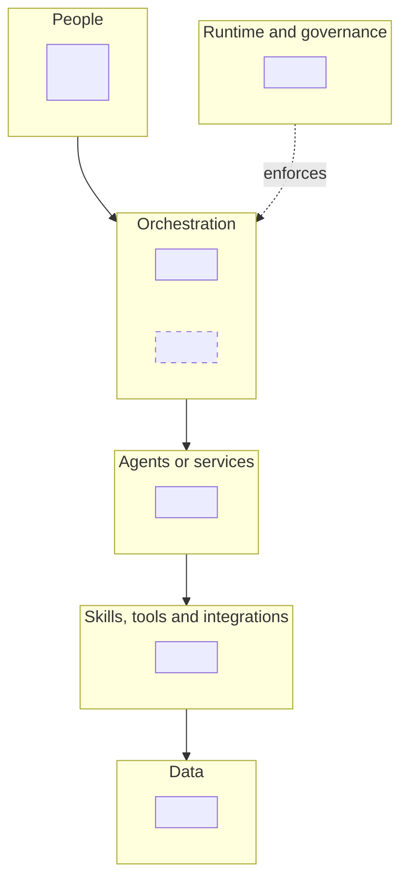
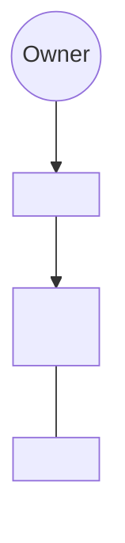
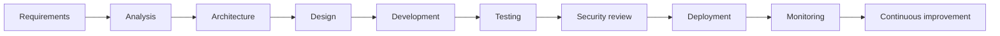
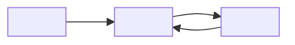
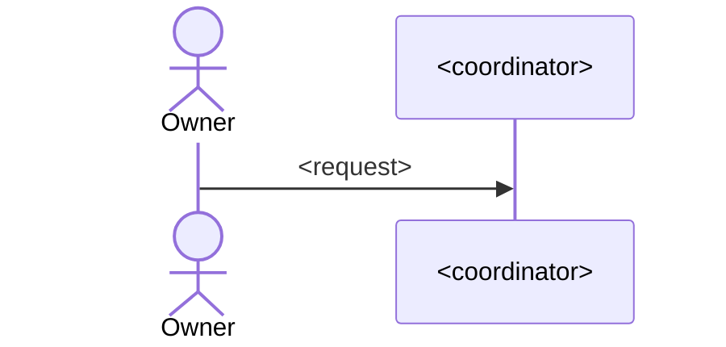

# <Project> Architecture Guide

| Version | Revision | Date | Describes | Source commit | Written by | Approved by | Supersedes |
| --- | --- | --- | --- | --- | --- | --- | --- |
| 1 | 1 | YYYY-MM-DD | <project, phase or release> | `<short commit>` | Claude (solution-overview skill) | pending | none |

> **What changed since the previous version:** first version.

<!-- One paragraph: what this guide explains and for whom (architects, developers, project managers, analysts,
stakeholders), assuming no knowledge of the code. -->

**Legend.** In the diagrams, a dashed outline marks something this project does not have, or that another party owns.
In the tables, *not in this project* says what does that job instead.

## Contents

1. [Executive overview](#1-executive-overview)
2. [Layered architecture](#2-layered-architecture)
3. [Agent hierarchy](#3-agent-hierarchy)
4. [SDLC workflow](#4-sdlc-workflow)
5. [Data flow](#5-data-flow)
6. [One piece of work, end to end](#6-one-piece-of-work-end-to-end)
7. [Responsibility matrix](#7-responsibility-matrix)
8. [Architecture principles](#8-architecture-principles)
9. [Glossary and further reading](#9-glossary-and-further-reading)

<!-- Every section opens with a one-line takeaway in a "> " callout, then its diagram, then its table. Rename a
section to the project's own terms when they differ (for example "Component hierarchy" for a project without
agents), and keep its number. -->

## 1. Executive overview

| | |
| --- | --- |
| **What it does** | <one or two sentences> |
| **Why it exists** | <the problem it removes> |
| **How the parts collaborate** | <how agents or components hand work to each other> |
| **Where people decide** | <every approval and outward action a person keeps> |

**SDLC coverage.** Covered: <stages>. Owned elsewhere: <stages and who owns them>.

> **In one line:** <the whole solution in one sentence>.

## 2. Layered architecture

> <takeaway>

| Layer | In this project | Not in this project, and what does that job |
| --- | --- | --- |
| People | | |
| Orchestration | | |
| Agents or services | | |
| Skills, tools and integrations | | |
| Data | | |
| Runtime and governance | | |

Sources: <path[:line-range], ...>

## 3. Agent hierarchy

> <takeaway: who can start or call whom, and how far the hierarchy goes>

| Agent | Responsibility | Inputs | Outputs | Write lane | Escalates when |
| --- | --- | --- | --- | --- | --- |
| | | | | | |

**Decision points.**

- <decision>: <who proposes>, <who decides>.

Sources: <path[:line-range], ...>

## 4. SDLC workflow

> <takeaway: which classic stages the project covers, and which it leaves to others>

| Stage | Project stage | Responsible | Skill or tool | Artifact | People | Handoff | Verified by |
| --- | --- | --- | --- | --- | --- | --- | --- |
| | | | | | | | |

<!-- Show the feedback loops (rework, re-checks) as edges. Add a stateDiagram-v2 where a stage has states. -->

Sources: <path[:line-range], ...>

## 5. Data flow

> <takeaway: how context and work move between the parts>

### Control flow: who starts, checks and approves

### Artifact flow: what each step reads and writes

```mermaid
flowchart LR
  IN["<input>"] --> W["<worker>"]
  W -->|"<writes>"| OUT["<artifact>"]
```

| Inputs | Outputs | Feedback loops |
| --- | --- | --- |
| | | |

Sources: <path[:line-range], ...>

## 6. One piece of work, end to end

> <takeaway>

<!-- Mermaid sequence diagrams of a typical change from request to delivery, split into parts of at most about seven
participants each. Mark an invented example as "Example". -->

### Part 1: <stages>

## 7. Responsibility matrix

> <takeaway>

| Stage | <person or part> | <person or part> | Verified by |
| --- | :-: | :-: | --- |
| | | | |

**R** does the work. **A** approves and answers for it. **C** is consulted: its output is a required input, or it fixes
findings. **I** is informed of the result.

## 8. Architecture principles

| Principle | How the project delivers it | Limit |
| --- | --- | --- |
| Modularity | | |
| Extensibility | | |
| Security | | |
| Governance | | |
| Observability | | |
| Reusability | | |
| Scalability | | |

<!-- Where the project has no mechanism for a principle, say so in the Limit column. -->

Sources: <path[:line-range], ...>

## 9. Glossary and further reading

| Term | Meaning |
| --- | --- |
| | |

| To learn | Read |
| --- | --- |
| Every part, with why, what, where and when | [<Project> Product Guide](product-guide.md) |
| How a change or release reaches its users | [<Project> Delivery Path](delivery-path.md) |
| <topic> | <project document> |
