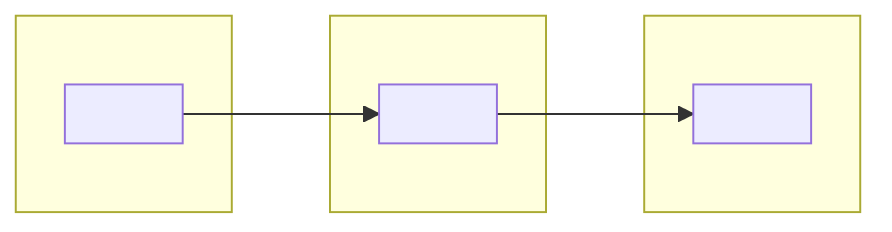
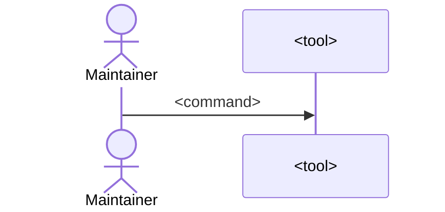

# <Project> Delivery Path

<!-- Title: "Release Path" when the project ships releases that others install, "Delivery Path" otherwise. -->

| Version | Revision | Date | Describes | Source commit | Written by | Approved by | Supersedes |
| --- | --- | --- | --- | --- | --- | --- | --- |
| 1 | 1 | YYYY-MM-DD | <project and release> | `<short commit>` | Claude (solution-overview skill) | pending | none |

> **What changed since the previous version:** first version.

<!-- One paragraph: for whoever installs, deploys or updates the solution; how a change or release gets from the
repository to its users, and which checker they trust at each stage. -->

## Contents

1. [Summary](#1-summary)
2. [How a change or release travels](#2-how-a-change-or-release-travels)
3. [Who checks whom](#3-who-checks-whom)
4. [Inside the key step](#4-inside-the-key-step)
5. [What you supply](#5-what-you-supply)
6. [Steps](#6-steps)
7. [What the checks prove, and what they do not](#7-what-the-checks-prove-and-what-they-do-not)
8. [Errors, mapped to stages](#8-errors-mapped-to-stages)
9. [Gaps found](#9-gaps-found)

## 1. Summary

<!-- What is delivered, how, and where the trust comes from at each stage. -->

> **Known gaps** (details in [section 9](#9-gaps-found)). <One line per gap, or "none found".>

## 2. How a change or release travels

Sources: <path[:line-range], ...>

## 3. Who checks whom

| Stage | Checker | Comes from | Checks | Can the change edit it? | Document / code |
| --- | --- | --- | --- | --- | --- |
| **A** <stage> | | | | | |

## 4. Inside the key step

<!-- A sequence diagram of the most important install, deploy or release command: each check in the order the code
runs it. Then a table of what each check refuses and its message. -->

| Check | Refused with |
| --- | --- |
| | |

Sources: <path[:line-range], ...>

## 5. What you supply

| Input | Purpose | Required | Defined in |
| --- | --- | --- | --- |
| | | | |

## 6. Steps

**First install or first deployment**

1. <step>

**Update**

1. <step>

**Rollback**

- <step>

## 7. What the checks prove, and what they do not

| Proves | Does not prove |
| --- | --- |
| | |

## 8. Errors, mapped to stages

| Message | Stages | Meaning and fix |
| --- | --- | --- |
| | | |

## 9. Gaps found

<!-- Where the code and the documentation disagree, or a step depends on a document the reader does not have. Write
"No gaps found." when there are none. -->
