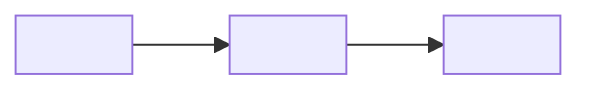

# <Project> Product Guide

| Version | Revision | Date | Describes | Source commit | Written by | Approved by | Supersedes |
| --- | --- | --- | --- | --- | --- | --- | --- |
| 1 | 1 | YYYY-MM-DD | <project and release> | `<short commit>` | Claude (solution-overview skill) | pending | none |

> **What changed since the previous version:** first version.

<!-- One paragraph: what the solution does for the reader's team, in their terms. -->

## The idea in one picture

<!-- One diagram of what goes in and what comes out (for example, a request in and a reviewed change out), with the
records each step leaves and where people decide. Then what one piece of work leaves in the repository, as a folder
tree; mark it "Example" where names are invented. -->

**Legend.** <what each layer or colour means>.

## Contents

- [The idea in one picture](#the-idea-in-one-picture)
1. [At a glance](#1-at-a-glance)
2. [The layers](#2-the-layers)
3. [The workflow](#3-the-workflow)
4. [When things run](#4-when-things-run)
5. [Data flow: which file drives what](#5-data-flow-which-file-drives-what)
6. [How access is controlled](#6-how-access-is-controlled)
7. [Every part: why, what, where, when](#7-every-part-why-what-where-when)
8. [Guarantees and limits](#8-guarantees-and-limits)
9. [Adopting and updating](#9-adopting-and-updating)

## 1. At a glance

| | |
| --- | --- |
| **Why** | |
| **What you get** | |
| **What changes for your team** | |
| **What stays yours** | |
| **What it needs** | |
| **What it does not do** | |

## 2. The layers

<!-- A diagram of the layers or components and who owns each, then a table. -->

| Layer | Locked or shared | Changes through | Limit |
| --- | --- | --- | --- |
| | | | |

Sources: <path[:line-range], ...>

## 3. The workflow

<!-- The stages as a table (stage, owner, artifact, check); which kinds of work run which stages; what happens when a
review finds something. -->

| Stage | Step | Owner | Artifact | Skill or check |
| --- | --- | --- | --- | --- |
| | | | | |

### Walkthrough: one example

> **Example.** <say which parts are invented and which are real>.

<!-- Stage by stage, with short excerpts of the files each stage writes, including one refusal or failure and how
it is handled. -->

## 4. When things run

| Moment | What runs | Who runs it |
| --- | --- | --- |
| | | |

Sources: <path[:line-range], ...>

## 5. Data flow: which file drives what

<!-- Say what the solution writes in the repository and whether it calls any network service. -->

Sources: <path[:line-range], ...>

## 6. How access is controlled

<!-- The permission or guard model as a decision diagram, if the project has one; otherwise "not in this project" and
what controls access instead. -->

Sources: <path[:line-range], ...>

## 7. Every part: why, what, where, when

> **How to read these tables.**
> - **Where** is the path in the repository. <Say which paths are at the root and which share a prefix.>
> - <What every row of a kind shares, so the cells don't repeat it.>

### <Kind of part>

| Part | Layer | Why | What | Where | When |
| --- | --- | --- | --- | --- | --- |
| | | | | | |

## 8. Guarantees and limits

| What <Project> guarantees | What <Project> does not claim |
| --- | --- |
| | |

Sources: <path[:line-range], ...>

## 9. Adopting and updating

**First install or onboarding**

1. <step>

**Each update**

1. <step>

The release or deployment path is in [<Project> Delivery Path](delivery-path.md). The architecture overview is in
[<Project> Architecture Guide](architecture-guide.md).
