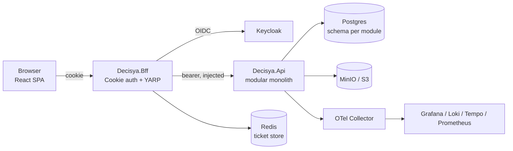
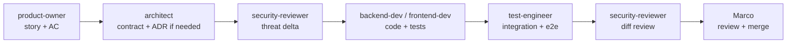

Source of truth is the shared Claude Doc "Decisya – Phase 0: Platform Foundations". This file is its offline export for agents, refreshed 2026-10-31. The section "Exit state (2026-10-31)" at the end is not part of the Doc export.

# Decisya – Phase 0: Platform Foundations

Sep 20, 2026 · @Marco

## Decisions

Decisya is built multi-tenant from the first commit and deployed as a single instance until paying users justify more. These decisions are Phase 0 ADRs; each gets a file under `docs/adr/` in the repo.

| ADR | Decision | Rationale |
| --- | --- | --- |
| ADR-001 Hosting | Multi-tenant data model, single-instance deployment on one VPS via Docker Compose from the Aspire manifest | Cheapest viable production; every scale-up step is config, not rewrite |
| ADR-002 Identity | Keycloak (OIDC) as the only identity provider; tenant carried as a claim | Free, self-hosted, one config difference between SaaS and single-tenant install |
| ADR-003 Session | BFF pattern: ASP.NET Core cookie session, tokens in a Redis ticket store, YARP forwards `/api` with the access token injected server-side; the SPA never sees a token | Eliminates XSS token theft; satisfies principle 1 |
| ADR-004 LLM | All AI code targets `Microsoft.Extensions.AI` (`IChatClient`, `IEmbeddingGenerator`); Ollama in dev, hosted API with a monthly spend cap plus BYO-key in prod; embeddings stay local (pgvector) | Vendor-neutral, zero dev cost, no GPU hosting bill |
| ADR-005 Modules | Hybrid modular monolith: `Module` + `Module.Contracts` per module, schema-per-module EF Core, NetArchTest boundaries, Wolverine for in-process messaging with the Postgres transport | Proven in PortfolioTracker; no external broker |
| ADR-006 Money & time | `decimal` amounts in minor units, ISO 4217 codes, NodaTime for instants and periods; `double`/`DateTime` banned by analyzer | Financial correctness |
| ADR-007 Storage | Postgres, Redis, S3-compatible object storage (MinIO locally); no provider-specific managed services before revenue | Portability |
| ADR-008 Frontend | React SPA served behind the BFF; entitlements delivered as a server-computed capability manifest | Plan gating enforced server-side |
| ADR-009 Framework | .NET 10 LTS and Aspire 13.5; .NET 11 rejected (STS, support also ends Nov 2028); revisit at .NET 12 LTS in Nov 2027 | Stable VS 2026 Community and released packages; no preview risk in Phase 0 for zero loss of support horizon |

### Platform invariants (enforced by tests, not convention)

- Every persisted aggregate carries `TenantId`; EF global query filters apply it; a NetArchTest rule fails any entity without it.
- Deterministic features (ledger, budgets, forecasts, alerts) never depend on the AI lane; every AI feature degrades gracefully when the model is unavailable.
- No vendor AI SDK is referenced outside the `Ai` infrastructure project.
- No secrets in source; configuration comes from environment or user-secrets only.
- Money is `decimal`; time is NodaTime.

### Non-goals

- Decisya does not give financial or investment advice. All AI output is informational, carries a disclaimer, and never produces buy/sell instructions for a specific instrument.
- Automatic bank feeds are out of scope until a provider is chosen; Phase 1 imports CSV, OFX and QIF only, behind a provider port.
- No mobile native apps; the SPA is responsive.
- No payments/billing processor in Phase 0; plans are assigned by the admin until billing is chosen.

## Standards & compliance register

Each standard below has an owner agent and the artifact that evidences it. The `compliance-auditor` agent re-checks this table at every phase exit.

| Standard | Scope | Evidence artifact | Checked by | When |
| --- | --- | --- | --- | --- |
| ISO/IEC/IEEE 12207 | Lifecycle structure (the 7 SDLC phases mapped to 10 gated stages) | This doc + per-phase milestone | compliance-auditor | Phase exit |
| NIST SSDF (SP 800-218) | Secure development practices | `docs/security/ssdf-checklist.md` | security-reviewer | Phase exit |
| OWASP ASVS 5.0, Level 2 | Application security verification | `docs/security/asvs-l2.md` with pass/fail per control | security-reviewer | Every PR touching auth, input, data access; full pass at phase exit |
| OWASP Top 10 (2025) | Web risks | SAST (CodeQL), DAST (OWASP ZAP baseline) in CI | devops | Every PR / nightly |
| OWASP Top 10 for LLM Applications | AI lanes | Prompt-injection test suite, output validation, spend caps | security-reviewer | Phases 5–7 |
| OWASP SAMM | Maturity self-assessment | `docs/security/samm.md` scorecard | compliance-auditor | Quarterly |
| SLSA Level 2 | Supply chain | CycloneDX SBOM per build, signed container images (cosign), pinned actions | devops | Every release |
| GDPR | Personal and financial data of EU users | DPIA (section below), records of processing, retention schedule, erasure procedure | compliance-auditor | Phase 0 seed, revisit per phase |
| ISO/IEC 25010 | Non-functional requirements | `docs/requirements/nfr.md` with measurable targets | product-owner | Phase 1 |
| OpenTelemetry semantic conventions | Traces, metrics, logs naming | `docs/observability/signal-catalogue.md` | backend-dev | Every module |
| WCAG 2.2 AA | SPA accessibility | axe-core in Playwright suite | frontend-dev | Every UI PR |
| Conventional Commits + SemVer | Change management | commitlint in CI, release-please changelog | devops | Every commit |
| arc42 + C4 + ADR | Architecture documentation | `docs/architecture/` | architect | Every ADR |

### Tooling (all free for a solo developer)

| Need | Tool | Note |
| --- | --- | --- |
| SAST | GitHub CodeQL | Free on public repos; on private repos use Roslyn security analyzers (`SecurityCodeScan.VS2019`, `Microsoft.CodeAnalysis.NetAnalyzers` with CA security rules) |
| DAST | OWASP ZAP baseline scan GitHub Action | Runs against the Compose stack in CI |
| Dependencies | Dependabot + `dotnet list package --vulnerable` in CI | Fail build on High |
| Secrets | gitleaks pre-commit + CI |  |
| SBOM | CycloneDX .NET tool |  |
| Signing | Sigstore cosign, keyless via GitHub OIDC |  |
| Architecture tests | NetArchTest.Rules in xUnit |  |
| Integration tests | Testcontainers for Postgres, Redis, Keycloak |  |
| E2E + a11y | Playwright + axe-core | Runs in Firefox and Chromium projects |
| Observability stack | Grafana, Prometheus, Loki, Tempo, OTel Collector | Aspire dashboard in dev |

## Phase 0 architecture

Phase 0 delivers a running, empty platform: a user can sign in through the BFF, land on a tenant-scoped dashboard, and an admin can assign a plan. No financial feature ships in this phase.

The SPA talks only to the BFF; the API is unreachable from the internet and trusts only the BFF's forwarded token.

### Solution layout

| Project | Purpose |
| --- | --- |
| `Decisya.AppHost` | Aspire 13.5 orchestration (AspireUseCliBundle=true, all Aspire.\* packages pinned to 13.5.0); `aspire publish` emits Compose |
| `Decisya.ServiceDefaults` | OTel, health checks, resilience, JSON console logging with trace-id enrichment and PII redaction processor |
| `Decisya.Bff` | Cookie auth, OIDC to Keycloak, Redis ticket store, YARP, antiforgery, `/bff/me` capability manifest |
| `Decisya.Api` | Host for modules; JWT bearer validation (`iss`, `aud`, `exp`, RS256/ES256) |
| `Decisya.Modules.Tenancy` + `.Contracts` | Tenant, membership, roles (viewer/editor/admin), invitations |
| `Decisya.Modules.Entitlements` + `.Contracts` | Plan → module → feature flags; server-side evaluation; admin overrides; trials |
| `Decisya.Modules.Admin` + `.Contracts` | Admin portal API: users, plans, system config, health |
| `Decisya.Modules.Audit` + `.Contracts` | Append-only audit log for security-relevant events |
| `Decisya.SharedKernel` | `Money`, `CurrencyCode`, `TenantId`, result types, NodaTime clock abstraction |
| `Decisya.Infrastructure.Ai` | The only project referencing model providers; exposes `IChatClient` |
| `Decisya.Web` | React SPA (Vite), served by the BFF |
| `tests/*` | Unit, Architecture (NetArchTest), Integration (Testcontainers), E2E (Playwright) |

### Cookie and token rules

- Session cookie: `HttpOnly; Secure; SameSite=Strict; Path=/`, sliding 30 min, absolute 12 h, stored as a Redis ticket, not a serialized token.
- OIDC correlation and nonce cookies: `SameSite=Lax` (Strict breaks the callback redirect), lifetime 5 min.
- Antiforgery: double-submit token in a header on every non-GET call through the BFF.
- Access tokens: 5 min lifetime, refreshed server-side; refresh tokens rotated; never returned to the browser.
- Keycloak realm `decisya`, client `decisya-bff` (confidential), roles mapped to tenant membership, tenant id as a claim.

### Tenancy and entitlements

- `TenantId` is a value object in `SharedKernel`; `ITenantContext` is resolved per request from the validated token.
- `DbContext` base applies `HasQueryFilter(e => e.TenantId == _tenant.Id)` for every `ITenantScoped` entity; a NetArchTest rule asserts every entity in `Modules.*` implements `ITenantScoped`.
- Entitlements are evaluated on the server (`IEntitlementService.Has(feature)`) and exposed to the SPA as a manifest; UI hides, API denies.
- Plan definitions live in the database and are seeded from `plans.json`, so the admin portal edits data, not code.

### Observability

- ServiceDefaults registers OTel traces, metrics and logs with the OTLP exporter; no vendor SDK.
- Logs are JSON on stdout with `trace_id`, `span_id`, `tenant_id`, `user_id` (hashed) injected.
- A `[Sensitive]` attribute on model properties drives a log-enrichment processor that masks those values; tokens and cookies are masked by name pattern as a second line of defence.
- Standard signals per module: request duration histogram, DB command duration, Wolverine message processing, failed auth attempts counter.

### Deployment target

- Single VPS, Docker Compose (from Aspire manifest) with Caddy for TLS, Postgres 17, Redis, Keycloak, MinIO, OTel Collector, Grafana stack.
- Nightly `pg_dump` + MinIO bucket sync to off-box object storage; restore drill is a Phase 0 exit criterion.
- Migration ladder: Compose → K3s on the same host → managed Kubernetes or Azure Container Apps; no step changes application code.

## Agents and skills

Nine agents and seven skills live in the repo under `.claude/`; you orchestrate from Claude Code (`claude` in the repo root, or the VS 2026 Claude extension) and remain the merge authority. Agents are `.claude/agents/<name>.md` with YAML front matter; skills are `.claude/skills/<name>/SKILL.md`. The `CLAUDE.md` at the repo root carries the platform invariants and your four principles verbatim so every agent inherits them.

### Agents

| Agent | Model | Tools | Owns |
| --- | --- | --- | --- |
| `product-owner` | Sonnet | Read, Grep, Write (docs only) | User stories with Gherkin acceptance criteria, NFR sheet, plan mapping |
| `architect` | Opus | Read, Grep, Write (docs + Contracts projects) | ADRs, C4, module map, OpenAPI contracts, NetArchTest rules |
| `security-reviewer` | Opus | Read, Grep, Bash (read-only git) | STRIDE per module, ASVS L2 checklist, PR diff review; blocks merge on High |
| `backend-dev` | Sonnet | Read, Write, Edit, Bash (`dotnet`) | Module implementation, migrations, tests in the same change |
| `frontend-dev` | Sonnet | Read, Write, Edit, Bash (`npm`) | React SPA, capability-manifest gating, axe-clean components |
| `test-engineer` | Sonnet | Read, Write, Edit, Bash (`dotnet test`, `npx playwright`) | Testcontainers integration, E2E, load baseline |
| `devops` | Sonnet | Read, Write, Edit, Bash | GitHub Actions, Compose, SBOM, signing, Grafana provisioning |
| `tech-writer` | Haiku | Read, Write (docs only) | Runbooks, changelog, admin guide, VS 2026 + CLI paths side by side |
| `compliance-auditor` | Opus | Read, Grep | Standards register, DPIA, phase-exit verdict |

Every agent's front matter ends with the same three rules: never commit secrets; never add a NuGet or npm package without a one-line justification in the PR; stop and report exact compiler errors with error codes rather than guessing a fix.

### Skills

| Skill | Invoked by | Produces |
| --- | --- | --- |
| `module-scaffold` | architect, backend-dev | `Modules.<Name>` + `.Contracts`, schema `<name>`, `<Name>DbContext`, Wolverine handler folder, NetArchTest fixture, integration test project |
| `adr-writer` | architect | `docs/adr/NNNN-<slug>.md` in MADR format, linked from the ADR index |
| `threat-model` | security-reviewer | `docs/security/threat-models/<module>.md`: STRIDE table, trust boundaries, mitigations mapped to ASVS controls |
| `asvs-checklist` | security-reviewer | Pass/fail/n-a per ASVS L2 control for the diff or module |
| `otel-instrumentation` | backend-dev | ActivitySource, meters and log scopes following semantic conventions; `[Sensitive]` masking test |
| `ef-migration` | backend-dev | Schema-scoped migration, idempotent SQL script, rollback note, `dotnet ef` and VS 2026 PMC commands documented together |
| `api-contract` | architect, frontend-dev | OpenAPI 3.1 file per module, generated TypeScript client, contract test |

### Orchestration rhythm per issue

One issue per PR, one phase per GitHub milestone, on-demand `@claude` review only; the diagram is the order in which you invoke agents for a single issue.

## Phase 0 work package

Milestone `Phase 0 – Platform Foundations`, 18 issues, one PR each, in dependency order. Each issue names its agent, its skill, and a testable done condition; nothing merges without its tests in the same PR.

| # | Issue | Agent | Skill | Done when |
| --- | --- | --- | --- | --- |
| 0.01 | Repo bootstrap: `CLAUDE.md`, `.claude/agents`, `.claude/skills`, `.editorconfig`, `Directory.Build.props` with analyzers, gitleaks pre-commit | devops | — | `dotnet build` clean with warnings as errors; gitleaks passes |
| 0.02 | ADR-001…008 written from the Decisions section | architect | adr-writer | ADR index links all eight |
| 0.03 | Aspire AppHost + ServiceDefaults with OTel, health checks, JSON logging, trace-id enrichment | backend-dev | otel-instrumentation | Aspire dashboard shows traces for a health call |
| 0.04 | SharedKernel: `TenantId`, `Money`, `CurrencyCode`, NodaTime `IClock`, result types; analyzer rule banning `double` for money and `DateTime` | backend-dev | — | Unit tests for `Money` arithmetic and rounding; banned-symbol test fails on `DateTime.Now` |
| 0.05 | Keycloak realm export `decisya` with `decisya-bff` confidential client, tenant claim mapper, seeded admin + test users | devops | — | Realm imports on container start; login page reachable |
| 0.06 | `Decisya.Bff`: cookie auth, OIDC, Redis ticket store, cookie policy per ADR-003, antiforgery, logout with Keycloak end-session | backend-dev | — | Integration test: login → cookie set with correct flags → `/bff/me` returns claims; browser never receives a token |
| 0.07 | YARP forwarding `/api/*` with server-side token injection and refresh | backend-dev | — | Integration test: expired access token is refreshed transparently |
| 0.08 | `Decisya.Api` host with JWT bearer validation (issuer, audience, expiry, algorithm allow-list) | backend-dev | — | Tests for rejected tokens: wrong aud, expired, `alg=none`, HS256 |
| 0.09 | Module scaffold skill + first use: `Modules.Tenancy` with tenant, membership, roles, invitations; schema `tenancy` | backend-dev | module-scaffold, ef-migration | Testcontainers test: two tenants cannot read each other's rows |
| 0.10 | Global tenant query filter + NetArchTest rule `every entity implements ITenantScoped` | backend-dev | — | Architecture test fails on a deliberate violation, then passes |
| 0.11 | `Modules.Entitlements`: plans, modules, features, overrides, trials; `plans.json` seed; `IEntitlementService` | backend-dev | module-scaffold, api-contract | Tests: Free plan denies Phase 3 feature; admin override grants it |
| 0.12 | `Modules.Audit`: append-only log of auth and admin events, Wolverine subscriber | backend-dev | module-scaffold | Test: audit rows cannot be updated or deleted at the DB role level |
| 0.13 | `Modules.Admin` API: users, tenants, plan assignment, system config, health summary; admin role required | backend-dev | api-contract | Test: non-admin gets 403; every call audited |
| 0.14 | React SPA shell: login redirect via BFF, capability manifest hook, admin route gated by manifest, axe-clean | frontend-dev | api-contract | Playwright: login flow in Firefox and Chromium; axe reports zero violations |
| 0.15 | STRIDE threat models for Bff, Tenancy, Entitlements, Admin; ASVS L2 checklist baseline | security-reviewer | threat-model, asvs-checklist | Every High mitigation has an issue or is closed |
| 0.16 | CI: build, unit, architecture, integration (Testcontainers), Playwright, CodeQL/analyzers, ZAP baseline, dependency + secret scan, commitlint | devops | — | Green pipeline on `main`; a seeded vulnerable package fails the build |
| 0.17 | Release: CycloneDX SBOM, cosign-signed images, release-please, Compose from `aspire publish`, Caddy TLS, Grafana provisioning | devops | — | Tagged build deploys to the VPS from a clean clone |
| 0.18 | Backup + restore runbook (pg\_dump, MinIO sync) and restore drill; admin guide with VS 2026 and CLI paths | devops, tech-writer | — | Restore drill reproduces a seeded tenant on a fresh host |

### Exit gate

- [ ] All 18 issues merged; milestone closed
- [ ] ASVS L2 baseline: zero open High findings (security-reviewer verdict recorded in `docs/security/asvs-l2.md`)
- [ ] Compliance register re-checked by compliance-auditor; DPIA seed reviewed
- [ ] Restore drill passed on a fresh host
- [ ] A new user can register, be assigned a plan by the admin, sign in, and see an empty tenant dashboard on the VPS over HTTPS

Estimated effort at solo-plus-agents pace: 4 to 6 weeks of evenings, with 0.06–0.08 and 0.16 the heaviest items.

## Roadmap and GitHub milestones

Security and entitlements move to the front, investments become an integration of PortfolioTracker, and every AI phase follows the deterministic module it explains. Phase 7 is now the Plan 3 differentiator. The Phase column is the exact GitHub milestone title; issues are created per phase from a work package in the same format as the Phase 0 table above.

| Phase | Modules | Plan | Depends on |
| --- | --- | --- | --- |
| Phase 0 – Platform Foundations | BFF, tenancy, entitlements, audit, admin skeleton, observability, CI/CD, deployment | — | — |
| Phase 1 – Ledger | Transactions engine, file import (CSV/OFX/QIF) behind a provider port, tags and rules, multi-currency, basic budgets, dashboards | Free | 0 |
| Phase 2 – Planning | Forecasting engine, scenario modeling, budget calendar and alerts | Free | 1 |
| Phase 3 – Long-term | Retirement planner, advanced reporting | Plan 1 | 2 |
| Phase 4 – Investments | PortfolioTracker integration (MarketData, Portfolio, Alerting, Analysis) as Decisya modules | Plan 2 | 1 |
| Phase 5 – AI Forecasting & Insights | `Infrastructure.Ai`, insight cards, AI explanations, local embeddings for categorisation | Plan 1 | 2, 3 |
| Phase 6 – AI Advisor & Coaching | Conversational advisor, habit detection, nudges, risk detection; LLM Top 10 test suite | Plan 2 | 4, 5 |
| Phase 7 – Decision Intelligence | Goal optimisation, strategy modelling (informational), multi-goal balancing | Plan 3 | 6 |
| Phase 8 – Automation | Rule engine: auto-tag, auto-budget, scenario triggers | Plan 2 | 2, 5 |
| Phase 9 – Files | File browser, linking, receipt detection, backups to user storage | Plan 3 | 1 |

Plan 3 = Plan 2 + Phases 7 and 9. Bank feed connectivity is a later provider adapter on Phase 1, added when a provider and its cost are chosen.

## Data protection outline (DPIA seed)

Decisya processes financial transaction data, which GDPR treats as personal data with heightened risk, so a DPIA is required before the first real user. This seed becomes `docs/compliance/dpia.md` and is completed in Phase 1.

| Topic | Phase 0 position |
| --- | --- |
| Controller | Marco, as operator of decisya.com; processor when self-hosted by a customer |
| Data categories | Identity (Keycloak), tenant membership, transactions, budgets, forecasts, uploaded files, AI prompts and outputs |
| Lawful basis | Contract for core features; consent for AI features that send data to a hosted model |
| Sub-processors | Hosting provider; hosted LLM provider only when consented; listed in the privacy notice |
| Retention | Ledger data for the life of the account plus 30 days; audit log 12 months; AI prompt logs 30 days |
| Erasure | Tenant deletion job removes all schemas' rows for the tenant, object storage prefix, Keycloak user, and Redis tickets; audit log keeps a pseudonymised record |
| Portability | Export of transactions, budgets and files as CSV/JSON zip from the user's settings |
| Encryption | TLS in transit; Postgres and MinIO volumes encrypted at rest (LUKS on the VPS); secrets via environment |
| PII in logs | `[Sensitive]` masking processor; user id hashed; no free-text transaction descriptions in logs |
| AI data minimisation | Only aggregated or tokenised data leaves the box; raw descriptions are embedded locally |
| Breach procedure | Runbook with 72-hour notification checklist, owned by compliance-auditor |

Open question for Phase 1: whether EU data residency is a stated commitment (it constrains the hosting provider list).

## Exit state (2026-10-31)

### Exit gate items

| # | Item | State |
| --- | --- | --- |
| 1 | All 18 issues merged; milestone closed | Not met. 0.17 (#29) and 0.18 (#30) are open and moved to Phase 1, together with #132 (NAS bring-up) and #223 (daily drift scan). |
| 2 | ASVS L2 baseline: zero open High findings | To be recorded by the Phase 0 exit audit (`docs/compliance/phase-0-exit.md`). |
| 3 | Compliance register re-checked; DPIA seed reviewed | To be recorded by the same audit. |
| 4 | Restore drill passed on a fresh host | Not met (#30). |
| 5 | A new user can sign in on the VPS over HTTPS | Not met (#29). |

### Waiver

> I approve exiting Phase 0 without three exit-gate items: issues 0.17 and 0.18 merged, the restore drill on a fresh host, and the new-user sign-in on the VPS over HTTPS. The deploy is blocked from outside: the deploy gate refuses while Keycloak's bundled guava has no fixed release (tracked by Ostium under D-008). #29, #30 and #132 move to Phase 1 and are re-checked at the Phase 1 exit at the latest. Everything else in 0.17 (SBOM, signing, release-please, Compose, Caddy TLS, the deploy gate) is done.
>
> Marco, 2026-10-31

### Follow-up work after the exit

- Split `build-test`: add an aggregating `gate` job and move the secret scan, the integration suite and commitlint out of it (see `docs/architecture/ci-hardening.md`, issue #194).
- #223: daily drift tracking.
- Caddy builder bumps (Go 1.27, distroless).
- Group Dependabot updates.

### Facts that changed since the Doc was written

The Doc above is not rewritten. Where it differs, these facts apply:

- Postgres is 18, not 17 (`src/Decisya.AppHost/ContainerImages.cs`).
- The repository has 11 agents and 16 skills, not nine and seven (`.claude/agents/`, `.claude/skills/`).
- The deploy targets now include the home NAS (ADR-0016); the NAS and home network themselves are set up and run outside this repository.
- The image-scan policy is ADR-0015 as revised by ADR-0022.
- Caddy is the self-built image (ADR-0021).
