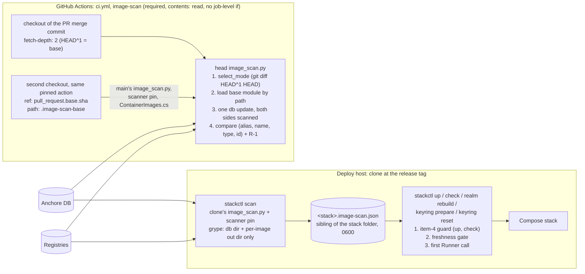

# Architecture note – ADR-0022 delta PR gate, gate-change comparison and deploy freshness gate (issue #222)

## Context

#222 implements [ADR-0022](../adr/0022-image-scan-pr-delta-gate.md) (Accepted 2026-10-30) items 1 and 4, with the conditions M-2, M-3 and M-5, the re-check items R-1 and R-2, and Ruling C of the G3 delta `docs/security/threat-models/adr-0022-pr-gate-delta.md`. The earlier note is [adr-0022-pr-gate-delta.md](adr-0022-pr-gate-delta.md).

- **In scope:**
  - the pull-request modes of `image-scan` (delta, gate-change comparison, validator only, full);
  - the base checkout and loading `main`'s `image_scan.py` by file path;
  - the `stackctl scan` command and the freshness gate;
  - the M-5 review-required paths;
  - the ADR-0021 pointer line (added with this note).
- **Out of scope:**
  - **#223:** ADR-0022 item 2 (daily drift run, `image-drift.yml`, tracking issue, deadline constants), M-4 and S-1. Until #223 lands, the weekly `schedule` in `ci.yml` keeps running the full scan.
  - **Done in #216:** M-1.
- **Not touched:** `.github/image-scan/Dockerfile` (the scanner pin, M-5), `.github/image-scan/exceptions.json`, `release.yml`, `release_images.py`, `caddy-image.yml`, and the item-4 guard, predicate and tripwire.

No .NET module, contract, message, entity or tenant data flow changes. The boundaries are CI and deploy policy, enforced by Python tests.

## C4 excerpt



## 1. Pull-request gate: `.github/scripts/image_scan.py` (devops)

### 1.1 New constants (code, never configuration)

| Name | Value |
| --- | --- |
| `IMAGES_LANE_RE` | the `ci.yml` lane regex (`images_changed`, `ci.yml:81`) without `^ALL$`. A parity test compares the two texts. |
| `PIN_FILE` | `src/Decisya.AppHost/ContainerImages.cs` |
| `PARITY_FILE` | `.devcontainer/engine/images.Dockerfile` |
| `EXCEPTIONS_PATH` | `.github/image-scan/exceptions.json` |
| `RELEASE_PREFIX` | `.github/release/` |
| `GATE_FILES` | `frozenset({".github/scripts/image_scan.py", ".github/image-scan/Dockerfile", ".github/workflows/ci.yml"})` |
| `BASE_CHECKOUT` | `ROOT / ".image-scan-base"`. A parity test compares it with the `path:` in `ci.yml`. |
| `BASE_MODULE_NAME` | `"_decisya_base_image_scan"`, never `"image_scan"` |
| `BASE_API` | `("CONTAINER_IMAGES", "SCANNER_DOCKERFILE", "parse_targets", "parse_scanner_ref", "scan_argv", "read_sbom", "check_provenance", "evaluate", "_run")`. These are the names `main`'s module has today. |
| `MODE_FULL`, `MODE_GATE`, `MODE_DELTA`, `MODE_VALIDATOR` | `"full"`, `"gate-change"`, `"delta"`, `"validator"` |

### 1.2 Mode selection (pure, head code): `select_mode(event: str | None, changed: list[str] | None) -> tuple[str, str]`

`run()` reads `event` from `GITHUB_EVENT_NAME`, the runner's default variable. The step gets no `env:` and no `${{ }}` interpolation. `changed` comes from `changed_files()`, which runs `git diff --name-only --no-renames -z HEAD^1 HEAD` as an argv list with no shell, in `ROOT`. It returns `None` on any failure. `--no-renames` lists both sides of a rename (#148).

Rules, first match wins. The second value returned is the reason, which is logged.

| # | Condition | Mode |
| --- | --- | --- |
| 1 | `event != "pull_request"` (push, schedule, dispatch, missing) | full (today's strict scan of all five aliases) |
| 2 | `changed is None` (unknown base) | full |
| 3 | no changed path matches `IMAGES_LANE_RE`, although the step ran | full (fail closed) |
| 4 | a lane path that is none of `PIN_FILE`, `PARITY_FILE`, `EXCEPTIONS_PATH`, a `RELEASE_PREFIX` path or a `GATE_FILES` path (for example a new `.github/image-scan/x`) | full |
| 5 | any lane path in `GATE_FILES` | gate-change |
| 6 | the lane paths are exactly `{EXCEPTIONS_PATH}` | validator |
| 7 | otherwise (pins, parity file, release pins, exceptions with any of these) | delta |

- In every mode, `validate_exceptions` runs first and exits 2 on any error, as today.
- Validator mode makes no scanner call and logs the O1 note.
- Delta mode needs the base pins. `git show HEAD^1:src/Decisya.AppHost/ContainerImages.cs` is parsed by the head's `parse_targets`. If it cannot be read or parsed, the mode becomes full (M-2, "unknown base").
- `changed_aliases(base_refs, head_refs)` returns the aliases whose full reference string differs.
- A parity-only change or a `.github/release/**`-only change gives an empty list, so nothing is scanned (Q8, accepted). The log says why.

### 1.3 Base checkout and base loading (G3 M-5, Ruling B)

- **`first_parent_sha()`** runs `git rev-parse --verify HEAD^1^{commit}` in `ROOT`.
- **`load_base_module(log) -> module | None`.** It returns `None` and logs the reason in any of these cases:
  - `BASE_CHECKOUT/.github/scripts/image_scan.py` is missing or is a link;
  - `git -C BASE_CHECKOUT rev-parse --verify HEAD` differs from `first_parent_sha()` (the base checkout is not the merge commit's first parent);
  - loading raises anything, `SystemExit` included;
  - a `BASE_API` name is missing.

  Loading uses `importlib.util.spec_from_file_location(BASE_MODULE_NAME, path)` and `module_from_spec`, then `exec_module`, the `load_scan_module` pattern of `stackguards.py:1689`. The module is not inserted into `sys.modules`, and nothing is imported under the name `image_scan`.
- **What the base module supplies.** It computes its own `CONTAINER_IMAGES` and `SCANNER_DOCKERFILE` from its own location, so it reads the base checkout's files:
  - `base_refs = base.parse_targets(base.CONTAINER_IMAGES.read_text(...))`;
  - `base_scanner = base.parse_scanner_ref(base.SCANNER_DOCKERFILE.read_text(...))`.

  Any exception sets the base to `None`.
- **Delta mode cross-check.** `base_refs` must equal the `git show HEAD^1` parse. If it does not, the base is `None`.
- **A `None` base never means "no findings".** The aliases being compared become "new": every head finding counts. That is ADR-0015's behaviour for those aliases.

### 1.4 Scanning both sides

- **One database.** `db_update_argv(head_scanner, db_dir)` runs once with the head's code. If it fails, the check fails (exit 1).
- **`scan_with(mod, scanner, ref, alias, db_dir, workdir, log) -> tuple[dict | None, list[str]]`** is head orchestration that calls only `mod`'s functions:
  - `mod.scan_argv(scanner, ref, db_dir, out_dir)`, with a fresh `out_dir` for each side and each alias;
  - `mod._run`;
  - `json.loads`;
  - `mod.check_provenance(doc, ref, alias, sbom=lambda: mod.read_sbom(out_dir))`.

  The head side passes the head module (`sys.modules[__name__]`). The base side passes the base module and `base_scanner`.
- **Ruling C (one snapshot).** The base scan of an alias counts as failed (`None`) in any of these cases:
  - it exits non-zero, for example when the base scanner cannot read the head-updated database (schema mismatch);
  - it fails provenance;
  - `_db_built(base_doc) != _db_built(head_doc)` for the same alias.

  There is never a second `db update` and never a second database.

### 1.5 Comparison (G3 M-2, Ruling A)

- **Key:** `finding_key(alias, match) = (alias, artifact.name, artifact.type, vulnerability.id)`. Exact strings; a missing value becomes `""`. No related ids, no version, no fix state.
- **Base side (raw, before exceptions, with `main`'s classification):** `base_ranks(base, doc, alias, today) -> dict[key, int]`.
  - For each `m` in `doc["matches"]`, call `base.evaluate({"matches": [m]}, alias, [], today)`. If it returns a finding, the match is High or Critical under `main`'s policy, S-05 elevation included.
  - The key is built from `m` and the rank from that finding's `severity` label. The highest rank per key is kept.
  - Calling `evaluate` once per match, with an empty exception list, is how `main`'s severity classification is used without relying on `main`'s finding fields.
- **Head side (after exceptions, full current policy):** the head's `evaluate(doc, alias, entries, today, tag_state=..., tag_label=..., ref=ref)`, as `run()` calls it today. `evaluate` gains one output field, `"type": artifact.get("type", "")`, so the head key can be formed. Nothing else in `evaluate` changes.
- **Rank:** `"Critical"` is 2. `"High"` and any `"Elevated(...)"` label are 1. An unknown label is `None`. A `None` at the head counts as new; a `None` at the base counts as absent.
- **`new_findings(findings, ranks | None)`:** every head finding when `ranks is None`; otherwise each finding whose key is not in `ranks`, or whose head rank is higher than the base rank. This covers a severity rise, a rename, a type change and a new id.
- **Re-pointed or new alias:** `same_repository(base_ref, head_ref)` compares the registry and image of `split_ref`. If they differ, or the alias has no base reference, `ranks = None`.
- **Aliases compared:** in gate-change mode, every alias of the head's `parse_targets`; in delta mode, `changed_aliases`.
- **Exit codes:**
  - 1 if any head scan is untrusted, the database update failed, any finding is new, or R-1 trips;
  - 0 otherwise;
  - 2 for a configuration error, as today.

### 1.6 R-1, the raw-key check (G3 re-check)

- `raw_keys(doc, alias)` is the set of `finding_key` values over all raw matches, at any severity, before any policy.
- **When it applies:** `base_scanner == head_scanner`, `base_refs[alias] == head_refs[alias]` and the base scan is trusted. Then `raw_keys(base) - raw_keys(head)` must be empty. Otherwise the check fails, and the log names the missing keys.
- **When the scanner pin changed:** the count of missing keys is logged and does not fail the check (the ADR's "fewer at the head is logged").
- **Binding interpretation for #222.** ADR-0022 item 1 says "it does not fail the comparison". That sentence now applies only when the scanner pin changes. I have not edited the Accepted ADR. A dated clarification line in ADR-0022 needs Marco's approval (see Decisions).

### 1.7 Output (supports R-2 and G6)

- In the protected log, a mode line: `mode: <mode> (<reason>)`.
- Per compared alias:
  - the base and head refs;
  - the base status: `trusted`, `unavailable: <reason>` or `re-pointed`;
  - every head High or Critical with its full key, severity, version, fix and status (`new`, `at base`, `excepted`);
  - the raw-key counts.
- The step summary gains a Mode line and a Status column with the same values, through `md_cell`.
- The whole key is printed so that G6 can match the R-2 dispatch run's keys against the head scan.

### 1.8 Shared full scan (also used by `stackctl scan`)

The body of today's per-alias loop in `run()` is extracted, unchanged, into one function:

`scan_targets(targets: dict[str, str], *, strict: frozenset, scanner, db_dir, workdir, entries, today, run_argv) -> dict`

- **Returns:** `{"docs": {name: doc}, "rows": [...], "failed": [...], "used": set, "db_built": set}`.
- **Strict names** (`api`, `bff`, `migrator` when `stackctl` calls it) are evaluated with `evaluate(doc, name, entries, today)`, with no `tag_state` and no `ref`. Item 3 and item 4 never apply to them, exactly as in `release_images.py`. They also get no `resolve_tag_state` call.
- **`run_argv(argv) -> CompletedProcess`:** `run()` passes `lambda a: _run(a, log)`, and `stackctl` passes the `Runner`.
- **Full mode** is `scan_targets(head_refs, strict=frozenset(), ...)` and behaves as today.

### 1.9 What this PR must not change in `image_scan.py`

- `scan_argv`, `db_update_argv`, `SCAN_ENV`, `DB_UPDATE_ENV` and `PLATFORM`. R-1 would trip on the bootstrap run, and these are out of scope.
- Anything related to the item-4 guard: `is_vendor_binary_entry`, `vendor_binary_entries`, `_vendor_binary_errors`, the `VENDOR_BINARY_*` constants and the sunset tripwire (M-5).
- `evaluate`'s policy. Only the `"type"` output field is added.

### 1.10 `ci.yml`, the `image-scan` job (devops)

```yaml
  image-scan:
    runs-on: ubuntu-latest
    needs: changes
    permissions:
      contents: read
    steps:
      - uses: actions/checkout@3d3c42e5aac5ba805825da76410c181273ba90b1  # v7.0.1
        with:
          fetch-depth: 2          # HEAD^1: the base for mode selection and delta pins (ADR-0022, G3 M-2)
          persist-credentials: false
      # ADR-0022 (G3 M-5): the base side runs main's image_scan.py and scanner pin, loaded by file path from
      # this second checkout. The script refuses it unless it is the merge commit's first parent.
      - uses: actions/checkout@3d3c42e5aac5ba805825da76410c181273ba90b1  # v7.0.1
        if: needs.changes.outputs.images == 'true' && github.event_name == 'pull_request'
        with:
          ref: ${{ github.event.pull_request.base.sha }}
          path: .image-scan-base
          fetch-depth: 1
          persist-credentials: false
      - name: Image CVE scan (ADR-0022 mode selection)
        if: needs.changes.outputs.images == 'true'
        run: python3 .github/scripts/image_scan.py
```

- It uses the same pinned `actions/checkout` and no new action. It has no job-level `if`, no `env:` on the scan step and no script arguments. The existing regex in `test_ci_gates_fail_closed.py:93` keeps matching.
- The base SHA reaches only `with: ref:`, never a `run:` line.
- If `base.sha` is not the merge commit's first parent (a base push during the run), the base is untrusted. The run fails closed and a re-run fixes it.
- `changes`, the lane regex, the triggers and the weekly `schedule` are unchanged in this PR.

## 2. Deploy freshness gate (devops)

### 2.1 The result file

- **Location:** `scan_result_path(stack) = stack.parent / (stack.name + ".image-scan.json")`, a sibling of the stack folder.
  - It is outside the stack folder (`layout_problems` stays unchanged) and outside every Git tree, because `location_problems` already requires that of the stack's parents.
  - It is outside the clone, so no test reads a developer's local result.
  - It is tied one-to-one to the stack.
- **Writing:** `stackctl` writes it with `write_atomic(path, data, 0o600)`, even when the scan is red, so that `check` can name the problem. The scanner never writes it.
- **Schema:**

```json
{
  "schema": 1,
  "scanned_at": "YYYY-MM-DDTHH:MM:SSZ",
  "scanner": "<the clone's FROM … AS grype reference>",
  "db_built": "<descriptor.db.built, identical in every scan of the run>",
  "exceptions_sha256": "<sha256 of the clone's .github/image-scan/exceptions.json>",
  "image_scan_sha256": "<sha256 of the clone's .github/scripts/image_scan.py>",
  "refs": {"postgres": "…", "keycloak": "…", "redis": "…", "caddy": "…", "otelcollector": "…",
           "api": "…", "bff": "…", "migrator": "…"},
  "untrusted": ["<name>: <reason>"],
  "findings": [{"image": "…", "package": "…", "type": "…", "id": "…", "severity": "…", "fix": "…"}],
  "excepted": [{"image": "…", "package": "…", "type": "…", "id": "…", "valid_through": "YYYY-MM-DD"}],
  "verdict": "green | red"
}
```

- **`scanned_at`** is UTC, taken by Python right after the database update succeeded. That is the earlier, conservative time.
- **`valid_through`** is the exception's `expires`. For an item-4 entry it is the earlier of `expires` and `VENDOR_BINARY_SUNSET`. It is computed from the matched entry, through `used` and `entries`.
- **`verdict`** is `green` only when `untrusted` and `findings` are empty and every name in `refs` was scanned.
- The record holds no first-seen date, deadline or age field. M-1: nothing gates on age.

### 2.2 `stackctl scan --stack DIR [--repo CLONE]`, `cmd_scan(args, runner_factory)`

1. Compute the bindings with `scan_bindings(stack, repo)`; on a `StackError` it stops with exit 2:
   - `refs = deploy_refs(stack, repo)`:
     - third-party: `guards.load_scan_refs(repo)` for `THIRD_PARTY_ALIAS.values()`;
     - `api`, `bff`, `migrator`: from the stack's `.env` (`_read_env`, each value checked by `guards.value_problem`) and equal to `images.txt`.

     The pure part is `guards.deploy_ref_set(scan_refs, env_values, release_refs) -> (dict, problems)`.
   - `scanner = scan.parse_scanner_ref(repo/.github/image-scan/Dockerfile)`;
   - both sha256 values (`sha256_file`).
2. Load the exceptions with `entries = scan.exception_errors(data)`. Any error stops the command and writes no result.
3. Create the working folders with `scan_workdir(stack, repo)`:
   - `tempfile.mkdtemp(prefix="decisya-scan-")`, mode 0700;
   - refuse if the resolved path is the stack folder, inside it, or inside the clone (a `TMPDIR` pointing there);
   - children `db/` and one fresh `out-<name>/` per image, each 0777 (the scanner runs as another uid; the 0700 parent keeps other host users out);
   - removed in `finally`.
4. Run `runner = runner_factory(stack)`, then:
   - `runner.run(scan.db_update_argv(scanner, db), timeout=1800)`;
   - `scan.scan_targets(refs, strict=frozenset({"api", "bff", "migrator"}), ..., run_argv=lambda a: runner.run(a, timeout=1800))`.

   A failed database update writes a red result with `untrusted: ["db update failed"]`.
5. Check that `db_built` is one value across all documents (if not, every name is untrusted). Then write the result and print the rows (neutralised, no scanner text outside known fields). Exit 0 for green, 1 for red.

`scan` itself is not gated: it starts only the scanner container.

### 2.3 Validation, `stackguards.py` (pure, no clock of its own)

- **Constants:** `SCAN_RESULT_SCHEMA = 1`, `MAX_SCAN_AGE = timedelta(hours=24)`, `SCAN_RESULT_MAX_BYTES = 4 * 1024 * 1024`.
- **`parse_utc(text) -> datetime | None`:**
  - `scanned_at`: exactly `YYYY-MM-DDTHH:MM:SSZ`;
  - `db_built`: ISO 8601 with `Z` or an offset and optional fractions, made timezone-aware;
  - anything else is `None`.
- **`scan_result_problems(record, *, refs, scanner, exceptions_sha256, image_scan_sha256, now) -> list[str]`.** Each item below is one refusal message:
  1. the record is not a dict, `schema != 1`, or a key is missing or unknown;
  2. `scanner`, `exceptions_sha256` or `image_scan_sha256` differs;
  3. `refs != refs` exactly: a changed, missing or extra name, with `api`, `bff` or `migrator` named when missing;
  4. `scanned_at` or `db_built` cannot be parsed;
  5. `scanned_at > now` (in the future);
  6. `now - scanned_at > MAX_SCAN_AGE` (exactly 24 h still passes);
  7. `scanned_at < db_built`, or `now < db_built` (a clock error);
  8. `untrusted` is not an empty list;
  9. `findings` is not an empty list: each finding is named by image, package, id and severity, capped at 20 lines and neutralised;
  10. an `excepted[].valid_through` is before `now.date()` ("an exception the scan relied on has expired since; scan again");
  11. `verdict != "green"`.

### 2.4 `stackctl.py` wiring

- **`freshness_problems(stack, repo) -> list[str]`:**
  - it never raises; any exception, `SystemExit` included, becomes one problem naming the result file;
  - it reads the file without following a link: it refuses a link, a non-regular file, a size over the cap or a non-JSON file, and on POSIX a group- or other-writable file;
  - it builds the bindings with `scan_bindings(stack, repo)` and the time with `_utc_now()` (a test seam);
  - it calls `guards.scan_result_problems`;
  - it reads no `os.environ` and has no flag. It makes no `Runner` call.
- **Call sites.** Each is before `runner_factory` is called:

| Command | Placement |
| --- | --- |
| `up` (`cmd_up`) | after `vendor_binary_problems(repo)` (unchanged, still first and clock-free), before `runner = runner_factory(stack)`; a refusal returns `report(problems)` |
| `check` (`cmd_check`) | `vendor_binary_problems(repo) + freshness_problems(stack, repo) + static_problems(...)`; reported, also with `--static-only` |
| `realm rebuild` (`cmd_realm_rebuild`) | after the `--confirm` and `stack.is_dir()` checks, before `runner_factory`; a refusal raises `StackError` (exit 2) |
| `keyring prepare` (`cmd_keyring_prepare`) | first statement after the path resolution (its `compose create bff` creates the BFF container) |
| `keyring reset` (`cmd_keyring_reset`) | after `--confirm`, before `runner_factory` (it calls `keyring_prepare`) |

- **Not gated, on purpose.** These one-shot containers are not stack services. Each runs with `--network none`, a read-only root and dropped capabilities, so G3 should confirm this list:
  - `caddy adapt` (`docker_problems`);
  - the key-ring one-shots (`keyring_*_argv`);
  - the certificate generator (`secrets init/add/rotate`).

  `export-root` (`compose cp`), `secrets rotate --apply-db` (`compose exec`) and `verify` create no stack container.
- **No override.** There is no `--force`, `--skip-scan` or environment variable. A test asserts that the parser rejects them and that the source has no `os.environ` or `getenv`.

### 2.5 The argv rules (M-3, T216-06)

Every argv that `scan` gives the Runner is `docker run --rm` with:
- only `-v <workdir>/db:/db` and, for an image scan, `-v <workdir>/out-<name>:/out`;
- no `--mount`, `--env-file`, `--privileged`, `--pid`, `--ipc`, `--volumes-from` or `--network host`;
- `-e` only with keys from `SCAN_ENV` or `DB_UPDATE_ENV`;
- no element containing the stack path, `docker.sock`, `TOKEN`, `PASSWORD` or `SECRET` (case-insensitive).

`scan` makes no `compose` call. Registry pulls are anonymous. If a release image on `ghcr.io` cannot be pulled anonymously, the scan is untrusted and the gate refuses. No token is added.

### 2.6 Existing deploy tests and the smoke (devops)

- **`deploy/tests/deploy_common.py`:**
  - `make_scan_repo` also copies `.github/image-scan/Dockerfile`;
  - a new helper, `write_fresh_result(stack, repo, now=...)`, builds a green record from `scan_bindings`;
  - tests that need `up`, `keyring prepare` or `keyring reset` to get past the gate use this helper, not a mock of `freshness_problems`. This covers `test_keyring.py:562, :576` and `VendorBinaryGuardTests.test_removal_is_the_only_way_through`.
- **`deploy/tests/stack_smoke.py`:** a `stackctl scan` step between `secrets init` and `check`. While a non-excepted finding exists (the Keycloak guava case, O2), `check` and `up` refuse. The smoke reports that as the result and does not bypass it.

## 3. Ownership against `.claude/boundaries.json`

| File | Change | Owner |
| --- | --- | --- |
| `.github/scripts/image_scan.py` | §1.1 to §1.9 | devops |
| `.github/workflows/ci.yml` | §1.10 (the `image-scan` job only) | devops |
| `deploy/compose/stackctl.py` | §2.1, §2.2, §2.4, `scan` subparser | devops |
| `deploy/compose/stackguards.py` | §2.3, `deploy_ref_set` | devops |
| `deploy/tests/test_stackctl.py`, `deploy/tests/deploy_common.py`, `deploy/tests/test_keyring.py`, `deploy/tests/stack_smoke.py` | §2.6 and the tests in §5 | devops |
| `docs/runbooks/deployable-stack.md` | `stackctl scan` before `check`/`up`, the 24 h rule, refusal meanings (deploy host CLI; the host has no VS 2026 path) | devops |
| `docs/runbooks/ci-security-gates.md` | the four modes and the R-2 evidence step | devops |
| `.claude/scripts/gates.py` | `REVIEW_REQUIRED_PATHS` gains `\|deploy/compose/stackctl\.py\|deploy/compose/stackguards\.py\|deploy/tests/test_stackctl\.py` (M-5) | main session |
| `.claude/tests/test_gates.py`, `.claude/tests/test_image_scan.py`, `.claude/tests/test_ci_gates_fail_closed.py` | the tests in §5 | main session |
| `docs/adr/0021-self-built-caddy-edge-image.md` | dated pointer line to ADR-0022 (done with this note) | architect |
| `docs/architecture/222-delta-gate-deploy-freshness.md` | this note | architect |

Every agent is denied `.claude/**`, so the main session writes those files. G5 is skipped (manifest), so §5 is the test specification.

## 4. Size

- **Estimate:** one PR of about 1,500 to 2,000 changed lines, more than half of them tests. That is large, but M-5 and the Done-when require the delta and the freshness gate in the same PR.
- **The only split M-5 allows** would be the freshness gate first. It is stricter and harmless alone, but it contradicts the issue's Done-when ("live in the same PR"), so it needs Marco to change the issue. Not recommended: the second PR would still be the bootstrap.
- **Commit order inside the one PR**, so that G6 can read it in parts:
  1. `gates.py` review paths and test;
  2. `stackguards` and `stackctl` freshness gate, `scan`, fixtures, deploy tests;
  3. `image_scan.py` modes, base loading, comparison, R-1 and `scan_targets`, with `.claude/tests`;
  4. `ci.yml`;
  5. runbooks.

## 5. Traceability

T = `.claude/tests/test_image_scan.py` (new classes), W = `.claude/tests/test_ci_gates_fail_closed.py`, D = `deploy/tests/test_stackctl.py`, Gt = `.claude/tests/test_gates.py`.

| Requirement | Proof |
| --- | --- |
| **Done when:** red tests for every M-2 case | T `ModeSelectionTests`, `ChangedAliasTests`, `DeltaKeyTests`, `BaseLoadingTests`, `ValidatorOnlyTests` (rows below) |
| **Done when:** gate-change comparison incl. R-1 and fail closed | T `GateChangeTests`, `RawKeyCheckTests` |
| **Done when:** every M-3 refusal with zero Runner calls, plus the argv mount test | D `FreshnessGateTests`, `ScanCommandTests.test_the_scan_argv_mounts_no_stack_folder_socket_or_token` |
| **Done when:** `image-scan` stays required with no job-level `if` | `.claude/tests/test_ruleset.py` `FLOOR` and G4-80-04 (existing); W `ImagesWiringTests.test_output_detect_and_scan_if_are_wired` (existing, kept green); W `test_the_base_checkout_is_step_gated_and_uses_the_same_pinned_action` |
| **Done when:** delta and freshness gates in the same PR (M-5) | Evidence: G6 checks that the PR diff holds both. T `DeployGateCouplingTests.test_the_delta_mode_ships_with_the_freshness_gate` (`stackctl.cmd_up` calls `freshness_problems` while `MODE_DELTA` exists), which keeps either from being reverted alone |
| **Done when:** this PR's run is the gate-change comparison; no scanner-pin bump | Evidence: the PR's `image-scan` log line `mode: gate-change`, and `git diff main -- .github/image-scan/Dockerfile` is empty (G6). A unit test cannot see `main` |
| **Done when:** R-2 dispatch run recorded before G6; every High/Critical key also in the head scan | Manual evidence, recorded in the manifest's G4 evidence: the `workflow_dispatch` run of `ci.yml` on `main` is the one run the PR cannot shape (Ruling B), so no test in the PR can stand in for it. Run it close in time to the PR run; database drift between the two runs is for G6 to judge. §1.7 prints the keys |
| **Done when:** G6 reads mode selection, base loading and comparison line by line | Manual (G6). §1.2 to §1.6 name the functions |
| **Done when:** after merge, ADR-0015 PR-path rules end and the chain resumes | Process (Marco) |
| M-2 key exact, no related ids, no version or fix state | T `DeltaKeyTests.test_the_key_is_exact_alias_name_type_id`, `test_related_ids_never_match_in_the_delta`, `test_version_and_fix_state_are_not_in_the_key` |
| M-2 base raw before exceptions, with S-05; Ruling A (`main`'s classification) | T `DeltaKeyTests.test_the_base_side_is_raw_before_exceptions`, `test_an_elevated_base_finding_counts_as_high`, `BaseLoadingTests.test_base_classification_is_the_base_modules_evaluate` |
| M-2 head after exceptions under the full policy | T `DeltaKeyTests.test_the_head_side_is_after_exceptions_under_the_full_policy` (a same-PR exception passes; a D-2-voided one is new) |
| M-2 rename, type change, severity rise, re-point count as new | T `DeltaKeyTests.test_a_rename_is_new`, `test_a_type_change_is_new`, `test_a_severity_rise_is_new`, `test_a_repointed_alias_gates_every_head_finding`, `test_an_alias_new_at_the_head_gates_every_finding` |
| M-2 a new High/Critical fails; present at both passes; unchanged alias not scanned | T `DeltaKeyTests.test_a_new_high_or_critical_at_the_head_fails`, `test_a_finding_present_at_both_passes`, `ChangedAliasTests.test_an_unchanged_alias_is_not_scanned` (count of scan argvs per ref) |
| M-2 failed or untrusted base makes the alias new; failed head or DB update fails | T `GateChangeTests.test_a_failed_base_scan_fails_closed` (exit, provenance, deleted digest), `test_a_failed_head_scan_or_db_update_fails_the_check`, `BaseLoadingTests.test_a_missing_or_broken_base_module_fails_closed` (missing, link, syntax error, `sys.exit` at import, missing `BASE_API` name) |
| M-2 base refs from git at `HEAD^1` via `parse_targets`; one DB update | T `ChangedAliasTests.test_base_references_come_from_the_first_parent_via_parse_targets` (fake git: argv is `show HEAD^1:src/Decisya.AppHost/ContainerImages.cs`), `test_an_unreadable_base_pin_file_runs_the_full_scan`, `GateChangeTests.test_one_db_update_serves_both_sides_with_auto_update_off` |
| M-2 mode selection fail closed; validator only for exactly `exceptions.json` | T `ModeSelectionTests.test_a_non_pull_request_event_runs_the_full_scan`, `test_an_unknown_base_runs_the_full_scan`, `test_an_empty_lane_with_the_step_running_runs_the_full_scan`, `test_an_unclassified_lane_path_runs_the_full_scan`, `test_an_unclassified_path_wins_over_a_gate_path`, `test_each_gate_file_runs_the_gate_change_comparison`, `test_exceptions_json_alone_runs_the_validator_only`, `test_exceptions_json_with_another_lane_path_is_not_validator_only`, `test_parity_or_release_only_scans_nothing`, `test_the_lane_regex_equals_ci_yml`, `test_changed_files_lists_both_sides_of_a_rename`; `ValidatorOnlyTests.test_an_exceptions_only_change_validates_and_makes_no_scanner_call` |
| M-5 bootstrap: base loaded by path from a separate checkout; `main`'s functions; never a head module of the same name | T `BaseLoadingTests.test_the_base_module_is_loaded_by_path_and_never_registered_as_image_scan`, `test_the_base_side_calls_only_the_base_modules_functions` (recording fake base module; the head's `scan_argv` and `check_provenance` are not called for the base), `test_the_base_scanner_comes_from_the_base_dockerfile`, `test_a_base_checkout_other_than_the_first_parent_is_untrusted`; W `test_the_base_checkout_path_equals_BASE_CHECKOUT` |
| Gate change: every alias at base and head; fails on new; passes on both; base with base code and scanner | T `GateChangeTests.test_a_gate_change_scans_every_alias_on_both_sides`, `test_a_gate_change_fails_on_a_finding_new_in_any_alias`, `test_a_gate_change_passes_on_findings_present_at_both`, `test_a_gate_change_scans_the_base_with_the_base_code_and_scanner`; fewer at the head with a changed scanner: `test_fewer_findings_at_the_head_is_logged_not_a_pass_reason` |
| R-1 | T `RawKeyCheckTests.test_a_raw_base_key_missing_at_the_head_fails`, `test_raw_keys_of_any_severity_count` (a lost Low match fails), `test_a_policy_change_cannot_trip_it`, `test_it_does_not_apply_when_the_scanner_pin_changed`, `test_it_does_not_apply_to_a_changed_reference` |
| Ruling C | T `GateChangeTests.test_a_base_scanner_that_cannot_read_the_db_fails_closed`, `test_a_db_built_mismatch_between_sides_fails_closed`; source test: exactly one `db_update_argv` call per run |
| M-3 scan on the host, no stack folder, socket or token | D `ScanCommandTests.test_the_scan_argv_mounts_no_stack_folder_socket_or_token`, `test_scan_dirs_are_fresh_private_and_outside_the_stack_and_the_clone` (`TMPDIR` inside the stack is refused), `test_scan_makes_no_compose_call` |
| M-3 bindings: time, scanner, `db.built`, both hashes, ref set = stack images + `.env` release refs; strict release images | D `ScanCommandTests.test_the_result_binds_time_scanner_db_built_and_both_hashes`, `test_the_scan_covers_exactly_the_assembled_set_with_api_bff_migrator`, `test_api_bff_and_migrator_are_evaluated_strictly` (an item-3-shaped exception does not cover a fixed finding in `bff`), `test_the_result_is_written_atomically_0600_beside_the_stack`, `test_a_failed_db_update_or_untrusted_scan_writes_a_red_result` |
| M-3 refusals, each with zero Runner calls in `up`, `realm rebuild`, `keyring prepare`, `keyring reset` (subTests per command) | D `FreshnessGateTests.test_no_result_refuses`, `test_an_unreadable_result_refuses` (not JSON, list, wrong schema, unknown key, link, oversize, group-writable), `test_a_result_older_than_24_hours_refuses` (24 h passes, 24 h + 1 s refuses), `test_a_result_in_the_future_refuses`, `test_a_scan_time_before_db_built_refuses`, `test_a_host_clock_before_db_built_refuses`, `test_an_untrusted_scan_refuses`, `test_a_red_result_refuses`, `test_a_different_pinned_set_refuses` (changed, extra, each of `api`/`bff`/`migrator` missing), `test_a_different_scanner_refuses`, `test_a_different_exceptions_hash_refuses`, `test_a_different_image_scan_hash_refuses`, `test_an_exception_expired_since_the_scan_refuses`, `test_a_non_excepted_finding_refuses_whatever_its_age` (age-like fields in the record change nothing) |
| M-3 `check` reports the same problem | D `FreshnessGateTests.test_check_reports_the_same_problem` (`--static-only` too) |
| M-3 no override; item-4 guard first and clock-free | D `FreshnessGateTests.test_no_override_flag_or_environment_variable`, `test_the_max_age_is_exactly_24_hours`, `test_the_item_4_guard_stays_first_and_clock_free` (an item-4 entry plus no result: the output names item 4; `cmd_up` source order; a patched `_utc_now` does not change `vendor_binary_problems`), `test_a_fresh_green_result_lets_up_reach_its_next_step` |
| M-5 review-required paths | Gt `test_the_deploy_gate_files_need_review` (the three paths) |
| M-5 item-4 guard, predicate and tripwire unchanged | Existing D `VendorBinaryGuardTests` and T `VendorBinaryItem4Tests` stay green unmodified, except fixture setup (§2.6). G6 checks for no diff in the names listed in §1.9 |
| M-1, M-4, S-1, deadlines, daily schedule | Not in #222: M-1 is done (#216); the rest is #223 |

## Decisions

- **Base by second checkout plus first-parent check**, not a `git worktree` from the script. This is the caller's constraint; it adds no action, and the SHA check makes a stale base untrusted. No ADR needed (inside ADR-0022 and M-5).
- **Base classification by calling `main`'s `evaluate` once per match** (Ruling A). The key comes from the raw match, so it does not depend on `main`'s finding fields. No ADR needed.
- **Result file beside the stack folder**, not in the stack folder or the clone. It is outside the stack folder as M-3 asks, there is no layout change, and tests stay independent of a developer's local scan. No ADR needed.
- **Excepted findings carry `valid_through`**, so an exception that expires inside the 24 h window, or the item-4 sunset, cannot leave a stale green. This is a tightening within M-3.
- **For Marco (no change in this note):** a dated clarification line in ADR-0022 item 1 for R-1: "with an unchanged scanner pin, a raw base match missing at the head fails; 'logged, not failed' applies only to a scanner-pin change". G3 asked G2 to adjust that sentence, but the ADR is Accepted, so I leave it to his approval. My recommendation is to add it; the risk of leaving it out is a reader taking the ADR text over the code.
- **For G3 to confirm:**
  - the not-gated one-shot list (§2.4);
  - gating `keyring reset`, the incident tool. It costs a fresh scan (minutes) before a reset. The alternative is to gate it only on the `create bff` branch, which would put the check after a `Runner` call.
  - push events stay in full mode until #223, so a push to `main` can go red on drift, as today;
  - an anonymous `ghcr.io` pull failure is a refusal, never a token on the host.
- **Observation (O2 consequence):** while the Keycloak guava finding is unfixed, `stackctl check` and `up` refuse, and so does `stack_smoke.py` past `check`. That is intended. There is no bypass.

- 2026-10-30, after G3 (PASS-WITH-NOTES, `docs/security/threat-models/222-delta-gate-deploy-freshness.md`): Marco approved S-5 ("approve both"), so the R-1 clarification line of §1.6 is now in ADR-0022 item 1, under the gate-change sub-bullet. G3 M222-4 overrides the §2.4 call-site table and the §5 subTest list: `keyring reset` is not gated, and its call to `keyring_prepare` must never reach `compose create`; `keyring prepare` and `up` stay gated.

## NetArchTest rules to add

| Rule | Assemblies | Test class |
| --- | --- | --- |
| None: no .NET project, module or contract boundary changes. The boundaries are enforced by the Python tests in §5. | – | – |

<!-- gate: G2 | verdict: PASS | issue: #222 -->
