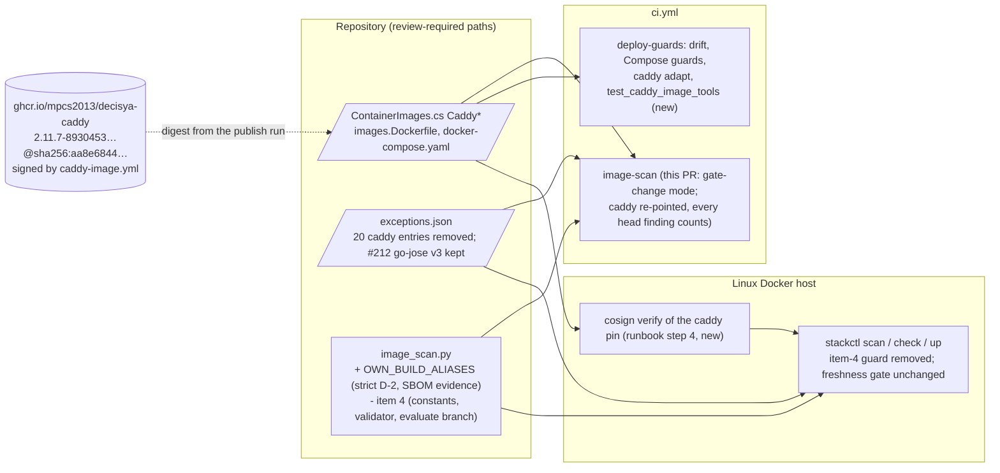

# Architecture note – switch the stack to the self-built Caddy image (issue #225)

<!-- gate: G2 | verdict: PASS | issue: #225 -->

## Context

#225 is the second half of #188 (ADR-0021 M6; Marco chose a new issue for it, 2026-10-31). PR-1 (#189) built, published and signed the image. This PR:
- re-points the `caddy` pin to the published image;
- adds the own-build scan rule of ADR-0021 item 7;
- retires ADR-0015 item 4 (ADR-0021 E1) with its entries, deploy guard and tripwire;
- adds the Docker test and the runbook step that need the published image.

No product module, `*.Contracts` type, Wolverine message, endpoint or tenant data flow changes. The note is not N/A, because the issue changes three things:
- the image at the LAN edge;
- the CI and deploy scan policy for `caddy`;
- the deploy guard.

- Inputs: ADR-0021 (items 6 to 8, E1), ADR-0015 (amendments 2026-10-06 item 3 and 2026-10-17 item 4), ADR-0022, `self-built-caddy.md` (the #188 design), `docs/security/threat-models/self-built-caddy.md` (the #188 G3, whose MUSTs M-3 a to e, M-2 e and S-4 are this PR's obligations), and the manifest `docs/ai/pipeline/225.md`.
- Facts used (main session, 2026-10-31, not re-derived here):
  - publish run 41180269858 on `main` `8930453` is green (build, publish, verify), and the package answers anonymously.
  - **Main-session scan of the digest.** The repository's pinned Grype (v0.120.0) scanned the digest through `image_scan.py`'s own argv, with a database built 2026-10-31.
    - Results: 9 raw matches, `distro.name` `debian`, `check_provenance` (without SBOM) clean.
    - Policy outcome: 0 blocking. 1 excepted: `github.com/go-jose/go-jose/v3` v3.0.5, `GHSA-mgcc-cww5-fp2q`, High, `not-fixed`, through the #212 entry. The other 20 `caddy` entries match nothing.
    - Not checked: the SBOM evidence and tag resolution.

## C4 excerpt (what changes)

Trust boundaries:
- **Changed: the CI and deploy policy for `caddy`.** It becomes strict D-2, with no item 3 and no item 4. The scan is trusted only with binary evidence (M-3 b).
- **Changed: merge to deploy.** The item-4 guard goes. In its place there is a `cosign verify` step in the runbook. The ADR-0022 freshness gate stays the deploy gate, and it covers every image.
- **Unchanged:** the stack contract (Caddyfile, `caddy adapt`, key-ring one-shots, healthcheck, smoke), the release path, `BINARY_ONLY_ALIASES`.

## 1. The pin

| Field | Value |
| --- | --- |
| Registry | `ghcr.io` |
| Image | `mpcs2013/decisya-caddy` |
| Tag | `2.11.7-8930453866c94e3f2b65f223c4ee9c8cc9b1318b` |
| Digest | `sha256:aa8e684446fde828f0d7beb786026a8b8815337dbc91545f809b906437c0e4d9` |

Every place that names the Caddy image:

| File | Change | Owner |
| --- | --- | --- |
| `src/Decisya.AppHost/ContainerImages.cs` | The four `Caddy*` constants. The comment is replaced: issue #225 (ADR-0021 item 6), the publish run id 41180269858 on `main` `8930453`, the green verify job, Marco's local `cosign verify` result, and "digest from the publish output, never a tag lookup" (G3 M-2 e). Keep the history short: the #120/#183/#187 lines go, ADR-0021 is the record | platform-dev |
| `.devcontainer/engine/images.Dockerfile` | The `caddy` `FROM` line, and its two comment lines replaced by one `#225` line. The Dependabot `/.devcontainer/engine` entry already ignores `mpcs2013/decisya-caddy` (no change) | devops |
| `deploy/compose/docker-compose.yaml` | Line `image:` of `caddy`, by regeneration only (drift check) | Marco regenerates; devops lane |
| `tests/Decisya.Identity.Tests/ContainerImageParityTests.cs` | See section 4 | platform-dev |
| Fixtures that name `docker.io/library/caddy` (`deploy/tests/test_keyring.py:36,206`, `test_compose_guards.py:283`) | No change: they are synthetic negatives or arbitrary fixture values, not the pin | none |
| `ComposeStack.cs`, `CaddyRootTrustTests` (Api, BFF), `ComposeStackPublishTests`, `stackctl.pinned_caddy_image`, `stackguards.THIRD_PARTY_ALIAS` | No change: they read the constants or the `caddy` alias | none |

`stackguards.IMAGE_RE` covers only `decisya-(api|bff|migrator)` from the environment file. `caddy` keeps going through `THIRD_PARTY_ALIAS` and the literal `ContainerImages.cs` reference (ADR-0018 mechanism). No change.

### How `image_scan.py` treats the new reference

- **Not binary-only.** distroless `static-debian13` gives Grype a distro: the main-session scan reports `debian`, and PR-1's build scan passed `release_images._grype`, which refuses an empty distro. `BINARY_ONLY_ALIASES` stays exactly `{"otelcollector": …}` (ADR-0021 B1, D5). Adding `caddy` there would be a provenance relaxation that needs its own G3.
- **New constant, `OWN_BUILD_ALIASES = {"caddy": "ghcr.io/mpcs2013/decisya-caddy"}`** (ADR-0021 item 7, G3 M-3):
  - Code only. Module-level assertions: it is a subset of `ALIASES`, disjoint from `BINARY_ONLY_ALIASES`, and names no release image.
  - **Matching (M-3 a).** One helper, `is_own_build(alias, ref)`, compares `split_ref` registry/image for equality with the mapped value. Never a prefix.
  - **Binary evidence (M-3 b).** For an own-build reference, `check_provenance` keeps the distro requirement. After every other check passes, it reads the same run's SBOM (the lazy `sbom` argument it already receives) and runs `check_binary_sbom`. It also requires these two components, each in a layer listed in `source.target.layers`:
    - `pkg:golang/github.com/caddyserver/caddy/v2@v<version>`;
    - a `pkg:golang/stdlib@` component.

    Missing evidence means "scan not trusted", with its own message.
  - **Where `<version>` comes from (deviation from M-3 b's wording, for G3).** It is the leading `x.y.z` of the pinned tag (`^(\d+\.\d+\.\d+)-[0-9a-f]{40}$`), not `deploy/caddy/image/go.mod`.
    - Why: a Caddy bump merges `go.mod` one PR before the pin moves (two PRs per update, ADR-0021). A `go.mod`-derived version would mark the still-pinned image untrusted for that whole window, in the daily drift scan and in `stackctl scan`.
    - The tag's version equals `go.mod`'s at the build commit: `caddy_image.py inspect` (M-1 f and `check_sbom`) binds them before the push.
    - A tag that does not match the regex is not trusted.
  - **Strict D-2 (M-3 c).** For an own-build reference, no tag state is resolved and `evaluate()` gets no `tag_state`. Put this in one helper used by both callers, so the full scan, the gate-change and delta comparison and `stackctl scan` cannot diverge:
    - `scan_targets` (CI full mode and `stackctl scan`): treat an own-build alias like the `strict` names;
    - `compare_alias` (delta and gate-change): skip `resolve_tag_state` and call `evaluate(doc, alias, entries, today)`.
  - An unfixed finding can still be excepted by a valid entry (ADR-0021 item 7, D7).

## 2. `exceptions.json`

The 21 `caddy` entries, all `added` 2026-10-29 and `expires` 2026-11-12:

| # | Id | Package | Issue | Decision | Reason |
| --- | --- | --- | --- | --- | --- |
| 1 | CVE-2026-78659 | `stdlib` | #187 | remove | item 4; our binary is go1.26.10 (fixed in 1.26.9); matches nothing (main-session scan) |
| 2 | CVE-2026-78659 | `golang.org/x/net` | #187 | remove | item 4; our binary carries x/net v0.60.0; matches nothing |
| 3 | CVE-2026-56857 | `stdlib` | #187 | remove | item 4; fixed toolchain; matches nothing |
| 4 | CVE-2026-56866 | `stdlib` | #187 | remove | same |
| 5 | CVE-2026-97031 | `stdlib` | #187 | remove | same |
| 6 | CVE-2026-94440 | `stdlib` | #187 | remove | same |
| 7 | CVE-2026-78667 | `stdlib` | #187 | remove | same |
| 8 | CVE-2026-78660 | `stdlib` | #187 | remove | same |
| 9 | CVE-2026-78660 | `golang.org/x/net` | #187 | remove | item 4; x/net v0.60.0; matches nothing |
| 10 | CVE-2026-78669 | `stdlib` | #187 | remove | item 4; fixed toolchain; matches nothing |
| 11 | CVE-2026-78669 | `golang.org/x/net` | #187 | remove | item 4; x/net v0.60.0; matches nothing |
| 12 | CVE-2026-78663 | `stdlib` | #187 | remove | item 4; fixed toolchain; matches nothing |
| 13 | CVE-2026-78663 | `golang.org/x/net` | #187 | remove | item 4; x/net v0.60.0; matches nothing |
| 14 | CVE-2026-94439 | `stdlib` | #187 | remove | item 4; fixed toolchain; matches nothing |
| 15 | CVE-2026-97032 | `stdlib` | #187 | remove | item 4; fixed toolchain; matches nothing |
| 16 | CVE-2026-97032 | `golang.org/x/net` | #187 | remove | item 4; x/net v0.60.0; matches nothing |
| 17 | GHSA-mgcc-cww5-fp2q | `github.com/go-jose/go-jose/v4` | #187 | remove | item 4; our `go.mod` overrides v4 to 4.1.6 (#212); matches nothing |
| 18 | CVE-2026-111497 | `brotli-libs` (apk) | #187 | remove | item 3; there is no Alpine userland in our image; matches nothing |
| 19 | CVE-2026-92392 | `libcurl` (apk) | #187 | remove | item 3; no Alpine userland; matches nothing |
| 20 | CVE-2026-92392 | `curl` (apk) | #187 | remove | item 3; no Alpine userland; matches nothing. It replaced the old #183 curl entry, which is already gone |
| 21 | GHSA-mgcc-cww5-fp2q | `github.com/go-jose/go-jose/v3` | #212 | **keep** | Our binary still carries v3.0.5 (`go.mod:49`, indirect through smallstep). No fixed v3 exists (`not-fixed`). The main-session scan excepts exactly this finding with this entry, and without it `image-scan` fails. It is a finding without a fix, which ADR-0021 item 7 still allows for our image. It passes the S-4 rule below (one approval, 2026-10-29, on `added`) and the 30-day S-120-07 bound |

Points for G3 and Marco on entry 21:
- **Justification text (Marco decides).** The entry ends with "(ADR-0015 item 4 bound)". After the retirement it is an ADR-0021 item 7 exception for a finding with no fix, not an item-4 entry. Recommendation: replace only that parenthesis with "(approved under the ADR-0015 item 4 bound; from #225 an ADR-0021 item 7 exception for a finding with no fix)". Keep the id, package, dates, approval phrase and void conditions unchanged. The PR body names the edit. Risk: almost none. The alternative is to leave the text as it is, which leaves a stale pointer in a review-required file.
- **Deploy consequence (G3 rules).** Today `stackctl up` refuses while this entry is present, because the item-4 predicate covers it. After the retirement, the ADR-0022 freshness gate honours it as an active exception until 2026-11-12. After that date, the finding blocks `up` again until a renewal (new issue, fresh G3) or a fixed v3.
  - This is the intended ADR-0021 item 7 behaviour, and it rests on the #212 G3 ruling 1 (class (b), not reachable).
  - It is still a relaxation against today's presence-keyed guard.
  - In practice nothing changes now, because the freshness gate refuses on Keycloak's guava anyway.
- **"No item-4 entries" (Done-when).** It holds by construction once the predicate is gone. The PR body says that entry 21 is kept as an item 7 entry, and why.

Additional rule in code (#188 G3 S-4, Low, fix-now): `exception_errors` requires every `caddy` entry to have exactly one `approved by Marco YYYY-MM-DD` with a real date that is not after `added`.
- Use the existing parser, renamed from `vendor_binary_approval` to `approval_date`, so that no `vendor_binary` symbol is left.
- Other images are unaffected. Extending S-4 to the other request-path images (Keycloak, Api, BFF) goes to backlog #83.

The `$comment` and docstrings that say "ADR-0015 item 4" about the exception **schema** mean decision item 4. They are not the 2026-10-17 amendment's item 4. Leave them.

## 3. Retiring ADR-0015 item 4 (E1): what is removed now

Everything is removed in this PR. #188 G3 M-3 d requires the retirement to be atomic: the re-point, `OWN_BUILD_ALIASES` and the removal of every item-4 symbol, entry, guard and tripwire land together. The parity test that pins our package ships in the same commit as the guard removal.

Keeping the code and removing only the entries is **not** offered. That would leave either:
- the vendor-reference carve-out as dead security code with a known red date (the ADR-0021 E2 option, rejected); or
- our image with no `OWN_BUILD_ALIASES`. Item 3 would then read our never-moving tag as `unchanged` (T120-19), and the vacuous pass (T188-07) would stay open.

| Where | Remove | Change or keep |
| --- | --- | --- |
| `.github/scripts/image_scan.py` | `VENDOR_BINARY_ALIASES` and its two assertions; `MAX_VENDOR_BINARY_EXCEPTION_DAYS`; `VENDOR_BINARY_SUNSET`; `RULE_ITEM4`; `is_vendor_binary_entry`; `_vendor_binary_errors`; `vendor_binary_entries`; `_keeps_vendor_binary_exception`; the item-4 branch in `exception_errors` and in `evaluate()`; the `RULE_ITEM4` status in `_summary`; the item-4 comment block | Add `OWN_BUILD_ALIASES`, `is_own_build`, the own-build evidence check and the strict path (section 1), and S-4 (section 2). Rename `vendor_binary_approval` to `approval_date`. Remove the now-unused `ref` keyword from `evaluate()`: with item 4 gone nothing reads it, and keeping it invites a new carve-out keyed on it. `tag_state` stays (item 3). `BASE_API` is unchanged, and the base side never passed `ref` |
| `deploy/compose/stackctl.py` | `vendor_binary_problems`, its call in `cmd_check` and in `cmd_up`, and the item-4 lines of the module docstring (`up`) and comments | `_valid_through`: drop the `RULE_ITEM4` / `VENDOR_BINARY_SUNSET` branch, so the result is the earliest `expires` (otherwise `AttributeError`). The `SCAN_STRICT` comment: "without item 3". `cmd_up` order: the freshness gate is the first step, still before any Runner |
| `deploy/compose/stackguards.py` | nothing | No item-4 code there |
| `.github/scripts/caddy_image.py` | nothing | Do not touch it. It is a `caddy-image.yml` push path, and a comment-only edit is not worth a rebuild |
| The tripwire (`test_sunset_tripwire`) | removed with `VendorBinaryItem4Tests` | |

**Consequence for this PR's `image-scan`.** Changing `image_scan.py` puts the run in **gate-change** mode (ADR-0022 item 1, `select_mode`), not delta.
- Every alias is scanned at the base (`main`'s code) and at the head.
- `caddy` is re-pointed (another repository), so it gets no base comparison: every head High or Critical without an active exception fails. That is stricter than delta, and it is what the main-session scan predicts green (0 blocking).
- The other four aliases have unchanged references and an unchanged scanner. Their findings read "at base", and R-1 must hold. Removing the item-4 branch does not change raw matches.
- Expired Keycloak or Postgres entries (2026-11-02) do not block, because those findings are at the base.
- The Done-when line says "delta on caddy". The job's mode line will read `gate-change`. The PR body states this, so the evidence is not misread.

This PR also triggers the `caddy-image.yml` **pull-request** build, because `image_scan.py` is one of its PR paths. It rebuilds the image from unchanged inputs and runs the strict build scan with the head's policy and exceptions. That build must be green too: it is further evidence that S-4 and the kept entry hold in the build path.

## 4. Tests

| File | Drop | Change | Add | Owner |
| --- | --- | --- | --- | --- |
| `tests/Decisya.Identity.Tests/ContainerImageParityTests.cs` | `ADR_0015_records_item_4_with_the_fallback_and_the_sunset` (#142 G1 story 5; a retired rule); the #187 bridge test (`…exactly_the_20_approved_187_caddy_bridge_entries…`) | `The_Caddy_and_collector_references_are_exact_patch_tags_on_docker_io` is split. The collector part is unchanged. The Caddy part asserts `CaddyRegistry == "ghcr.io"`, `CaddyImage == "mpcs2013/decisya-caddy"` and `CaddyTag` matching `^\d+\.\d+\.\d+-[0-9a-f]{40}$` (`dryrun-` never matches). The #183 curl test keeps only its zlib assertion and is renamed | (a) The Caddy reference is equal in `ContainerImages`, the sandbox list and the committed Compose file (`Contain(reference)`, like the collector test). (b) The exceptions file: no entry with issue `#142`, `#183` or `#187`; no `caddy` entry for `curl`, `libcurl`, `brotli-libs`, `stdlib`, `golang.org/x/net` or `go-jose/v4`. Every `caddy` entry has exactly one `approved by Marco <date>`, no `PENDING`, and spans 30 days or less. The collector carries no Go entry (kept from the bridge test). No exact-digest assertion: Caddy bumps are frequent, and the comment and manifest carry the run id | platform-dev |
| `.claude/tests/test_image_scan.py` | `VendorBinaryItem4Tests` entirely (tripwire included); the item-4 lines of the module docstring | The `NarrowD2Tests` caddy "test 4" case (no reference) stays valid; keep it. `test_the_release_path_never_reaches_item_4` becomes "release_images.py calls `ims.evaluate(` with no `tag_state`" | `OwnBuildTests`: (1) exact `OWN_BUILD_ALIASES`; subset, disjoint from `BINARY_ONLY_ALIASES`, no release image; `BINARY_ONLY_ALIASES` unchanged. (2) M-3 a lookalike reds: `ghcr.io/mpcs2013/decisya-caddyx`, `ghcr.io/other/decisya-caddy`, `docker.io/mpcs2013/decisya-caddy`, `ghcr.io/mpcs2013/decisya-caddy/x`, a non-ref. (3) M-3 b: trusted with distro and a good SBOM. Reds: no SBOM, no go-module component, no Caddy component, Caddy at another version than the tag, no stdlib, components in no listed layer, an empty distro (still required), a non-matching tag. (4) M-3 c: fixed `deb`, `binary` and `go-module` findings with an active matching `caddy` entry FAIL in both callers (`scan_targets`, `compare_alias`) with `resolve_tag_state` replaced by a stub that raises (no tag call). An unfixed finding with a valid entry is excepted. (5) M-3 e: for every alias in `ALIASES` plus the release names, every tag state (`unchanged`, `moved`, `unknown`, none), and an active 14-day approved entry, a fixed `go-module` finding is never excepted. (6) No item-4 symbol: none of the removed names exists (`hasattr`), the source contains neither `VENDOR_BINARY` nor `RULE_ITEM4`, and `evaluate` has no `ref` parameter. (7) S-4 reds: a `caddy` entry with no approval, two approvals, an impossible date, or an approval after `added` is rejected; the same entry for `postgres` is not | main session |
| `.claude/tests/test_image_scan_delta.py` | none | none expected (it mocks `check_provenance` and `resolve_tag_state`); run it unchanged and report any red | none | main session |
| `deploy/tests/test_stackctl.py` | `VendorBinaryGuardTests` entirely | `FreshnessGateTests.test_the_item_4_guard_stays_first_and_clock_free` becomes "the freshness gate is the first step of `up` and comes before `runner_factory`; `stackctl` has no `vendor_binary_problems`". The live-file test at `:709` (30 days or less for `caddy`) stays | (a) Done-when 3: a fixture clone whose `exceptions.json` holds a Go-shaped `caddy` entry (the old item-4 shape, unfixed), plus a fresh green result, makes `up` reach its next step (sentinel static problem, one Runner), and `check --static-only` reports no item-4 problem. (b) In `ScanCommandTests`, the own-build rule at the deploy gate: with `offline_scan_module` (every tag `unchanged`), a fixed `deb` finding in the `caddy` reference with a 20-day item-3-shaped entry makes the result red. The same entry on `postgres` is still excepted (the existing pattern) | devops |
| `deploy/tests/deploy_common.py` | none | `grype_sbom`: for an own-build reference, also emit the Caddy component at the tag's version and a `stdlib` component in `GRYPE_LAYER`. Without this, every `ScanCommandTests` case goes red (untrusted `caddy`). `vendor_entry` docstring: "a Go-shaped entry (the retired item-4 shape)"; the name stays (other files use it) | none | devops |
| `deploy/tests/test_caddy_image_script.py` | none | `test_the_committed_v3_entry_passes_the_item_4_validator_and_not_one_day_more` becomes: the committed v3 entry passes `exception_errors` on its `added` date, has exactly one approval on or before `added`, and spans 30 days or less. `test_the_real_evaluate_takes_no_ref_and_no_tag_state_by_default` becomes "`tag_state` defaults to None and there is no `ref` parameter". The `item_4_shaped` reds stay valid; rename them if wanted | none | devops |
| `deploy/tests/test_keyring.py` | none | the comment at `:620` ("the live file would refuse (#142)") | none | devops |
| `deploy/tests/test_caddy_image_tools.py` (new; ADR-0021 "Enforced by"; deferred from PR-1 because it needs the published image) | none | none | A `DockerCase`, so it fails rather than skips in `deploy-guards`. It uses the **pinned** image from `load_scan_refs(ROOT)["caddy"]`, with `--network none --read-only --cap-drop ALL --security-opt no-new-privileges` and a tmpfs where needed. (1) `nc -z` succeeds against a `caddy respond` listener on loopback and fails on a closed port. (2) The three key-ring scripts (`keyring_prepare_argv`, `keyring_reset_argv`, `keyring_verify_argv` shapes) run on a scratch volume and print their counts. (3) BusyBox `wget --no-check-certificate` completes TLS against a `tls internal` site served by the same image. The smoke cannot reach this proof while the freshness gate refuses (runbook first-run check). No `sleep` applet: retry with `nc -z` | devops (written); main session (runs it, Docker) |

Run unchanged, expected green on the new pin: `test_caddyfile.py` (`caddy adapt` in the pinned image), `test_compose_guards.py`, the rest of `deploy/tests`, `ComposeStackPublishTests`, the Api and BFF `CaddyRootTrustTests` (Integration, CI integration job), `.claude/tests/test_dependabot.py`, `test_ci_pins.py`.

Planned in #188 and replaced here: "a case that `cmd_up` reads no `exceptions.json`". Since #222 the freshness gate hashes that file, so the honest test is (a) above: no refusal on item-4-shaped content.

## 5. Ownership (against `.claude/boundaries.json`)

| Owner | Files |
| --- | --- |
| platform-dev | `src/Decisya.AppHost/ContainerImages.cs`, `tests/Decisya.Identity.Tests/ContainerImageParityTests.cs` |
| devops | `.devcontainer/engine/images.Dockerfile`, `.github/image-scan/exceptions.json`, `.github/scripts/image_scan.py`, `deploy/compose/stackctl.py`, `deploy/tests/{test_stackctl,deploy_common,test_caddy_image_script,test_keyring}.py`, `deploy/tests/test_caddy_image_tools.py` (new), `docs/runbooks/deployable-stack.md`, `docs/runbooks/caddy-image.md` |
| main session | `.claude/tests/test_image_scan.py` (`.claude/**` is denied to agents); every Docker run (devops has no `docker run`); the single commit |
| Marco | Regenerates `deploy/compose/docker-compose.yaml` (publish, drift); local `cosign verify` of the pin with `caddy_image.py verify-command`; the smoke on a Linux host; the entry-21 wording decision; the M-2 f record (below) |
| architect (done in G2) | This note; dated pointer lines in ADR-0014, ADR-0015, ADR-0017, ADR-0018, ADR-0021, and `deployable-stack.md` D2 |

Runbook edits (devops):
- `deployable-stack.md` step 4: verify the pinned `caddy` reference with the `caddy-image.yml` identity before `scan`. Print the command with `python3 .github/scripts/caddy_image.py verify-command --reference <the caddy reference of ContainerImages.cs> --runner cosign`, and never retype it. Give the VS 2026 / VS Code and CLI columns.
- `deployable-stack.md` step 8: drop "first refuses while `exceptions.json` holds an item-4 entry".
- `caddy-image.md`: the "Pin a published digest" heading names #225. The first-run check for the `wget` TLS row points to `test_caddy_image_tools.py` as well as the smoke.

Process items G3 and G6 should see in the manifest (not code):
- **M-2 e.** Run id 41180269858, the verify job output, and Marco's local `cosign verify` output (shape only).
- **M-2 f.** Neither `188.md` nor `225.md` records the date Marco made the package public, or that he read the pre-push results first. The package answers anonymously, so it is public. The main session records Marco's own statement in the #225 manifest.

## 6. Done-when traceability

| Done-when line | Test(s) or evidence |
| --- | --- |
| The stack's `caddy` image is the self-built, signed image, pinned by digest | `ContainerImageParityTests`: the new Caddy pin test (registry, image, tag regex), the sandbox parity test, and the new Compose parity test. `ComposeStackPublishTests` (constants into Compose). The `deploy-guards` drift check. The `ContainerImages.cs` comment with run 41180269858 and the verify result. Marco's local `cosign verify` (manifest) |
| `image-scan` passes on this PR (delta on `caddy`) with no item-4 entries in `exceptions.json` | The PR's `image-scan` run id (mode `gate-change`, `caddy` re-pointed: every head finding counts; section 3). The main-session pre-scan (0 blocking, 1 excepted #212 v3). `test_image_scan.py` `OwnBuildTests` (1) to (7). `ContainerImageParityTests` exceptions test (b). `test_caddy_image_script.py` v3-entry test. The `caddy-image.yml` PR build (strict build scan with the head policy) |
| The deploy guard no longer refuses on item 4 | `test_stackctl.py` new test (a) and the reworked freshness-order test; `OwnBuildTests` (6) (no item-4 symbol) |
| The guard tests, the `caddy adapt` checks and the deploy tests pass; the smoke runs as far as the deploy gate allows | `deploy-guards` green: `test_caddyfile.py` `CaddyAdaptRules` on the pinned image, `test_compose_guards.py`, `test_stackctl.py` incl. `ScanCommandTests` (b), `test_keyring.py`, the new `test_caddy_image_tools.py`. Api and BFF `CaddyRootTrustTests` (CI integration job). The smoke report (Marco, Linux host): `stackctl scan` shows no `caddy` finding and no `caddy` untrusted line, and `check` refuses only on the Keycloak guava finding (manual; the freshness gate stops it there by design) |
| Each removed exception is listed in the PR body | The G7 PR body: the 20 rows of section 2 (id, package, issue), plus the kept entry 21 with its reason. `ContainerImageParityTests` (b) proves that none of them remains |

#188 G3 obligations carried here: M-3 a, b, c, e map to `OwnBuildTests` (2), (3), (4), (5). M-3 d is the single commit plus `OwnBuildTests` (6) plus the parity test. M-2 e is covered by the manifest and the comment. S-4 maps to `OwnBuildTests` (7). The M-4 pointer line is in ADR-0014.

## NetArchTest rules to add

| Rule | Assemblies | Test class |
| --- | --- | --- |
| N/A: no .NET module, Contracts project or project reference changes; `ContainerImages.cs` changes constant values only | none | none |

## 7. Size and order

**One PR.** Most of the diff is deletion (the item-4 code, about 200 test lines in each of `test_image_scan.py` and `test_stackctl.py`, and 20 entries). The additions are one constant with two helpers, an SBOM check, S-4, one Docker test file, the parity tests and two runbook rows. M-3 d forbids splitting the re-point from the retirement.

Order:
1. **Before G3 concludes** (main session): rerun the pinned Grype on the digest with the SBOM output (`scan_argv(..., out_dir)`). Record:
   - `metadata.component` name and version;
   - the `pkg:golang/github.com/caddyserver/caddy/v2@v2.11.7` and `pkg:golang/stdlib@…` purls and their layer ids;
   - whether those layers are in the JSON's `source.target.layers`.

   If the Caddy or stdlib component is missing, stop and report: M-3 b cannot pass as designed.
2. **G4.**
   - platform-dev: pin and parity test.
   - devops: the parity file, exceptions, `image_scan.py`, `stackctl.py`, deploy tests, runbooks.
   - main session: `test_image_scan.py`.
   - Marco: regenerates Compose.
3. **Suites** (main session, the full set per the working agreements):
   - `dotnet build -warnaserror` and the unit tests;
   - the AppHost tests;
   - `deploy/tests` with Docker;
   - the `.claude` suite (Git Bash preflight);
   - the integration suites with `CaddyRootTrustTests`.
4. **One commit**, `feat(deploy)` per the issue title. Release-please still cuts a release that carries the pin. ADR-0021 item 6 asked for `fix(deploy)` only to get that release.
5. If 2026-11-12 passes before the merge, nothing changes for this PR: the removed entries expire unused, and entry 21's expiry is a deploy matter, not a PR gate.
