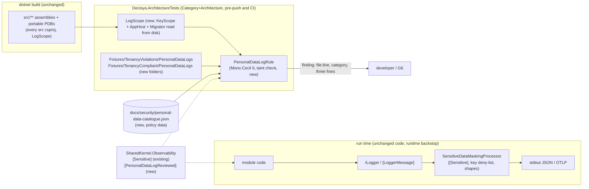

# Architecture note – Keep personal data out of log arguments (issue #230, C-12)

## Context
#230 closes register finding C-12 (`docs/security/threat-models/system-baseline.md`, "Carry-forward: PII under an innocent name"). The runtime masking core (`SensitiveDataMaskingProcessor`, #15) cannot judge a plain `string`: `LogInformation("Paid {Payee}", tx.Description)` reaches stdout and OTLP in clear. This issue adds a static check that fails a test when a log call in `src/` passes personal data without masking. It also marks the stored raw `sub` fields `[Sensitive]` and proves the masking with canary tests.

Inputs: G1 `docs/requirements/230-pii-log-arguments.md` (Stories 1 to 5, NFR-62), the #15 note `docs/architecture/apphost-servicedefaults.md`, ADR-0005 and ADR-0023, and the #231 IL rules (`IlScan`, `KeyScope`, `TenantKeyRule`) in `tests/Decisya.ArchitectureTests`. #68 is closed and its tests are delivered: this note builds on them and does not plan them again.

Marco, 2026-11-02 (option A): `AuditRecord.ActorUserId` joins this issue. See D5.

G3, 2026-11-02 (`docs/security/threat-models/230-pii-log-arguments.md`, PASS-WITH-NOTES; G3 wins where it differs): the design changes for G4-230-01 to G4-230-04 and S-01, S-02 and S-04, as set out in "G3 changes" below. Taint becomes field-level, and a tainted Decisya object is a finding unless its type or the member holding the taint carries `[Sensitive]`. `memberNames` match any member type except `bool` and enums. The catalogue (now version 2) gains the `MeResponse.Sub`, `sid`/`SessionId`, cookie, stored-token and JWT-payload sources, the latter two as name-keyed `claimReaders`. `Console`, `Debug` and `Trace` writes become sinks, and nothing else does. Suppressions are pinned in the catalogue, `secret-material` cannot be suppressed, and the `[GeneratedCode]` skip covers only `[LoggerMessage]`-generated bodies. Output uses repo-relative paths and prints no literals (S-02). The catalogue edits are made in this G2 revision; the rule edits are G4's.

Marco, 2026-11-02 (after G3): (a) fixture package option A: the main session adds `Microsoft.AspNetCore.Authentication.OpenIdConnect` to `TenancyViolations.csproj`, so the red JWT fixture uses the real `JsonWebToken` reader (Question 3, decided). (b) `GetTokenAsync` option A: `Microsoft.AspNetCore.Authentication.AuthenticationHttpContextExtensions::GetTokenAsync` (`nameParameter` `tokenName`, fallback `secret-material`) is added now as a `claimReaders` entry, with a red fixture in R4a. Marco approved it as a Low in a file this PR already changes (`docs/security/personal-data-catalogue.json`); G3's list did not name it, since nothing in `src` calls it today, but it is the most common way to read a stored token.

## G3 changes (2026-11-02)
These change the sections below. Where a section below and this list differ, this list wins.

1. **Field-level taint, and taint survives a Decisya object (G4-230-01).**
   - A constructor, `init` or setter call with a tainted argument taints the field it stores to; this carries S5's field source across the parameter-to-field hop. Reading a member yields that member's taint, not the receiver's whole taint, so `membership.Id` or `result.FailureReason` does not inherit a user id.
   - The object rule now honours taint. A Decisya-typed argument that carries taint, passed whole or turned into text (`ToString`, `AppendFormatted<T>`, `Concat(object)`, `Format`), is a finding unless its type carries `[Sensitive]`, or every member holding the tainted value carries `[Sensitive]`. This holds whatever kind of `ToString` the type has. The type-based check of D3 (a personal-data member without `[Sensitive]` within depth 3) stays as well, for untainted objects.
   - The conservative alternative G3 allows (every text-capable member to depth 3 is `[Sensitive]` or non-personal) is acceptable only if field-level taint proves impractical in G4; backend-dev records the choice in the G4 evidence.
   - `memberNames` match members of any type except `bool`, `bool?`, enums and nullable enums, declared on `Decisya.*` types. A Decisya value object read from a matched member is personal data whole.
2. **New sources (G4-230-02), in the catalogue:**
   - `user-identifier.members`: `Decisya.Bff.MeResponse::Sub`, `Microsoft.IdentityModel.JsonWebTokens.JsonWebToken::Subject`;
   - `secret-material.memberNames`: `SessionId`;
   - `secret-material.claimTypes`: `sid`, `Microsoft.AspNetCore.Authentication.Cookies-SessionId`, `access_token`, `refresh_token`, `id_token`;
   - `secret-material.members`: `IRequestCookieCollection::Item` and `::TryGetValue` (session cookie reads), `AuthenticationToken::Value`;
   - a new `claimReaders` list for stored-token reads (`AuthenticationTokenExtensions::GetTokenValue`, `::GetTokenAsync`, and `AuthenticationHttpContextExtensions::GetTokenAsync` per Marco's 2026-11-02 decision below) and JWT payload reads (`JsonWebToken::TryGetPayloadValue`, `::GetPayloadValue`, `::TryGetClaim`, `::GetClaim`, and `::Claims` enumerated). A constant name is matched against every category's `claimTypes` (no match is clean, so `expires_at`, `iat`, `exp`, `events` and `nonce` stay clean). A non-constant name, or the `Claims` enumeration, yields the reader's `fallbackCategory` (`secret-material` for token readers, `user-identifier` for JWT readers). The `ClaimsPrincipal` and `ClaimsIdentity` readers stay built into the rule (D2).
   - If an entry turns R7 red on today's code, G4 stops and reports; it does not drop the entry.
3. **Sinks (G4-230-03): `Console`, `Debug` and `Trace` writes, and nothing else new:**
   - `System.Console::Write` and `::WriteLine`, all overloads;
   - `System.IO.TextWriter::Write*` and `::WriteLine*` only when the receiver comes from `Console.get_Out` or `Console.get_Error` in the same method;
   - `System.Diagnostics.Debug::Write*`, `::Print`, `::Fail` and `::Assert` (message arguments);
   - `System.Diagnostics.Trace::Write*` and `::Trace*`.

   Other `TextWriter` and `Stream` writes are not sinks (a later export feature writes personal data to a response stream legitimately). `KeyRingCertificateGenerator`'s constant `stderr` lines stay green.
4. **Exemptions are counted and security-owned (G4-230-04).**
   - The pinned suppression list moves from the test class to the catalogue's `suppressions` array (`{ site, category, justification }`, empty at merge). A `[PersonalDataLogReviewed]` use with no matching entry fails; an entry with no matching use fails as stale. Matching is on all three fields, so a changed justification is a catalogue diff too.
   - A category with `"suppressible": false` cannot be suppressed: an attribute or an entry naming it fails. Only `secret-material` carries `false`, and R5 pins that.
   - The `GeneratedCodeAttribute` skip applies only to the generated body of a method that carries `LoggerMessageAttribute`. A hand-written method carrying `[GeneratedCode]`, `[CompilerGenerated]` or `[ExcludeFromCodeCoverage]` is examined as usual.
5. **Output hygiene (S-02).** Failure text and statistics print paths relative to the repository root found by `RepoPaths`, locally as well as in CI; a path outside the repository prints the file name only. The output holds no IL string literal from the flagged method (the template included), no drive letter and no `Users` segment. Fixtures and canaries use synthetic values only. Justifications hold no personal data.
6. **Existence of third-party entries (S-01), for backend-dev in R5.** Build the reference closure of LogScope (every assembly LogScope references, transitively, resolved with the same Cecil resolver). For each third-party entry in `members`, `types`, `maskers` and `claimReaders`:
   - if the declaring type's assembly is in the closure, resolve the type and the member by name (`Item` for an indexer, any overload for a method). An unknown type or member fails and names the entry;
   - for a `claimReaders` entry with a `nameParameter`, at least one overload must have a parameter of that name, or the entry fails;
   - if no assembly in the closure declares the namespace's type (today: `Microsoft.Extensions.AI`), list the entry in the statistics under "not referenced", and do not fail.
7. **S-04.** A test asserts that `LogEnrichmentContext` is the only implementation of `ILogEnrichmentContext` in LogScope, and that its `Begin` passes `userId` only to `UserIdHasher::Hash` (R10 below).

## C4 excerpt

## How masking really works, and how this note reads G1
This is the most important point of the note. G3 and G5 need it.

`[Sensitive]` on a member masks that member only when the masking processor sees the **owning object**. The processor judges each log value by its run-time type (`SensitiveDataMaskingProcessor.cs:338-395`). A `string` takes the scalar path and gets only shape masking (JWT, bearer, URL). So `Log(logger, member.UserId)` writes the raw `sub` even after `MemberDto.UserId` carries `[Sensitive]`, because the string does not carry the attribute. `Log(logger, member)` is masked: the processor renders `UserId = ***` through `RenderMember` (`:475-480`).

G1 defines "masked" as "a member or type carrying `[Sensitive]`". Story 1's last scenario says "a log call whose argument is a property marked [Sensitive]" passes. Taken literally, that is a false negative at run time. This note reads it as follows, and the check enforces it:

- **Masked:** an argument whose static type carries `[Sensitive]`, passed as itself; an object of a Decisya type whose personal-data members all carry `[Sensitive]`, passed whole; the output of a listed masker; a listed redacting type.
- **Not masked:** a scalar **read from** a `[Sensitive]` member. The check reports it as a finding, labelled with the member's catalogue category, or "Marked [Sensitive]" when the member is in no category. This also closes a gap the key deny-list leaves: `{Value}` fed from a `[Sensitive]` secret.

G5 writes Story 1's "masked" fixture in the owning-object form. The test-engineer restates that scenario in the G1 file (lane `docs/requirements/**`), citing this section.

## Decisions

### D1. Mechanism: an IL architecture test (Mono.Cecil) in `Decisya.ArchitectureTests`
| Criterion (G1) | A. IL test over built assemblies (chosen) | B. Roslyn analyzer (build failure) | C. Built-in CA1848/CA2254 as errors only |
| --- | --- | --- | --- |
| Static type and declaring member | Yes: call, field and member operands name the declaring member; signatures give static types | Yes, through `IOperation` | No: they never judge the value |
| Interpolation and concatenation | Yes: `DefaultInterpolatedStringHandler.AppendFormatted<T>`, `string.Concat` and `StringBuilder` propagate taint (fixtures for each lowering) | Yes (`IInterpolatedStringOperation`) | CA2254 bans non-constant templates only |
| `[LoggerMessage]` parameters | Yes: the call site of any method carrying `LoggerMessageAttribute` | Yes | CA1848 forces their use only |
| Scopes, `Log<TState>`, `LoggerMessage.Define*` | Yes (listed sinks) | Yes | Partly |
| File and line in the failure | Yes, from portable PDB sequence points (Cecil `ReadSymbols`) | Yes, natively | Yes |
| False negatives | Same class as B for locals, closures and async, with fixtures per shape. Residuals are listed below | Same residual class (interprocedural, virtual dispatch) | Almost everything |
| New package | **None**: Mono.Cecil 0.11.6 is already resolved there (`tests/Decisya.ArchitectureTests/packages.lock.json`) and used by `IlScan` | `Microsoft.CodeAnalysis.CSharp` (plus a testing package): Marco's approval; its version is coupled to the SDK and VS compiler (load failures on SDK bumps) | None |
| New project or build wiring | **None**: files in an existing project and in the two existing fixture projects | An analyzer project (netstandard2.0, against `Directory.Build.props`' net10.0 default) plus a test project. Every project wired through `Directory.Build.props`, so every `packages.lock.json` changes | `.editorconfig` only |
| Cost (G1: at most +10%) | Build: compile of new test files only. Unit run: one Cecil pass over about 17 assemblies, seconds (G5 measures) | Runs on every compile of every project and in the IDE | Negligible |
| Maintenance | Same pattern as R10, R14, R16 and R17 (#231). Lowering changes surface as fixture failures | Roslyn API and compiler-version upkeep, release tracking | Low, but not a control |

**Chosen: A.** G1 accepts "the build or a test" (Done-when). A meets every G1 shape with no new package, project or lock churn. It reuses `IlScan`, `KeyScope`, `CompilerGeneratedTypeWalk`, `RepoPaths` and the fixture projects. It runs in the pre-push filter and in CI (`Category=Architecture`). Solo-developer time decides it: B adds a permanent compiler-coupled component for IDE squiggles that the test does not need. C stays a later option (see Questions).

### D2. Catalogue: `docs/security/personal-data-catalogue.json` (written in this G2)
- **One checked-in file**, read by the check through `RepoPaths.Find("docs/security/personal-data-catalogue.json")`. It sits beside the threat models, so G3 and G6 review every change. The architect (the G2 of an issue that adds personal data) and the security-reviewer can edit it. Implementers cannot: a G4 that needs a new entry stops and reports, which is intended.
- **Shape (version 2 after G3):** `version`, `categories[]`, `claimReaders[]`, `maskers[]`, `redactingTypes[]` and `suppressions[]`. Each category has:
  - `id`, `name` and `suppressible` (`false` for `secret-material` only);
  - `members`: exact `Namespace.Type::Member`, nested types as `Outer+Inner`. An interface member covers its implementations. A method covers its return value and `out` parameters;
  - `memberNames`: exact simple names of properties or fields **declared on `Decisya.*` types**, of any type except `bool` and enums (G3 change 1; was `string` only). This is how a future `Transaction.Description` is caught with no catalogue edit. Third-party members are matched only through `members`, so `System.Type.FullName` never matches;
  - `types`: any value of the type is personal data, whole or derived;
  - `claimTypes`: constant claim types whose `Claim` or value is personal data. A claim read with a non-constant type, a predicate or `.Claims` enumeration counts as `user-identifier`. Constant `acr`, `roles` and `tenant_id` reads stay clean.
- **`claimReaders` (G3 change 2):** framework readers keyed by a name argument (`member`, `nameParameter`, `fallbackCategory`), matched against `claimTypes` as set out in "G3 changes".
- **`suppressions` (G3 change 4):** the pinned list of `[PersonalDataLogReviewed]` uses, empty at merge.
- **Extensible without code change:** the check knows only this schema, never a category name. The seven category ids are `user-identifier`, `contact`, `name`, `account-number`, `free-text`, `ai-text` and `secret-material` (G1's seven).
- The developer guidance ("how to fix") lives in the file's `$comment`, in the failure message (D4, R8) and in a pointer from the developer docs (G7 `Docs:` line).

### D3. What counts as masked
As in the section above:
- a `[Sensitive]` type passed as itself;
- a Decisya object passed whole whose personal-data members, to depth 3 (the processor's `MaxRenderDepth`), all carry `[Sensitive]`, and whose members holding any taint carry `[Sensitive]` too (G3 change 1);
- the result of a `maskers` method: `Decisya.ServiceDefaults.Logging.UserIdHasher::Hash` today. It is internal, so module code gets the hashed id only through `ILogEnrichmentContext`, which writes `user_id` on every line;
- a `redactingTypes` type: none today. Each entry must carry `[Sensitive]` at type level or declare its own `ToString`, or the check fails;
- a collection of non-scalar elements: the processor masks it whole.

Values of non-personal kinds pass:
- `bool` and enums;
- `Length` and `Count` results;
- constants;
- `TenantId`: Marco's standing decision, baseline line 141.

A `Guid` or number parsed from a personal value keeps its taint.

### D4. Suppressions
- **New attribute** `Decisya.SharedKernel.Observability.PersonalDataLogReviewedAttribute(string category, string justification)`:
  - `AttributeTargets.Method | AttributeTargets.Constructor`, `AllowMultiple = true`, `Inherited = false`;
  - the constructor never throws (the `AllowCrossTenantAttribute` precedent);
  - it sits beside `[Sensitive]` because Contracts and modules may reference only SharedKernel (ADR-0005).
- It suppresses only its category, only in the method that carries it (compiler-generated closures and state machines count as their declaring method).
- The check reads it from Cecil's `ConstructorArguments`. A blank or whitespace justification, one under 20 characters, or an unknown category id is itself a failure.
- **Counted:** `Evaluate` returns findings, suppressions and statistics. The today-src test writes every suppression (site, category, justification) and their count to the test output, and compares the list with the catalogue's `suppressions` array (G3 change 4; no longer pinned in the test class). The list is **empty at merge**: G1 Story 2 says existing findings are fixed, not suppressed. Every new suppression is then a catalogue diff in `docs/security/**`, outside every implementer lane, for G6.
- **Never suppressible:** a category with `"suppressible": false` (`secret-material`). An attribute or a catalogue entry naming it is itself a failure.

### D5. `[Sensitive]` on `Membership.UserId`, `MemberDto.UserId` and `AuditRecord.ActorUserId`
| Member | Change | API JSON | Column, EF model, migration |
| --- | --- | --- | --- |
| `Decisya.Modules.Tenancy.Domain.Membership.UserId` (`Membership.cs:40`) | Add `[Sensitive]`. A class: its `ToString` is the type name, so no override is needed | Not serialized directly | Unchanged. EF Core ignores the attribute; the column is mapped explicitly (`TenancyDbContext.cs:40`, `user_id`, max length 255). No snapshot change, no migration |
| `Decisya.Modules.Tenancy.Contracts.MemberDto.UserId` (`MemberDto.cs:4`) | `[property: Sensitive] string UserId`, plus a `private bool PrintMembers(StringBuilder)` that writes `Role = …` only, as `GrantOverride` does (`Commands.cs:21`). The synthesized record `ToString` would otherwise render the raw `sub` in an interpolated string or an exception (Story 3, ToString scenario) | Unchanged: System.Text.Json ignores `[Sensitive]` and the property name stays `userId`. `src/` has no OpenAPI generation (no `AddOpenApi`) | Not persisted |
| `Decisya.Modules.Audit.Domain.AuditRecord.ActorUserId` (`AuditRecord.cs:42`) | **None needed: it already carries `[Sensitive]` (`AuditRecord.cs:41`).** G1's note ("its neighbour at `AuditRecord.cs:41` does") and the brief misread line 41: that line *is* the attribute on `ActorUserId`. Marco's option A is therefore met as far as the attribute goes. The new part is the masking test (G4 split) | Not exposed by any endpoint | Unchanged: the column is mapped explicitly (`AuditDbContext.cs:45`, `actor_user_id`), and the existing `HasPendingModelChanges` assertion (`tests/Modules/Decisya.Modules.Audit.Tests/AuditModelAndRegistrationTests.cs:102`) stays green. No migration |

**Fit with the catalogue and the check (Marco's question).**
- All three members are in the `user-identifier` category, by exact `members` entry and by `memberNames` (`UserId`, `ActorUserId`).
- An unmasked `ActorUserId` log argument **is flagged**: for example `AuditLog.Something(logger, record.ActorUserId)`, or `$"…{record.ActorUserId}"`. The attribute does not protect a scalar read (see the section above).
- Passing the `AuditRecord` whole is masked and passes: its one personal-data member carries `[Sensitive]`. The same holds for `Membership` and `MemberDto` after this change.
- Nothing in `src/` logs any of the three today (G6 reviews 21 to 26; `AuditWriter.cs:49-53` reads `caller.UserId` only for a length check and the insert).

**Breaking change:** none on the wire or in storage. `MemberDto.ToString()` changes from rendering `UserId` to omitting it. No code in `src/` or `tests/` calls it.

### D6. Scope: LogScope covers every `src` project
`LogScope` contains every `src/**/*.csproj`, with no exclusion (G1 Story 2: "a new project is examined without editing the check"):
- the `KeyScope` assemblies by `Assembly.Location`;
- `Decisya.AppHost` and `Decisya.Infrastructure.Migrator` read **from disk only, with Cecil, never loaded or referenced**. A reference broke the build with MSB3277 in #231 (see `231-wolverine-tenant-safety.md`, 2026-11-01 entry). The path is the sibling of the test's own output, `<artifacts>/bin/<Project>/<pivot>/<Project>.dll`, which holds for all three `ArtifactsPath` forms in `Directory.Build.props`.

The scope fails closed:
- a missing DLL or PDB fails and names the project, with "build the solution first";
- a DLL older than the newest `*.cs` in its project folder fails as stale.

A solution-level `dotnet test` (pre-push, CI) always builds both. The Migrator matters: it logs (`MigratorLog`, `Program.cs:27`).

### ADR
No ADR is needed. The check changes no earlier ADR and no CLAUDE.md invariant. CLAUDE.md's "Mark PII with `[Sensitive]`; the log processor masks it" stands; this note states its limit for scalar reads. The check is one more Cecil rule in the existing architecture test project, like #231's R10, R16 and R17, which needed none. Marco may still ask for one; a draft would be ADR-0025.

## Check design (`PersonalDataLogRule`)
`Evaluate(IEnumerable<string> assemblyPaths, PersonalDataCatalogue catalogue)` returns `(Findings, Suppressions, Stats)`. It reads all assemblies into one Cecil universe so that summaries cross assemblies.

**Sinks**
- S1: `Microsoft.Extensions.Logging.ILogger::Log` and `::BeginScope`; every `LoggerExtensions` method (`Log`, `LogTrace` to `LogCritical`, `BeginScope`). The template, the `params` array elements and `state` are all checked.
- S2: every method carrying `Microsoft.Extensions.Logging.LoggerMessageAttribute`, at its call site: every argument except the `ILogger`, the `Exception` included. The generated body of such a method (the partial implementation carrying `GeneratedCodeAttribute`) is a sink, not a call site, and is skipped. No other method is skipped for `[GeneratedCode]`, `[CompilerGenerated]` or `[ExcludeFromCodeCoverage]` (G3 change 4).
- S3: `Invoke` on a delegate obtained from `LoggerMessage.Define*` or `DefineScope`.
- S4: `newobj` of an exception type, meaning a type that is or derives from a type whose full name ends in `Exception`, resolved inside LogScope. Its message and arguments count, wherever it occurs (G1: "exception message built from a catalogue value").
- S5 (summaries, fixpoint over LogScope): a method whose parameter reaches S1 to S4 is a sink for that parameter at its call sites. A method whose return value is tainted is a source. A `Decisya.*` field assigned a tainted value is a source wherever it is read. Only direct calls (`call`, and `callvirt` to a non-virtual or sealed target) are followed.
- S6 (G3 change 3): `Console`, `Debug` and `Trace` writes, as listed in "G3 changes".
- Not sinks: `ILogEnrichmentContext.Begin` (it hashes; R10 pins it), `Activity` tags and metrics (out of scope; backlog #243, S-06), other `TextWriter` and `Stream` writes.

**Sources:** catalogue `members`, `memberNames` (on members of any type except `bool` and enums, on `Decisya.*` types) and `types`; claims, as in D2; `claimReaders` calls; every read of a `[Sensitive]` member (property, field, or an interface member it implements); a field tainted by a constructor, `init` or setter (field-level taint, G3 change 1).

**Propagation** (flow-sensitive, per method, worklist over the control-flow graph, join = union):
- Stack and locals: `stloc`, `ldloc`, `starg` and `ldarg`. `ldloca` handed to a call as receiver or `out`/`ref` receives that call's taint, which covers interpolated-string handlers and `TryRead…(out x)`.
- Compiler-generated closure and state-machine fields are locals of their family, so async hoisting and lambdas are covered. `ldftn` of a lambda whose body yields a source taints the delegate.
- A call or `newobj` result carries the union of its receiver and argument taints, except as set out in D3 and the object rule below. `stelem` and instance calls on arrays, BCL collections and text builders (`StringBuilder`, `*InterpolatedStringHandler`) taint the container, with `dup` aliasing kept.
- **Object rule (as changed by G3 change 1):** an argument whose static or boxed type is a `Decisya.*` type, and not compiler-generated, is judged by taint **and** by type. Taint: it is a finding when it carries taint, unless its type carries `[Sensitive]` or every member holding the tainted value carries `[Sensitive]`, whether passed whole or turned into text. Type: it is also a finding when the type has a personal-data member without `[Sensitive]` within depth 3, because the processor renders it. It is also a finding when the value is turned into text (`ToString`, `AppendFormatted<T>`, `Concat(object)`, `Format`) while the type has a personal-data or `[Sensitive]` member and a compiler-generated `ToString` or `PrintMembers`. Anonymous types and tuples follow taint.

**Output (G1 Stories 1 and 5).** One line per finding:

`<repo-relative file>:<line>: <Type>::<Method> passes <category name> (<source member>) to <sink>. Fix: pass the owning object whose member carries [Sensitive] (a string read from it is not masked), rely on the hashed user_id from ILogEnrichmentContext, or drop the value. Suppress only with [PersonalDataLogReviewed("<category id>", "<justification>")].`

The line is the sink instruction's nearest preceding sequence point. A CI `/_/` path prefix is stripped. Paths are relative to the repository root locally too, a path outside the repository prints the file name only, and no IL string literal is printed (S-02, G3 change 5).

**Triage on today's code.** A finding on existing `src` is either fixed in the code, or, if it is a false positive, removed by narrowing the rule with a new green fixture. It is never suppressed without Marco's approval.

## Boundaries and contracts
- **Contracts types / messages (Wolverine):** no new message. `MemberDto` (`Decisya.Modules.Tenancy.Contracts`, public) gains `[property: Sensitive]` and a `PrintMembers` override. This is additive for JSON and changes only its `ToString` (D5).
- **New public type:** `Decisya.SharedKernel.Observability.PersonalDataLogReviewedAttribute` (D4). Additive.
- **New repository artifact:** `docs/security/personal-data-catalogue.json` (D2), policy data read by a test.
- **Unchanged:** endpoints, schemas, columns, migrations, packages, `Directory.Packages.props`, `decisya.slnx`, `Directory.Build.*`, runtime logging code. The only csproj edits are the two test-project references and, after G3, the `TenancyViolations` fixture package reference, all in the G4 split.
- **Module boundaries:** none crossed. The check lives in the test project. Module code references only SharedKernel for the attribute.

## Architecture-test rules to add
All rules are in `Decisya.ArchitectureTests`. Fixtures go in `Fixtures/TenancyViolations/PersonalDataLogs/` (red) and `Fixtures/TenancyCompliant/PersonalDataLogs/` (green). Both projects already carry `Microsoft.AspNetCore.App` and `Decisya.SharedKernel`, so `ILogger`, the `[LoggerMessage]` generator, `[Sensitive]`, `Request.Cookies`, `AuthenticationToken` and `GetTokenValue` are available with no csproj change. If the generator is not there, stop and report; do not drop the `[LoggerMessage]` fixture.

**One csproj change after G3:** the red fixture `TryGetPayloadValue<string>("sub", …)` needs the real `Microsoft.IdentityModel.JsonWebTokens.JsonWebToken`, which is not in the shared framework and not in either fixture lock file. `TenancyViolations.csproj` gains (Marco, 2026-11-02, option A) `<PackageReference Include="Microsoft.AspNetCore.Authentication.OpenIdConnect" />`, the package the BFF already uses (central version 10.0.13 in `Directory.Packages.props`; `Microsoft.IdentityModel.JsonWebTokens` 8.19.2 already resolves in `tests/Decisya.ArchitectureTests/packages.lock.json`), so the fixture sees the same `JsonWebToken` as `src`. No new package in the repository, no `Directory.Packages.props` change; its `packages.lock.json` is regenerated under locked restore (ADR-0019 A6). It needs Marco's confirmation and a one-line justification in the PR body. A fixture type that only imitates the name is not acceptable: it would test a spoof, not the reader. If restore or build fails (for example MSB3277), stop and report.

| # | Rule | Scope | Test class |
| --- | --- | --- | --- |
| R1 | Red, one fixture each, each failure naming file, line and category: - F1: `logger.LogInformation("Seen {Who}", caller.UserId)` over `ICurrentCaller`; - F2 to F8: one per category with `{Value}` and a plain `string` (`UserId`, `Email`, `DisplayName`, `Iban`, `Description`, `Prompt`, `ClientSecret`), so 7 of 7 categories; - F9: a `[LoggerMessage]` parameter fed from `tx.Description`; - F10: `logger.LogWarning($"Failed for {member.UserId}")`, with CA2254 suppressed locally in the fixture; - F11: the #15 case `LogInformation("Paid {Payee}", tx.Description)`, named in its test. | fixtures | `PersonalDataLogRuleTests` |
| R2 | Red, one fixture per lowering: - local variable hop; - `await` between the read and the log (hoisted local); - lambda or closure capture; - `?:` and `??`; - `string.Concat` and `StringBuilder`; - `BeginScope` with a dictionary; - `new InvalidOperationException($"…{tx.Description}")` (S4); - a helper that forwards its parameter to a log call (S5); - a method returning a catalogue value (S5); - a field set from a source and logged elsewhere (S5); - `LoggerMessage.Define` invoke (S3); - `principal.FindFirst("sub")?.Value`; - `principal.Claims` enumerated into a log. | fixtures | `PersonalDataLogRuleTests` |
| R3 | `[Sensitive]` semantics: - red: a scalar read from a `[Sensitive]` member, and from a `[Sensitive]` member in no category ("Marked [Sensitive]"); - red: an object passed whole whose personal-data member lacks `[Sensitive]`; - red: a record with a `[Sensitive]` member and a synthesized `ToString`, interpolated; - green: the owning object passed whole, a `[Sensitive]` type, a list of such objects. | fixtures | `PersonalDataLogRuleTests` |
| R4 | Green with zero findings: - masker output (a fixture masker added to an in-memory catalogue copy); - `TenantId`, an enum, a `bool`, `userId.Length`, a constant; - the `acr` claim mapped to constants (the `AuthEvents.ClassifyAcr` shape); - a `Guid` not derived from a source; - `GetTokenValue("expires_at")` parsed and logged (G4-230-02); - `KeyRingCertificateGenerator`-shaped constant `Console.Error` lines (G4-230-03); - a member of an object built from a source, read from a field that did not receive the taint (field-level taint, G4-230-01). | fixtures | `PersonalDataLogRuleTests` |
| R4a | G3 MUSTs (all red unless marked green): - **G4-230-01:** `record PaymentNote(string Payee)` built from `tx.Description`, logged whole; the same object interpolated; an object initializer `new View { Text = tx.Description }` logged; a Decisya value object `Iban` read from an `Iban`-named member, logged whole; a `Guid UserId` member logged. Green: `new Membership(tenantId, caller.UserId, role, now)` logged whole; a value object whose type carries `[Sensitive]`; - **G4-230-02:** `TryGetPayloadValue<string>("sub", out var s)` logged; `Request.Cookies.TryGetValue(name, out var c)` logged; `GetTokenValue("refresh_token")` logged; an `HttpContext.GetTokenAsync("access_token")` result logged (Marco 2026-11-02); - **G4-230-03:** `Console.WriteLine(tx.Description)`; - **G4-230-04:** a hand-written `[GeneratedCode]` method that logs `tx.Description`. | fixtures | `PersonalDataLogRuleTests` |
| R5 | Catalogue: - loads, its seven category ids are present and unique, and each has a red fixture; - every `Decisya.*` entry in `members`, `types`, `maskers` and `redactingTypes` names an existing member or type in LogScope. An unknown name, a namespace or a wildcard fails; - **S-01:** every third-party entry in `members`, `types`, `maskers` and `claimReaders` is checked as in "G3 changes" item 6; an unreferenced assembly's entries are listed in the statistics; - every `claimReaders.fallbackCategory` and every `suppressions[].category` is a known category id; - `secret-material` carries `"suppressible": false` (pinned); - **extension:** a copy with a new category whose `memberNames` holds a name absent from the real file reports a fixture that uses it, under that category, with no code change. | catalogue + fixtures | `PersonalDataCatalogueTests` |
| R6 | Suppression: - a valid `[PersonalDataLogReviewed]` with a matching entry in an in-memory catalogue copy turns a finding into a counted suppression; - a use with no matching entry fails; an entry with no matching use fails as stale; - a blank, short (under 20 characters) or unknown-category one fails; - a suppression naming `secret-material` fails, as an attribute and as an entry; - a suppression for category A does not hide category B; - seven attributes on one method are seven entries. | fixtures | `PersonalDataLogRuleTests` |
| R7 | Today's `src`: - `Evaluate(LogScope, real catalogue)` has zero findings, and the suppression list equals the catalogue's `suppressions` (empty), printed with its count; - **non-vacuity:** the statistics show that every `[LoggerMessage]` call site in `src` was examined (for example `PlatformAdminAuthorizationHandler` → `AdminLog.AccessRefused`), and that sources were seen (for example the `ICurrentCaller.UserId` reads in `TenantMembershipGate`, and the `GetTokenValue("access_token")` read in `AccessTokenProvider`). | LogScope | `PersonalDataLogRuleTests` |
| R8 | Failure text: it holds the repo-relative file, a positive line number, the category name and all three fixes (Story 5). **S-02:** the output (findings and statistics) has no drive letter, no `Users` segment and no IL string literal from the flagged method (fixture: a log call whose template holds a canary literal). | fixtures | `PersonalDataLogRuleTests` |
| R9 | LogScope: - it equals the set of `src/**/*.csproj` names, with no exclusion; - the AppHost and the Migrator are read from disk; - a missing or stale build output fails and names the project. | repository | `PersonalDataLogRuleTests` |
| R10 | **S-04:** `LogEnrichmentContext` is the only implementation of `ILogEnrichmentContext` in LogScope, and its `Begin` passes `userId` only to `UserIdHasher::Hash`. | LogScope | `PersonalDataLogRuleTests` |

Story 3 and Story 4 tests are behaviour tests, listed in the G4 split (G5).

## G4 split (files)
| Who | Files |
| --- | --- |
| backend-dev | `src/Decisya.SharedKernel/Observability/PersonalDataLogReviewedAttribute.cs` (new). `src/Modules/Tenancy/Decisya.Modules.Tenancy/Domain/Membership.cs` (`[Sensitive]` on `UserId`). `src/Modules/Tenancy/Decisya.Modules.Tenancy.Contracts/MemberDto.cs` (`[property: Sensitive]` and `PrintMembers`). `src/Modules/Audit/Decisya.Modules.Audit/Domain/AuditRecord.cs`: **no edit**, the attribute is already there (D5). In G4, because the Done-when needs the red proof in the G4 evidence (the #231 R16/R17 precedent): `tests/Decisya.ArchitectureTests/LogScope.cs`, `PersonalDataCatalogue.cs` (reads catalogue version 2: `suppressible`, `claimReaders`, `suppressions`; rejects any other version), `PersonalDataLogRule.cs` (it may add helpers to `IlScan.cs`), R1 to R10 (R4a included) in `PersonalDataLogRuleTests.cs` and `PersonalDataCatalogueTests.cs`, and the fixtures under both `Fixtures/*/PersonalDataLogs/`. **After G3:** field-level taint, the taint-honouring object and text rules, `memberNames` on any type except `bool` and enums, the `claimReaders`, the S6 sinks, the catalogue-pinned suppressions with `suppressible`, the narrowed `[GeneratedCode]` skip, the S-01 existence check, S-02 output hygiene and the S-04 test (all in "G3 changes"). **Not in this lane:** `docs/security/personal-data-catalogue.json`. It was updated in this G2 revision; a G4 that needs a catalogue change stops and reports. **G4 evidence (S-03):** every narrowing made during R7 triage, each with its new green fixture; no R1 to R4a red fixture is edited to turn green. Any R7 finding in backend-dev's lanes is fixed there. |
| identity-dev | Only if R7 reports a finding in `src/Decisya.Bff/**` or `src/Decisya.Api/Authentication/**`. None is expected (G6 reviews 21 to 26; G3: nothing logs the new cookie, token, `sid` or JWT sources today). The new sources make this lane more likely than before G3. |
| main session | **Before backend-dev (Marco confirmed 2026-11-02, option A):** `tests/Decisya.ArchitectureTests/Fixtures/TenancyViolations/TenancyViolations.csproj` gains the `Microsoft.AspNetCore.Authentication.OpenIdConnect` package reference, and its `packages.lock.json` is regenerated under locked restore (see "Architecture-test rules to add"). **After backend-dev:** `tests/Modules/Decisya.Modules.Tenancy.Tests/Decisya.Modules.Tenancy.Tests.csproj` and `tests/Modules/Decisya.Modules.Audit.Tests/Decisya.Modules.Audit.Tests.csproj`: add a `ProjectReference` to `src/Decisya.ServiceDefaults/Decisya.ServiceDefaults.csproj` (the `Decisya.Modules.Entitlements.Tests` precedent), then regenerate those two `packages.lock.json` files under locked restore (ADR-0019 A6). No new package, no `Directory.Packages.props` change. |
| test-engineer (G5) | Story 3 and Marco's option A, one masking canary per member, through the real `SensitiveDataMaskingProcessor` and the `decisya-json` formatter: - `Membership` and a `List<MemberDto>` with `sub-canary-7f3a`, plus the `ToString` and interpolation case, in `Decisya.Modules.Tenancy.Tests`; - `AuditRecord` with a canary `ActorUserId`, in `Decisya.Modules.Audit.Tests` (InternalsVisibleTo exists); - a reflection test that all three carry `[Sensitive]`. Storage and JSON: `TenancyDbContext.Database.HasPendingModelChanges()` is false, following `AuditModelAndRegistrationTests.cs:102`; cite or extend the `GET /api/tenancy/members` integration tests (`TenancyEndpointScenarioTests.cs:162`, `TenancyPipelineIntegrationTests.cs:153`) so they assert the real user id in JSON. Story 4: the review list of the #15 logging test files, with no re-planning of #68's tests. NFR-62: before and after times of `dotnet build -warnaserror` and of the unit run on the same host. NFR-62's text names `Decisya.ServiceDefaults.Tests` for the canary; restate it to the two module test projects, because ServiceDefaults tests must not depend on modules. Traceability. |
| security-reviewer (G6) | Baseline lines 150 to 154 and the C-12 row ("Control until the analyzer exists" becomes "the control exists: `PersonalDataLogRule`"). Checks G4-230-01 to G4-230-04 and S-01 to S-04 against the diff, and that the catalogue's `suppressions` is empty. The test-engineer updates NFR-11's wording (Story 4). |

Order (after G3; Marco confirmed the fixture package reference on 2026-11-02): the main session (fixture csproj and its lock file), then backend-dev, then identity-dev only if needed, then the main session (two module test csproj files and two lock files), then G5.

## Residual false negatives (G3, 2026-11-02: all six accepted with conditions; S-05, S-06 and S-10 to backlog #243)
- Virtual and interface dispatch, reflection, `dynamic`, and expression trees: summaries follow direct calls only.
- Implicit flows, such as branching on a personal value and then logging a constant.
- Values kept in collections that another method fills.
- Personal text under a name that is not in the catalogue on a type that is not listed, such as `Text` or `Value`, or on a third-party type. **Process control:** the G2 of every issue that adds personal data adds its members to the catalogue, and G3 checks it.
- Framework-emitted logs (EF Core, ASP.NET Core, Wolverine): outside `src` code. They stay covered by the existing EF and Npgsql bans and the category levels.
- Traces and metric attributes: out of scope (G1). The same engine could later add `Activity.SetTag` and `Meter` sinks.

## Notes (no decision needed)
- **To G1 (test-engineer may edit `docs/requirements/**`):**
  - "masked" is restated as in the section above;
  - Note 2 (`ActorUserId` lacks `[Sensitive]`) is factually wrong: it carries it at `AuditRecord.cs:41`;
  - NFR-62's prose lists six categories while its target says seven: the seventh is `secret-material`.
- **To G3 (answered 2026-11-02):**
  - the catalogue is written; review its `memberNames` for false positives. `MeResponse.Email` (`src/Decisya.Bff/MeResponse.cs:26`) and the BFF token records match by design. G3: true positives; no MUST; generic free-text names fail in the safe direction;
  - the residuals above. G3: accepted with conditions.
- **Addendum conflict, reported:** `.claude/addenda/architect.md` lets the architect write `*.Contracts` projects, while the core agent file says "You write only under `docs/`". This note follows the core file: the `MemberDto` edit goes to backend-dev, whose lane `src/Modules/**` covers it.

## Questions for Marco
1. **Records that render a personal-data member in their synthesized `ToString`, outside log calls.** Should a structural rule ban them?
   - **Status: backlog #243 (G3 concurs, S-07), pending Marco's confirmation.** Not fix-now.
   - Recommendation: phase backlog #243, not this PR.
   - Today's hits:
     - `CallerIdentity` (`UserId`);
     - `WhoAmIResponse` (`UserId`, a non-positional record);
     - `LogoutTokenValidationResult` (`Subject`);
     - `AccessTokenResult` and `ForwardedAccessTokenFeature` (`AccessToken`).

     All of these are identity-dev lanes.
   - Risk of deferring: low. The R3 use-site rule already flags them when they are interpolated into a log or an exception. Only `ToString` reaching a sink outside `src` code stays open.
   - Risk of doing it now: it adds identity-dev work and grows the PR.
2. **CA1848 and CA2254 as errors for `src/**/*.cs`.** These are built-in analyzers: no package, a devops `.editorconfig` edit.
   - **Status: backlog #243 (G3 concurs, S-08), pending Marco's confirmation.** Not fix-now.
   - Recommendation: backlog #243.
   - What it would add: build-time feedback for interpolated templates. `src` already uses only `[LoggerMessage]`.
   - Risk of deferring: none for C-12, which the test closes.
   - Risk of doing it now: an extra lane, and a possible build break if any hit exists.
3. **(New after G3) The `Microsoft.AspNetCore.Authentication.OpenIdConnect` package reference in the `TenancyViolations` fixture project**, for G3's red JWT fixture (`TryGetPayloadValue<string>("sub", …)`).
   - **Decided: Marco, 2026-11-02, option A (yes).** The main session adds it before backend-dev; the PR body carries the one-line justification.
   - Recommendation: yes. It is the BFF's own package at the central version, so no new package enters the repository; only the fixture's lock file changes.
   - Risk of yes: one more lock file to keep in step on Dependabot bumps of that package; a possible MSB3277 conflict in the fixture build (stop and report).
   - Risk of no: the JWT payload readers get no red fixture, so a `claimReaders` mistake for them (wrong `nameParameter`, wrong `fallbackCategory`) is caught only by the S-01 existence check, which proves the member exists, not that its reads are flagged.

<!-- gate: G2 | verdict: PASS-WITH-NOTES | issue: #230 -->
