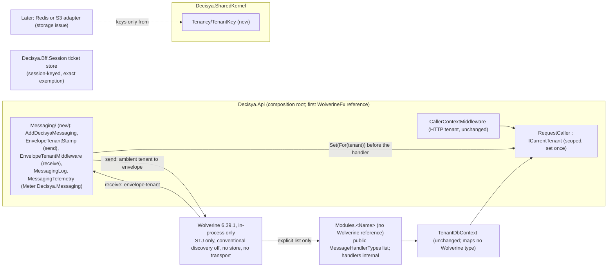

# Architecture note – Tenant safety before the first Wolverine use (issue #231)

## Context
#231 adds the first reference to Wolverine and the one builder for tenant-keyed Redis and object-storage keys. It closes C-13 (serializer, discovery, outbox entities) and C-14. Inputs: [requirements](../requirements/231-wolverine-tenant-safety.md) (G1 PASS, with Marco's answers of 2026-11-01), NFR-61, ADR-0001, 0005, 0007, 0012 and 0013. The decision is recorded in **[ADR-0024](../adr/0024-wolverine-envelope-tenant-and-outbox-storage.md) (Accepted 2026-11-01; amendments 1 and 2 at G4)**. This is a tenancy change, so the note is in full form. No behaviour changes for users.

## C4 excerpt

## Boundaries and contracts
- **Contracts types / messages:** none added. Message records live in `Modules.<Name>.Contracts` (ADR-0005). They carry no tenant property for routing: the envelope carries the tenant, and handlers read the tenant only from `ICurrentTenant`. A `TenantId` member that a message does carry is either a constructor parameter or `required`.
- **New public surface, `Decisya.SharedKernel.Tenancy.TenantKey`** (sealed class, private constructor, BCL only):
  - `static TenantKey For(TenantId tenant, params ReadOnlySpan<string> segments)` throws `ArgumentException` on `default(TenantId)`, on zero segments, on any segment that breaks the rules below, or when the key would be too long. No overload takes `string`, `Guid` or `object` for the tenant.
  - `TenantId Tenant { get; }`
  - `string ToCacheKey()` gives `<tenant>:<s1>:<s2>`.
  - `string ToObjectKey()` gives `<tenant>/<s1>/<s2>`.
  - `<tenant>` is `TenantId.Value.ToString("D")` (36 characters, lower case). It is fixed length and the separators are banned in segments, so two tenants can never produce the same key.
  - Value equality.
  - Constants `MaxSegmentLength = 128` and `MaxKeyLength = 512`.
- **Segment rules (Story 5):**
  - 1 to 128 characters from `[a-z0-9._-]`. This allow-list bans `/`, `:`, whitespace, control characters and non-ASCII. Being ASCII-only, a character is one byte.
  - `.` and `..` are refused.
  - The whole key is at most 512 characters.
- **Why 128 and 512:** S3 caps an object key at 1024 UTF-8 bytes, and 512 leaves half of that for a bucket-side prefix that the storage issue may add. Redis allows 512 MB, but short keys save memory. 128 fits a GUID plus a descriptive name with room to spare.
- **Key namespacing:** the builder adds no application prefix, so keys start with the tenant (Story 5). A Redis or S3 namespace is an option the application sets in its client, outside the builder.
- **Module handler surface:**
  - A module with handlers exposes `public static IReadOnlyList<Type> MessageHandlerTypes` on its `<Name>Module` class. Handlers stay `internal`.
  - `AddDecisyaMessaging` takes the lists explicitly.
  - Modules do not reference Wolverine in #231. The first module that publishes is a G2-reviewed change to R5.
- **Envelope (application options, in `Decisya.Api`):**
  - The send stamp writes the ambient tenant's canonical text and the originating caller id (a header; `RequestCaller.Set` needs a non-blank user id). It throws when the ambient is not `Tenant`.
  - The receive middleware refuses an envelope whose tenant is missing, or is not the exact canonical text (`TenantId.TryParse` succeeds and `ToString()` equals the input ordinally; `TryParse` alone accepts padding and upper case). It also refuses a missing caller id.
  - Refusal reasons: `missing`, `malformed`, `no-caller`.
  - A refusal returns `HandlerContinuation.Stop` (no exception, so no retry and no dead letter). It logs one `LoggerMessage` event (message type, message id, reason, trace id) and adds 1 to `decisya.messaging.envelope.refused{reason}`. A refusal runs no handler. Handler dependencies may already be constructed (WolverineFx 6.39.1 builds them before the middleware), but no tenant-scoped read or write and no caller read happens before the middleware sets `RequestCaller` (G3 G4-231-08; R1, R16).
- **Fail-closed backstop:** `RequestCaller` defaults to `Invalid`. A `DbContext` constructed before the middleware (as 6.39.1 does) keeps the `ICurrentTenant` reference and reads it per query and per save, so it throws `InvalidTenant` until the middleware sets the tenant, and then works as that tenant.
- **Breaking changes:** none for users. Developers: `ApiBoundaryTests`'s minter list grows by exactly one type, and modules stay Wolverine-free until R5 changes.

## Decisions
1. **Outbox entities: no envelope entity in any EF model** (ADR-0024, option 3). This rejects both the separate DbContext and the exact-type allow-list.
   - Trade-off: one extra command per save instead of batching into `SaveChanges`, and a dependency on Wolverine keeping the unmapped EF path. In exchange, NFR-28 keeps no exception and `TenantDbContext` gets no seam.
   - Exact entity types in any model: **none**. `MapWolverineEnvelopeStorage` is banned (R7).
   - The tables (`wolverine_incoming_envelopes`, `wolverine_outgoing_envelopes`, `wolverine_dead_letters`, plus node tables) belong to Wolverine's Postgres message store in schema `wolverine`, created by the migrator.
   - No ADR-0001 amendment is needed: its "Enforced by" line holds as written.
2. **First reference: `Decisya.Api`** (`WolverineFx` only), in `src/Decisya.Api/Messaging/`.
   - The Api is where the tenant enters the process: the HTTP claim now, the envelope next.
   - `RequestCaller.Set` is `internal` there, so a separate `Infrastructure.Messaging` project would need a second `ICurrentTenant` or an `InternalsVisibleTo`.
   - When a module moves to its own host, it extracts `Messaging/` with that move.
   - The serializer setting and discovery live in `AddDecisyaMessaging`. Wolverine runs in-process with no store, transport or listener (ADR-0024 point 2).
3. **Key builder:** `SharedKernel.Tenancy.TenantKey`, as above. No ADR is needed: it implements ADR-0001's "keys are prefixed with the tenant id". The storage wrapper's key parameter is `TenantKey` (a criterion recorded for the storage issue).
4. **Cross-tenant messages:**
   - On the receive side, every handler, attributed or not, runs under the envelope tenant. Story 1 scenario 4 holds this way, with the audit appended inside the handler's own transaction (ADR-0013).
   - The explicit-target send (a `TenantResolution` minted by an attributed, audited type, as in ADR-0012 amendment 1 point 6) comes with the first cross-tenant sender, under its own G2 review.

## Architecture-test rules to add
Scopes:
- **WolverineScope** is `ArchitectureScope` plus `Decisya.Api`, `Decisya.Bff` and `Decisya.ServiceDefaults`.
- **KeyScope** is every `src/**/*.csproj` assembly except `Decisya.AppHost` and `Decisya.Infrastructure.Migrator`. The Migrator only applies EF migrations and holds no cache, Redis or object-storage sink, and referencing it would load two EF Core versions.

*2026-11-01, G4 (Marco, option A):* KeyScope no longer includes `Decisya.Infrastructure.Migrator`. The planned `ProjectReference` from `Decisya.ArchitectureTests` to it broke the build with MSB3277: the Migrator's `Microsoft.EntityFrameworkCore.Design` 10.0.13 brings EF Core 10.0.13, while every other project resolves EF Core 10.0.4 through `Npgsql.EntityFrameworkCore.PostgreSQL` 10.0.3. R11 and the main-session edits below changed with it.

*2026-11-01, G4 (Marco, "yes"; [ADR-0024 amendment 1](../adr/0024-wolverine-envelope-tenant-and-outbox-storage.md#amendments)):* the design follows what WolverineFx 6.39.1 allows. Under `MediatorOnly` only `InvokeAsync` works, so R2 now covers the invoke paths and asserts that publish, send, delayed and scheduled sends and cascades throw; they return, stamped, with backlog #243 item 231-1. The stamp is the scope's `IMessageBus` wrapper (`MessageCallerBindings.DecorateScopedBus`), because 6.39.1 applies no `IEnvelopeRule` on invoke. R3 pins Wolverine's inert internals. R14 closes the unstamped `IMessageContext`/`MessageContext`/`MessageBus` path. R15 keeps `WolverineFx.RuntimeCompilation` (approved for `tests/Decisya.Api.Tests` only) out of every `src` project. The Api runs `TypeLoadMode.Static` and 6.39.1 ships no runtime compiler, so no Roslyn runs in the Api: the G3 note below about Roslyn in the lock diff no longer applies to the Api graph, and the backlog item on the code-generation mode is now a prerequisite of the first handler.

*2026-11-01, G4 (Marco, option A; [ADR-0024 amendment 2](../adr/0024-wolverine-envelope-tenant-and-outbox-storage.md#amendments); G3 "G4 delta 2"):* the G4-231-07 real-chain tests showed that WolverineFx 6.39.1 constructs a handler's dependencies before `EnvelopeTenantMiddleware.Before` runs, on refused messages too. This is a control-ordering gap with fail-closed data protection intact, not a data exposure: `TenantDbContext` keeps the `ICurrentTenant` reference and reads the tenant per query and per save, throwing under `Invalid`. The control is now: no tenant-scoped read or write and no caller read before tenant resolution, and tenant-dependent services read the tenant at use time, never in their constructor. R1 is restated to it (G3 G4-231-08), and so are the refusal and backstop lines under "Envelope" above. **R16** (G3 G4-231-09) is the static rule. A nested invoke from a handler keeps the tenant but loses the caller-id header and is refused as `no-caller`: accepted as fail-closed, R2's nested case pins it, and the fix is a hard prerequisite of the first handler that sends a nested message (backlog #243 item 231-5). Wolverine's four chain-less handlers are confirmed as R4's exact list (S-03); **R17** (G3 S-12) bans the routes into them that the chain walk cannot list. R16 and R17 are written in G4 by backend-dev, so proof (d) is in the G4 evidence; R1 to R15 stay with G5.

| # | Rule | Scope | Test class (project) |
| --- | --- | --- | --- |
| R1 | Refusal matrix of Story 1: valid tenant; missing; empty; whitespace; all-zero; `not-a-guid`; padded; upper case; `*DEFAULT*`; no caller. Receive-side cases inject envelopes below the send stamp and run through real chains (G3 G4-231-07). Control (G3 G4-231-08, ADR-0024 amendment 2 item 1): a refused message runs no handler, and no tenant-scoped read or write and no caller read happen before the middleware sets `RequestCaller`. WolverineFx 6.39.1 constructs handler dependencies before the middleware, so construction is allowed and asserted, not forbidden: - Each refusal: the handler method never runs; a scoped probe dependency constructed before the check records `Invalid` at construction and records no use-time read; the scope's `RequestCaller` stays `Invalid`; no exception reaches the caller; one log event without payload or raw value; counter +1 with `reason` as its only tag. - Valid path: `RequestCaller` is set once, with `IsPlatformAdmin` and `HasMfaLevel` false. The probe recorded `Invalid` at construction and reads tenant A and caller A at use time, through the same `ICurrentTenant` instance the middleware set (`ReferenceEquals` with the handler's `ICurrentTenant`, or an equivalent assertion). In the two-tenant concurrent test each probe reads its own message's tenant. - `TenantDbContext`, on a real subclass (`CompliantDbContext` is enough): a query and a save under `Invalid` throw `TenantIsolationException(InvalidTenant)` before any SQL (`TenantDbContextGuardTests` may be cited for this static case); a context constructed under `Invalid` whose same `ICurrentTenant` instance is then set to tenant A queries and saves as A. R16 is the static half of this control (proof (d)). | built Api host (chain host: Production composition, only `TypeLoadMode` Dynamic) | `Messaging/EnvelopeTenantTests`; the real-chain cases in `Messaging/EnvelopeChainTests` (`Decisya.Api.Tests`) |
| R2 | The send stamp is the scope's `IMessageBus` (`EnvelopeTenantStamp`); the root provider cannot resolve `IMessageBus`. Under `MediatorOnly` (ADR-0024 amendment 1): - `InvokeAsync`, with and without a response and with and without `DeliveryOptions`: a tenant A invoke arrives as tenant A with the sender's caller id; a foreign `DeliveryOptions.TenantId` and a forged caller-id header are overwritten; a nested invoke from a handler keeps the handled envelope's tenant but, in 6.39.1, loses the caller-id header and is refused as `no-caller` with the inner handler never run (pinned, fail-closed; fixed under backlog #243 item 231-5, ADR-0024 amendment 2 item 2); two scopes keep their own tenant and caller. - Every invoke overload throws `InvalidOperationException` for a `None` or `Invalid` ambient, before Wolverine sees the message. - `InvokeForTenantAsync` (both overloads), setting `TenantId`, `EndpointFor` (both overloads) and `BroadcastToTopicAsync` throw `NotSupportedException`. - `PublishAsync`, `SendAsync`, a delayed send, a scheduled send and a cascaded message (other than an invoke's own response) throw `InvalidOperationException` naming `MediatorOnly`, and no handler runs. They return, stamped, with backlog #243 item 231-1. - Every other member of the wrapper (`StreamAsync`, `PreviewSubscriptions`) either arrives stamped or throws. | built Api host | `Messaging/EnvelopeStampTests` (`Decisya.Api.Tests`) |
| R3 | Story 2: - STJ is the default and only serializer, with `RespectRequiredConstructorParameters` and `RespectNullableAnnotations` true. - The `TenantId` converter is in effect. - A missing or all-zero `TenantId` fails Wolverine's configured serializer. - The serializer registry holds exactly `application/json`, `binary/envelope` and `binary/wolverine` (Wolverine's two intrinsic entries). - On the composed Production runtime: `MediatorOnly`; the null message store as the main store and no ancillary store; no storage auto-build; external listeners off; transports exactly `local`, `stub` and `tcp`; every endpoint and active listener `local` or `stub`; durable endpoints at most `durable` and `scheduled` (ADR-0024 amendment 1, item 4). The enabling issue changes these on purpose. | built Api host | `Messaging/SerializerAndStorageTests` (`Decisya.Api.Tests`) |
| R4 | The discovered handler set equals the union of the explicit lists plus Wolverine's own types, exactly. Conventional discovery is off. | built Api host | `Messaging/HandlerDiscoveryTests` (`Decisya.Api.Tests`) |
| R5 | Every type in a module's `MessageHandlerTypes` is declared in that module's assembly. No `Decisya.Modules.*` assembly references the `Wolverine` assembly. | `ArchitectureScope` | `MessagingBoundaryTests` (`Decisya.ArchitectureTests`) |
| R6 | Every member of a type in the `Wolverine`, `Wolverine.*` or `JasperFx*` assemblies whose name contains `Tenant` (case-insensitive) is referenced only by the exact type `Decisya.Api.Messaging.EnvelopeTenantStamp` in `Decisya.Api`; the one other exemption is `get_TenantId`, read by the exact type `Decisya.Api.Messaging.EnvelopeTenantMiddleware` in `Decisya.Api`. A reference is any method or field operand (`call`, `callvirt`, `newobj`, `ldftn`, `ldtoken`, `ldfld`, `stfld` and the like); compiler-generated types count as their declaring type. Red and green fixtures. | WolverineScope | `WolverineTenantSetterRule` (`Decisya.ArchitectureTests`) |
| R7 | No method reference named `MapWolverineEnvelopeStorage`. A `TenancyViolations` fixture context that maps `Wolverine.Envelope` fails `TenantModelRule` and names the type. `TenantDbContext` still has no exemption seam. | WolverineScope plus the fixture | `EnvelopeStorageMappingRule`, `TenancyRuleTests` (`Decisya.ArchitectureTests`) |
| R8 | Fix: `No_Contracts_assembly_depends_on_a_persistence_or_web_framework` bans `"WolverineFx"`. That is the package id, so the check is vacuous today. It must ban the assembly name `"Wolverine"`. | `ContractsScope` | `ContractsBoundaryTests` (`Decisya.ArchitectureTests`) |
| R9 | The minter list is exactly `[CallerContextMiddleware, Messaging.EnvelopeTenantMiddleware]`. The middleware calls only `TenantResolution.For`. | `Decisya.Api` | `ApiBoundaryTests` (`Decisya.Api.Tests`) |
| R10 | Key sink rule. Sinks are members of `StackExchange.Redis`, `Microsoft.Extensions.Caching.Distributed`, `Microsoft.Extensions.Caching.Hybrid`, `Microsoft.Extensions.Caching.StackExchangeRedis`, `Amazon.S3` and `Minio`; the storage issue extends the list. Every type that references a sink: - is on the exact exemption list (`Decisya.Bff.Session.RedisTicketStore`, `Decisya.Bff.Session.RedisRefreshLock`, `Decisya.Bff.Session.RedisRegistration`), or references `TenantKey.ToCacheKey` or `ToObjectKey`; - and references no tenant text: `TenantId.get_Value`, `TenantId.ToString`, `box TenantId`, `constrained. TenantId`, a generic instantiation over `TenantId` (such as `AppendFormatted<TenantId>`), or `System.Security.Claims` members. Each exemption must be an existing exact type name; a namespace, a wildcard or an unknown name fails. Fixtures: a key built by hand fails, a sink with a plain string key fails, and `TenantKey` passes. | KeyScope plus fixtures | `TenantKeyRule` (`Decisya.ArchitectureTests`) |
| R11 | Every `src/**/*.csproj` except `Decisya.AppHost` and `Decisya.Infrastructure.Migrator` is in KeyScope (via `RepoPaths`). The exclusion list is exactly those two names, so a third exclusion fails. | repository | `TenantKeyRule` (`Decisya.ArchitectureTests`) |
| R12 | `TenantKey` (Story 5): - The surface has no `string`, `Guid` or `object` tenant overload. - The segment matrix holds, including 128 against 129 characters and 512 against 513. - `default(TenantId)` throws. - Two tenants give disjoint keys. | unit | `Tenancy/TenantKeyTests` (`Decisya.SharedKernel.Tests`) |
| R13 | Two-tenant Redis round trip through `ToCacheKey`: read, overwrite and delete stay with their tenant. Testcontainers Redis, already used there. | Integration | `TenantKeyRedisIsolationTests` (`Decisya.Bff.Tests`) |
| R14 | Unstamped-bus rule (ADR-0024 amendment 1, item 3). No type references `Wolverine.IMessageContext`, `Wolverine.Runtime.MessageContext`, `Wolverine.Runtime.MessageBus` or the method `Wolverine.HostBuilderExtensions.MessageBus(Microsoft.Extensions.Hosting.IHost)` (names confirmed in the 6.39.1 `Wolverine.xml`). A reference is any use in a signature, field, property, local, base type, interface, generic argument, cast, `typeof`, object creation or member call. Compiler-generated nested types count as their declaring type. - The one exemption is the exact namespace `Decisya.Api.Messaging` in the `Decisya.Api` assembly. It is not a prefix, and the same namespace in another assembly is not exempt. - The first handler with pre-generated code adds exactly `Internal.Generated.WolverineHandlers` in `Decisya.Api`, under its own G2. - Red fixtures (`Fixtures/TenancyViolations`), one per target, each named in the failure: a constructor taking `IMessageContext`; a field of type `MessageContext`; `new MessageBus(runtime)` (a `MessageBus` parameter if 6.39.1's constructor is not public; the XML docs do not list it); a call to `host.MessageBus()`; and a type in namespace `Decisya.Api.Messaging` declared in the fixture assembly. - Green fixture (`Fixtures/TenancyCompliant`): a type that takes and calls only `Wolverine.IMessageBus`. | KeyScope plus fixtures | `UnstampedBusRule` (`Decisya.ArchitectureTests`) |
| R15 | Runtime compiler stays out of `src` (ADR-0024 amendment 1, item 5). - No `src/**/*.csproj` (via `RepoPaths`) has a `PackageReference` to `WolverineFx.RuntimeCompilation`. - No KeyScope assembly references the `Wolverine.RuntimeCompilation` assembly. - The csproj check is red on an inline project text that holds the reference, and green on the real `src` tree. `tests/Decisya.Api.Tests` is the only project that may reference the package. | repository and KeyScope | `MessagingBoundaryTests` (`Decisya.ArchitectureTests`) |
| R16 | No tenant or caller read at construction time (G3 G4-231-09, proof (d); ADR-0024 amendment 2 item 1). Banned members, matched by the referenced method's declaring type (a generic instance resolved to its element) and exact name: - `Decisya.SharedKernel.Tenancy.ICurrentTenant.get_Resolution`; - `Decisya.SharedKernel.Tenancy.ICurrentCaller.get_UserId` and `get_IsPlatformAdmin`; - every `Decisya.Api.Authentication.RequestCaller` getter: `get_Resolution`, `get_UserId`, `get_IsPlatformAdmin`, `get_HasMfaLevel`; - `Wolverine.IMessageBus.get_TenantId`. A read is a `call` or `callvirt` (with or without a `constrained.` prefix) of a banned member. Code checked: - the own IL of every instance constructor (`.ctor`) and static constructor (`.cctor`) of every type. Field initializers compile into these bodies, so they are checked; - the body of every delegate passed as an `IServiceProvider` factory to a DI registration: a `Func<IServiceProvider, …>` (or keyed `Func<IServiceProvider, object?, …>`) handed to `Microsoft.Extensions.DependencyInjection.ServiceCollectionServiceExtensions.Add*`, `Microsoft.Extensions.DependencyInjection.Extensions.ServiceCollectionDescriptorExtensions.TryAdd*`, or a `Microsoft.Extensions.DependencyInjection.ServiceDescriptor` constructor or static factory (`Describe`, `Scoped`, `Singleton`, `Transient`, and their keyed forms). The factory body is the method its `ldftn`/`ldvirtftn` names. The detection may over-approximate, for example every `Func<IServiceProvider, …>` body in scope, as long as it is green on `src`; it never under-approximates. Not checked (the approved use-time pattern; the rule must not flag it): a lambda, local function or expression tree declared in a constructor and stored for later, such as `new Lazy<T>(() => tenant.Resolution)`. Their bodies compile into separate methods, so the constructor half reads the constructor body only and follows no `ldftn`, `ldtoken` or call. It does not use `MethodReferenceScan.ReferencesOf`, which folds closure bodies into the declaring type. A constructor that calls a helper which reads the tenant passes: an indirect read, accepted as Low by G3 (the behaviour proofs in R1 and the throwing `TenantDbContext` and `UserId` are the backstop). Exemptions: an exact list of type full names (reflection style), **empty** in #231. Each entry must be an existing type in KeyScope; a namespace, a wildcard or an unknown name fails. `EnvelopeTenantMiddleware` and `EnvelopeTenantStamp` read in methods, not constructors, and need none. Each failure names the type, the constructor or factory, and the banned member. Red fixtures (`Fixtures/TenancyViolations`), one per shape, each named in the failure: a constructor that reads `ICurrentTenant.Resolution`; a constructor that reads `ICurrentCaller.UserId`; a field initializer that reads `ICurrentCaller.IsPlatformAdmin`; a DI factory (`AddScoped<T>(sp => …sp.GetRequiredService<ICurrentTenant>().Resolution…)`) that reads `Resolution`. `RequestCaller` is internal to `Decisya.Api`, so its getters are matched by name and have no fixture. Green fixtures (`Fixtures/TenancyCompliant`): a constructor that stores the `ICurrentTenant` reference and a method that reads it; a constructor that builds a `Lazy` over a lambda that reads it. Green on today's `src`: its DI factories (the two forwards in `AddDecisyaApiAuthentication`, `MessageCallerBindings.DecorateScopedBus`) read no banned member. | KeyScope plus fixtures | `ConstructionTimeTenantReadRule` (`Decisya.ArchitectureTests`) |
| R17 | No route into Wolverine's chain-less handlers (G3 S-12, G4 delta 2 finding 3; ADR-0024 amendment 2 item 3). The chain walk (R4, G3 G4-231-07) pins exactly four `message type => handler type` pairs that run no middleware; it cannot list `IAgentCommand` implementations, because Wolverine routes any implementing type by interface. No type in a KeyScope assembly (compiler-generated types counted as their declaring type): - implements `Wolverine.Runtime.Agents.IAgentCommand`, directly, through a base type or through another interface; - creates, by `newobj` of any constructor, `Wolverine.Envelope`, `Wolverine.Runtime.RemoteInvocation.Acknowledgement` or `Wolverine.Runtime.RemoteInvocation.FailureAcknowledgement`. Exact full names, confirmed in the restored 6.39.1 `lib/net10.0/Wolverine.xml`, matched exactly, never by namespace or assembly. The exemption list is exact type full names, **empty** in #231. The first issue that needs one of these changes R17 under its own G2 and G3. Red fixtures (`Fixtures/TenancyViolations`), one per target, each named in the failure: a class implementing `IAgentCommand`; `new Envelope(…)`; `new Acknowledgement(…)`; `new FailureAcknowledgement(…)`. If 6.39.1 gives one of them no constructor a fixture can call, stop and report to G2 and G3; never drop the fixture or the target. Green on today's `src`. | KeyScope plus fixtures | `ChainlessHandlerRouteRule` (`Decisya.ArchitectureTests`) |

Story 6 scenario 2 (a handler without an isolation test): G5 adds a check that is red on a fixture, for example R5 requiring an isolation test per listed handler type. Story 6 scenario 1 (register): security-reviewer updates C-13 and C-14 at G6.

## G4 split (files)
| Who | Files |
| --- | --- |
| backend-dev | `src/Decisya.SharedKernel/Tenancy/TenantKey.cs`; `src/Decisya.Api/Messaging/*` (with the `EnvelopeTenantMiddleware` XML doc restated to G3 G4-231-08). In G4, because Marco wants proof (d) in the G4 evidence (2026-11-01, option A): R16 and R17 in `tests/Decisya.ArchitectureTests/` (`KeyScope` as defined above, `ConstructionTimeTenantReadRule`, `ChainlessHandlerRouteRule`) and their fixtures under `Fixtures/TenancyViolations` and `Fixtures/TenancyCompliant`. The fixture projects already reference `WolverineFx`, `Decisya.SharedKernel` and `Microsoft.AspNetCore.App`, so no csproj or lock change is needed. |
| identity-dev | `src/Decisya.Api/Program.cs`: `builder.AddDecisyaMessaging(...)` after `AddDecisyaApiAuthentication` |
| main session (Marco approves each write) | see below |
| test-engineer (G5) | R1 to R15, and their fixtures under `tests/Decisya.ArchitectureTests/Fixtures/*`. R10, R11 and R14 reuse the `KeyScope` backend-dev adds. |

Main session edits:
- **`src/Decisya.Api/Decisya.Api.csproj`:** add `<PackageReference Include="WolverineFx" />`. Do not add `WolverineFx.Postgresql` or `WolverineFx.EntityFrameworkCore` (ADR-0024 point 2).
- **`tests/Decisya.ArchitectureTests/Decisya.ArchitectureTests.csproj`:** add a `ProjectReference` to `src/Decisya.Bff/Decisya.Bff.csproj`, for KeyScope and R10's exemption check.
- **`Fixtures/TenancyViolations/TenancyViolations.csproj` and `Fixtures/TenancyCompliant/TenancyCompliant.csproj`:** add `<PackageReference Include="WolverineFx" />` (R6, R7) and `<FrameworkReference Include="Microsoft.AspNetCore.App" />` (an `IDistributedCache` sink for R10).
- **Lock files:** regenerate every `packages.lock.json` whose graph changes (Api, Api.Tests, ArchitectureTests and its fixtures, AppHost if it locks the Api graph) under locked restore (ADR-0019 A6).
- **No change** to `Directory.Packages.props` or `decisya.slnx`.
- **PR body line:** "WolverineFx (already pinned 6.39.1): first use; in-process mediator and the envelope-tenant pipeline (ADR-0024)."

Order: backend-dev, identity-dev, main session (csproj and locks), G5.

## Notes for G3 and G5 (no decision needed)
- G3: review WolverineFx's transitive closure in the lock diff (the runtime code generator brings Roslyn).
- Wolverine's own `Wolverine` meter and activity source stay unsubscribed (the OTel wildcard is `Decisya.*`). Their tags include tenant ids, so subscribing them is a later decision.
- Set Wolverine's log categories to `Warning` so no envelope body reaches the log, and extend `LogScanTests`.
- To the phase backlog #243: Wolverine's code-generation mode (dynamic in development, static for release images).

## Question for Marco
1. **Durable storage in #231?**
   - **Recommendation: no** (ADR-0024 point 2). G1's own out-of-scope line excludes "the outbox mechanism itself", the Done-when needs only the decision, and no package or schema is added.
   - Risk of no: Story 4 scenarios 5 and 6, and Story 1's "no row" line, move to the enabling issue as recorded criteria, and the refusal is proven in-process only until then.
   - Alternative: enable it now. Add `WolverineFx.Postgresql` (pinned), give the migrator the `wolverine` schema and grants, and get Marco's approval for `WolverineFx.EntityFrameworkCore`.
   - Risk of the alternative: roughly double the scope (migrator, role grants and their Testcontainers tests). The durable inbox may also keep handled rows for deduplication, which conflicts with "no row" and needs its own design.

<!-- gate: G2 | verdict: PASS-WITH-NOTES | issue: #231 -->
