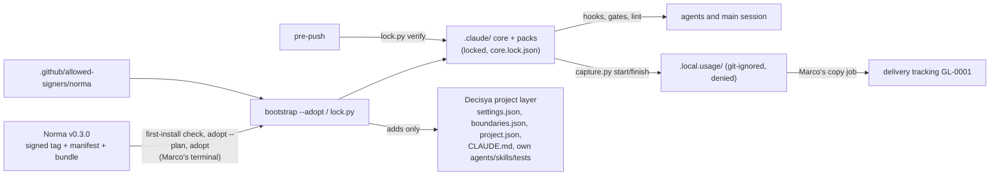

# Architecture note – lock Norma 0.3.0 (issue #246)

## Context
Decisya locks Norma 0.3.0 (core plus the `dotnet` and `npm` packs, so `--packs dotnet,npm`) into `.claude/` for the first time, by `bootstrap --adopt`. Until now `.claude/` has been maintained by hand. No module, contract, assembly or runtime data flow changes. What changes:
- who owns the agent guardrails;
- who writes build logic;
- a new local-only folder for the usage capture.

Sources, read as data and matching the release notice: the Norma 0.3.0 `CHANGELOG.md`, `docs/architecture.md`, `docs/consumer-guide.md`, `docs/project-json.md` and `docs/runbooks/bump-a-consumer.md`. This note refreshes the 0.2.1 version.

## C4 excerpt

## 1. ADR
Yes: the change moves ownership of `.claude/`, makes bumps the way rules change, and adds a trust root. **ADR-0023, "Lock the shared Norma rule set into `.claude/`", Proposed**, refreshed for 0.3.0 (title unchanged, so the index line stands). Marco accepts it before G4 merges.

## 2. Ownership after the lock
| Owner | Files | On a bump |
| --- | --- | --- |
| Norma (locked) | Every file in `.claude/core.lock.json`: all of `.claude/hooks/` and `.claude/scripts/` (`capture.py` included; only release files may live there). The core skills `issue`, `adr-writer`, `architecture-note`, `threat-model`, `asvs-checklist`, `traceability`, `runbook`, `bootstrap`, `solution-overview`. The core agents `product-owner`, `architect`, `security-reviewer`, `test-engineer`, `tech-writer`. `rules/core.md`, `base-settings.json`, `packs/*.json`, `github-features.json` | overwritten |
| Decisya | `project.json`, `settings.json`, `boundaries.json`, `CLAUDE.md`. The agents `backend-dev`, `platform-dev`, `identity-dev`, `frontend-dev`, `devops`, `compliance-auditor`. The skills `api-contract`, `isolation-test`, `module-scaffold`, `phase-exit-audit`. Decisya's own `.claude/tests` | untouched |
| Local only, not in git | `.local.usage/` (written by `capture.py`) | untouched |

**The mechanism for keeping Decisya's settings and stricter rules is adopt mode** (consumer guide, "Settings for a project that has its own"; ADR-0023 decisions 2 and 3):
- `bootstrap --adopt` never replaces `settings.json` or `boundaries.json`. It only adds, at the end of each list:
  - to `settings.json`: the base `deny` entries and the two core hook registrations;
  - to `boundaries.json` `deny`: the packs' build-logic globs and `.local.usage/**`.
  It never removes, reorders or replaces an entry, so every Decisya `allow`, `ask` and `deny` entry, lane and Docker allow-list stays. `--plan` prints each addition and writes nothing; the session reviews that output before `--adopt`.
- **Expected snag for G4.** If a file "registers a core hook another way, as an older install did", `--adopt` writes nothing at all and names the place. Decisya's `settings.json` registers `agent_boundaries.py` and `secret_guard.py` in shell form, so the plan will likely name it. Then `settings.json` is merged by hand: the two registrations are replaced by the guide's exec form, and adopt runs again. All of this happens in Marco's terminal; settings take effect only after Claude Code restarts.
- Adopt does not remove the older engine files. The 0.1.0 ACTION REQUIRED still applies: before bootstrap, `.claude/hooks/` and `.claude/scripts/` are emptied of the older copies, and the older tests of those engines go.
- Beyond what adopt carries, a stricter rule lives in the project layer: a `deny` or lane entry, a settings `deny`/`ask` entry, an extra floor entry in `project.json`, a guard in `.claude/guards/`, `CLAUDE.md`, or a Decisya agent or skill. Each one gets a Decisya regression test against the installed core. Where only the core can hold a rule, Norma is asked for a core option.

G4 inventories the rules in the replaced files and records each as covered by the core / moved, with its test / missing (G3 decides). Known items:
- #218, case-insensitive `deny` and Windows names: in the core. Keep `HiddenBuildLogicTests`.
- #217, Git Bash: `gitbash.py` must also accept git under `mingw64|ucrt64|clangarm64\libexec\git-core\`, walking up at most four folders. Test it with that folder first on PATH (0.3.0 ACTION REQUIRED; the scope's hook-PATH test). `test_gitbash.py` stays: it also covers `deploy/tests`.
- Decisya-only lint patterns (the sandbox and compose checks, risky grants, ASVS 4.0 labels, `git diff main`, the trait filter's exit 8): only packs add lint patterns, so these move into a Decisya test file.
- The issue skill's local text (Keep issues small, the security-reviewer prompt addition, the VS 2026 | CLI table) moves to `CLAUDE.md` or a Decisya skill.

**Usage capture** (ADR-0023 decision 5):
- `usage` is `{"capture_folder": ".local.usage", "project_id": "GL-0001"}`. It is written in Marco's terminal right before the install: both the old and the new loader refuse a mismatch, and the hooks then deny every command.
- `/.local.usage/` goes into `.gitignore` as a folder (a file pattern is not enough), and `.local.usage/**` into the shared `deny`, before the first capture.
- The folder holds `capture-<id>.json`, a null-issue capture, `ledger.jsonl`, `start-<n>.json` and `worktrees.json`: token counts only, from the usage fields of this repository's session records. The `issue` skill writes it at G0 and after the merge.
- Two Windows accounts: `capture.py finish <n> --other-accounts` under each, in its own clone. Both captures say `partial`, and the copy job lists both folders.
- This issue's own capture is `partial` (no recorded start).
- For G3: the capture reads `~/.claude` session records (it states usage fields only); there is no egress in the core, and the copy job runs outside Norma.

**`blocked_folders`:** `[]` in this issue. Today's guard does not block `ops.local/` either, so nothing gets weaker. The `.local.ops` rename is its own issue, guard entry first. A `.local.ops` entry blocks `.local.o…` and leaves `.local.usage` free. Never list `.local.u…` (the loader refuses the capture folder) or `.local.d…`.

## 3. Owner of project and build files
Done when point 3 (no undenied build-logic warning) puts every pack glob into the shared `deny` list, at the root and at any depth, and a lane never overrides `deny`. The 0.3.0 `issue` skill states it outright: files the shared `deny` keeps from every listed agent are the main session's to change.

| Group | Globs | Owner | Trade-off |
| --- | --- | --- | --- |
| Generated, git-ignored | `obj/**`, `bin/**`, `*.user` | nobody (tools write them) | none |
| Project and solution files | `*.csproj`, `*.slnx` (plus the unused `*.fsproj`, `*.vbproj`, `*.proj`, `*.projitems`, `*.shproj`, `*.sln`, `*.slnf`) | the main session, at G4 as a build-logic step before the lane agent runs. New projects come from the `module-scaffold` assets (the orchestrator runs `scaffold.py`). Add `settings.json` `ask` entries | more prompts and main-session work; no agent runs build logic it wrote itself |
| Central build and restore policy | `Directory.Build.*`, `*.props` (`Directory.Packages.props` too), `*.targets`, `NuGet.config`, `global.json`, `*.runsettings` | the main session only, with Marco's approval in the manifest and an `ask` entry. Drop `Directory.Build.props` and `global.json` from the devops lane | slower central changes |

G4 records this as a `routing.G4` row and renders `docs/ai/README.md`. It also edits `backend-dev`, `platform-dev`, `identity-dev` and `module-scaffold` so that none of them writes `*.csproj`. `packs.dotnet`: `solution` is `decisya.slnx`, `unit_test_filters` are the two `--filter-not-trait` pairs, and `locked_restore.env_name` is `DECISYA_LOCKED_RESTORE` (ADR-0019 A6).

## 4. Enforced rules affected
- NetArchTest: N/A (no module, assembly or dependency change).
- `.claude` suite:
  - The tests of the old engines go.
  - Decisya's suites stay: ADR-0014 pins, ADR-0022 image scan, ruleset, ZAP, build policy, Dependabot, CI changes, plus the regression tests above.
  - `test_roster` drops the issue-skill rendering.
- `lint.py` check 15: an existing capture folder that git does not ignore fails.
- Recommendations for G3 only (out of scope, backlog #243):
  - items 246-1 to 246-3: the CI lock check with the base branch's checker, the commitlint range, `prereqs.py github --actual`. Until the first lands, `lock.py verify` runs only in the pre-push check, which `--no-verify` skips;
  - add `Directory.Build.*`, `*.targets`, `NuGet.config` and `global.json` to `gates.review_required_paths`;
  - deny `.github/allowed-signers/**` to agents (the devops `.github/**` lane reaches both signer files).

## Open questions for Marco
Answered: 1 (Done when point 4 amended), 2 (Scope item 6), 7 (`DECISYA_LOCKED_RESTORE`).
3. **Addenda.** Still open. The 0.3.0 documents name addenda as project-owned and review-required, but do not say what an addendum is, or how a project extends a core agent or skill. Where do the Decisya rules in today's architect and security-reviewer texts go (the Contracts lane, ITenantScoped, ADR-0005)? Until this is answered: `CLAUDE.md`.
4. **`otel-instrumentation` collision.** Still open in the documents. The main session answers it from the bundle's file list after the first-install check.
5. **Files in `.claude/tests/`.** Still open in the documents: only `hooks/` and `scripts/` are core-only. The main session answers it from the bundle's file list.
6. **A `routing.G4` row naming the main session.** Partly answered: the 0.3.0 `issue` skill gives denied files to the main session. Whether the loader accepts a non-agent name in `routing.G4` is not documented; `lint.py` decides at G4. If it refuses, G4 stops and reports.

<!-- gate: G2 | verdict: PASS | issue: #246 -->
