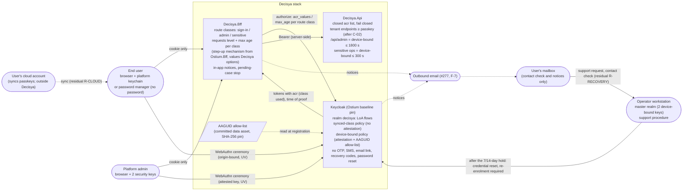

# Architecture note – end-user authenticators at ASVS Level 3: synced versus device-bound passkeys (issue #266)

## Context

Issue #266 decides authentication strength. It makes no code, realm, BFF or test change: G4 and G5 are skipped (manifest `docs/ai/pipeline/266.md`, Marco 2026-11-03). The issue changes the target authentication data flow and the token contract between Keycloak, the BFF and the Api. So this note is the full form, not N/A.

- Requirements: `docs/requirements/266-end-user-authenticators-l3.md` (G1 PASS-WITH-NOTES; K1 to K10, T1 to T8, Marco's decisions Q1 to Q5), NFR-63 to NFR-69.
- Decision: **[ADR-0025](../adr/0025-authenticators-at-asvs-level-3.md)** (Proposed; Marco accepts by 2026-11-20). It refines ADR-0002 and supersedes D-012's Level 3 guarantee on acceptance.
- Threat delta: `docs/security/threat-models/266-end-user-authenticators-l3.md` (G3).
- Applicable decisions:
  - ADR-0001: one tenant per end user, cross-tenant admin;
  - ADR-0003: BFF session, tokens server-side;
  - ADR-0016: synthetic users only;
  - ADR-0019: identity code in Ostium; the BFF frozen until its switch; app-owned values are options;
  - D-008: Ostium owns the Keycloak baseline;
  - the #121 note `docs/architecture/production-identity.md` (D2 realm migration, D3 admin MFA, D7 spike).
- **G3 outcome (2026-11-03): PASS-WITH-NOTES.** G3 found one High, T266-02: email control alone passed total-loss recovery. That High is mitigated by MUSTs M266-01 to M266-05. ADR-0025 was revised the same day to carry the five MUSTs and Marco's acceptance-point decisions:
  - R-RECOVERY accepted;
  - a recovery hold of 7 days, or 14 days for an account that ever held a device-bound key;
  - P-1: no end-user password;
  - P-2: the master-realm operator account moves to device-bound keys;
  - P-3: the 300 s proof age kept;
  - P-4: SMTP created as #277.

  NFR-69 was added by the product owner. G3's SHOULDs S266-01 to S266-10 are inputs to the follow-ups below.

## C4 excerpt: the target authentication flow

Target state after the follow-up issues. Today the BFF sends `acr_values=2` on every sign-in, and level 2 is TOTP for admins (#121).

- **Sign-in (end user).** The BFF asks for the base level. Keycloak runs a passkey ceremony, with user verification required, and issues `acr` = `passkey`. There is no password and no device-bound prompt.
- **Sensitive operation (end user).** The Api refuses the call without a fresh `device-bound` proof, using its generic step-up refusal. The BFF then runs a step-up authorize request for `device-bound` with a maximum age. Keycloak asks for a credential of the device-bound type only and never offers registration. The new token carries `device-bound` and the time of the proof. A user with no device-bound credential gets the support route.
- **Admin.** An admin session reaches `/api/admin` only at `device-bound`, with a proof at most 1800 s old. Whether admins reach that level at sign-in (role-conditioned, as today) or by a step-up on entering the admin area is the realm and BFF issues' choice. The invariants below hold either way. The master-realm operator account holds two device-bound keys too.
- **Recovery and support cases.** There is no automated path. The steps are:
  1. a contact check through the mailbox;
  2. a hold of 7 days, or 14 days for an account that ever held a device-bound key;
  3. a notice by email, and in the application at the next sign-in with any credential, where a sign-in can stop the case (a stopped case goes to operator review);
  4. the operator's credential reset;
  5. re-enrolment at the original level.

  Deletion through support is restorable for a grace period (ADR-0025 decision 6, M-12, NFR-69).

## The level model (closed list)

| Order | Level (model name) | Class used | End user | Admin | Api accepts for |
| --- | --- | --- | --- | --- | --- |
| 1 | `password` | password only | Phase 0 synthetic users until C-02; never after (end users have no password, P-1) | intermediate step only | nothing once C-02 is on |
| 2 | `passkey` | synced class: WebAuthn, UV, no verified attestation | normal sign-in | never | tenant endpoints |
| 3 | `device-bound` | WebAuthn, UV, verified attestation, AAGUID on the allow-list | step-up for sensitive operations (≤ 300 s) | always (≤ 1800 s) | tenant endpoints, sensitive operations, `/api/admin/**` |

- Model names only. **The literal `acr` strings and LoA numbers are chosen by the realm issue.** They are Decisya-owned values passed as options, never defaults in shared or Ostium code.
- The token carries exactly one `acr` string claim, from this list. Anything else is "no level". This is the same rule `CallerIdentity` applies to `"2"` today.
- The level never exceeds the class used (NFR-66).
- If U-1 is negative and admins are enrolled under witness, level 3 for admins means "device-bound, enrolled under witness". The end-user use of level 3 is then suspended (ADR-0025 decision 7).

**Flow invariants** the realm and BFF issues must prove, whatever flow layout they choose:
- **I-1.** An end user is never asked for a device-bound credential at a plain sign-in. They are asked only on a step-up request.
- **I-2.** A step-up to `device-bound` never registers a credential. A missing device-bound credential fails the step-up (ADR-0025 M-8, U-5).
- **I-3.** An admin never holds a session that reaches `/api/admin` below `device-bound`.
- **I-4.** No session below `device-bound` changes a credential, the email address or the registered name. This covers every path: the account console, application-initiated actions, registration and recovery. The one exception is enrolment before the account is complete. If the account console and `kc_action` cannot be restricted, their credential and profile actions are disabled (M-9, M-12, U-7).
- **I-5.** No required action or flow step exists for TOTP, recovery codes, SMS, voice, an email link, an emailed code or a password reset (NFR-63).
- **I-6.** Every support case shows its pending notice in the application at the next sign-in with any registered credential, and a stop there sends the case to operator review (M-12, NFR-69).

## Boundaries and contracts

- **No module, `*.Contracts` type or Wolverine message changes.** The level is enforced in the Api composition (`Decisya.Api.Authentication`) and in route-group policies. Modules never read `acr`.
  - Admin and level facts never ride on a Wolverine message. `EnvelopeTenantMiddleware` already refuses a message scope that carries an admin or MFA fact (G6-231-01), and that stays.
  - A future sensitive operation in a module is gated by its route group in `Program.cs`, not inside the module.
  - Restorable deletion (M-12) is a future Tenancy/account concern. It is designed in its own issue (F-5 input), with `ITenantScoped` data kept but unreachable during the grace period.
- **Token contract, Keycloak → BFF → Api (changed).**
  - `acr` changes from `"1"`/`"2"` to one value from the closed list.
  - A claim that proves the time of the last device-bound proof is added. Which claim is item U-6; the Api enforces the proof's age, not `auth_time` of any authentication (S266-04).
  - Breaking: `CallerIdentity.MfaAcrValue = "2"`, the BFF's `AuthenticationContextValue = "2"`, `AuthEvents.ClassifyAcr`, and test tokens with `acr: "2"` all change in the Api and BFF issues.
- **Authorization request contract, BFF → Keycloak (changed).** The single constant `acr_values=2` is replaced by a value per route class (sign-in, admin, sensitive), plus `max_age` for the step-ups. The values are Decisya options.
- **Api policies (changed).**
  - `Api.AdminMfa` becomes "admin level" (`device-bound`, proof age at most 1800 s). The `Authentication:RequireAdminMfa` setting and its Development-only opt-out stay.
  - New: a minimum level for every tenant endpoint once C-02 is on, and a sensitive-operation policy (`device-bound`, proof age at most 300 s). The refusal is generic (403 problem details, no level named) and logs one fixed event.
- **Realm contract (changed, production and dev, parity slot P4).**
  - The two WebAuthn policies.
  - The LoA flows for the three levels.
  - The level map.
  - An explicit `requiredActions` list. This uses P4's reserved slot and reverses #121's rely-on-defaults decision (ADR-0025 U-8).
  - OTP removed, and no password for end users.
  - The account console and `kc_action` restricted or disabled for credential and profile actions.
  - Impersonation disabled, or kept from reaching the Api (U-11).
  - The relying-party id comes from the existing app-origin placeholder, so no new placeholder name is needed if U-1 to U-5 allow it.
- **Master realm (changed, operator configuration, not a realm file).** The operator account holds two device-bound keys and no OTP. `verify`'s master-realm check changes with it (F-6).
- **New external integration.** Outbound email, #277 (F-7). It carries the contact check, email verification at enrolment and the notices (M-13). It has its own threat model, and is a prerequisite of the C-02 switch-on.
- **New data asset.** The AAGUID allow-list of device-bound models, with a metadata snapshot for trust anchors if U-1 allows. It is committed under `deploy/keycloak/production/` with a `.SOURCE.md` record and a SHA-256 pin, like `common-passwords.txt` (S266-01). Marco approves its source and licence.
- **Ostium (D-008, ADR-0019).** Two things are requested through the exchange, as a draft Marco approves:
  - the BFF step-up mechanism, as an option-driven feature of `Ostium.Bff`;
  - possibly attestation verification, if U-1 is negative.

  The realm content stays Decisya's.
- **Breaking changes and who they affect.**
  - **Marco, as admin and master-realm operator:** TOTP stops on the switch, and two keys per account must be enrolled first.
  - **Synthetic tenant users:** they must enrol passkeys at the C-02 switch-on.
  - **Go-live gate:** C-02's TOTP switch-on steps A are replaced, and #277 becomes a prerequisite of C-02.
  - **Greenlight:** D-012 is superseded by the relaxation and the two residuals (ADR-0025 decision 9).
  - **AetherSpark:** none, unless it adopts the Ostium step-up feature.

## Decisions

- Authenticator classes per role, the level model, the relaxation, the residuals R-CLOUD and R-RECOVERY and the controls M-1 to M-13, sensitive operations, the admin and master-realm move, recovery, attestation and the spike re-open rule: **ADR-0025**.
- Keycloak capability: what is verified, what upstream documents, and what stays unknown (U-1 to U-11): **ADR-0025 section 8**.
  - The realm issue starts with a spike over U-1 to U-11 on the pinned version.
  - A negative on U-1, U-5, or U-7 without the disable fallback, stops it and goes to Marco, with no silent fallback, as #121's D7 did.
  - Such a negative re-opens ADR-0025 decisions 1 and 9 by a dated amendment, with Greenlight told in G-008 (decision 7).

## Follow-up issues (none implemented in #266)

Each is its own issue, in this order unless stated otherwise. The owners are routed by path, as in the `issue` skill. The G3 inputs are the SHOULDs from the threat delta.

| # | Follow-up | Owner (G4) | Depends on | Changes | G3 inputs |
| --- | --- | --- | --- | --- | --- |
| F-1 | **Realm: WebAuthn classes and levels.** Spike U-1 to U-11 first (stop on a negative of U-1, U-5, or U-7 without the disable fallback), then the production and dev realm | identity-dev | ADR-0025 accepted; #268 if merged by then | `deploy/keycloak/**`: both WebAuthn policies, LoA flows for the three levels, `acr.loa.map`, explicit `requiredActions`, OTP removed, no end-user password, account console and `kc_action` restricted or disabled for credentials, email and name, impersonation, AAGUID allow-list (Marco approves the data asset). Parity P4, realm-file tests, Integration tests NFR-63 to NFR-66. Realm-change entry in `docs/runbooks/deployable-stack.md` (the rebuild path while every user is synthetic) | S266-01 (backup flags, trust anchors only from a committed snapshot, SHA-256 pin), S266-02 (UV-unset and `none`-attestation cases), S266-03 (U-11 impersonation), S266-09 (no credential ids, user handles, public keys or attestation certificates in events) |
| F-2 | **Api: level policies** | identity-dev | F-1 (values) | `src/Decisya.Api/Authentication/**`, `Program.cs`: closed-list parsing, admin level (NFR-66 supersedes NFR-44), tenant minimum level after C-02, sensitive-operation policy with proof age (U-6). Coupling tests | S266-04 (age of the device-bound proof, not any `auth_time`; amendment if impossible), S266-09, S266-10 (shorter proof age for non-GET `/api/admin`) |
| F-3 | **BFF: route-class levels, step-up, in-app notices and stop** | Ostium first (exchange draft), then identity-dev at the BFF switch | ADR-0019 BFF switch; F-1 | Ostium.Bff option for the requested level and `max_age` per route class; Decisya sets the values; step-up redirect and return; `ClassifyAcr` closed list; pending-case notice and stop at sign-in (I-6) | S266-09 |
| F-4 | **Enrolment screens and sign-up** (two authenticators, no password, optional device-bound key) | frontend-dev + identity-dev | F-1, F-3, #277 (email verification) | Keycloak login theme or SPA screens; WCAG 2.2 AA; NFR-68 completion measurement (counts from Keycloak events, no personal data; target from Greenlight and Marco) | S266-06 (plain-words notice that a synced passkey is as safe as its cloud account; offer the device-bound option) |
| F-5 | **Recovery and support procedure** | devops / tech-writer, G3 reviews | F-1, #277 | `docs/runbooks/`: contact check, name compared with the enrolment value and history, hold of 7 or 14 days, email and in-app notice, stop leading to operator review, reset, re-enrolment at the original level, restorable deletion with a grace period at least as long as the hold (GDPR one-month window checked), record keeping without personal data in the repository. NFR-64, NFR-69 | S266-05 (one open case per account, rate limit, operator guidance on pressure to skip the hold) |
| F-6 | **Admin and master-realm move, and go-live gate** | devops; Marco runs the sitting | F-1, F-2 | Go-live gate: admin item (two device-bound keys, no OTP, master-realm operator included), the new C-02 switch-on steps, #277 as a C-02 prerequisite; `identity-check.sql` counts admins and master-realm operators with fewer than two device-bound credentials, any OTP credential, and accounts with fewer than two authenticators | S266-07 (last-resort break-glass through Keycloak's host-level bootstrap admin, then removed) |
| F-7 | **#277: outbound email (SMTP)** for sign-in, recovery and security notices. A prerequisite of the first non-synthetic sign-up (C-02) | platform-dev / devops, threat model first | — (created 2026-11-03, P-4) | New external integration: email verification at enrolment, the support channel's contact check, the notices of M-13 (with F-3 for the in-app side); also unlocks V6.3.5 and V6.3.7 | R-SMTP (threat delta residual) |
| F-8 | **Tests: WebAuthn in E2E** (U-10) | test-engineer | F-1, F-4 | Firefox and Chromium projects; a software-authenticator approach. A new package needs Marco's approval and a line in the PR body | S266-02 |
| F-9 | **Baseline records** | security-reviewer | as each control lands | ASVS rows and register C-01/C-02 as in ADR-0025 decision 10 | S266-08 (C-02 password rows N/A for end users, kept for admins) |
| F-10 | **Exchange** | orchestrator drafts, Marco approves | ADR-0025 accepted | New baseline contract superseding D-012 (decision 9 text); outcome posted in G-008; Ostium request for F-3 | — |
| F-11 | **Pointer note in ADR-0002** | architect | ADR-0025 accepted | A dated note like ADR-0003's: the MFA mechanism is ADR-0025's | — |

## Architecture-test and realm-guard rules to add

| Rule | Scope (assemblies, files) | Test class (proposed) | Issue |
| --- | --- | --- | --- |
| Authenticator providers in every flow of the production realm come from an allow-list (cookie, username form, password form for admins only, both WebAuthn authenticators, LoA and role conditions, plus what the spike adds). `auth-otp-form`, recovery-code, email, SMS and password-reset providers are refused by not being listed | `deploy/keycloak/production/realm-decisya.json` | `ProductionRealmFileTests` (new cases) | F-1 |
| `requiredActions` is explicit and equals a pinned allow-list. No TOTP, recovery-code or password-reset action is enabled. `resetPasswordAllowed` stays false | production and dev realm | `ProductionRealmFileTests`, `ProductionRealmParityTests` | F-1 |
| Both WebAuthn policies: user verification required, no extra origins, relying-party id from the placeholder only. Device-bound policy: attestation required, AAGUID list equal to the committed allow-list file. Synced policy: no AAGUID list. The allow-list file matches its SHA-256 pin | production realm, allow-list file | `ProductionRealmFileTests`; a `deploy/tests` pin test | F-1 |
| `acr.loa.map` keys equal the closed list. The `device-bound` sub-flow contains only the device-bound authenticator, with `userSetupAllowed: false` | production realm | `ProductionRealmFileTests` | F-1 |
| On the real realm, a synced-only session cannot: reach `device-bound`; register a device-bound credential by step-up; change credentials, the email or the registered name through the account console or `kc_action` (I-2, I-4). Also: an assertion with UV unset is refused, and an impersonated session reaches no Api endpoint | Testcontainers Keycloak, production realm | new `AuthenticatorClassProductionRealmTests` (Integration) | F-1 |
| Every `/api/admin` endpoint carries the admin-level policy. Every endpoint on the sensitive-operation list carries the sensitive policy. The list is pinned by a meta-test | `Decisya.Api` endpoint metadata | `AdminMfaCouplingTests` (renamed or extended), new `SensitiveOperationCouplingTests` | F-2 |
| `acr` parsing accepts only the closed list (single string claim). Anything else gives no level | `Decisya.Api.Authentication` | `AdminMfaPolicyTests` / `CallerIdentity` unit tests | F-2 |
| No type outside `Decisya.Api.Authentication` and `Program` depends on the level policies' types. No `Decisya.Modules.*` assembly depends on `Decisya.Api` (existing). Modules never see the level | `Decisya.Api`, `Decisya.Modules.*` | `ApiBoundaryTests` (new fact), `ModuleBoundaryTests` (existing) | F-2 |
| A pending support case shows its notice at the next sign-in with any registered credential, and a stop moves it to operator review (I-6, NFR-69) | BFF, SPA | `Decisya.Bff.Tests` Integration case; Playwright E2E | F-3, F-5 |
| The identity check reports: admins and master-realm operators with fewer than two device-bound credentials; any OTP credential; accounts with fewer than two authenticators | `deploy/keycloak/production/identity-check.sql` | `IdentityCheckSqlTests`, `ProductionIdentityCheckTests` | F-6 |
| The go-live gate names the admin and master-realm device-bound item, the passkey C-02 switch-on, and #277 as a C-02 prerequisite. It no longer names a TOTP switch-on | `docs/runbooks/go-live-gate.md` | `deploy/tests/test_go_live_gate.py` | F-6 |

No new NetArchTest boundary between modules is introduced. The only new type-level rule is the `ApiBoundaryTests` fact. The other rules are realm-file, Integration, endpoint-metadata and E2E tests, as in #121.

## Notes for G6 and Marco

1. **ASVS wording.** ADR-0025 now cites the orchestrator's check against `OWASP/ASVS` `v5.0.0`. The heading and the V6.3 introduction are verbatim. The two 6.3.3 clauses are confirmed in substance only, and the decision depends only on their substance (M266-05). Decision 6's "6.4.4's rule" and decision 10's row ids stay "to be checked".
2. **Residuals accepted by Marco (2026-11-03):**
   - R-CLOUD, at the extent G3 stated (M266-02);
   - R-RECOVERY (M266-01, option A), with M-12 and NFR-69.

   R-SPIKE (U-1 to U-11) and R-SMTP (#277) remain as the threat delta records them.
3. **Re-open rule.** A negative on U-1, U-5, or U-7 without the disable fallback re-opens ADR-0025 decisions 1 and 9 by a dated amendment, and Greenlight is told in G-008 (M266-04).

<!-- gate: G2 | verdict: PASS-WITH-NOTES | issue: #266 -->
