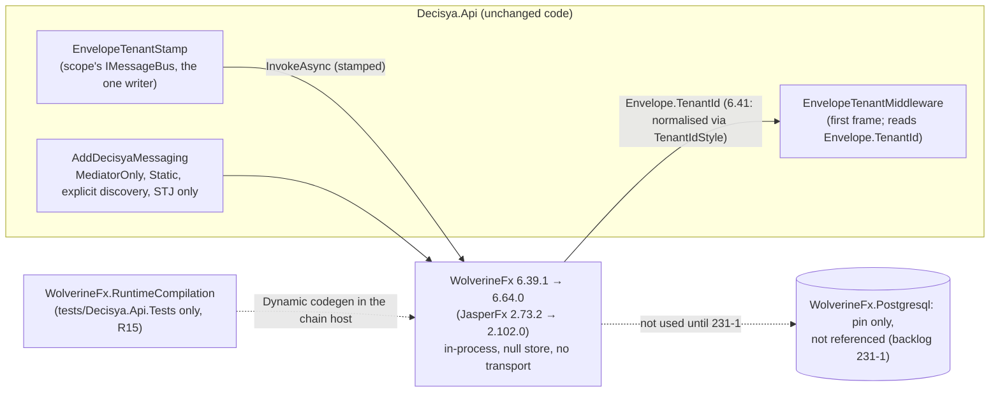

# Architecture note – Bump WolverineFx from 6.39.1 to 6.64.0 (issue #326)

## Context
#326 moves the three `WolverineFx*` pins in `Directory.Packages.props` from 6.39.1 to 6.64.0. They are `WolverineFx` (Api and the two architecture-test fixtures), `WolverineFx.Postgresql` (pinned, but no project references it) and `WolverineFx.RuntimeCompilation` (`tests/Decisya.Api.Tests` only, R15). The bump supersedes Dependabot #317. Wolverine carries the tenant on the envelope (platform invariant 1, ADR-0024), so per the architect addendum this note uses the full form even though Decisya's own boundaries do not change.

Inputs: the manifest `docs/ai/pipeline/326.md`; the release notes of the 37 releases from 6.40.0 to 6.64.2, fetched by the orchestrator (third-party text, read as data only); ADR-0005; ADR-0024 with amendments 1 and 2; the #231 note `231-wolverine-tenant-safety.md` (rules R1 to R17); the #231 threat model; `src/Decisya.Api/Messaging/*`; `tests/Decisya.Api.Tests/Messaging/*`; and the lock files.

Facts about the starting point that this note relies on:
- **The Api has no handler yet.** `Program.cs` calls `AddDecisyaMessaging()` with no lists. No `src` code sets an error policy or a `TenantIdStyle`, and none calls `RunJasperFxCommands` or resource setup.
- **Only one compile error on #317.** Dependabot #317 built with exactly one error, CS0618 on `DurabilitySettings.EnableMessageDeduplication` (`MessagingRuntimeTests.cs:70`). So restore under transitive pinning succeeded, and `EnvelopeTenantStamp` still implements every *abstract* member of `IMessageBus`. No test has run on 6.64.0 yet.

## C4 excerpt

## Release-note delta: what touches Decisya
Legend: **Yes** means it changes code or proof in #326. **Watch** means existing tests decide whether it applies, and G4 stops if one turns red. **No** means not on Decisya's paths. **231-1** and **codegen** mean it is recorded for that backlog item (see Backlog).

| Area | Release, item | Change | Affects Decisya? | Decisya file | R-rule / ADR point |
| --- | --- | --- | --- | --- | --- |
| Deduplication | 6.45 (GH-4757) | `EnableMessageDeduplication` is obsolete; the new `MessageDeduplicationMode` has three values, `None`, `CompareByString` and `CompareByHash`. `true` maps to `CompareByHash` and `false` to `None`. `CompareByHash` uses a separate table, `wolverine_deduplication_hashed`. | **Yes.** This is the #317 build break. | `tests/Decisya.Api.Tests/Messaging/MessagingRuntimeTests.cs:70` | R3; ADR-0024 point 2 (durable-mode test) |
| Envelope tenant | 6.41 (#4640) | `Envelope.TenantId` is now normalised through `TenantIdStyle`. Before, only `MessageContext.TenantId` was. | **Watch.** The middleware reads `Envelope.TenantId` and requires the exact canonical lower-case text. With a non-case-sensitive style, an upper-case tenant would arrive lower-cased and be accepted. Decisya sets no style, and R6 bans every `*Tenant*` Wolverine member outside the stamp, `TenantIdStyle` included. The real-chain case `upper` must stay `malformed`. | `EnvelopeTenantMiddleware.cs`, `EnvelopeFacts.TryReadTenant`; `EnvelopeChainTests` (`upper`) | R1, R6; ADR-0024 point 3 |
| Send paths, `MediatorOnly` | 6.50 (#4993) | New `BroadcastToAllNodesAsync()`, an **extension method** on `IMessageBus`. Per the notes, "`MediatorOnly` refuses it just like `PublishAsync()`". | **Yes (new proof).** It is a new send path that the stamp cannot intercept, because it is not an interface member. R2 has no case for it. | `EnvelopeStampTests` | R2; ADR-0024 amendment 1 item 1 |
| `IMessageBus` surface | 6.40 to 6.64 | Members added as extension methods ("so no other `IMessageBus` implementation breaks"). Any default interface member would compile silently. | **Yes (new proof).** G3 #231 item 2 says every `IMessageBus` member is either stamped or throws. That is proven only by enumerated calls, and a new default interface member would bypass the wrapper unnoticed. | `EnvelopeTenantStamp.cs`; `WolverineSurfaceTests` | R2 |
| `InvokeAsync` / `IEnvelopeRule` | none | No release changes `IEnvelopeRule` application on invoke. 6.45 (#4743, @lahma) fixes inline-retry state on `InvokeAsync`, which applies only with retry policies. | **No.** Decisya has no error policy, and refusal is `Stop`, not an exception. | n/a | ADR-0024 amendment 1 item 2 |
| Nested invoke and caller | none | No release mentions carrying headers onto a nested invoke. | **Watch.** The pinned `no-caller` test decides. | `EnvelopeStampTests:82-99` | R2; amendment 2 item 2; backlog 231-5 |
| Construction order | 6.44 (GH-4714), 6.49 (#4946), 6.52 (GH-5133, 7.0 prep "one chain per handler") | Continuation variables are numbered per chain. Latent `Separated` fixes. A startup warning for combined handlers. | **Watch.** The proofs (a), (c) and (e) decide. If dependencies are now built *after* the middleware, `built.Should().NotBeEmpty(...)` turns red. That is an improvement, but it is a behaviour change, so stop. | `EnvelopeChainTests`, `EnvelopeChainRefusalTests` | R1, R16; amendment 2 item 1 |
| Chain-less handlers | 6.50 (broadcast via node control), 6.52 and 6.61 (timer agents, `SkipWhileRunning`) | New internal messaging that may bring Wolverine-owned handlers. | **Watch.** The chain walk pins exactly four `type => handler` pairs. A fifth fails. | `EnvelopeChainTests:56-60` | R4, R17; amendment 2 item 3 |
| Code generation, `TypeLoadMode.Static` | 6.41 (#4625); 6.44 (GH-4699); 6.50 (#4984/#4992, a regression in 6.44 to 6.49); 6.50 (#4996) | Pre-generated types are looked up by full name. The static handler registry now honours `DisableConventionalDiscovery()` and the custom discovery rules (`IncludeType`). The application assembly is the one that *registered* Wolverine, which for Decisya is `Decisya.Api` through `AddDecisyaMessaging`. | **No today.** The Api has no handler, and the chain host is Dynamic. **codegen:** these fixes favour Decisya's Static plus explicit-discovery shape, and #4996 matches R14's planned `Internal.Generated.WolverineHandlers` exemption in `Decisya.Api`. | `DecisyaMessagingExtensions.cs:109-117`; `WolverineSurfaceTests` | R4, R14, R15; amendment 1 item 5 |
| `WolverineFx.RuntimeCompilation` | 6.57 (#5258) | `JasperFx.RuntimeCompiler` 5.0.0 → 5.0.1. | **Yes (lock only).** Test graph only. R15 and S-11 must stay green on `src` locks. | `tests/Decisya.Api.Tests/packages.lock.json` | R15 |
| Durability settings | 6.44 `CompressAgentCommands`; 6.48 `AgentRestrictionConfirmationTimeout`, `LeaderTakeoverHoldEvaluations`; 6.51 `NodeRole`, `DurabilityMode.ServerlessWithOutbox`; 6.54 `ArchivedDeadLetterRetention`; 6.58 `UseTransactionScopedDurabilityPassLock` | New settings, all off or inert by default. | **No.** They are inert under `MediatorOnly` with the null store. The composed-runtime test pins mode, store, listeners and endpoints. **231-1:** `ServerlessWithOutbox` and the PgBouncer-safe lock are options to weigh there. | `MessagingRuntimeTests` | R3; ADR-0024 point 2 |
| Composed-runtime sets | none announced | Transports `local`, `stub` and `tcp`; reserved durable queues; serializer registry read through the private `_serializers` field. | **Watch.** If a set grows or the field is renamed, the test fails with its reason. Adding to a set is a G2 and G3 change (amendment 1 item 4), never a test update. | `MessagingRuntimeTests:78-114` | R3 |
| Resource setup | 6.64.0 docs (#5445) | "The resource setup hosted service migrates message storage regardless of `AutoCreate`." | **No today.** No store, and no resource setup registered. **231-1:** `AutoBuildMessageStorageOnStartup = None` alone does not prove "no resource auto-setup" (ADR-0024 point 2). | `MessagingRuntimeTests:67` | ADR-0005 (migrator owns DDL), ADR-0024 point 2 |
| Postgres persistence (`WolverineFx.Postgresql`) | 6.42 (GH-4663) UTC `timestamp` default, which does not migrate deployed tables; 6.45 `wolverine_deduplication_hashed`, opt-in `wolverine_deduplicated_responses`; 6.50 opt-in LISTEN/NOTIFY (one extra connection per process); 6.51 (#5062) transport schema from its bound store; 6.51.3 nullable `envelope_id` on the deduplication table; 6.54 seven nullable columns on `wolverine_dead_letters`, an index and `wolverine_dead_letter_history`; 6.62 (GH-5346) a scheduled-poll index | Schema grows through Wolverine's own migration. No new database privilege is announced beyond DML on the new tables. | **No.** Not referenced; pin only. **231-1:** ADR-0024 point 1's table list and T-20's grants grow, and the dead-letter history and fingerprint columns join the retention and erasure scope. Decisya has no deployed Wolverine tables, so GH-4663 needs no manual migration. | `Directory.Packages.props:47` | ADR-0024 point 1, T-20 |
| Multi-tenancy features | 6.40 (#4516, #4586); 6.42 (GH-4658/4659, per-tenant brake); 6.46 (#4813); 6.50 NATS `TrustTenantIdHeader`; 6.54 `DeadLetterEnvelopeQuery.TenantId`; 6.55 (GH-5218); 6.63 (GH-5435) | These all concern Wolverine's own tenancy (tenant stores, database per tenant), transports or durable inboxes. | **No.** Decisya does not use Wolverine's tenancy. Any new `*Tenant*` member is automatically under R6. **231-1:** the tenant-filtered dead-letter admin API is a cross-tenant admin path (ADR-0012). | n/a | R6; ADR-0012 |
| Telemetry | 6.41 (#4647-4650); 6.50.1 (#5012) disposes the runtime `Meter`; 6.52 `handler.type` tag; 6.61 (GH-5311) exception message and stack on spans (`Tracking.RecordExceptionsOnSpans`) | Activity and meter changes. | **No.** The `Wolverine` source and meter stay unsubscribed (T-14, test-pinned). #5012 helps the test suites that build many hosts. **Note for a later subscription:** set `RecordExceptionsOnSpans = false`. | `MessagingRuntimeTests:191-217` | T-14 |
| Logging | 6.44 (GH-4702), 6.52 (combined-handler warning), 6.58 one-time warnings | New Warning-level startup lines that name types. | **No.** They pass the Warning floor and carry no tenant or caller. The log-scan tests stay. | `DecisyaMessagingExtensions.WolverineLogFloor` | S-05 |
| Breaking changes and obsoletions | 6.41 (#4631) `AutoApplyTransactions` two-provider build failure; 6.50 (#5010) Wolverine.HTTP body binding; 6.51.2 (GH-5078) `AgentAssignmentsChanged`; 6.52 `MultipleHandlerBehavior.ClassicCombineIntoOneLogicalHandler`; 6.45 `EnableMessageDeduplication` | Breaking changes and obsoletions. | **Only GH-4757 (above).** Decisya uses no EF integration, no Wolverine.HTTP and no `MultipleHandlerBehavior`. | n/a | n/a |
| Security fixes | 6.46 (#4781) `System.Formats.Asn1` 7.0.0; 6.50.1 and 6.50.2 `System.Security.Cryptography.Pkcs` (SqlServer, Oracle, Polecat) and SignalR; 6.61 MySqlConnector; 6.62 ILCompiler NU1903; 6.64.1 Aspire samples | Package-graph security fixes. | **No.** None of these packages is in Decisya's graph. `System.Formats.Asn1` is not in `src/Decisya.Api/packages.lock.json`. G6 still runs the vulnerable-package check on the new graph. | locks | T-19, S-08 |
| JasperFx command line | 6.59.1 (`RunJasperFxCommands` awaits); 6.64.1 (#5456) `codegen-preview`/`describe` with a recurring schedule | Command-line fixes. | **No.** `Program.cs` uses `app.Run()` (T-19), and recurring messages are off. **codegen:** if that item uses the JasperFx `codegen` command on a host with a recurring schedule, it needs ≥ 6.64.1. | `Program.cs` | T-19 |
| Envelope ids, durability internals | 6.63 (#5399) and many inbox, outbox and queue fixes in 6.42 to 6.63 | Durable-mode internals. | **No.** There is no durable path. | n/a | n/a |

## Version decision: 6.64.0
**Target 6.64.0. G4 may run now: its cooldown ended on 2026-11-16.**

Reason: the 6.64.1 fixes do not touch Decisya. They cover the `codegen-preview` and `describe` commands with a recurring schedule, Polecat/SQL Server solo agents, native-ack listeners, inline-retry spans and MySQL. Decisya runs no JasperFx command, has no recurring schedule, no retry policy, no transport, and does not subscribe Wolverine's activity source. 6.64.2 changes Wolverine.HTTP only, which Decisya does not reference. Neither release adds a dependency or security fix that reaches Decisya's graph. So neither fixes anything on Decisya's messaging, deduplication, Postgres or code-generation paths.

## Boundaries and contracts
- **Contracts types and messages:** none added or changed. No `Modules.<Name>.Contracts` change.
- **Decisya public surface:** unchanged. `AddDecisyaMessaging`, `EnvelopeTenantStamp`, `EnvelopeTenantMiddleware` and `TenantKey` keep their signatures and behaviour.
- **Component boundaries:** unchanged.
  - Wolverine is referenced by `Decisya.Api` only (R5: no module references it).
  - The runtime compiler is in `tests/Decisya.Api.Tests` only (R15).
  - `WolverineFx.Postgresql` stays an unreferenced pin (ADR-0024 point 2).
- **Third-party surface Decisya's controls depend on:** this changed, and the proofs below re-establish it.
  - `Envelope.TenantId` normalisation.
  - `BroadcastToAllNodesAsync`.
  - The obsolete deduplication flag.
  - Possible default interface members on `IMessageBus`.
- **Breaking changes:** none for users or developers. The one source change is the test assertion at `MessagingRuntimeTests.cs:70`.
- **Lock graph (named for G6, S-08):**
  - `JasperFx`, `JasperFx.Events` and the `JasperFx.SourceGenerator` analyzer move 2.73.2 → 2.102.0, in the Api build too.
  - `JasperFx.RuntimeCompiler` moves to 5.0.1 or later, in the test graph only.
  - Do not pin any `JasperFx*` package centrally. The 6.62 notes warn that a central pin that splits `JasperFx.Events` from its source generator breaks projections at run time.

## Decisions
1. **6.64.0, not 6.64.1 or 6.64.2** (above). No ADR needed: this is a version choice inside ADR-0005's library decision.
2. **ADR-0005 and ADR-0024 decisions are unchanged.** Wolverine stays an in-process mediator under `MediatorOnly`, Static code generation, explicit discovery, System.Text.Json only, the scope-bus stamp and the first-frame middleware. No ADR is needed *before* G4.
   - **If any #231 behaviour pinned by a test differs on 6.64.0, G4 stops.** This covers construction order, the nested-invoke `no-caller`, the four chain-less handlers, the `MediatorOnly` refusals, the composed-runtime sets and the `upper` refusal.
   - Such a difference needs a dated ADR-0024 amendment under G2 and G3 before merge, the way #231 handled them. A test is never relaxed to fit.
3. **Deduplication assertion (MUST).** `MessagingRuntimeTests.cs:70` becomes `options.Durability.MessageDeduplicationMode.Should().Be(MessageDeduplicationMode.None);`.
   - Assert the exact value `None`. Never use `NotBe(CompareByHash)`: it would accept `CompareByString`, and the obsolete getter's answer for `CompareByString` is not documented.
   - No `#pragma warning disable CS0618`, no `NoWarn`, and no reading of the obsolete member.
   - G4 takes the enum's namespace from the 6.64.0 `Wolverine.xml`.
4. **Version mentions in code comments.** Comments that name 6.39.1 as the version where a behaviour was found stay as they are. Editing them is optional and must not widen the diff.

## Architecture-test rules to add or change
No new boundary, so no new NetArchTest rule. Two additions to R2 and one changed assertion in R3 re-prove #231 behaviours on the new version:

| # | Rule | Scope | Test class (project) |
| --- | --- | --- | --- |
| R2 (addition a) | **The stamp owns every bus member.** For `typeof(IMessageBus)` and every interface it extends (`GetInterfaces()`), each `typeof(EnvelopeTenantStamp).GetInterfaceMap(iface).TargetMethods` entry has `DeclaringType == typeof(EnvelopeTenantStamp)`. This catches a default interface member added between 6.40 and 6.64, which compiles silently and would run Wolverine's default body instead of a stamped or throwing member (G3 #231 item 2). The failure names each unowned member. If it is red on 6.64.0, **stop and report to G2 and G3**. Do not add a pass-through override without review. | built Api types | `Messaging/WolverineSurfaceTests` (`Decisya.Api.Tests`) |
| R2 (addition b) | **Broadcast is refused.** `BroadcastToAllNodesAsync(new ProbeMessage(…))` on the scope's `IMessageBus` (the stamp), from a tenant A scope in the Production composition, throws `InvalidOperationException` naming `MediatorOnly`, and no probe handler runs. Use the same shape as the existing publish, send and schedule refusal test. Any other outcome means **stop and report to G2 and G3**: no throw, a different exception, or a handler that runs. The method's declaring type comes from the 6.64.0 `Wolverine.xml`. | built Api host | `Messaging/EnvelopeStampTests` (`Decisya.Api.Tests`) |
| R3 (changed assertion) | Deduplication is off: `Durability.MessageDeduplicationMode == None` (decision 3). The rest of R3 is unchanged. | built Api host | `Messaging/MessagingRuntimeTests` (`Decisya.Api.Tests`) |

R1, R4 to R17 stay as written. Why they need no change:
- **R6** matches every Wolverine and JasperFx member whose name contains `Tenant` by name, so `TenantIdStyle`, `TrustTenantIdHeader` and `DeadLetterEnvelopeQuery.TenantId` are already banned outside the stamp.
- **R14 and R17** red fixtures compile against the named types, so a rename in 6.64.0 fails the build rather than passing silently.

## G4 split (files)
| Who | Files |
| --- | --- |
| main session (Marco approves each write) | `Directory.Packages.props`: `WolverineFx`, `WolverineFx.Postgresql` and `WolverineFx.RuntimeCompilation` set to `6.64.0`. Every `packages.lock.json` whose graph changes, regenerated under locked restore (ADR-0019 A6): Api, Api.Tests, ArchitectureTests and its two fixtures, and AppHost if it locks the Api graph. No csproj change. |
| backend-dev | `tests/Decisya.Api.Tests/Messaging/MessagingRuntimeTests.cs` (decision 3); `WolverineSurfaceTests.cs` (R2 a); `EnvelopeStampTests.cs` (R2 b). No `src` change. |

**G4 evidence** (in the manifest):
1. **Commands, all green.** Build with `-warnaserror`; locked restore; `dotnet list package --vulnerable --include-transitive`; the fast suite; the full `dotnet test`, with the Postgres integration suites and the AppHost tests.
2. **Named tests green on 6.64.0, each unchanged.** Any red one is a stop.
   - The `EnvelopeChainTests` refusal matrix, including `upper` and `default-star`.
   - The valid-path proofs (a), (c) and (e).
   - The chain walk with exactly four chain-less pairs.
   - `The_test_hosts_only_Wolverine_override_is_TypeLoadMode`.
   - The nested `no-caller` pin.
   - The cascade, publish, send and schedule refusals.
   - `MessagingRuntimeTests`, including the `_serializers` registry.
   - `WolverineSurfaceTests`, including the Static mode on the Production host.
   - R14 to R17 in `Decisya.ArchitectureTests`.
3. **Surface diff.** From the 6.39.1 and 6.64.0 `lib/net10.0/Wolverine.xml` in the package cache, list:
   - the members of `IMessageBus`, `ICommandBus` and `IMessageContext`;
   - the public types that implement them;
   - the extension methods whose return type is any of them, or which take `IHost` or `IServiceProvider` and return a bus or context.

   Any new route to an unstamped bus beyond R14's four targets is a stop, reported to G2 and G3.
4. **Lock-diff summary** for the PR body (S-08): new or moved transitive packages, analyzers and code generators. State that no `src/**/packages.lock.json` contains `JasperFx.RuntimeCompiler` or `WolverineFx.RuntimeCompilation` (R15 and S-11).

## What G3 must check (threat delta for #326)
- **T-01, `Envelope.TenantId` normalisation (6.41 #4640).** Confirm the default `TenantIdStyle` leaves the text as sent. Rely on the real-chain `upper` refusal; do not assume it from the notes. R6 keeps the style unreachable from `src`.
- **T-03, the send stamp.** Accept or amend R2 (a) and (b). `BroadcastToAllNodesAsync` is a send path outside the interface, so the stamp sees it only if Wolverine routes it back through `IMessageBus` members. Under `MediatorOnly` it must be refused. For 231-1 it joins the per-path stamp list.
- **T-10 and T-12, the composed runtime.** Check the chain walk and the composed-runtime sets as reported at G4. Anything new is a G2 and G3 change.
- **T-14, telemetry.** 6.61 (GH-5311) puts exception messages on Wolverine spans. The source stays unsubscribed and test-pinned, so no change now. Confirm the note for a later subscription.
- **T-19 and S-08, supply chain.**
  - The lock diff, including the JasperFx analyzer, which runs at Api build time.
  - The vulnerable-package audit.
  - `Program.cs` still never calls `RunJasperFxCommands`.
  - The test-only runtime compiler 5.0.1.
- **Version choice.** Confirm 6.64.0 as the target, or name a 6.64.1 or 6.64.2 fix G3 sees on Decisya's paths.

## Backlog (#243, one command at G7)
- **Item 231-1 (durable messaging), added criteria:**
  - **Tables:** ADR-0024 point 1's table list and T-20's grants cover `wolverine_dead_letter_history`, the seven new dead-letter columns, `wolverine_deduplication` or `wolverine_deduplication_hashed` (whichever `MessageDeduplicationMode` 231-1 sets explicitly, never through the obsolete flag), and the deduplication `envelope_id` column. The dead-letter history and the exception/fingerprint columns join retention and erasure.
  - **Resource setup:** the Api registers no Wolverine/JasperFx resource-setup hosted service, asserted on the composed host. 6.64 #5445 says it migrates regardless of `AutoCreate`, and the migrator owns DDL (ADR-0005).
  - **Broadcast:** `BroadcastToAllNodesAsync` joins publish, send, schedule and cascade as a path that needs the stamp and a per-path stamp test. Establish whether it reaches the stamp's members or Wolverine's unstamped context.
  - **Options to weigh:** `DurabilityMode.ServerlessWithOutbox` (6.51), and `UseTransactionScopedDurabilityPassLock` if a transaction-mode pooler is used (6.58).
  - **Dead-letter admin:** the tenant-filtered dead-letter query and replay API (6.54) is cross-tenant admin work under ADR-0012.
- **Item "code-generation mode":**
  - Run R4 and the chain proofs against Static pre-generated code; 6.50 fixed the Static registry's handling of explicit discovery.
  - Pre-generated code belongs in `Decisya.Api`, the assembly that registers Wolverine (6.50 #4996). That matches R14's planned exemption.
  - If the JasperFx `codegen` command runs on a host with a recurring schedule, it needs ≥ 6.64.1 (#5456).
- **T-14 follow-up (no item needed now):** whoever subscribes the `Wolverine` activity source also sets `Tracking.RecordExceptionsOnSpans = false`.

## Question for Marco
1. **Add a short ADR-0024 amendment 3 once G4 is green?**
   - **What it says:** "The pinned WolverineFx is 6.64.0 (#326). Amendments 1 and 2 hold on it, as the unchanged #231 tests prove. The durable-mode test asserts `MessageDeduplicationMode.None`. R2 gains the bus-member and broadcast checks." It links this note.
   - **Recommendation: yes.** It costs about five lines. The architect writes it after the G4 evidence, before G7.
   - **Risk of no:** ADR-0024 keeps reading as specific to 6.39.1, and a later reader cannot find where the behaviours were re-proved.
   - **Risk of yes:** none to the design. It must not be written before the evidence is in.

## G4 stop, round 2 (2026-11-19, Marco option A): the `binary/wolverine+gzip` serializer
**What G4 found** (manifest, G4 evidence, item "STOP"): the R3 pin `System_Text_Json_is_the_default_serializer_and_the_only_one_beyond_Wolverines_intrinsic_two` fails on 6.64.0. The composed registry now holds `application/json`, `binary/envelope`, `binary/wolverine` and `binary/wolverine+gzip`. Every other #231 proof passed (464 of 465 Api.Tests unit tests, `MessagingBoundaryTests` 23 of 23).

**Where it comes from:** 6.44.0, GH-4720, `Durability.CompressAgentCommands`. It gzips agent command payloads "under their own `binary/wolverine+gzip` content type". Writing is off by default, and "reading works from this version forward". So the new entry is a built-in **reader** for compressed agent commands, the cluster control messages between nodes. It is always registered, so that a node can read a peer's compressed commands.

**Boundary, public surface, ADR-0024 decisions:** none changes.
- It is Wolverine's own intrinsic entry. It is not a serializer that Decisya or an extension adds.
- System.Text.Json stays the default and the only serializer for Decisya's messages (ADR-0024 point 5).
- R3's `DefaultSerializer` assertions still hold.
- Amendment 1 item 4 treats a new set entry as a G2 and G3 change, not a test update. This section is that change.

**R3 pin: may be updated to the exact four-entry set** `application/json`, `binary/envelope`, `binary/wolverine`, `binary/wolverine+gzip`. The comparison stays exact (`Equal`, never `Contain` or a subset), so a fifth entry still fails. The reason, written in the test comment:
- It is inert, as the two intrinsic entries accepted at #231 already are (G3 "G4 delta" item 4).
- Under `MediatorOnly` only `InvokeAsync` works, and local messages pass by reference without being serialized.
- No transport, listener, node control endpoint or message store exists to hand it bytes. The composed-runtime test pins the null store, `local`/`stub`-only endpoints and no listener.
- Agent commands are its only content. R17 bans any KeyScope type from implementing `IAgentCommand`, and modules reference no Wolverine (R5).

The test name keeps its meaning as "Wolverine's intrinsic entries". Renaming it to "...intrinsic_three" is optional.

SHOULD (low cost, same test class): add `options.Durability.CompressAgentCommands.Should().BeFalse()`, so the writer side is pinned off as well. G4 takes the member name from the 6.64.0 `Wolverine.xml`.

**ADR-0024 amendment 3** (written after the G4 evidence, as the question above recommends) must also say:
- Amendment 1 item 4's serializer set is now exactly the four entries. The fourth is Wolverine's built-in reader for gzip-compressed agent commands (WolverineFx 6.44, GH-4720).
- It is accepted as inert, for the reasons above.
- Before any transport or durable store reads envelope bytes, 231-1 must meet the criteria below.

**#243 item 231-1, added criteria:**
- **Decompression limit (must-have, Marco option A).** Before any transport, listener, control endpoint or durable store reads envelopes, `binary/wolverine+gzip` input has a decompressed-size cap and a compression-ratio cap.
  - Each cap is either Wolverine's own, verified in its source on the pinned version, or one Decisya sets.
  - A test feeds an oversized payload (a gzip bomb) and asserts it is refused with no unbounded allocation.
  - If neither cap can be had, the serializer is removed or refused on the composed host.
- **Re-review of all four intrinsic entries.** This extends the existing item that re-reviews `binary/envelope` and `binary/wolverine` once bytes are read. It covers what each accepts and from whom.
- **`CompressAgentCommands` stays off** unless 231-1's G2 and G3 decide otherwise.

**Verdict:** unchanged, PASS-WITH-NOTES. G4 may resume with the four-entry pin. G3 runs its round on this change only.

<!-- gate: G2 | verdict: PASS-WITH-NOTES | issue: #326 -->
