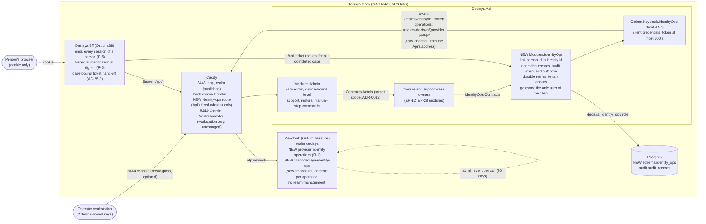

# Architecture note – admin path from the application to the identity service (issue #333, COND-02)

## Context

Issue #333 decides how Decisya acts on identities in Keycloak. It makes no code, realm, edge or test change: G4 and G5 are skipped (manifest `docs/ai/pipeline/333.md`, Marco 2026-11-20). It changes who may act on identities, a trust boundary, a network path and a module boundary, so this note is the full form.

- Requirements: `docs/requirements/333-admin-path-identity-service.md` (G1 PASS-WITH-NOTES): OP-1 to OP-15, OQ-12's options (a) to (d), OQ-39's strict reading, NFR-70 to NFR-74, notes N-1 and N-2.
- Decision: **[ADR-0026](../adr/0026-admin-path-to-the-identity-service.md)** (Accepted, Marco 2026-11-20). Option (b) is chosen:
  - narrow identity operations from Ostium's identity kit;
  - called only by one audited Decisya module in the Api;
  - (c) is defined and switched off;
  - (d) is a beta stopgap that ends before open sign-up (N-1).
- Edge: **[ADR-0016 amendment 2026-11-20](../adr/0016-phase-0-hosting.md#amendment-2026-11-20-333-one-back-channel-route-from-the-api-to-the-identity-operations)** (Accepted with ADR-0026, Marco 2026-11-20).
- Threat delta: `docs/security/threat-models/333-admin-path-identity-service.md` (G3, PASS-WITH-NOTES).
- **Revision 2026-11-20 (G2, one pass after G3).** ADR-0026, the ADR-0016 amendment, this note and NFR-71 now carry:
  - the MUSTs M333-01 to M333-05;
  - the fix-now items F333-01 to F333-03;
  - Marco's cap values and his answers to Q-1 to Q-3 (manifest "G2 decisions" and "G3 decision").

  The SHOULDs S333-01 to S333-09 are placed in the scope of D-1 to D-9. The section "G3 outcome: where each item landed" below lists each item.
- Applies: ADR-0005 (modules, Contracts, Wolverine), ADR-0012 (target-tenant scope, point 6), ADR-0013 (audit in the command's transaction), ADR-0019 (Ostium owns reusable identity mechanisms), ADR-0024 (envelope tenant and caller, durable messaging prerequisites), ADR-0025 (levels, support procedure, decision 6).
- Facts relied on (G1 section 1):
  - ADR-0016 lines 122 and 124 to 128;
  - review 17 lines 93, 95 and 97;
  - `docs/runbooks/deployable-stack.md` lines 133, 181 and 203;
  - ADR-0025 lines 188 to 196, 246 and 251;
  - `deploy/caddy/Caddyfile`;
  - `deploy/compose/docker-compose.stack.yaml` (the Api has no fixed address today; Keycloak runs `kc.sh start` on a writable container, so a mounted provider is augmented at start).
- Plan dates used (data, `docs/intake/decisya-phase1.md`): EP-24 from 2026-12-27, EP-26 from 2027-03-02, EP-27 from 2027-03-09, EP-25 from 2027-04-13, EP-28 from 2027-05-25, EP-22 from 2027-06-05, EP-12 from 2027-09-06, EP-18 from 2027-11-21.

## C4 excerpt (target, after the follow-up issues)



Closure sequence (OQ-39 strict reading, ADR-0026 decision 10):

```mermaid
sequenceDiagram
  participant O as Closure owner (EP-12 module)
  participant I as Modules.IdentityOps
  participant A as Audit (IAuditWriter)
  participant G as Caddy back channel
  participant K as Keycloak provider
  O->>O: closure takes effect: own sessions ended (R-5), account blocked
  O->>O: closure due (self-service at once; support at grace end)
  O->>I: DeleteIdentityAsync(scope, person, origin=closure)
  I->>I: resolve identity id in tenant scope; refuse if origin not this tenant/person
  I->>A: intent record (same transaction as state "attempting")
  I->>G: delete-identity (token at most 300 s)
  G->>K: Api's fixed address only
  K-->>I: done / failure
  I->>K: read-identity-state
  K-->>I: not found = confirmed
  I->>A: outcome record
  I-->>O: IdentityOperationSettled(Confirmed)  (or Pending, retried 1 min doubling to 1 h)
  O->>O: delete profile
  O->>I: RemoveLinkAsync(scope, person) (refused without a confirmed deletion or a recorded manual step)
```

## Boundaries and contracts

### The module (new): `Decisya.Modules.IdentityOps` and `Decisya.Modules.IdentityOps.Contracts`

- **Owns:**
  - the link from Decisya's person id to the identity id (OQ-39: not the same value);
  - the operation records;
  - the calls through the gateway, their audit, retries and tenant checks;
  - the published outcome messages.
- **Owns nothing else:**
  - closures belong to EP-12's module, support cases to EP-28's, sessions to the BFF and memberships to Tenancy;
  - how the link is created at first sign-in is EP-24's design (OQ-39). This note fixes only that the identity id is stored in this module's schema and nowhere else in Decisya.
- **Schema `identity_ops`, role `decisya_identity_ops`.** Every table has `tenant_id uuid not null` and an index starting with it, and every entity is `ITenantScoped`. Instants are `timestamptz`.
  - `identity_links`: tenant, person id, identity id, created.
  - `identity_operations`: tenant, operation id, person id, kind, origin kind and reference, state, attempts, first failure, next attempt, settled at, outcome.
  - The value of a pending email or name change: G3 prefers keeping it in the support case and reading it at call time through the case owner's Contracts, so there is one copy, erased with the case (S333-03; D-4's G2 decides). If it is held in `identity_operations` instead:
    - it is marked `[Sensitive]` and validated for format and length before it is stored;
    - it is cleared when the operation settles, expires or is cancelled (M333-03);
    - it is in the erasure job's scope;
    - it never travels in a message body, a log, an audit record or a metric.
- **Telemetry:** `ActivitySource` and `Meter` `Decisya.IdentityOps`:
  - counter `decisya.identity_ops.calls`, tags `decisya.identity_ops.kind` and `decisya.identity_ops.outcome`;
  - gauges `decisya.identity_ops.pending` (tag kind) and `decisya.identity_ops.oldest_pending_age_seconds`.

  No person id, identity id or tenant id goes in a metric attribute. Logs carry the operation id, kind and outcome. The person id is hashed like the user id, and the identity id is never logged.

**Contracts types / messages** (the target surface; D-4's G2 fixes exact names and signatures and may only narrow them):

```csharp
namespace Decisya.Modules.IdentityOps.Contracts;

// Every method takes the caller's scope as ADR-0012 point 6 requires: the ambient resolution for a
// tenant caller, or the resolution an [AllowCrossTenant] admin handler minted. Kind != Tenant is refused.
public interface IIdentityOperations
{
    Task<IdentityOperationId> DeleteIdentityAsync(TenantResolution scope, PersonId person, OperationOrigin origin, CancellationToken ct);
    Task<IdentityOperationId> RemoveCredentialsAsync(TenantResolution scope, PersonId person, CredentialRef? credential /* null = all */, OperationOrigin origin, CancellationToken ct);
    Task<IdentityOperationId> ChangeEmailAsync(TenantResolution scope, PersonId person, [Sensitive] string newEmail, OperationOrigin origin, CancellationToken ct);
    Task<IdentityOperationId> ChangeNameAsync(TenantResolution scope, PersonId person, [Sensitive] string newName, OperationOrigin origin, CancellationToken ct);
    Task<IdentityOperationId> EndIdentitySessionsAsync(TenantResolution scope, PersonId person, OperationOrigin origin, CancellationToken ct);
    Task<CancelResult> CancelAsync(TenantResolution scope, IdentityOperationId operation, CancellationToken ct);   // audited; M333-03
    Task<LinkRemovalResult> RemoveLinkAsync(TenantResolution scope, PersonId person, CancellationToken ct);
}

public interface IIdentityFacts
{
    Task<IReadOnlyList<CredentialFact>> GetCredentialsAsync(TenantResolution scope, PersonId person, OperationOrigin origin, CancellationToken ct);
}

public interface IEnrolmentTickets   // synchronous; the BFF's sign-in path for a completed case
{
    // Called only after the case's owning module has checked the case binding in the Api (M333-02 (a));
    // IdentityOps refuses an origin whose binding check is not recorded as passed for this ticket.
    Task<EnrolmentTicketResult> IssueAsync(TenantResolution scope, PersonId person, OperationOrigin origin, EnrolmentPurpose purpose, CancellationToken ct);
}

public readonly record struct IdentityOperationId(Guid Value);
public readonly record struct CredentialRef(string Value);          // opaque; never logged; length-bounded
public sealed record OperationOrigin(OriginKind Kind, Guid Reference);
public enum OriginKind { Closure = 1, SupportCase = 2, Restore = 3, StepUp = 4 }
public enum IdentityOperationKind { DeleteIdentity = 1, RemoveCredentials = 2, ChangeEmail = 3, ChangeName = 4, EndIdentitySessions = 5 }
public enum IdentityOperationOutcome { Confirmed = 1, AlreadyGone = 2, Refused = 3, Expired = 4, Cancelled = 5 }
public enum CredentialClass { Passkey = 1, DeviceBound = 2, Other = 3 }
public sealed record CredentialFact(CredentialRef Credential, CredentialClass Class, Instant CreatedAt);
public enum EnrolmentPurpose { OneCredentialPasskey = 1, OneCredentialDeviceBound = 2, ReEnrolmentPasskey = 3, ReEnrolmentDeviceBound = 4 }
// EnrolmentTicketResult, CancelResult and LinkRemovalResult: status types with no zero value; the ticket is a
// short-lived opaque value the BFF hands to the browser and never logs.

// Wolverine messages published by IdentityOps (durable; envelope tenant and caller per ADR-0024):
public sealed record IdentityOperationSettled(IdentityOperationId Operation, PersonId Person, IdentityOperationKind Kind, IdentityOperationOutcome Outcome, OperationOrigin Origin);
public sealed record IdentityOperationPending(IdentityOperationId Operation, PersonId Person, IdentityOperationKind Kind, int Attempts, Instant FirstFailureAt, OperationOrigin Origin);
```

- `PersonId` is the person id type that OQ-39's design brings (EP-24). It does not exist yet. D-4 uses it, or defines it in `Decisya.SharedKernel` if EP-24 has not.
- No public member carries an identity id, a `TenantId`, an email in a message, or a token.
- The internal durable message that drives a call carries only the operation id.
- **Version and compatibility rule:** additive only, as for every Contracts project. A new operation is a new method plus a new `IdentityOperationKind` value under its own G2 and G3. An enum value is never renumbered.
- **Cross-tenant send.** When an operator command (tenant-less admin) asks for an operation, the durable message is the first cross-tenant send. ADR-0024 point 4 then extends the send-side rule by one exact entry under D-4's G2 and G3.

### Who may call, and the reference rules

| Assembly | May reference (Decisya and Ostium) | Must not reference |
| --- | --- | --- |
| `Decisya.Modules.IdentityOps` | its Contracts, `Decisya.SharedKernel`, `Decisya.Infrastructure.Persistence`, `Decisya.Modules.Audit.Contracts`, `Ostium.Keycloak.IdentityOps` (R-2) | any module implementation, ASP.NET Core (no endpoints in the module), `System.Net.Http.HttpClient` outside the client package's registration, `NodaTime.SystemClock` |
| any other assembly (Api, BFF, every other module) | `Decisya.Modules.IdentityOps.Contracts` where it needs it | `Decisya.Modules.IdentityOps`, `Ostium.Keycloak.IdentityOps` |
| `Decisya.Bff` | — (calls the Api's endpoint for the ticket) | `Decisya.Modules.IdentityOps*`, `Ostium.Keycloak.IdentityOps` |

Inside the module, one internal type, the gateway, is the only one that depends on the Ostium client interface. Its "before" hook commits the intent record, and an exception there stops the call (R-2 acceptance criterion).

### Least privilege (NFR-70)

See ADR-0026 decision 3:
- one client;
- one client role per operation;
- `disable-and-strip` defined and never mapped;
- no `realm-management`, realm role or fine-grained permission;
- protected accounts (`platform-admin`, service accounts) refused by the provider;
- the scope attribute (`tenant_id`) checked against the request.

Keycloak's admin API refuses the client everything, because it holds no admin role. The provider exposes nothing beyond the list.

Additions from G3:
- **Token checks (F333-01).** The provider checks:
  - the signature with the realm's keys, RS256 or ES256 only;
  - `iss`, `exp`, `typ` `Bearer`;
  - `azp` is the configured client and `sub` is its service-account user;
  - the client is in `aud`.

  R-3 turns standard and legacy token exchange off on every client, and gives the service account no realm role, the default-roles composite included (S333-09).
- **Caps per operation kind (M333-01 (a); Marco's values, 2026-11-20).** Realm configuration, rolling windows:
  - enrolment tickets: at most 5 per hour and 10 per 24 h;
  - email or name changes: at most 5 per hour and 10 per 24 h;
  - destructive operations: at most 30 per hour and 60 per 24 h.

  Reads and `end-identity-sessions` are not capped. Above a cap: "too many", an admin event and an operator alert.

### Audit (NFR-71)

- One intent record before each call, in the same transaction as the operation's state change (ADR-0013), and one outcome record after it. A call without a committed intent record is never sent.
- Each record holds: the actor's internal id, the tenant, the person id, the kind, the operation id, the attempt, the origin, the outcome and the time.
- It never holds: the identity id, an email, a name, a credential id, a ticket, a token or a body.
- New `AuditAction` values: `identity_op.intent` and `identity_op.outcome` (D-4).
- The provider emits a Keycloak admin event per call, without representation, naming the operation, the client and the target user (M333-01 (b)), kept 90 days (NFR-46). The Api cannot write that store.
- A scheduled daily comparison checks the admin-event counts per operation kind against the outcome records. It flags any day over a set threshold, even when the two agree (M333-01 (e), D-8).
- A negative on V-5 stops D-2, unless the provider records each call in another store the Api cannot write (M333-01 (c)).

### When Keycloak is unreachable (NFR-73)

See ADR-0026 decision 9:
- calls run off the request path, one in flight, with a 10 s timeout;
- retries start at 1 minute, double, and are capped at 1 hour;
- retries run without limit only for `delete-identity`, `read-identity-state` and `end-identity-sessions` (M333-03);
- `remove-credentials`, `change-email` and `change-name` stop at a not-after time (7 days, or the end of the case's enrolment period if that comes first), then become "expired, operator review" and are never sent;
- the operator can cancel any pending operation by an audited command;
- `remove-credentials` (all) removes only credentials created before the request;
- a refusal raises an alert at once, and anything pending more than 24 hours raises an alert (S333-02);
- an operation shows "pending" from the first failure, and a closure shows "overdue" from 7 days before its deadline;
- the Api's readiness check does not include the path.

Ledger endpoints and the sign-in of enrolled users never touch it. The enrolment ticket is the only synchronous call. It fails with the generic error and leaves the case waiting.

### Edge (ADR-0016 amendment 2026-11-20)

- The Api gets a fixed address on the back-channel network. The network gets an `ip_range` that excludes every fixed address (S333-01).
- One back-channel route admits the provider path of the app realm from that address only. The back-channel realm route and the published realm route refuse that path.
- Every refusal and the admitting route match the provider segment as a prefix without a trailing slash (M333-05). If D-3 confirms Keycloak needs none, the id host also refuses any path with `;`.
- The id host's access log drops the ticket's query parameter (M333-02 (b)).
- No `/admin` route for any container. No new port, network or alias. The 8444 console path is unchanged.

### The enrolment ticket (M333-02)

- **The case binding is checked in the Api** by the case's owning module, on the case secret the BFF forwards, never only in the BFF. The case secret:
  - is stored only as a hash and compared in constant time;
  - is bound to one case and one person;
  - is good for one ticket at a time;
  - ends with the enrolment period.
- The endpoint is rate-limited per case and per source, and locks the case for operator review after a small number of failures (a Decisya value set in D-4).
- **The ticket is never written down:**
  - Caddy's id-host log filter drops it (D-3);
  - the BFF, YARP and the Api never log the ticket response or the redirect `Location` (D-4, D-5);
  - the realm keeps `Referrer-Policy: no-referrer` (D-2).
- Consuming the ticket creates no Keycloak sign-in session. The person then signs in through the BFF, with forced authentication.
- Each ticket counts toward the ticket cap.

### What changes in today's guards and baselines

| Today | After (issue) |
| --- | --- |
| Review 17 G4-17-10: roles not composite, no `realm-management` mappings, no IdPs, registration off | **Unchanged**: still no `realm-management` mapping anywhere. Registration: EP-24's realm issue decides (OP-14 runs in Keycloak's registration flow), not this path |
| G4-17-01: no `clientRoles`; `secret` only on `decisya-bff`; the realm's placeholders | Client roles only on `decisya-identity-ops`, exactly ADR-0026's list, none composite, mapped only to its service account; no realm role on that service account, default roles included (S333-09); `disable-and-strip` unmapped; a secret placeholder on the two clients (D-2, via R-3; review 17 baseline D-6) |
| G4-17-05, G4-17-06, G4-17-07 (client settings, issued tokens, negative flows) for `decisya-bff` | Unchanged for `decisya-bff`. Added:<br/>- for the new client: service account only; standard, implicit, direct and device grants refused; `exp - iat` ≤ 300; audience the operations client only (no `decisya-api`, no `account`, no `realm-management`); no refresh token;<br/>- for every client: standard and legacy token exchange off (F333-01).<br/>(D-2) |
| Realm caps | New: the caps per operation kind and rolling window as realm configuration (M333-01 (a)); each answers "too many" above its value (D-2) |
| G4-17-08 `admin-cli` direct grants off | Unchanged |
| `RealmExportFileTests`, `RealmGuard` (frozen until ADR-0019 block 3) | Replaced at the block 3 switch by `Ostium.Keycloak.Realm`'s rules. The new client's rules come from R-3's option. Decisya keeps its content tests |
| Production and dev realm parity (NFR-47) | The client is in both realms; its secret placeholder and the provider configuration are on the parity allow-list where they differ (D-2) |
| `deploy/tests` Caddy guards: back-channel allow-lists inside the committed subnets; no admin path on 8443; no `path_regexp` on admitting routes | New single-address back-channel route. The provider prefix (no trailing slash) is refused on the published and back-channel realm routes, with a can-fail case per variant: no trailing slash, `;x`, a suffix, upper case, a percent-encoded character (M333-05). The `;` refusal applies if D-3 adds it. The id host's access-log filter drops the ticket parameter (M333-02 (b)). Still no `path_regexp`, since prefix paths suffice (D-3) |
| `deploy/tests` Compose guards: network members, two published ports, secret table, Keycloak mounts | The Api's fixed address, outside the network's `ip_range` (S333-01). The new secret goes to the Api and Keycloak's wrapper only. One read-only provider mount on Keycloak with its SHA-512 pin, checked by `stackctl.py check`; the pin is derived from the package that A3 verified (M333-04 (b)) (D-2, D-3) |
| ADR-0015 scan targets | The provider JAR, or its SBOM, joins them with the images' thresholds and exception rules (M333-04 (a), D-2) |
| `identity-check.sql` / `stackctl.py verify` | Adds:<br/>- no service account other than `decisya-identity-ops` holds any client role, and that one holds exactly the list;<br/>- the daily admin-event counts per operation kind, with the target users, compared **on a schedule** with Decisya's outcome records, and flagged above a set threshold even when the two agree (M333-01 (e)).<br/>(D-8) |
| AppHost (development) | Keycloak resource mounts the provider and gets the secret parameter; the Api gets the client options (D-2, platform-dev part) |
| Runbook: console steps for the reset (ADR-0025 decision 6 step 4) | The reset runs through the audited command and the path, and the console stays break-glass (ADR-0025 pointer D-7). D-8 adds:<br/>- the compromise response (M333-01 (e));<br/>- rotation of the Api's and the wrapper's secret files together (S333-06);<br/>- the 24-hour pending alert (S333-02);<br/>- unmounting the provider as the rollback, also used when a Keycloak security bump has no compatible provider (M333-04 (c), S333-05);<br/>- lowering a raised cap after a restore;<br/>- the refusal checks |

## The Ostium boundary

The details are in ADR-0026 decision 12, which gives each request with its acceptance criteria. In short:
- **Requested from Ostium, adopted from its release:**
  - R-1: the identity-operations provider in the Keycloak baseline;
  - R-2: the .NET client;
  - R-3: the `Ostium.Keycloak.Realm` rule option;
  - R-4: the `Ostium.Keycloak.Testing` provider support;
  - R-5: `Ostium.Bff`'s "end every session of one subject" and forced authentication at sign-in;
  - R-6, only if EP-27's or EP-28's design needs it: a sign-in event feed.
- **Decisya's:**
  - the IdentityOps module;
  - the realm content and its values;
  - the composition and its options (no defaults in shared code);
  - the Caddy route, the fixed address, the Compose secret and the provider mount, with their guards;
  - the operator commands, the runbooks and every Decisya test.

The orchestrator turns R-1 to R-5 into the exchange request (D-1). Marco approves the draft.

## Effort and follow-up issues (COND-02, COND-03)

ADR-0026 decision 13 gives the sizes, owners, dependencies and dates. In short:
- Decisya: D-1 S, D-2 M, D-3 M, D-4 L, D-5 S, D-6 S, D-7 S, D-8 S, and D-9 S (conditional). That is about 17 to 25 working days in total, and about five weeks for D-2 to D-4.
- Ostium: R-1 L, R-2 M, R-3 S, R-4 S, R-5 M. **No date given by Ostium.** An answer is asked for by 2026-12-11.

**Order:**
1. D-1, now.
2. D-7.
3. Ostium's releases, and the ADR-0019 block 2 and block 3 switches.
4. D-3 merged before or with D-2: the provider is never mounted in the stack before the edge refuses its prefix on both realm routes (G6-333-01). Then D-6.
5. Backlog #243 items 231-1 and 231-5, then D-4 and D-8.
6. D-5, after R-5 and the BFF switch.
7. D-9, only if needed.

**Latest useful releases:** R-5 by 2027-02-01 (EP-26), and R-1 to R-4 by 2027-04-01 (EP-28, EP-25's re-enrolment).

EP-24 is not blocked by the path.

## Decisions

- Option (b): narrow identity operations from Ostium's kit, called only by `Modules.IdentityOps` in the Api. Options (a1) and (a2) are rejected. (c) is defined and switched off. (d) is a beta stopgap that ends before open sign-up. **ADR-0026.**
- How each of OP-1 to OP-15 is met. OP-4 is enforced by Decisya's own session store plus forced authentication. OP-14 and OP-15 need no admin right (N-2). **ADR-0026 decision 2.**
- The edge route from the Api's fixed address only. The admin paths stay on 8444. **ADR-0016 amendment 2026-11-20.**
- The operator's reset runs through the path, and the console stays break-glass. **ADR-0026; ADR-0025 pointer D-7.**
- The module pair and its Contracts surface follow ADR-0005, ADR-0012 point 6 and ADR-0024. The ADR covers the boundary, and D-4's G2 fixes the signatures.

## Architecture-test, realm-guard and deploy-guard rules to add

| Rule | Scope (assemblies, files) | Test class (proposed) | Issue |
| --- | --- | --- | --- |
| Only `Decisya.Modules.IdentityOps` references `Ostium.Keycloak.IdentityOps`; no other assembly (Api, BFF, modules, ServiceDefaults) does | all `Decisya.*` assemblies; csproj files | `IdentityOpsBoundaryTests` (new) | D-4 |
| `Decisya.Modules.IdentityOps` references among `Decisya.*` exactly its Contracts, SharedKernel, Infrastructure.Persistence and Audit.Contracts; no `Microsoft.AspNetCore*`; no `NodaTime.SystemClock` | IdentityOps | `IdentityOpsBoundaryTests` | D-4 |
| No assembly other than `Decisya.Modules.IdentityOps` depends on any type of that assembly (Contracts only), which extends `ModuleBoundaryTests` | `ArchitectureScope` plus Api and BFF | `ModuleBoundaryTests` (existing, scope gains the module) | D-4 |
| Exactly one internal type (the gateway) depends on the Ostium client interface; it is internal and sealed | IdentityOps | `IdentityOpsBoundaryTests` | D-4 |
| The Contracts project exports exactly the listed types; no public member's type or name carries an identity id (`IdentityId`, `Subject`, `Sub`), a `TenantId` or a token; enums have no zero value | IdentityOps.Contracts | `IdentityOpsContractsTests`, `ContractsBoundaryTests` (scope gains it) | D-4 |
| Every entity of the module is `ITenantScoped` (existing `TenantModelRule`); the identity id column exists only in `identity_ops.identity_links` (static check over migrations and `deploy/sql`) | IdentityOps, `deploy/sql/identity_ops` | `TenantModelRule` (existing), `IdentityLinkColumnTests` (new) | D-4 |
| The Api's readiness checks do not include the identity-operations endpoint or the client | Api composition | `HealthEndpointTests` (amended) | D-4 |
| No file under `src/` holds a default client id, realm, role name, base address or secret for the client: the options are required and come from the composition (app-owned values) | `src/**`, `appsettings*.json` | `IdentityOpsOptionsTests` | D-4 |
| NFR-71: with a fake provider, every call has exactly one intent record committed before it and one outcome record after it; a failing intent write sends no call; no record holds the identity id, an email, a name, a credential id or a ticket (canary values) | IdentityOps, Audit | `IdentityOpsAuditTests` (Integration) | D-4 |
| NFR-72: for every operation, tenant A's operation never reaches tenant B's person; a mismatched origin is refused before any call; the provider refuses a wrong scope attribute | IdentityOps with real Postgres and the real provider | `IdentityOpsIsolationTests` (Integration, two tenants) | D-4 |
| NFR-73: with Keycloak stopped, ledger reads and writes and the sign-in of an enrolled user succeed; the operation stays pending and is retried on the stated schedule; no closure is reported confirmed; after Keycloak returns, it settles | Api host with Testcontainers | `IdentityOpsUnreachableTests` (Integration) | D-4 |
| M333-03: `remove-credentials`, `change-email` and `change-name` past their not-after time become "expired, operator review" and are never sent; a cancelled operation is never sent and writes an audit record; delete, read and end-sessions keep retrying; `remove-credentials` (all) spares a credential created after the request; the pending value is cleared on settlement, expiry and cancel | IdentityOps with a fake clock and the real provider | `IdentityOpsStaleOperationTests` (Integration) | D-4 |
| M333-02 (a): the ticket is issued only after the Api checked the case secret (hash, constant-time compare, one case and one person, one ticket at a time, within the enrolment period); a check done only in the BFF gives no ticket; repeated failures hit the rate limit and lock the case for review | Api, case owner module, IdentityOps | `EnrolmentBindingTests` (Integration) | D-4 (with EP-25) |
| M333-01: each cap per kind and window answers "too many" above its value, and the Api cannot change it; each admin event names the operation, the client and the target user | Testcontainers Keycloak with the provider | `IdentityOpsRealmTests` (Integration) | D-2 |
| M333-04: the committed SHA-512 pin equals the SHA-512 of the JAR inside the `.nupkg` that A3 verified; the provider (or its SBOM) is in the ADR-0015 scan target list | `deploy/**`, the lock file, the scan config | `deploy/tests` pin and scan-target tests | D-2 |
| Realm (R-3 option): the client is service-account only; standard, implicit, direct and device grants off; no refresh token for client credentials; token life at most 300 s; `fullScopeAllowed` off; exactly the listed client roles, none composite, mapped only to its service account; no realm role on the service account, default roles included; `disable-and-strip` unmapped; no `realm-management` mapping anywhere; standard and legacy token exchange off on every client | production and dev realm files | `Ostium.Keycloak.Realm` rules in Decisya's realm tests | D-2 |
| Against the real realm and provider: each operation works with its role and fails without it; create, list, search, password reset, impersonation, role and attribute writes, and every `/admin/realms/...` call are refused with the client's token; a `platform-admin` user and a service account are refused; a `decisya-bff` user token and an admin's token are refused; the Api refuses the client's token (audience) | Testcontainers Keycloak (R-4) | `IdentityOpsRealmTests` (Integration) | D-2 |
| The enrolment ticket is single use, expires within its set life (at most 300 s), registers only the requested class, and creates no Keycloak sign-in session. It is never written to a log, an audit record, a trace or a response other than the hand-off: Api, BFF and YARP logs are checked with a canary ticket, the redirect `Location` included | provider, IdentityOps, BFF | `EnrolmentTicketTests` (Integration) | D-4, D-5 |
| Caddy: the provider prefix is admitted only on the back channel from the Api's single address. It is refused on the published realm route and on the back-channel realm route for any other source, with a can-fail case per variant: the bare segment, `;x`, a suffix, upper case, a percent-encoded character. `/admin` and `/realms/master` stay refused on 8443 and admitted only on 8444. The id host's access log filters the ticket parameter. Each rule has a "can fail" case | `deploy/caddy/Caddyfile` | `deploy/tests/test_caddyfile.py` | D-3 |
| Compose: the Api's fixed address is inside the committed back-channel subnet and outside its `ip_range`; the client secret goes to the Api and Keycloak's wrapper only; Keycloak mounts exactly one provider file read-only and its SHA-512 equals the committed pin | `deploy/compose/**` | `deploy/tests/test_compose_guards.py`, `test_stackctl.py` | D-2, D-3 |
| G6-333-01: a provider mount on Keycloak in the Compose file fails the guard unless the Caddyfile refuses the provider prefix on both realm routes (published and back channel), with a "can fail" case for a mount without the refusals | `deploy/compose/**`, `deploy/caddy/Caddyfile` | `deploy/tests/test_compose_guards.py` | D-3 (merged before or with D-2) |
| Option (d): "manual identity step recorded" is refused and not offered unless the deployment setting is on; the Api refuses to start with it on while open sign-up is on | Api composition, Modules.Admin | `ManualIdentityStepSwitchTests` | D-9 (with EP-28) |
| BFF: ending every session of one person leaves no ticket of that person; a sign-in after it with a live Keycloak session but no passkey reaches no Decisya page, data or action (AC-12-3) | BFF with Testcontainers Keycloak | `Decisya.Bff.Tests` Integration case | D-5 |

New NetArchTest boundaries: the IdentityOps module pair and the client-package reachability rule. The other rules are realm, Integration, deploy-guard and start-up tests.

## Open questions for Marco

None is left. Marco's answers are recorded below.

## Decided (Marco, 2026-11-20)

Recorded in ADR-0026's "Decided" section, from the manifest's "G2 decisions" and "G3 decision" lines.
- **Q-1. If Ostium declines R-1 or gives no date: wait.** Option (d) covers only the identity step of the beta's closures; it gives no re-enrolment (OP-13). The beta cannot open without re-enrolment (EP-25 AC-25-9), so the beta's date moves with the release date of Ostium's R-1, whatever (d) does.
- **Q-2. The values: accepted, with G3's changes.**
  - Retries start at 1 minute, double, and are capped at 1 hour. They run without limit only for delete, read and end-sessions. `remove-credentials`, `change-email` and `change-name` stop at a not-after time, with an audited cancel (M333-03).
  - The overdue warning comes 7 days before the deadline, plus a 24-hour pending alert.
  - The client secret is rotated every 90 days.
  - The caps per kind: enrolment tickets at most 5 per hour and 10 per 24 h; email or name changes at most 5 per hour and 10 per 24 h; destructive operations at most 30 per hour and 60 per 24 h (M333-01).
- **Q-3. Forced authentication at every BFF sign-in: accepted.** The account-console caveat of F333-02 applies.

**Accepted (Marco, 2026-11-20):** residuals **R-APIOPS** and **R-PROVIDER**, by name, each at its full scope as stated in ADR-0026 Consequences, together with ADR-0026 and the ADR-0016 amendment.

**R-APIOPS.** Within the caps, whoever controls the Api can act on the account of any end user who is not protected (admins and service accounts are refused), in any tenant. They can:
- delete identities and remove credentials;
- change emails;
- register their own passkey through an enrolment ticket. **That access persists after the Api is cleaned.**

Only the edge, the protected-account refusal and the caps prevent anything. Keycloak's admin events (which the Api cannot write), the scheduled daily comparison and D-8's response are detective: they find a compromise after the fact, not at once. A passkey registered before the response stays usable, also after the Api is patched and its secret rotated, until support removes it.

**R-PROVIDER** (G6-333-02).
- **Reach.** Third-party code runs inside the Keycloak process. A defect or a compromised build reaches every realm (the master realm and the operator's account included), Keycloak's database connection and every user's sign-in.
- **Controls:**
  - the signed chain;
  - the pin derived from the verified package;
  - the scan;
  - D-2's Integration tests;
  - the edge, once D-3 is in;
  - unmounting the provider as the rollback.
- **What the controls do not do.**
  - The caps of decision 7 do not bound R-PROVIDER, because the provider enforces them.
  - The controls lower the chance that a defective or compromised build reaches production, and limit who can call it. None of them contains what such a build can do once it runs.
  - Accepting R-PROVIDER accepts that full scope.

## G3 outcome: where each item landed

G3 gave PASS-WITH-NOTES. These items were applied on 2026-11-20:

| Item | Landed in |
| --- | --- |
| M333-01 (T333-01, High) | ADR-0026 decision 7 (caps per kind, Marco's values), decision 14 (V-5 joins the stop rule), R-1 (8) (target user in each admin event) and (9) (caps per kind and window), Consequences (R-APIOPS); D-8's scope (compromise response; scheduled comparison with a threshold); this note's audit section |
| M333-02 (T333-02 High if present, T333-03 Medium) | ADR-0026 decision 4 (binding checked in the Api; hashed secret; constant-time compare; rate limit and lock; no logging), R-1 (7) (no sign-in session; counts toward the cap); ADR-0016 amendment change 2 and guards (log filter); D-3, D-4 and D-5 scopes; this note's ticket section |
| M333-03 (T333-04, Medium) | ADR-0026 decision 9, decision 3's table and R-1 (6) (created-before parameter); the Contracts' `CancelAsync`, `Expired` and `Cancelled`; D-4 scope |
| M333-04 (T333-05, Medium) | ADR-0026 R-1 (10) (no bundled libraries unless listed), D-2 scope (scan target, pin derived from the verified package), Consequences (a security bump never waits; the provider is unmounted and operations stay pending; R-PROVIDER); ADR-0016 amendment guards |
| M333-05 (T333-06, Medium) | ADR-0016 amendment change 2 (a prefix without a trailing slash; the `;` refusal if D-3 confirms) and guards (a can-fail case per variant); ADR-0026 decision 8; D-3 scope |
| F333-01 | ADR-0026 R-1 (2) (token checks listed), R-3 (token exchange off) |
| F333-02 | ADR-0026 decision 2 OP-4 ("no Decisya page, data or action", with the account-console caveat); the BFF rule above |
| F333-03 | `docs/requirements/nfr.md` NFR-71 now says "one intent record before the call and one outcome record after it". ADR-0026's drivers line was aligned; this note already said so |
| S333-01 | ADR-0016 amendment change 1; D-3 |
| S333-02 | ADR-0026 decision 9; D-8 |
| S333-03 | D-4 (D-4's G2 decides where the pending value lives); this note's schema bullet |
| S333-04 | D-4 (D-4's G3) |
| S333-05 | R-1 (9) and (12); D-1; D-8 |
| S333-06 | R-2, R-3 (`private_key_jwt` option); D-1; D-8 |
| S333-07 | D-9 |
| S333-08 | R-1 (6); D-1 |
| S333-09 | R-3; D-1; D-2 |

Nothing is left for #243 from this review.

Still open, and named for G6 and Marco:
- **R-OSTIUM-DATES:** Ostium has given no date.
- **R-SPIKE-0026:** V-1 to V-6 are unverified at 26.7.5. A negative on V-1, V-2, V-3 or V-5 stops D-2.
- **R-APIOPS and R-PROVIDER:** Marco accepted both by name, at their full scope, on 2026-11-20. ADR-0026's "Accepted" line records it. R-PROVIDER is stated in ADR-0026 Consequences at its real extent (G6-333-02): the provider runs inside the Keycloak process, so a defect or a compromised build reaches:
  - every realm, the master realm and the operator's account included;
  - Keycloak's database;
  - every sign-in.

<!-- gate: G2 | verdict: PASS-WITH-NOTES | issue: #333 -->
