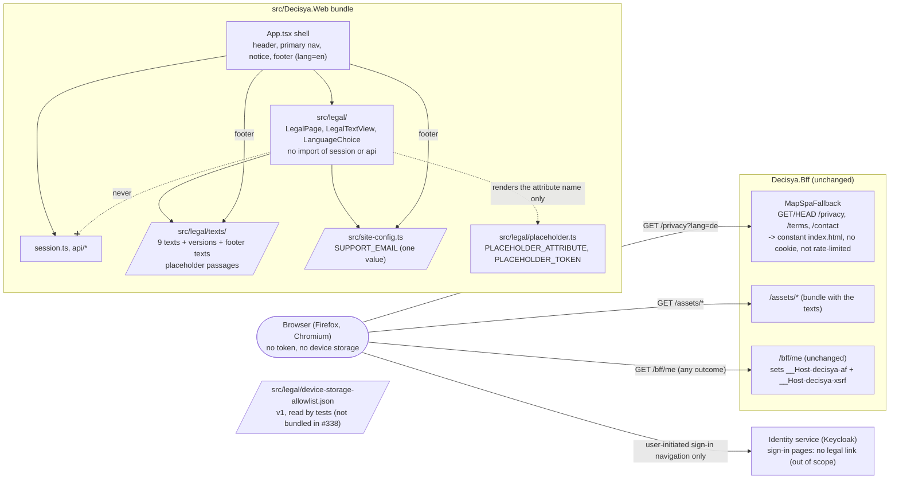

# Architecture note – public privacy notice, terms and contact page with placeholder texts in English, German and French (issue #338)

## Context

#338 adds three public pages to the SPA: the privacy notice, the terms and the contact page. Each page has placeholder texts in English, German and French, a language choice kept in the web address, and the language markup. The issue also adds footer links on every view, marks the footer's no-advice statement as a placeholder, and ships the first device-storage allowlist with its tests. It is the first content the SPA renders that does not depend on the session.

- Requirements: `docs/requirements/338-public-legal-pages.md` (G1 PASS-WITH-NOTES): Stories 1 to 11, section 2 (placeholder form), notes 1 to 4, NFR-75 to NFR-79 in `docs/requirements/nfr.md`.
- Plan (data): `docs/intake/decisya-phase1.md`, EP-13#1, #3 (c), (d), (g), (h), #4, #6 to #10, #12, #14 (a); EP-14#6.
- Manifest: `docs/ai/pipeline/338.md` (Full tier, host run, G0 by Marco 2026-11-20).
- Applies, unchanged: ADR-0003 (BFF session, the SPA never holds a token), ADR-0008 and its amendment 1 (SPA behind the BFF, strict CSP, same origin), and the #26 note `docs/architecture/spa-shell.md` (D5 fallback and reserved prefixes, D6 CSP, D7 one npm project, E2E in `src/Decisya.Web/e2e`).
- Code read on `issue/338-public-legal-pages`:
  - `src/Decisya.Web`: `index.html`, `src/App.tsx`, `src/routes.ts`, `src/main.tsx`, `src/session.ts`, `src/api/bff.ts`, `src/static-rules.test.ts`, `src/audited-pages.test.ts`, `src/rate-limit.test.ts` (titles), `e2e/audited-pages.ts`, `e2e/axe.spec.ts`, `e2e/shell.spec.ts`, `e2e/support.ts`, `e2e/fixtures.ts`, `vite.config.ts`, `tsconfig.json`, `playwright.config.ts`.
  - `src/Decisya.Bff`: `Program.cs`, `Spa/SpaHosting.cs`, `Endpoints/BffEndpoints.cs` (`/bff/login`, `/bff/me`, `IssueXsrfCookie`), `Security/AntiforgeryCookieNames.cs`, `Security/ReturnUrlValidator.cs`, `Session/CookieOptionsSetup.cs`, `Session/OidcOptionsSetup.cs`, `RateLimiting/RouteClassifier.cs`, `RouteClass.cs`, `BffRateLimiterFactory.cs`.
  - Tests: `tests/Decisya.Bff.Tests/SpaHostingTests.cs`, `SpaPackageTests.cs`, `BffLoginFlowTests.cs`, `tests/Decisya.Identity.Tests/SecureCookieRelayHandler.cs`.
  - The `e2e` job of `.github/workflows/ci.yml`, `.claude/boundaries.json`, `.claude/project.json` (visibility).
- Not run: `gh issue view 338` (no shell in this session). Scope comes from the manifest and G1.

**Result in one line:** a client-side change only. There is no BFF, Api, AppHost, realm or NuGet change, and no new npm package. The legal pages are a new folder `src/Decisya.Web/src/legal/` that does not depend on the session. Three new public web addresses and four new fixed interfaces exist for #339, #340, #342 and EP-14 (see "Public surface"). No ADR is needed.

## C4 excerpt



```mermaid
sequenceDiagram
  participant B as Browser
  participant F as Decisya.Bff
  B->>F: GET /terms?lang=fr (fallback)
  F-->>B: 200 index.html (constant, lang="en", no Set-Cookie)
  B->>B: SPA renders the French terms at once (no wait for the session)
  B->>B: document lang = "fr", title in French; header, nav, footer keep lang="en"
  B->>F: GET /bff/me
  alt 200
    F-->>B: identity + af/xsrf cookies -> header shows the identity
  else 429, 5xx, network error or no answer
    F-->>B: (no answer, 429 or 5xx) -> notice or nothing; the terms stay readable
  end
  B->>B: user chooses "Deutsch" -> push /terms?lang=de, focus to the h1, nothing stored
```

## Projects and ownership

| Path | Kind | G4/G5 owner |
| --- | --- | --- |
| `src/Decisya.Web/src/legal/**` (pages, texts, placeholder constants, allowlist JSON, their Vitest files) | new | frontend-dev |
| `src/Decisya.Web/src/site-config.ts` | new | frontend-dev |
| `src/Decisya.Web/src/App.tsx` (legal routes outside the session gate, footer), `src/styles.css`, `src/static-rules.test.ts`, `src/audited-pages.test.ts` | changed | frontend-dev |
| `src/Decisya.Web/e2e/audited-pages.ts`, `e2e/axe.spec.ts` (new states), new `e2e/legal.spec.ts`, `e2e/storage.spec.ts`, `e2e/placeholders.spec.ts` | changed / new | frontend-dev (test-engineer has no lane in `src/Decisya.Web/**`, the #26 D7 gap; at G5 it maps and routes changes) |
| `tests/Decisya.Bff.Tests/SpaHostingTests.cs` (legal paths), new `tests/Decisya.Bff.Tests/DeviceStorageAllowlistTests.cs` | changed / new | test-engineer |
| `index.html` | **unchanged** (stays `lang="en"`, D3) | — |
| `src/Decisya.Bff/**`, `src/Decisya.Api/**`, AppHost, realm, `deploy/**`, `package.json`, lockfile, `tsconfig.json`, `vite.config.ts`, `.github/**` | **unchanged** | identity-dev, devops, platform-dev: nothing to do |

**Packages: none.** No npm and no NuGet package. Rendering checks run in Playwright, which is already installed. Vitest stays in the `node` environment and tests only pure functions and data. Neither jsdom nor Testing Library is added. If an implementer finds one is needed, it goes back to Marco before any code (G0).

## D1 – Web addresses: three top-level paths, the language as the `lang` query parameter

**Paths: `/privacy`, `/terms`, `/contact`.**
- They collide with no reserved prefix of `SpaHosting.ReservedPrefixes` (`/bff`, `/api`, `/signin-oidc`, `/signout-callback-oidc`, `/health`, `/alive`, `/assets`). The check is segment-aware, so `/privacy` cannot match by prefix either. The fallback serves the constant shell for them today, with no authorization metadata and no `Set-Cookie`.
- `RouteClassifier` puts them in no route class, so the BFF rate limiter never limits the shell document for them. A 429 can only come from `/bff/me` (class `api`), and D6 handles that case.
- They are English path names in every language. The URL is not localised, and the language lives only in the query.
- React Router matches them case-insensitively and ignores a trailing slash (its defaults, not changed).

**Language: query parameter `lang`, values exactly `en`, `de`, `fr`. Options:**
- **Path segment** (`/de/privacy` or `/privacy/de`). Rejected for these reasons:
  - G1 requires an unsupported value to show English, not "Page not found". With a path segment, `/privacy/xx` would have to render English under a path that does not exist.
  - The route table would grow a parameter that the rest of the SPA does not have.
  - #339 and EP-01 would need two route shapes.
- **Query parameter `?lang=`.** **Chosen.**
  - One route per page.
  - English is the default when the parameter is absent.
  - Reload, share and a new private window all keep the language (Story 2), because the address holds it.
  - The BFF fallback ignores the query, so the server is not involved.
  - `loginUrl(pathname, search)` already carries the query into `returnUrl`. A sign-in from `/privacy?lang=de` returns there: `ReturnUrlValidator`'s `IsLocalUrl` accepts a local path with a query.
- **Storage (cookie, localStorage).** Rejected by EP-13#3 (d): nothing may be stored for the choice.

**Parsing (fixed):** `parseLegalLanguage(value: string | null): LegalLanguage` returns `value` only when it is exactly `'en'`, `'de'` or `'fr'` (case-sensitive), and `'en'` otherwise. That covers absent, empty, `DE`, `de-CH`, markup and over-long values. The first `lang` parameter wins (`URLSearchParams.get`).
- The raw value is never rendered, never put into an attribute and never used to build a link. Only the parsed `LegalLanguage` goes further.
- An unsupported value is not rewritten in the address. The page shows English, and the language choice marks English as current.

**Links that keep the language (fixed):** `legalHref(page: LegalPageId, language: LegalLanguage): string` returns `` `${path}?lang=${language}` ``. All three kinds of link use it:
- the language choice: always explicit, `en` included, as Story 2 requires;
- the footer links while a legal page is shown: they carry that page's current language;
- links inside a text that point to another legal page.

On every other view the footer links carry no `lang`, so they open in English. Changing the language is a normal push navigation, so Back returns to the previous language.

## D2 – Where the texts live and how they render

**The texts are TypeScript data modules in the SPA bundle (`src/Decisya.Web/src/legal/texts/`).** They ship with each release (EP-13#3). Nothing is fetched at run time, nothing is stored on a server or outside a tenant, and there is no database, BFF or Api change. Options:
- **JSON or Markdown fetched at run time.** Rejected:
  - a second request that can fail would contradict NFR-78;
  - Markdown needs a parser package and HTML injection, which the CSP and the S-c rule (`innerHTML`, `dangerouslySetInnerHTML`) forbid.
- **Served by the BFF or the Api.** Rejected: it adds a public endpoint for static content and couples the texts to a host and to its rate limiting.
- **Bundled TS data, rendered as React elements.** **Chosen.** The size is a few tens of kilobytes even with the final texts. Splitting the code per language is deferred until the size calls for it. It would need a lazy import that can fail, so a split must keep D6.

**Layout (file names binding where tests or #339 read them):**

```text
src/Decisya.Web/src/
  site-config.ts                       SUPPORT_EMAIL (D5)
  legal/
    pages.ts                           LegalPageId, LegalLanguage, LEGAL_LANGUAGES, LEGAL_LANGUAGE_PARAM = 'lang',
                                       LANGUAGE_NAMES, legalPages (id, path, footerLabel), parseLegalLanguage, legalHref
    model.ts                           LegalText, LegalSection, Passage, Block, Inline (types only)
    placeholder.ts                     PLACEHOLDER_ATTRIBUTE, PLACEHOLDER_PASSAGE_ATTRIBUTE, PLACEHOLDER_TOKEN (D4)
    LegalPage.tsx                      route element: reads ?lang, sets the document language (D3), renders LegalTextView
    LegalTextView.tsx                  renders one LegalText; languageScope 'document' | 'element' (D3)
    LanguageChoice.tsx                 the three links (D3)
    device-storage-allowlist.json      D7
    texts/
      privacy.en.ts privacy.de.ts privacy.fr.ts
      terms.en.ts   terms.de.ts   terms.fr.ts
      contact.en.ts contact.de.ts contact.fr.ts
      markers.ts                       visible placeholder words per language (en, de, fr)
      versions.ts                      one version label per text, shared by its three languages
      footer.en.ts                     the footer's no-advice statement (interface language)
    *.test.ts                          Vitest (rules table below)
```

**Text model (fixed shape; frontend-dev may add block kinds, never an HTML string):**

```ts
export type LegalLanguage = 'en' | 'de' | 'fr';
export type LegalPageId = 'privacy' | 'terms' | 'contact';

export interface LegalText {
  readonly page: LegalPageId;
  readonly language: LegalLanguage;
  readonly title: string;                      // the h1 and the document title, in this language
  readonly sections: readonly LegalSection[];  // h2 each; same ids, same order in the three languages
}
export interface LegalSection {
  readonly id: string;                         // kebab-case, stable across languages
  readonly heading: string;
  readonly passages: readonly Passage[];
}
export interface Passage {
  readonly id: string;                         // kebab-case, unique within the text, stable across languages
  readonly heading?: string;                   // h3 when present
  readonly blocks: readonly Block[];           // paragraphs and lists of plain text, legal links, the support email
  readonly placeholder?: PlaceholderToken;     // D4: present = not a final text
}
```

- Rendering produces React elements only. There is one h1, the sections are h2 and the passage headings h3, so no level is skipped. Everything sits inside the existing `<main>`.
- The version label of a text comes from `versions.ts`, one value per page that the three languages share (EP-13#3 (c)). It is rendered under the h1 with its own placeholder marker. EP-01's acceptance step (out of scope) will read the same constant.
- **Every passage of the three texts is a placeholder in #338.** None has been through the narrow legal review. A fact the plan fixes is still written as real text inside its marked passage:
  - the terms' `eligibility` passage states "18 or older" in each language (Story 6);
  - the contact page states the complaint route, "no screenshots or ledger content" and "an email alone never lets anyone in" (Story 8).

  #340 replaces passages and removes their markers one by one.
- **Minimum passage ids (closed set; #339 checks each one by id, and a Vitest test pins that each exists in all three languages):**

| Text | Passage ids |
| --- | --- |
| privacy | `controller`, `uk-representative`, `eu-representative` (section (a)); `purposes` (b); `data-stored` (c); `recipients` (d); `rights` (e, with the complaint route); `device-storage` (f); `data-about-others` (g); `region` (h); `operator-access`, `sign-in-risks` (i) |
| terms | `eligibility` (adults only, 18), `no-advice`, `general` |
| contact | `controller`, `postal-address`, `support-email`, `response-time`, `complaints`, `no-ledger-content`, `support-procedure` |
| every text | `version` (from `versions.ts`) |
| footer (English) | `footer-no-advice`; the address marker `support-email-address` (D5) |

## D3 – Language markup

- **On a legal page the document language is the text's language.** `LegalPage` sets `document.documentElement.lang` to the parsed language before paint (a layout effect) on load and on every language change. On unmount it restores `'en'`. The document title follows through the existing `PageHeading` (`documentTitle(title)`).
- **`index.html` keeps `lang="en"`.** The BFF serves one constant document for every caller and path. That is a #26 security property (no request-derived content in the shell), so the server never varies `lang`. Until the bundle runs, the language is `en`. The SPA has no server rendering, so nothing is shown before then.
- **The interface around the text declares English explicitly.** The skip link, `<header>`, the primary `<nav>`, the `role="status"` notice and `<footer>` each carry `lang="en"` on every view. It is redundant when the document is `en`, and required when the document is `de` or `fr` (Story 2: the interface stays English; SC 3.1.2).
- **The language choice is `LanguageChoice`:** `<nav aria-label="Language of this text" lang="en">` holding a list of three `<a>` elements built with `legalHref`.
  - Each link carries `lang` and `hreflang` set to its own code, so "English", "Deutsch" and "Français" each declare their language (SC 3.1.2, EP-13#3 (h)).
  - The current language has `aria-current="true"`.
  - The choice sits in `<main>` directly under the h1 and the version label, before the text. A reader who needs another language finds the choice before the text, not after it.
  - Following a link is a push navigation. `PageHeading` then moves focus to the h1, which is now in the new language, as on every other client-side navigation (Story 2 last scenario, Story 10).
- **Embedded use (for EP-01's acceptance screen and #342).** `LegalTextView` takes `languageScope: 'document' | 'element'`. With `'element'` it does not touch the document language and wraps the text in `<div lang={language}>` (Story 3 third scenario). `LegalPage` always uses `'document'`.
- **Keyboard order on a legal page (for G5):** skip link → header (sign-out when signed in) → primary navigation → language choice → links inside the text → footer links and support email. This refines G1 Story 10's list: the language choice comes before the text rather than after the main content. G5 asserts this order.

## D4 – The placeholder form (fixed interface for #339)

`src/Decisya.Web/src/legal/placeholder.ts`:

```ts
/** The data attribute on the element that wraps a placeholder passage (NFR-79, #339). */
export const PLACEHOLDER_ATTRIBUTE = 'data-decisya-placeholder';
/** The passage id on the same element, so the release-candidate gate can name what is left. */
export const PLACEHOLDER_PASSAGE_ATTRIBUTE = 'data-decisya-passage';
/** The fixed attribute value, and the literal every placeholder passage carries in the source. */
export type PlaceholderToken = 'decisya-placeholder-not-final';
export const PLACEHOLDER_TOKEN: PlaceholderToken = 'decisya-placeholder-not-final';
```

Each placeholder carries all three markers of G1 section 2:
1. **Visible words** in the language of the text, inside the marked element, from `texts/markers.ts`. The wording is the implementer's, for example "Placeholder, not the final text." / "Platzhalter, nicht der endgültige Text." / "Texte provisoire, pas le texte définitif.". In the footer the words are English. The words are never hidden, `aria-hidden`, visually hidden or styled away, and screen readers read them in reading order.
2. **The machine-readable marker** on the wrapping element: `data-decisya-placeholder="decisya-placeholder-not-final"` and `data-decisya-passage="<passage id>"`. The renderer copies the value from the passage's own `placeholder` field. It never writes the token itself.
3. **The source literal.** Each placeholder passage in `src/legal/texts/**`, and the support-email entry in `src/site-config.ts`, writes `placeholder: 'decisya-placeholder-not-final'` as a literal. `PLACEHOLDER_TOKEN` is imported only by tests (`*.test.ts`, `e2e/**`); application code imports only the `PlaceholderToken` type and the two attribute names. Tree-shaking therefore removes the constant from the bundle, and the token appears in the build output exactly once per placeholder passage.

What this gives #339, without a browser:
- **Source:** the count of token literals under `src/legal/texts/**` plus `src/site-config.ts` equals the number of placeholder passages, counted structurally by importing the data.
- **Build:** the count of the token in the served JS bundle equals the same number. Zero means no placeholder is left.

Both counts are #338 tests (rules table). #339 turns "count > 0" into a release-candidate failure. If a minifier ever merged the repeated literals, the build count would drop below the source count and the test would fail. The check fails closed, never silently.

## D5 – The support email: one value the application sets

`src/Decisya.Web/src/site-config.ts` (the SPA is the application that owns the value; it is not shared code):

```ts
export interface SupportEmail {
  readonly address: string;
  /** Present while the business owner has not supplied the address (EP-13#9). */
  readonly placeholder?: PlaceholderToken;
}
export const SUPPORT_EMAIL: SupportEmail = {
  address: 'support@example.invalid',
  placeholder: 'decisya-placeholder-not-final',
};
```

- **One place.** The footer on every view and the contact page's `support-email` and `complaints` passages read `SUPPORT_EMAIL`. A Vitest rule bans any other `mailto:` or e-mail literal in `src/**`.
- **The placeholder address is in the reserved `.invalid` top-level domain** (RFC 2606), so a message to it can never be delivered. The `mailto:` link can be built and tested now. Wherever the address is shown, the inline element carries `data-decisya-placeholder` with passage id `support-email-address` and the visible word, in the surrounding language.
- **Supplying the real address** (business owner, before #339 passes): replace `address` and delete `placeholder` in this one file. That is a release change, like the texts.
- **Options rejected:**
  - A BFF option served to the SPA: it adds a public endpoint and a fetch that can fail (NFR-78), and the address is part of the versioned contact text.
  - A Vite build-time variable: banned by the S-d rule (`VITE_`).

## D6 – Legal pages do not depend on the session (Story 11, NFR-78)

Today `App.tsx` renders `<Routes>` only after `loadSession()` has settled, and only if `/bff/me` was not rate-limited:
- while loading it shows only "Loading";
- with an anonymous 429 it shows only the heading.

A hanging `/bff/me` (no answer) would keep a legal page on "Loading" for good.

**Change (fixed rule, not the exact JSX):** the three legal routes render **before and independently of** the session gate.
- When the current path is a legal path, `<main>` holds the `role="status"` notice (unchanged, so a limited `/bff/me` still shows its message) and the `LegalPage`. It never shows "Loading" or the bare heading.
- Every other path keeps today's behaviour exactly: loading, rate-limited, signed-out prompt, gated, denied, not found.
- `App` still calls `loadSession()` once on every page, legal pages included. The header shows the identity once it is known. The security cookies are therefore still set on legal pages, as G1 note 7 requires.
- `src/legal/**` imports nothing from `src/session.ts` or `src/api/**`, and `LegalPage` receives no `session` prop (Vitest rule). Nothing on a legal page can wait for or depend on the session.
- `/bff/me` 5xx and a network error already read as anonymous (`fetchMe`). With this rule, a 429 and no answer at all are covered too.

## D7 – The device-storage allowlist, first version

**Location: `src/Decisya.Web/src/legal/device-storage-allowlist.json`.** It is one data file for every reader:
- the Playwright storage test and the Vitest schema test read it with `fs` (#338);
- `tests/Decisya.Bff.Tests` reads it to cross-check the BFF's cookie names (#338);
- the notice's device-storage section imports it and renders from it in #340, so "a change to the allowlist updates the notice in the same release" (EP-14#6) holds by construction;
- EP-14 extends the same file, adding entries and pages, and does not move it.

It is not imported by application code in #338. When #340 imports it, `tsconfig.json` may need `resolveJsonModule`. That is a frontend-dev config line, not a package.

**Schema v1 (fixed; EP-14 bumps `version` if it adds a field):**

```json
{
  "version": 1,
  "entries": [
    { "name": "...", "match": "exact | prefix", "store": "cookie | localStorage | sessionStorage | indexedDB",
      "setBy": "app | identity-service", "purpose": "sign-in | session | security | setting",
      "lifetime": "browser-session | sign-in-flow | sso-session", "source": "where it is set (code reference, English)" }
  ]
}
```

- `purpose` is the closed set of EP-13#4 and EP-14#6. `lifetime` is a code, and the notice in #340 translates it per language.
  - `browser-session`: no `Expires`, so the cookie is gone when the browser closes.
  - `sign-in-flow`: exists only during a sign-in, deleted at the callback, with a short framework expiry.
  - `sso-session`: until the identity service's session ends, bounded by the realm's maximum session lifespan.
- **`prefix` is allowed only for the two framework-named OIDC cookies**, whose suffix is generated per sign-in. A Vitest rule pins the prefix entries to exactly those two names, so nobody can allow a family with a short prefix such as `__Host-`.

**Entries, confirmed against the code:**

| name | match | store | setBy | purpose | lifetime | source (confirmed) |
| --- | --- | --- | --- | --- | --- | --- |
| `__Host-decisya-af` | exact | cookie | app | security | browser-session | `AntiforgeryCookieNames.CookieToken`, `Program.cs` `AddAntiforgery` (HttpOnly, Secure, SameSite=Strict, Path=/, no expiry); issued by `/bff/me` through `GetAndStoreTokens` |
| `__Host-decisya-xsrf` | exact | cookie | app | security | browser-session | `AntiforgeryCookieNames.XsrfCookie`, `BffEndpoints.IssueXsrfCookie` (JS-readable, Secure, SameSite=Strict, Path=/, no expiry); on every `/bff/me` |
| `__Host-decisya-session` | exact | cookie | app | session | browser-session | `CookieOptionsSetup.SessionCookieName` (HttpOnly, Secure, SameSite=Strict, no persistent expiry; the server ticket has an absolute 10 h limit) |
| `.AspNetCore.Correlation.` | prefix | cookie | app | sign-in | sign-in-flow | the framework's default `OpenIdConnectOptions.CorrelationCookie.Name`, not renamed in `OidcOptionsSetup` (SameSite=Lax, Secure, HttpOnly; path is the callback path) |
| `.AspNetCore.OpenIdConnect.Nonce.` | prefix | cookie | app | sign-in | sign-in-flow | the framework's default `OpenIdConnectOptions.NonceCookie.Name`, not renamed (same flags) |
| `AUTH_SESSION_ID` | exact | cookie | identity-service | sign-in | sign-in-flow | Keycloak login flow (seen in #17, `SecureCookieRelayHandler`) |
| `KC_RESTART` | exact | cookie | identity-service | sign-in | sign-in-flow | same |
| `KC_AUTH_SESSION_HASH` | exact | cookie | identity-service | sign-in | sign-in-flow | same |
| `KEYCLOAK_IDENTITY` | exact | cookie | identity-service | session | sso-session | Keycloak after sign-in (to confirm at G4, below) |
| `KEYCLOAK_SESSION` | exact | cookie | identity-service | session | sso-session | same |

No `localStorage`, `sessionStorage` or IndexedDB entry exists. The S-c rule already bans the first two in the source, and no "person's own setting" key exists yet. The legal pages and the language choice add none.

**Confirmations at G4, recorded in G4 evidence:**
- The two OIDC prefixes are the framework defaults. The C# cross-check below reads them from the configured `OpenIdConnectOptions`, so a wrong row fails a test rather than a guess.
- The identity-service names come from #17 (login form) and from Keycloak's usual post-sign-in cookies. The first signed-in E2E run confirms them.
  - If Keycloak sets a name that is not listed and serves sign-in or the session, add it with its purpose and record it in the evidence.
  - If it serves anything else, stop and report to Marco. Keycloak's cookie set comes from Ostium's Keycloak baseline, so a change there is an exchange request to Ostium, not a Decisya change.
- **Why one list for both hosts:** in development and CI, the BFF and Keycloak are both on `localhost` on different ports. Browsers scope cookies by host, not by port, so the browser context holds both sets under one domain. The test therefore matches every cookie in the context against the union, by name. EP-14#6 asks for "the application and its sign-in" anyway.

## D8 – Storage, third-party and source tests

- **Anonymous storage (Playwright, both browsers, `e2e/storage.spec.ts`):**
  - Use a fresh context per view: home, each legal page in each language (9), and not-found. Wait until `/bff/me` has answered.
  - Then read `context.cookies()`, `localStorage` and `sessionStorage` keys, and `indexedDB.databases()`.
  - Every item must match an allowlist entry. The failure message names each unlisted key.
  - Positive pin: the two security cookies are present (G1 Story 7 note: the test must not pass by suppressing them).
- **The language choice adds nothing:** on each legal page, activate each of the three languages, then compare the cookie names and values with the snapshot taken after load. The storage lists must stay empty.
- **Signed in:** sign in as dev-alice, load home and each legal page (English), then apply the same check against the full allowlist, identity-service entries included.
- **No third-party origin:**
  - For every legal page in every language, signed out, record `page.on('request')`. Every request URL's origin must equal the app origin: scripts, styles, images, fonts, frames, beacons and fetches.
  - The fixture's existing CSP-violation monitor must stay empty.
  - The signed-in variant records only after the return from sign-in, so the user-initiated navigation to the identity service is the only cross-origin request and lies outside the recorded window.
- **Source (Vitest, `static-rules.test.ts`):**
  - No `http://` or `https://` URL in non-test `src/**` or `index.html` other than the allow set `{ 'http://www.w3.org/2000/svg' }` (the SVG namespace).
  - No `<link rel="preconnect|dns-prefetch|prefetch|preload">` to another origin.
  - No `@import url(` in CSS.
  - No `mailto:` outside `site-config.ts` and the renderer that builds it from `SUPPORT_EMAIL`.
- **Dependencies:** "no analytics, advertising or tracking package" is already enforced. `SpaPackageTests.Package_json_holds_only_the_packages_approved_in_G1_Q6_and_G2` pins the exact dependency set, so any new package fails it. It stays unchanged.

## D9 – Footer

The footer (`<footer lang="en">`, outside `<Routes>`, so on every view including loading, not-found, denied, rate-limited and the legal pages) holds:
1. A list of three links ("Privacy notice", "Terms", "Contact"), built from `legalPages`.
   - They are a plain `<ul>`, not a `<nav>`, so non-legal views keep exactly one navigation landmark. The existing `shell.spec.ts` landmark test stays valid.
   - On a legal page the links carry the current `lang` (D1), and the current page's link has `aria-current="page"`.
2. The support email as a `mailto:` link from `SUPPORT_EMAIL`, with its placeholder marker while `placeholder` is set (D5).
3. The no-advice statement from `texts/footer.en.ts`: today's sentence unchanged, as passage `footer-no-advice` with the marker and the English visible words (Story 9).

The primary navigation does not change. `legalPages` is a separate table, and `routes.ts` does not gain the legal paths. If it did, the `feature === null` filter would put them in the primary navigation.

## Public surface (deliberate) and breaking changes

| Surface | Consumers | Stability rule |
| --- | --- | --- |
| Web addresses `/privacy`, `/terms`, `/contact` with `?lang=en\|de\|fr` | visitors, shared links, the future sign-in-page link (note 1), EP-01, help pages | Public and stable from this release. A later move keeps the old address working (a client-side redirect). The BFF must never reserve these paths (pinned in `SpaHostingTests`) |
| `placeholder.ts`: `PLACEHOLDER_ATTRIBUTE`, `PLACEHOLDER_PASSAGE_ATTRIBUTE`, `PLACEHOLDER_TOKEN`, and the passage-id table of D2 | #339 (release-candidate gate), #340 | Fixed. A rename is a coordinated change of #339's test |
| The text model (`model.ts`), `LegalTextView` with `languageScope`, `versions.ts` | #340 (replaces texts), #342 (layout), EP-01 (acceptance screen, stored version) | Additive changes only |
| `device-storage-allowlist.json` schema v1 | EP-14, #340 (notice section (f)), the BFF cross-check test | A field change bumps `version` |
| `SUPPORT_EMAIL` in `site-config.ts` | footer, contact page | One value |

**Breaking changes: none for any user or caller.** Today `/privacy`, `/terms` and `/contact` show "Page not found", and nobody relies on that (G1). The footer sentence keeps its wording and gains the marker words.

## Decisions

- **D1** Paths `/privacy`, `/terms`, `/contact`; language in `?lang=`; English default; strict parse, never echoed. **No ADR:** no change to ADR-0008's routing or to the BFF's reserved prefixes.
- **D2** Texts as bundled TS data rendered as React elements; every passage a placeholder in #338. **No ADR:** it implements EP-13#3 ("texts ship with each release; nothing stored outside a tenant") inside the existing SPA.
- **D3** Document-level `lang` set by the SPA; `index.html` stays `en`; interface regions carry `lang="en"`; the language choice as links with `lang`, `hreflang` and `aria-current`. **No ADR.**
- **D4** The placeholder form: attribute, passage attribute, token, literal-per-passage. **No ADR:** a test interface for #339.
- **D5** `SUPPORT_EMAIL` in `site-config.ts`, `.invalid` placeholder. **No ADR:** an application-owned value set by the application (CLAUDE.md rule).
- **D6** Legal routes outside the session gate; `src/legal` independent of `session` and `api`. **No ADR:** no change to ADR-0008's manifest handling for any other route.
- **D7** The allowlist v1 in `src/legal/device-storage-allowlist.json` with the ten entries above. **No ADR:** EP-14 extends it in place.
- **D8, D9** Tests and footer as above. **No ADR.**
- **No new package, no BFF, Api, realm, AppHost, CI or `.claude/` change.** Nothing touches Ostium's identity kit.
- **Out of scope, recorded with its owner – the identity service's sign-in pages (G1 note 1).** "Linked from every page" is read as every view of the Decisya web application. The Keycloak sign-in pages are on the identity service's origin. A legal link there needs a login theme:
  - **Decisya's own:** the theme's content and the realm's `loginTheme` setting (realm content, `deploy/keycloak/**`, identity-dev).
  - **Ostium's identity kit:** a supported way to load a theme into the Keycloak baseline image. That is requested from Ostium through the exchange (Marco's standing rule), never built in Decisya.

  The realm sets no `loginTheme` today. Recommendation, as G1: one #243 backlog item ("legal links on the sign-in pages before the beta opens"), added at G7. Risk until then: a visitor on the sign-in page sees no legal link, but the notice is public and linked from every application view.

## Architecture-test rules to add

There are no new .NET types, so no NetArchTest rule is added; `BffBoundaryTests` and `SpaHostingTests` rules stay as they are. The boundaries this issue introduces are in the SPA and are enforced by Vitest static rules and one C# cross-check.

| Rule | Scope | Test (owner) |
| --- | --- | --- |
| No file under `src/legal/**` (non-test) imports `../session`, `./session`, `../api/` or any module under `src/api/`; `LegalPage` takes no `session` prop (D6) | `src/Decisya.Web/src/legal` | `src/legal/legal-boundary.test.ts` (frontend-dev) |
| The token literal `decisya-placeholder-not-final` occurs in non-test sources only in `src/legal/texts/**`, `src/site-config.ts` and `src/legal/placeholder.ts`; the identifier `PLACEHOLDER_TOKEN` is imported by no non-test module (D4) | `src/Decisya.Web/src` | `src/legal/placeholders.test.ts` (frontend-dev) |
| Structural placeholder count (import every text, `versions.ts`, `footer.en.ts`, `SUPPORT_EMAIL`) equals the literal count in those files; every passage id of the D2 table exists in all three languages and carries the marker; `versions.ts` has one entry per page | same | `src/legal/placeholders.test.ts` |
| For each page the section ids, passage ids and placeholder flags are identical in `en`, `de`, `fr`; each `LegalText` has `language` equal to its file's language | same | `src/legal/legal-texts.test.ts` |
| `parseLegalLanguage`: `en`, `de`, `fr` pass; `null`, `''`, `DE`, `de-CH`, `xx`, markup, a 2 KB string give `en`. `legalHref` builds only from the enum. `get('lang')` appears only in `pages.ts` (or `LegalPage.tsx`) | same | `src/legal/legal-texts.test.ts` |
| The legal paths are disjoint from `routes.ts` paths and do not start with any BFF reserved prefix (the seven literals, kept in step with `SpaHostingTests`) | same | `src/legal/legal-texts.test.ts` |
| Allowlist schema v1: required fields and closed value sets; unique names; prefix entries are exactly `.AspNetCore.Correlation.` and `.AspNetCore.OpenIdConnect.Nonce.`; no storage entry; the five `setBy: app` cookies present | `device-storage-allowlist.json` | `src/legal/device-storage-allowlist.test.ts` |
| Forbidden-claim patterns per language (Story 5: "nobody at Decisya can read", shared household, cannot be taken over, a second authenticator protects, self-service without a device-bound key), scanned over every text constant and every non-test source under `src/`; the pattern list lives in the test file | `src/Decisya.Web/src` | `src/legal/forbidden-claims.test.ts` |
| No third-party URL, preconnect or CSS import; `mailto:` only from `SUPPORT_EMAIL`; the existing S-c and S-d rules stay | `src/**`, `index.html` | `src/static-rules.test.ts` (extended) |
| The audited list covers every legal page × language with `kind: 'legal'`, plus a legal page with `/bff/me` stubbed to 429 | `e2e/audited-pages.ts` | `src/audited-pages.test.ts` (extended) |
| `AntiforgeryCookieNames.CookieToken`, `.XsrfCookie`, `CookieOptionsSetup.SessionCookieName`, and the configured `OpenIdConnectOptions.CorrelationCookie.Name` and `.NonceCookie.Name` are each on the allowlist with `setBy: app` and the purpose of D7; every `setBy: app` cookie entry is one of these five (both directions) | `Decisya.Bff` + the JSON | new `tests/Decisya.Bff.Tests/DeviceStorageAllowlistTests.cs`, `[Trait("Category", "Architecture")]` (test-engineer) |
| `/privacy`, `/terms`, `/contact` and `/privacy?lang=de` get the shell with the exact headers and no `Set-Cookie`; the reserved set stays the seven prefixes | `Decisya.Bff` | `SpaHostingTests` (new `InlineData`; test-engineer) |

## Changes to existing tests

- **`e2e/audited-pages.ts`:**
  - `AuditedKind` gains `'legal'`, and `AuditedPage` gains an optional `lang: 'en' | 'de' | 'fr'`.
  - `AuditedState` gains `'me-rate-limited'`, where `/bff/me` is stubbed to 429.
  - New rows: the 9 legal page × language views signed out; the privacy notice in English signed in as dev-alice; the terms in German with `me-rate-limited`.
  - `audited-pages.test.ts` grows the completeness rules above. The existing route rules stay.
- **`e2e/axe.spec.ts`:** `reachState` handles `'me-rate-limited'` (route stub before `goto`, `allowConsoleErrors`) and navigates to `path + '?lang=' + lang` for legal rows. The five WCAG tags stay, and no rule is disabled. The `toBeVisible` h1 wait is unchanged.
- **`e2e/shell.spec.ts`:** no footer-text assertion exists (checked), so nothing breaks.
  - The landmark test on `/` stays valid, because D9 keeps the footer links out of a `<nav>`.
  - The signed-out test's primary-navigation assertion (`['Home']`) stays, and Story 1 needs it unchanged.
  - Add one assertion that the footer (`contentinfo`) holds the three legal links and the support `mailto:` link.
- **`e2e/support.ts`:** gains nothing mandatory. A `legalUrl(page, lang)` helper may mirror `legalHref`.
- **`tests/Decisya.Bff.Tests/SpaHostingTests.cs`:** the new `InlineData` rows. Observation: the class carries no `Category` trait, which CLAUDE.md requires. test-engineer adds the trait matching its no-Docker run while in the file, or records it for #243.

## G5 behaviour tests (map to the Done-when)

- **Three pages on marked placeholders, all languages (Stories 1, 4, 9; NFR-79):** `e2e/legal.spec.ts`
  - each of the 9 views opened directly, signed out: one h1; the response is the shell, not a sign-in prompt; no `/api` call; at least one `[data-decisya-placeholder]` with visible words; the passage ids of D2 present.
  - `e2e/placeholders.spec.ts`: the DOM count per view equals the structural count, and the token count in the served JS assets (fetched over HTTP from the running BFF, following `index.html`'s script) equals the source count.
  - Vitest rules above.
- **Footer on every view (Stories 1, 8, 9):** home signed out and signed in, a gated page allowed, denial, not-found, loading (hold `/bff/me` with a route that never answers), `/bff/me` 429, each legal page. Each must show the three links, the `mailto:` link and the marked statement inside `contentinfo`, and the primary navigation must be unchanged.
- **Language choice (Story 2):**
  - English by default.
  - Each choice puts `lang=<code>` in the address and shows that text.
  - The interface stays English, with the same nav and footer texts and `lang="en"` on them.
  - The language carries privacy → terms → contact through the footer links.
  - Reload and a new context keep it.
  - `?lang=xx` and a markup value show English, and the value appears nowhere in the DOM.
  - Keyboard: Tab to the choice, activate with Enter, focus on the new h1, `aria-current="true"` on the current link.
- **Language markup (Story 3):** `html[lang]` per view (9) and `en` after navigating to Home; each language name has its own `lang`; footer and nav are `lang="en"` on a German page; the document title changes with the language.
- **Storage and third party (Story 7, NFR-77):** D8.
- **Degraded session lookup (Story 11, NFR-78):** `/bff/me` stubbed to 429, to 503, aborted (`route.abort()`), and never answered. In each case the legal text, its marker and the footer links appear. Other routes keep their present behaviour in the 429 case (the existing shell test).
- **Accessibility (Story 10, NFR-75):**
  - axe on every audited row, in both browsers;
  - the keyboard order of D3;
  - visible focus, by axe plus a G5 manual spot check;
  - no trap;
  - one h1, no skipped heading level, content in `main`.
- **Manual, recorded at G5 with date and reason:**
  - one screen reader on the host: three pages, one language each, plus one language change; it must announce the language switch and the placeholder words;
  - the identity service stopped (NFR-78's third state): stop Keycloak in the Aspire dashboard and open a legal page. The shared AppHost cannot stop it inside the suite without affecting other tests;
  - a reasoned read for forbidden claims (Story 5).
- **CI cost:** the repository is public, so GitHub-hosted runner minutes are free. The new specs run in the existing `e2e` job, with no new job, runner, artifact or cache. Expected growth is a few minutes per run in two browsers; G5 records the job's run time against its 30-minute timeout.

## G4 split and interfaces

| Order | Owner | Delivers |
| --- | --- | --- |
| 1 | frontend-dev | `src/legal/**` (D1–D4, D7 file), `site-config.ts`, the App and footer change (D6, D9), styles, the Vitest rules, the E2E specs and the audited-page changes. No npm install or package change. `npm run typecheck`, `lint`, `test` and `build` green |
| 2 | test-engineer (G4 support, then G5) | `SpaHostingTests` rows, `DeviceStorageAllowlistTests` |
| 3 | Marco | The E2E run (both browsers) locally, with Docker shared as usual (one project at a time), or through CI's `e2e` job; the G4 evidence records the confirmations of D7 |
| — | identity-dev, platform-dev, devops, backend-dev | **Nothing** |

**Fixed interface:** D1's paths, the parameter name and values, `parseLegalLanguage` and `legalHref`; D2's model and passage-id table; D3's `languageScope`; D4's three names and token; D5's `SUPPORT_EMAIL` shape; D7's file path and schema v1.

## Notes for G3

- **Unauthenticated surface:**
  - The BFF serves the same constant shell as today, and no endpoint is added.
  - The new client-rendered content is static text from the bundle.
  - Rate the `lang` handling: an enum parse, never echoed, never in a link. Rate the `mailto:` link built from one constant.
- **Rendering:** React elements only, so the CSP stays exactly as #26 set it, and the S-c bans (no `innerHTML`) hold for the texts.
- **Cookies:**
  - The legal pages still trigger `/bff/me` and its two security cookies. G1 Story 7 keeps them, and they are on the allowlist.
  - Rate whether the notice (#340) must say they are set before any sign-in.
  - The prefix rule in D7 limits allowlist wildcards to the two OIDC cookies.
- **Placeholder address in `.invalid`:** it cannot be delivered, and #339 blocks the release while it is present.
- **NFR-78:** the legal pages no longer wait for `/bff/me`. Confirm this opens no path where a signed-in-only element renders before the session is known. The header renders identity only from a loaded session, as today.

## Notes for Marco (no answer needed to proceed)

1. **Keyboard order (D3).** The language choice sits before the text rather than after it. It refines G1 Story 10's listed order, and G5 tests D3's order. Say so if you want it after the text instead.
2. **Sign-in pages (G1 note 1).** As recorded under Decisions: a #243 item at G7. The theme content and the realm's `loginTheme` are Decisya's. The theme-loading point in the Keycloak baseline is an exchange request to Ostium, if the baseline offers none.
3. **Observation for the legal review (#340), not a #338 change.** Swiss UWG Art. 3(1)(s) is why the contact page exists. For people in Germany, a provider-identification page is usually expected as well. The contact page can carry it, and whether it is enough is the narrow legal review's call.

<!-- gate: G2 | verdict: PASS-WITH-NOTES | issue: #338 -->
