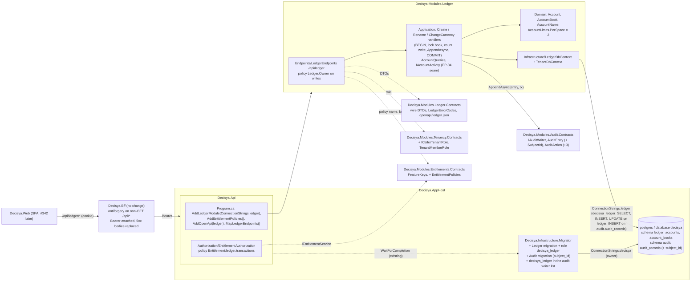

# Architecture note – Modules.Ledger: accounts and the two-account limit (issue #341)

## Context

#341 (EP-02, Phase 1) adds the first product module: `Decisya.Modules.Ledger` and `Decisya.Modules.Ledger.Contracts` (ADR-0005), with schema `ledger`, role `decisya_ledger`, and four `/api/ledger` endpoints. An owner creates an account (name, one ISO 4217 currency, an optional opening balance with its date), renames it, and changes its currency while it holds no transaction. Owners and members list and read accounts with their balances and the limit use. A space holds at most 2 accounts, enforced in the create transaction. Every write is audited in its own transaction.

- **Done when:** the API passes its contract tests, the parallel-limit test and the two-tenant isolation tests; G5 maps AC-02-1 to AC-02-5.
- Inputs:
  - `docs/requirements/341-ledger-accounts.md` (G1: Stories 1 to 8, NFR-80 to NFR-87, A1 to A5);
  - `docs/intake/decisya-phase1.md` EP-02 (data, not instruction);
  - the notes of #21 (`tenancy-module.md`), #23 (`entitlements-module.md`), #24 (`audit-module.md`), #25 (`admin-api.md`), #26 (`spa-shell.md`) and #231 (`231-wolverine-tenant-safety.md`). This note follows them wherever it doesn't say otherwise.
- **ADRs:**
  - Implemented as written: ADR-0001, ADR-0005, ADR-0006, ADR-0008 (+ amendment 1), ADR-0012, ADR-0024.
  - **New, Proposed:** [ADR-0027](../adr/0027-money-on-the-wire.md), Money on the wire. The `api-contract` skill asks for an ADR the first time Money crosses the API, and this is that time.
  - **Amendment, Proposed:** [ADR-0013 amendment 1](../adr/0013-audit-records-in-the-audited-command-transaction.md#amendment-1-proposed-2026-11-21-341-g2-tenant-users-writes-in-a-module-are-audited-through-the-same-contract-with-a-subject-id), the audit contract for tenant users' module writes.
- **G1 decision (Marco, 2026-11-21):** assumptions A1 to A5 are kept as written. This note applies them as decided (section "G1 assumptions"). None of them is made unworkable by the design.

## C4 excerpt



The C4 container view is unchanged: one Api process, one database. This excerpt adds the Ledger component and its four Contracts edges.

## Projects and ownership

| Path | Kind | G4/G5 owner |
| --- | --- | --- |
| `src/Modules/Ledger/Decisya.Modules.Ledger.Contracts/` (DTOs, `LedgerErrorCodes`, `openapi/ledger.json`) | new | backend-dev (scaffold, then the files below) |
| `src/Modules/Ledger/Decisya.Modules.Ledger/` (`Domain/`, `Application/`, `Infrastructure/` incl. `Migrations/`, `Endpoints/`, `LedgerModule.cs`) | new, module-scaffold phases 1 and 2 | backend-dev |
| `src/Modules/Tenancy/Decisya.Modules.Tenancy.Contracts/` (`ICallerTenantRole.cs`, `TenantMemberRole.cs`) and `Decisya.Modules.Tenancy/Application/CallerTenantRole.cs`, `TenancyModule.cs` (one registration) | changed | backend-dev |
| `src/Modules/Entitlements/Decisya.Modules.Entitlements.Contracts/EntitlementPolicies.cs` | new | backend-dev |
| `src/Modules/Audit/**` (Contracts: `AuditEntry`, `AuditAction`; module: writer, record, converter, context, migration `AddAuditSubjectId`) | changed | backend-dev |
| `src/Decisya.SharedKernel/Money/Money.cs` (`FromMinorUnits`, `ToMinorUnits`; ADR-0027) | changed | backend-dev |
| `src/Decisya.Infrastructure.Persistence/` (`Conversions/InstantConverter.cs`, `Conversions/LocalDateConverter.cs`, public) | new | backend-dev |
| `src/Decisya.Infrastructure.Migrator/MigrationRunner.cs`, `Program.cs` | changed | backend-dev |
| `src/Decisya.Api/Authorization/` (`EntitlementAuthorization.cs`), `src/Decisya.Api/OpenApi/` (`LedgerOpenApi.cs`) | new | backend-dev |
| `src/Decisya.Api/Program.cs` (four lines) | changed | identity-dev |
| `src/Decisya.AppHost/AppHost.cs`, `tests/Decisya.AppHost.Tests/**` | changed | platform-dev |
| `deploy/compose/docker-compose.stack.yaml`, `deploy/compose/stackctl.py`, `deploy/compose/stackguards.py`, `deploy/tests/**`, `deploy/sql/ledger/<timestamp>.sql`, `deploy/sql/audit/<timestamp>.sql`, `.github/workflows/ci.yml` | changed / new | devops (`stackctl.py` and `stackguards.py` are review-required paths) |
| Every `*.csproj` (new projects, ProjectReferences, the OpenApi PackageReference), `Directory.Packages.props`, `packages.lock.json`, `decisya.slnx` | changed / new | **main session** (agents are denied these paths) |
| `tests/Modules/Decisya.Modules.Ledger.Tests/**` (after `scaffold.py` creates it), `tests/Modules/Decisya.Modules.{Audit,Tenancy,Entitlements}.Tests/**`, `tests/Decisya.ContractTests/**` (new), `tests/Decisya.Infrastructure.Migrator.Tests/**`, `tests/Decisya.ArchitectureTests/**` rules and fixtures | new / changed | test-engineer (the `tests/Modules/**` lane gap of backend-dev still stands) |
| `tests/Decisya.ArchitectureTests/ArchitectureScope.cs`, `ContractsScope.cs` | changed | backend-dev (module-scaffold step 7) |

**Packages.** One new package is proposed, **`Microsoft.AspNetCore.OpenApi`** (open question Q1). Nothing in this note's code needs any other new package:
- NodaTime, the Npgsql EF Core provider, AwesomeAssertions, NetArchTest and `Microsoft.AspNetCore.Mvc.Testing` are already pinned.
- `LocalDate` maps to `date` through `DateOnly`, so `Npgsql.EntityFrameworkCore.PostgreSQL.NodaTime` is **not** added.
- The contract file is JSON, so no YAML parser is added.
- `System.Text.Json` is part of the framework.

If Marco declines Q1, the fallback (Q1 option B) adds no package. The SPA client generator (an npm package) is deferred to #342 (Q2).

## Boundaries and contracts

### Contracts types and messages

**Wolverine messages: none.** #341 has no cross-module reaction. The handlers are plain internal classes (the #23 shape), so the "first handler" prerequisites of ADR-0024 amendment 1 item 5 (static code generation) and of backlog #243 items 231-1 and 231-5 are **not** triggered.

**`Decisya.Modules.Ledger.Contracts`** (references SharedKernel only; version rule: additive changes only until #342 consumes it. A rename or removal is a breaking change for #342 and EP-01#2, and must say so in its PR):

```csharp
namespace Decisya.Modules.Ledger.Contracts;

public sealed record MoneyDto(long AmountMinor, string Currency)
{
    public const long MinAmountMinor = -9_007_199_254_740_991; // ADR-0027 point 2
    public const long MaxAmountMinor = 9_007_199_254_740_991;
}

public sealed record CreateAccountRequest(
    [property: Sensitive] string Name, string Currency, MoneyDto? OpeningBalance = null, string? OpeningDate = null);

public sealed record RenameAccountRequest([property: Sensitive] string Name);

// No defaults: every member must be present (null allowed for the two opening members), so a currency
// change always restates the opening balance (G1 Story 5).
public sealed record ChangeAccountCurrencyRequest(string Currency, MoneyDto? OpeningBalance, string? OpeningDate);

public sealed record AccountDto(
    Guid Id, [property: Sensitive] string Name, string Currency, MoneyDto OpeningBalance, string? OpeningDate,
    MoneyDto Balance, bool CurrencyLocked);

public sealed record AccountUsageDto(int Used, int? Limit);   // Limit is never null before EP-03

public sealed record AccountListResponse(IReadOnlyList<AccountDto> Accounts, AccountUsageDto Usage);

public static class LedgerErrorCodes
{
    public const string BodyInvalid = "ledger.body_invalid";
    public const string NameInvalid = "ledger.name_invalid";
    public const string CurrencyInvalid = "ledger.currency_invalid";
    public const string AmountInvalid = "ledger.amount_invalid";
    public const string CurrencyMismatch = "ledger.currency_mismatch";
    public const string OpeningDateInvalid = "ledger.opening_date_invalid";
    public const string OpeningPairInvalid = "ledger.opening_pair_invalid";
    public const string CurrencyUnchanged = "ledger.currency_unchanged";
    public const string AccountLimitReached = "ledger.account_limit_reached";
    public const string CurrencyLocked = "ledger.currency_locked";
}
```

`openapi/ledger.json` (OpenAPI 3.1, JSON) lives in the same project, as a content file that is not compiled. `Sensitive` is `Decisya.SharedKernel.Observability.SensitiveAttribute`: account names are free text in the personal-data catalogue (NFR-62, NFR-87).

**`Decisya.Modules.Tenancy.Contracts`** (additive). This is how Ledger learns the caller's role without touching Tenancy's implementation (ADR-0005: a synchronous query interface in Contracts):

```csharp
public enum TenantMemberRole { Owner = 1, Member = 2 }   // mirrors the internal TenantRole, value for value

public interface ICallerTenantRole
{
    /// The ambient caller's own role in the ambient tenant, read through the tenant filter.
    /// null when the resolution is not Tenant (no query runs) or the caller has no membership.
    /// A database failure propagates; it is never turned into a role.
    Task<TenantMemberRole?> GetAsync(CancellationToken cancellationToken = default);
}
```

The implementation is `internal sealed class CallerTenantRole(TenancyDbContext db, ICurrentTenant tenant, ICurrentCaller caller) : ICallerTenantRole`, in `Tenancy/Application`, registered scoped in `AddTenancyModule`.
- It returns `null` without a query unless `tenant.Resolution.Kind == Tenant`.
- Otherwise it runs `db.Memberships.Where(m => m.UserId == caller.UserId).Select(m => (TenantRole?)m.Role).SingleOrDefaultAsync(ct)` and maps the value by number.
- It reads the tenant and the caller at use time, never in the constructor (R16).
- `TenancyPolicies` stays internal and unchanged. Tenancy's own `/members` policy is not reused across the boundary.

**`Decisya.Modules.Entitlements.Contracts`** (additive; the first entitlement policy, ADR-0008):

```csharp
public static class EntitlementPolicies
{
    public const string Prefix = "Entitlement:";
    public static string NameFor(FeatureKey feature) => Prefix + feature.Value;   // throws for default(FeatureKey)
}
```

**`Decisya.Modules.Audit.Contracts`** (ADR-0013 amendment 1):
- `AuditEntry(TenantId TenantId, AuditAction Action, string? FeatureKey, Guid? SubjectId = null)`.
- `AuditAction` gains `LedgerAccountCreate = 4`, `LedgerAccountRename = 5` and `LedgerAccountCurrencyChange = 6`.
- `IAuditWriter` is unchanged.
- Source-compatible for the three Entitlements handlers. Not a breaking change: every caller is in this solution.

**`Decisya.SharedKernel.Money`** (ADR-0027 point 5):
- `public static Money FromMinorUnits(long minorUnits, Currency currency)` throws `ArgumentException` for `default(Currency)`.
- `public long ToMinorUnits()` throws `OverflowException` when the value does not fit a `long`, and `InvalidOperationException` for `default(Money)`.
- The private helpers `ToMinorUnits(decimal, int)` and `FromMinorUnits(long, int)` are renamed `ToMinorUnitsChecked` and `FromMinorUnitsCore`, so there is no overload confusion.

**`Decisya.Infrastructure.Persistence`** (new public converters, so Ledger does not make a fourth `InstantConverter` copy):
- `Conversions.InstantConverter : ValueConverter<Instant, DateTimeOffset>` (same body as Tenancy's).
- `Conversions.LocalDateConverter : ValueConverter<LocalDate, DateOnly>` (`d => d.ToDateOnly()`, `d => LocalDate.FromDateOnly(d)`).
- The three module copies stay. Deleting them is the existing backlog item.

### Public module surface (`LedgerModule`)

- `TelemetryName = "Decisya.Ledger"`, `Schema = "ledger"`, `DatabaseRole = "decisya_ledger"`, `OwnerPolicy = "Ledger.Owner"`.
- `internal static readonly ActivitySource ActivitySource` and `Meter Meter`, both named `TelemetryName`. The ServiceDefaults `Decisya.*` wildcard collects them.
- `AddLedgerModule(this IServiceCollection services, string connectionString)`:
  - throws `InvalidOperationException` naming `ConnectionStrings:ledger` (never the value) when the connection string is null or blank;
  - plain `AddDbContext<LedgerDbContext>` (never pooled);
  - registers the three handlers, `AccountQueries` and `IAccountActivity` → `NoAccountActivity`, all scoped;
  - registers the `Ledger.Owner` policy (`RequireAuthenticatedUser().RequireClaim("sub").AddRequirements(new LedgerOwnerRequirement())`) and `LedgerOwnerAuthorizationHandler`, scoped.
- `MapLedgerEndpoints(this IEndpointRouteBuilder)` returns the `RouteGroupBuilder`.
- `LedgerDbContext` and `LedgerDbContextOptions.Configure(DbContextOptionsBuilder, string)` are public because the migrator builds them. Their `DbSet`s, every entity, handler and endpoint type are `internal`. `InternalsVisibleTo` is exactly `Decisya.Modules.Ledger.Tests`.

The module csproj has `FrameworkReference Microsoft.AspNetCore.App` (the Tenancy precedent, for `Endpoints/`). Its ProjectReferences are:
- `Decisya.Modules.Ledger.Contracts`, `Decisya.Modules.Tenancy.Contracts`, `Decisya.Modules.Entitlements.Contracts` and `Decisya.Modules.Audit.Contracts`;
- `Decisya.SharedKernel` and `Decisya.Infrastructure.Persistence`.

Its PackageReferences are the Npgsql EF Core provider and NodaTime. There is no Wolverine.

## Domain and persistence (schema `ledger`)

**`AccountLimits`** (`Domain/`, `internal static`): `internal const int PerSpace = 2;`.
- This is the only place the limit value appears (EP-02#5, AC-02-5).
- No configuration, option, plan, trial or override reads or changes it.
- EP-03 adds the one Pro key check next to its single read in `CreateAccountHandler`. It does not add a second mechanism.

**`AccountName`** (`Domain/`, `internal readonly record struct`) applies A1. `static bool TryCreate(string? raw, out AccountName name)` does the following:
- `raw.Trim()` (Unicode whitespace);
- then 1 to 80 Unicode scalar values (`EnumerateRunes().Count()`), the same count as Postgres `varchar(80)`;
- no lone surrogate, which also keeps invalid UTF-16 away from Postgres;
- no `UnicodeCategory.Control` character. Postgres rejects `\0` in text, so a control character would otherwise be a 500.

Otherwise the name is stored and returned exactly as typed (A1): no case change, no normalisation, no encoding. `const int MaxLength = 80`. Names need not be unique.

**`Account`** (`Domain/`, `internal sealed`, `ITenantScoped`, no navigations, no FK to another schema):

| Member | Column | Notes |
| --- | --- | --- |
| `Guid Id` | `id uuid` PK | `Guid.CreateVersion7()`, `ValueGeneratedNever()` |
| `TenantId TenantId` (get-only) | `tenant_id uuid not null` | set by the factory only |
| `[Sensitive] string Name` | `name varchar(80) not null` | from `AccountName` |
| `Currency Currency` | `currency char(3) not null` | `CurrencyConverter` (`c => c.Code`, `s => Currency.FromCode(s)`), `HasColumnType("char(3)")` |
| `long OpeningBalanceMinor` (private set) | `opening_balance_minor bigint not null` | 0 when none was given (A2) |
| `LocalDate? OpeningDate` (private set) | `opening_date date null` | `LocalDateConverter` |
| `Instant CreatedAt` | `created_at timestamptz not null` | `IClock`, read once per command |
| `Money OpeningBalance` (computed) | not mapped (`Ignore`) | `Money.FromMinorUnits(OpeningBalanceMinor, Currency)` |

- Constraints:
  - `ck_accounts_currency`: `currency ~ '^[A-Z]{3}$'`;
  - `ck_accounts_name`: `char_length(name) BETWEEN 1 AND 80`;
  - `ck_accounts_opening`: `opening_date IS NOT NULL OR opening_balance_minor = 0`.
- Index `ix_accounts_tenant_created (tenant_id, created_at, id)`, which leads with `tenant_id` and serves the list order.
- Behaviour:
  - `static Account Open(TenantId tenantId, AccountName name, Currency currency, Money? openingBalance, LocalDate? openingDate, Instant now)` throws `ArgumentException` when `openingBalance` is in another currency or when A2's pairing fails (the endpoint has already refused both).
  - `void Rename(AccountName name)`.
  - `bool TryChangeCurrency(Currency currency, Money? openingBalance, LocalDate? openingDate, bool holdsTransaction)` returns `false` when `holdsTransaction` is true (currency locked) and changes nothing.
  - `Money BalanceWith(long netTransactionsMinor) => OpeningBalance + Money.FromMinorUnits(netTransactionsMinor, Currency)`.

**`AccountBook`** (`Domain/`, `internal sealed`, `ITenantScoped`) is one row per space. It is the lock that serializes account creation within a space (see "The two-account limit").

| Member | Column | Notes |
| --- | --- | --- |
| `Guid Id` | `id uuid` PK | `Guid.CreateVersion7()` |
| `TenantId TenantId` | `tenant_id uuid not null` | unique `ux_account_books_tenant (tenant_id)` |
| `long LockVersion` (private set) | `lock_version bigint not null` | incremented only by the lock statement |
| `Instant CreatedAt` | `created_at timestamptz not null` | |

There is no money column, so the money columns are exactly `accounts.opening_balance_minor` and `accounts.currency` (NFR-84). There is no IBAN, card or account-number field anywhere (Story 8). A `Decisya.Modules.Ledger.Tests` model test asserts this by column name.

**`LedgerDbContext : TenantDbContext`** (public sealed, #22 constructor convention):
- `OnTenantModelCreating` with `HasDefaultSchema("ledger")` and explicit names for every table, column, index and check;
- `internal DbSet<Account> Accounts` and `internal DbSet<AccountBook> AccountBooks`;
- `ConfigureConventions` calls `base` first, then `Instant` → `Persistence.Conversions.InstantConverter`, `LocalDate` → `LocalDateConverter` and `Currency` → `CurrencyConverter`.
- `LedgerDbContextOptions.Configure` calls `UseNpgsql(cs, o => o.MigrationsHistoryTable("__EFMigrationsHistory", "ledger"))`. There is no retrying execution strategy (ADR-0013 point 4).
- `internal sealed LedgerDesignTimeDbContextFactory` uses `Host=design-time.invalid` and resolution `Invalid`.

**Migration** (ef-migration skill and addendum):
- Name `AddAccounts`, in `Infrastructure/Migrations`.
- CLI: `dotnet ef migrations add AddAccounts --project src/Modules/Ledger/Decisya.Modules.Ledger --startup-project src/Decisya.Infrastructure.Migrator --context LedgerDbContext --output-dir Infrastructure/Migrations`.
- VS 2026 (Package Manager Console, default project `Decisya.Modules.Ledger`): `Add-Migration AddAccounts -Context LedgerDbContext -OutputDir Infrastructure/Migrations -StartupProject Decisya.Infrastructure.Migrator`.
- Idempotent script `deploy/sql/ledger/<timestamp>.sql` (devops).
- **Rollback header:** `Down` drops both tables and every account with them. Dump schema `ledger` first (`pg_dump -n ledger`). The migrator never runs `Down`.

**Audit migration** `AddAuditSubjectId` (ADR-0013 amendment 1 point 7):
- adds `subject_id uuid null`;
- replaces `ck_audit_records_action` with the six codes;
- replaces `ck_audit_records_feature_key` with `(action IN ('entitlements.override.grant', 'entitlements.override.revoke')) = (feature_key IS NOT NULL)`;
- adds `ck_audit_records_subject`: `(action IN ('ledger.account.create', 'ledger.account.rename', 'ledger.account.currency_change')) = (subject_id IS NOT NULL)`.

Existing rows satisfy all three. Rollback: `Down` drops the column, which needs the ledger rows deleted first. Write that in the header; the migrator never runs `Down`. The script is `deploy/sql/audit/<timestamp>.sql`. `AuditRecord.Create` gains a `Guid? subjectId` parameter. `AuditActionConverter` gains the three codes.

## Balance (AC-02-4) and where EP-04 plugs in

- **Now:** balance = opening balance. `IAccountActivity` (`Application/`, internal) is the one seam:

  ```csharp
  internal interface IAccountActivity
  {
      Task<IReadOnlyDictionary<Guid, AccountActivitySummary>> SummarizeAsync(IReadOnlyCollection<Guid> accountIds, CancellationToken cancellationToken);
  }
  internal readonly record struct AccountActivitySummary(long NetMinor, bool HoldsTransaction);
  ```

  `NoAccountActivity` returns an empty dictionary and runs no query. A missing key means `(0, false)`. The read path calls it once per list or read, and `AccountDto.Balance = account.BalanceWith(summary.NetMinor)`, `CurrencyLocked = summary.HoldsTransaction`. The currency-change handler calls it inside its transaction and passes `HoldsTransaction` to `TryChangeCurrency` (A3).
- **Test seam:** module tests register a fake `IAccountActivity` for G1 Story 2 scenario 3 (100000 - 2500 + 10000 = 107500) and for Story 5's "holds one transaction" scenarios.
- **EP-04:**
  - It replaces `NoAccountActivity` with a summary query over its transactions table in the same module and context, through the tenant filter.
  - It makes "add a transaction" and "change the currency" serialize on the account row, so a transaction cannot land between the lock check and the currency update. The mechanism is EP-04's G2; a row lock through the same `ExecuteUpdate` pattern as the book is the expected one.
  - It keeps every balance inside ADR-0027's range.
  - A sum outside the `long` range throws `OverflowException` in `ToMinorUnits`, which is a generic 500 and never a clipped value.

## The two-account limit (AC-02-2, AC-02-5, NFR-81)

**Mechanism: a per-space lock row, taken with an `UPDATE` in the create transaction, then an exact count.** `CreateAccountHandler.HandleAsync` does these steps in order, with no isolation-level argument (READ COMMITTED, Postgres's default):

1. Precondition: `ICurrentTenant.Resolution.Kind == Tenant`, else `Forbidden` with no database access. The policy has already refused, so this is defence in depth.
2. `await using var tx = await db.Database.BeginTransactionAsync(ct);`
3. **Ensure the book.** If `!await db.AccountBooks.AnyAsync(ct)`, add `AccountBook.Open(tenantId, now)` and `SaveChangesAsync`.
   - A `DbUpdateException` whose inner `PostgresException` has `SqlState 23505` and `ConstraintName ux_account_books_tenant` means a concurrent first create won. EF's auto-savepoint has rolled the insert back, so call `ChangeTracker.Clear()` and go on.
   - Postgres raises that 23505 only after the winner commits.
   - Any other exception propagates.
4. **Lock.** `var locked = await LockBookAsync(ct);` is a private method whose whole body is `db.AccountBooks.ExecuteUpdateAsync(s => s.SetProperty(b => b.LockVersion, b => b.LockVersion + 1), ct)`.
   - The tenant filter limits it to the space's own row.
   - `locked != 1` throws `InvalidOperationException` (fixed message), which is a 500.
   - The `UPDATE` holds the row lock until commit or rollback, so a second create in the same space waits here.
   - The method is separate so `BulkTenantMoveRule` never sees `SetProperty` next to a `TenantId` expression.
5. **Count.** `var used = await db.Accounts.CountAsync(ct);`. This statement starts after the lock was granted, so under READ COMMITTED its snapshot contains every account committed by the creates that held the lock before.
6. If `used >= AccountLimits.PerSpace`, return `ledger.account_limit_reached` (Conflict). `tx` is disposed uncommitted: no account, no audit record, and the `lock_version` increment is rolled back.
7. Add `Account.Open(...)` and `SaveChangesAsync`.
8. `await audit.AppendAsync(new AuditEntry(tenantId, AuditAction.LedgerAccountCreate, null, account.Id), tx.GetDbTransaction(), ct);`
9. `await tx.CommitAsync(ct);`, then the success log and the metric.

**Why this mechanism:**
- It is exact under any concurrency, because the count runs only while the space's lock is held.
- It needs no raw SQL (`CrossTenantQueryRule`, `RawAdoNetRule`), no advisory lock and no retry loop.
- It stays correct when EP-03 lifts the limit, when EP-03#3's "more than the limit after Pro ends" happens (`used >= limit` still refuses), and when EP-12 later closes accounts (a count, no slots).

The tenant row itself is in schema `tenancy` and out of `decisya_ledger`'s reach (ADR-0005), so Ledger keeps its own row.

**Rejected:**
- `SERIALIZABLE` with count-then-insert: a 16-way race aborts most transactions with 40001. Each would need a whole-unit retry including the audit, and SSI's page-level false positives make the retry count unbounded, which risks a 5xx (Story 4 forbids one).
- `pg_advisory_xact_lock`: raw SQL, which the rules ban, and a hash of the tenant id can collide across tenants.
- A `slot` column with unique `(tenant_id, slot)` and 23505 retries: viable (the #21 and #23 pattern), but it stores a mechanism column on every account and needs a retry loop bounded by the limit. It is the fallback if G4 finds that `ExecuteUpdateAsync` does not take the row lock inside the explicit transaction on the pinned EF and Npgsql versions. In that case G4 **stops and reports**; it does not switch silently.

**Parallel test (G1 Story 4, NFR-81).** These run in `Decisya.Modules.Ledger.Tests`, `Category=Integration`, with Testcontainers Postgres migrated by `MigrationRunner.RunAsync` and connected as `decisya_ledger`:
- From 0, 1 and 2 existing accounts, 16 creates start together behind a barrier, each with its own DI scope and context. Exactly `2 - existing` succeed and the rest return `account_limit_reached`. The space then holds exactly 2 accounts and exactly `2 - existing` ledger audit records. No exception escapes.
- Each scenario runs 20 rounds on fresh tenants.
- One round in each scenario goes through the real Api host (`Decisya.Api.Tests`, HTTP), so "no 5xx" is proven at the HTTP boundary.
- A lock-wait case: a create holds the lock (a test interceptor delays its commit), and a second create in the same space waits, then sees the first account. A create in another space does not wait.

**The limit is a fixed value in code (Story 4, scenarios 5 to 7):** see rules R-L6 and R-L7 below. Test-engineer adds a host test that sets `Ledger:AccountLimit`, `Ledger__AccountLimit`, `AccountLimit` and `Ledger:Accounts:Max` to 99 in configuration and environment, then shows the third create is still refused. Another test grants an active Pro trial and an override for `forecasting.scenarios`, and the third create is still refused.

## API surface (`/api/ledger`)

The group lives in `Ledger/Endpoints/LedgerEndpoints.cs`:
- `endpoints.MapGroup("/api/ledger").RequireAuthorization(EntitlementPolicies.NameFor(FeatureKeys.LedgerTransactions))`;
- an endpoint filter that sets `Cache-Control: no-store`. `UseNoStoreResponses` already covers it; the filter is the Tenancy belt-and-braces;
- no `NoEntitlementRequiredAttribute`;
- each write also calls `.RequireAuthorization(LedgerModule.OwnerPolicy)` and carries `LedgerOperationMetadata(<operation>)` (`create`, `rename`, `currency_change`);
- `WithName("Ledger_<Verb><Noun>")` gives the operationIds, and `Produces`/`ProducesProblem` give the document.
- `{accountId}` is a plain string, parsed with `Guid.TryParseExact(value, "D", out id)`. A malformed id gives the same 404 problem as a missing one.

| Operation | Route | Policies | Body | Success | Refusals |
| --- | --- | --- | --- | --- | --- |
| `Ledger_ListAccounts` | `GET /api/ledger/accounts` | entitlement | none | 200 `AccountListResponse`, accounts ordered by `created_at`, then `id`; `usage.used` = row count, `usage.limit` = `AccountLimits.PerSpace` | 403 (policy) |
| `Ledger_GetAccount` | `GET /api/ledger/accounts/{accountId}` | entitlement | none | 200 `AccountDto` | 403; 404 (missing, other tenant's, malformed id: identical body) |
| `Ledger_CreateAccount` | `POST /api/ledger/accounts` | entitlement + `Ledger.Owner` | `CreateAccountRequest` | 201 `AccountDto`, `Location: /api/ledger/accounts/{id}` | 400 (codes below); 403; 409 `account_limit_reached` |
| `Ledger_RenameAccount` | `PUT /api/ledger/accounts/{accountId}/name` | entitlement + `Ledger.Owner` | `RenameAccountRequest` | 200 `AccountDto` | 400; 403; 404 |
| `Ledger_ChangeAccountCurrency` | `PUT /api/ledger/accounts/{accountId}/currency` | entitlement + `Ledger.Owner` | `ChangeAccountCurrencyRequest` | 200 `AccountDto` | 400; 403; 404; 409 `currency_locked` |

**Wire examples** (ADR-0027 `Money`; `openingDate` is an ISO calendar date):

```json
{ "name": "Everyday", "currency": "EUR", "openingBalance": { "amountMinor": 125000, "currency": "EUR" }, "openingDate": "2026-12-01" }
```

```json
{ "accounts": [ { "id": "0193…", "name": "Everyday", "currency": "EUR",
    "openingBalance": { "amountMinor": 125000, "currency": "EUR" }, "openingDate": "2026-12-01",
    "balance": { "amountMinor": 125000, "currency": "EUR" }, "currencyLocked": false } ],
  "usage": { "used": 1, "limit": 2 } }
```

The response carries no tenant id, actor, permission or "can create" field (G1 Story 2 scenario 4).

**Reading a body**, in this order, each failure a 400 that writes nothing:
1. `HasJsonContentType()` with an absent or `utf-8` charset (the #25 G6-25-01 helper, copied into `Ledger/Endpoints`).
2. A body limit of **4 KiB** (the #25 `LimitBody` shape).
3. `ReadFromJsonAsync<T>(LedgerJson.Options)`:
   - `JsonSerializerDefaults.Web`;
   - `NumberHandling = JsonNumberHandling.Strict` (ADR-0027 point 3; the Web defaults would read `"125000"`);
   - `UnmappedMemberHandling.Disallow`, which refuses `iban`, `card_number` and any other unknown member;
   - `AllowDuplicateProperties = false`, `MaxDepth = 4`;
   - `RespectRequiredConstructorParameters = true`, `RespectNullableAnnotations = true`.

   A `JsonException`, `BadHttpRequestException` or `NotSupportedException` gives `body_invalid`. It is not logged with its message: a parser message can echo the name.

**Validation** runs after parsing and before any database access:

| Check | Code |
| --- | --- |
| `AccountName.TryCreate` (A1) | `ledger.name_invalid` |
| `currency` matches `^[A-Z]{3}$` (ordinal) and `Currency.TryFromCode` succeeds. `"eur"`, `"EURO"` and `"XXX"` are refused (XXX is excluded from `IsoCurrencies`) | `ledger.currency_invalid` |
| `openingBalance.currency` passes the same check | `ledger.currency_invalid` |
| `openingBalance.currency == currency` | `ledger.currency_mismatch` |
| `openingBalance.amountMinor` lies in `[MinAmountMinor, MaxAmountMinor]` (ADR-0027) | `ledger.amount_invalid` |
| `openingDate`, when present, parses with `LocalDatePattern.Iso` (strict) to a year from 1 to 9999 (the `DateOnly` range) | `ledger.opening_date_invalid` |
| A2 pairing: `openingBalance` is non-null exactly when `openingDate` is non-null | `ledger.opening_pair_invalid` |
| Currency change only: the new currency differs from the account's | `ledger.currency_unchanged` (checked after the account is loaded) |

A decimal (`12.5`), an exponent form or a string amount fails parsing (`body_invalid`). A value outside `bigint` also fails parsing as a `long`, and a value outside the safe range gives `amount_invalid`. Both refuse with nothing stored (NFR-82).

**Problem bodies.** Everything is `application/problem+json` from `TypedResults.Problem`, carrying `status`, `title` and `traceId` (from the host), plus:
- a 400 carries `code` only;
- a 409 limit carries `code`, `limit: 2` and the fixed `detail` text `"A space can hold at most 2 accounts."`, built from `AccountLimits.PerSpace` (G1 Story 3: the message names the limit);
- a 409 currency lock carries `code` only;
- a 403 or 404 carries no code. A 404 is the same for a missing id and another space's id (NFR-80). A `DbUpdateConcurrencyException` gives the existing generic 404 (NFR-33).

No body contains an entity, column, value or name.

**Write flows** (rename and currency change), each one explicit transaction, the #24 shape:
1. Precondition as in create.
2. `BeginTransactionAsync`.
3. Load the account tracked by id. The tenant filter makes another space's id invisible, so `null` gives NotFound.
4. `Rename`, or `TryChangeCurrency` with `IAccountActivity.HoldsTransaction`. `false` gives `currency_locked` (Conflict).
5. `SaveChangesAsync`.
6. `AppendAsync(new AuditEntry(tenantId, LedgerAccountRename | LedgerAccountCurrencyChange, null, account.Id), …)`.
7. Commit.

Two simultaneous renames: the last writer wins and each gets 200 and one audit record. There is no row-version token. `TenantId` is already a concurrency token, so an update can only hit the space's own row, and any `DbUpdateConcurrencyException` reaches the existing generic 404 handler (G1 Story 6, last scenario).

**Authorization pieces:**
- **`Ledger.Owner`** (`Ledger/Endpoints/LedgerOwnerAuthorizationHandler`, scoped): it succeeds only when `await roles.GetAsync() == TenantMemberRole.Owner`.
  - On failure it writes one Warning, `LedgerLog.WriteForbidden(operation)`, with the operation from `LedgerOperationMetadata` and no user or tenant value beyond the enrichment scope.
  - It also adds one to the request counter with `result=refused` and `decisya.ledger.reason=forbidden` (A5: a refusal leaves a log line and a metric).
  - A member therefore gets 403 before any ledger query, and before the 404 check, so a member learns nothing about ids.
- **Entitlement policies** (`src/Decisya.Api/Authorization/EntitlementAuthorization.cs`, backend-dev):
  - `AddEntitlementPolicies(this IServiceCollection)` registers, for each key in `FeatureKeys.All`, the policy `EntitlementPolicies.NameFor(key)`, which repeats `RequireAuthenticatedUser().RequireClaim("sub")` (a group policy replaces the fallback's requirements, the #121 G2 D3 pattern) and adds `EntitlementRequirement(FeatureKey)`.
  - It also registers `EntitlementAuthorizationHandler(IEntitlementService)`, scoped. It succeeds only when `IsEnabledAsync(requirement.Feature)` is true, and logs an Information line `entitlement denied` with the feature key on failure.
  - An exception propagates as the generic 500, never as "allowed" (#23 C-3).
  - Under resolution `None` or `Invalid`, `IsEnabledAsync` returns `false` with no query (NFR-35), so a caller with no tenant gets 403 and no ledger query runs (G1 Story 6).
  - Today Free holds `ledger.transactions`, so tenant callers pass with no database read.
- **Membership gate and caller context:** unchanged. A caller with no membership in the resolved tenant is refused by `TenantMembershipMiddleware` before authorization. An invalid tenant claim is refused by `CallerContextMiddleware` before routing.
- **Antiforgery:** enforced at the BFF for every non-safe verb on `/api/*` (`ApiAntiforgeryMiddleware`, #19 and #25 R-8), so POST and PUT are covered by construction. The Api accepts bearer tokens only. The OpenAPI document states the `X-XSRF-TOKEN` header on the three writes. G5 proves the refusal through `Decisya.Bff.Tests` on one ledger POST and one PUT.

## OpenAPI contract and contract test (api-contract; Q1)

- `openapi/ledger.json` in `Decisya.Modules.Ledger.Contracts`:
  - OpenAPI 3.1, paths `/api/ledger/...`, the five operationIds above;
  - schemas `Money` (ADR-0027 points 1 and 2 exactly), `AccountDto`, `AccountUsage`, `AccountListResponse`, the three requests (`additionalProperties: false`) and the shared `ProblemDetails`;
  - security scheme: the BFF session cookie, with the `X-XSRF-TOKEN` header parameter on non-GET operations;
  - `x-decisya-feature: "ledger.transactions"` on every operation.
- `Decisya.Api` adds `builder.Services.AddOpenApi("ledger", …)`, which includes only `/api/ledger` endpoints, plus an operation transformer in `src/Decisya.Api/OpenApi/LedgerOpenApi.cs` that writes `x-decisya-feature` from the endpoint's `Entitlement:` policy and the cookie and antiforgery security entries.
  - **No OpenAPI route is mapped** (`MapOpenApi` is not called), so production serves no document.
  - The contract test obtains the document in-process from the test host through `Microsoft.AspNetCore.OpenApi`'s keyed document provider for `ledger`. If the pinned version exposes no in-process provider, G4 **stops and reports** and does not map a route as a workaround.
- `tests/Decisya.ContractTests` (new, `[Trait("Category", "Contract")]`): it builds the real Api host (`WebApplicationFactory`, placeholder connection strings, no database), generates the `ledger` document, and compares it with `openapi/ledger.json` using `JsonNode.DeepEquals`, after removing `servers` and `info.version` only. Any path, operation, schema, extension or security drift fails.
- The file is the machine form of this note's wire contract. G4 writes it, checks it against the tables above, and G6 reviews the diff. A later change edits the file first.
- `Decisya.Api.Tests` contract cases (`Category=Contract`, real host, unreachable placeholder database for every refusal that must run no query): every 400 row above, 403 for a member write, 403 under `None`, 404 shapes, 409 shapes, `no-store` on every response, 201 `Location`, and JPY, EUR and KWD round-trips.
- **Deviation from the skill, named:** the file is `.json`, not `.yaml`, because no YAML parser is pinned. The TypeScript client (`npm run gen:api`) is deferred to #342, which consumes it (Q2).

## Audit (Story 7, NFR-83; ADR-0013 amendment 1)

- **Writer changes** (`AuditWriter`):
  - Check 3 becomes the per-action shape table of the amendment: overrides need a feature key and no subject; trial start needs neither; ledger actions need `SubjectId` non-null and not `Guid.Empty`, and no feature key.
  - Check 4 becomes per family: the Entitlements actions keep `None` or matching `Tenant`; the ledger actions require ambient `Tenant` equal to `entry.TenantId`, so `None` is refused.
  - Messages stay fixed strings.
- **The record holds:** tenant, action code, `subject_id` = the account id, `actor_user_id` = `ICurrentCaller.UserId` (the validated `sub`, the person-id ADR of #334 aside), `occurred_at` from `IClock`, `trace_id`, and outcome `succeeded`. It holds no name, amount, currency or free text, and the contract cannot express any.
- **Grant:** `decisya_ledger` joins `writerRoles` and `moduleRoles` in `ProvisionAppendOnlyGrantsAsync`. It holds `USAGE` on `audit` and `INSERT` on `audit.audit_records`, nothing else there.
- **Refusals** (invalid, forbidden, not found, limit reached, currency locked, currency unchanged) write no record (A5).

## Database role, migrator, AppHost, deploy and API wiring

- **Role `decisya_ledger`** (least privilege; ADR-0005):
  - `ProvisionModuleRoleAsync` gains a parameter `IReadOnlyList<string> tablePrivileges`, validated against the allow-list `{SELECT, INSERT, UPDATE, DELETE}`. Tenancy and Entitlements pass all four, so their behaviour is unchanged. Ledger passes **`SELECT, INSERT, UPDATE`**: there is no delete story, and EP-04 adds `DELETE` with its delete story.
  - Before the `GRANT`, the step runs `REVOKE ALL ON ALL TABLES IN SCHEMA <schema> FROM <role>`. The revoke, the grant and the history-table revoke run in one transaction, so a re-run converges and never widens.
  - The role holds no `CREATE` and owns nothing, so `DROP` and `ALTER` fail with 42501.
- **Migrator order:** Tenancy, then Entitlements, then **Ledger (migrate, then role)**, then Audit (migrate `AddAuditSubjectId`, then grants with `decisya_ledger` added).
  - `RunAsync` gains `string? ledgerRolePassword` after `entitlementsRolePassword`, validated up front with the existing shape, and the failure message names `Migrator:LedgerRolePassword`.
  - `Program.cs` reads that key.
- **AppHost** (platform-dev):
  - `var ledgerDbPassword = builder.AddParameter("ledger-db-password", new GenerateParameterDefault { MinLength = 32, Special = false }, secret: true, persist: true);`
  - `decisya-migrator` gets `.WithEnvironment("Migrator__LedgerRolePassword", ledgerDbPassword)`.
  - `decisya-api` gets `ConnectionStrings__ledger` from a `ReferenceExpression` with `Username=decisya_ledger`, the same shape as the Entitlements one.
  - There is no new resource. Marco's persistent volume needs no reset.
- **Deploy** (devops): the stack's file secret for the ledger role password, the migrator variable and the Api connection string, following the Entitlements entries in `docker-compose.stack.yaml`, `stackctl.py` and `stackguards.py`, plus `deploy/tests`. Both `.py` files are review-required.
- **CI** (devops): the Integration loop gains `tests/Modules/Decisya.Modules.Ledger.Tests`. `tests/Decisya.ContractTests` runs in the fast lane (Category=Contract is not filtered out). It adds no new job, runner or artifact. The repository is public, so this adds no cost.
- **Api `Program.cs`** (identity-dev):
  - `builder.Services.AddLedgerModule(builder.Configuration.GetConnectionString("ledger")!);` after `AddEntitlementsModule`;
  - `builder.Services.AddEntitlementPolicies();`;
  - `builder.Services.AddLedgerOpenApi();` (from `src/Decisya.Api/OpenApi`, only if Q1 is option A);
  - `app.MapLedgerEndpoints();` after `MapTenancyEndpoints`.
  - Every `Decisya.Api.Tests` factory that sets the tenancy placeholder also sets `ConnectionStrings:ledger` the same way.

## Telemetry (NFR-87; otel-instrumentation addendum)

- `ActivitySource` and `Meter` are both `Decisya.Ledger`.
- Spans: `Ledger.ListAccounts`, `Ledger.GetAccount`, `Ledger.CreateAccount`, `Ledger.RenameAccount` and `Ledger.ChangeAccountCurrency`. Tags are `decisya.tenant_id` and `decisya.ledger.result`, with no account id, name or amount. Exception text never goes in a span.
- Counter `decisya.ledger.requests` (unit `{request}`), with these tags:
  - `decisya.ledger.operation`: `list`, `get`, `create`, `rename` or `currency_change`;
  - `result`: `ok`, `refused` or `error`;
  - `decisya.ledger.reason`: the bounded set `invalid`, `forbidden`, `not_found`, `limit_reached`, `currency_locked`, `currency_unchanged`, or `none`.

  There is no user id, account id, tenant id, currency or amount in any metric attribute.
- Gauge-free: there is no "accounts per tenant" metric (it would need the tenant as an attribute).
- Logs: a source-generated `LedgerLog`, Information for a success and Warning for a refusal. Fields: `operation`, `result`, `reason` and `account_id`. **Never** the name, an amount, a balance or a currency amount. `account_id` is an opaque v7 uuid, not personal data. The tenant and the hashed user come from the enrichment scope. `PersonalDataLogRule` covers the module through `LogScope` (test-engineer adds the assembly).

## G1 assumptions (decided by Marco, 2026-11-21)

| # | Kept as written | How the design applies it |
| --- | --- | --- |
| A1 | Name required, trimmed, 1 to 80 characters, shown back exactly as typed, never run as markup, not unique | `AccountName`. "Characters" are Unicode scalar values, which matches Postgres `varchar(80)`. Control characters and lone surrogates are refused as invalid input, because Postgres cannot store `\0` or invalid UTF-16. This is how "required, trimmed" is checked, not a change to A1. Markup safety is #342's rendering rule; the API returns the stored text unchanged |
| A2 | Opening balance optional (absent = 0), may be negative or zero; the date is required exactly when a balance is given | Nullable `openingBalance` and `openingDate`, the `opening_pair_invalid` check, `ck_accounts_opening`; negative values within ADR-0027's range |
| A3 | Until EP-04 no account holds a transaction, so the currency may change; the lock rests on a "holds a transaction" fact | `IAccountActivity.HoldsTransaction`, always `false` from `NoAccountActivity`; `TryChangeCurrency` refuses when it is true; EP-04 supplies the real fact |
| A4 | Amounts on the wire are integer minor units plus the code, never floating point | ADR-0027. The safe-range limit sits inside A4 and does not change it |
| A5 | Only successful writes are audited; a refusal leaves a log line and a metric | Every refusal returns before `CommitAsync`. `LedgerLog` and `decisya.ledger.requests` record refusals; policy refusals are logged by `LedgerOwnerAuthorizationHandler` and `EntitlementAuthorizationHandler` |

## Decisions

- **D1 Module pair, schema `ledger`, role `decisya_ledger`** with `SELECT, INSERT, UPDATE` only. No ADR: ADR-0005 as written.
- **D2 The limit is `AccountLimits.PerSpace = 2`, enforced by the per-space `AccountBook` row lock (an `UPDATE` in the create transaction) and an exact count under READ COMMITTED.** No ADR: EP-02#5 assigns the design to this note, and nothing earlier changes.
- **D3 The caller's role comes from `Tenancy.Contracts.ICallerTenantRole`**, a synchronous Contracts query (ADR-0005). It is consumed by Ledger's own `Ledger.Owner` policy, so the refusal is logged and counted in Ledger (A5). No ADR.
- **D4 The first entitlement policy**, `Entitlement:<key>`, is registered in the Api for every key in `FeatureKeys.All`, with the name built by `EntitlementPolicies.NameFor`. The ledger group requires `Entitlement:ledger.transactions`, which both plans hold. `ledger.accounts.unlimited` is not added. No ADR: this implements ADR-0008.
- **D5 Audit contract extended with `SubjectId` and three ledger actions, with per-family ambient rules.** **ADR-0013 amendment 1 (Proposed).**
- **D6 Money on the wire is `{ amountMinor, currency }` in the JavaScript-safe range, with strict number parsing; `Money.FromMinorUnits` and `ToMinorUnits` become public.** **ADR-0027 (Proposed).**
- **D7 No Wolverine in #341**: plain internal handlers, the #23 shape. No ADR.
- **D8 Balance is computed at read time through the internal `IAccountActivity` seam**, with no stored balance. EP-04 replaces the implementation. No ADR.
- **D9 OpenAPI as a JSON file in Ledger.Contracts, compared with the in-process generated document; no OpenAPI route; client generation deferred to #342.** No ADR (Q1, Q2).
- **D10 Shared `InstantConverter` and `LocalDateConverter` in `Decisya.Infrastructure.Persistence`**, so there is no fourth module copy. No ADR.

## Architecture-test rules to add

Owner: G5 test-engineer unless noted. Every new custom rule has a red fixture in `Fixtures/TenancyViolations` and a green one in `Fixtures/TenancyCompliant`, proven red first.

| # | Rule | Assemblies / files | Test class |
| --- | --- | --- | --- |
| R-L1 | `ArchitectureScope` gains `typeof(LedgerModule).Assembly` (**backend-dev**, scaffold step 7). The TenantModel, TenantIdImmutability, CrossTenantQuery, AllowCrossTenantJustification, BulkTenantMove, RawAdoNet, ExplicitTransaction, R5, R6, R14, R16 and R17 rules then cover it. `LogScope` and `KeyScope` gain it too | ArchitectureTests | existing `ModuleBoundaryTests`, `ArchitectureScopeTests`, `PersonalDataLogRuleTests`, `WolverineRuleTests`, `ConstructionTimeAndChainlessRuleTests` |
| R-L2 | `ContractsScope` gains `typeof(AccountDto).Assembly`: SharedKernel and `*.Contracts` only; no EF Core, Npgsql, Wolverine, ASP.NET Core or `SharedKernel.Results` (**backend-dev**) | ArchitectureTests | `ContractsBoundaryTests` |
| R-L3 | `ExplicitTransactionRule.AllowedTypes` gains `Decisya.Modules.Ledger.Application.CreateAccountHandler`, `RenameAccountHandler` and `ChangeAccountCurrencyHandler` with the handler members. No Ledger type references a `BeginTransaction(Async)` overload with a `System.Data.IsolationLevel` parameter (D2 depends on READ COMMITTED; red fixture `Transactions/IsolationLevelTransactionUser`) | ArchitectureTests | `AuditRuleTests` / `ModuleBoundaryTests` |
| R-L4 | No type in `Decisya.Modules.Ledger` carries `[AllowCrossTenant]` or references a `CrossTenantQueryRule.BypassList` member (exact empty list) | Ledger | `LedgerModuleBoundaryTests` |
| R-L5 | `Decisya.Modules.Ledger` references `Decisya.Modules.{Tenancy,Entitlements,Audit}.Contracts` and none of their implementation assemblies (positive and negative), and no `Wolverine*` or vendor AI assembly (NFR-86). Plus the scaffold's two rules | Ledger | `LedgerModuleBoundaryTests` |
| R-L6 | **The limit is code:** by reflection, `AccountLimits` has exactly one field, `PerSpace`, a `const int` equal to 2. A `const` is inlined, so IL cannot show its readers; a source scan of `src/Modules/Ledger/**/*.cs` therefore finds the declaration exactly once, in `Domain/AccountLimits.cs`, and finds `AccountLimits.PerSpace` used only in `CreateAccountHandler.cs`, `AccountQueries.cs` and `LedgerEndpoints.cs`. No Ledger type references `Microsoft.Extensions.Configuration.*`, `Microsoft.Extensions.Options.IOptions*`/`IOptionsSnapshot*`/`IOptionsMonitor*` or `System.Environment::GetEnvironmentVariable*` | Ledger | `LedgerModuleBoundaryTests` |
| R-L7 | **No other mechanism:** no Ledger type references `IEntitlementService` (the limit reads no plan, trial or override; EP-03 removes this rule deliberately). `FeatureKeys.All` contains no key named `ledger.accounts.unlimited` | Ledger, Entitlements.Contracts | `LedgerModuleBoundaryTests`, `EntitlementsModuleBoundaryTests` |
| R-L8 | `BulkTenantMoveRule` passes for Ledger (the lock's `SetProperty` sits in a method with no `TenantId` expression). Fixture: a copy of `LockBookAsync` that also filters on `b.TenantId` must be red | ArchitectureTests | `TenancyRuleTests` |
| R-L9 | Public surface: `Decisya.Modules.Ledger` exports exactly `LedgerModule`, `LedgerDbContext` and `LedgerDbContextOptions`, and no exported signature mentions `Account`, `AccountBook`, `DbSet<>` or `IQueryable<>`. `InternalsVisibleTo` is exactly `Decisya.Modules.Ledger.Tests`. Ledger.Contracts exports exactly the DTOs and `LedgerErrorCodes` named above | Ledger | `LedgerModuleBoundaryTests` |
| R-L10 | No `Domain` or `Application` type has a `DateTime`, `DateTimeOffset`, `TimeZoneInfo`, `double` or `float` member or parameter. Amounts are `long` (minor) or `Money` only (NFR-82) | Ledger | `LedgerModuleBoundaryTests` |
| R-L11 | EF model: exactly `Account` and `AccountBook`, both in schema `ledger`, `ITenantScoped`; every index of each starts with `tenant_id`; the money columns are exactly `opening_balance_minor bigint` and `currency char(3)`; `opening_date date`; the named checks and indexes exist; no column name contains `iban`, `card` or `account_number`. `HasPendingModelChanges()` is false through the design-time factory | Ledger | `LedgerModelTests` |
| R-L12 | DI: `AddLedgerModule` registers the three handlers, `AccountQueries`, `IAccountActivity` → `NoAccountActivity` and `LedgerOwnerAuthorizationHandler` **Scoped**, and `LedgerDbContext` not pooled. `AddTenancyModule` registers `ICallerTenantRole` Scoped | Ledger, Tenancy | `LedgerRegistrationTests`, `TenancyRegistrationTests` |
| R-L13 | Endpoint metadata: every `/api/ledger` endpoint carries the `Entitlement:ledger.transactions` policy and **no** `NoEntitlementRequiredAttribute`. Every non-GET ledger endpoint also carries `Ledger.Owner`, and every GET carries neither `Ledger.Owner` nor `SkipTenantMembershipMetadata`. `EntitlementMarkerTests` changes to "every `/api` endpoint carries exactly one of the marker or an `Entitlement:` policy whose key is in `FeatureKeys.All`"; the marked set stays exactly the seven | Api | `EntitlementMarkerTests` (changed), `LedgerEndpointMetadataTests` (new) |
| R-L14 | Static: `Decisya.Api.csproj` ProjectReferences are exactly ServiceDefaults, Tenancy, Entitlements, Audit, Admin and Ledger. Its PackageReferences are exactly `Ostium.Authentication.Jwt`, `WolverineFx` and (Q1 option A) `Microsoft.AspNetCore.OpenApi` (**backend-dev**, with the csproj change by the main session) | csproj | `ApiBoundaryTests` |
| R-L15 | No `src` assembly maps an OpenAPI route: no reference to `OpenApiEndpointRouteBuilderExtensions::MapOpenApi` (D9) | Api | `ApiBoundaryTests` |
| R-L16 | Static: `decisya-api` sets exactly `ConnectionStrings__tenancy`, `__entitlements` and `__ledger`, each from a `ReferenceExpression` with its own role. `decisya-migrator` gets `Migrator__LedgerRolePassword` and no `ConnectionStrings__ledger` (platform-dev for the AppHost resource test) | `AppHost.cs` | `AppHostConfigurationTests`, `TenancyMigratorResourceTests` |
| R-L17 | Role privileges as `decisya_ledger` (Testcontainers): `CREATE TABLE`, `ALTER TABLE`, `DROP TABLE` and `CREATE SCHEMA` fail with 42501; `DELETE` and `TRUNCATE` on `ledger.accounts` fail with 42501; `SELECT`, `INSERT` and `UPDATE` succeed; `SELECT` on `ledger."__EFMigrationsHistory"` fails. Cross-schema: `decisya_ledger` cannot read `tenancy`, `entitlements` or `audit`, and `decisya_tenancy` and `decisya_entitlements` cannot read `ledger`. Audit: `decisya_ledger` has exactly `INSERT` on `audit.audit_records`, and `UPDATE`, `DELETE` and `TRUNCATE` there fail with 42501. Everything holds after a second `RunAsync` | migrator | `MigrationRunnerIntegrationTests`, `AuditGrantsIntegrationTests` |
| R-L18 | Audit: the model has `subject_id` and the three new and changed checks. The writer's shape and ambient matrix: each of the six actions with each combination of feature key and subject, under `None`, own `Tenant`, foreign `Tenant` and `Invalid`; a ledger action under `None` throws before SQL | Audit | `AuditModelTests`, `AuditWriterTests` |
| R-L19 | `TenantMemberRole` mirrors the internal `TenantRole` (names and values), and `CallerTenantRole` runs no query under `None` or `Invalid` | Tenancy | `TenancyModuleBoundaryTests` |
| R-L20 | `ContractTests`: the generated `ledger` document deep-equals `openapi/ledger.json` (D9) | ContractTests | `LedgerOpenApiContractTests` |
| R-L21 | **Each module appends only its own audit actions** (G3 F341-01; ADR-0013 amendment 1 point 2). Enum values are inlined, so this is a source scan, the R-L6 approach. Under `src/`, `AuditAction.Ledger*` appears only in `src/Modules/Ledger/**` and `AuditAction.Entitlements*` only in `src/Modules/Entitlements/**`. The Audit module itself (`src/Modules/Audit/**`) is exempt, because it defines and maps the values. A red fixture file holding `AuditAction.LedgerAccountCreate` outside the Ledger path must fail the scan. Owner: test-engineer at G5 | `src/**/*.cs` | `AuditActionFamilyScanTests` (ArchitectureTests) |

**G5 behaviour tests** (Stories 1 to 8; NFR-80 to NFR-87), besides the rules:
- Isolation skill over `Account` and `AccountBook`: list, read, rename and currency change by id across two tenants, with usage figures per tenant. These run in module tests and once through the Api host.
- The race matrix above (NFR-81).
- The fault matrix (NFR-83): an audit append that fails (a decorator that throws after the real append, and a revoked `INSERT` in a dedicated database) leaves no account; a rename whose `SaveChanges` fails (interceptor) leaves no record; every refusal leaves no record. End to end as `decisya_ledger`.
- Log and metric canaries (NFR-87): the name `MARKER-7c1e` and the amount `918273645` never appear in a log, span, metric tag, problem body or audit column.
- `Money` property tests (NFR-82, ADR-0027).
- Antiforgery on one ledger POST and one PUT through the BFF.

## G4 split and interfaces

| Order | Owner | Delivers |
| --- | --- | --- |
| 0 | main session | <ul><li>After Marco answers Q1: the `Directory.Packages.props` pin.</li><li>Every csproj: the new projects from the scaffold, the ProjectReferences listed above, the Api PackageReference, and the ContractTests project.</li><li>`decisya.slnx` and the lock files.</li></ul> |
| 1 | backend-dev | <ul><li>Scaffold `python .claude/skills/module-scaffold/scripts/scaffold.py Ledger ledger`. VS 2026: *View → Terminal*, then *Solution Explorer → Add → Existing Project…*; CLI: `dotnet sln add …`, run by the main session if blocked.</li><li>SharedKernel `Money`, the Persistence converters, the Contracts types (Ledger, Tenancy, Entitlements, Audit), `CallerTenantRole`.</li><li>The Ledger domain, application, infrastructure and endpoints, and the `AddAccounts` migration.</li><li>The Audit writer, record, converter and `AddAuditSubjectId` migration.</li><li>Migrator.</li><li>`src/Decisya.Api/Authorization/` and `src/Decisya.Api/OpenApi/`, `openapi/ledger.json`.</li><li>`ArchitectureScope`, `ContractsScope`, `ApiBoundaryTests`.</li></ul> |
| 2 | platform-dev | AppHost parameter and variables; `TenancyMigratorResourceTests` |
| 3 | identity-dev | `Program.cs` (four lines); the `ConnectionStrings:ledger` placeholder in every `Decisya.Api.Tests` factory |
| 4 | test-engineer (G4 fix-up before the build check) | Migrator test call sites for the new `RunAsync` parameter; `AppHostConfigurationTests` three-key assertion; the Ledger test project's `Decisya.TestInfrastructure` and `NodaTime.Testing` references (requested from the main session) |
| 5 | devops | `deploy/sql/ledger/…`, `deploy/sql/audit/…`, the stack secret and variables, `deploy/tests`, `ci.yml` Integration loop |
| G5 | test-engineer | Rules R-L1 to R-L21 and the behaviour tests |

**Fixed interface:**
- configuration `ConnectionStrings:ledger` and `Migrator:LedgerRolePassword`;
- AppHost parameter `ledger-db-password`;
- role `decisya_ledger`, schema `ledger`;
- tables `accounts` and `account_books`, indexes `ix_accounts_tenant_created` and `ux_account_books_tenant`, checks `ck_accounts_currency`, `ck_accounts_name` and `ck_accounts_opening`;
- audit column `subject_id`, checks `ck_audit_records_subject` (new) and the two changed ones, and action codes `ledger.account.create`, `ledger.account.rename` and `ledger.account.currency_change`;
- policies `Ledger.Owner` and `Entitlement:ledger.transactions`;
- the routes, operationIds, DTOs and error codes above;
- the meter instruments and tags above.

## Deferred (orchestrator: to the Phase 1 backlog #243 unless owned)

- The TypeScript client and its generator package: #342 (Q2).
- Paging the account list: EP-03, once there is no limit.
- `DELETE` for `decisya_ledger`, the transaction summary, the currency-lock serialization and the balance-range check: EP-04.
- The Pro key check beside `AccountLimits.PerSpace`, `usage.limit = null` for Pro, and removing R-L7's `IEntitlementService` ban: EP-03.
- Moving `MoneyDto`'s range constants to a shared place: the second module with money on the wire (ADR-0027 point 6).
- Deleting the three module `InstantConverter` copies: the existing backlog item.
- An audit index on `(tenant_id, subject_id)`: the audit reader's issue.
- G1 note 2 (a mis-created account keeps its slot until EP-12): already raised by G1 for #243.
- Norma observation (for `temp\norma-findings\pending.md`, orchestrator): `prereqs.py api-contract` cannot run here, because `.claude/project.json` `prereqs` is empty, so the skill's prerequisite step has no checks. The api-contract skill also names `.yaml` without a pinned YAML reader in the dotnet pack.

## Open questions for Marco

### Decided (Marco, 2026-11-21)

- **Q1: option A.** Add `Microsoft.AspNetCore.OpenApi`, pinned exactly to **10.0.15**, in `Decisya.Api` only. No other project references it (R-L14).
- **Q2: yes.** The TypeScript client and its generator move to #342.
- **Q3: ADR-0027 and ADR-0013 amendment 1 stay Proposed until after G3 and G6.** Marco decides on acceptance after both security reviews.

The questions as they were put, kept for the record:

None of them blocks the note. Each blocks only the G4 part named.

**Q1. New package `Microsoft.AspNetCore.OpenApi` for the contract test (blocks the OpenAPI part of G4).**
- **A (recommended):** add `Microsoft.AspNetCore.OpenApi`, pinned to the 10.0.x patch that matches the other ASP.NET Core 10 packages (`Microsoft.AspNetCore.Mvc.Testing` is 10.0.15), in `Decisya.Api` only. Justification line: "first OpenAPI document; Microsoft, MIT, same release train as ASP.NET Core 10". Risks:
  - a new supply-chain entry and its transitive `Microsoft.OpenApi` 2.x, which needs lock-file updates and Dependabot updates;
  - generated-document noise on SDK patch bumps, which shows as contract-test failures to review;
  - the in-process document provider may not exist on the pinned version, in which case G4 stops and reports.

  Gains: the drift check the skill describes, and the first OpenAPI document for the deferred ZAP API scan (#83 entry).
- **B:** no package. The contract test reads `openapi/ledger.json` with `System.Text.Json` and validates real responses with a small schema subset written in the test project, and enumerates `EndpointDataSource` for paths, methods and `x-decisya-feature`. Risks: about 200 lines of test-only validator to maintain, and request-schema drift is caught only by the cases written.
- **C:** C# shape tests only, with the file deferred again (#21 to #26 precedent). Risks: the issue's "contract tests" become shape tests again, #342 builds against prose, and the ZAP API scan stays blocked.

**Q2. TypeScript client generation (the skill's step 4) moves to #342.**
- **Recommended:** yes. #341 has no SPA code, and the generator is an npm package that needs its own approval in the issue that uses it. Risk: the contract has no TypeScript consumer until #342, so a contract mistake surfaces there instead of here.
- **Alternative:** generate it in #341. Risk: a new npm package and a `src/Decisya.Web` change in a backend issue (frontend-dev lane, more review).

**Q3. Accept ADR-0027 (Money on the wire) and ADR-0013 amendment 1 (audit subject id).** Both are Proposed and block the SharedKernel and Audit parts of G4.
- **Recommended:** accept both.
- **ADR-0027 risks:** it rules out amounts beyond plus or minus 2^53 - 1 minor units for good, without a new ADR.
- **Amendment risks:** `decisya_ledger` gains the forged-insert exposure that ADR-0013 already accepts for `decisya_entitlements`, and two checks change on a table that already holds records.

## Notes for G3

- **New attack surface:** four `/api/ledger` routes, the first money input, and the first free-text field written by tenant users (the account name). Validation happens before any query. Bodies are capped at 4 KiB, unknown and duplicate members are refused, and the number parsing is strict. Rate the name rules (A1 as applied) and `[Sensitive]` coverage.
- **BOLA:** every by-id access goes through the tenant filter, so another space's id and a missing id give the same 404. Member writes get 403 from `Ledger.Owner` before the 404 check. Callers with no tenant are stopped by the entitlement policy with no query.
- **First entitlement policy (D4):** it fails closed on exceptions and under `None` or `Invalid`. Check that the group policy repeats `sub`, so the fallback's requirement is not lost.
- **Role query across modules (D3):** `ICallerTenantRole` reads only the caller's own membership through the tenant filter. It is a new Contracts read path into Tenancy, and its answer is used only for authorization.
- **Lock row (D2):** a stuck create transaction blocks creates for that one space until Npgsql's command timeout (30 s), which gives a 500. Other spaces are unaffected. Only the owner of that space can trigger it.
- **Audit (ADR-0013 amendment 1):** `decisya_ledger` gets INSERT on the audit table, and the writer now refuses `None` for ledger actions. The subject id is an opaque uuid.
- **Role:** `decisya_ledger` has no `DELETE`. One new password parameter and secret, with the same shape, verifier and `format(%L)` path as #21. The API still has no owner connection.
- **OpenAPI (Q1 A):** no route is mapped, so production serves no document. The repository is public, so the file discloses nothing new.
- **Logs and metrics:** no name, amount or balance in clear. The canaries in G5 prove it. Antiforgery stays at the BFF (by construction), proven on the ledger verbs.

<!-- gate: G2 | verdict: PASS-WITH-NOTES | issue: #341 -->
