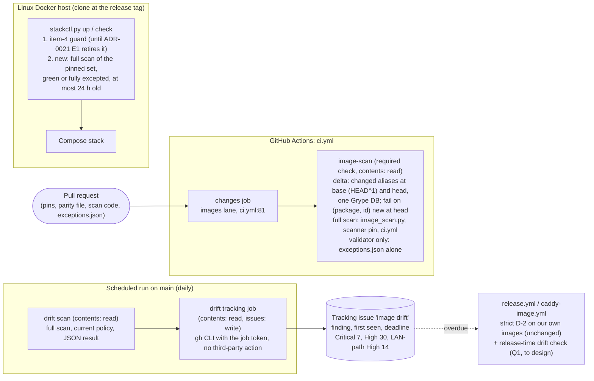

# Architecture note – ADR-0022: image-scan pull-request delta gate, daily drift tracking, fresh full scan at deploy (issue #216)

## Context

#216 writes [ADR-0022](../adr/0022-image-scan-pr-delta-gate.md) (Proposed) from the draft Marco approved on 2026-10-30. The ADR revises ADR-0015 decision items 3 and 5 for the pull-request path only. This issue is docs only: the ADR, the index row, a dated pointer line in ADR-0015 and this note. The code comes in one implementation issue (full tier) after Marco accepts the ADR.

No product module, `*.Contracts` type, Wolverine message, endpoint, entity or tenant data flow changes, so no NetArchTest rule is added. The note is not N/A: the ADR changes what a required check compares, adds a workflow permission (`issues: write`) and adds a check at the merge → deploy boundary.

Sources read as data: `docs/ai/pipeline/216.md`, the approved draft, ADR-0015 (with both amendments), ADR-0021, `.github/workflows/ci.yml`, `.github/workflows/release.yml`, `.github/scripts/image_scan.py`, `deploy/compose/stackctl.py`, `.claude/tests/test_ruleset.py`, `docs/architecture/release-supply-chain.md`, `docs/security/threat-models/deployable-stack.md`.

## C4 excerpt (after the implementation issue)

## What changes structurally

1. **The pull-request gate's comparison.** `image-scan` stays one required job with no job-level `if`. Its step chooses one of three modes from the diff: delta (changed aliases only, base vs head), full (the gate itself changed), validator only (`exceptions.json` alone). The delta needs the base pins, so the job reads `ContainerImages.cs` at the merge commit's first parent, as the `changes` job already does for its diff (`ci.yml:57`).
2. **The scheduled run.** Daily instead of weekly, full scan, plus a separate tracking job that alone holds `issues: write`. `test_ruleset.py:368` already flags a job-level `if: github.event_name == 'schedule'` on `image-scan`, so the tracking must be its own job (or its own workflow), never a step of the required check.
3. **The deploy gate.** `stackctl up` and `check` gain a freshness check after the item-4 guard and before any `Runner` call: a full-scan result for exactly the clone's pinned set, green or fully excepted, at most 24 hours old.
4. **Release.** Unchanged for our own images. Item 2 makes an overdue drift finding a release blocker, which needs a new release-time check (Q1).

## Components and files the implementation issue touches

| Area | Files | Owner (G4) |
| --- | --- | --- |
| Scan policy | `.github/scripts/image_scan.py` (mode selection, base refs, delta comparison, deadline constants, a machine-readable result for drift and deploy) | devops |
| CI | `.github/workflows/ci.yml` (image-scan mode, daily schedule, tracking job with `issues: write`), or a new `.github/workflows/image-drift.yml` (Q6); a new stdlib tracking script under `.github/scripts/` if the logic does not fit `image_scan.py` | devops |
| Release | `.github/workflows/release.yml` and/or `.github/scripts/release_images.py`, only if Q1 chooses a release-time check there | devops |
| Deploy | `deploy/compose/stackctl.py` (freshness check in `cmd_up` and `cmd_check`) | devops |
| Tests (G5) | `.claude/tests/test_image_scan.py`, `.claude/tests/test_ruleset.py` and the `ci.yml` tests, `deploy/tests/test_stackctl.py` | test-engineer |
| Docs | `docs/runbooks/deployable-stack.md` (run the scan before `up`), `docs/runbooks/ci-security-gates.md`, pointer lines in ADR-0015 and ADR-0021 on acceptance | architect / devops |
| Records | `.github/image-scan/exceptions.json` (bridge entries kept or dropped, per ADR "What changes for the open work") | devops, with Marco's approval |

`gates.py` already treats `.github/scripts/*.py` and `.github/image-scan/**` as review-required (`gates.py:328`); a new workflow file needs the same check.

## Corrections against the repository (draft → ADR)

1. **Images-lane paths.** The draft named "an image pin, the exceptions file, the scan code or `ci.yml`". `ci.yml:81` also includes `.devcontainer/engine/images.Dockerfile` and `.github/release/**`. The ADR's context lists all of them.
2. **ADR-0015 item numbers.** "Items 1, 2, 4" are decision items; "item 3, fixed OS packages" is amendment 2026-10-06 item 3; "item 4, Caddy go-module" is amendment 2026-10-17 item 4. Amendment 2026-10-06 items 1 (binary-only) and 2 (the waiver) also stay. The ADR header names each by its section. Option 3's "an item 5" became "a new amendment item", because decision item 5 already exists.
3. **Line references verified:** `ci.yml:9-10` (weekly cron, Monday) and `ci.yml:81` (the lane regex) are right. `stackctl up` refuses only on item-4 entries at `stackctl.py:1325-1329`; `check` runs the same guard at `stackctl.py:1186`. The draft's "(and `check`)" therefore matches today's shape. Note: the schedule runs the whole of `ci.yml` (every lane, `changed=ALL`), not only the scan.
4. **Item 4 is being retired.** ADR-0021 E1 removes item 4 and its `stackctl` guard with #188 PR-2. "In addition to today's item-4 refusal" now reads "for as long as item 4 exists".
5. **Release scope.** The release scan (`release_images.py`, `evaluate()` without `ref`) covers only `api`, `bff` and `migrator`; `caddy-image.yml` covers our Caddy. No release job scans `postgres`, `keycloak`, `redis` or `otelcollector`. The draft's "an overdue finding is a release ... blocker (item 3)" has no mechanism today. The ADR keeps the decision and states that the implementation issue designs the release-time check (Q1).
6. **"Not affected" at deploy.** Item 4 requires "green or fully excepted", and the scan honours only `exceptions.json`. The ADR states that a "not affected" statement meant to let a deploy through is recorded as an exception entry, as today's class (a)/(b) justifications are.
7. **ADR-0021 item 8** ("The weekly `image-scan` keeps scanning the pinned `caddy`") is also affected. The ADR adds an ADR-0021 pointer line on acceptance. Its consequence "a fixed finding blocks the images lane until the rebuilt image is pinned" holds only for a pull request that changes the `caddy` pin after the switch.
8. **Header.** The draft's status line became the house header (Status, Date, Deciders, Tags, Issue, Revises/Unchanged, pointer rule). The "Enforced by" line now names the test files in the house style. The evidence names the issues and the GHSA id from the manifest. The guava CVE id is left out. No IP literals.

## Consistency observations (no change to the decision)

- **O1, exceptions-only pull requests.** ADR-0015's amendment 2026-10-17 lists as a residual risk that deleting item-4 entries without a Caddy bump leaves `image-scan` red on that pull request. Under ADR-0022 item 1 that pull request runs only the validator. The deploy gate (item 4) catches it instead, and the next daily drift run reports it. The same applies to shortening or deleting any exception.
- **O2, a fixed vendor-bundled finding with no vendor release (the guava case).** ADR-0022 adds no exception path (option 3 was not chosen), so D-2 still voids an exception for such a finding. The pull request is unblocked, but a deploy stays refused until the vendor ships the fix. Once Q1 exists, an overdue finding of this kind also blocks a release until then. This is intended (nothing is deployed), and Marco should know it before accepting.
- **O3, release bases (pre-existing, backlog #83).** `release-supply-chain.md:82` and `:231` say the weekly `image-scan` scans the release bases `aspnet` and `runtime`. `image_scan.py` scans only the five `ALIASES`. Under ADR-0022 a `.github/release/**`-only change is neither a changed alias nor a gate change (Q8).
- **O4, a clock at deploy.** The item-4 guard is clock-free by design. A 24-hour freshness rule cannot be. A deploy-host clock set behind makes an old scan look fresh (G3, Q4).

## Open questions for G3

- **Q1. Release-time drift check.** How does an overdue third-party finding block a release? Options:
  - (a) `release.yml` runs the full pinned-set scan and applies the deadlines; the first-seen dates must then be readable there;
  - (b) `release.yml` reads the tracking issue (`issues: read`); this trusts an issue body as gate input;
  - (c) Marco decides that the deploy gate is the release blocker for third-party images, since a release reaches a running stack only through `stackctl up`. That narrows item 2's wording, so it needs his decision.
  - Recommendation: (c) or (a); (b) only with Q5's provenance rule.
- **Q2. Finding identity in the delta.** The ADR says (package, id). Recommendation: key on (alias, package name, id), with the id matched against `vulnerability.id` and `relatedVulnerabilities[].id`, the same way exceptions match today (`image_scan.py:637`, `:648`). Leave the version out, so a bump that keeps a vulnerable version is not "new". Compare the head's non-excepted High/Critical findings (including S-05 elevated) with the base's raw High/Critical matches. G3 to confirm:
  - whether a package renamed between versions should count as new (fail closed);
  - whether "absent at the base" should use the base after or before exceptions.
- **Q3. How the base scan is obtained.**
  - The base pins come from `ContainerImages.cs` at `HEAD^1` (`fetch-depth: 2` in `image-scan`, or `git show` in the step), never from a `changes` job output.
  - They are parsed by the same `parse_targets`, and changed aliases are decided by ref comparison, not by file names.
  - One `db update`, then both scans with `GRYPE_DB_AUTO_UPDATE=false`, as `run()` does today (`image_scan.py:714`, `:734`).
  - The scanner pin is the head's. It equals the base's, because a scanner-pin change forces full mode.
  - Provenance checks apply to both scans, and an untrusted or failed base scan fails closed.
  - Residual: the pull request's own code computes its delta, the same trust as today (review-required paths).
- **Q4. The 24-hour freshness rule and where the scan result lives.** Recommendation:
  - the scan runs on the deploy host (`image_scan.py` full mode writing a result file under the stack directory): no CI artefact download and no token on the host;
  - the result records the UTC scan time, the scanner ref, the DB built time, every scanned ref and the sha256 of `exceptions.json`;
  - `stackctl` refuses if the refs differ from the clone's pinned set, the hash differs, the time is more than 24 hours old or in the future, or the result is not green or fully excepted;
  - every refusal comes before any `Runner` call, fails closed, and has no override flag or environment variable.
  - Open for G3:
    - whether "the exact pinned set" also includes the deployed `api`, `bff` and `migrator` digests (recommended: yes, evaluated on the strict release path);
    - whether the DB built age needs its own bound (Grype's default age check still applies);
    - the new deploy-time egress (Anchore DB endpoint, registries) and running Grype on the host (amd64, ADR-0016 F6);
    - the clock residual (O4).
- **Q5. Tracking-issue mechanics without a third-party action.**
  - A separate job runs on `schedule` and `workflow_dispatch` on `main` only, with job-level `contents: read` and `issues: write`. The workflow-level `contents: read` and the scan job stay as they are.
  - It reads the scan job's JSON through the already-pinned `actions/upload-artifact` / `actions/download-artifact`. It runs no scanner and no pull-request code.
  - It uses `gh issue list/create/edit` with `GH_TOKEN: ${{ github.token }}`, as `release.yml:326` does.
  - It finds the issue by a fixed label and the `github-actions[bot]` author, not by title alone.
  - First-seen dates are kept in a machine-readable block in that bot-authored body, or rebuilt from earlier run artefacts.
  - Scanner-derived text is neutralised: the `md_cell` rules, no `@` mentions, no links, and a size cap.
  - G3 to rule on:
    - whether a bot body edited by a collaborator may be trusted for first-seen dates;
    - what a green run does (close the issue or comment).
- **Q6. Daily schedule placement.** Moving the `ci.yml` cron to daily runs every lane daily (CodeQL, the three full-stack jobs). A separate `image-drift.yml` (daily) keeps `ci.yml` weekly. Both satisfy item 2. Recommendation: the separate workflow, which also keeps `issues: write` out of `ci.yml`.
- **Q7. "On the request path of a LAN-reachable service".** Make it a code constant. Recommendation: `{caddy, keycloak}`. S-120-07 is applied to `api`, `bff`, `caddy` and `keycloak` entries (#190), and `api`/`bff` are not in the drift scan.
- **Q8. `.github/release/**`-only changes.** Today they trigger the full scan. Under item 1 they are neither a changed alias nor a gate change. Recommendation: no scan in `image-scan`, because `release.yml`'s `pull_request` build already scans those inputs (`release-supply-chain.md:95`). Alternatively keep them in full mode.
- **Q9. O1 acceptance.** Is losing the pull-request-time red on an exception deletion acceptable, given the deploy gate and the daily drift run?

## NetArchTest rules

None. No .NET project, module or contract boundary is introduced. The boundaries here are CI and deploy policy, enforced by the Python tests listed in the ADR's "Enforced by".

## Verdict

- 2026-10-30, after G3 (PASS-WITH-NOTES, `docs/security/threat-models/adr-0022-pr-gate-delta.md`): M-1 is applied to the ADR text: (a) Q1 decided as option (c), so the deploy gate is the release blocker for third-party images, there is no release-time drift check, and the tracking issue is never gate input (the property is restated in the problem statement; Q1's release-time check is dropped from "Enforced by" and the rollout); (b) a deadline is time to fix, not a grace period, so every non-excepted finding blocks `stackctl up` whatever its age and "overdue" only notifies; (c) "not affected" counts only as a valid exception, D-2 still voids it for a fixed finding, and the guava consequence is stated; (d) in item 4 the pinned set includes `api`, `bff` and `migrator`, and the gate covers every `stackctl` command that creates or starts containers. Also added as references: M-2 to M-5 are the implementation issue's "Done when", and ADR-0015 applies until the implementation PR merges. Q1 below is closed by (a).
- 2026-10-30, rollout gap (manifest "Rollout gap found after G3"; Marco "option 1"):
  - **ADR changes.** Item 1's "full scan as today" for scan-code, scanner-pin or `ci.yml` changes is replaced by a gate-change comparison:
    - every alias is scanned at base and head;
    - the build fails on a High or Critical (alias, package, id; the M-2 key) that is new at the head;
    - the base uses `main`'s scan code, scanner pin and policy, and the head uses the PR's, with one database snapshot;
    - a failed, missing or untrusted scan fails closed;
    - fewer findings at the head is logged and is not a pass reason.
  - **Rollout, Enforced by, Bad.** The rollout states the bootstrap (the implementation PR is gated by the logic it introduces; controls: the base scan on `main`'s code, G6, Marco's review; no bypass). "Enforced by" gains the four red cases, and "Bad" gains the residual-risk line.
  - Structural-change item 1 above ("full (the gate itself changed)") is superseded by this line, and so is G3 N-2's "full mode is kept".
  - **For the one G3 re-check.** If the base and head scanner versions cannot read the same database snapshot (a Grype DB schema change on a scanner bump), "same snapshot" cannot hold. The implementation must treat that as a failed scan (fail closed) and must not fall back to two databases.

ADR-0022 is consistent with ADR-0015 (both amendments) and ADR-0021, with the corrections above. It is implementable in one full-tier issue without a new third-party action or token.

<!-- gate: G2 | verdict: PASS | issue: #216 -->
