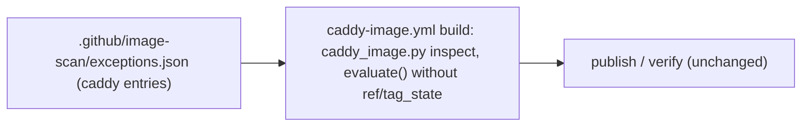

# Architecture note – Caddy image build scan: unfixed exceptions and the go-jose v4 override (issue #212)

## Context
The first push run of `caddy-image.yml` (#189) refused to publish on GHSA-mgcc-cww5-fp2q: go-jose v4 4.1.5 (fix 4.1.6) and go-jose v3 3.0.5 (no fix). `caddy_image.py` calls `ri._grype(..., "caddy", ims, [], today)`, so the build scan honours no exception at all, not even an approved one for a finding without a fix. #212 raises v4 by an annotated override and lets the build scan apply the `caddy` entries of `exceptions.json` so the unfixed v3 row can be excepted. Inputs: manifest `docs/ai/pipeline/212.md`, [ADR-0021](../adr/0021-self-built-caddy-edge-image.md), [ADR-0015](../adr/0015-container-image-cve-scan-grype.md), `docs/security/threat-models/deployable-stack.md` (S-120-07), `docs/security/threat-models/self-built-caddy.md`, [self-built-caddy.md](self-built-caddy.md).

## C4 excerpt

## Boundaries and contracts
- None. No module, `*.Contracts` type, message, endpoint, cross-module dependency or runtime data flow changes. The only new input edge is `exceptions.json` into the build job, which already reads repository files at the same commit.

## Decisions

### 1. Applying the `caddy` entries in the build scan is what ADR-0021 decided (code catches up)
- The scan rule is in ADR-0021 **item 5** (Workflow, `build` bullet), not item 6 (Pin and deploy). The clarification sits there.
- Item 5 names the release path. `release_images.py` validates `exceptions.json` (line 601) and passes the entries to `evaluate(doc, name, entries, today)` (line 561). Strict D-2 there means: no `ref` (item 4 never applies) and no `tag_state` (item 3 never applies), so any entry for a **fixed** finding is dropped at once, while an active entry for an **unfixed** finding still excepts it (`image_scan.evaluate`, lines 648 to 670).
- Item 7 and the Consequences keep a `caddy` exception for a finding without a fix possible. With the empty list, that rule could never take effect for the image we publish. So the empty list was stricter than the ADR, not a decision of it.
- Applied to ADR-0021, item 5, as a dated sub-bullet (nothing else changed):

  > **Clarification (architect, 2026-10-29; #212 G2).** As on the release path, `evaluate()` receives the validated `caddy` entries of `.github/image-scan/exceptions.json`, so a finding without a fix can be excepted under item 7 (for this request-path image at most 30 days, S-120-07), while a finding with a fix still blocks.

- No new ADR is needed. `OWN_BUILD_ALIASES` (item 7) is not in `image_scan.py` yet; it lands in #188 PR-2 and does not change this ruling, because the build calls `evaluate()` directly.

### 2. Bounds for a `caddy` entry: the tightest applicable bound governs
| Bound | Source | Applies |
| --- | --- | --- |
| 90 days | ADR-0015 `MAX_EXCEPTION_DAYS`; ADR-0021 item 7 and Consequences | the global ceiling only |
| **30 days**, Marco's recorded approval, reachability argument | `deployable-stack.md` S-120-07 (request path, Caddy named); `deploy/tests/test_stackctl.py` line 704 | every `caddy` entry: **governs** after #188 PR-2 |
| **14 days**, exactly one `approved by Marco YYYY-MM-DD` (not after `added`), `#212` in the justification, expiry at most 14 days after the approval and not after 2026-11-30 | `image_scan.is_vendor_binary_entry` + `_vendor_binary_errors` | **governs now**: until PR-2 retires item 4, every `caddy` entry whose package contains `/` (so `github.com/go-jose/go-jose/v3`) is validated as an item-4 entry |

- Item 7's "at most 90 days" does not contradict 30 (it is a ceiling), but the Consequences line "needs a 90-day exception" reads as an allowance the test would reject. The clarification sentence names the 30 days, so no other ADR edit is needed.
- Side effect G3 and Marco must know: while item 4 lives, the go-jose v3 entry is an item-4 entry for the `stackctl up`/`check` deploy guard, which refuses while any such entry is present. The #142/#187 entries already hold that state; this entry keeps it until PR-2 removes item 4 and the guard (E1). With an entry added and approved on 2026-10-29, expiry is at most 2026-11-12; a renewal or PR-2 must land before that date.
- Fixed findings stay out of reach: in the build, `ref` is `None`, so an existing item-4 `caddy` entry (fixed Go finding) is never applied to our image.

### 3. The go-jose v4 4.1.6 override fits item 3
- Item 3's condition holds: the version fixes a published advisory (GHSA-mgcc-cww5-fp2q), and no Caddy release carries the fix (latest v2.11.7).
- "A version Caddy's master branch has already merged is preferred" is a preference. The main session's fact (master `go.mod` read 2026-10-29: still v4 4.1.5, v3 3.0.5, `smallstep/certificates` v0.30.2, `go.step.sm/crypto` v0.91.0) means the preference cannot be met. That is acceptable: a patch release in the same minor, past the 7-day cooldown, under the Consequences' mitigations (`modules.txt`, the `caddy adapt` guards, the trust integration tests and the smoke at pin time in PR-2). The PR body records that master has not merged it yet.
- v3 gets no override: no fixed v3 version exists, and item 3 allows only a raise to a fixing version.
- The stale check is the exit: once Caddy's upstream build list reaches v4 4.1.6 or later, `buildlist` fails and the override is removed.

G4 must show (evidence in the manifest):
1. The `go.mod` diff is exactly `github.com/go-jose/go-jose/v4 v4.1.5` replaced by an annotated override line in the `golang.org/x/net` shape, `// indirect; override <id> #212`. `OVERRIDE_RE` accepts only `GO-` or `CVE-` ids, so the annotation uses the advisory's Go vulndb id or CVE alias. **If neither exists, stop and report:** a GHSA id in the annotation changes item 3's format and needs Marco.
2. The `go.sum` diff adds only go-jose v4 4.1.6 lines (written by the pinned builder; `go mod verify` and `go mod tidy -diff` pass).
3. The `buildlist` table has `github.com/go-jose/go-jose/v4` as `override` and no other changed row. Any `raised by an override` row is listed and justified in the evidence, for G3.
4. The 4.1.5 to 4.1.6 change is patch-only (release notes or tag diff read, no API change); `modules.txt` is unchanged; `go version -m` and the SBOM show v4.1.6.
5. Tests for the build scan rule (G5 skipped, so they ship in G4): an active `caddy` entry excepts an unfixed finding; an entry for a fixed `go-module`, `deb` or `binary` finding does not, including an item-4-shaped one; an expired entry or an entry for another image does not; an invalid `exceptions.json` fails the build before scanning.

### 4. NetArchTest and structure
- No NetArchTest rule is added or changed: no .NET project, reference or module boundary is touched. The guarding tests are the Python suites above (`deploy/tests/`, `.claude/tests/test_image_scan.py`).

## NetArchTest rules to add
| Rule | Assemblies | Test class |
| --- | --- | --- |
| none: no .NET structural change | | |

<!-- gate: G2 | verdict: PASS | issue: #212 -->
