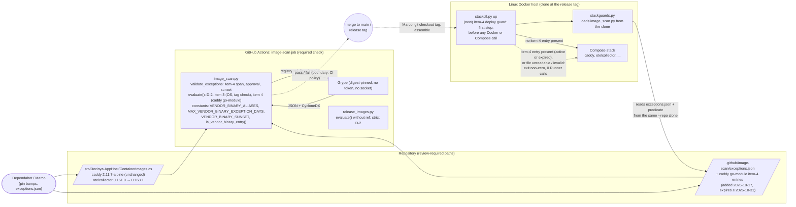

# Architecture note – image scan: ADR-0015 item 4 (time-boxed vendor-binary Go exceptions for Caddy) and collector 0.163.1 (issue #142)

## Context

#142 narrows the `image-scan` required check (D-2: an upstream fix voids an exception at once) for one case. That case is fixed `go-module` findings in `caddy` while no Caddy release carries the fix. It also adds a code tie from the CI policy to deployment: `stackctl up` refuses while such an exception is present in `exceptions.json`, expired or not, until the Caddy bump removes it (Marco, 2026-10-17, after G3 ruling 2). The collector moves to 0.163.1, which is fixed, so it needs no exception.

No product module, `*.Contracts` type, Wolverine message, endpoint or tenant data flow changes. The note is not N/A, because the change alters what the CI-policy boundary lets through and adds a check at the merge → deploy boundary.

- Requirements (G1): [image-scan-vendor-go-exceptions.md](../requirements/phase-0/image-scan-vendor-go-exceptions.md), stories 1 to 5, NFR-57 and NFR-58.
- Decision: [ADR-0015](../adr/0015-container-image-cve-scan-grype.md), "Amendment 2026-10-17 (issue #142)", item 4. It is Accepted (Marco, 2026-10-17). The two sentences of the 2026-10-06 amendment that item 4 narrows carry dated pointers to it.
- Security inputs, read as data:
  - the 2026-10-10 G3 BLOCK (`docs/security/threat-models/image-scan-go-http2-exceptions.md`, F-1 "way forward 1", M-5);
  - the 2026-10-06 and 2026-10-07 deltas in `docs/security/threat-models/deployable-stack.md` (G4-120-07 and its withdrawal, G4-120-09, S-120-15).
- **G4-120-07 is not superseded by this note or by the ADR.** The 2026-10-07 delta withdrew option (ii) (`VENDOR_BINARY_ALIASES`). Item 4 revives it. Only the new #142 G3 delta can supersede that withdrawal, for this case only. G4 waits for that G3 (M-5).
- Applicable ADRs: 0014 (pinning and cooldown), 0015 (with both amendments), 0017 (release images keep strict D-2), 0018 (deployable stack, `stackctl`).

## C4 excerpt (CI policy → merge → `stackctl` deploy)

Trust boundaries: unchanged in number.
- **CI policy** (`image-scan` → merge): now lets fixed `caddy` `go-module` findings through for at most 14 days, until 2026-11-30.
- **Merge → deploy:** gains a code check. Before #142 it was manual only (2026-10-10 G3, T-05 and S-1).

## Boundaries and contracts

No .NET boundary, `*.Contracts` type or OpenAPI document changes. The contracts that change are Python and file contracts between components that are already reviewed.

| Component | Change | Owner (G4) |
| --- | --- | --- |
| `.github/scripts/image_scan.py` | **New code constants:** `VENDOR_BINARY_ALIASES = {"caddy": "docker.io/library/caddy"}`, `MAX_VENDOR_BINARY_EXCEPTION_DAYS = 14` and `VENDOR_BINARY_SUNSET = date(2026, 11, 30)`. **New predicate** `is_vendor_binary_entry(entry)`: `image` in the map and `package` is `stdlib` or contains `/`. **Validation** of item-4 entries: span, approval phrase, approval date, sunset cap. **`evaluate()`** gets a keyword `ref=None`; item 4 applies only with a ref whose `Registry/Image` matches the map, never consults `tag_state`, and makes no network call. **New non-exiting entry point** for the deploy guard (validate and return every item-4 entry present, active or expired, or raise; never an empty or partial list on error, M-7), so `stackctl` does not inherit `sys.exit(2)` or workflow-command output. `ENTRY_KEYS` unchanged. | devops |
| `.github/scripts/release_images.py` | No change. It must keep calling `evaluate()` without `ref`. | none |
| `.github/image-scan/exceptions.json` | The Caddy `go-module` entries for the findings the scan reports. Each has its CVE or GHSA id (the GO id goes in the justification; `ID_RE` is unchanged), `issue` `#142`, `added` 2026-10-17, `expires` no later than 2026-10-31, and the justification phrase `approved by Marco 2026-10-17`. The justification also carries the 2026-10-10 G3 M-3 reachability statement. No `otelcollector` Go entry. | devops |
| `deploy/compose/stackctl.py` | **New guard**, the first step of `cmd_up`, also listed by `cmd_check`. It loads `image_scan.py` from `--repo` (the same mechanism as `stackguards.load_scan_refs`) and reads `repo/.github/image-scan/exceptions.json` through the repo argument. It refuses when any item-4 entry is present for an alias whose service is in the stack, expired or not, and on any load, read, parse or validation error. It refuses with zero `Runner` calls, before `docker_problems`. Its keying reads no clock. There is no flag and no environment variable. | devops |
| `src/Decisya.AppHost/ContainerImages.cs` | `OtelCollectorTag = "0.163.1"`, `OtelCollectorSha256 = f0e23036…9ae9c`, with the resolution comment. Nothing else. | platform-dev |
| `deploy/compose/docker-compose.yaml` | Regenerated for the collector pin. | main session |
| `.claude/tests/test_image_scan.py`, `deploy/tests/test_stackctl.py` | The red tests listed in ADR-0015 item 4, "Enforced by". | main session, devops |

**Invariant that ties CI and deploy together:** every entry that `evaluate()` can honour under item 4 satisfies `is_vendor_binary_entry`, and `stackctl up` refuses on every entry that satisfies it, active or expired. Because both use the one function in `image_scan.py`, what CI lets through is always a subset of what the deploy guard blocks, and the guard keeps blocking after CI has stopped honouring an expired entry. A Go module name the predicate does not recognise fails closed on both sides: CI blocks the finding, and no entry for it can exist to be honoured.

## Decisions

- **Item 4 is accepted.** It covers one alias tied to its image, one package type, at most 14 days per entry, and a sunset on 2026-11-30. It never applies to release images, has a deploy guard, and is code, not configuration. See ADR-0015, amendment 2026-10-17. The considered options, including the self-build fallback and the rejected newer-release probe, are recorded there.
- **Entry classification is structural** (`image` plus a Go-shaped `package`), not by finding state. `stackctl` must decide offline from `exceptions.json` alone. Consequence: an exception for an *unfixed* Caddy `go-module` finding is also capped at 14 days and also blocks `up`. That is stricter than Marco's limits, and accepted, because these modules sit on the edge's pre-authentication request path. No ADR beyond item 4 is needed.
- **The approval date bounds the entry, too.** `expires` is at most 14 days after the `approved by Marco <date>` in the justification, and that date is on or before `added`. Without this, an entry with a later `added` could stretch one approval past 14 days. This is a tightening within limit 2, recorded in item 4.
- **Item 4 ignores the item 3 tag state.** `moved` for `caddy:2.11.7-alpine` is an Alpine rebuild of the same Caddy binary, and `unknown` is a network flake. Neither says anything about a Go fix, and using either would bring back the flake that limit 2 excludes.
- **The deploy guard keys on presence, not activity** (Marco, 2026-10-17, after G3 ruling 2; stricter than his original limit 3, which said "active"). `stackctl up` refuses while any item-4 entry is in `exceptions.json`, expired or not, until the Caddy bump PR (or a commit Marco reviews) removes it. With "active", the guard would have lifted on `expires + 1` (2026-11-01 for #142) while the same vulnerable digest was still pinned (G3 T-10). Presence needs no date logic, so a deploy host clock set ahead cannot lift it; the reused schema validation can only add a refusal for a clock set behind (`added` in the future). The accepted residual risk is a deliberate, reviewed deletion of the entries without a bump, which leaves `image-scan` red on that PR.
- **The deploy guard runs before any Docker call.** Today `cmd_up` runs `docker_problems`, which starts a `caddy adapt` one-shot, before it starts the stack. The guard comes first and returns non-zero with zero `Runner` calls (M-8), so story 3's "before any container is started" holds literally. `Runner.__init__` starts no process, so building it first is harmless.
- **The guard reads from the `--repo` clone.** That is the clone the manifest check already binds to the assembled files, so a different `--repo` fails the manifest check. No exceptions file is copied into the stack folder (`ASSEMBLE_MAP` is unchanged).
- **The collector pin** is a data change in `ContainerImages.cs` under ADR-0015 §1 and §2. No ADR is needed.

## NetArchTest rules to add

| Rule | Assemblies | Test class |
| --- | --- | --- |
| N/A: no .NET module, Contracts project or project reference changes. `ContainerImages.cs` changes only a pin, and `ContainerImageParityTests` already covers it. The new boundary (CI policy ↔ deploy guard) is enforced by the Python tests in ADR-0015 item 4, "Enforced by". | none | none |

## Enforcement summary

| Boundary or bound | Enforced by |
| --- | --- |
| Alias map, 14-day bound, sunset are exact code values | `.claude/tests/test_image_scan.py` exact-value tests |
| Scope: only `caddy` + `go-module` + mapped image; release path strict | `test_image_scan.py`: negative cases (other aliases, other types, a re-pointed ref, no ref, a non-Go-shaped name) |
| Item 3's same-tag proxy never covers a vendor-binary fix (G4-120-09 test 4, moved under G3 ruling 3) | `test_image_scan.py`: `keycloak` and `otelcollector` fixed `go-module` with an active ≤ 14-day entry and `tag_state="unchanged"` block; `caddy`/`stdlib` `unchanged` with a 15- or 30-day entry passed directly to `evaluate()` blocks |
| No entry, no cover | `test_image_scan.py`: a fixed `caddy` `go-module` finding with no matching entry blocks (M-6) |
| Item 3 unchanged | `test_image_scan.py`: `apk` in `caddy` decided as before |
| Span, approval, sunset cap rejected at validation | `test_image_scan.py`: validation boundary cases (14 vs 15 days, sunset, approval) |
| Sunset inert from 2026-12-01; tripwire | `test_image_scan.py`: injected-date cases and the real-clock tripwire |
| No network, no env, no per-entry flag | `test_image_scan.py`: raising stubs, static source assertions, `ENTRY_KEYS` |
| Deploy guard: refuse on a present entry (on `expires`, the day after, after the sunset), removal as the only boundary, zero `Runner` calls on refusal, fail closed, no override, single predicate | `deploy/tests/test_stackctl.py` (fixture repo, recording fake runner, injected date) |
| Collector pin parity | `ContainerImageParityTests`, the Compose regeneration check, `image-scan` |
| Required check stays required | The ruleset and the drift test's floor set (unchanged) |

## Notes for G3, G4 and G5

1. **"Active" versus "present": decided, "present".** This note first followed limit 3's "active" and asked G3 to rule. G3 recommended "present" (ruling 2, T-10), and Marco chose it on 2026-10-17. The guard refuses while any item-4 entry is present, expired or not, until the Caddy bump removes it. ADR-0015 item 4 ("Deploy guard", Consequences, Enforced by) carries the change. G1 story 3 scenario 2 and the boundary test change with it (manifest bullet "Guard keys on 'present'"); G1 is outside this note.
2. **Collector cooldown.** 0.163.1 was released on 2026-10-16, and its 7-day cooldown ends on 2026-10-23. The pin may be committed now. The PR either merges on or after 2026-10-23, or Marco records a one-off waiver in `ContainerImages.cs` (the item 2 precedent). This branch is stacked on #143, which cannot merge before 2026-10-20, so the 2026-10-23 date is the one to plan for.
3. **The existing red test changes (accepted by G3 ruling 3, on conditions).** `test_4_a_fixed_go_module_finding_still_blocks_with_an_unchanged_tag` (G4-120-09 test 4) uses `caddy`/`stdlib` and flips under item 4. Its negative intent moves to `keycloak` and `otelcollector`, which keep `tag_state="unchanged"` and an active exception of 14 days or less, and both block. A `caddy`/`stdlib` variant stays: `unchanged`, with an entry that breaks an item-4 bound (15- or 30-day span) passed directly to `evaluate()`, and it blocks. A fixed `caddy` `go-module` finding with no matching entry also blocks (M-6). The G7 PR body lists the rename or move, so G6 sees it was intended.
4. **Tests must not read the live `exceptions.json` for the guard.** Some `deploy/tests` cases may run `check` or `up` against the real clone. Because the guard keys on presence, the #142 entries would make them refuse until the Caddy bump removes the entries, not only until 2026-10-31. The guard therefore takes the repo path (and the date, which only the reused schema validation reads) as inputs, and the tests use a fixture repo and an injected date.
5. **Naming.** G1 story 4 calls the constant `ITEM4_SUNSET`, and the ADR uses `VENDOR_BINARY_SUNSET`. They are one constant. G5's traceability should use the code name.
6. **Fallback date.** The #142 entries expire on 2026-10-31, the same day as the fallback. If Caddy has not released the fix by then, the self-build issue is opened that day. Any renewal is a new issue with a fresh approval, under the same rules, and only until the sunset.

<!-- gate: G2 | verdict: PASS | issue: #142 -->
