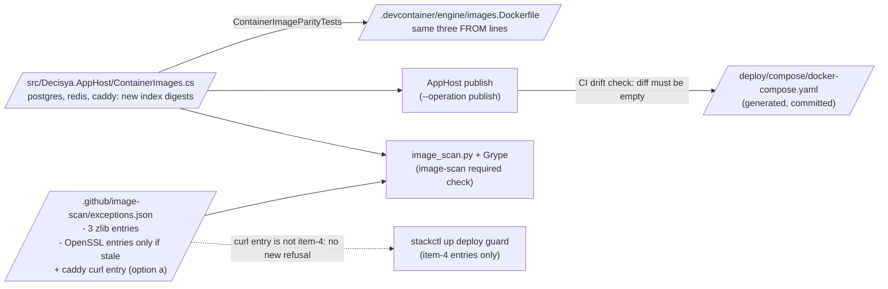

# Architecture note – image scan: postgres, redis and caddy rebuilds for zlib CVE-2026-85091; caddy curl CVE-2026-92392 (issue #183)

## Context

Upstream rebuilt three pinned tags under the same tag name. The new digests carry Alpine zlib 1.3.2-r1, which fixes CVE-2026-85091, so ADR-0015 amendment item 3 now voids the zlib exceptions ("tag moved"). The caddy rebuild still ships curl 8.22.0-r0 with High CVE-2026-92392 (fix state unknown). #183 bumps the three digests, removes the exceptions the bump makes stale, and routes the curl finding.

No product module, `*.Contracts` type, Wolverine message, endpoint or tenant data flow changes. The verdict is PASS rather than N/A for two reasons: the change moves pins across the AppHost, sandbox and Compose boundaries, and the curl route is an ADR-0015 exception on the LAN edge (Caddy).

- Applicable ADRs: [0007](../adr/0007-portable-storage.md) (image pinning), [0014](../adr/0014-ci-supply-chain-pinning.md) (pins and the 7-day cooldown), [0015](../adr/0015-container-image-cve-scan-grype.md) (decision item 4, amendment items 3 and 4), [0017](../adr/0017-release-images-sdk-containers-cosign.md) (images we build), [0018](../adr/0018-deployable-stack-compose-secrets-transport.md) (deployable stack, generated Compose file).
- Precedent, read as data: `docs/security/threat-models/image-scan-renew-120.md` (reachability classes a/b/c, the Caddy 30-day rule), `docs/architecture/image-scan-vendor-go-exceptions.md` (#142).
- No new ADR. Every rule used here already exists.

## C4 excerpt (pin source → copies → scan policy)

## Decisions

### D1. Pin changes (three digests, three files)

The tags stay the same. Only `<Alias>Sha256` changes:

| Alias | Reference after the bump |
| --- | --- |
| postgres | `docker.io/library/postgres:18-alpine@sha256:83148c0bc09eac4d598b70a61e1404d0212b76c95c504bfd6c81a4c59ec91792` |
| redis | `docker.io/library/redis:8.10.2-alpine@sha256:615b4cedaff0c1437a1548acae4222572df8c021eeb7382d64cb8b5e3a13ac7a` |
| caddy | `docker.io/library/caddy:2.11.7-alpine@sha256:24ec7b05bc532c7bb57f727030c5056e257ff7138b4b50460306819ff79362bd` |

- `src/Decisya.AppHost/ContainerImages.cs`: `PostgresSha256`, `RedisSha256`, `CaddySha256`. Update the comments: the old "Unchanged from images.Dockerfile (PR #51); not re-resolved here" for Postgres, and the Caddy waiver text, which then describes the old digest. The new comment names #183, the push date and the two-way resolution.
- `.devcontainer/engine/images.Dockerfile`: the three matching `FROM` lines, each with a one-line `#183` comment.
- `deploy/compose/docker-compose.yaml`: **yes, it changes.** The generated file pins all five third-party images (the `image:` lines of `postgres`, `redis` and `caddy`), and the CI step "Drift check (a fresh publish equals deploy/compose/docker-compose.yaml)" diffs it against a fresh publish. It must be regenerated with the publish of `docs/runbooks/deployable-stack.md` step 2, never edited by hand. The diff must be exactly those three `image:` lines. If the G4 agent cannot run the AppHost publish under its Bash allow-list, Marco runs it and copies the result over the committed file.
- Evidence G4 records in the manifest:
  - Each digest is the **multi-arch index** digest, read two ways: the Docker Hub tags API `digest`, and the registry `Docker-Content-Digest` (or `docker buildx imagetools inspect`). This is the ContainerImages.cs practice.
  - The push date of each digest. **Cooldown (ADR-0014, ADR-0015 item 3 "No cooldown bypass"):** if any digest was pushed after 2026-10-15, it is younger than 7 days on 2026-10-22. Then either wait until it is 7 days old, or record Marco's one-off waiver in the manifest and in the ContainerImages.cs comment, as #120 and #142 did. G2 does not decide the waiver.
- Close any Dependabot PR for the same digests (`docs/runbooks/ci-security-gates.md`, "A new finding on a vendor image", step 1).

### D2. Exceptions after the bump

Rules in `.github/scripts/image_scan.py`:
- `run()`: an entry that matched nothing is listed as `stale (matched nothing)`. This is a note only and does **not** fail the scan. An expired entry is ignored, so its finding fails again.
- `evaluate()`: a `fixed` finding keeps its entry only under item 4 (`_keeps_vendor_binary_exception`) or item 3 (`_keeps_fixed_exception`: apk, span of 30 days or less, tag `unchanged`). Otherwise the note is "a fix is now available, bump the image".
- The runbook rule for a stale entry is "remove it". Done-when 2 makes it mandatory for zlib.

| Entries | After the bump | Action |
| --- | --- | --- |
| `CVE-2026-85091` zlib: postgres, redis, caddy (3 entries) | zlib 1.3.2-r1 in all three, so no match and the entries go stale | **Remove all three.** Required by Done-when 2. |
| OpenSSL `CVE-2026-54873`, `-72897`, `-84782`, `-84784` × `libssl3`/`libcrypto3` × postgres, redis, caddy (24 entries) | OpenSSL 3.5.8-r0 moved to 3.5.9-r0. Whether 3.5.9 clears them is known only from the scan on the new digests. | Remove exactly the entries that the PR's scan lists as `stale (matched nothing)`, image by image. Keep every entry that still matches, **byte for byte**: no new `expires`, no new `added` and no justification edit (an edit is a renewal, a fresh approval). Their texts name 3.5.8 and the old digests. That is historical, and they expire 2026-11-02 anyway. G3 may require a note in the manifest. |
| #142 item-4 entries (16, caddy `stdlib`/`golang.org/x/net`, expire 2026-10-31) | Same Caddy 2.11.7 binary (go1.26.8, x/net v0.59.0), so they should still match | Keep unchanged. If the scan lists any of them as stale, **stop and report**: that would mean a different binary. Removing them changes the deploy guard and the 16-entry test. |
| keycloak pcre2, api/bff/migrator libc6 | Not touched by this bump | Keep unchanged. |

No expiry is extended. The 2026-10-31 and 2026-11-02 dates stay.

**Timing:** the #142 entries expire 2026-10-31. A scan from 2026-11-01 on is red on the Caddy Go findings unless Caddy has released a fixed version. The PR's green `image-scan` run must therefore happen on or before 2026-10-31.

### D3. CVE-2026-92392 (caddy curl 8.22.0-r0, fix unknown): options for Marco

Facts from the repository:
- Caddy is a static Go binary (`CGO_ENABLED=0`), so it never loads libcurl and never runs `curl`.
- The Compose healthcheck of `caddy` is `nc -z` (busybox). The overlay owns no healthcheck or entrypoint.
- `stackctl.py` runs the caddy image three ways, and none calls curl:
  - `caddy adapt`;
  - the key-ring one-shots `sh -c <script>` (`deploy/tests/test_keyring.py` bans `curl` and `wget` in those scripts);
  - the smoke test's back-channel client `--entrypoint wget`, which is busybox wget.
- No process in the stack, at run time or in a one-shot, calls curl.

- **(a) ADR-0015 exception, class (a) "not loaded, not executed". Recommended.**
  - Entry: `{id: CVE-2026-92392, image: caddy, package: curl, issue: #183}`.
  - Caddy is the LAN edge, so the `$comment` / S-120-07 rule applies: Marco's recorded approval in the justification (use the phrase `approved by Marco <YYYY-MM-DD>` for consistency), a reachability argument, and **expires at most 30 days after `added`**. With `added` 2026-10-22 that is 2026-11-21 at the latest. The 30-day span also keeps item 3 usable if Alpine later ships a fixed curl without a rebuild. A rebuild moves the tag and ends the entry at once.
  - Evidence the justification and G3 need:
    1. The Grype JSON match: `artifact.type` `apk`, name `curl`, version, location (the apk database), and the CVE's description and vector. Is the flaw in the curl tool, or in libcurl?
    2. The static-binary fact above.
    3. The no-caller list above: healthcheck, one-shots, smoke test.
    4. No shell route from the network into the container.
  - The entry is not an item-4 entry (`curl` is neither `stdlib` nor a path with `/`), so `stackctl up` gains no refusal from it. `up` still refuses on the #142 entries.
- **(b) Remove curl from the image** (`FROM caddy … RUN apk del curl`, or a scratch Caddy). That makes it an image we build, sign and scan (ADR-0014/0017), and a scratch image needs `caddy` in `BINARY_ONLY_ALIASES` (code change, G3). Out of scope for #183 and out of policy without an ADR. Record it as input to the 2026-10-31 self-build fallback of ADR-0015 item 4. A self-built scratch Caddy would remove the curl, zlib and OpenSSL entries together.
- **(c) Wait for an Alpine curl fix and a Caddy rebuild.** ADR-0015 allows it, but `image-scan` stays red on this PR and on every images-lane PR until then, so the zlib fix cannot merge. Not recommended.

**postgres libcurl 8.22.0-r0:** the scan did not flag it, and it did not flag caddy's libcurl either. Two readings follow:
- The vulnerability database maps CVE-2026-92392 to the `curl` binary package only, which means a tool-only flaw. In that case postgres is out of scope.
- The advisory also covers libcurl and Grype's apk matching missed it. That would be a scanner gap.

**G3 must decide which**, from the advisory text and the `matchDetails` of the caddy `curl` match. In postgres, libcurl most likely serves PostgreSQL 18's libpq OAuth client flow, which is client side; the server request path is not affected. G3 should confirm this too. If the advisory covers libcurl, G3 decides whether the postgres and caddy libcurl need a documented note. A scan miss creates no exception entry.

### D4. Tests and G4 owner

- **No existing test changes:**
  - `ContainerImageParityTests` compares the constants with `images.Dockerfile` and hard-codes only the collector digest.
  - `deploy/tests/test_stackctl.py` keeps `expires` of postgres, redis and keycloak entries at 2026-11-02 or earlier. Removals keep it true, and caddy is outside that cap.
  - `.claude/tests/test_image_scan.py` asserts 16 #142 entries (unchanged) and uses zlib only as fixture data.
  - `stackctl` guard tests use fixture repos.
- **Recommended for G5:** one live-file fact in `tests/Decisya.Identity.Tests/ContainerImageParityTests.cs` (test-engineer lane). It asserts:
  - (1) `exceptions.json` holds no `CVE-2026-85091`/`zlib` entry for postgres, redis or caddy;
  - (2) if option (a) is chosen, the caddy `curl` entry names `#183`, contains `approved by Marco`, and spans 30 days or less.

  This proves Done-when 2. The scan alone would only print "stale" and pass.
- **G4 owner: devops**, for all four files. Per `.claude/boundaries.json`:
  - platform-dev may write `src/Decisya.AppHost/**`, but **not** `.devcontainer/**`, `.github/**` or `deploy/compose/**`;
  - devops has `src/Decisya.AppHost/**`, `.devcontainer/**`, `.github/**` (so `exceptions.json`) and `deploy/**` (so the regenerated Compose file).

  One owner keeps the parity, drift and scan evidence in one G4 step. Routing to platform-dev would split one atomic pin change across two agents.
- `exceptions.json` and the scan are review-required paths: G3 and G6 run (Full tier).

## Traceability (Done-when → proof)

| Done-when item | Proof |
| --- | --- |
| `image-scan` passes on the PR with the new digests; run id in the manifest | the `image-scan` job on the PR head (images lane triggers on `ContainerImages.cs`, `images.Dockerfile`, `.github/image-scan/**`); log shows `scanning <alias>: …@sha256:<new digest>` for all three, `tag state unchanged`, no `FAIL`; run id recorded under "G4 evidence" by the orchestrator |
| No zlib CVE-2026-85091 exception remains for an image whose bumped digest carries the fix | `apk info -v` evidence (zlib 1.3.2-r1 in all three) in the manifest; the PR diff of `exceptions.json`; the G5 live-file fact (D4); the scan log lists no `CVE-2026-85091` line, stale or failed |
| CVE-2026-92392 fixed by the bump or covered by an approved, expiring exception with evidence | not fixed (curl 8.22.0-r0 unchanged); option (a) entry with Marco's dated approval and `expires` 30 days or less after `added`; G3 threat delta holding the D3 evidence; scan log shows it `excepted`; G5 fact on span and approval |
| `ContainerImageParityTests` passes | `dotnet test --project tests/Decisya.Identity.Tests` (the parity facts are not Integration) locally and in CI `build-test` |
| Compose drift check passes | CI step "Drift check (a fresh publish equals deploy/compose/docker-compose.yaml)" green; the committed diff is exactly three `image:` lines |

## NetArchTest rules to add

None. No .NET assembly, module or reference changes.

| Rule | Assemblies | Test class |
| --- | --- | --- |
| none | none | none |

<!-- gate: G2 | verdict: PASS | issue: #183 -->
