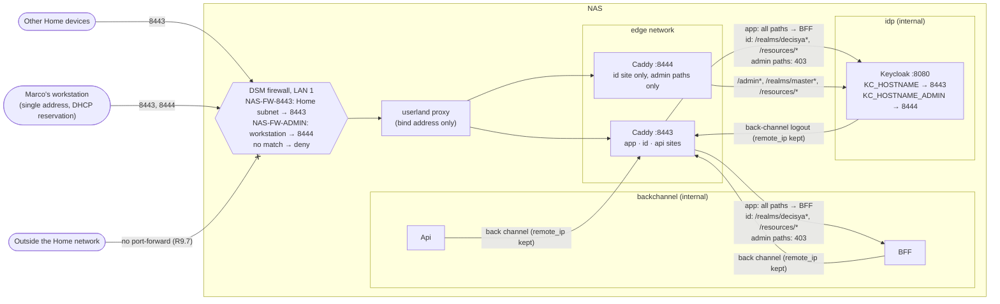

# Architecture note – NAS ingress without source-address allow-lists; Keycloak admin paths on their own port (issue #178)

## Context

On the Phase 0 NAS, a published container port is answered by Container Manager's userland proxy. Caddy then sees the proxy's address, not the client's, and Docker's DOCKER-USER chain is never consulted. The `remote_ip` allow-lists on the published routes (the Home subnet; the workstation for the Keycloak admin paths, ADR-0016 R9.8) would refuse every client, and R9.8 forbids widening them. Marco's decision (issue #178, 2026-10-19): the DSM per-interface firewall is the source-address control for published ports. The Keycloak admin paths move to their own published port, which the firewall admits only from the workstation, and 8443 never routes them. Container-to-container traffic keeps real addresses, so the back-channel allow-lists stay.

Marco decided that the source address is measured on the real NAS after coding, not before. The design below holds whatever the measurement finds (D5).

Applies: ADR-0016 (R9.6 and R9.8 amended 2026-10-20 by this issue, status Proposed), ADR-0018 (key ownership between the generated Compose file and the overlay), and the edge contract in `deployable-stack.md`. G1 was skipped (approved by Marco 2026-10-20). The acceptance criteria are the issue's Done-when.

## C4 excerpt (ingress only)



## Boundaries and contracts

- **No product boundary changes:** no module, no Contracts type, no Wolverine message, no endpoint, no entity. The change is the deployment edge: the Caddyfile, the Compose overlay, one Keycloak setting, the stack's deploy settings and their guards.
- **Files that change, and who changes them** (G4 routing; the manifest names only the devops lane, and **platform-dev is also needed** for the two AppHost files):

| File | Change | G4 owner |
| --- | --- | --- |
| `deploy/caddy/Caddyfile` | D1 | devops |
| `deploy/compose/docker-compose.stack.yaml` | D2: second published port; Caddy's environment reduced to the three host names; header comment | devops |
| `deploy/compose/stack.env.example` | D2: add `DECISYA_ADMIN_PORT`; remove `DECISYA_LAN_SUBNET` and `DECISYA_WORKSTATION_ADDRESS` | devops |
| `deploy/compose/stackguards.py` | D2 validators, D4 guard rules, `PUBLISHED_ROUTES` table | devops |
| `deploy/compose/stackctl.py` | `verify` passes the admin port to the inspect guard; the allow-list overlap calls go | devops |
| `deploy/tests/test_caddyfile.py`, `test_compose_guards.py`, `test_stackctl.py`, `deploy_common.py` (fixture values) | D4 red and green cases | devops (G5 test-engineer reviews and extends) |
| `deploy/tests/stack_smoke.py` | D6 (SHOULD) | devops |
| `src/Decisya.AppHost/Deploy/ComposeStack.cs` | D3: `KC_HOSTNAME_ADMIN` | platform-dev |
| `deploy/compose/docker-compose.yaml` | regenerated from the AppHost (the CI drift check) | platform-dev |
| `tests/Decisya.AppHost.Tests/ComposeStackPublishTests.cs` | assert the `KC_HOSTNAME_ADMIN` value | platform-dev |
| `docs/runbooks/deployable-stack.md`, `docs/runbooks/go-live-gate.md` | D7 | devops |
| `docs/adr/0016-phase-0-hosting.md`, `docs/adr/README.md` | amendment (written at G2, Proposed) | architect (done) |
| `docs/architecture/deployable-stack.md`, `docs/architecture/phase-0-hosting.md` | pointers to this note (written at G2) | architect (done) |
| `docs/requirements/phase-0/nas-ingress-admin-port.md` | traceability (from the table at the end) | test-engineer (G5) |

## Decisions (five MUSTs)

### D1 (MUST). Caddy: a second listener for the admin paths, the id host only; published routes without source allow-lists

The new edge table. Every site keeps `import edge` (internal CA, size limit, access log, dot-dot refusal) and one `route` with default deny.

| Server | Site | Order | Matcher | Action | Class |
| --- | --- | --- | --- | --- | --- |
| :8443 | app host | 1 | dot-dot | 403 | |
| | | 2 | `remote_ip` idp subnet, `POST`, `/bff/backchannel-logout` | `bff:8080` | back channel (unchanged) |
| | | 3 | `/bff/backchannel-logout*` | 403 | (unchanged) |
| | | 4 | `@published_app`: `not remote_ip` (backchannel, idp) | `bff:8080` | published, NAS-FW-8443 |
| | | 5 | anything | 403 | |
| :8443 | id host | 1 | dot-dot | 403 | |
| | | 2 | `@admin_paths`: `/admin /admin/* /realms/master /realms/master/*` | **403** (new, explicit) | |
| | | 3 | `@published_realm`: `not remote_ip` (backchannel, idp), `/realms/decisya /realms/decisya/* /resources/*` | `keycloak:8080` | published, NAS-FW-8443 |
| | | 4 | `remote_ip` backchannel subnet, `/realms/decisya /realms/decisya/*` | `keycloak:8080` | back channel (unchanged) |
| | | 5 | anything | 403 | |
| :8443 | api host | unchanged | back channel only, `/api/*` | `api:8080` | back channel |
| **:8444** | **id host only** | 1 | dot-dot | 403 | |
| | | 2 | `@admin_console`: `not remote_ip` (backchannel, idp), `/admin /admin/* /realms/master /realms/master/* /resources/*` | `keycloak:8080` | published, NAS-FW-ADMIN |
| | | 3 | anything | 403 | |

The new site, in Caddyfile form (the `transport` block is the same as in the other routes):

```caddyfile
# Keycloak's admin console and the master realm (#178, ADR-0016 R9.8 amended): their own published
# port, the id host only. The NAS firewall admits 8444 from the workstation only. /resources/* carries
# the console's and the login theme's static files. Container sources never use a published route.
{$DECISYA_ID_HOST}:8444 {
	import edge

	@admin_console {
		not remote_ip 10.120.0.0/24 10.120.1.0/24
		path /admin /admin/* /realms/master /realms/master/* /resources/*
	}

	route {
		respond @dotdot 403
		reverse_proxy @admin_console keycloak:8080 {
			transport http {
				dial_timeout 5s
				response_header_timeout 60s
			}
		}
		respond 403
	}
}
```

On 8443, `@workstation_admin` and `@lan`/`@lan_public` are removed. `@admin_paths` (403) goes right after the dot-dot refusal on the id site. `@published_app` and `@published_realm` replace the LAN matchers, with `not remote_ip` over the two committed subnets. Why that exclusion: without it, removing the LAN matcher would let Keycloak (idp) and the BFF and Api (backchannel) use the published routes, which they cannot do today. The exclusion works whichever address the published traffic carries, because the edge network's subnet is Docker-assigned and never one of the committed ones.

The Caddyfile no longer uses `{$DECISYA_LAN_SUBNET}` or `{$DECISYA_WORKSTATION_ADDRESS}`. The header comment's rule list changes to D4.

### D2 (MUST). Compose and deploy settings: the admin port on the bind address only, fail-closed

- Overlay, `caddy.ports`, exactly two entries:

  ```yaml
  ports:
    - "${DECISYA_BIND_ADDRESS:?}:${DECISYA_HTTPS_PORT:?}:8443"
    - "${DECISYA_BIND_ADDRESS:?}:${DECISYA_ADMIN_PORT:?}:8444"
  ```

- New required key **`DECISYA_ADMIN_PORT`** in the stack's `.env`. `value_problem` accepts only `8444` ("must be 8444: Caddy's admin listener and Keycloak's admin URL use it"), the same shape as `DECISYA_HTTPS_PORT` (must be 8443). A fixed value keeps the published port equal to the container port and to `KC_HOSTNAME_ADMIN`, and leaves nothing to drift.
- **Fail-closed when empty:**
  - Compose `:?` on both the bind address and the port, so `docker compose config`, `up` and Container Manager refuse the project when either is empty or missing.
  - `stackctl.py check` reports `DECISYA_ADMIN_PORT: missing`, `empty` or the value rule.
  - The bind address is already validated as one unicast IPv4 address, never `0.0.0.0`.
  - The port guard (D4 G-C1) refuses any entry without that host address.
  - So the admin port is never published on all interfaces.
- `DECISYA_LAN_SUBNET` and `DECISYA_WORKSTATION_ADDRESS` are **removed**: from `ENV_KEYS`, from `CADDY_ENV_KEYS`, from Caddy's overlay environment, from `stack.env.example` and with their validators. Nothing uses them any more, and a setting that looks like an allow-list but filters nothing would mislead a reviewer. `overlap_problems` and its three call sites go with them; the bind-address-in-committed-subnet check stays. An existing `.env` that still carries them fails `check` with "not allowed in the stack's environment file". That is intended (fail loud), and the runbook's update step says what to change. Caddy's environment becomes exactly the three host names, still each with `:?`.

### D3 (MUST). Keycloak's admin URL names the admin port

- `ComposeStack.cs` adds `KC_HOSTNAME_ADMIN = "https://${DECISYA_ID_HOST}:${DECISYA_ADMIN_PORT}"` next to `KC_HOSTNAME`. This follows ADR-0018's key ownership: non-secret environment lives in the generated file. The file is regenerated in the same PR (the drift check).
- Without this setting, the console served on 8444 would build its master-realm URLs from `KC_HOSTNAME` (8443). 8443 refuses those paths, so the console could not sign in.
- `KC_HOSTNAME` (8443, the decisya realm's issuer on the front and back channel) does not change.
- An empty `DECISYA_ADMIN_PORT` cannot reach Keycloak: Compose already refuses the project through Caddy's `:?` (D2). No overlay restatement is needed.
- Guard: `_keycloak_problems` requires `KC_HOSTNAME_ADMIN` to be exactly that reference (`--no-interpolate`) or `https://<id host>:8444` (interpolated).
- `hostname-admin` only moves where the console lives. It does not stop the admin REST API from answering on the frontend hostname, which is why 8443 refuses the paths at Caddy (D1 route 2).
- That the console's master-realm sign-in stays on 8444 end to end is **(unverified)** until the D6 smoke and the D7 workstation check have run.

### D4 (MUST). The new guard rules (replace "every admitting Caddy matcher has a remote_ip")

Over the `caddy adapt` JSON (`stackguards.caddy_problems`, fixture values). "Admitting route" means a route whose handler is `reverse_proxy`. `COMMITTED` means the two committed internal subnets (backchannel, idp).

- **G-E1 Listeners.** There are exactly two HTTP servers. One listens only on `:8443`, the other only on `:8444`; there is no other listen address. Sites are collected **per server**. Today's single `host → route` dict would let the 8444 id site overwrite the 8443 one. Expected: 8443 holds exactly the app, id and api sites, and 8444 holds exactly the id site.
- **G-E2 Classes.** Every admitting route is exactly one of the following:
  - **back channel**: its match has a positive `remote_ip` whose ranges are a non-empty subset of `COMMITTED`. The three back-channel routes keep their exact ranges, paths, methods and upstreams (today's table).
  - **published**: it has no positive `remote_ip`, and its match carries `not: [{remote_ip: {ranges: COMMITTED}}]`, both subnets and nothing else in the `not`. A positive `remote_ip` holding any range outside `COMMITTED` is a failure ("source allow-list on a published route; ADR-0016 R9.8 amended: the NAS firewall is the control").
- **G-E3 Published table.** `stackguards.PUBLISHED_ROUTES` lists every published route as (server port, site label, path set, upstream, firewall rule id):
  - `(8443, app, all, bff:8080, NAS-FW-8443)`
  - `(8443, id, {/realms/decisya, /realms/decisya/*, /resources/*}, keycloak:8080, NAS-FW-8443)`
  - `(8444, id, {/admin, /admin/*, /realms/master, /realms/master/*, /resources/*}, keycloak:8080, NAS-FW-ADMIN)`

  A published route that is not in the table fails, and so does a table entry with no matching route. Port 8443 entries must name `NAS-FW-8443`; port 8444 entries must name `NAS-FW-ADMIN`. A static test (no Docker) asserts that `docs/runbooks/deployable-stack.md` names each firewall rule id on the same line as its port number.
- **G-E4 No admin path on 8443.** On the 8443 server, every admitting route whose upstream is `keycloak:8080` has a `path` matcher and no other matcher kind besides `remote_ip`/`not`. None of its patterns matches any probe in `ADMIN_PROBES`. The probes are `/admin`, `/admin/`, `/admin/master/console/`, `/Admin/master/console/`, `/realms/master`, `/realms/master/`, `/realms/master/protocol/openid-connect/token` and `/REALMS/MASTER/account`. Matching follows Caddy's `path` semantics: case-insensitive; exact, `*` suffix (prefix match), `*` prefix (suffix match) or a glob for an inner `*`; implemented once as `caddy_path_matches(pattern, path)` with its own unit cases. Also, the 8443 id site's second route is a 403 whose patterns match every probe.
- **G-E5 Admin listener.** The 8444 server holds the id site only. Its admitting routes all dial `keycloak:8080`, and their path sets equal the table entry. No pattern matches `/realms/decisya/protocol/openid-connect/auth`, `/bff/login` or `/api/capabilities`. The route list ends with the catch-all 403.
- **Unchanged:** tls internal, size limit, no `trusted_proxies`, no `log_credentials`, no upstream on 9000 or 8081, the forwarding-header and 429 pass-through rules, `admin off`, `skip_install_trust`.

Over the Compose configuration and `docker inspect`:

- **G-C1 Ports.** `caddy` publishes exactly two tcp entries, `(BIND, HTTPS_PORT, 8443)` and `(BIND, ADMIN_PORT, 8444)`. The CI form requires the references `${DECISYA_BIND_ADDRESS:?}`, `${DECISYA_HTTPS_PORT:?}` and `${DECISYA_ADMIN_PORT:?}`, and the interpolated form requires the validated values. A missing host address, `0.0.0.0` or a third entry fails. No other service publishes.
- **G-C2 Caddy environment.** It is exactly the three host keys, each a required reference.
- **G-C3 Inspect.** `inspect_problems`: Caddy's `PortBindings` keys equal `{8443/tcp, 8444/tcp}`, each bound to exactly `[(bind, its port)]`.
- **G-C4 Keycloak.** `KC_HOSTNAME_ADMIN` as in D3.

Red cases G5 must show failing, one each:

- add `/admin/*` to the 8443 published id route;
- remove the explicit 403 for admin paths on 8443;
- add `/realms/decisya/*` to the 8444 route;
- move the 8444 site to the app host;
- drop the `not remote_ip` from a published route;
- add a positive Home-range `remote_ip` to a published route;
- widen a back-channel `remote_ip` to a non-committed range;
- a third listener;
- a published route missing from `PUBLISHED_ROUTES`;
- a firewall rule id missing from the runbook;
- the admin port published without a host address, on `0.0.0.0`, or not as a required reference;
- `DECISYA_ADMIN_PORT` missing, empty, `8443` or `9443`;
- a leftover `DECISYA_LAN_SUBNET` key in `.env`;
- `KC_HOSTNAME_ADMIN` missing or naming 8443.

### D5 (MUST). The source-address measurement and the NAS firewall, in #132's runbook

The measurement is a required, recorded step on the real NAS at #132 bring-up. Its procedure is in D7 b. The design holds whatever it finds because the refusal checks, not the measurement, decide whether the stack stays up:

| Caddy logs, through the published ports | What it means | Refusal checks (D7 c) | Outcome |
| --- | --- | --- | --- |
| the edge network's gateway (userland proxy) | traffic ends at the host's proxy, so the DSM firewall's input rules see the real client | pass | Done. The firewall is the control; this PR's shape applies. |
| the same | the same | fail | **STOP**: `$C down`; fix the firewall rule; re-run. |
| the client's own Home address | Docker's NAT path may bypass the DSM firewall (forwarded, not input) | pass | Done. Restoring the `remote_ip` lists as a second layer goes to backlog #83 (text below). |
| the same | the firewall does not see published traffic | fail | **STOP**: `$C down`. A new issue restores source allow-lists in Caddy as the control before the stack runs again. |
| anything else | unknown path | — | **STOP** and report. |

Follow-up text for both "client address" rows:

- restore two validated keys (a Home subnet, a single workstation address) and the overlap check;
- a positive `remote_ip` on the 8443 published routes (Home subnet) and on the 8444 route (workstation), next to the `not remote_ip`;
- G-E2 then requires them.

The separate admin port stands in every row.

### D6 (SHOULD). `stack_smoke.py`

- Drop the two removed keys and write `DECISYA_ADMIN_PORT=8444`.
- The host-origin LAN checks become conclusive, since no source allow-list remains: remove the "inconclusive" path.
- Add these checks:
  - `/admin/` and `/realms/master/` on the id host at 8443 are 403;
  - `/admin/` on the bind address at 8444 is answered by Keycloak (not 403, not 502);
  - `/realms/decisya/` at 8444 is 403;
  - from one-shot clients on `decisya_backchannel` and `decisya_idp`, `https://<id host>:8444/admin/` is 403;
  - the console page served at 8444 names the 8444 origin and never the 8443 origin (D3).
- Remove 8444 from the "port refused on the bind address" list.
- Keep the two source-address `info` lines (they are the D5 record on a Linux host).

## D7. Runbook changes (devops owns `docs/runbooks`)

Everything below goes into a new section **"NAS ingress (#132): firewall, source address, refusal checks"** of `docs/runbooks/deployable-stack.md` (#132 extends this runbook). Every step gets the DSM or VS Code column next to the CLI column. Unverified commands are marked **(unverified)**. No address, subnet or host name appears as a literal: describe it ("the workstation's address", "the router's public address").

**a. Firewall, before the first start.** Use the DSM UI: *Control Panel → Security → Firewall*, edit the profile's rules **for the LAN 1 interface** (not "All interfaces"). The CLI column reads "none: DSM UI only".

| Id | Interface | Protocol and port | Source | Action |
| --- | --- | --- | --- | --- |
| NAS-FW-8443 | LAN 1 | TCP 8443 | the Home subnet | Allow |
| NAS-FW-ADMIN | LAN 1 | TCP 8444 | the workstation's address (single host; its DHCP reservation confirmed first) | Allow |
| (existing R9.8 rules) | LAN 1 | DSM HTTPS 5001, SMB, SSH when on, the other project's backup service | the Home subnet | Allow |
| | | if no rule is matched | | Deny access |

- No rule above NAS-FW-ADMIN, and no "All interfaces" rule, may admit 8444 (or "all ports") from a wider source.
- Check that nothing on the NAS already listens on 8444 **(unverified)**.

**b. Measure the source address** (after `up`, with a. in place). The CLI column is the same commands in the VS Code PowerShell terminal or an SSH key session.

1. From the workstation, request the id host's `/realms/decisya/` on 8443 once and `/admin/` on 8444 once (`curl --cacert`).
2. On the NAS, read the last Caddy access-log entries' `request.remote_ip`: `$C logs --no-color --no-log-prefix --since 2m caddy` **(unverified)**.
3. Compare that value by eye with:
   - the workstation's own address;
   - the edge network's gateway: `docker network inspect decisya_edge --format '{{range .IPAM.Config}}{{.Gateway}}{{end}}'` **(unverified)**.
4. Record only the class from D5 ("edge gateway", "client address", "other"), the date, and the DSM and Container Manager versions in #132's record. **Never paste the address.**

**c. Refusal checks.** Record pass or fail per row, never an address.

| From | Request | Expect |
| --- | --- | --- |
| workstation | 8443, app host `/` | the SPA |
| workstation | 8443, id host `/admin/`, `/admin/master/console/`, `/realms/master/` | 403 each |
| workstation | 8444, id host `/admin/` in the Phase 0 Firefox profile | the console loads, sign-in with OTP completes, and the Network panel (F12) shows no request to 8443 |
| workstation | 8444, id host `/realms/decisya/` | 403 |
| a second Home device (not the workstation) | 8443, app host `/` | the SPA |
| a second Home device | 8443, id host `/admin/` | 403 |
| a second Home device | 8444, any path | **no connection**: refused or timed out, no TLS handshake and no 403. CLI: `curl --connect-timeout 5 …` exits 7 or 28; PowerShell: `Test-NetConnection <bind address> -Port 8444` gives `TcpTestSucceeded : False` **(unverified)** |
| outside the Home network (a phone on mobile data, Wi-Fi off) | the router's public address on 8443 and 8444 | no connection (R9.7) |

Any failed row is a D5 STOP.

**d. Repeat b. and c.** after every DSM update, every Container Manager update (an update can switch the published-port path, and with it D5's row) and every firewall change.

**Other edits:**

- **Step 5:** the keys are the bind address, `DECISYA_HTTPS_PORT` (8443), `DECISYA_ADMIN_PORT` (8444), the three host names and the three images. Drop "the LAN subnet, the workstation address".
- **"Update to a new release":** an older `.env` must lose `DECISYA_LAN_SUBNET` and `DECISYA_WORKSTATION_ADDRESS` and gain `DECISYA_ADMIN_PORT=8444`; `check` names both.
- **Verify table:** replace the row "`/admin/` on the id host from any client that is not the workstation → 403" with "`/admin/` on 8443 from any client → 403" and "8444 from any device but the workstation → no connection".
- **Console references** (Sessions sign-out; *Make a small change* step 2; *The permanent admin* intro and step 1; the events paragraph): change "the id host's `/admin/`" to "the id host's `/admin/` on port 8444". Change "which only the workstation address can reach" to "which only the workstation reaches, through port 8444 and the NAS firewall".
- **`docs/runbooks/go-live-gate.md`**, C-03 "Closed when": "the admin console and `/realms/master` answer only on port 8444, which the NAS firewall admits from the workstation alone, and 8443 answers 403".

## NetArchTest rules to add

None. No .NET assembly or module boundary changes. The new boundaries are deployment boundaries and are enforced by the Python guards in D4 (`deploy/tests`, run by `deploy-guards` on every PR) and by the runbook checks in D7.

## Notes for G3

- **One control per published port in the "edge gateway" outcome.** The DSM firewall alone limits who reaches 8444. Behind it, the master realm still requires OTP: `verify` fails on a master-realm user without OTP once the bootstrap secret is retired (T121-15). A misordered or "All interfaces" firewall rule is the main risk; D7 a and c target it.
- **Rate limiting and events (#122, C-10).** In that outcome, the BFF's `X-Forwarded-For` and Keycloak's event addresses are the proxy's address. All Home clients then share one IP partition per rate-limit class, so failed logins from one device throttle every device for the window. Session partitions are unaffected. This is a known consequence of the platform, not of this change. It does not block a single-user Phase 0. G3 decides whether it goes to #83.
- **The VPS and any NAT-path host.** The published traffic may bypass a host firewall there. The ADR-0016 amendment adds this as a review trigger: a provider firewall outside the host, or the restored `remote_ip` layer.

## Traceability (Done-when → proof; G5 copies this into `docs/requirements/phase-0/nas-ingress-admin-port.md`)

| Done-when | Automated proof | Manual proof |
| --- | --- | --- |
| 1. The source address is recorded from the stack | `stack_smoke.py` source-address `info` lines (Linux host) | D7 b on the NAS, recorded as a class with the versions in #132's record (#132, then after every DSM or Container Manager update) |
| 2. The admin paths answer only on their own port, and 8443 refuses them | `test_caddyfile.py::CaddyAdaptRules` (G-E1, G-E3, G-E4, G-E5 and their red cases); `caddy_path_matches` unit cases; `test_compose_guards.py` (G-C1, G-C4); `test_stackctl.py` (`DECISYA_ADMIN_PORT` values, G-C3 inspect cases); `ComposeStackPublishTests` (`KC_HOSTNAME_ADMIN`) | `stack_smoke.py` D6 checks; D7 c rows 2 to 4, 6 and 7 |
| 3. Guard tests enforce the new rule, and ADR-0016 is amended | the D4 red cases (one per rule) in `deploy/tests`; the runbook-id static test (G-E3) | the ADR-0016 amendment 2026-10-20 and its README row, accepted by Marco before merge |
| 4. #132's runbook carries the firewall rules and the refusal checks | the G-E3 static test (each firewall rule id and its port are in `docs/runbooks/deployable-stack.md`) | D7 a, c and d present and carried out at #132 bring-up |

<!-- gate: G2 | verdict: PASS | issue: #178 -->
