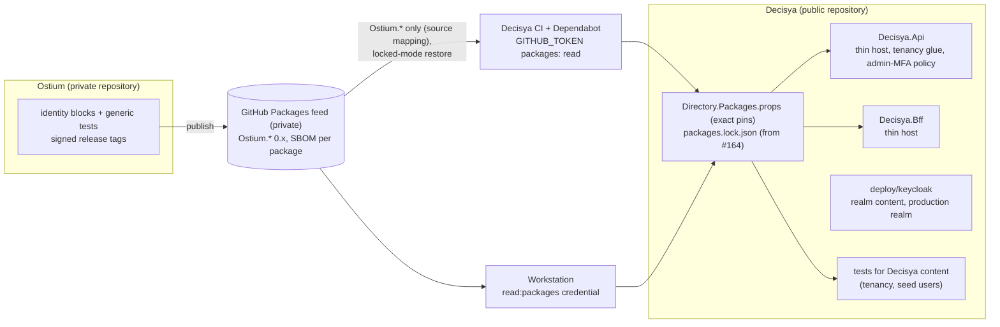

# Architecture note – Ostium identity packages as an external dependency (issue #147)

## Context

Issue #147 records Marco's decision of 2026-10-11: Decisya's identity code moves (not copies) to Ostium, a private repository that publishes `Ostium.<Block>` NuGet packages for Decisya and a second application. Decisya then consumes those packages from a private GitHub Packages feed, one block per switch issue, starting with #164. This PR changes documents only; no code, test or CI file changes. It is not N/A because it adds an external dependency on the auth path and freezes identity paths.

- Decision: [ADR-0019](../adr/0019-ostium-identity-packages.md) (Accepted, Marco, 2026-10-15).
- ADRs touched: [ADR-0003](../adr/0003-bff-session-pattern.md) gets a dated note (the BFF mechanism moves at the BFF switch; `Decisya.Bff` stays as the thin host). [ADR-0002](../adr/0002-keycloak-identity-provider.md) is unchanged: it names no code location that the move makes stale, and `deploy/keycloak` (realm content) stays app-owned.
- Related: [ADR-0011](../adr/0011-host-development-default.md), [ADR-0014](../adr/0014-ci-supply-chain-pinning.md), [ADR-0017](../adr/0017-release-images-sdk-containers-cosign.md).

## C4 excerpt

The target state after all four switches. Until #164 nothing restores from the feed, and the frozen Decisya code runs as today.

## Boundaries and contracts

- No module, `*.Contracts` type, Wolverine message, endpoint or schema is added or changed.
- **New external dependency boundary:** `Ostium.*` packages, restored only from the private feed by package source mapping, pinned by exact version and (from #164) by lock-file content hash.
- **Frozen paths** (from `79eb3d2` until Decisya's CI restores its first Ostium package, #164): `src/Decisya.Bff`, `src/Decisya.Api/Authentication`, `deploy/keycloak`, the Keycloak test fixtures (`tests/Decisya.Identity.Tests/KeycloakRealmFixture.cs`, `tests/Decisya.Api.Tests/Authentication/KeycloakApiFixture.cs`, `tests/Decisya.Bff.Tests/KeycloakBffFixture.cs`) and the realm guard with its users (`tests/Decisya.Identity.Tests/RealmGuard.cs`, `RealmGuardTests.cs`, `RealmExportFileTests.cs`, `ScanExclusionsTests.cs`, all in `tests/Decisya.Identity.Tests`). Documents and container image updates are not frozen. App-owned frozen code is fixed under a freeze exception Marco approves (ADR-0019, decision 2).
- App-owned after the switches: thin hosts, realm content, tenancy glue, admin-MFA policy, app runtime names as options.

## Decisions

- Move, feed, freeze, switch order, evidence chain, lock files, versioning: ADR-0019.
- Lock files and locked-mode restore: assigned to #164, the first switch, not to a separate tooling issue.
- Standards register: Ostium packages listed as a supplier for the Phase 0 exit audit (`docs/compliance/standards-register.md`).
- Handed to #164's G2/G3: triage points 5–8 and backlog item B-1 of `docs/security/reviews/147.md`.

## NetArchTest rules to add

None now. No assembly boundary changes in this PR.

Impact in #164 (its G2 decides the new form): the rules in `tests/Decisya.Api.Tests/Architecture/ApiBoundaryTests.cs` that name `Decisya.Api.Authentication` are retargeted there, `Only_Decisya_Api_Authentication_depends_on_JwtBearer_or_IdentityModel` first. The same file's `Decisya_Api_csproj_has_exactly_..._only_the_JwtBearer_package` rule pins the Api's package references and will also change when the Api references the Ostium packages.

| Rule | Assemblies | Test class |
| --- | --- | --- |
| — | — | — |

## Changes in this gate (architect lane)

| File | Change |
| --- | --- |
| `docs/adr/0019-ostium-identity-packages.md` | New, Accepted (Marco, 2026-10-15); G6-147-01 to 04 applied |
| `docs/adr/README.md` | 0019 row added |
| `docs/adr/0003-bff-session-pattern.md` | Dated note pointing to ADR-0019; decision unchanged |
| `docs/compliance/standards-register.md` | Supplier row for the Ostium packages |
| `docs/architecture/ostium-dependency.md` | This note |

<!-- gate: G2 | verdict: PASS | issue: #147 -->
