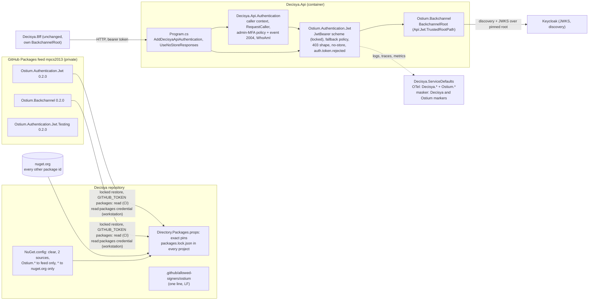

# Architecture note – Identity switch 1: Ostium Jwt and Backchannel packages (issue #164)

## Context

`Decisya.Api` stops carrying its own JWT validation and back-channel trust and consumes three private Ostium packages at exactly 0.2.0:
- `Ostium.Authentication.Jwt` (runtime);
- `Ostium.Backchannel` (runtime, through the Jwt package);
- `Ostium.Authentication.Jwt.Testing` (tests only).

This is the first switch under ADR-0019 decision 3, with no behaviour change. It adds lock files and locked restore for every project, a `NuGet.config` with source mapping, `packages: read` in CI, and the pinned signer line. The BFF keeps its own code until its own switch.

**Version switch to 0.2.0 (2026-10-18, before merge).** This note was written against 0.1.1, and the branch first restored 0.1.1. Ostium published 0.2.0 on 2026-10-18 (exchange O-013), and Marco switched #164 to 0.2.0 before merge, so Decisya never merges 0.1.1. The switch changes no decision in this note:
- 0.2.0 is **additive only**. `Ostium.Authentication.Jwt` gains an opt-in `resource_metadata` challenge: `ApiJwtOptions.ResourceMetadataUrl`, the `ResourceMetadataChallenge` type and `ApiJwtBearerEvents.InitialOnChallenge`. Decisya does not set `Api:Jwt:ResourceMetadataUrl`, so the 401 challenge stays bare (`ChallengeResponseTests`), as with 0.1.1.
- `Ostium.Backchannel` and `Ostium.Authentication.Jwt.Testing` have no API change.
- Dependencies are unchanged (Microsoft only, JwtBearer floor 10.0.12, lifted to 10.0.13). 0.2.0 still has no sensitive-data marker, `ActivitySource` or `Meter`, and no ASVS report (ADR-0019 amendment A4).
- The pins, the lock-file hashes (the O-013 signed checksums), the static test constants and the merge-gate check name 0.2.0. Where the text below still says 0.1.1, it records history (the G4 probe, the O-006/O-010 chain).

- Requirements: `docs/requirements/phase-0/ostium-jwt-switch.md` (G1, Stories 1 to 6, NFR-59, NFR-60). Original behaviour: `docs/requirements/phase-0/api-jwt-validation.md`.
- Decision: [ADR-0019](../adr/0019-ostium-identity-packages.md). This gate adds its **amendment 2026-10-17, Accepted (Marco, 2026-10-17)**:
  - A1 to A4 make decision 4 concrete: the checksums file, the namespaces, the pinned line, the check script and the ASVS report gap.
  - A5 covers key change and key compromise.
  - A6 is the restore hardening, which closes FU-59-1.
- Earlier note: [ostium-dependency.md](ostium-dependency.md) (#147). Supplier input, read as data: exchange O-001, O-004, O-005, O-006, O-010, O-013 (0.2.0) and D-004.
- Related: ADR-0002, ADR-0003 (the BFF is unchanged here), ADR-0010 and ADR-0011, ADR-0014, ADR-0017.

## C4 excerpt

Component level: `Decisya.Api` after the switch, and the restore path.



## Boundaries and contracts

- No module, `*.Contracts` type, Wolverine message, schema or HTTP endpoint changes. `/api/whoami`, `/api/admin/**`, `/api/capabilities` and every status code, body and header stay as they are.
- **External package boundary (new code path).** `Ostium.*` types are confined:
  - Runtime: only `Decisya.Api`, in namespace `Decisya.Api.Authentication`, and `Program`.
  - Tests: only test projects.
  - Modules, SharedKernel, Persistence, ServiceDefaults and the BFF never reference `Ostium.*`. ServiceDefaults recognises Ostium's telemetry and sensitive-data marker **by name**, with no package reference.
- **Decisya.Api no longer touches JwtBearer or IdentityModel types.** The mechanism lives in the package. The #20 rule ("only `Decisya.Api.Authentication` may") becomes "nothing in `Decisya.Api` may".
- **Configuration contract** (section `Api:Jwt`, unchanged name):

  | Key | Value | Source | New? |
  | --- | --- | --- | --- |
  | `Api:Jwt:Authority` | realm issuer | environment only (`Api__Jwt__Authority`, AppHost and Compose), unchanged; `LaunchProfileAndConfigurationTests` still bans it in `appsettings*.json` | no |
  | `Api:Jwt:RequireHttpsMetadata` | `true` (false: Development + loopback only) | unchanged | no |
  | `Api:Jwt:TrustedRootPath` | Caddy root path in the stack | Compose, unchanged | no |
  | `Api:Jwt:Audience` | `decisya-api` | `src/Decisya.Api/appsettings.json` | yes (was the constant `ApiJwtDefaults.Audience`) |
  | `Api:Jwt:Events:TokenRejected:Name` | `auth.token.rejected` | `src/Decisya.Api/appsettings.json` | yes |
  | `Api:Jwt:Events:TokenRejected:Id` | `2003` | `src/Decisya.Api/appsettings.json` | yes |
  | `Authentication:RequireAdminMfa` | default `true` | unchanged, Decisya-owned | no |

  The three new values go in `appsettings.json`, not in the environment. They are the same in every environment and instance (O-005 B1), they ship inside the release image (only `appsettings.Development.json` is excluded from publish), and the Compose file and its drift check stay unchanged.

## Decisions

### D1. Type map and wiring

The Ostium side below comes from O-001 (block map), O-005 (B1 to B7) and the 79eb3d2 sources. The packages are on a private feed that is not restored on this machine. **Every Ostium name in this table is for G4 to confirm against the restored package.** To confirm, read the public API and XML docs under the NuGet global packages folder (`ostium.authentication.jwt/0.2.0/lib/net10.0/`) and record the confirmed names in the G4 evidence. If a name differs, G4 uses the real name and changes nothing else. If a *behaviour* differs from the table, G4 stops and reports it, because that is a supplier defect (Story 2). *(2026-10-18: G4 confirmed the names against 0.1.1; 0.2.0 keeps every one of them and only adds the opt-in `resource_metadata` members, see Context.)*

**Deleted from `src/Decisya.Api/Authentication`** (moved to Ostium; Decisya keeps no copy):

| Decisya 79eb3d2 type | Replaced by (Ostium 0.2.0) |
| --- | --- |
| `ApiJwtOptions` (`Api:Jwt`: Authority, RequireHttpsMetadata, TrustedRootPath) | Ostium's options type in `Ostium.Authentication.Jwt`, bound from `Api:Jwt`, plus required `Audience` and `Events:TokenRejected:{Name,Id}` |
| `ApiJwtOptionsEnvironmentValidator` | Ostium's environment validator (same Development-only relaxations) |
| `ApiJwtDefaults` (audience constant) | configuration `Api:Jwt:Audience`, fail-closed (K-1, B1) |
| `JwtBearerOptionsSetup` (the pinned parameters, the events, logger category `Decisya.Api.Authentication.JwtBearerOptionsSetup`) | Ostium's setup, with the scheme locked after registration (B7) and logger category `Ostium.Authentication.Jwt` (B3) |
| `TokenRejectionReason` | Ostium's (same closed reason list) |
| `AuthEventsLog.TokenRejected` (2003) | Ostium's event, name and id from configuration (B2) |
| `ProblemDetailsAuthorizationResultHandler` | Ostium's, registered by `AddApiAuthentication` (replace, not add) |
| `NoStoreResponses.UseNoStoreResponses` | `Ostium.Authentication.Jwt` `UseNoStoreResponses(this IApplicationBuilder)` |
| `BackchannelRoot`, `ApiJwtTrustedRootValidator` (in `BackchannelRoot.cs`) | `Ostium.Backchannel.BackchannelRoot` (public; B5) and Ostium's trusted-root validator |
| the generic half of `ApiAuthenticationBuilderExtensions` (JwtBearer registration, fallback policy authenticated + `sub`, 403 handler) | `Ostium.Authentication.Jwt` `AddApiAuthentication(this WebApplicationBuilder)` |

**Kept in Decisya, unchanged in behaviour:**

| Type | Change |
| --- | --- |
| `CallerIdentity`, `CallerContextMiddleware`, `CallerContextMiddlewareLog`, `CallerContextApplicationBuilderExtensions` (`UseCallerContext`), `RequestCaller` | None. Caller context stays here; Decisya does **not** implement Ostium's `ICallerContextHook` (B6; a rule below enforces this). |
| `AdminMfaAuthorization` (requirement, handler, `AdminMfaPolicy`, `RequireAdminMfa`), `AdminMfaOptions` (+ setup, validator) | Doc comments that `cref` deleted types (for example `ApiJwtOptionsEnvironmentValidator`) are rewritten; under `-warnaserror` a dangling `cref` is CS1574. |
| `AuthEventsLog` | Keeps only `AdminMfaRequired`: EventId **2004**, name `auth.admin.mfa_required`, Warning, emitted by `AdminMfaAuthorizationHandler` (logger category unchanged). `TokenRejected` is removed. |
| `WhoAmIEndpointRouteBuilderExtensions`, `WhoAmIResponse` | None. |
| `ApiAuthenticationBuilderExtensions.cs` | Becomes the Decisya composition entry point, `DecisyaApiAuthenticationExtensions.AddDecisyaApiAuthentication(this WebApplicationBuilder)`. It is renamed because the same `AddApiAuthentication` name on `WebApplicationBuilder` in both namespaces is ambiguous (CS0121). |

**`AddDecisyaApiAuthentication`**, in this order:
1. `builder.AddApiAuthentication()` (Ostium). This registers the options and validators (all `ValidateOnStart`), the JwtBearer scheme, the fallback policy and the 403 handler. After this call the scheme is locked (B7).
2. The admin-MFA options, setup and validator, exactly as today.
3. `AddAuthorization(options => options.AddPolicy(AdminMfaPolicy.Name, …))`: additive. It does **not** set `FallbackPolicy` again, and it touches no scheme setting.
4. The scoped `AdminMfaAuthorizationHandler`.
5. The scoped `RequestCaller`, with `ICurrentTenant` and `ICurrentCaller` forwarded to the same instance, exactly as today.

**`Program.cs`:**
- The only edits: `using Ostium.Authentication.Jwt;` (for `UseNoStoreResponses`); `builder.AddApiAuthentication()` becomes `builder.AddDecisyaApiAuthentication()`; and the header comment is updated.
- The middleware order is unchanged: forwarded headers, no-store, exception handler, authentication, caller context, routing, membership, authorization.
- The endpoint mapping is unchanged.

**`Decisya.Api.csproj`:** the single `PackageReference` becomes `Ostium.Authentication.Jwt` (replacing `Microsoft.AspNetCore.Authentication.JwtBearer`).
- JwtBearer still arrives transitively. Its `PackageVersion` 10.0.13 stays in `Directory.Packages.props`, so central transitive pinning holds the .NET 10.0.13 servicing level even though Ostium 0.2.0 declares 10.0.12 floors. G4 checks the resolved graph with `dotnet list src/Decisya.Api package --include-transitive`.
- No direct `Ostium.Backchannel` reference: the Api code does not use it.

**G4 confirms against the restored package** (and records each one in the G4 evidence):
1. The namespaces and type names in the table above. This includes the `ICallerContextHook` full name and the sensitive-data marker's full name.
2. `AddApiAuthentication` binds section `Api:Jwt`, needs no argument, and registers the fallback policy and the 403 handler itself.
3. `MapInboundClaims = false`, name claim `sub`, `ValidAudience` taken from configuration, `ValidAlgorithms` RS256 and ES256 only, `ClockSkew` 60 s, `typ` must be `Bearer`, `IncludeErrorDetails = false`, `SaveToken = false`, `ValidIssuer` pinned to the authority with the trailing `/` trimmed.
4. The start-up failure messages name the key and never the value.
5. `TestTokenIssuer(issuer, audience)`, `IssueAccessToken(string subject, IReadOnlyDictionary<string, object>? additionalClaims = null)`, `StaticConfigurationManager` and `UnreachableConfigurationManager` are public. Also check which of the old hand-built-token helpers are public (`IssueToken`, `DefaultClaims`, `BuildAlgNoneToken`, `BuildHs256Token`, `IssueTokenWithEmbeddedAttackerJwk`, the key properties).
6. The ActivitySource and Meter names the packages declare, if any.

### D2. Restore design

**Pins** (`Directory.Packages.props`, a new `<!-- Ostium -->` group, with a comment that points to ADR-0019 and says "exact pins; every change needs the A3 check"):

```xml
<PackageVersion Include="Ostium.Authentication.Jwt" Version="0.2.0" />
<PackageVersion Include="Ostium.Authentication.Jwt.Testing" Version="0.2.0" />
<PackageVersion Include="Ostium.Backchannel" Version="0.2.0" />
```

The pins are plain versions, in the same form as every other pin. Under CPM a plain version is a minimum, so the exact pin comes from the lock file plus locked restore, and from the static test. Bracket notation (`[0.2.0]`) adds nothing under locked mode. `0.1.0` appears in no build input (it never existed on the feed, O-006).

**`NuGet.config`** (new, repository root, no credential ever):

```xml
<?xml version="1.0" encoding="utf-8"?>
<configuration>
  <packageSources>
    <clear />
    <add key="nuget.org" value="https://api.nuget.org/v3/index.json" protocolVersion="3" />
    <add key="ostium" value="https://nuget.pkg.github.com/mpcs2013/index.json" protocolVersion="3" />
  </packageSources>
  <packageSourceMapping>
    <packageSource key="nuget.org">
      <package pattern="*" />
    </packageSource>
    <packageSource key="ostium">
      <package pattern="Ostium.*" />
    </packageSource>
  </packageSourceMapping>
  <auditSources>
    <clear />
    <add key="nuget.org" value="https://api.nuget.org/v3/index.json" />
  </auditSources>
</configuration>
```

- The most specific pattern wins. So `Ostium.*` goes to the feed only, and every other id goes to nuget.org only. An `Ostium.*` id squatted on nuget.org is never fetched.
- The source key `ostium` is short on purpose: it is part of the credential's environment variable name.
- The file holds no `packageSourceCredentials`. Credentials come from the user level (workstation) or the environment (CI). They merge by source key.

**Lock files and locked mode.**
- `Directory.Build.props` (devops):
  - `<RestorePackagesWithLockFile>true</RestorePackagesWithLockFile>`;
  - `<RestoreLockedMode Condition="'$(DECISYA_LOCKED_RESTORE)' == 'true'">true</RestoreLockedMode>`.
- The switch is an explicit environment variable, not `GITHUB_ACTIONS`. Locked mode then also covers the implicit restores inside `dotnet build`, `dotnet test` and the harness scripts. Dependabot's updater, which must rewrite lock files, never sets the variable.
- `ci.yml` and `release.yml` set `DECISYA_LOCKED_RESTORE: "true"` in a workflow-level `env:` block. It is not a secret. No job or step `env:` redefines it.
- **Every explicit restore passes `--locked-mode` on the command line** (G3 M-1): every `dotnet restore` in `ci.yml` and `release.yml`, and the pre-push check. `--locked-mode` is a global property, so it wins over anything a project sets. The variable covers the implicit restores; the flag covers the explicit ones.
- No dotnet command in either workflow passes `--source`, `-s`, `--configfile` or `RestoreSources`.
- The pre-push check sets the variable for its dotnet calls. It also runs its own first step, `dotnet restore --locked-mode`, so a stale lock file fails with a clear title.
- **No NuGet package cache in any job that restores** (G3 M-1): no `cache:` on `setup-dotnet`, and no `actions/cache` over `~/.nuget/packages`. Locked mode trusts the `.nupkg.metadata` hash of a package that is already in the global folder and does not hash it again, so a pre-filled cache would bypass the lock file.
- Locally, VS 2026 and the CLI restore unlocked, so a package change rewrites the lock files and they are committed with it.
- `Directory.Build.targets` (main session) adds two policy errors next to DECISYA0001 to 0005:
  - DECISYA0007: `RestorePackagesWithLockFile` must stay `true`.
  - DECISYA0008: `RestoreSources`, `RestoreAdditionalProjectSources` and `RestoreFallbackFolders` must be empty. `NuGet.config` is the only source definition, so a project cannot side-step the mapping.
  - **DECISYA0009** (G3 M-1): when `'$(DECISYA_LOCKED_RESTORE)' == 'true'`, `RestoreLockedMode` must be `true`. A project that sets `<RestoreLockedMode>false</RestoreLockedMode>` would otherwise win over `Directory.Build.props`, which is imported before the project body.
  - **Canary exemption:** the dependency canary passes `-p:RestoreLockedMode=false`, so it needs an explicit exemption. G4 picks one of two forms: the canary also passes `-p:DECISYA_LOCKED_RESTORE=false`, or DECISYA0009 is skipped for the canary project only. `RestoreLockedMode=false` appears nowhere except `.github/scripts/dependency_canary.py`.
- `.claude/tests/test_build_policy.py` gets the matching red and green fixtures for 0007, 0008 and 0009.
- A static workflow test (in `.claude/tests/test_ci_fullstack.py` or `deploy/tests`) asserts the M-1 rules:
  - both workflows declare `DECISYA_LOCKED_RESTORE` at workflow level, and nothing redefines it;
  - every `dotnet restore` carries `--locked-mode`;
  - no workflow passes a source or config-file override;
  - `RestoreLockedMode=false` appears only in the canary;
  - no NuGet cache exists in a job that restores.
- Lock files: one `packages.lock.json` next to every project restored from the solution, including `tests/Decisya.ArchitectureTests/Fixtures/*` and `tests/Modules/*`. The generated canary project is the one exception: it is created and deleted at run time.
  - The lock files are generated by one unlocked `dotnet restore` after every csproj change of this PR has landed. Then `dotnet restore --locked-mode` must pass, and they are committed together.
  - Any later csproj change in the PR means regenerating them.
- **Known locked-mode pitfall (G4 resolves, G6 checks):** `release_images.py` publishes with `-r linux-x64`.
  - A lock file restored without that runtime identifier fails a locked restore for it (NU1004).
  - First choice: `<RuntimeIdentifiers>linux-x64</RuntimeIdentifiers>` for the three release projects (`IsDecisyaReleaseImage`) in `Directory.Build.props`, so the normal restore writes the `net10.0/linux-x64` target. G4 checks that this triggers no DECISYA0004 (`PackageDownload`), and that it does not change the normal build.
  - Locked mode is never switched off for the release build.
- `dependency_canary.py nuget` (devops) adds `-p:RestoreLockedMode=false` to its restore argv. Its project has no lock file, and the property under test is the audit, not locked mode. The lock file it writes lands inside `CANARY_DIR`, which the script deletes. It uses the DECISYA0009 exemption above. `docs/runbooks/ci-security-gates.md` says why. That runbook also records two other things:
  - an NU1403 on an `Ostium.*` id is a compromise signal, handled under A5, and never cleared by regenerating the lock files (G3 S-2);
  - the fork-approval setting (S-1).

**CI: who restores, with which permission and credential** (G3 M-5):
- The credential is the job's own token.
- It is set **only on `run:` steps that restore**: the `dotnet restore --locked-mode` steps, and `Vulnerable packages` only if G4 shows that step needs it.
- It is never set on a `uses:` step, at job or workflow level, and it is never written to `$GITHUB_ENV`.
- `packages: read` appears **only on the jobs in the table below**. Each of those job-level blocks lists exactly `contents: read` and `packages: read`, plus `security-events: write` on `codeql`.
- The workflow-level block stays `contents: read`.
- `realm-guard`, `changes`, `claude-config` and `image-scan` gain no `packages` permission.

The variable, on a restore step:

```yaml
env:
  NuGetPackageSourceCredentials_ostium: "Username=${{ github.actor }};Password=${{ github.token }}"
```

| Workflow / job | Restores | `permissions` after #164 | Credential on |
| --- | --- | --- | --- |
| ci / build-test | yes | `contents: read`, `packages: read` (new job-level block; today it inherits the workflow's) | `Restore` (`dotnet restore --locked-mode`), and `Vulnerable packages` only if G4 shows it queries the feed |
| ci / codeql | yes (`dotnet build`) | `contents: read`, `security-events: write`, `packages: read` | the `dotnet build` step |
| ci / apphost-tests, e2e, zap | yes | `contents: read`, `packages: read` | a new lane-gated `Restore` step (`dotnet restore --locked-mode`), placed before the first build. Later dotnet steps restore nothing new, because they find the packages in the global folder. If a harness step still reaches the feed, G4 does not put the variable on that step: it makes the explicit restore cover that graph (for example the AppHost project or the Release configuration), then records why. |
| ci / deploy-guards | yes (AppHost Release build) | `contents: read`, `packages: read` | a new `Restore` step (`dotnet restore --locked-mode`) before the drift check (no `if`, the job stays unconditional) |
| ci / realm-guard | yes, only `Decisya.Identity.Tests`, which has no `Ostium.*` in its graph | unchanged (`contents: read`) | none. A static test (below) fails if `Decisya.Identity.Tests` gains an `Ostium.*` entry; then this row changes. |
| ci / changes, claude-config, image-scan | no | unchanged | none |
| release / build | yes | `contents: read`, `packages: read` | a new `Restore` step (`dotnet restore --locked-mode`) before `release_images.py build` |
| release / release-please, publish, verify, release-assets | no dotnet | unchanged | none |

- `secrets.GITHUB_TOKEN` is not used, so the bans on `secrets.` in `test_ci_fullstack.py` stay true. `${{ github.token }}` is the same token that `release.yml` already uses for GHCR.
- **G4 confirms** that the SDK in `global.json` honours `NuGetPackageSourceCredentials_<key>`.
  - If it does not, the fallback is a step that runs `dotnet nuget add source https://nuget.pkg.github.com/mpcs2013/index.json --name ostium --username "$GITHUB_ACTOR" --password "$OSTIUM_TOKEN" --store-password-in-clear-text --configfile "$HOME/.nuget/NuGet/NuGet.Config"`. That writes to the runner's user-level file, never into the checkout. The repository file's `<clear/>` drops that duplicate source, and its credential still applies by key, which G4 verifies.
  - Use the fallback only if the environment variable is shown not to work (G3 S-5). If it is used, a step with `if: always()` removes the source right after the restore steps, so later steps in the job cannot read the token from the user-level file.
  - With either mechanism, the token never appears in a file inside the workspace.
- Tests that pin today's permissions change with the workflow, in the same PR:
  - `.claude/tests/test_ci_fullstack.py` (`contents: read is the only permission`) changes to allow exactly `contents: read` plus `packages: read`.
  - `deploy/tests/test_ci_workflow.py` (lines 87 and 88: deploy-guards bans `packages`) changes the same way.
  - Both tests also assert where `NuGetPackageSourceCredentials_ostium` appears: only on `run:` restore steps (M-5).
  - `.claude/tests/test_release.py` needs no change (it checks writes only).
- `release.yml`'s `pull_request.paths` adds `NuGet.config` and `**/packages.lock.json`.
- Fork PRs *(corrected after G3 S-1)*: a fork PR **may** be able to restore the compiled packages. GitHub's documentation warns that forks may get access; it does not guarantee they are refused. Marco accepted this residual in exchange A-003 point 4: the compiled packages could reach a fork owner, while Ostium's source stays private. The repository setting "Require approval for all external contributors" is recommended for fork workflows, and devops records it in `docs/runbooks/ci-security-gates.md`. Version changes from any PR not on Marco's own branch are redone there (A3).
- **Residual (accepted at G3):** restore evaluates the PR's MSBuild files while the credential is in the environment. For same-repository PRs (Marco's own) this is the same trust as today's build. For fork PRs it is covered by the A-003 residual above, together with the approval setting.

**Workstation (Marco, before G4; agents never run or read this):**
- Use a classic personal access token with only `read:packages` and an expiry. GitHub Packages' NuGet feed does not take fine-grained tokens. Do not use the `gh` login token, which carries broad scopes.

| Visual Studio 2026 | CLI |
| --- | --- |
| Open `decisya.slnx`. The first restore asks for credentials for `nuget.pkg.github.com`: user name `mpcs2013`, password the token. VS stores it in Windows Credential Manager. Check: *Tools → Options → NuGet Package Manager → Package Sources* lists `ostium` from the repository's `NuGet.config` **(unverified)** | `dotnet nuget add source https://nuget.pkg.github.com/mpcs2013/index.json --name ostium --username mpcs2013 --password <token> --configfile "$env:APPDATA\NuGet\NuGet.Config"`. On Windows the password is stored encrypted; never add `--store-password-in-clear-text`. Then `dotnet restore` in the repository **(unverified)** |

The file `%APPDATA%\NuGet\NuGet.Config` is outside the repository. Agents never read it, and the agent hook already bans `dotnet nuget add`.

**Dependabot** (`.github/dependabot.yml`, devops). The target shape, if G4's check allows it:

```yaml
registries:
  ostium:
    type: nuget-feed
    url: https://nuget.pkg.github.com/mpcs2013/index.json
    token: ${{ secrets.GITHUB_TOKEN }}   # only if GitHub documents this for Dependabot; never a PAT without Marco's ADR change
updates:
  - package-ecosystem: nuget
    registries: [ostium]
    # existing settings stay
```

G4 (devops) checks GitHub's current Dependabot documentation and records the result in the manifest's G4 evidence and in ADR-0019 amendment item A6:
- (a) whether Dependabot can read a private GitHub Packages NuGet feed of the same owner with the repository's `GITHUB_TOKEN`, using the per-package repository access that O-006 granted;
- (b) whether the `nuget` ecosystem updates `packages.lock.json`.

If (a) is not supported:
- no PAT and no Dependabot secret is added;
- the `nuget` entry gets `ignore: [{ dependency-name: "Ostium.*" }]`;
- the manifest records which projects' NuGet updates then fail (every project whose graph includes `Ostium.*`);
- Marco decides between accepting that gap and an ADR-0019 change.

If (b) is not supported, Dependabot NuGet PRs fail locked restore in CI. That is recorded the same way, and FU-59-1's "check first" is met by the record. In every case, Ostium bumps are never auto-merged and are bumped by hand at once for security releases (decision 2). The check from A3 applies.

**Pinned signer line** (`.github/allowed-signers/ostium`, devops): exactly the line in ADR-0019 amendment A2, ending in LF. `.gitattributes` adds `.github/allowed-signers/** -text`, so the bytes are never converted. If the secret guard refuses the public-key line, the main session writes it. Nobody works around a deny.

**Merge gate for 0.2.0:** after the locked restore on the branch, Marco runs Ostium's check script (`--version 0.2.0`) against the head commit and pastes the block into the PR. It must end in `RESULT: PASS`. *(2026-10-18: the earlier `RESULT: PASS` on 0.1.1, head `0a5d44f`, does not count for 0.2.0.)*

### D3. Telemetry and logging (ServiceDefaults, backend-dev)

- `DecisyaTelemetry` gets `OstiumSourceWildcard = "Ostium.*"`, with the trailing dot, like `Decisya.*`. `ConfigureOpenTelemetry` calls `AddMeter` and `AddSource` with both wildcards. OTLP stays the only exporter (NFR-12). There is no package reference: the subscription is by name.
- Masker: `SensitiveTypeAnalyzer` recognises a **set of marker full names**: `Decisya.SharedKernel.Observability.SensitiveAttribute` and Ostium's marker. G4 takes its exact full name from the restored package (D1, item 1).
  - The five `Attribute.IsDefined(…, typeof(SensitiveAttribute), inherit: true)` sites become one helper. It reads `Attribute.GetCustomAttributes(member, inherit: true)` and compares each attribute's type full name against the set.
  - Every failure answers "sensitive", as today. A foreign attribute that spoofs the name only causes more masking.
  - `IsProcessorRenderable` stays limited to `Decisya.*` assemblies. Ostium types whose graph needs rendering are therefore masked whole (fail closed, Story 5).
  - If the restored packages contain no marker type, G4 records that. The name set then stays Decisya-only, Story 5's marker scenario is reported to Marco as not applicable to the pinned version, and the supplier is asked in the exchange. It is never silently passed. *(G4 found no marker in 0.1.1, and 0.2.0 has none either.)*
- Log category: the JWT block now logs under `Ostium.Authentication.Jwt` (B3). A search found no log query, alert or Collector filter in the repository that names `Decisya.Api.Authentication.JwtBearerOptionsSetup`.
  - Three living documents name the old file as the code location, and are updated by their owners: `docs/security/threat-models/system-baseline.md` (TB5 row, A-03 row) and `docs/security/asvs-l2-baseline.md` (V9.1.1) by security-reviewer at G3 or G6.
  - `docs/architecture/production-identity.md` is the #121 note and stays as a historical record.
- `auth.token.rejected` keeps level Warning, id 2003, its name and the closed `reason` list. They now come from configuration and the package. Decisya's host-level test pins them (D4).
- If the packages declare sources or meters, backend-dev adds their rows to `docs/observability/signal-catalogue.md`.

### D4. Tests

**Principle:**
- Decisya keeps every test that drives **Decisya's real host** through HTTP or its real logging pipeline. Those tests now run against the package unchanged in expectation, and they are Story 2's "original scenarios on the host".
- Tests that open up types which moved go with the code (O-001), because Ostium runs them. The exception is the pinned-options snapshot and the environment rows, which stay in Decisya (G3 M-2).
- This keeps more than O-001's list, on purpose. 0.2.0, like 0.1.1, has no ASVS report (amendment A4), so Decisya's own black-box suite is the only proof of no behaviour change at this version.

**Removed from `tests/Decisya.Api.Tests/Authentication`** (moved with the code):
- `ApiAuthenticationWiringTests`, `NoStoreResponsesTests`, `ProblemDetailsAuthorizationResultHandlerTests`. *(Corrected after G3 M-2: `JwtBearerOptionsPinnedTests` and `ApiJwtOptionsTests` are no longer removed. They are kept and rewritten, see below.)*
- `JwksTrustTests`, replaced by `ApiTrustedRootWiringTests` below;
- the helpers `TestTokenIssuer`, `StaticConfigurationManager` and `UnreachableConfigurationManager`, which now come from `Ostium.Authentication.Jwt.Testing`.

**Kept and rewritten against `AddDecisyaApiAuthentication`** (G3 M-2). These are the compensating control for the missing report of the pinned version, 0.2.0 (A4). Each one goes through Decisya's real registration, never through Ostium's own:
- `JwtBearerOptionsPinnedTests` resolves `IOptionsMonitor<JwtBearerOptions>.Get("Bearer")` from Decisya's host and asserts the pinned validation options:
  - `ValidAlgorithms` is exactly {RS256, ES256};
  - `ValidAudience` is `decisya-api`;
  - `ValidIssuer` is the authority with the trailing `/` trimmed;
  - `ClockSkew` is 60 s;
  - `ValidateIssuer`, `ValidateAudience`, `ValidateLifetime`, `RequireExpirationTime`, `RequireSignedTokens` and `ValidateIssuerSigningKey` are true;
  - `SaveToken`, `IncludeErrorDetails` and `MapInboundClaims` are false;
  - `NameClaimType` is `sub`;
  - `RefreshInterval` and `AutomaticRefreshInterval` are at their defaults;
  - after the host starts, `IdentityModelEventSource.ShowPII` and `IdentityModelEventSource.LogCompleteSecurityArtifact` are still false at run time.

  The file is in Api.Tests, so its reference to `JwtBearerOptions` does not break the `Decisya.Api` rule.
- `ApiJwtOptionsTests` keeps the environment rows, using the O-004 direct-start pattern:
  - In `Production`: an `Api:Jwt:Authority` that is missing, relative or `http://` stops start-up, and `Api:Jwt:RequireHttpsMetadata=false` stops start-up.
  - In `Development`: the exact-host loopback rows of #20 G4-20-02 still hold. `localhost.evil.test`, `localhost@evil.test` and `127.0.0.1.nip.io` all leave `RequireHttpsMetadata` true.
  - Every failure message names the key and never the value.
- **New:** `AuthenticationSchemeSetTests`. `IAuthenticationSchemeProvider` lists exactly one authentication scheme, `Bearer`, and it is the default authenticate and challenge scheme. G6 also checks that `AddDecisyaApiAuthentication` and `Program.cs` call no `AddAuthentication`, `AddScheme`, `AddPolicyScheme` or `AddCookie`, and set neither `FallbackPolicy` nor `DefaultPolicy`.
- If any assertion differs from 79eb3d2, G4 stops and reports a supplier defect (D1). G4 never adapts the test.

**Kept, retargeted** (helper references only; no expectation is weakened):
- `TokenValidationTests` and `InvalidTokenCaseCatalog`: the rejection set, RS256 and ES256, the NFR-26 and NFR-27 rows. Every #20 G4-20-01 row stays unchanged in expectation (G3 M-2):
  - **the `PS256` and `RS512` rows, signed with the genuine key**, which are the only proof of the algorithm allow-list (G1's Story 2 list omits them);
  - `alg` in its `none` variants;
  - HS256 with the public key as PEM and as DER;
  - an embedded `jwk` header;
  - an unknown `kid`;
  - no `exp`;
  - `typ` set to `ID`, and `typ` absent.
- `ChallengeResponseTests`, `FallbackPolicyTests`, `ExceptionHandlingTests`, `LogCaptureTests`.
- `ApiKeycloakAuthenticationTests` (Integration), `KeycloakApiFixture`, `KeycloakBackedApiFactory`.
- `ApiTestFactory`: it takes Ostium's `StaticConfigurationManager`. Its O-004 remark (wrong cause) is corrected.
- Every Decisya-content test: `CallerContext*` (its O-004 remark is corrected too, and it calls `AddDecisyaApiAuthentication` with the three new keys in its in-memory configuration), `CallerIdentity*`, `Tenancy*`, `TenantClaimForbiddenTests`, `ForbiddenResponseTests`, `EndpointAuthorizationTests`, all `Admin*`, `Capabilities*`, `EntitlementMarkerTests`, `AuthLogCanaryTests`.
- Token issuing goes through Ostium's `TestTokenIssuer(issuer, audience)` and `IssueAccessToken(subject, additionalClaims)`, with `tenant_id`, `roles` (string array) and `acr` as additional claims. There is no claim-shaping adapter (scope comment of 2026-10-15). A constants-only class `DecisyaTestTokens` holds `Issuer`, `Audience` = `decisya-api`, `DevAliceTenantId`, plus a factory `Create()`. A test asserts that `Audience` equals the `appsettings.json` value.
- Hand-built malformed tokens (alg=none, HS256, embedded jwk) come from the Testing package if it exposes them publicly (D1, item 5). Otherwise, `InvalidTokenCaseCatalog` keeps their builders as test-only code. That is a fixture, not a mechanism.
- `TokenRejectionEventTests` becomes host-level only. A rejected token produces exactly one Warning with EventId 2003, name `auth.token.rejected` and category `Ostium.Authentication.Jwt`, and no token, header or claim value. Three rows pin the observed `reason` strings `expired`, `bad_audience` and `bad_type`, so a silent change in the package's contract fails here. The assertions over `TokenRejectionReason.All` are removed (Ostium's).
- `ApiBoundaryTests`: the two rules retargeted (NetArchTest table below).

**New tests** (G5 test-engineer unless noted):

| Test | Project | Proves |
| --- | --- | --- |
| `ApiJwtConfigurationTests` | Api.Tests | Story 3 / NFR-60. Shipped values: read `src/Decisya.Api/appsettings.json`. Five bad audiences and two missing or empty event settings each stop start-up, and the message names the key, never the value. Built with the **O-004 pattern**: `WebApplication.CreateBuilder` with `UseTestServer`, in-memory configuration only (so `appsettings.json` is not loaded), `AddDecisyaApiAuthentication`, `Build`, then `StartAsync` on the test thread. Never `Record.Exception(() => factory.Server)`. |
| `RolesClaimShapeTests` | Api.Tests | Story 2, scenario 2. `IssueAccessToken("dev-admin-sub", {roles: ["tenant-user","platform-admin"], acr: "2", …})`. The payload's `roles` is a JSON array of two strings. With no `tenant_id`, `GET /api/admin/…` succeeds as before. With `tenant_id`, the R-2 rule gives 403 as before. A wrong shape fails the test, and the defect goes to the supplier through the exchange (Marco approves the text). No workaround. |
| `CaddyRootTrustTests` | Api.Tests (`Trust/`, Integration) | Story 6. A retargeted copy of the BFF test against `Ostium.Backchannel.BackchannelRoot`, with the same expectations. It links `tests/Decisya.Bff.Tests/Trust/TempFolder.cs` as source, the way `TlsTestPki.cs` is linked today, or uses its own temp folder. **Note:** the class lives in `tests/Decisya.Bff.Tests/Trust/`, not in `Decisya.Identity.Tests`. The BFF copy stays unchanged, because it proves the BFF's own `BackchannelRoot`, which stays until the BFF switch, and that switch removes it. The copy goes in Api.Tests, the API being the consumer: Identity.Tests stays free of `Ostium.*`, so the required `realm-guard` job needs no feed access. |
| `ApiTrustedRootWiringTests` | Api.Tests | Stack contract: `Api:Jwt:TrustedRootPath` is still read. A missing file stops start-up (O-004 pattern) with the key named. A good root makes `JwtBearerOptions.Backchannel` trust a stub signed by it. |
| `OstiumMarkerMaskingTests` | Api.Tests | Story 5. A value typed with Ostium's real marker attribute, logged through the real host pipeline, is masked in the stdout JSON and in the OTel record. Skipped with a recorded reason only if D3's "no marker in the pinned version" case applies (it does for 0.1.1 and 0.2.0). |
| `TelemetryConfigurationTests` (extended) + `OstiumSubscriptionTests` | ServiceDefaults.Tests | `OstiumSourceWildcard == "Ostium.*"`. An `ActivitySource` and a `Meter` named `Ostium.Authentication.Jwt`, created in the test, reach an in-memory exporter; `OstiumFoo` does not. |
| `SensitiveTypeAnalyzerTests` (extended) | ServiceDefaults.Tests | An attribute named exactly like Ostium's marker (declared in the test assembly) marks a member and a type as sensitive. An unrelated attribute does not. The reflection failure path still masks. |
| `OstiumSupplyChainTests` | ArchitectureTests (static, reads files through `RepoPaths`) | Story 1 / NFR-59. Checks: (1) `NuGet.config` starts with `<clear/>`, has exactly the two sources and the mapping, and no credentials. (2) The three `PackageVersion` entries are exactly `0.2.0`, and `0.1.0` is in no `Directory.Packages.props`, `*.csproj` or lock file. (3) Every `*.csproj` under `src/` and `tests/` has a sibling `packages.lock.json`. (4) Every `Ostium.*` lock entry resolves `0.2.0` with the O-013 hash for its id (a table of three constants; 0.1.1 used the O-006 hashes until 2026-10-18). (5) `src/Decisya.Bff` and `tests/Decisya.Identity.Tests` lock files and csproj files contain no `Ostium.`. (6) Under `src/`, only `Decisya.Api.csproj` references `Ostium.*`. (7) `.github/allowed-signers/ostium` is exactly the A2 line followed by one LF. |
| `test_build_policy.py` (extended) | `.claude/tests` (main session) | DECISYA0007, DECISYA0008 and DECISYA0009 (with the canary exemption), red and green. |
| `test_prepush.py` (extended) | `.claude/tests` (main session) | The pre-push check runs `dotnet restore --locked-mode` before the build, and sets `DECISYA_LOCKED_RESTORE`. |

**Evidence that is not a committed test** (G5 records it in the manifest):
- The locked restore with a deliberately edited `Ostium.*` `contentHash` fails, with a nonzero exit (NU1403), and with no fallback source in the output. Run this in a scratch copy made with `git archive` in the scratchpad, never with `git stash`. In the same copy, a csproj that sets `RestoreLockedMode=false` while `DECISYA_LOCKED_RESTORE` is set fails with DECISYA0009 (G3 M-1).
- Every new or retargeted architecture rule fails on a deliberate violation.

**Unchanged:**
- `src/Decisya.Bff/**` and `tests/Decisya.Bff.Tests/**`, except their generated `packages.lock.json` files. Story 1 ("every restorable project has a lock file") and Story 6 ("no file under `src/Decisya.Bff` changes") conflict literally. G2 resolves it: the generated lock file is the only allowed change, and the static test above proves it holds no `Ostium.*` entry.
- `tests/Decisya.Identity.Tests` (lock file only); the realm guard and its CI wiring; `src/Decisya.AppHost` and `deploy/compose` (the drift check stays green).

### D5. Documents and skills to update

| File | Change | Owner |
| --- | --- | --- |
| `docs/adr/0019-ostium-identity-packages.md`, `docs/adr/README.md` | Amendment 2026-10-17, Accepted (Marco, 2026-10-17) | architect (this gate) |
| `docs/compliance/standards-register.md` | Ostium supplier row: the chain as delivered, V6, V7, V9 and V10, the report gap (0.1.1, and 0.2.0 since 2026-10-18) | architect (this gate) |
| `docs/GETTING-STARTED.md` | Prerequisites row "Ostium private feed credential (#164)" with the VS 2026 \| CLI pair of D2. `GettingStartedAdminDocTests` must stay green. | tech-writer (or main session) |
| `docs/runbooks/deployable-stack.md` | Troubleshooting rows: Api start-up fails naming `Api:Jwt:Audience` or `Api:Jwt:Events:TokenRejected:*`, which means a broken image configuration, so roll back one release. `auth.token.rejected` now logs under category `Ostium.Authentication.Jwt`. | devops |
| `docs/runbooks/ci-security-gates.md` | Locked restore and lock files; the canary's `RestoreLockedMode=false` and why; feed access with `packages: read` | devops |
| `.claude/skills/keycloak/SKILL.md` | The Api's token validation is `Ostium.Authentication.Jwt` 0.2.0. A defect is fixed in Ostium and bumped, never patched here. Test tokens use `TestTokenIssuer(issuer, audience)` and `IssueAccessToken(subject, additionalClaims)`, with `roles` as a string array. | main session |
| `.claude/skills/testcontainers/SKILL.md` | `CaddyRootTrustTests` now has an Api.Tests copy (Integration, already in CI's project list). Restores need the feed credential. | main session |
| `.claude/agents/identity-dev.md` (description), then `python .claude/scripts/roster.py`, which regenerates the roster row in `docs/ai/README.md` | "JWT validation in Decisya.Api" becomes "the Api's composition of the Ostium JWT package (caller context, admin MFA, `Program.cs` wiring)". | main session |
| `.claude/scripts/prepush.py` | A `dotnet restore --locked-mode` step; `DECISYA_LOCKED_RESTORE` for its dotnet calls; `packages.lock.json` added to `WARN_NAMES`; `.github/allowed-signers/` added to `WARN_PREFIXES` | main session |
| `docs/security/threat-models/system-baseline.md`, `docs/security/asvs-l2-baseline.md` | Code-location rows that name `JwtBearerOptionsSetup.cs` | security-reviewer (G3 or G6) |

### D6. G4 routing and order

No agent lane covers `NuGet.config`, `Directory.Packages.props`, `Directory.Build.targets` or the lock files of all projects. The main session takes them, as it did `Directory.Packages.props` in #166. The lock files are tool output that spans every lane, so one owner generates and commits them.

| Step | Owner | Files |
| --- | --- | --- |
| 0 | Marco | ADR-0019 amendment: done (accepted 2026-10-17). Add the workstation credential (D2). Confirm that the three packages grant `mpcs2013/decisya` read access (O-006). |
| 1 | main session | `NuGet.config` (new), `Directory.Packages.props` (three pins), `Directory.Build.targets` (DECISYA0007, DECISYA0008, DECISYA0009), `.claude/tests/test_build_policy.py` |
| 2 | devops | `Directory.Build.props` (lock files, `DECISYA_LOCKED_RESTORE`, release `RuntimeIdentifiers` if needed), `.gitattributes` |
| 3 | backend-dev | `src/Decisya.Api/Decisya.Api.csproj` (package swap; identity-dev's lane does not include the csproj), `src/Decisya.ServiceDefaults/**`, `tests/Decisya.ServiceDefaults.Tests/**` (kept green) |
| 4 | identity-dev | `src/Decisya.Api/Authentication/**` (deletions, rename, `AuthEventsLog`, crefs), `src/Decisya.Api/Program.cs`, `src/Decisya.Api/appsettings.json`. Also `tests/Decisya.Api.Tests/**`: the csproj (`Ostium.Authentication.Jwt.Testing`, `Ostium.Backchannel`), the removals and the retargets, kept green. |
| 5 | main session | Generate all `packages.lock.json` (unlocked restore once), prove `dotnet restore --locked-mode`, check the resolved graph is 10.0.13 |
| 6 | devops | `.github/workflows/ci.yml`, `.github/workflows/release.yml`, `.github/dependabot.yml`, `.github/scripts/dependency_canary.py` (and `release_images.py` only if needed), `.github/allowed-signers/ostium`, `deploy/tests/test_ci_workflow.py`, `docs/runbooks/deployable-stack.md`, `docs/runbooks/ci-security-gates.md`. The Dependabot result goes in the G4 evidence. |
| 7 | main session | `.claude/scripts/prepush.py`, `.claude/tests/test_prepush.py`, `.claude/tests/test_ci_fullstack.py`, the two skills, the identity-dev description, `roster.py` |
| 8 | tech-writer or main session | `docs/GETTING-STARTED.md` |
| G5 | test-engineer | New tests and rules (D4, table below), the mutation checks, the hash-tamper evidence |
| before merge | Marco | Ostium's check script with `--version 0.2.0`; `RESULT: PASS` pasted in the PR. Exchange replies drafted for Marco's approval: O-006 (freeze ended; Decisya restores 0.2.0, hashes match the 0.2.0 checksums), O-010 (path and RESULT line for 0.2.0), O-005 (roles shape, if it is wrong). |

**Discoveries:**
1. The ADR-0010 agent sandbox cannot restore after #164: its egress allow-list has no GitHub Packages host and there is no feed credential. This goes to #83, as a sandbox threat-model change. Until it is done, every issue runs on the host.
2. O-004's flaky-start-up pattern: the five places listed in #83 lose their Api half with this switch. The new start-up tests use the direct-start pattern. The BFF half stays in #83 until the BFF switch.

## NetArchTest rules to add

| Rule | Assemblies | Test class |
| --- | --- | --- |
| `Decisya_Api_does_not_depend_on_JwtBearer_or_IdentityModel`: no type depends on `Microsoft.AspNetCore.Authentication.JwtBearer` or `Microsoft.IdentityModel`, with no namespace exception. **Replaces** `Only_Decisya_Api_Authentication_depends_on_JwtBearer_or_IdentityModel`. | `Decisya.Api` | `tests/Decisya.Api.Tests/Architecture/ApiBoundaryTests` |
| `Only_Decisya_Api_Authentication_and_Program_depend_on_Ostium`: types outside namespace `Decisya.Api.Authentication` that are not `Program` must not depend on `Ostium` | `Decisya.Api` | `ApiBoundaryTests` |
| `No_Decisya_Api_type_implements_ICallerContextHook`: caller context stays in `CallerContextMiddleware` (Story 4). The full name is confirmed in G4. | `Decisya.Api` | `ApiBoundaryTests` |
| Static rule, **changed**: `Decisya_Api_csproj_has_exactly_the_ServiceDefaults_Tenancy_Entitlements_Audit_and_Admin_ProjectReferences_and_only_the_Ostium_Jwt_package`. The same five project references; `PackageReference` ids equal `["Ostium.Authentication.Jwt"]`. | `src/Decisya.Api/Decisya.Api.csproj` | `ApiBoundaryTests` |
| Unchanged and still green: `Only_CallerContextMiddleware_mints_a_tenant_resolution_in_Decisya_Api`, `No_type_depends_on_the_legacy_JwtSecurityTokenHandler_namespace`, `No_file_under_src_enables_IdentityModel_PII_or_security_artifact_logging` | `Decisya.Api`, `src/` | `ApiBoundaryTests` |
| `Modules_SharedKernel_Persistence_and_ServiceDefaults_do_not_depend_on_Ostium` | ArchitectureScope modules and every `*.Contracts`, `Decisya.SharedKernel`, `Decisya.Infrastructure.Persistence`, `Decisya.ServiceDefaults` | `tests/Decisya.ArchitectureTests/OstiumBoundaryTests` (new) |
| Static supply-chain rules (file-based, D4 `OstiumSupplyChainTests`) | `NuGet.config`, `Directory.Packages.props`, every `*.csproj` and `packages.lock.json`, `.github/allowed-signers/ostium` | `tests/Decisya.ArchitectureTests/OstiumSupplyChainTests` (new) |

Each rule is shown to fail on a deliberate violation at G5 (Story 6).

## Changes in this gate (architect lane)

| File | Change |
| --- | --- |
| `docs/architecture/ostium-jwt-switch.md` | This note; 2026-10-18: version switch to 0.2.0 |
| `docs/adr/0019-ostium-identity-packages.md` | Amendment 2026-10-17 (Accepted, Marco, 2026-10-17): A1 to A6. Dated pointers in decisions 1, 2, 4 and 5. 2026-10-18: the 0.2.0 checksums file in A1, and 0.2.0 in the A4 gap. |
| `docs/adr/README.md` | 0019 row: amendment status |
| `docs/compliance/standards-register.md` | Ostium supplier row: the chain as delivered, the ASVS scope and the report gap; 2026-10-18: pinned version 0.2.0 |

<!-- gate: G2 | verdict: PASS | issue: #164 -->
