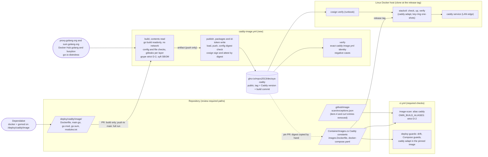

# Architecture note – self-built Caddy edge image from source with the patched Go toolchain (issue #188)

## Context

#188 replaces the stack's edge image, `docker.io/library/caddy:2.11.7-alpine`, with an image we build ourselves:
- Caddy built from source with a pinned, patched Go toolchain;
- on a distroless base with one static BusyBox binary;
- published and signed by its own workflow;
- pinned by digest in `ContainerImages.cs` exactly where the vendor image is pinned today.

It ends ADR-0015 item 4 (the time-boxed `caddy` Go exceptions of #142 and #187, sunset 2026-11-30) and removes the Alpine userland that brought the zlib, OpenSSL and curl findings (#120, #143, #183).

No product module, `*.Contracts` type, Wolverine message, endpoint or tenant data flow changes. The note is not N/A, for three reasons:
- the issue adds a build and publish pipeline whose output the stack runs at its LAN edge;
- it adds a second signing identity;
- it changes what the `image-scan` policy lets through for `caddy`.

- Requirements: G1 skipped (Marco, 2026-10-22); the acceptance criteria are the issue's Done-when (traceability below). G5 writes `docs/requirements/phase-0/self-built-caddy.md`.
- Decision: [ADR-0021](../adr/0021-self-built-caddy-edge-image.md) (Accepted 2026-10-22). It amends ADR-0015 (§2, item 3 scope, item 4 retired), ADR-0017 and ADR-0018 outcome 1, and ADR-0014 item 4 if Marco picks T2. Marco's decisions M1 to M7 are listed there, each with a recommendation.
- Applicable ADRs: 0014 (pins, cooldown), 0015 (scan, both amendments), 0016 (F6: x86-64-v2), 0017 (public packages, signing pattern), 0018 (Compose ownership, literal third-party pins), 0010/0011 (the sandbox image list `images.Dockerfile`).
- Related notes: `deployable-stack.md` (D2, D7, D10), `release-supply-chain.md` (D4, D5), `image-scan-vendor-go-exceptions.md` (item 4, which this issue retires).

## C4 excerpt (build, publish, pin, deploy)

Trust boundaries:
- **New: Go supply chain into the edge image.** The module proxy and checksum database, the builder, BusyBox and distroless images cross into an artifact that runs on the LAN edge. Controls: ADR-0021 items 1 to 3; Go builds execute no dependency code with cgo off.
- **New: a second signer.** `caddy-image.yml` on `main`, separate from `release.yml`, and each identity must reject the other's images (ADR-0021 item 5).
- **Changed: the CI policy for `caddy`.** It becomes strict D-2, with no item 3 and no item 4 (ADR-0021 item 7).
- **Unchanged: merge → deploy.** It gains a `cosign verify` step for `caddy` in the runbook. The item-4 code guard goes away together with item 4.

## Image contract (what the stack uses inside the `caddy` image)

Read from the code on 2026-10-22. The self-built image must keep every row; the applet link set is exactly the union of the "Needs" column.

| Use | Where | Needs from the image |
| --- | --- | --- |
| The edge service | `ComposeStack.cs` (generated Compose), overlay `caddy` service | `caddy` on `PATH` and no `ENTRYPOINT`. The default `CMD` is `caddy run --config /etc/caddy/Caddyfile --adapter caddyfile`. `XDG_DATA_HOME=/data` (the `caddy-data` volume) and `XDG_CONFIG_HOME=/config` (tmpfs). It runs as root with `cap_drop: ALL`, `read_only`, ports 8443 and 8444 (no capability needed). Env also carries `SSL_CERT_FILE=/etc/ssl/certs/ca-certificates.crt` from the distroless base, allowed with exactly that value (Marco, 2026-10-23; ADR-0021 item 4 amendment) |
| Healthcheck | `ComposeStack.cs`: `nc -z` against the loopback address on port 8443 | `nc` with `-z` |
| `caddy adapt` | `stackctl.Runner.caddy_adapt` (`check`, `up`), `deploy/tests/test_caddyfile.py` | `caddy adapt`, with the command overridden (no `ENTRYPOINT`); `--network none --read-only` |
| Key-ring `prepare`, `reset`, `reset --all-keys`, `verify` | `stackctl.keyring_*_argv` (`--entrypoint sh`), the smoke's key-ring probe | `sh` (including `set -eu`, `cd`, functions, `while read`, `$(...)`), `find` (`-xdev`, `-type`, `-name`, `-perm`, `-user`, `-group`, `-exec ... \;`), `chown -h`, `chmod`, `grep` (`-q`, `-i`, `-E`, `-o`, `-c`), `wc -l`, `tr -d`, `rm -f --`, `printf`, `echo`, `[` / `test`. BusyBox is `/usr/bin/busybox` (merged-usr; `/bin/busybox` via `/bin -> usr/bin`); there is no `sleep` applet |
| Root export | `stackctl export-root` (`docker compose cp`), `CaddyRootTrustTests` (`ReadFileAsync`) | `/data/caddy/pki/authorities/local/root.crt`, which follows from `XDG_DATA_HOME=/data`. The copy uses the Docker archive API, so no `tar` is needed inside |
| Trust integration tests | Api and BFF `CaddyRootTrustTests` (Testcontainers) | the default `CMD`, `/etc/caddy/Caddyfile`, the log line `serving initial configuration` |
| Smoke client | `stack_smoke.py client_status` (`--entrypoint wget`, HTTPS to Caddy on internal networks) | `wget` with HTTPS (`--no-check-certificate`, `-S`, `-T`, `-O`, `--post-data`, `--header`). TLS 1.2 or later against Caddy's internal-CA ECDSA leaf |
| Smoke PID 1 check | `stack_smoke.py` (`compose exec caddy cat /proc/1/status`) | `cat` |

Not needed and absent: `curl`, `tar`, a package manager, OpenSSL, zlib, libc, `setcap` file capabilities (both ports are above 1024), `VOLUME` declarations (the overlay mounts both paths), and Caddy's placeholder `index.html`.

Executable regular files: `caddy` and BusyBox, plus the exec bit the distroless base sets on exactly `usr/lib/os-release`, `etc/ssl/certs/ca-certificates.crt`, `usr/share/doc/ca-certificates/copyright` and `etc/update-motd.d/10-uname` (allowed by Marco, 2026-10-23; anything else still fails; re-checked on every base bump; ADR-0021 item 4 amendment).

## Boundaries and contracts

No .NET boundary, `*.Contracts` type or OpenAPI document changes. The contracts are file, pipeline and image contracts.

| Component | Change | PR | Owner (G4) |
| --- | --- | --- | --- |
| `deploy/caddy/image/Dockerfile` (new) | Stages `golang` (builder), `busybox` (applet links prepared in that stage), and distroless (final, `COPY` only). Each `FROM` is `tag@sha256`. Go environment, build flags and the final image as in ADR-0021 items 2 and 4 | 1 | devops |
| `deploy/caddy/image/main.go`, `go.mod`, `go.sum` (new) | `main.go` is Caddy's `cmd/caddy/main.go`. `go.mod` has one direct requirement, `github.com/caddyserver/caddy/v2` at the release, plus annotated overrides (initially `golang.org/x/net` v0.60.0, GO-2026-6603..6613 and 6617, `#188`). G4 writes `go.sum` with `go mod tidy` in the pinned builder, with `GOSUMDB` on | 1 | devops |
| `deploy/caddy/image/modules.txt` (new) | The expected `caddy list-modules` output, generated once from the upstream release binary of the same version (G4 evidence) | 1 | devops |
| `.github/workflows/caddy-image.yml` (new) | Jobs `build`, `publish`, `verify` (ADR-0021 item 5). The workflow is `permissions: {}`, every job declares its own permissions, every `uses:` is SHA-pinned, and there is no `pull_request_target`. Push paths: the image inputs, the workflow and its script. PR paths: those, plus the shared helpers and the pins the build reads | 1 | devops |
| `.github/scripts/caddy_image.py` (new) | Subcommands `build`, `inspect` (config, files, applet set, Go checks, override staleness, `modules.txt`, gitleaks, Grype through `image_scan.evaluate()` without `ref` and `tag_state`, syft), `push`, `sign`, `verify`, `verify-command`. It reuses `release_images.py` helpers (`read_archive`, `unpack_layer`, gitleaks, `cosign_argv`, `verify_flags(identity=…)`, `classify_negative`) **without changing `release.yml` behaviour** | 1 | devops |
| `.github/dependabot.yml` | New `docker` and `gomod` entries for `/deploy/caddy/image` (ADR-0021 item 8). The `/.devcontainer/engine` entry ignores `mpcs2013/decisya-caddy` | 1 | devops |
| `docs/runbooks/caddy-image.md` (new) | Build and publish, package visibility, `verify-command`, the pin procedure, how to bump the Go builder and add or remove an override. Every step is given twice: VS 2026 / VS Code path and CLI path | 1 | devops |
| `.github/scripts/image_scan.py` | `OWN_BUILD_ALIASES = {"caddy": "ghcr.io/mpcs2013/decisya-caddy"}`, a subset of `ALIASES` and disjoint from the release images. For a matching reference, `run()` skips `resolve_tag_state` and calls `evaluate(..., tag_state=None, ref=None)`. **Item 4 removed:** `VENDOR_BINARY_ALIASES`, `MAX_VENDOR_BINARY_EXCEPTION_DAYS`, `VENDOR_BINARY_SUNSET`, `is_vendor_binary_entry`, `vendor_binary_entries`, the item-4 validation and `evaluate()` branches, `RULE_ITEM4` (E1) | 2 | devops |
| `.github/image-scan/exceptions.json` | Remove every `caddy` Go entry (#142/#187) and the `caddy` `curl` entry (#183) | 2 | devops |
| `deploy/compose/stackctl.py` | Remove `vendor_binary_problems` and its calls in `cmd_check` and `cmd_up`, and update the module docstring. No other change: the one-shots, `caddy_adapt` and `pinned_caddy_image` keep reading the `caddy` alias | 2 | devops |
| `src/Decisya.AppHost/ContainerImages.cs` | The `Caddy*` constants become our image, with a comment naming the publish run and the verify result (ADR-0021 item 6) | 2 | platform-dev |
| `.devcontainer/engine/images.Dockerfile` | The same `caddy` line | 2 | devops |
| `deploy/compose/docker-compose.yaml` | Regenerated (drift check) | 2 | devops (or main session) |
| `docs/runbooks/deployable-stack.md` | Step 4: `cosign verify` of the pinned `caddy` reference with the `caddy-image.yml` identity, printed by `caddy_image.py verify-command` | 2 | devops |
| ADR-0015, 0017, 0018 (and 0014 if T2), `deployable-stack.md` D2 | Dated pointer lines to ADR-0021 once Marco accepts it | 2 | architect |

## Decisions

All of these are in ADR-0021, with the rejected options and the reason for each.

- **D1. Build (A1).** A pinned main module, not a git clone at the tag and not xcaddy. The Caddy release tag is cross-checked once by G4: the commit of `refs/tags/vX.Y.Z^{}` from `git ls-remote` must equal `Origin.Hash` in the module proxy's `.info` for that version. G4 records it in the PR. After that, `go.sum` and the checksum database are the pin.
- **D2. Runtime base (B1).** Distroless static plus static BusyBox. CVE-surface trade-off:
  - removed: OpenSSL, zlib, curl, apk-tools, musl and every Alpine package;
  - kept: the BusyBox binary (a shell in the edge container, as today) and Debian `base-files`/`netbase`/`tzdata`/`ca-certificates`;
  - scan accuracy: BusyBox is now matched by binary/CPE rather than Alpine's security database.

  B4 (no shell in the edge container) goes to #83.
- **D3. Pipeline (C1).** Its own workflow and signing identity, with the publish job holding the only write and `id-token` permissions. The package is public under ADR-0017 conditions 1 to 5.
- **D4. Pin.** A literal digest in `ContainerImages.cs`, as for every non-release image. ADR-0018's "third-party image" wording is amended, its mechanism is not, so parity, drift, the Compose literal-image guard, the `caddy` scan alias and `pinned_caddy_image` work unchanged. The pin PR is separate from the build-input PR, because the digest exists only after the publish run.
- **D5. Scan.** Our image gets strict D-2 through `OWN_BUILD_ALIASES`, the release-image semantics. Item 3 must never apply: our tag never moves, so its same-tag proxy would read `unchanged` forever. `BINARY_ONLY_ALIASES` is unchanged, because distroless gives Grype a Debian distro.
- **D6. Item 4 (E1).** Retired in PR-2 together with its entries, the deploy guard and the tripwire. "The deploy guard no longer refuses" then holds by construction.
- **D7. Tracking.** Dependabot `docker` (the Go builder, BusyBox, distroless) and `gomod` (Caddy releases only; module advisories through security updates or annotated overrides). The inputs live under `deploy/`, because Dependabot could not open PRs for `docker` entries under `.github/` (#83, 2026-10-17). Go security releases follow T1 or T2 (Marco, M5).
- **D8. User.** Root without capabilities, as today (M7). The like-for-like swap lets every existing guard and the smoke prove equivalence. Non-root goes to #83.

## NetArchTest rules to add

| Rule | Assemblies | Test class |
| --- | --- | --- |
| N/A: no .NET module, Contracts project or project reference changes. `ContainerImages.cs` changes only constant values, which `ContainerImageParityTests` and `ComposeStackPublishTests` already cover. The new boundaries are pipeline and image boundaries, enforced by the Python and parity tests below. | none | none |

## Enforcement summary

| Boundary or rule | Enforced by | Writer |
| --- | --- | --- |
| Workflow triggers exact; `permissions: {}`; write and `id-token` only in `publish`; no third-party action, Go or `docker build` in `publish`; exact identity, no regexp; negative cases present | `.claude/tests/test_caddy_image_workflow.py` (new). Note (Marco, 2026-10-23, test-location decision option a, recorded in `docs/ai/pipeline/188.md`): now `deploy/tests/test_caddy_image_workflow.py`, run in `deploy-guards` | main session (`.claude/**` is denied to project agents). Since 2026-10-23: devops |
| Every `uses:` SHA-pinned; the Dockerfile's three `FROM` lines are `tag@sha256` | `.claude/tests/test_ci_pins.py` (extended) | main session |
| Go environment (item 2), no `replace`/`exclude`/`retract`/`tool`, one direct requirement, override comment format, `main.go` imports, `COPY`-only final stage, applet set = image contract, `CMD`/`ENV`/no `ENTRYPOINT`/no `VOLUME` | `deploy/tests/test_caddy_image_inputs.py` (new, offline) | devops |
| The applets work in the pinned image: `nc -z` succeeds against a `caddy respond` listener and fails on a closed port; the three key-ring scripts run on a scratch volume with the stackctl argv shape | `deploy/tests/test_caddy_image_tools.py` (new, Docker; runs in `deploy-guards`) | devops |
| Config, files and layers before push; strict D-2; SBOM; `modules.txt`; stale overrides | `caddy_image.py inspect` in the `build` job, with offline fixture tests in `.claude/tests/test_caddy_image.py` (new). Note (Marco, 2026-10-23, test-location decision option a, recorded in `docs/ai/pipeline/188.md`): now `deploy/tests/test_caddy_image_script.py` (the script) and `deploy/tests/test_caddy_image_inputs.py` (the build inputs), run in `deploy-guards` | devops (script), main session (tests). Since 2026-10-23: devops (script and tests) |
| Signature with the exact identity; an unsigned image and the `release.yml` identity fail | `caddy-image.yml` `verify` job | devops |
| `OWN_BUILD_ALIASES` exact; strict D-2 for fixed `deb`, `binary` and `go-module` findings in our `caddy` with `tag_state` `unchanged`; no tag resolution for it; item-4 symbols absent; `release_images.py` still calls `evaluate()` without `ref` | `.claude/tests/test_image_scan.py` (changed: the item-4 tests and the tripwire are removed, new cases added) | main session |
| Item-4 guard gone; `up` and `check` no longer read `exceptions.json` | `deploy/tests/test_stackctl.py` (item-4 cases removed; a case that `cmd_up` makes no `exceptions.json` read) | devops |
| The pin: `ghcr.io`, `mpcs2013/decisya-caddy`, tag `^\d+\.\d+\.\d+-[0-9a-f]{40}$`, equal in `images.Dockerfile` and Compose; no `caddy` exception for `curl` or a Go package | `ContainerImageParityTests` (the docker.io Caddy test and the #183 curl test are replaced) | platform-dev |
| The stack contract on the new image | `deploy-guards` (drift, Compose guards, `test_caddyfile.py` `caddy adapt`), Api and BFF `CaddyRootTrustTests` (Integration), `stack_smoke.py` on a Linux host | existing; G5 and Marco run the smoke |
| No new CVE after publication goes unseen | weekly `image-scan` on the pinned `caddy` | existing |

## Sequencing (before 2026-11-30)

| When (target) | Step | Exit evidence |
| --- | --- | --- |
| by 10-27 | G3 threat delta; Marco decides ADR-0021 (M1 to M7) | ADR status line; manifest |
| by 11-06 | **PR-1 (`Refs #188`)**: build inputs, workflow, script, Dependabot entries, runbook, the tests that need no published image. Every pin used must be past its 7-day cooldown at merge (the Go 1.26.9 image, x/net v0.60.0 and Caddy v2.11.7 already are). | The PR-time `caddy-image` build is green: strict D-2 with no High, `modules.txt` equal, applets present. G4 records the upstream equivalence (`go version -m` of both binaries) |
| merge + 1 day | The push run publishes, signs and verifies. Marco reads the pre-push results, switches the package to public, and runs `cosign verify` locally | Run id, digest and verify output in the manifest |
| by 11-20 | **PR-2 (`Closes #188`, `fix(deploy)`)**: the pin, the scan rule, the item-4 retirement, the exception clean-up, the stackctl and test changes, the runbook step, the ADR pointer lines. The `image-scan`, `deploy-guards` and integration jobs run on the new image; G5 or Marco runs the smoke on a Linux host | Green required checks; smoke report; `image-scan` run id |
| after PR-2 | Marco merges the release PR, so the release tag carries the new pin | Release tag |

- **#187** bridges until PR-2 merges, and PR-2 deletes its entries.
- **If PR-2 slips past 2026-11-30:** `image-scan` goes red under strict D-2 and the tripwire turns red on 12-01. Item 4 cannot be extended without a new ADR amendment and G3. So 11-30 is the hard date, and 11-20 leaves ten days of slack.
- **If Caddy releases a fixed version first:** PR-1 builds that version instead, without the x/net override, and the plan is otherwise unchanged.

## Done-when traceability

| Done-when item | Proof | Where recorded |
| --- | --- | --- |
| An ADR (amending ADR-0015 and/or ADR-0018) records the decision, including how new Go toolchain and Caddy tags are tracked | ADR-0021 Accepted by Marco: Amends line, item 8 (tracking), T1/T2 | `docs/adr/0021-…`, README row, pointer lines |
| The stack's `caddy` image is the self-built, signed image | `ContainerImages.cs`, `images.Dockerfile` and `docker-compose.yaml` carry `ghcr.io/mpcs2013/decisya-caddy:<x.y.z>-<commit>@sha256:…`; the `caddy-image.yml` verify job; Marco's local `cosign verify` | `ContainerImageParityTests`, drift check, manifest (run id, verify output) |
| `image-scan` passes on it with no item-4 entries | PR-2's `image-scan` run is green with `caddy` scanned strictly; `exceptions.json` has no `caddy` Go entry; the item-4 code is gone | `test_image_scan.py`, `ContainerImageParityTests`, run id in the manifest |
| The deploy guard no longer refuses | The guard and its entries are removed (E1); `stackctl up` in the smoke reaches `verify` | `test_stackctl.py`, smoke report |
| The guard tests, `caddy adapt` checks and the smoke test pass on it | `deploy-guards` green on PR-2 (it pulls the new pin); `test_caddy_image_tools.py`; Api and BFF `CaddyRootTrustTests`; `stack_smoke.py` report on a Linux host | CI run ids; smoke report in the manifest |

## Notes for G3, G4 and G5

**G3 (candidate MUSTs, at most five):**
1. The Go environment is fixed in the Dockerfile and asserted by a test: `GOTOOLCHAIN=local`, `GOFLAGS=-mod=readonly`, `GOPROXY` without `direct`, `GOSUMDB` on, the `GONO*`/`GOPRIVATE`/`GOINSECURE` variables empty, and no `replace` directive. A `replace` to a fork or a local path would bypass the checksum database.
2. `publish` runs no Go, no `docker build` and no third-party action. The verify identity is exact, and verify proves both cross-identity negatives (our image under `release.yml`; the unsigned base).
3. `OWN_BUILD_ALIASES` gives strict D-2 with no tag-state call. A test proves that item 3 cannot cover a fixed `deb` finding in our image.
4. ADR-0017 public-package conditions before the first push: per-layer gitleaks, the `ENV` allow-list, no file capabilities, no setuid, and the applet set equal to the contract.
5. The item-4 removal leaves no path that excepts a fixed `go-module` finding. The tripwire is removed only together with the item-4 code, in PR-2.

**G4 must verify, and stop and report if any fails:**
- The chosen `busybox:<x.y.z>-musl` has `nc -z`, and `wget` with HTTPS through BusyBox's own TLS, which completes a handshake with Caddy's internal-CA leaf in the smoke. Fallback: Marco chooses between adding `ssl_client` and OpenSSL back (B2's surface) and moving the smoke client to another pinned image (part of B4).
- Caddy's release build tags and linker flags at the tag. Then `go version -m` of our binary against the upstream release binary: the same modules except the main module, stdlib and the overrides (and what MVS raises with them).
- Whether the runner's default Docker driver can produce the archive that the `release_images.py` load-and-push path expects. If it needs a BuildKit container, its image is pinned in `.github/release/tools.Dockerfile` (exact alias set extended).
- Whether Dependabot bumps the digest of the distroless pin. Record it on the first run. Fallback: the base digest is re-resolved in every pin PR.
- That `go mod tidy -diff` exists in the pinned Go (1.23 and later).
- The run mode is `host` or `sandbox` per the manifest. The issue brings in new third-party content (Go modules), so the sandbox is the recommended mode (ADR-0011). Marco records the choice.

**G5:** traceability in `docs/requirements/phase-0/self-built-caddy.md`, from the Done-when table above to the named tests and run ids. The smoke report and Marco's `cosign verify` are manual evidence, recorded in the manifest.

<!-- gate: G2 | verdict: PASS | issue: #188 -->
