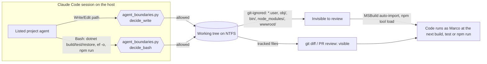

<!-- gate: G3 | verdict: PASS-WITH-NOTES | issue: #218 -->
# Threat delta: deny agent writes to `.user` and `obj` files, case-insensitively (issue #218)

- Scope: the `deny` list in `.claude/boundaries.json`, deny matching in `.claude/hooks/agent_boundaries.py` (`glob_to_regex` :194-203, `decide_write` :206-229, and `_in_lane` :311-314, which reuses `decide_write` for `dotnet ef ... -o`), and the boundary tests (`.claude/tests/test_agent_roster.py` holds `write_decision`; `test_hooks.py` is also fine). This is a delta against `agent-roster.md` (cited as **ar:**) and `npm-install-guard.md` (**ng:**). It is not a full model.
- Mode: G3, before code. Tier full, host run (manifest `docs/ai/pipeline/218.md`). Origin: Norma's N-014, confirmed for Decisya by the main session (manifest facts).
- Reviewer: security-reviewer agent, 2026-10-30. Read, Grep and Glob only (no Bash at this gate), so Windows path behaviour of the Write tool itself was **not** exercised. Where it matters, the mitigation is chosen so that the answer does not matter (fail closed).

## Verdict

**PASS-WITH-NOTES.** The planned change closes N-014 for the paths in the Done-when, and case-insensitive deny with case-sensitive lanes is sound. Two gaps of the same class change the merge decision: Windows name forms that `Path.resolve()` does not fold for a new file (**M2**), and `node_modules/` in the frontend-dev lane (**M3**). With M1 to M4 nothing High or Medium stays open. The rest is SHOULD or backlog #83.

## Data flow

Trust boundaries: TB-a, agent intent to the file system (the hook is the only check on the host, ADR-0011; `host-review.py` covers sandbox runs only); TB-b, git-ignored files to build and tool execution, with no human review in between.

## Answers to the brief

1. **Is the deny list complete?** For git-ignored paths that run code automatically and sit inside a lane, no. `*.user` and `obj/` are covered by the plan. **`node_modules/`** is the same class for JavaScript: git-ignored (`.gitignore:6`), inside the frontend-dev lane `src/Decisya.Web/**`, and loaded on every `npm run dev|build|test|lint` (vite, vitest, eslint and playwright run from it as Marco). An agent can rewrite a file there and nothing shows in `git diff`. This changes the decision (M3). `bin/` and `src/Decisya.Bff/wwwroot/` are git-ignored and in lanes too, but nothing loads them on its own across a rebuild in a way that is clearly exploitable; SHOULD (S1, S2). Tracked auto-imports (`Directory.Build.props|targets|rsp`, `Directory.Packages.props`, nested `nuget.config`, `global.json`, `.editorconfig`/`.globalconfig`, `*.props`/`*.targets` in lanes) appear in the PR diff, so review is the control; backlog B-1. `artifacts/`, `.vs/`, `ops.local/` and `TestResults/` at the root are in no lane, so `boundary.not-in-lane` already denies them. `artifacts/obj/...` (UseArtifactsOutput) is matched by `**/obj/**` in any case.
2. **Case and Windows normalisation.** Case-insensitive deny with case-sensitive lanes only ever blocks more: deny is checked first and a deny match ends the decision, so widening the deny match cannot allow anything new. Python's `re.IGNORECASE` folds at least ASCII case, which is all NTFS folds for `user`, `obj` and `node_modules`. Its extra Unicode folds (for example U+017F to `s`) only add denies. Other forms:
   - **Alternate data streams and trailing dots or spaces: must be handled in #218 (M2).** For a path whose tail does not exist yet, CPython's `ntpath.realpath` resolves the existing prefix and appends the rest as given. So `tests/P/P.csproj.user::$DATA`, `tests/P/P.csproj.user.` and `tests/P/P.csproj.user ` keep their suffix in `rel`, and `**/*.user` (anchored at `.user$`) does not match them. `src/P/obj./x.props`, `src/P/obj /x.props` and `src/P/obj::$INDEX_ALLOCATION/x.props` (when `obj` does not exist yet, as on a fresh clone) escape `**/obj/**` in the same way. If the Write tool passes the path to Windows in Win32 form, NTFS writes the default stream of `P.csproj.user` or strips the dot or space, and MSBuild imports the result. In `\\?\` form the name stays literal and is harmless. That was not verified (no Bash at this gate). A deny on the name form makes the question moot. Today's `/**` deny entries are not affected (`.*` absorbs any suffix). The new suffix-anchored patterns are, which is why this belongs in #218.
   - **8.3 short names: no action.** A short name only refers to an existing file. Existing components are expanded by `resolve()` (final path name), and a new file gets its literal name.
   - **`\\?\` and UNC prefixes: no action beyond a test (S3).** The resolved drive (`\\?\C:` or a UNC share) differs from `ROOT`'s, so `relative_to` raises and `boundary.outside-repo` denies.
   - **Mixed separators: no action.** `Path` folds `\` and `/` on Windows, and `as_posix()` is applied. On Linux CI a backslash is part of a root-level name, which `*.user` still matches.
3. **Does a listed agent need a denied path?** No. No lane names `*.user`, `obj`, `node_modules`, `bin` or `wwwroot`. No agent file (`.claude/agents/*.md`) tells an agent to write them. Build output written through Bash (`dotnet build`, `npm run build`) is not a Write/Edit call and is unaffected.
4. **Bash routes around the Write hook.** They do not change the decision. `dotnet build|test|restore` write `obj/` and `bin/` only from tracked inputs. `-p`/`-property`, `--artifacts-path`, `-o` and `--output` are outside `_DOTNET_ALLOWED`, so an agent cannot redirect intermediate output or set `BaseIntermediateOutputPath`. `dotnet ef ... -o|--output-dir` goes through `_in_lane`, which calls `decide_write`. M1 and M2 therefore apply to it automatically, and M4 pins this. `dotnet format` rewrites tracked files only. `npm run` executes tracked `package.json` scripts (ng:N-06, C2 ask rule).

## Threats

| Id | Element / flow | STRIDE | Threat | Severity | Mitigation | ASVS 5.0 id | Status |
| --- | --- | --- | --- | --- | --- | --- | --- |
| U-01 | Agent → `<project>.csproj.user` (TB-a, TB-b) | T, E | Microsoft.Common targets import `$(MSBuildProjectFullPath).user` on their own. `.gitignore:4` hides it. Code runs as Marco on the next build with no review. Lanes of backend-dev, platform-dev, identity-dev and test-engineer reach all 33 project folders. Root-level `X.user` is also hidden. | Medium | **M1** | V15.2, V8.2 | Mitigated by requirement |
| U-02 | Agent → `obj/<project>.*.props|targets` (TB-a, TB-b) | T, E | MSBuild imports `$(MSBuildProjectExtensionsPath)$(MSBuildProjectFile).*.props` and `.targets` by wildcard. `obj/` is git-ignored (`.gitignore:2`) and survives restore (NuGet adds files and never deletes foreign ones). | Medium | **M1** | V15.2, V8.2 | Mitigated by requirement |
| U-03 | Case variants of a new file | T | `P.csproj.USER` or `src/P/OBJ/x.props` (before `obj` exists) keep their case through `resolve()`. NTFS and MSBuild treat them as the same file. | Medium | **M1** (`re.IGNORECASE` on deny only) | V5.3, V2.2 | Mitigated by requirement |
| U-04 | Windows name forms of a new file | T | `::$DATA`, `::$INDEX_ALLOCATION`, trailing `.` or space (answer 2). They escape suffix-anchored deny globs, and Windows may fold them onto the denied file. | Medium (not verified live; treated as real) | **M2** | V5.3, V2.2 | Mitigated by requirement |
| U-05 | frontend-dev → `src/Decisya.Web/node_modules/**` (TB-b) | T, E | Same class as U-01 for JavaScript: git-ignored, loaded by every `npm run`/`npm test`, invisible in review. ng: accepted agent-written code that runs as Marco (hd:H-1) on the premise that it is **visible** in the diff. This code is not. | Medium | **M3** | V15.2, V8.2 | Mitigated by requirement (scope: see M3) |
| U-06 | Agent → `**/bin/**`, `src/Decisya.Bff/wwwroot/**` | T | Git-ignored. Extra files in `bin/` survive incremental builds (Copy overwrites only what the build produces). `wwwroot/` is served same-origin by the BFF in dev until the next SPA build. | Low | S1, S2 | V15.2 | Open (SHOULD) |
| U-07 | Tracked auto-imports in lanes (nested `Directory.Build.*`, `*.rsp`, `nuget.config`, `.editorconfig`/`.globalconfig`) | T, E | They change build, package sources or analyzer severities. They are visible in the PR diff. `host-review.py` flags them on sandbox runs only. | Low | G6 diff review; B-1 | V15.2, V13.1 | Accepted (review) |
| U-08 | Bash build commands write `obj/`, `bin/` | T | Content derives from tracked inputs. Output-path options are not allow-listed. EF `-o` passes through `decide_write`. | Low | Existing allow-list, plus M1/M2 via `_in_lane`; M4 test | V8.2 | Mitigated |
| U-09 | Over-blocking | D | Case-insensitive deny blocks a legitimate write. | Info | None needed (answer 3) | V8.2 | Accepted |

## Requirements for G4

### MUST (fix-now)

- **M1 – deny globs and case-insensitive deny.** Add `*.user`, `**/*.user`, `obj/**` and `**/obj/**` to `deny`. Give `glob_to_regex` a keyword such as `ignore_case: bool = False`. Pass `True` for deny globs only (`decide_write` :222). Lane matching (:224) stays case-sensitive. Do not lower-case `rel` itself, because the lanes must still see the real case.
- **M2 – Windows name forms denied outright.** In `decide_write`, after `rel` is computed and before the deny check, deny (new rule, e.g. `boundary.windows-name`) when any component of `rel` contains `:`, or ends in `.` or a space. `rel` is relative, so no drive colon can occur, and `.`/`..` components are already collapsed by `resolve()`. Make the check a pure string test so it behaves the same on Windows and on Linux CI. Do not try to normalise the forms. Denial is simpler and fails closed.
- **M3 – `node_modules`.** Add `node_modules/**` and `**/node_modules/**` to `deny` (case-insensitive via M1). This is outside the issue title, but it uses the same file, the same mechanism and adds one test row. It is a Medium, so it is reported now rather than parked in #83. If Marco prefers to keep #218 to its title, open its own issue at once and merge it next. Recommendation: include it in #218. Risk: none to agents (no lane or instruction needs it). Vite's cache (`node_modules/.vite`) is written by `npm run` through Bash, which the Write hook does not see.
- **M4 – tests** (in the existing `write_decision` style; nothing written to disk):
  - Denied, for every listed agent whose lane reaches the path, at minimum test-engineer and backend-dev: `tests/
/
.csproj.user`, `tests/
/
.CSPROJ.USER`, `X.user`, `X.USER`, `src/
/obj/x.props`, `src/
/OBJ/x.props`, `src/
/Obj/
.csproj.x.targets`.
  - Denied by M2: `tests/
/
.csproj.user::$DATA`, `tests/
/
.csproj.user.`, `tests/
/
.csproj.user ` (trailing space), `src/
/obj./x.props`, `src/
/obj::$INDEX_ALLOCATION/x.props`.
  - Denied by M3 for frontend-dev: `src/Decisya.Web/node_modules/vite/x.js` and its `Node_Modules` variant.
  - EF output: `dotnet ef migrations add X -p src/Modules/<M>/<proj> -o obj` (backend-dev) is denied through `_in_lane`.
  - Regression: the existing `LaneTests` rows and `test_never_in_any_lane` pass unchanged. Add a unit test that `glob_to_regex("src/Decisya.Api/**")` (default) does not match `SRC/Decisya.Api/x.cs`, and that the deny form matches `X.CsProj.User`. Do not write a test that resolves a case-variant lane path end to end: on Windows `resolve()` folds existing folders and on Linux it does not, so the result would depend on the platform.

### SHOULD (fix-now if it fits the same edit; else #83)

- **S1** Deny `bin/**` and `**/bin/**` (git-ignored, no lane needs it).
- **S2** Deny `src/Decisya.Bff/wwwroot/**` (Vite output, git-ignored, in the identity-dev lane).
- **S3** Add a test that a `\\?\`-prefixed or UNC path for an in-repo file is denied (`boundary.outside-repo`), so that answer 2 is pinned.

### Backlog (#83)

- **B-1** A lint check or G6 checklist item that flags new nested `Directory.Build.*`, `Directory.Packages.props`, `*.rsp`, `nuget.config`, `global.json` and `.editorconfig`/`.globalconfig` inside agent lanes on host runs. `host-review.py` does this for sandbox runs only.
- **B-2** `**/.env` and `**/.env.*` in lanes (Vite auto-loads `src/Decisya.Web/.env*`; an agent write could also overwrite Marco's file). This needs a glob exception for the tracked `.env.example`, which the glob language lacks.
- **B-3** `host-review.py:188` matches `bin|obj|artifacts` case-sensitively (the `.user` check at :186 already lower-cases). This is a sandbox path only.
- **B-4** `**/__pycache__/**` and `*.pyc` under `.devcontainer/**` (devops lane). Low: the Write tool emits UTF-8 text, so it cannot easily produce a valid pyc header.
