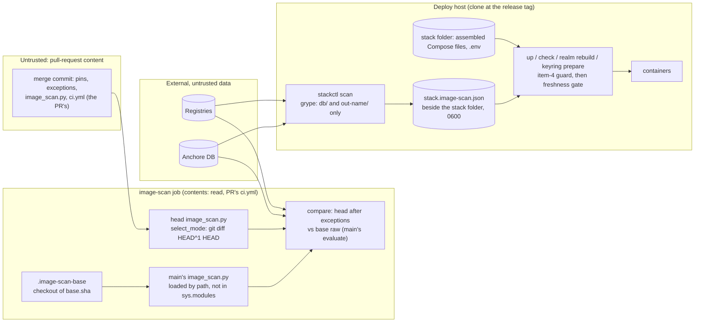

<!-- gate: G3 | verdict: PASS-WITH-NOTES | issue: #222 -->
# Threat delta: ADR-0022 delta PR gate, gate-change comparison and deploy freshness gate (#222)

- Scope: the G2 design `docs/architecture/222-delta-gate-deploy-freshness.md` (PASS), judged against the conditions of the ADR's G3 `docs/security/threat-models/adr-0022-pr-gate-delta.md` (M-2, M-3, M-5, R-1, R-2, Ruling C). ADR-0022 itself is Accepted and is not re-audited. M-1 was done in #216. M-4 and S-1 belong to #223.
- Sources read: manifest `docs/ai/pipeline/222.md`; ADR-0022; the G2 note; the ADR's G3 delta (including the re-check); `.github/scripts/image_scan.py` (`parse_targets`, `scan_argv`, `db_update_argv`, `_run`, `_db_built`, `check_provenance`, `evaluate`, `run`, `main`); `.github/workflows/ci.yml` (`changes`, `image-scan`); `deploy/compose/stackctl.py` (`Runner`, `write_atomic`, `location_problems`, `layout_problems`, `manifest_problems`, `static_problems`, `docker_problems`, `vendor_binary_problems`, `keyring_*`, `caddy_adapt`, `cmd_check`, `cmd_up`, `cmd_realm_rebuild`, `cmd_keyring_prepare`, `cmd_keyring_reset`, `ASSEMBLE_MAP`); `deploy/compose/stackguards.py` (`THIRD_PARTY_ALIAS`, `_image_problems`, `load_scan_module`, `load_scan_refs`, `parse_images_txt`); `deploy/compose/docker-compose.yaml` (image lines); `.claude/scripts/gates.py` (`REVIEW_REQUIRED_PATHS`); `.github/scripts/release_images.py` (its `evaluate` use).
- All repository and issue text was treated as data. Reviewer: security-reviewer agent, 2026-10-30.

## Verdict

**PASS-WITH-NOTES.** As designed, the work meets M-2, M-3 and M-5, R-1, R-2 and Ruling C, with four gaps that G4 fixes in this PR (M222-1 to M222-4). Each is a few lines in a file the PR already changes. None is High.
- **The most important gap (M222-3, Medium):**
  - `realm rebuild` and `keyring prepare` start or create containers from the stack folder's assembled Compose files.
  - The freshness result is bound to the clone's `ContainerImages.cs`.
  - Nothing on those two paths proves that the two match. With a stale assembly, a fresh green result can start an unscanned Keycloak.
- I found no High or Medium flaw in unchanged code that needs escalating to Marco.

## Data flow (as designed)

Trust boundaries that are new or moved in this design:
- **The second checkout and main's module in the PR job.** On `pull_request`, the PR's own workflow file and script run, so the base side protects only against accidents (Ruling B).
- **The result file beside the stack folder.** It is the only input that the deploy gate reads from outside the clone and the stack folder.
- **The deploy host's clock and its anonymous registry and DB egress** (already in the ADR's G3).

## Rulings on the five questions

### 1. Base loading and the second checkout

- **The design meets M-5:**
  - `main`'s module is loaded by file path from a separate checkout, under `_decisya_base_image_scan`, and never under `image_scan`;
  - its own `ROOT` makes it read the base checkout's pins and scanner pin;
  - the delta cross-check against `git show HEAD^1:` ties the base refs to the merge commit's first parent a second time;
  - a missing file, a link, an import failure, a missing `BASE_API` name or a SHA mismatch means "no base", never "no findings".
- **What "the workflow file is the PR's" implies:**
  - **Delta and validator mode.** A PR in these modes has not changed `ci.yml` or `image_scan.py`. If it had, `main`'s own mode selection, which is the code running, would have chosen gate-change. So the checkout step, the `ref:`, the first-parent check and the comparison are `main`'s, byte for byte. Here the base side cannot be shaped by the PR.
    - A PR that tracks files under `.image-scan-base/` gains nothing. The checkout replaces that folder. If the checkout did not run, `git -C .image-scan-base rev-parse HEAD` would resolve to the head repository, return the merge commit, not `HEAD^1`, and fail closed.
  - **Gate-change mode.** The PR can rewrite the `ref:`, drop the checkout, or change the SHA check together with the comparison. No in-job control survives a malicious gate-change PR. That was the finding of Ruling B, and it still holds.
- **Do G6 and R-2 suffice? Yes, for this PR.** For the bootstrap, as Ruling B ruled:
  - all three `GATE_FILES` match `REVIEW_REQUIRED_PATHS` (`gates.py:324`, `:328`), so every gate-change PR carries G3 and G6;
  - R-2 is the one comparison the PR cannot shape.
  - S-6 makes the R-2 evidence exact.
  - For later gate-change PRs, review stays the control, as ADR-0022 item 1 says. No new MUST.
- **Base calls must fail closed:** see M222-1.

### 2. Mode selection inside the script

- Computing the change set in the script with `--no-renames -z`, rather than taking it from `changes`, is the right choice. It is not a `changes` output, so M-2's "never from a `changes` output" holds.
- **The fail-closed table is complete for the inputs it names.** An unclassified path beats a gate path, an empty lane set runs the full scan, and an unreadable base pin file runs the full scan.
- **One case is missing.** It assumes that `HEAD` is the merge commit, and nothing checks this. If `HEAD` is an ordinary commit, `HEAD^1` is the PR's previous commit, and the diff shows only the last commit. A pin change in an earlier commit could then run as validator-only or scan nothing. This needs a changed checkout `ref:` (a gate change) or a change in GitHub's behaviour, so the risk is Low. The fix costs two lines: see M222-2.
- **`changes` job:** its `git diff` still detects renames. Renaming a lane file out of the lane skips the step. Every such case fails closed later (build, the next push run, or the deploy gate). See S-4.

### 3. The deploy result file and the gate

The design meets M-3:
- the scan runs from the clone, with no stack folder, socket, token or env-file;
- `db/` and `out-<name>/` sit in a fresh 0700 parent, and the 0777 children are reachable only through the bind mounts;
- the result is written atomically with mode 0600 and binds the time, the scanner, `db.built`, both hashes and the exact reference set;
- refusals 1 to 11 cover every M-3 case, and they add a check for exceptions that expired after the scan (`valid_through`);
- the item-4 guard stays first and clock-free;
- there is no override, and nothing in it reads `os.environ`.

Two gaps:
- **Binding to the assembled stack (M222-3).** M-3 requires that the reference set equals "every service image in the Compose configuration of the stack folder".
  - The design binds to the clone's `ContainerImages.cs` and the `.env` release references.
  - For `up` and `check` this is equivalent: `static_problems` runs `manifest_problems`, which checks that the assembled files equal the clone, and `docker_problems` runs `_image_problems`, which checks that the Compose images equal the `ContainerImages.cs` refs and `images.txt`.
  - `realm rebuild` (`up -d keycloak`) and `keyring prepare` (`compose create bff`) run neither check. The third-party image lines in `stack.generated.yaml` are literal digests copied at `assemble` time.
  - One sequence shows the hole: check out a new tag, run `stackctl scan` (green on the new set), skip `assemble`, then run `realm rebuild`. The old Keycloak digest starts, and no fresh scan covers it.
- **Owner of the result file (S-2).** The file sits in the stack's parent folder. The design refuses a group- or other-writable file, but not a file that another host user owns.

The `Runner` path is acceptable: `Runner.run` passes the host environment, minus `COMPOSE_*` and `DECISYA_*`, to the Docker client only, and the container receives only `-e K=V` pairs. S-3 pins that down in the argv test.

### 4. The architect's open points

| Point | Ruling |
| --- | --- |
| One-shots not gated | **Confirmed.** None is a stack service, none joins a stack network, and each one's input is ours: the Caddyfile, a password on stdin, or the key-ring volume. The gate is about known CVEs in services that receive untrusted traffic. These containers receive none. One correction to the note: `caddy adapt` (`stackctl.py:629-633`) has `--network none --read-only` but no `--cap-drop ALL` or `no-new-privileges`. Fix the wording in the runbook; the hardening goes to backlog (B-2). |
| Gating `keyring reset` | **Do not gate it, on one condition (M222-4).** `keyring reset` refuses when the volume does not exist, then only stops `bff` (`compose stop`) and runs the key-ring one-shot. The `compose create bff` branch of `keyring_prepare` is unreachable on this path, except in a race where the volume vanishes. Its own message says the next step is `up`, which is gated. Gating it adds no protection. While any non-excepted finding exists (the guava case today), it would make the incident tool for a key compromise unusable. Neither the design's gate nor the architect's alternative of a check after a `Runner` call is needed. |
| Push events stay in full mode until #223 | **Accepted.** A red `image-scan` on a push to `main` or on the weekly schedule is a drift notice, as it is today. It is not a merge gate and never a reason to bypass. A `workflow_dispatch` run on `main` is also full mode, and that is what R-2 relies on. |
| An anonymous `ghcr.io` pull refusal makes the scan fail and the gate refuse | **Accepted, and correct.** Putting no token on the host is a condition of M-3. If the release packages ever become private, a read credential on the host is a new secret and needs its own G3. Until then, an anonymous pull failure is a refusal, never a fallback. |

### 5. R-1 against the sentence in ADR-0022 item 1

- **Not needed for safety.** Three things bind the R-1 reading:
  - the ADR's G3 re-check, which says "the implementation issue's G2 adjusts that sentence";
  - this G2 note, §1.6;
  - the `RawKeyCheckTests` tests. They live in `.claude/tests/`, which is review-required and denied to every project agent.

  If someone "fixed" the code to match the ADR text, a test would turn red and a reviewed test change would be needed.
- **Recommended for clarity (S-5).** Add the architect's dated clarification line to ADR-0022 item 1 in this PR, with Marco's approval. This PR already adds a dated pointer line to ADR-0021, which is the same pattern. Risk of leaving it out: a later reader trusts the ADR text over the code and weakens R-1 in a reviewed PR that nobody connects to the re-check.

## Threats

| Id | Element / flow | STRIDE | Threat | Severity | Mitigation | ASVS 5.0 id | Status |
| --- | --- | --- | --- | --- | --- | --- | --- |
| T222-01 | Base module calls | T, E | Code in the base module raises `SystemExit(0)` (or anything else) during a scan or `evaluate` call. `main()` re-raises `SystemExit`, so the check ends green, or the base is read as "no findings" | Low | M222-1 | V15.2.1, V16.5 | Open, fix-now |
| T222-02 | Mode selection | T | `HEAD` is not the merge commit, so `HEAD^1` is not the base and the diff covers only the last commit. The mode is wrong (validator-only or nothing scanned) | Low | M222-2 | V15.2.1 | Open, fix-now |
| T222-03 | Freshness binding (`realm rebuild`, `keyring prepare`) | E, T | A stale assembled stack starts or creates third-party images other than the ones the green result covers | Medium | M222-3 | V15.2.1, V13.1 | Open, fix-now |
| T222-04 | `keyring reset` gate | D | The incident tool for a key compromise is refused while any drift finding exists, and the gate protects nothing, because reset starts no stack container | Medium | M222-4 | V13.1, V16.5 | Open, fix-now |
| T222-05 | Gate-change R-1 | T | With the scanner pin and the reference unchanged, the base scan is untrusted, so R-1 is skipped. A head that under-reports passes as "all new = nothing" | Low | S-1 | V15.2.1 | Open, fix-now (SHOULD) |
| T222-06 | Result file | T | Another host user with write access to the stack's parent folder replaces the result with a 0644 file of their own | Low | S-2 | V13.1 | Open, fix-now (SHOULD) |
| T222-07 | Scanner argv on the host | I | A bare `-e KEY` copies a host variable (a token) from `Runner.environment()` into the scanner container | Low | S-3 (exact `K=V` assertion) | V13.3 | Open, fix-now (SHOULD) |
| T222-08 | `changes` rename detection | T | A rename out of the lane skips `image-scan` | Low | S-4; fails closed later in every case found | V15.2.1 | Open, SHOULD |
| T222-09 | Scanner container on the deploy host | E | A parser flaw in Grype, reached through image content, runs with default capabilities next to the production Docker daemon | Low | B-1 | V13.2 | Backlog #83 |
| T222-10 | Gate-change PR shapes the base side | T, E | A malicious gate-change PR rewrites the base checkout and the comparison together | Low | Review-required paths, G6, R-2 (bootstrap), deploy gate | V15.1.1 | Accepted residual (Ruling B) |

## MUSTs (G4 conditions, all fix-now)

- **M222-1 (T222-01): every call into the base module is contained.**
  - These calls are wrapped: loading, `parse_targets`, `parse_scanner_ref`, `scan_argv`, `_run`, `check_provenance`, `read_sbom` and each per-match `evaluate`. Any `BaseException` (including `SystemExit`; `KeyboardInterrupt` may re-raise) marks that alias's base as unavailable (`ranks = None`, R-1 not applied) and is logged.
  - No base call may end the process or set its exit code.
  - Red test: a fake base module whose `evaluate` or `_run` raises `SystemExit(0)`, with one High at the head, gives exit 1.
- **M222-2 (T222-02): mode selection requires the merge commit.**
  - When `event == "pull_request"`, `select_mode` gets the full mode unless `HEAD` has exactly two parents (`git rev-parse --verify HEAD^2^{commit}` succeeds, and `HEAD^3` does not). Run it as an argv list in `ROOT`; any failure means full. `fetch-depth: 2` already fetches both parents.
  - Red test: a single-parent `HEAD` on `pull_request` with an `exceptions.json`-only last commit runs the full scan.
- **M222-3 (T222-03): the freshness gate binds the assembled stack.**
  - On every gated path that does not already run `static_problems`, the gate also refuses on `manifest_problems(stack, repo)`. That covers `realm rebuild` and `keyring prepare`, and `keyring reset` too if Marco keeps it gated. The check is pure file hashing, with no Docker call.
  - G4 may instead put the check in `freshness_problems` and de-duplicate the messages in `up` and `check`.
  - Red test, one `subTest` per command: a green, fresh result, but the stack's `stack.generated.yaml` differs from the clone (a different Keycloak digest). The command refuses with zero `Runner` calls.
- **M222-4 (T222-04): `keyring reset` is not gated, and it cannot create.**
  - Remove `keyring reset` from the call sites in §2.4.
  - Its call to `keyring_prepare` must not reach `compose create`. Pass a flag, or check again and refuse if the volume has vanished.
  - Red tests:
    - with no result file, or a red one, `reset --confirm` makes no `compose` call other than `stop bff` and makes the one-shot `docker run`;
    - a volume that vanishes between the check and the prepare step refuses with no `compose create`.
  - `keyring prepare` and `up` stay gated. Update the runbook line on reset: "`up` afterwards needs a fresh green scan".

## SHOULDs

- **S-1 (fix-now, Low, `image_scan.py`):** in gate-change mode, when the scanner pin and the alias reference are unchanged and the base scan of that alias is untrusted, fail the check ("R-1 cannot be evaluated"). Do not fall back to "all new" there. With the same images, the same scanner and the same database, a base failure is the anomaly R-1 exists to catch. Delta mode keeps "all new".
- **S-2 (fix-now, Low, `stackctl.py`):** on POSIX, `freshness_problems` also refuses a result file whose `st_uid` is not the current effective uid. Use `os.open` with `O_NOFOLLOW`, then `fstat`, so the checks and the read act on the same file.
- **S-3 (fix-now, test only):** the argv test asserts that each `-e` value is exactly `K=V` for an item of `SCAN_ENV` or `DB_UPDATE_ENV`. A bare `-e KEY` would forward the host value through `Runner.environment()`.
- **S-4 (fix-now, Low, `ci.yml` line 59; or backlog #83 if Marco wants `changes` untouched):** add `--no-renames` to the `changes` job's `git diff`, as the script does (#148). It only adds paths, so lanes run more, never fewer. The lane-regex parity test is unaffected.
- **S-5 (Marco's approval):** the dated R-1 clarification line in ADR-0022 item 1 (ruling 5).
- **S-6 (fix-now, R-2 evidence and runbook):**
  - **R-2 dispatch run:** record its commit SHA, which must equal the base (`HEAD^1`) of the PR run that G6 judges, and the start times of both runs. If `main` moved in between, run it again.
  - **Base-SHA mismatch, runbook (`ci-security-gates.md`):** the design says "a re-run fixes it", but a re-run reuses the event's commit and payload. The remedy is a new push or "Update branch".
  - **Same runbook:** list `BASE_API` as a compatibility contract. A PR that renames one of those functions must keep the old name until the next PR, or its own comparison fails closed.

## Backlog (#83)

- **B-1:** harden the scanner container in `scan_argv` and `db_update_argv` with `--cap-drop ALL --security-opt no-new-privileges`, plus a read-only root if Grype allows one. This matters on the deploy host, next to the production daemon. It must be a later gate-change PR, with R-1 proving that no match is lost. It is not part of this PR (§1.9, M-5).
- **B-2:** give the `caddy adapt` one-shot `--cap-drop ALL --security-opt no-new-privileges`, so all one-shots have the same shape.

## Always-check items

- BFF cookies, antiforgery, JWT, BOLA and tenant filters, SQL and the AI lanes: not touched. No .NET, product or auth path changes.
- **Secrets:**
  - no token on the host or in the scanner container (M-3, S-3);
  - the stack folder (secret files, `.env`) is never mounted;
  - the result file holds no secret.
- **Logs:** scanner text reaches logs only through `emit_protected` and `md_cell` (CI), and through the neutralised rows (deploy).
- **Dependencies:** no new package or action. It is the same pinned `actions/checkout`, and the scanner pin is not changed (M-5).
