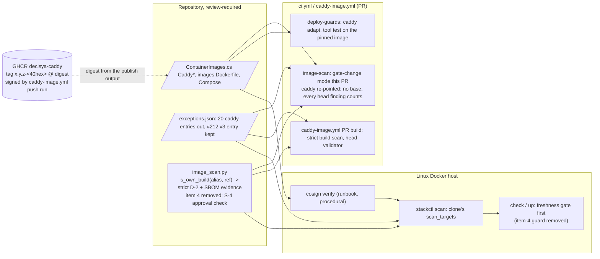

<!-- gate: G3 | verdict: PASS-WITH-NOTES | issue: #225 -->
# Threat delta: switch the stack to the self-built Caddy image and retire ADR-0015 item 4 (issue #225)

- Date: 2026-10-31. Reviewer: security-reviewer (G3, Full tier), before G4.
- Scope: only the G2 design `docs/architecture/225-caddy-switch.md` (PASS). It re-points `caddy`, adds `OWN_BUILD_ALIASES` with SBOM evidence, retires item 4 with its entries, guard and tripwire, keeps the #212 go-jose v3 entry, and adds S-4 and the Docker tool test. No product module, endpoint, token, cookie, tenant flow or SQL changes, so BOLA, tenant filters, validation, JWT validation and the AI lanes are not re-audited.
- Inputs, all read as data: the manifest `docs/ai/pipeline/225.md` (facts, scan and SBOM facts, Marco's statements); the G2 note; the #188 G3 `self-built-caddy.md` (M-2 e and f, M-3 a to e, S-4, S-10); `docs/ai/pipeline/188.md`; ADR-0021 (items 6 and 7, E1); ADR-0015 item 4; ADR-0022; the #222 G3 `222-delta-gate-deploy-freshness.md`. Code read: `.github/scripts/image_scan.py` (`check_provenance`, `check_binary_sbom`, `_sbom_go_components`, `evaluate`, `_keeps_fixed_exception`, the item-4 symbols, `scan_targets`, `compare_alias`, `select_mode`, `BASE_API`); `.github/scripts/caddy_image.py` (`check_sbom`, `cmd_inspect`); `.github/scripts/release_images.py` (`_grype`'s `evaluate` call); `deploy/compose/stackctl.py` (`vendor_binary_problems`, `SCAN_STRICT`, `_valid_through`, `cmd_scan`, `cmd_check`, `cmd_up`); `deploy/compose/stackguards.py` (`scan_result_problems`, `load_scan_module`); `.github/image-scan/exceptions.json`.
- The earlier, interrupted G3 run's preliminary findings were treated as data. I re-derived each one from the code. Where I adopt one, the evidence is cited below.
- Ids: T225-xx (threats), M225-1 to M225-4 (MUSTs, all fix-now), S225-x (SHOULDs), B-x (backlog #83). Reused: T188-xx, M-2, M-3, S-4, S-10 (#188 G3).
- ASVS 5.0 at section level, as in the earlier deployment models: V15.1 and V15.2 (architecture, dependencies), V13.1 (configuration), V16.5 (error handling, fail closed).
- No address, subnet or host name appears below as a literal.
- I found no High or Medium in unchanged code to escalate.

## Verdict

**PASS-WITH-NOTES.** No High. The design meets the #188 G3 obligations in shape. Retiring item 4 is a net tightening for `caddy`: strict D-2 for every package type, plus binary evidence, in place of a 14-day carve-out for fixed Go findings. It weakens nothing for the other aliases. Four MUSTs, all fix-now, make sure G4 implements the design exactly where it is easiest to get it subtly wrong:

1. **M225-1.** The own-build SBOM evidence must match exactly and component by component. Do not copy `caddy_image.py:745`'s `startswith`.
2. **M225-2.** One predicate makes the own-build decision inside the shared functions. Callers never make it.
3. **M225-3.** The retirement includes every consumer of the removed symbols in the same commit, `stackctl._valid_through` in particular.
4. **M225-4.** The PR's evidence: both CI scans green, the mode stated, and M-2 e recorded.

The design's deviation from #188 M-3 b's wording, reading the Caddy version from the pinned tag instead of `go.mod`, is **accepted** (section 2).

## Data flow and trust boundaries (delta)

- **TB-C, the CI and deploy policy for `caddy` (changed).** Strict D-2 with binary evidence replaces item 3 and item 4 for the own-build reference. Code paths that decide it: `check_provenance`, `scan_targets` (CI full scan and `stackctl scan`) and `compare_alias` (delta and gate-change). The release path (`release_images._grype`, `caddy_image.py inspect`) already calls `evaluate` without `tag_state` or `ref`.
- **TB-D, merge to deploy (changed).** The presence-keyed item-4 refusal in `check`/`up` goes. The ADR-0022 freshness gate becomes the first step. It is bound to the clone's `exceptions.json` and `image_scan.py` hashes and holds every excepted row to its `valid_through`.
- **Unchanged:** `BINARY_ONLY_ALIASES`, `_keeps_fixed_exception`, `BASE_API`, the release path, the stack contract.

## Analysis

### 1. Own-build evidence (M-3 b): sound design, two implementation traps (M225-1)

- **What the code does today.** `check_binary_sbom` (`image_scan.py:514`) checks:
  - the container component's name and version against the pinned registry/image and tag;
  - that some go-module component exists;
  - that **at least one** go-module layer is in `source.target.layers`;
  - that every JSON go-module match has an SBOM purl.

  `_sbom_go_components` returns purls and layer ids **in aggregate** (`:491`). With those helpers alone, "the Caddy and stdlib components, each in a listed layer" (G2) cannot be checked. A per-component check is needed.
- **The prefix trap.** `caddy_image.py:745` tests the Caddy purl with `startswith(f"pkg:golang/{CADDY_MODULE}@v{version}")`, so `v2.11.7` also accepts `v2.11.70` or `v2.11.7-rc.1`. In `inspect` that is harmless, because `cmd_inspect` binds the binary's real Caddy version exactly through `go version -m` (`:831`). In `image_scan.py`, the SBOM purl is the **only** version binding between the pinned tag and the scanned binary. A prefix match there would let a tag and a binary disagree while the scan reads as trusted (T225-01). G4 must not copy that line.
- **Evidence that the design can pass.** The manifest's main-session scan of the published digest shows:
  - `pkg:golang/github.com/caddyserver/caddy/v2@v2.11.7` and `pkg:golang/stdlib@1.26.10` are both present;
  - both are in a layer of the 16-layer `source.target.layers`;
  - the container component is `ghcr.io/mpcs2013/decisya-caddy` at the pinned tag.

  The exact check therefore passes on the real image.

### 2. The Caddy version from the pinned tag: accepted

- The scan pulls by digest. The SBOM container version is the tag, and the existing check compares it with the pinned tag. M225-1 then requires the binary's catalogued Caddy purl to equal the tag's `x.y.z` exactly. A tag whose version does not match the binary in that digest makes the scan untrusted, so the tag is checked against the bytes and is not merely trusted.
- The link to `go.mod` already exists twice:
  - `cmd_inspect` binds the binary to `go.mod` before the push (`:831`);
  - the signature's `--certificate-github-workflow-sha` binds the digest to the commit named in the tag (M-2 d).
- A `go.mod`-derived version would mark the still-pinned image untrusted during every two-PR Caddy bump, both at the head and on the base side of a later delta (the base module scans the old reference). That would be a standing red, which pushes toward an override. The tag is the better source. A tag that does not fullmatch `^(\d+\.\d+\.\d+)-[0-9a-f]{40}$` is untrusted, so the check fails closed.

### 3. One decision point (M-3 c): adopt as M225-2

- `scan_targets` (`:761`) decides strictness from a caller-supplied `strict` set. `stackctl` passes `SCAN_STRICT` = the release services (`stackctl.py:985`), and `run()` passes `frozenset()` (`:1156`). `compare_alias` (`:1022`) has no strict parameter and always resolves the tag state.
- If own-build strictness came from callers adding `caddy` to `strict`:
  - `compare_alias` would miss it;
  - `stackctl scan`, which loads the clone's module (`stackguards.load_scan_module`), would need its own edit;
  - the alias name, not the reference, would decide.

  Our tag never moves, so item 3 would then read it as `unchanged` forever (T120-19). A fixed `deb` finding with an active `caddy` entry would be excepted on whichever path missed the rule (T225-02).
- The decision belongs inside `scan_targets`, `compare_alias` and `check_provenance`, from one `is_own_build(alias, ref)` predicate, as G2 section 1 says.

### 4. Retiring item 4 (M-3 d): weakens nothing else, but has dangling consumers (M225-3)

- **Other aliases.** `_keeps_vendor_binary_exception` applies only to `VENDOR_BINARY_ALIASES` (`caddy`) and `go-module` findings (`:614-636`). With it gone, the only fixed-finding path left is `_keeps_fixed_exception`: OS package types, a span of 30 days or less, and tag state `unchanged` (`:601-611`). That path is unchanged, and for an own-build reference it receives no tag state. Nothing widens for postgres, keycloak, redis or otelcollector. `release_images._grype` calls `ims.evaluate(doc, name, entries, today)` without `ref` (`release_images.py:561`), so removing the parameter is safe. `BASE_API` names no removed symbol, and `base_ranks` never passes `ref`.
- **Consumers that break if they are left behind** (verified):
  - `stackctl._valid_through` reads `scan.RULE_ITEM4` and `scan.VENDOR_BINARY_SUNSET` on **every** excepted row (`stackctl.py:1128-1129`). After the retirement, entry 21 makes an excepted `caddy` row, so `stackctl scan` would raise `AttributeError` outside its handlers. The result fails closed, since there is no result file and no start, but the deploy path is broken.
  - `cmd_check` (`:1440`) and `cmd_up` (`:1586`) call `vendor_binary_problems`, which calls `scan.vendor_binary_entries`. That raises `AttributeError`, which is caught, and becomes a permanent refusal (`:969-970`).
  - `scan_targets` (`:770`) and `compare_alias` (`:1027`) pass `ref=ref` to `evaluate`. Once the parameter goes, they raise `TypeError`.
- **Fail-closed behaviour after removal.** `vendor_binary_problems` also refused on an invalid `exceptions.json`. That property survives:
  - `cmd_scan` refuses to scan an invalid file (`:1152-1153`), so no result exists;
  - `scan_result_problems` refuses when the file's hash changed since the scan (`stackguards.py:1790`);
  - `freshness_problems` turns any exception into a refusal (`:1085-1086`).

  Nothing is lost.

### 5. The kept #212 go-jose v3 entry: acceptable

- It is class (b) (#212 G3 ruling 1, not reachable), `not-fixed`, 14 days, with one `approved by Marco 2026-10-29` dated on `added` (`exceptions.json:310-318`). It passes S-4 as designed and the 30-day bound for `caddy`. Strict D-2 can except only a finding without a fix, which ADR-0021 item 7 allows.
- **At deploy** the presence-keyed refusal becomes "honoured until `valid_through` 2026-11-12". `scan_result_problems` refuses once that date passes (`stackguards.py:1836-1845`). This is a deliberate relaxation against today's guard, and it is the ADR-0021 item 7 behaviour. Today the Keycloak guava finding refuses `check` and `up` anyway (manifest). Low, accepted (T225-04).
- **Wording edit (Marco approved, manifest).** The G2 replacement text contains "approved under", not a second "approved by Marco", so S-4 still finds exactly one approval. G6 checks that exactly one remains.
- The void-at-once conditions are prose only. Admin `disabled` and `tls internal` are already asserted on the adapted config (`deploy/tests/test_caddyfile.py`). `acme_server`, a non-local `pki` CA and a JWS/JWKS-verifying module are not. Backlog (S225-1).

### 6. This PR's CI evidence: gate-change bootstrap (M225-4)

- `image_scan.py` is in `GATE_FILES` (`:51`), so `select_mode` returns `gate-change` (`:831-832`), not the "delta" the Done-when line names.
- `caddy` is re-pointed, so `same_repository` is false and the comparison gets no base: `ranks` is None, and every head High or Critical without an active exception is a FAIL (`:1036-1037`, `:988-990`). That is stricter than delta.
- The other four aliases are scanned at both sides with main's module. R-1 and #222 S-1 apply to them (`:1054-1057`, `:1070-1073`), and a missing base module fails the run (`:1169-1170`). Main's module exports `BASE_API` today.
- The `caddy-image.yml` PR build loads the head's `validate_exceptions` (`caddy_image.py:768`) and runs the strict build scan with the `caddy` entries. Its green result is independent evidence that S-4 and entry 21 hold on the build path.

### 7. Process gaps carried from #188

- **M-2 f (T188-11, Low).** No date for the visibility change is recorded, and no record shows the pre-push results were read first. Marco's statement is in the manifest ("for now, it's fine. we are still on phase-0"). The substance is covered: the publish run's build job ran the per-layer gitleaks, the `ENV` allow-list and the file checks, and `publish` needs it green. Only the human record is missing. It does not change the merge decision. Noted, not a MUST.
- **M-2 e** is still owed. Marco's local `cosign verify` output (shape only) and the verify job's result must be in the manifest before G6 (M225-4).
- **S-10** (`stackctl up` runs `cosign verify` itself) stays in backlog #83. The runbook step is procedural. For an edge image with no signature check today, that is not a regression.

## Threats

| Id | Element / flow | STRIDE | Threat | Severity | Mitigation | ASVS 5.0 id | Status |
| --- | --- | --- | --- | --- | --- | --- | --- |
| T225-01 | TB-C own-build evidence | T, I | The scan reads as trusted while the binary's Caddy version differs from the tag (prefix purl match), or while the Caddy or stdlib component sits only in a layer the scan did not list (aggregate layer check). Fixed findings could then be invisible, or attributed to the wrong build | Medium (if missed) | M225-1; existing `check_binary_sbom` checks kept | V15.2, V13.1 | Open, fix-now |
| T225-02 | TB-C scan paths | E | Strictness is applied by callers or by alias name. One path (`compare_alias` or `stackctl scan`) then resolves the never-moving tag as `unchanged`, and item 3 excepts a fixed OS finding in the edge image | Medium (if missed) | M225-2 | V15.2 | Open, fix-now |
| T225-03 | TB-C / TB-D retirement | E, D | A partial retirement leaves a live carve-out or a dangling consumer. `_valid_through` makes `stackctl scan` crash; `vendor_binary_problems` gives a permanent refusal; `ref=` makes `evaluate` raise `TypeError` | Medium (if missed) | M225-3; #188 M-3 d single commit | V15.2, V16.5 | Open, fix-now |
| T225-04 | TB-D entry 21 at deploy | E | The #212 go-jose v3 High (availability only, pre-auth edge) is honoured until 2026-11-12 instead of refused while present | Low | Class (b) ruling (#212 G3); S-4 approval in code; freshness gate `valid_through`; Keycloak guava refuses anyway now | V15.2, V15.1 | Accepted (ADR-0021 item 7); S225-1 backlog |
| T225-05 | CI evidence | R | The Done-when line says "delta" while the job runs gate-change, so the evidence is misread. Or a red `caddy-image.yml` PR build is ignored because it is not `image-scan` | Low | M225-4 | V15.1 | Open, fix-now (process) |
| T225-06 | TB-D signature at deploy | S, T | The pinned digest is deployed without `cosign verify`, because the check is a runbook step only | Low | Runbook step 4 with `verify-command`; parity tag regex; M-2 e record; S-10 backlog | V15.2 | Accepted residual (no regression) |
| T188-11 | GHCR visibility | I | No record of when the package went public or whether the pre-push results were read | Low | Publish needs a green build job (gitleaks per layer, `ENV` allow-list, file checks); Marco's statement in the manifest | V13.4 | Accepted by Marco (Phase 0) |

## MUSTs (all fix-now; G4 implements them, G6 checks them)

- **M225-1 (Medium; T225-01, T188-07). Exact, per-component own-build evidence.** Owner: devops (`image_scan.py`), main session (`test_image_scan.py`), devops (`deploy_common.grype_sbom`).
  - (a) For an `is_own_build` reference, `check_provenance` keeps the distro requirement and every other existing check. Only after they pass does it run the full existing `check_binary_sbom`: container name and version, go-module presence, the aggregate layer check and JSON-to-SBOM purl agreement.
  - (b) Then a separate per-component check. It reads the components itself and does not reuse `_sbom_go_components`' aggregate sets:
    - **Caddy:** a component whose purl, cut at the first `?` or `#`, **equals** `pkg:golang/github.com/caddyserver/caddy/v2@v` plus the tag's `x.y.z`. Never `startswith`. Do not copy `caddy_image.py:745`.
    - **stdlib:** a component whose purl, cut the same way, is `pkg:golang/stdlib@` followed by a non-empty version.
    - Each of the two must carry `syft:package:type` = `go-module` and its **own** `syft:location:N:layerID` value in the JSON's `source.target.layers`.
  - (c) The version comes only from a tag that fullmatches `^(\d+\.\d+\.\d+)-[0-9a-f]{40}$`. Otherwise the scan is untrusted, with its own message.
  - (d) Red tests, in addition to G2 `OwnBuildTests` (3):
    - the Caddy purl at `v2.11.70`, and at `v2.11.7-rc.1`, against tag `2.11.7-…`;
    - Caddy in a listed layer while stdlib is only in an unlisted one;
    - a Caddy purl on a component whose type is not `go-module`.
- **M225-2 (Medium; T225-02, T188-08). One own-build decision point, inside the shared functions.** Owner: devops; tests: main session and devops.
  - `is_own_build(alias, ref)` uses `split_ref` registry/image **equality** with `OWN_BUILD_ALIASES[alias]`. It is called inside `check_provenance`, `scan_targets` and `compare_alias`. For an own-build reference, neither function calls `resolve_tag_state`, and both call `evaluate(doc, alias, entries, today)`.
  - No caller adds `caddy` to `strict`: `run()` keeps `frozenset()`, and `stackctl.SCAN_STRICT` stays the release services.
  - Tests: G2 `OwnBuildTests` (4) with a raising `resolve_tag_state` stub in **both** functions, plus `ScanCommandTests` (b) through `stackctl scan`.
- **M225-3 (Medium; T225-03, #188 M-3 d). The retirement is atomic and includes every consumer.** Owner: devops; main session (the single commit).
  - In the same commit as the re-point:
    - `stackctl._valid_through` becomes the earliest `expires` only;
    - `vendor_binary_problems` and its calls in `cmd_check` and `cmd_up` go, with their docstrings and comments, and the freshness gate becomes the first step of `up`, before `runner_factory`;
    - the `ref=ref` arguments at `image_scan.py` `scan_targets` and `compare_alias` go, and `evaluate` loses `ref`;
    - the `RULE_ITEM4` status in `_summary` goes.
  - Keep:
    - `BASE_API` unchanged;
    - `tag_state` defaulting to None;
    - `BINARY_ONLY_ALIASES` and `_keeps_fixed_exception` unchanged;
    - the approval parser, renamed `approval_date`, used by S-4 for `caddy` entries: exactly one phrase with a real date, not after `added`.
  - The G2 "no item-4 symbol" test (6) also scans **`deploy/compose/stackctl.py`** for `VENDOR_BINARY`, `RULE_ITEM4` and `vendor_binary`, not only `image_scan.py`.
- **M225-4 (Low, process; T225-05, M-2 e). The PR's evidence.** Owner: main session (manifest, G7 body); Marco (local verify).
  - Before G6, the manifest records:
    - the `image-scan` run id with mode `gate-change`, `caddy` `re-pointed`, and the other four aliases `base trusted`;
    - the `caddy-image.yml` PR build run id, green;
    - `deploy-guards` green, with `test_caddy_image_tools.py` as a `DockerCase` that fails rather than skips;
    - Marco's local `cosign verify` output for the pin (shape only, M-2 e).
  - The PR body states that the Done-when's "delta on `caddy`" ran as gate-change, which is stricter. It lists the 20 removed entries and the kept entry 21 with its reason.

## SHOULDs and backlog

- **S225-1 (backlog #83; T225-04).** Encode entry 21's void-at-once conditions as tests: in the adapted Caddyfile, no `acme_server` handler and no `pki` CA other than the implicit local one; in `modules.txt`, no module that verifies JWS or JWT or fetches a JWKS. Admin `disabled` and `tls internal` are already asserted.
- **B-1 (backlog #83).** On the next change to `caddy_image.py`, make `check_sbom`'s Caddy purl test exact as well (`:745`). Today it is covered by the exact `go version -m` binding at `:831`, so it is not a flaw.
- **S-10 (#188, already backlog).** `stackctl up` runs the `cosign verify` of the `caddy` pin itself.

## Always-check items

- **BFF cookies, token never in the browser, antiforgery; JWT validation; BOLA and tenant filter; validation and SQL:** not touched.
- **Secrets and logs:** no secret enters the change. The new Docker test runs the pinned image with `--network none --read-only --cap-drop ALL --security-opt no-new-privileges` and mounts no secret. Scan logs carry purls, ids and digests only.
- **Dependencies:** no NuGet or npm package added. The only new runtime artifact is our own signed image, already scanned by the main session: 0 blocking, 1 excepted under entry 21.
- **AI lanes:** not touched.
