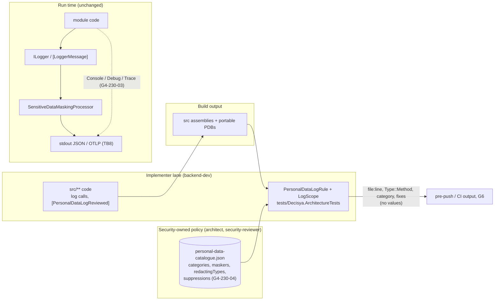

<!-- gate: G3 | verdict: PASS-WITH-NOTES | issue: #230 -->
# Threat delta: keep personal data out of log arguments (issue #230, finding C-12)

- Scope: what #230 adds. That is `PersonalDataLogRule` (Mono.Cecil IL taint check) with `LogScope` and the fixtures in `tests/Decisya.ArchitectureTests`, the policy file `docs/security/personal-data-catalogue.json`, the suppression attribute `Decisya.SharedKernel.Observability.PersonalDataLogReviewedAttribute`, `[Sensitive]` on `Membership.UserId` and `MemberDto.UserId` with the `MemberDto` `PrintMembers` override, and the canary masking tests (including `AuditRecord.ActorUserId`, option A). #230 adds no endpoint, store, message, package or runtime logging code. Mono.Cecil 0.11.6 is already in `tests/Decisya.ArchitectureTests/packages.lock.json` and ships in no product image.
- Mode: threat delta, done **before** implementation. "Requirements for G4" is design input for backend-dev (G4), the main session, and test-engineer (G5). G6 checks each requirement against the diff.
- Inputs: G1 `docs/requirements/230-pii-log-arguments.md` (as corrected after G2: the "masked" definition, Story 1's scalar-read scenario, Story 3 with `AuditRecord.ActorUserId`), NFR-62, G2 `docs/architecture/230-pii-log-arguments.md` (PASS-WITH-NOTES), the catalogue, register finding C-12 and SB-09 in `system-baseline.md`, and Marco's option A in `docs/ai/pipeline/230.md`. Code read: `SensitiveDataMaskingProcessor`, `SensitiveTypeAnalyzer`, `UserIdHasher`, `LogEnrichmentContext`, `ILogEnrichmentContext`, `Membership`, `FeatureOverride`, `MeResponse`, `LogoutTokenValidator`, `BffEndpoints` (back-channel logout), `AuthEvents`, `AccessTokenProvider`, `SessionFixationGuard`, `RedisTicketStore`, `EnvelopeTenantLog`, `MigratorLog`, `KeyRingCertificateGenerator`, `BannedSymbols.txt`, `.claude/boundaries.json`.
- ASVS: 5.0, Level 2. Per the addendum, V6 and V7 are Level 3. #230 changes no authentication and no session behaviour. It protects V7 assets (session cookie values, the `sid`, tokens) from reaching logs, which is a V16.2.5 control. Requirement-level ids follow `docs/security/asvs-l2-baseline.md`. Check each number against the official 5.0 text before copying it into a compliance artefact.
- Threat ids T-xx and requirement ids G4-230-xx are local to this file. At G6, security-reviewer updates the C-12 row and the "PII under an innocent name" section of `system-baseline.md` (G2 G4 split).
- Reviewer: security-reviewer agent, 2026-11-02.

## Verdict

**PASS-WITH-NOTES.** The G2 mechanism is the right one: a test over built IL that judges the value, not the placeholder name, with flow-sensitive taint, sinks for `ILogger`, `[LoggerMessage]`, `LoggerMessage.Define*` and exception construction, fail-closed scope, a non-vacuity check, and no new package. G2's reading of "masked" (a scalar read from a `[Sensitive]` member is a finding) matches what `SensitiveDataMaskingProcessor` really does at run time (`ProcessAny` takes the `string` path before any attribute is consulted). No High is left without a mitigation or a linked issue.

G3 changes four details. backend-dev and G5 follow them where they differ from the architecture note (the MUSTs below):

1. **Taint survives a Decisya object (T-02, T-03).** As written, the object rule judges a Decisya-typed argument "by type, not by taint", and `memberNames` match only `string` members. Together these let personal data pass when it is wrapped: `new PaymentNote(tx.Description)` logged whole or interpolated, or an `Iban` value object read from `account.Iban`. The processor then renders the wrapper's innocent-named `string` member in clear. That is C-12 again, one hop removed.
2. **Catalogue gaps on today's sources (T-04).** `MeResponse.Sub` (the raw `sub`), the `sid` claim, and the framework reads the BFF uses for cookies, tokens and JWT payloads are not in the catalogue.
3. **`Console`, `Debug` and `Trace` writes are sinks (T-06).** Stdout is the log stream. A `Console.WriteLine(tx.Description)` skips the masking core entirely and breaks the JSON line format.
4. **Every exemption is counted and security-owned (T-07, T-08).** The pinned suppression list moves out of the implementer's lane into the catalogue. `secret-material` can never be suppressed. No other attribute on hand-written code exempts it.

**G2's questions to G3:**
- `memberNames` false positives: none is worth a MUST. `MeResponse.Email` and the BFF token records are true positives (contact, secret material). They cost nothing until someone logs them, and that is the point. Generic free-text names (`Description`, `Reason`, `Note`, `Comment`) will one day match a non-personal member. That fails in the safe direction, and the fix is a rename or a reviewed suppression. `EnvelopeTenantLog`'s `{Reason}` is fed from `EnvelopeRefusalReason.Text`, a fixed word, so it stays clean.
- Residual false negatives: all six accepted, with conditions (table in "Residual false negatives").
- The suppression attribute: abusable as designed, fixed by G4-230-04.
- Personal data in the catalogue or the rule's output: none in the catalogue. The output carries only metadata, provided paths are repo-relative locally too (S-02).
- The two backlog proposals: both backlog, neither fix-now (section "G2 questions for Marco").

No ADR is needed. G3 agrees with G2.

## Data flow and trust boundaries

Nothing new crosses a runtime boundary. The runtime flow (module code → `ILogger` → masking core → stdout or OTLP, TB8 in the baseline) is unchanged except for the `[Sensitive]` marks. The new element is a development-time control and its policy data. The boundary that matters is between the implementer's lane (`src/**`, `tests/Decisya.ArchitectureTests/**`) and the security-owned policy (`docs/security/**`).

## Threats

| Id | Element / flow | STRIDE | Threat | Severity | Mitigation | ASVS 5.0 id | Status |
| --- | --- | --- | --- | --- | --- | --- | --- |
| T-01 | Log call with a personal value under an innocent placeholder (C-12) | I | `LogInformation("Paid {Payee}", tx.Description)`, an interpolated template, a `[LoggerMessage]` parameter, a scope or an exception message carries personal data to stdout and OTLP in clear. | Medium | `PersonalDataLogRule`: sinks S1 to S5, catalogue sources, `[Sensitive]` member reads as sources, flow-sensitive propagation through locals, closures, state machines, interpolation handlers, `Concat` and `StringBuilder`. R1 to R4 fixtures, 7 of 7 categories red. | V16.2.5, V14.2.4 | Mitigated by design; G6 verifies |
| T-02 | Decisya object built from a personal value | I | The value is wrapped in a Decisya type whose receiving member has an innocent name and no `[Sensitive]` (`record PaymentNote(string Payee)`), then passed whole or turned into text. The object rule judges by type only, so it passes. At run time the processor renders `Payee = <description>` (`RenderMember` → `ProcessAny` string path), and a synthesized `ToString` prints it too. | Medium | G4-230-01 | V16.2.5 | Open: G3 change 1 |
| T-03 | Personal member of a non-`string` type | I | `Guid UserId`, or a value object such as `Iban Iban` or `EmailAddress Email` on an entity. EF sets the field by reflection, so no IL flow taints it, and `memberNames` skip non-`string` members. Logged whole, the value object renders its inner `Value` in clear. Latent today; likely in the Ledger (account numbers). | Medium (latent) | G4-230-01 | V16.2.5, V14.1.1 | Open: G3 change 1 |
| T-04 | Catalogue completeness for today's sources | I | `Decisya.Bff.MeResponse::Sub` (raw `sub`, `MeResponse.cs:23`) is in no category. The constant `sid` claim read stays clean. Framework reads of cookies (`IRequestCookieCollection.TryGetValue`, `SessionFixationGuard.cs:43`), stored tokens (`GetTokenValue("access_token")`, `AccessTokenProvider.cs:192`) and JWT payload claims (`JsonWebToken.TryGetPayloadValue<string>("sub")`, `LogoutTokenValidator.cs:127`) are not sources. Nothing logs them today. | Low | G4-230-02 | V14.1.1, V16.2.5 | Open: G3 change 2 |
| T-05 | Personal data under a name the catalogue lacks | I | A new type holds personal text under a name such as `Label`, `Text` or `Value`, filled from an untainted source (a request body). | Low | Process control: the G2 of every issue that adds personal data adds its catalogue entries, and its G3 checks the catalogue diff (catalogue `$comment`). G4-230-01 narrows the gap: once a catalogued source flows into the type, the member is tainted whatever its name. | V14.1.1, V14.1.2 | Accepted with process control |
| T-06 | Console, Debug and Trace writes | I, T | `Console.WriteLine`, `Console.Out/Error.Write*`, `Debug.Write*` or `Trace.Write*` sends personal data to stdout with no masking and breaks the one-JSON-object-per-line format. Not an `ILogger` sink in G2's list. `src` uses only constant `stderr` text today (`KeyRingCertificateGenerator`). | Low | G4-230-03 | V16.2.5, V16.4.1, V16.2.4 | Open: G3 change 3 |
| T-07 | `[PersonalDataLogReviewed]` misuse | T, R | The attribute is public in SharedKernel, `AllowMultiple`, method-wide. The same agent that adds it can update the pinned list, because the list lives in the test class (backend-dev lane). Seven attributes on one method switch the rule off there. A suppression for a secret is never legitimate. | Low (Medium without review) | G4-230-04 | V16.2.5, V14.1.2 | Open: G3 change 4 |
| T-08 | Silent exemptions other than the attribute | T | The rule skips `GeneratedCodeAttribute` bodies. If the skip keys on the attribute alone, a hand-written method marked `[GeneratedCode]` is never examined, and is not counted. | Low | G4-230-04 | V16.2.5 | Open: G3 change 4 |
| T-09 | Catalogue tampering | T | A name is removed, a pass-through method is listed as a masker, or a redacting type with a leaking `ToString` is added. | Low | The file is in `docs/security/**`, outside implementer lanes. R5 checks every `Decisya.*` entry exists. The red fixtures pin one name per category. G3 or G6 reviews every catalogue diff. S-01 extends existence checks to third-party entries. S-09 (backlog): review-required path. | V14.1.2 | Mitigated; S-01, S-09 |
| T-10 | Rule narrowed to reach zero findings | T | R7 (today's `src` is clean) raises false positives, and G4 loosens the rule until they disappear, opening a hole. | Low | R1 to R4 red fixtures stay red. G2: a narrowing comes with a new green fixture, never a suppression without Marco. S-03: each narrowing is listed in the G4 evidence. | V15.1 (architecture rules) | Mitigated; S-03 |
| T-11 | Virtual and interface dispatch, reflection, `dynamic`, expression trees | I | A helper reached through an interface (the DI norm) logs its parameter, and the summary is not followed. | Low | Accepted for #230. The processor still masks whole objects. S-05 (backlog): follow implementations in the closed LogScope world. | V16.2.5 | Accepted (residual) |
| T-12 | Implicit flows | I | Branching on a personal value, then logging a constant. | Low | Accepted: leaks at most a bit per call, no text. | V16.2.5 | Accepted (residual) |
| T-13 | Collections filled by another method | I | A list passed by reference is filled with personal values elsewhere, then logged. | Low | Accepted. `List<string>` of personal values filled in the same method is caught (container taint). Non-scalar collections are masked whole at run time. | V16.2.5 | Accepted (residual) |
| T-14 | Framework-emitted logs | I | EF Core, ASP.NET Core, Npgsql or Wolverine logs a value. | Low | Outside `src` code. Existing EF and Npgsql bans and category level floors (Wolverine and JasperFx at Warning, #231). Trigger: the first Wolverine message that carries personal data re-checks Wolverine's failure and dead-letter logging in its G3. | V16.2.5 | Accepted (residual) |
| T-15 | Trace and metric attributes | I | `Activity.SetTag`, `AddEvent` or a meter tag carries personal data. | Low | Out of scope (G1). S-06 (backlog): the same engine gains these sinks. CLAUDE.md already forbids user ids and amounts in metric attributes. | V16.2.5, V14.2.4 | Linked: #243 (S-06) |
| T-16 | Synthesized record `ToString` outside `src` sinks | I | `CallerIdentity`, `WhoAmIResponse`, `LogoutTokenValidationResult`, `AccessTokenResult`, `ForwardedAccessTokenFeature` print personal data or a token when a framework or a debugger calls `ToString`. | Low | The R3 use-site rule flags them at every `src` sink. When logged whole, the processor masks `AccessToken` (deny-list) and renders `[Sensitive]` members as the mask. S-07 (backlog): structural rule. | V16.2.5 | Linked: #243 (S-07) |
| T-17 | Rule and test output | I | The failure text, the suppression list or the stats include a value, an IL string literal, or an absolute local path holding a Windows user name. Output lands in CI logs, G4 evidence and PR bodies. | Low | Static analysis never sees run-time values. The output format holds file, line, `Type::Method`, category and source member only. S-02: repo-relative paths locally too, no literals; canaries synthetic. | V16.2.5, V14.2.4 | Mitigated; S-02 |
| T-18 | Rule fails open | T | A missing or stale DLL or PDB, a missing catalogue, or zero call sites seen, so the check reports "zero findings" over nothing. | Low | D6: missing or stale output fails and names the project. A missing catalogue throws. R5 needs all seven ids. R7 non-vacuity asserts every `[LoggerMessage]` call site in `src` was examined and that sources were seen. | V16.5.3 | Mitigated by design |
| T-19 | Hard-coded non-sink `ILogEnrichmentContext.Begin` | I | A second implementation of the interface stores the raw user id and puts it in a scope. The exemption hides it. | Low | S-04: assert `LogEnrichmentContext` is the only implementation in LogScope and its `userId` reaches only `UserIdHasher::Hash`. | V16.2.5 | Mitigated; S-04 |
| T-20 | `MemberDto` and `Membership` changes | T | `[Sensitive]` or `PrintMembers` changes the API JSON, the EF model or the migration snapshot. | Low | STJ and EF ignore the attribute. G5: JSON still holds the real user id for an owner; `HasPendingModelChanges()` false for Tenancy and Audit; canary tests through the real processor and `decisya-json` formatter for all three members. | V16.2.5, V15.3.1 | Mitigated by design; G5 verifies |
| T-21 | Check cost | D | A slow fixpoint over about 17 assemblies stalls the pre-push hook. | Low | NFR-62: at most 10% over baseline, measured by G5 on the same host. | V15.1.3 | Mitigated by design |

## Requirements for G4

### MUST (fix-now)

- **G4-230-01: taint survives a Decisya object** (T-02, T-03). Medium.
  - **`memberNames` match members of any type except `bool` and enums.** That covers `string`, `Guid`, numbers, `Nullable<T>` and Decisya value objects, not only `string`. A Decisya value object read from a matched member is personal data whole.
  - **The object rule honours taint.** A Decisya-typed argument that carries taint is a finding unless one of these holds:
    - the type carries `[Sensitive]`; or
    - every member that holds the tainted value carries `[Sensitive]`.
  - **Preferred mechanism: member-level (field-sensitive) taint.** A constructor, `init` or setter call with a tainted argument taints the field it stores to. This extends S5's "a `Decisya.*` field assigned a tainted value is a source" across the parameter-to-field hop. Reading a member then yields that member's taint, not the receiver's whole taint, so `membership.Id` or `result.FailureReason` does not inherit the user id. That removes a class of R7 false positives too.
  - **Acceptable conservative alternative:** a tainted Decisya argument passes only if every text-capable member to depth 3 carries `[Sensitive]` or is of a non-personal kind (`bool`, enum, number, `TenantId`, `Money`, `Currency`, NodaTime). Text-capable means `string`, `Uri`, `object`, interfaces, collections, and Decisya non-scalar types.
  - **The text rule follows the same test.** Turning a tainted Decisya value into text (`ToString`, `AppendFormatted<T>`, `Concat(object)`, `Format`) is a finding when the member holding the taint lacks `[Sensitive]`, whatever kind of `ToString` the type has.
  - **Fixtures:**
    - red: `record PaymentNote(string Payee)` built from `tx.Description`, logged whole;
    - red: the same object interpolated;
    - red: an object initializer `new View { Text = tx.Description }`;
    - red: a Decisya value object `Iban` read from an `Iban`-named member, logged whole;
    - red: a `Guid UserId` member logged;
    - green: `new Membership(tenantId, caller.UserId, role, now)` logged whole (`UserId` is `[Sensitive]`);
    - green: a value object whose type carries `[Sensitive]`.
  - ASVS: V16.2.5, V14.1.1.
- **G4-230-02: catalogue completeness for today's sources** (T-04). Low, a few lines in a file this PR adds.
  - **Entries.** security-reviewer (or the architect) writes them; implementers do not edit the catalogue (G2 D2). G3 makes this edit when the orchestrator routes it, before G4 runs R7:
    - `user-identifier.members`: add `Decisya.Bff.MeResponse::Sub` and `Microsoft.IdentityModel.JsonWebTokens.JsonWebToken::Subject`.
    - `secret-material.memberNames`: add `SessionId` (`LogoutTokenValidationResult.SessionId`).
    - `secret-material.claimTypes`: add `sid`, `Microsoft.AspNetCore.Authentication.Cookies-SessionId`, `access_token`, `refresh_token` and `id_token`.
    - `secret-material.members`: add `Microsoft.AspNetCore.Http.IRequestCookieCollection::Item`, `Microsoft.AspNetCore.Http.IRequestCookieCollection::TryGetValue` and `Microsoft.AspNetCore.Authentication.AuthenticationToken::Value`.
  - **Name-keyed readers (rule code).** The rule treats these framework readers like claim reads: a constant name argument is matched against `claimTypes`, and a non-constant name is `user-identifier`, or `secret-material` for the token readers. That way `GetTokenValue("expires_at")` and `TryGetPayloadValue<long>("iat")` stay clean.
    - `AuthenticationTokenExtensions.GetTokenValue` and `GetTokenAsync`;
    - `JsonWebToken.TryGetPayloadValue<T>`, `GetPayloadValue<T>`, `TryGetClaim` and `GetClaim`;
    - `JsonWebToken.Claims`, enumerated, which counts as `user-identifier`, as `ClaimsPrincipal.Claims` does.
  - **Where the reader list lives.** Preferably in the catalogue, as a `claimReaders` list (schema version 2), so it can be extended without a code change. A fixed list in the rule is acceptable if G2 prefers it.
  - **Fixtures:**
    - red: `TryGetPayloadValue<string>("sub", out var s)` logged;
    - red: `Request.Cookies.TryGetValue(name, out var c)` logged;
    - red: `GetTokenValue("refresh_token")` logged;
    - green: `GetTokenValue("expires_at")` parsed and logged.
  - **If an entry makes R7 red on today's code,** G4 stops and reports it. It does not drop the entry.
  - ASVS: V14.1.1, V16.2.5.
- **G4-230-03: Console, Debug and Trace are sinks** (T-06). Low, a few sink entries in the rule this PR adds.
  - **Sinks to add:**
    - `System.Console::Write` and `::WriteLine`, all overloads;
    - `System.IO.TextWriter::Write*` and `::WriteLine*` when the receiver comes from `Console.get_Out` or `Console.get_Error` in the same method;
    - `System.Diagnostics.Debug::Write*`, `::Print`, `::Fail` and `::Assert` (message arguments);
    - `System.Diagnostics.Trace::Write*` and `::Trace*`.
  - **Not sinks:** other `TextWriter` and `Stream` writes. A later export feature writes personal data to a response stream legitimately.
  - **Fixtures:** red `Console.WriteLine(tx.Description)`. `KeyRingCertificateGenerator`'s constant `stderr` lines stay green.
  - ASVS: V16.2.5, V16.4.1.
- **G4-230-04: every exemption is counted and security-owned** (T-07, T-08). Low, in files this PR adds.
  - **The pinned suppression list lives in the catalogue,** as a `suppressions` array of `{ site: "Namespace.Type::Method", category, justification }`, empty at merge. It does not live in the test class.
    - A `[PersonalDataLogReviewed]` use with no matching entry fails.
    - An entry with no matching use fails as stale.
    - A suppression therefore needs an edit in `docs/security/**`, outside every implementer lane, and shows up as a diff G6 reads.
  - **`secret-material` cannot be suppressed.** A suppression naming it is itself a failure. Logging a secret is never a verified false positive.
  - **The `GeneratedCode` skip applies only to the generated body of a method that carries `LoggerMessageAttribute`** (the partial implementation). A hand-written method carrying `[GeneratedCode]`, `[CompilerGenerated]` or `[ExcludeFromCodeCoverage]` is examined as usual. Red fixture: a hand-written `[GeneratedCode]` method that logs `tx.Description`.
  - **R6 keeps G2's cases:** blank, short or unknown-category justifications fail, and A does not hide B. Add one case: seven attributes on one method are seven pinned entries.
  - ASVS: V16.2.5, V14.1.2.

### SHOULD

- **S-01** (fix-now, Low): R5 also checks third-party entries in `members`, `types`, `maskers` and the reader list whenever the declaring assembly is in the reference closure of LogScope. An unknown name there fails. An entry whose assembly is not referenced at all (today: `Microsoft.Extensions.AI`) is listed in the stats output, not failed, so a typo cannot hide.
- **S-02** (fix-now, Low; T-17):
  - The failure text and the stats print paths relative to the repository root found by `RepoPaths`, locally as well as in CI. A path outside the repository prints the file name only.
  - R8 asserts that the output has no drive letter, no `Users` segment, and no IL string literal from the flagged method (fixture: a log call whose template holds a canary literal).
  - Fixtures and canaries use synthetic values only, never a seeded realm user's `sub`.
  - Justifications must not hold personal data. G6 reads them.
- **S-03** (G4 evidence; T-10): every narrowing made during R7 triage is listed in the G4 evidence with its new green fixture. No R1 to R4 red fixture is edited to turn green.
- **S-04** (fix-now, Low; T-19): a test asserts that `LogEnrichmentContext` is the only implementation of `ILogEnrichmentContext` in LogScope, and that its `Begin` passes `userId` only to `UserIdHasher::Hash`.
- **S-05** (backlog #243; T-11): closed-world dispatch. A `callvirt` to an interface or virtual method follows the union of the implementations found in LogScope, at least for single-implementation interfaces. Trigger: re-checked in the G3 of the first Ledger feature.
- **S-06** (backlog #243; T-15): `Activity.SetTag`, `Activity.AddEvent`, `AddBaggage` and `Meter` instrument tags as sinks.
- **S-07** (backlog #243; T-16): the structural `ToString` rule (G2 question 1).
- **S-08** (backlog #243): CA1848 and CA2254 as errors (G2 question 2).
- **S-09** (backlog #243; T-09): add `docs/security/personal-data-catalogue.json` and `tests/Decisya.ArchitectureTests/PersonalDataLogRule.cs` to `review_required_paths` in `.claude/project.json`, following the realm-guard precedent. This is a main-session edit of the project layer. It is not fix-now because #230 does not touch `.claude/**`.
- **S-10** (backlog #243): schema support for parameter sources of framework callbacks: the `key` of `ITicketStore` methods, and form fields such as `logout_token`. At run time these are covered only by the key deny-list and the JWT shape mask.

## Residual false negatives (G2 list): G3 decision

| Residual | Decision | Condition |
| --- | --- | --- |
| Virtual and interface dispatch, reflection, `dynamic`, expression trees | Accept | S-05 in the backlog, re-checked at the first Ledger G3. Reflection, `dynamic` and expression trees reaching a log call are rare in `src` and visible at review. |
| Implicit flows | Accept | No text leaves; at most one bit per call. |
| Collections filled by another method | Accept | Same-method fills are caught. Non-scalar collections are masked whole at run time. |
| Names not in the catalogue | Accept with process control | The G2 of every issue that adds personal data adds its entries, and its G3 checks the catalogue diff. G4-230-01 removes the "wrapped in an innocent-named member" variant. |
| Framework-emitted logs | Accept | Existing EF and Npgsql bans and level floors. Wolverine re-checked when the first message carries personal data. |
| Traces and metric attributes | Accept for #230 | S-06 in the backlog. |

## G2 questions for Marco: the G3 view

1. **Structural `ToString` rule:** backlog (#243), Low. Not fix-now. Inside `src`, every sink is covered by the R3 use-site rule, and G4-230-01 widens that. What stays open is a framework or debugger calling `ToString` on one of the five records, and none of them is a Wolverine message, an exception or a logged framework object today. Doing it now would pull identity-dev into five BFF and Api records for a Low.
2. **CA1848 and CA2254 as errors:** backlog (#243), Info. Not fix-now. The IL rule already examines interpolated templates (F10), and `src` uses only `[LoggerMessage]`. The analyzers add IDE feedback, not a control. If they are adopted later, the R1 F10 fixture keeps its local CA2254 suppression.

## Register

- After G6 verifies G4-230-01 to G4-230-04, C-12 can move to Closed, with Low residuals T-05 and T-11 to T-16, linked to #243 (S-05 to S-10). Baseline line 154's trigger ("the analyzer becomes a MUST in the G3 of the first issue that handles user-entered free text or contact data") is then met by this control.
- No High or Medium flaw in unchanged code was found. `MeResponse.Sub` and the framework token and cookie reads are catalogue gaps, not leaks: nothing logs them today.
