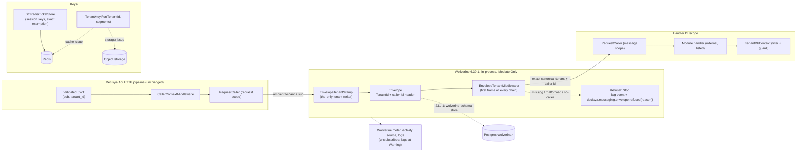

<!-- gate: G3 | verdict: PASS-WITH-NOTES | issue: #231 -->
# Threat delta: Wolverine tenant safety and the tenant key builder (issue #231)

- Scope: what #231 adds. That is the first `WolverineFx` reference (in-process only, in `Decisya.Api`), the send stamp and receive middleware for the envelope tenant, the refusal log event and metric, the serializer and discovery settings, the startup test that keeps durable mode off, `Decisya.SharedKernel.Tenancy.TenantKey`, and architecture rules R1 to R13. #231 adds no endpoint, no store, no transport and no package version.
- Mode: threat delta, done **before** implementation. "Requirements for G4" is design input for backend-dev, identity-dev and the main session (G4), and for test-engineer (G5). G6 checks each requirement against the diff.
- Inputs: G1 `docs/requirements/231-wolverine-tenant-safety.md` (PASS, with Marco's answers of 2026-11-01), NFR-61, G2 `docs/architecture/231-wolverine-tenant-safety.md` (PASS-WITH-NOTES), ADR-0024 (Proposed), ADR-0001, ADR-0005, ADR-0012 (with amendment 1), ADR-0013, and Marco's outbox decision in `docs/ai/pipeline/231.md`. Code read: `TenantId`, `TenantIdJsonConverter`, `TenantResolution`, `RequestCaller`, `CallerContextMiddleware`, `ILogEnrichmentContext`, `DecisyaTelemetry`, `RedisTicketStore`, `RedisRefreshLock`, `RedisRegistration`, `ContractsBoundaryTests`, and `Directory.Packages.props` (`WolverineFx` 6.39.1 is pinned).
- ASVS: 5.0, Level 2. Per the addendum, V6 and V7 are Level 3. #231 adds no authentication and no session. The envelope never carries a token, a cookie or a claim set (G4-231-01), so V6 and V7 are not touched. Controls are cited at requirement level where the mapping is clear. Check each number against the official 5.0 text before copying it into a compliance artefact. V8.3.3 is a Level 3 requirement and is cited for information only.
- Threat ids T-xx and requirement ids G4-231-xx are local to this file. At G6, security-reviewer moves C-13 and C-14 in the register (G1 Story 6).
- Reviewer: security-reviewer agent, 2026-11-01.

## Verdict

**PASS-WITH-NOTES.** The G2 design is sound. It has an exact canonical tenant check on receive, one writer on send, no envelope entity in any EF model, no store or transport, STJ only, explicit handler lists, a fixed-length tenant prefix with separators banned from segments, and a fail-closed `RequestCaller` backstop. No High is left without a mitigation or a linked issue.

G3 changes five details. backend-dev, identity-dev, the main session and G5 follow them where they differ from the architecture note (the MUSTs below):

1. **The send stamp is authoritative on every send path, and R6 covers every Wolverine tenant setter (T-03, T-04).** R6 matches `set_TenantId` and `ForTenant` by name. Wolverine also takes a tenant through other members, such as `InvokeForTenantAsync`, which that match misses. The stamp also has to overwrite any tenant or caller value that is already on the envelope, rather than keep it.
2. **The receive middleware is first in every chain, validates the caller id, never elevates, and is tested with two tenants (T-01, T-02, T-06, T-08).**
3. **No `[AllowCrossTenant]` type in any handler list in #231 (T-09).** Admin handlers are reachable today only through HTTP, behind the admin role and the MFA policy. A message path to one would skip both, so a tenant user's request could start a cross-tenant handler.
4. **Durable mode, transports and extra serializers are refused on the built runtime, not on the options the code wrote (T-11, T-12).** Wolverine applies extensions it finds in referenced assemblies, so only a test of the composed host proves the state.
5. **R10 needs three corrections before G5 writes it (T-15, T-16).** As written, it bans every `System.Security.Claims` member in every sink type, exempt or not. `RedisTicketStore` calls `ClaimsPrincipal.FindFirst("sid")`, so R10 is red on the very type G1 Story 5 says must not be flagged. G5 would then have to loosen the rule. The fix:
   - narrow the claims ban for exempt types to the `tenant_id` claim;
   - add `TenantResolution` text as a tenant-text source;
   - check each method rather than each type.

**The `no-caller` refusal holds** (decision below). **ADR-0024 needs a small edit before Marco accepts it** (section "ADR-0024"). It is still Proposed, so the text is edited in place.

## Decision: the `no-caller` refusal reason (added by G2)

G3 confirms it, with conditions.

- **Why it must exist.** `RequestCaller.Set` throws `ArgumentException` on a blank user id. Without an explicit refusal, an envelope with a valid tenant but no caller id would end in an exception. Wolverine's error policy would then retry it or move it to a dead-letter queue, which contradicts Marco's answer 1 (discard, never store). Making up a placeholder actor such as `system` is worse. Every ADR-0013 audit record written in that handler would then name an actor nobody authenticated, which is a repudiation gap (T-07).
- **Why G1 is not contradicted.** G1 asks that a message that cannot be handled under a valid caller context is refused. A missing caller makes the context incomplete. A stricter refusal is allowed, and NFR-61 is unchanged.
- **Conditions** (in G4-231-02):
  - The caller id only attributes the message. It never authorizes anything: no role, no platform-admin fact and no MFA fact comes from the envelope.
  - It is checked for length and shape before `Set`.
  - It is never written to the refusal event or the metric. Only the reason `no-caller` is.
- **Consequence, recorded for later.** A message started by something with no HTTP caller, such as a scheduled job or a startup task, is refused until that issue defines a service actor id. That issue decides it under its own G3. This is not a #231 gap, because #231 has no such sender.

## Data flow and trust boundaries

Everything runs in one process. The boundaries that matter are between the HTTP caller context, the in-process bus and the handler's DI scope, plus the future stores. Dashed flows don't exist in #231; their owning issue is in the label.

Trust boundaries:

- **B1, HTTP to bus.** The tenant and caller cross from a validated principal into an envelope.
- **B2, envelope to handler scope.** The receive side must not trust anything except the canonical tenant text and a bounded caller id.
- **B3, code to key.** Tenant text becomes a store key.
- **B4, process to telemetry.** Wolverine's own logs, meter and traces.
- **B5, later: process to the shared envelope tables.** Rows from every tenant sit in one table (231-1).

## Threats

| Id | Element / flow | STRIDE | Threat | Severity | Mitigation | ASVS 5.0 id | Status |
| --- | --- | --- | --- | --- | --- | --- | --- |
| T-01 | Envelope tenant, receive | S, E | An envelope with an absent, empty, whitespace, all-zero, `not-a-guid`, padded or upper-case tenant (or Wolverine's `*DEFAULT*`) runs a handler. It might run under no tenant, or under a tenant that `TryParse` alone would accept after trimming. | High | ADR-0024 point 3: `TryParse` succeeds **and** `ToString()` equals the input ordinally. Refusal is `Stop` before any handler dependency resolves. The `RequestCaller` default is `Invalid`, so any DbContext that resolves early fails closed. R1 matrix plus `*DEFAULT*` (G4-231-02). | V8.4.1, V2.2.1, V16.5.3 | Mitigated by design; G6 verifies; "before any handler dependency resolves" restated (G4 delta 2, G4-231-08) |
| T-02 | Middleware order in the chain | E, I | Another middleware or the handler's constructor resolves a scoped service, such as a validator that pulls a DbContext, before the tenant is set. It then reads under `Invalid`, or under a stale scope. | Medium | The tenant middleware is the first frame of every chain, asserted over all discovered chains. R1 asserts that no DbContext is constructed on refusal and that the tenant is set before any DbContext resolves. The backstop fails closed (G4-231-02). | V8.3.1, V16.5.3 | Mitigated by design plus G3 change 2; chain walk landed; dependencies are built before the middleware, so the control is restated as no tenant read before resolution (G4 delta 2, G4-231-08, G4-231-09) |
| T-03 | Send stamp, all send paths | T, E | A path the stamp does not cover sends with no tenant, or with a tenant someone else chose. The paths are `InvokeAsync`, `InvokeAsync<T>`, `PublishAsync`, `SendAsync`, `ScheduleAsync`, cascaded return values, and an `IMessageBus` resolved from the root provider. A tenant-less send is refused on receive (fail-closed). A **chosen** tenant is accepted. | High | The stamp reads the ambient tenant on every send, never cached. It throws for `None` and `Invalid`. It **overwrites** any pre-set `TenantId` or caller header, so a value already on the envelope is never kept. R2 covers every path in the list, plus a pre-set tenant B from a tenant A context arriving as A (G4-231-01). | V8.4.1, V8.2.2, V8.3.3 | Mitigated by G3 change 1; send paths reduced to invoke under `MediatorOnly` (G4 delta, item 1, G4-231-06) |
| T-04 | Tenant setters outside the stamp | T, E | Api code sets a tenant through a Wolverine member that R6's name match misses, for example `InvokeForTenantAsync(tenantId, …)` or a `DeliveryOptions` initializer, and forges another tenant's scope. Modules can't do this in #231 (R5: no Wolverine reference). The Api can. | Medium (High once a module publishes) | R6 matches **every** member of a type in the `Wolverine` and `JasperFx*` assemblies whose name contains `Tenant`, case-insensitive. The exact read-only exemption is `get_TenantId`, used only by the receive middleware. Red and green fixtures (G4-231-01). | V8.4.1, V15.1 (architecture rules) | Mitigated by G3 change 1 |
| T-05 | Forged tenant from a handler (cascade) | T | A handler returns a cascaded message meant for another tenant. | Low | Inside a handler, the ambient tenant is the envelope tenant set by the middleware, so the stamp writes the same tenant. Module handlers can't reach `DeliveryOptions` (R5). A cascade case in R2 (G4-231-01). | V8.4.1 | Mitigated; corrected in G4 delta (item 6): a cascade is refused under `MediatorOnly`, and R2's cascade case asserts the refusal (G4-231-06); cascade clause verified (G4 delta 2) |
| T-06 | Caller id header | S, E | A forged or oversized caller id, or one with control characters, is attributed to the handler's work. Or the receive side restores privileges from the envelope (`isPlatformAdmin`, `hasMfaLevel`). | Medium | The stamp overwrites the header from the ambient `sub`. Receive accepts 1 to 128 characters, no control characters, no leading or trailing whitespace. Otherwise `no-caller`. `Set(For(tenant), callerId, isPlatformAdmin: false, hasMfaLevel: false)`, asserted in R1 (G4-231-02). | V8.3.3, V2.2.1, V8.2.1 | Mitigated by G3 change 2 |
| T-07 | Audit attribution | R | A handler's ADR-0013 audit record has no actor, or a made-up one. | Medium | The `no-caller` refusal: no handler runs without a real caller id. The receive middleware begins `ILogEnrichmentContext` with the tenant and the caller id (stored hashed), so handler logs carry `tenant_id` and `user_id` like HTTP logs do (G4-231-02). | V16.2.1, V16.3 | Mitigated |
| T-08 | Scope isolation | I | A tenant A message and a tenant B message handled at the same time share an ambient value, through a leaked `AsyncLocal` enrichment or a reused scope. | Medium | Each message gets its own `RequestCaller` scope (`Set` once). Enrichment is disposed per message. A two-tenant concurrent test is required by the CLAUDE.md test convention (G4-231-02). | V8.4.1 | Mitigated by G3 change 2 |
| T-09 | `[AllowCrossTenant]` handler reachable by a message | E | An attributed admin handler on a module's `MessageHandlerTypes` list is invoked by a message a tenant user caused. That skips the HTTP admin role and the MFA policy (`AdminMfaAuthorization`). If it also takes a target tenant from the body (ADR-0012 point 3), it acts across tenants. | Medium (latent: no handler list exists yet) | In #231, no type with `[AllowCrossTenant]` may appear in any `MessageHandlerTypes` list. The exact allow-list is empty, and a fixture proves the rule is red. The first cross-tenant sender's G2 and G3 add the exact entry, together with the authorization check inside the handler (G4-231-03). | V8.2.1, V8.4.1, V8.4.2 | Mitigated by G3 change 3 |
| T-10 | Handler discovery | E | Conventional or assembly-wide scanning finds an internal admin handler or another module's handler. | Medium | Conventional discovery off. R4: the discovered set equals the explicit lists plus an **exact, named** list of Wolverine's own handler types, never "any type in the Wolverine assembly". R5: list members are declared in their own module (S-03). | V8.2.1, V15.1 | Mitigated by design; Wolverine's four chain-less handlers confirmed as the exact list (G4 delta 2, finding 3, S-12) |
| T-11 | Serializer | T, E | A non-STJ serializer (Newtonsoft, MessagePack, Wolverine's intrinsic `ISerializable`), registered by an extension or a transitive package, builds `default(TenantId)` or binds polymorphic types. | Medium (Low while in-process: local messages are passed by reference, not serialized) | STJ only, with `RespectRequiredConstructorParameters` and `RespectNullableAnnotations`. R3 inspects the **built** runtime's serializer registry for every content type. R3's missing and all-zero cases go through Wolverine's configured serializer, not a fresh `JsonSerializerOptions` (G4-231-04). | V1.5.2 | Mitigated by design plus G3 change 4; the two intrinsic serializers accepted as inert (G4 delta, item 4) |
| T-12 | Durable mode, transports, auto-applied extensions | T, I | A durable store, a durable local queue, a transport or a listener gets switched on, either by a later edit or by an `IWolverineExtension` that Wolverine finds in a referenced assembly. Envelopes would then be persisted with no tenant isolation at the database (B5), before 231-1's design exists. | High (if switched on) | The startup test runs on the built host under the Production environment. It asserts no message store other than Wolverine's null store, no transport other than local, no listener, no durable local queues, no resource auto-setup and no auto-build of storage. Preferably also `Durability.Mode = MediatorOnly`, if 6.39.1 offers it (G4-231-04). Linked: backlog #243 item 231-1. | V15.2.3, V13 (fail-closed options), V16.5.3 | Mitigated by G3 change 4; durable design linked to #243 (231-1); inert internals pinned (G4 delta, item 4) |
| T-13 | Refusal log event and metric | I | The refusal event carries the payload, the raw tenant value, the caller id or an exception object. Or the metric gets a high-cardinality tag. The message type comes from the envelope's alias string, which turns into untrusted text once a transport exists. | Medium | G2 design, confirmed: one `LoggerMessage` with message type, message id, reason and trace id. The reason is a closed enum (`missing`, `malformed`, `no-caller`), the only metric tag. Log the resolved chain's CLR message type (not the raw alias), with a length cap (S-04). `LogScanTests` extended. | V16.2.5, V16.3.3, V16.4.1 | Mitigated by design |
| T-14 | Wolverine's own telemetry and logs | I | Wolverine's `Wolverine` meter and activity source tag tenant ids and message metadata. Its Information and Debug logs describe envelopes. Someone subscribes them, or configuration lowers the level, and tenant or caller data reaches OTLP. | Low | `DecisyaTelemetry` subscribes only `Decisya.*` and `Ostium.*`. A test asserts `Wolverine` is not subscribed. The `Warning` floor for the `Wolverine` and `JasperFx` categories is set in code in `AddDecisyaMessaging`, and a test asserts the effective level on the built Production host (S-05). | V16.2.5, V14.2 | Mitigated by design plus S-05 |
| T-15 | `TenantKey` and R10, the key rule | T, I, E | A tenant key is built by hand. A type that references both a sink and `ToCacheKey` once passes R10 while another method passes a hand-built string. `TenantResolution.ToString()` (`Tenant(<guid>)`) is not on R10's tenant-text list. | Medium (High once the first tenant-keyed key exists: C-14) | `TenantKey`: no `string`, `Guid` or `object` tenant overload. Segments use the allow-list `[a-z0-9._-]` (ordinal ASCII, not `char.IsLetterOrDigit`), 1 to 128 characters, never `.` or `..`, and the key is at most 512 characters. The fixed-length tenant prefix comes from `Value`, which throws on default. R10 is corrected (G4-231-05). The storage wrapper with a `TenantKey`-typed parameter is the lasting control, recorded for the storage issue. | V8.4.1, V5.3.2, V2.2.1 | Mitigated by G3 change 5; wrapper linked to the storage issue |
| T-16 | R10 exemption shape | T | As written, R10 is red on `RedisTicketStore` (`ClaimsPrincipal.FindFirst("sid")`). G5 then loosens it under pressure, for example to a namespace exemption, and the rule stops protecting anything. | Medium | Exempt types (exact names, checked to exist) must still reference no `TenantId`/`TenantResolution` text and no `tenant_id` claim (an `ldstr "tenant_id"` or a constant equal to it). Only non-exempt sink types keep the full `System.Security.Claims` ban (G4-231-05). | V15.1, V8.4.1 | Mitigated by G3 change 5 |
| T-17 | Key contents | I | A segment carries personal data (an e-mail address, a raw transaction description) that then shows up in Redis `MONITOR` or `SLOWLOG` and in S3 access logs. | Low | Segments are identifiers or fixed names, never personal data or free text. Stated in the `TenantKey` XML doc (S-06). | V14.2 | Accepted (SHOULD) |
| T-18 | Shared Redis between Bff and Api | I | When the first Api-side cache lands, an Api Redis user can read `decisya:bff:ticket:*`, which holds tokens. | Medium (latent) | Backlog for the cache issue: a separate Redis ACL user, with a client-side key namespace so an ACL key pattern can confine it (S-07). Nothing in #231 connects the Api to Redis. | V13.2, V14.2 | Linked: #243 (new item, see Backlog) |
| T-19 | Transitive closure of `WolverineFx` | T, D | The runtime code generator (Roslyn, through JasperFx) and any serializer or command-line packages enter the Api's runtime. A High or Critical advisory, or a dangerous-functionality surface such as `RunJasperFxCommands` exposing `resources teardown`, ships with it. | Medium | G6 reads every `packages.lock.json` diff and runs `dotnet list package --vulnerable --include-transitive`: no High or Critical. `Program.cs` keeps `app.Run()`, never `RunJasperFxCommands`. Static code generation for release images is already in the backlog (G2). The PR body names each new transitive serializer or code generator (S-08). | V15.2.1, V15.1.2, V15.2.5 | Verified at G6 (not restored locally: no lock file or package cache entry yet); Roslyn is now test-only (G4 delta, item 5) |
| T-20 | Envelope tables when durable mode arrives | I, E | Every tenant's message bodies and caller ids sit in shared `wolverine.*` tables. A module role with SELECT there can read other tenants' financial data, and a role with DELETE can drop other tenants' messages. | High (when 231-1 lands) | Not reachable in #231 (T-12). ADR-0024 point 1 is edited: module roles get **INSERT on the outgoing table only**; reads, updates and deletes belong to a separate dispatcher role. Retention and erasure of stored caller ids and bodies are designed in 231-1's G3. | V8.4.1, V14.2, V13.2 | Linked: #243 item 231-1 |

## Requirements for G4

### MUST (fix-now)

- **G4-231-01: send stamp, one authoritative writer** (T-03, T-04, T-05).
  - **What the stamp does:**
    - It reads the sender's ambient `ICurrentTenant` and `ICurrentCaller` on every send, and never caches them.
    - It throws for `None` and `Invalid`.
    - It **overwrites** whatever tenant and caller-id header the envelope already carries.
    - It writes only the canonical tenant text and the caller id. It never writes a token, a cookie, a claim set, a role or an MFA fact.
  - **R2 covers** `InvokeAsync`, `InvokeAsync<T>`, `PublishAsync`, `SendAsync`, `ScheduleAsync`, a cascaded return value, and a `DeliveryOptions { TenantId = B }` (or the equivalent header) sent from a tenant A context, which arrives as A or throws.
  - **R6 is broadened.** Every member of a type in the `Wolverine` and `JasperFx*` assemblies whose name contains `Tenant`, case-insensitive, is referenced only by `Decisya.Api.Messaging.EnvelopeTenantStamp`. The one exception is the exact getter `get_TenantId`, which the receive middleware also references. Red fixture: `InvokeForTenantAsync`, if 6.39.1 has it, otherwise the nearest tenant-taking overload.
  - ASVS: V8.4.1, V8.2.2, V8.3.3.
- **G4-231-02: receive middleware, first frame and no elevation** (T-01, T-02, T-06, T-07, T-08).
  - **Position:** it is the first frame of every discovered chain. A test walks all chains.
  - **Tenant check:** the exact canonical tenant as in ADR-0024 point 3. Add `*DEFAULT*` to R1's matrix.
  - **Caller id:** 1 to 128 characters, no control characters, no leading or trailing whitespace. Otherwise the reason is `no-caller`.
  - **`Set` call:** `RequestCaller.Set(TenantResolution.For(tenant), callerId, isPlatformAdmin: false, hasMfaLevel: false)`. R1 asserts `IsPlatformAdmin` and `HasMfaLevel` are false.
  - **Log scope:** it begins `ILogEnrichmentContext` with the tenant and the caller id for the handler's duration.
  - **Refusal:** `HandlerContinuation.Stop`. No exception, no retry, no dead letter, no handler dependency resolved.
  - **Two-tenant test:** tenant A and tenant B messages handled at the same time each see only their own tenant in `ICurrentTenant` and in the log enrichment.
  - ASVS: V8.4.1, V8.3.1, V2.2.1, V16.5.3.
- **G4-231-03: no `[AllowCrossTenant]` handler on a message path in #231** (T-09). A rule in `MessagingBoundaryTests` or R5: no type carrying `AllowCrossTenantAttribute` appears in any module's `MessageHandlerTypes`. The exact allow-list is empty, and a red fixture proves it. The first cross-tenant sender's G2 adds the exact entry, together with an authorization check inside the handler (admin and MFA are HTTP policies and do not apply to a message). ASVS: V8.2.1, V8.4.2.
- **G4-231-04: durable mode off, proven on the built runtime** (T-11, T-12).
  - R3 and the startup test inspect the **composed** host (`IWolverineRuntime` and its options after every extension has run), under the Production environment.
  - They assert:
    - no message store except the null store;
    - no transport except local;
    - no listener;
    - no durable local queues;
    - no resource setup on startup and no auto-build of storage;
    - STJ as the only serializer for every content type.
  - Set `Durability.Mode = DurabilityMode.MediatorOnly` if 6.39.1 offers it, and assert it. If it does not, say so in the PR body.
  - ASVS: V15.2.3, V1.5.2, V16.5.3.
- **G4-231-05: R10 corrections** (T-15, T-16).
  1. Exempt types (exact, existing names) must still reference no tenant text, but their claims ban is narrowed to the `tenant_id` claim (an `ldstr` or constant equal to `"tenant_id"`). Non-exempt sink types keep the full `System.Security.Claims` ban. `RedisTicketStore`, `RedisRefreshLock` and `RedisRegistration` must pass, and G1 Story 5 "not flagged" is the green fixture.
  2. Add `TenantResolution.ToString`, `TenantResolution.get_TenantId`, `box TenantResolution` and `constrained. TenantResolution` to the tenant-text sources.
  3. Apply the "references `TenantKey.ToCacheKey`/`ToObjectKey`" condition to **each method** that references a sink member, not to the type as a whole. Add a fixture: one type with one compliant method and one hand-built key, which must be red.
  - ASVS: V8.4.1, V5.3.2.

### SHOULD

- **S-01** (fix-now, Low; a test the PR adds): R12 checks segment validation with non-ASCII letters and digits (`é`, Arabic-Indic digits, fullwidth `ａ`), so a `char.IsLetterOrDigit` implementation fails. It also checks a `null` element in `segments` (`ArgumentNullException`), and `TenantKey.ToString()` returning either the cache key or a fixed type name, documented.
- **S-02** (fix-now, Low): every `TenantId` member of a message record is `required` or a constructor parameter (G2). Handlers never scope work by a message's `TenantId` member, only by `ICurrentTenant`. State this in the `Messaging/` XML doc. An analyzer is not needed in #231.
- **S-03** (fix-now, Low): R4's list of Wolverine's own handler types is exact full names, not an assembly or namespace match.
- **S-04** (fix-now, Low): the refusal event logs the resolved chain's CLR message type (`Type.FullName`, capped at 256 characters), not `Envelope.MessageType`.
- **S-05** (fix-now, Low):
  - The `Warning` floor for the `Wolverine` and `JasperFx` log categories is set with `AddFilter` in `AddDecisyaMessaging`. A test asserts the effective minimum level on the built Production host, and that a `Logging:LogLevel:Wolverine=Debug` setting does not lower it, if the filter order allows that. If it does not, the test documents the actual precedence.
  - A test asserts that `Wolverine` is not in the tracer or meter subscription.
- **S-06** (fix-now, Low): the `TenantKey` XML doc says segments are identifiers or fixed names, never personal data or free text.
- **S-07** (backlog #243): the first Api-side Redis client gets its own ACL user and a client-side key namespace, kept apart from `decisya:bff:*` (T-18).
- **S-08** (G6 check): G6 reviews the lock diff and runs the vulnerability audit for the Api graph. The PR body lists each new transitive serializer and code generator. `Program.cs` never calls `RunJasperFxCommands`.

## ADR-0024: edit before acceptance

ADR-0024 is still Proposed, so G2 edits it in place. Before Marco accepts it:

1. **Point 3 (receive side):** add the caller-id check, the `no-caller` refusal, and that the middleware never sets the platform-admin or MFA facts. Today the point names only the tenant check.
2. **Point 4 (send side):**
   - Say the stamp **overwrites** any tenant or caller value already on the envelope.
   - Say the setter ban covers every Wolverine and JasperFx member whose name contains `Tenant`, not only `set_TenantId` and `ForTenant`.
3. **Point 1 (outbox entities):** replace "Each module role gets only the DML it needs there" with the floor from T-20. Module roles get INSERT on the outgoing envelope table only; reading, updating and deleting belong to a dedicated dispatcher role. 231-1 verifies this against the pinned EF integration, together with retention and erasure of stored caller ids. Today's wording would let 231-1 grant SELECT on every tenant's message bodies.
4. **Point 2 (phasing):** name `MediatorOnly` (if available), and say the startup test inspects the composed runtime, so auto-applied extensions are covered.
5. **New line under point 5 (discovery):** no `[AllowCrossTenant]` handler type is on a message path until the first cross-tenant sender's review (G4-231-03). Also say, in so many words, that this ADR **removes** ADR-0005's "unless its handler is `[AllowCrossTenant]`" exception. Point 3 already implies it ("there is no tenant-less handler"), but ADR-0005 still reads the other way.
6. **"Enforced by":** add the G4-231-01 to G4-231-05 tests to the R1 to R9 list.

No change to ADR-0001 is needed. G3 agrees with G2: its "Enforced by" line holds as written.

## Backlog

- **#243 item 231-1 (exists, durable messaging):** add as recorded criteria for that issue's G3:
  - T-20: the INSERT-only module roles and the dispatcher role;
  - retention and erasure of the caller id and bodies in envelope and dead-letter rows;
  - re-running R1 against the store;
  - "no row" for refused messages, including the inbox deduplication table;
  - a `MessageType` alias from a transport is treated as untrusted text.
- **#243, new item (T-18 and S-07):** before the first Api-side Redis client, a separate Redis ACL user and a key namespace, so the Api cannot read `decisya:bff:ticket:*`. Not fix-now: nothing in #231 connects the Api to Redis.
- **Storage issue (existing criterion, G1 Story 5):** the storage wrapper's key parameter is `TenantKey`. Until then, R10 is a tripwire, not a proof (T-15).
- **Later sender issue (no backlog entry needed):** a service actor id for messages with no HTTP caller (the `no-caller` consequence above).

No High or Medium flaw in unchanged code was found.

## G4 delta (2026-11-01)

- Why: at G4, WolverineFx 6.39.1 forced deviations from G4-231-01, G4-231-02 and G4-231-04. Marco approved aligning the design (2026-11-01). The deviations are recorded in ADR-0024 amendment 1 and in the G2 note's two dated G4 lines (R2, R3 changed; R14, R15 new).
- Inputs read: ADR-0024 (with amendment 1), the G2 note, `src/Decisya.Api/Messaging/*`, `tests/Decisya.Api.Tests/Messaging/*`, `tests/Decisya.SharedKernel.Tests/Tenancy/TenantKeyTests.cs`, the csproj and `packages.lock.json` diffs (`git diff`), and `Program.cs` (`ValidateScopes = true` in every environment).
- The status cells of T-02, T-03, T-05, T-11, T-12 and T-19 above point here. Their threat and mitigation text is left as written at G3, and this section takes precedence where the two differ.
- **The verdict is unchanged (PASS-WITH-NOTES).** Every deviation is accepted. None leaves a High without a mitigation. Two MUSTs are added (G4-231-06, G4-231-07). Both are fix-now and both are tests. G6 gives BLOCK if either is missing.

### Item verdicts

1. **Invoke-only send path under `MediatorOnly` (G4-231-01): accepted.**
   - Publish, send, delayed and scheduled sends throw in Wolverine before any envelope exists. That is fail-closed and narrower than the G3 design: no fire-and-forget path, no store and no transport.
   - The test `Publish_send_and_scheduling_are_refused_by_the_in_process_only_mode` pins publish, send, delayed and scheduled. It has **no cascade case** (see item 6), so the tripwire ADR-0024 amendment 1 item 1 promises ("a test asserts that each of them throws") is incomplete. Closed by G4-231-06.
   - Condition, recorded for backlog #243 item 231-1: each of these paths returns only with the stamp re-established and a per-path send-stamp test (ambient arrives; a pre-set foreign tenant and caller are overwritten; `None` and `Invalid` throw). The amendment says this; G3 makes it a recorded criterion of 231-1's G3.
2. **The stamp is the scope's `IMessageBus` wrapper, not an `IEnvelopeRule` (G4-231-01): accepted.**
   - What the code does:
     - `EnvelopeTenantStamp.Stamp` reads `RequestCaller` on every call, never cached.
     - It throws for anything but `Tenant`.
     - It overwrites `DeliveryOptions.TenantId` and the caller-id header, creating the options when none are passed.
     - It refuses `InvokeForTenantAsync`, the `TenantId` setter, `EndpointFor` and `BroadcastToTopicAsync`.
   - Every `IMessageBus` member is either stamped or throws.
   - It meets the G3 intent better than a rule would: the G4 probe showed a rule stamps nothing on invoke.
   - `MessageCallerBindings.DecorateScopedBus` fails loudly if Wolverine stops registering a scoped `IMessageBus`, and `WolverineSurfaceTests` pins the single registration.
   - The root provider cannot resolve the bus. The tests prove it with `ValidateScopes = true`, and `Program.cs` sets that in every environment. If the root ever did resolve it, its `RequestCaller` is `Invalid` and the stamp throws.
   - Because the stamp reads per call, a service that takes `IMessageBus` and is constructed before the receive middleware runs still stamps the middleware's tenant.
3. **The unstamped `IMessageContext` / `MessageContext` / `MessageBus` / `host.MessageBus()` bypass: accepted.** Each path is closed:
   - A tenant-less invoke through them is refused as `missing`, which the R1 matrix proves.
   - A chosen tenant needs a Wolverine member whose name contains `Tenant`, which R6 bans outside the stamp.
   - Modules reference no Wolverine (R5).
   - R14 bans the four targets themselves. It also bans `MessageHandler<T>` overrides, because they take `MessageContext`; those pre-canned handlers bypass the middleware (see G4-231-07).
   - Residual (Low): R14 exempts the whole namespace `Decisya.Api.Messaging`, but no type in it references any of the four targets today (checked by search over `src`). An exempt type holding a `MessageContext` inside a handler could also rewrite the caller-id header, whose name does not contain `Tenant`, so R6 does not see it. That would forge attribution within the same tenant. The tenant itself cannot be forged that way. S-09 narrows the exemption.
4. **Inert Wolverine internals on the composed runtime (G4-231-04): accepted, as a change to the G3 wording "no durable local queues, local transport only".**
   - `MessagingRuntimeTests` reads the built Production runtime. It asserts:
     - `MediatorOnly`;
     - the null store as main and no ancillary store;
     - no auto-build;
     - external listeners off;
     - transports exactly `local`, `stub` and `tcp`, with every endpoint and active listener `local` or `stub`;
     - durable endpoints a subset of `durable` and `scheduled`;
     - the serializer registry exactly `application/json`, `binary/envelope` and `binary/wolverine`, read by reflection, with a failing assertion if the field disappears.
   - With the null store and `MediatorOnly`, the two reserved queues persist nothing, and the `tcp` transport has no endpoint or listener.
   - The two intrinsic serializers are not used in-process: local messages pass by reference. `binary/wolverine` applies only to message types that implement `Wolverine.ISerializable`, and module types cannot (R5).
   - Anything beyond these sets still fails. ADR-0024 amendment 1 item 4 makes adding to them a G2 and G3 change, which keeps the G3 intent.
   - Recorded for 231-1 (Backlog below): re-review both intrinsic serializers once a transport or store reads bytes.
5. **Chain walk deferred; `WolverineFx.RuntimeCompilation` in `tests/Decisya.Api.Tests` only (G4-231-02): accepted on condition, not as a waiver.**
   - The deferred tests are still #231 scope and must land before G6 (G4-231-07). Today the receive middleware is tested by calling `Before` directly. The stamp tests use pre-canned `MessageHandler<T>` probes, which bypass the middleware entirely. So nothing yet shows the middleware running in a real chain.
   - The package: G3 accepts it. Same publisher and version line, test-only, approved by Marco.
   - The lock diff matches the brief:
     - `tests/Decisya.Api.Tests/packages.lock.json` adds `JasperFx.RuntimeCompiler` 5.0.0, `Microsoft.CodeAnalysis.*` 5.0.0 (C# and Visual Basic, Workspaces, Scripting), `System.Composition.*` 9.0.0 and `Humanizer.Core` 2.14.1, and moves `Microsoft.Bcl.AsyncInterfaces` 6.0.0 → 9.0.0.
     - `src/Decisya.Api/packages.lock.json` has no Roslyn and no `JasperFx.RuntimeCompiler`. It gains WolverineFx's own closure (`JasperFx`, `JasperFx.Events`, `JasperFx.SourceGenerator`, `Cronos`, `NewId`, `FastExpressionCompiler`, `ImTools`, `Spectre.Console`, `Microsoft.Bcl.TimeProvider`) and moves `Polly.Core` 8.4.2 → 8.6.5.
   - T-19 drops for the Api runtime, because no code generator runs in-process under `TypeLoadMode.Static`, which `WolverineSurfaceTests` asserts.
   - Notes for G6:
     - `JasperFx.SourceGenerator` runs at Api build time, as an analyzer. Name it in the PR body (S-08).
     - The audit (S-08) covers the test graph too. A G3 run on 2026-11-01 of `dotnet list package --vulnerable --include-transitive` over the working tree reported no vulnerable package in any project, `Decisya.Api` and `Decisya.Api.Tests` included. G6 re-runs it on the final diff.
     - `Program.cs` still never calls `RunJasperFxCommands`. `Spectre.Console` is now in the Api graph.
   - R15 is accepted. S-11 closes its transitive gap.
6. **T-05 "a cascade case in R2": corrected (here and in T-05's status cell).**
   - Under `MediatorOnly` a cascade is refused, not stamped. T-05's mitigation now reads: "a cascaded message (other than an invoke's own response) throws under `MediatorOnly` and no second handler runs; R2's cascade case asserts this (G4-231-06). When 231-1 enables cascades, its stamp test covers them."
   - The current tests contain no such case: `ProbeQueryHandler`'s `EnqueueCascadingAsync` is the invoke's own response. G4-231-06 adds it.
7. **"The stamp throws before Wolverine sees the message" is asserted only indirectly: accepted, with S-10.**
   - `AssertEverySendThrowsAsync` matches the stamp's own message ("ambient tenant and caller"), and the recorder stays empty.
   - In the code, `Stamp(...)` is an argument expression, so it runs before `inner` is called. The claim holds today.
   - A direct assertion costs a few lines and guards against a refactor that calls Wolverine first: S-10.

### MUST (fix-now)

- **G4-231-06: complete R2's `MediatorOnly` tripwire and send-path coverage** (T-03, T-05; items 1 and 6). In `EnvelopeStampTests`:
  - **Cascade:** a probe handler under `InvokeAsync` cascades a message that is not the invoke's response. It throws `InvalidOperationException` naming `MediatorOnly`, and the cascaded message's handler never runs. If 6.39.1 behaves differently, for example by dropping it silently or by running it locally, stop and report to G2 and G3 before writing the test. A cascaded message that runs must arrive with the handled envelope's tenant and caller id, or be refused.
  - **`StreamAsync` (all four overloads) and `PreviewSubscriptions` (both):** a tenant A call arrives stamped as A, or throws.
  - **No ambient:** a `None` or `Invalid` ambient throws the stamp's exception on **every** overload. That includes `InvokeAsync<T>` with `DeliveryOptions`, `StreamAsync` and `PreviewSubscriptions`, not only the five overloads in `AssertEverySendThrowsAsync` today.
  - ASVS: V8.4.1, V8.2.2.
- **G4-231-07: the chain walk, through real chains, before G6** (T-01, T-02, T-08; item 5). With `WolverineFx.RuntimeCompilation` in `tests/Decisya.Api.Tests` only:
  - **Same composition:** the test host builds from `AddDecisyaMessaging` exactly as the Api does. The only Wolverine override is `TypeLoadMode` (Dynamic), and a test asserts that the override is the only difference from the Production options.
  - **Every routable handler:** the walk covers every handler the composed runtime can route to (the `HandlerGraph`, not only the chains it lists). It fails on any handler that is not a generated chain, such as an `AddMessageHandler`/`MessageHandler<T>` registration, which runs no middleware. For each chain, `EnvelopeTenantMiddleware.Before` is the first frame: before any other middleware, any handler construction and any service-located dependency.
  - **Refusal:** for each refusal reason, the handler does not run and no `DbContext` or other handler dependency is constructed. Prove it with a scoped probe dependency whose constructor records.
  - **Concurrency:** the two-tenant concurrent test runs through real chains (`InvokeAsync` from two caller scopes). Each handler sees only its own `ICurrentTenant`, caller and log enrichment.
  - **Nested invoke:** a nested invoke from a real handler asserts **both** the tenant and the caller id. If 6.39.1 does not carry the `decisya-caller-id` header onto a nested invoke, the test pins the `no-caller` refusal and the gap goes to G2. The fix is never a relaxed caller check or a made-up actor (G3 decision on `no-caller`).
  - ASVS: V8.4.1, V8.3.1, V16.5.3.

### SHOULD

- **S-09** (fix-now, Low; R14 is new in this PR): R14's exemption is a list of exact type full names in `Decisya.Api`, **empty in #231**, instead of the namespace `Decisya.Api.Messaging`. No type there needs it today. The first pre-generated handler adds its generated namespace `Internal.Generated.WolverineHandlers`, as ADR-0024 amendment 1 already says. It is a namespace because generated type names vary. This keeps the G3 line from T-16: exemptions are exact.
- **S-10** (fix-now, Low; `EnvelopeStampTests`): a unit test builds `EnvelopeTenantStamp` over a recording `IMessageBus`. It asserts that with a `None` or `Invalid` ambient the inner bus receives **zero** calls on every overload. With a `Tenant` ambient, the `DeliveryOptions` the inner bus receives already carry the stamped tenant and caller id.
- **S-11** (fix-now, Low; R15): R15 also fails when any `src/**/packages.lock.json` contains `WolverineFx.RuntimeCompilation` or `JasperFx.RuntimeCompiler`. A `PackageReference` scan misses a transitive arrival through another package.

### Backlog (#243)

- **Item 231-1 (durable messaging), added criteria for its G3:**
  - each re-enabled path (publish, send, schedule, cascade) has the stamp and a per-path stamp test before any code uses it (item 1);
  - the `binary/envelope` and `binary/wolverine` serializers are re-reviewed once a transport or store reads bytes;
  - a rule bans `Wolverine.ISerializable` on any message type (item 4).
- **Item "code-generation mode" (now a prerequisite of the first handler, per ADR-0024 amendment 1 item 5), added criterion:**
  - G4-231-07's chain walk also runs against the pre-generated Static code shipped in the Api;
  - a check fails the build when the pre-generated code is stale against the current `AddDecisyaMessaging` options, since stale code could lack the middleware frame.

No High or Medium flaw in unchanged code was found.

## G4 delta 2 (2026-11-01)

- Why: the G4-231-07 real-chain tests (with `WolverineFx.RuntimeCompilation` in `tests/Decisya.Api.Tests` only) showed three WolverineFx 6.39.1 behaviours that differ from what G3 expected. Marco decided on each on 2026-11-01, and those decisions bind this delta.
- Inputs read:
  - `tests/Decisya.Api.Tests/Messaging/`: `EnvelopeChainTests.cs`, `DiagTests.cs` (class `EnvelopeChainRefusalTests`), `EnvelopeStampTests.cs`, `ProbeMessaging.cs`, `MessagingHost.cs` and `ChainHostFixture.cs`;
  - `src/Decisya.Api/Messaging/EnvelopeTenantMiddleware.cs` and `DecisyaMessagingExtensions.cs`;
  - `src/Decisya.Api/Authentication/RequestCaller.cs`, `ICurrentCaller`, `TenantResolution`;
  - `src/Decisya.Infrastructure.Persistence/TenantDbContext.cs`, `tests/Decisya.ArchitectureTests/TenantDbContextGuardTests.cs`;
  - ADR-0024 point 3, and the G2 note (R1, R6, R14).
- State as reported to G3, not re-run here: the build is green. The fast suite has 1923 tests: 1912 pass and 11 fail on purpose, all in `EnvelopeChainTests`. They are the 10 refusal cases and the valid-path case, which assert that nothing is constructed before the check.
- The status cells of T-01, T-02, T-05 and T-10 above point here. This section takes precedence over G4-231-02 ("no handler dependency resolved") and G4-231-07 ("no `DbContext` or other handler dependency is constructed").
- **The verdict is unchanged (PASS-WITH-NOTES).** Finding 1 is a Medium control-ordering gap. The data-side backstop fails closed, and the PR closes the gap with G4-231-08 and G4-231-09. Findings 2 and 3 leave no High or Medium open. G6 gives BLOCK if G4-231-08 or G4-231-09 is missing.

### Finding verdicts

1. **Handler dependencies are constructed before the middleware runs: Medium, fix-now, accepted as option A.**
   - **What happens.** Wolverine's generated `HandleAsync` locates `ICurrentTenant` and builds the handler's scoped dependencies at the top of the method, before `EnvelopeTenantMiddleware.Before` runs. On every refusal reason the dependencies are still constructed, but the handler never runs.
   - **Classification confirmed: a control-ordering gap, not a data exposure.** The code shows why:
     - `TenantDbContext` keeps the `ICurrentTenant` reference in a readonly field and never copies the resolution.
     - Its query filter closes over `this` and reads `CurrentTenantFilter` per query execution. Under `Invalid` that throws `TenantIsolationException(InvalidTenant)` while EF extracts parameters, before any SQL is sent.
     - `SaveChanges` and `SaveChangesAsync` (both sealed) read the resolution per call and throw `InvalidTenant` first, even with no pending change.
     - `TenantDbContextGuardTests` already proves both throws on the real fixture context.
     - No `src` code uses `AddDbContextPool` or a context factory.
     - Before `Set`, `RequestCaller` gives `Invalid`. `UserId` throws, and `IsPlatformAdmin` and `HasMfaLevel` are false, so a snapshot taken at construction can only lose privilege, never gain it.
     - A refused message leaves the scope's `RequestCaller` at `Invalid`; `EnvelopeChainTests` asserts this.
     - So a dependency that reads tenant data before the check fails, and one that holds the reference reads the envelope tenant once the middleware has set it.
   - **The control is reframed as Marco approved:**
     - No tenant-scoped read or write, and no read of the caller context, happens before tenant resolution.
     - Tenant-dependent services keep the `ICurrentTenant` / `ICurrentCaller` reference and read it at use time, never in their constructor.
     - Constructing a dependency on a refused message is allowed. Using it is not, and the handler never runs.
   - **Residual risks beyond Marco's four proofs:**
     - **Same instance (G4-231-08 e).** The design relies on the dependency's `ICurrentTenant` being the very instance the middleware sets. If it were another instance, a valid message would fail closed. If it came from an already-populated scope, the dependency would read that scope's tenant, not the envelope's. Nothing proves the shared instance today: `ProbeDb` records only its construction-time value, and the handler's method parameter is a separate location.
     - **Caller reads in constructors (G4-231-09).** A constructor that reads `ICurrentCaller.UserId` throws before the middleware runs. The refusal then becomes an exception instead of `Stop`: no refusal event and no metric, and once durable mode exists, a retry or a dead letter, which Marco's answer 1 forbids. A constructor that copies `Resolution` or `IsPlatformAdmin` freezes `Invalid` or `false` for the scope's lifetime. That fails closed, but it breaks the use-time rule. So the architecture rule covers the caller members as well as `Resolution`.
     - **DI factory delegates (G4-231-09).** A registration such as `AddScoped<X>(sp => new X(sp.GetRequiredService<ICurrentTenant>().Resolution))` runs at construction time, but it is not a constructor. The rule covers it. Today's only factories (`AddDecisyaApiAuthentication` forwarding both interfaces to `RequestCaller`) read no member, so the rule is green on `src`.
     - **Indirect reads (accepted, Low).** A constructor that calls a helper which reads the tenant passes an IL rule that checks direct references only. The rule is a tripwire, not a proof. The backstops are the behaviour proofs (a) and (b) and the throwing `TenantDbContext` and `UserId`.
     - **Construction side effects on refused messages (accepted, Low).** A constructor that does I/O (opens a connection, starts a timer, calls out) runs for a refused message too. It cannot reach tenant data, because every tenant read throws or is banned. Recorded so that the first handler's review keeps constructors free of I/O.
   - **Doc wording (fix-now, Low, in files this PR changes).** The XML doc of `EnvelopeTenantMiddleware` says it runs "before any handler dependency resolves" and that on refusal "no handler dependency has resolved". Both are now false. ADR-0024 point 3 says "before any handler dependency runs", and R1 in the G2 note says "no `DbContext` constructed". They are restated in G4-231-08's terms: in place if ADR-0024 is still Proposed, otherwise as an amendment.
2. **A nested invoke from inside a handler keeps the tenant but loses `decisya-caller-id`: accepted for #231 as fail-closed (Low). Recorded as a hard prerequisite.**
   - `A_message_invoked_from_a_real_handler_is_refused_as_no_caller_because_the_caller_header_is_not_carried` pins it:
     - the outer message arrives as tenant A with its caller;
     - the inner handler never runs;
     - one `EnvelopeRefused` event is logged, with `Reason=no-caller` and the inner CLR type.
   - The inner tenant cannot drift. Wolverine copies the handled envelope's tenant, which the middleware validated, and any tenant setter is banned outside the stamp (R6 as broadened by G4-231-01).
   - The probe sends through Wolverine's `IMessageContext`, which Wolverine injects into the chain. That is the unstamped path, so the header is lost there.
   - **Hard prerequisite, backlog #243 item 231-5, before the first handler that sends a nested message.** That issue's G2 and G3 must:
     - establish which `IMessageBus` instance a handler and its dependencies receive inside a generated chain (the scope's `EnvelopeTenantStamp`, or Wolverine's own `MessageContext` variable);
     - carry the handled envelope's caller id onto the nested envelope through the one writer, the stamp or an equivalent reviewed single writer;
     - replace the pinned `no-caller` test with one that asserts the inner message arrives with **both** the outer tenant and the outer caller id;
     - keep a forged caller header on a nested send overwritten, never kept.
   - The fix is never a relaxed caller check, a made-up actor or a fallback to `system` (G3 decision on `no-caller`).
3. **Wolverine's four hand-written, chain-less handlers: confirmed. The allow-list meets S-03's intent.**
   - **Why it meets S-03.** S-03 asks for exact full names, never an assembly or namespace match. The chain walk pins exactly four `message type => handler type` pairs by full name and fails on any fifth chain-less handler. It also proves every other routable message type is a generated chain in `Internal.Generated.WolverineHandlers` with the envelope tenant middleware as its first constructed middleware. T-10's intent holds: nothing a module wrote, and nothing unlisted, is routable without the middleware.
   - **Can Api code invoke one of them with a forged envelope or command?** Modules cannot: they have no Wolverine reference (R5). The Api can, through the stamped bus.
     - **What the stamp covers.** It stamps only the **outer** envelope. These handlers run no middleware, so they ignore that stamp.
     - **What R14 covers.** It bans the unstamped bus types, not these message types, so it covers none of them.
     - **`Wolverine.Envelope` → `ScheduledSendEnvelopeHandler`.** The handler forwards the inner `Envelope`. To give it another tenant, Api code must call `Envelope.set_TenantId`, which R6 (broadened, G4-231-01) bans outside the stamp. With no tenant, the target chain refuses it as `missing`. If 6.39.1 can forward at all under `MediatorOnly`, two residuals remain:
       - a caller-header forgery within the same tenant (the header name does not contain `Tenant`), the same Low class as S-09;
       - an envelope object captured from another tenant's handler and replayed, which takes deliberately hostile Api code.
     - **`IAgentCommand` → `AgentCommandHandler`.** An Api type that implements it runs `ExecuteAsync` with the runtime and no middleware. It gets no tenant: any scope it creates has an `Invalid` `RequestCaller`, so tenant data fails closed. But it is a path with no refusal event and no enrichment. The walk cannot list it, because Wolverine routes **any** implementing type by interface.
     - **`Acknowledgement` and `FailureAcknowledgement`.** These complete pending remote-invocation replies. Local `InvokeAsync<T>` under `MediatorOnly` uses no remote reply listener, so a forged acknowledgement has nothing to complete. Not verified in Wolverine's source (see "Not checked").
   - **Result.** No cross-tenant path without an R6-banned member. A fix-now Low (S-12) turns the allow-list's premise, "no Decisya code sends these types", from an assumption into a check.

**Cascade (G4-231-06): closed.** `A_cascaded_message_is_refused_under_MediatorOnly_and_its_handler_never_runs` asserts all three points:

- `InvokeAsync` of a message whose handler returns a non-response message throws `InvalidOperationException` naming `MediatorOnly`.
- The cascading handler ran exactly once.
- `ProbeCascadedHandler` never ran.

This matches the G4 delta expectation and the corrected T-05. G4-231-06's other clauses (all `StreamAsync` and `PreviewSubscriptions` overloads, the no-ambient case on every overload) are not re-checked here; G6 checks them.

### MUST (fix-now)

- **G4-231-08: no tenant read before resolution; construction proofs in the real chain** (T-01, T-02, T-07; finding 1). Replaces G4-231-07's "Refusal" clause and its "before any … handler construction and any service-located dependency" wording, and G4-231-02's "no handler dependency resolved".
  - **Control:** no tenant-scoped read or write and no caller-context read happens before `EnvelopeTenantMiddleware.Before` has set the scope's `RequestCaller`. Tenant-dependent services hold the `ICurrentTenant` / `ICurrentCaller` reference and read it at use time.
  - **Proofs required in the G4 evidence**, in the chain host (Production composition, `TypeLoadMode` Dynamic only). The 11 red tests are rewritten to these assertions, not deleted:
    - **(a)** A scoped dependency constructed before the check records `Invalid` at construction, on the valid path and on every refusal reason.
    - **(b)** A query and a save under `Invalid` throw `TenantIsolationException(InvalidTenant)` before any SQL, on a real `TenantDbContext` subclass (the `CompliantDbContext` fixture is enough), not on a stand-in. `TenantDbContextGuardTests` covers the static case and may be cited. The #231 evidence adds the use-time case: a context constructed while the resolution is `Invalid`, whose same `ICurrentTenant` instance is then set to tenant A, queries and saves as A (shown before any connection, for example by the save guard's `TenantMismatch` for a tenant B entity, or with the existing Postgres fixture).
    - **(c)** On every refusal reason the handler method never runs. The dependency's use-time read never happens: the probe records a use-time read, and the test asserts there is none. One `EnvelopeRefused` event is logged, the scope's `RequestCaller` stays `Invalid`, and no exception reaches the caller.
    - **(e)** On the valid path, the dependency built before the check reads tenant A and caller A **at use time**, through the same `ICurrentTenant` instance the middleware set (`ReferenceEquals` with the handler's `ICurrentTenant` parameter, or an equivalent assertion). Run it in the two-tenant concurrent test too, so each dependency reads its own message's tenant.
  - **Wording:** the `EnvelopeTenantMiddleware` XML doc, ADR-0024 point 3 and R1 in the G2 note are restated to match (finding 1, doc wording).
  - ASVS: V8.4.1, V8.3.1, V16.5.3.
- **G4-231-09: architecture rule, no tenant or caller read at construction time** (finding 1, proof (d); G2 numbers it as the next rule after R15).
  - **Scope:** every KeyScope assembly.
  - **Banned members:** `ICurrentTenant.get_Resolution`, `ICurrentCaller.get_UserId`, `ICurrentCaller.get_IsPlatformAdmin`, every `RequestCaller` getter (`Resolution`, `UserId`, `IsPlatformAdmin`, `HasMfaLevel`), and `Wolverine.IMessageBus.get_TenantId`.
  - **Code checked:**
    - every instance and static constructor's own IL, field initializers included;
    - every delegate body passed as an `IServiceProvider` factory to a DI registration (`ServiceCollectionServiceExtensions.Add*`, `ServiceCollectionDescriptorExtensions.TryAdd*`, `ServiceDescriptor` factories).
  - **Not checked:** a lambda or local function declared in a constructor and stored for later (for example `new Lazy<T>(() => tenant.Resolution)`). That is the approved use-time pattern; the rule must not flag it.
  - **Exemptions:** an exact type-name list, **empty** in #231. `EnvelopeTenantMiddleware` and `EnvelopeTenantStamp` read in methods, not constructors, and need none.
  - **Fixtures:**
    - red, one per shape, each named in the failure: a constructor that reads `Resolution`; a constructor that reads `UserId`; a field initializer that reads `IsPlatformAdmin`; a DI factory that reads `Resolution`;
    - green: a constructor that stores the reference and a method that reads it; a constructor that builds a `Lazy` over a lambda that reads it.
  - It must be green on today's `src`.
  - ASVS: V8.4.1, V15.1.

### SHOULD

- **S-12** (fix-now, Low; in the rule file the PR adds for R14, or in G4-231-09's): no type in a KeyScope assembly implements `Wolverine.Runtime.Agents.IAgentCommand`, and none creates (`newobj`) `Wolverine.Envelope`, `Wolverine.Runtime.RemoteInvocation.Acknowledgement` or `FailureAcknowledgement`. Exact names, an empty exemption list, and one red fixture per target. This closes the routes into Wolverine's four middleware-less handlers that the chain walk cannot list (finding 3). The first issue that needs one of them changes the rule under its own G2 and G3.

### Backlog (#243)

- **Item 231-5 (first handler that sends a nested message): hard prerequisite added**, as listed under finding 2. No such handler may merge until the nested envelope carries both tenant and caller through the one writer, and a test asserts both.
- **Item "code-generation mode" (prerequisite of the first handler):** G4-231-08's proofs (a), (c) and (e) also run against the pre-generated Static code, since its frame order is what ships.
- **Item 231-1 (durable messaging), added criterion:** re-check that a constructor exception on a refused message cannot turn the refusal into a retry or a dead letter, and that G4-231-09 is green at that time.

### Not checked

- Wolverine 6.39.1's source for `ScheduledSendEnvelopeHandler`, `AgentCommandHandler`, `AcknowledgementHandler` and `FailureAcknowledgementHandler`: whether forwarding or reply completion is reachable under `MediatorOnly`. This is reasoned from behaviour and mode, not read. The package cache is outside this agent's working folders. S-12 makes the answer irrelevant for #231.
- The generated handler code itself: the construction order is taken from the G4 report and the red tests, not read.
- Backlog item 231-5 is not in any repository file; its text in #243 was not read (an outward read).
- No test run: this agent does not run the suites. The 1923 / 1912 / 11 figures are as reported.

No new High or Medium flaw in unchanged code was found.
