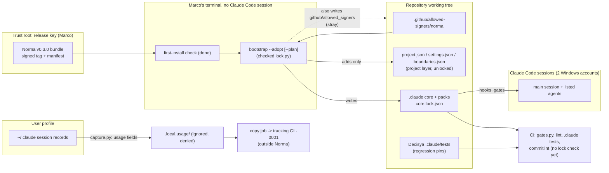

<!-- gate: G3 | verdict: PASS-WITH-NOTES | issue: #246 -->

# Threat delta – lock Norma 0.3.0 (issue #246)

Scope: the change replaces Decisya's hand-kept `.claude/` guardrails with the signed Norma 0.3.0 core plus the `dotnet` and `npm` packs. The install runs by `bootstrap --adopt`, and the change also adds a release signer line and a local usage capture. No runtime code, module, contract or data flow of the product changes. ASVS ids are ASVS 5.0 sections, applied by analogy to developer tooling: V15.2 (dependencies and supply chain), V13.3 (secret management), V14.2 (sensitive data), V8.2 (authorization at the object level, here agent write lanes) and V16.2 (logging).

Inputs read as data: G2 note and ADR-0023 (Proposed); Decisya's current hooks, scripts, agents, skills, `settings.json`, `boundaries.json`, `ci.yml`, `.gitattributes`, `.gitignore`; pipeline 217 and 218; the Norma 0.3.0 CHANGELOG, `architecture.md`, `consumer-guide.md`, `project-json.md` and bump runbook; and the four checked first-install files (`core.manifest`, `bootstrap.py`, `lock.py`, `base-settings.json`). I did not read the core hooks or the other core scripts. Where this note says "core holds X", the source is the 0.3.0 documents, so each such claim needs the pin in M1.

## Data flow and trust boundaries

## Threats

| Id | Element / flow | STRIDE | Threat | Severity | Mitigation | ASVS 5.0 | Status |
| --- | --- | --- | --- | --- | --- | --- | --- |
| T-01 | Replaced hooks and scripts | T, E | A Decisya-only deny (Bash option lists, compose `config`/`convert`, the `cd` target, the Docker and npm cases) is absent from the core, and the old tests that would show it are deleted with the engines | Medium | M1 | V8.2, V13.3 | Open (G4) |
| T-02 | `gates.py` review-required list | T, R | Decisya's patterns (stackctl/stackguards, ZAP, release pins, image scan, realm guard, rulesets, Dependabot) are not in the core floor, so G3/G6 can be skipped for them | Medium | M2 | V15.2 | Open (G4) |
| T-03 | Replaced agent and skill texts | E, I | Decisya's security rules in the five core agents, the issue skill and the three pack skills are overwritten (V6/V7 Level 3, the always-check list, negative auth tests, tenant column, never logging full AI prompts, the full-tier list) | Medium | M1 | V6, V7, V14.2 | Open (G4) |
| T-04 | Install window | E | Agents run while `.claude/hooks` is empty or `settings.json` is half-merged; in an account with Claude Code older than 2.1.295, an exec-form hook that fails to start lets the call through (`onFailure` ignored) | Medium | M3 | V15.2 | Open (G4) |
| T-05 | Adopting PR's own `lock.py` | T | No checker on the base branch, so CI and pre-push run the PR's own `lock.py`, which could vouch for itself | Medium | M3 (compare with the `norma-check` copy) | V15.2 | Open (G4) |
| T-06 | Signer line | S, T | A wrong or extra signer line is trusted. Because `SIGNERS_FILE` is hard-coded, `bootstrap.py` writes a stray `.github/allowed_signers` whenever `--signer-line` is given; the devops lane (`.github/**`) reaches both signer files | Low | M4; first-install check done | V15.2 | Open (G4) |
| T-07 | `capture.py` reading session records | I | Message text, tool output (secrets seen in a session), profile paths or the Windows user name end up in `.local.usage/` and leave with the copy job | Medium if the documented "usage fields only" property is wrong | M5 | V14.2, V16.2 | Open (G4) |
| T-08 | `.local.usage/` | I | Folder committed, written by an agent, put in an image build context, or blocked by a later `blocked_folders` entry (every hook would then deny) | Low | M5; `lint.py` check 15; loader refuses a blocked capture folder | V14.2 | Open (G4) |
| T-09 | Merged core file not lock-checked in CI (246-1) | T | A core file edited in a PR, pushed with `--no-verify`, missed in review | Low | Backlog #243 246-1 (B-1) | V15.2 | Accepted until 246-1 |
| T-10 | `blocked_folders: []` | I | `ops.local/` loses protection | None | Verified below (item 5) | V13.3 | No change |

## MUSTs

**M1 (fix-now): carry every replaced guardrail over, and pin each with a Decisya test against the installed core.** Before the old engine tests go, port their Decisya-specific deny cases into black-box tests in `.claude/tests/`: feed the installed hook a JSON payload and assert deny or allow. Copy these cases at least:
- Writes: `HiddenBuildLogicTests` (#218: case-insensitive deny of `*.user`, `obj/`, `node_modules/`; `::$DATA`, trailing dot or space). Also `.claude/**`, `docs/ai/pipeline/**`, `CLAUDE.md`, `.local.usage/**`, and `*.csproj` and `package.json` written by a lane owner.
- Bash allow-list: `cd` anywhere other than `src/Decisya.Web`. dotnet options that write files (`--artifacts-path`, `-o`, `--packages`, `-getResultOutputFile`). `dotnet ef --force` and `--connection`, and `--output-dir` outside the agent's lane. git `--output`, `--no-index`, `--upload-pack` and a fetch refspec. The devops-only tools: `gitleaks --report-path`, `pre-commit run -c`, `actionlint -shellcheck`, `aspire publish -o`. The command denies: `dotnet add package`, `dotnet tool install`, `dotnet nuget add`, `gh api`, `gh pr merge`, `gh secret`, `aspire add`.
- Docker: `exec`, `inspect`, `compose config`, `compose down -v`, `logs -f`, the Docker socket.
- npm: `npm install`, `npm audit fix`, `npx`, `pnpm`.
- Freeze after the first deny, and fail closed when `boundaries.json` cannot be read.
- `secret_guard`: the `.env` forms, `UserSecrets`, `secrets.json`, and `docker compose config` / `convert` for the main session too.

If the core allows a case that Decisya denies today, G4 stops and reports it. The fallback lives in the project layer: a `settings.json` `deny` entry (for compose: `Bash(docker compose config*)`, `convert`, the `docker-compose` forms and their PowerShell twins), or a narrower tools line on a Decisya agent (for example, drop `pre-commit run *` from devops). In parallel, a Norma core option is drafted for the exchange. Nobody patches a locked file. The same M1 covers the replaced texts. Move them, with a test that checks they are present:
- security-reviewer: ASVS 5.0 L2, and L3 for V6 and V7, plus the always-check list. Move Decisya's `asvs-checklist/references/l2-controls.md` rows into a Decisya-owned file.
- test-engineer: negative auth tests (expired token, wrong `aud`, `alg=none`, missing antiforgery header) and two-tenant isolation tests.
- issue skill: the full-tier list (auth, secrets, hooks, permissions, `.devcontainer/**`, CI required checks, rulesets, workflow permissions, gate machinery, reviewer agents, a new third-party package) and the #84 proportion rules.
- threat-model: the financial STRIDE emphasis.
- ef-migration: `tenant_id uuid not null`, with an index that starts with `tenant_id`.
- otel-instrumentation: the `[Sensitive]` masking test, and no full AI prompts in logs (log a hash and a token count).
- testcontainers: lazy fixtures with no secrets in `InitializeAsync`, and run-time canaries.

**M2 (fix-now): project.json must not lower any floor that Decisya holds today, and a Decisya test pins it.**
- `gates.review_required_paths` keeps every Decisya-only alternative of today's `REVIEW_REQUIRED_PATHS` that the core floor does not hold: `\.github/rulesets/.+\.json`, `\.github/dependabot\.yml`, `\.github/scripts/[^/]+\.py`, `\.github/image-scan/.+`, `\.github/release/.+`, `Directory\.Build\.targets`, `\.dockerignore`, `release-please-config\.json`, `\.github/zap/.+`, `deploy/compose/(stackctl|stackguards)\.py`, `deploy/tests/test_stackctl\.py`, the three realm-guard files, and new `\.github/allowed-signers/.+`. The test feeds one sample path per pattern to the installed `gates.py` and expects review-required.
- Also pinned:
  - `agent_boundaries.cd_targets` equals exactly `["src/Decisya.Web"]`;
  - `secret_guard.blocked_folders` equals `[]`;
  - `lock.signers_file` is `.github/allowed-signers/norma`;
  - `gates.approvers` lists only Marco;
  - `gates.docs_line_from` is `76`;
  - `prepush.ignore_paths` and `ignore_markdown` equal CI's `changes` lists;
  - `packs.dotnet.unit_test_filters` holds CI's **three** `--filter-not-trait` pairs (Integration, E2E, AppHost; `ci.yml` line 161). G2 says two pairs; three is correct;
  - `locked_restore.env_name` is `DECISYA_LOCKED_RESTORE`.

**M3 (fix-now): the install window, and how the result is checked before the commit.**
- From the moment `.claude/hooks` and `.claude/scripts` are emptied until the restart check below, no Claude Code session (CLI or VS Code, under either Windows account) is open on this checkout. Delete the `__pycache__` folders under both directories in the same step.
- Hand merge of `settings.json`: only the two hook registrations change, to the exact exec form (`-I`, `onFailure: "block"`, matchers including `PowerShell|Monitor`). `--adopt` then only appends the base denies. Adopt reformats the whole file, so a reviewer cannot check it by eye. A Decisya test pins every pre-adoption entry instead: all `allow` entries, the `deny` entries including the three `mcp__` denies, and all 14 `ask` entries.
- Before the commit:
  1. `python -I <temp>\norma-check\core\.claude\scripts\lock.py verify --root .` prints `lock: ok`. The SHA-256 of `.claude/scripts/lock.py` and of `.claude/core.manifest` equals the `norma-check` copies.
  2. `floors.py`, `lint.py` and `prereqs.py interpreter` pass.
  3. `git status --ignored` and `git diff` are read in full. No stray `.github/allowed_signers`, no `*.adopt-tmp`, no tracked `.pyc`. `.claude/hooks` and `.claude/scripts` hold only release files.
- After Claude Code restarts, `cat no-such-folder/.env` is refused.
- Under the second Windows account, `prereqs.py interpreter` passes (Claude Code 2.1.295 or newer, Python 3.12 or newer) before its first session after the merge.
- Record all of this in the G4 evidence.

**M4 (fix-now): the signer trust root.**
- `.github/allowed-signers/norma` holds exactly one line: `norma-release namespaces="git" ...`, taken from the notice, ending in LF. `.gitattributes` line 11 already keeps it byte-exact.
- Its fingerprint equals the notice's and the `signer` in `core.lock.json`. A Decisya test pins this, in the same way `test_build_policy.py` pins the Ostium file.
- Delete the `.github/allowed_signers` file that bootstrap writes.
- Add `.github/allowed-signers/**` and `.github/allowed_signers` to the `boundaries.json` `deny` list. These are a few lines in a file this PR changes (Low). Signer files then change only in the main session, after Marco has checked the fingerprint (ADR-0023 decision 4).

**M5 (fix-now): the usage capture.**
- These are in place before the first `capture.py` run: `/.local.usage/` in `.gitignore` as a folder, `.local.usage/**` in `deny`, and `.local.usage` in `.dockerignore`. `test_local_only_paths.py` is extended to check all three, the same way it checks `ops.local`.
- `blocked_folders` never names `.local.u…`.
- A Decisya test runs the installed `capture.py` against a fixture `CLAUDE_CONFIG_DIR`. Its records carry canaries in the message text, the tool output, a token-shaped string and a profile path. The test asserts that no file written under the capture folder holds any canary. This holds the documented "usage fields only" property.
- With two Windows accounts, each account runs `capture.py` only in its own clone under its own profile. Never point `CLAUDE_CONFIG_DIR` at the other account's profile, and never widen its ACLs. The copy job lists both capture folders.

## Item 5: `blocked_folders: []`

Confirmed, nothing gets weaker. Today's `secret_guard.py` blocks no folder at all: its `PATTERNS` cover only `.env`, `UserSecrets`, `secrets.json` and compose `config`/`convert`. Today `ops.local/` is protected by these:
- `.gitignore` line 32;
- `test_local_only_paths.py` (ignored, never tracked, listed in `.dockerignore`);
- Marco's local `Read` deny in `settings.local.json`.

`bootstrap.py` reads and writes only `settings.json` and `boundaries.json` (`adoption_plan`), so the local file stays as it is. One more point: the 0.3.0 loader expects a dot-folder with one inner dot. `ops.local` (no leading dot) cannot be listed, so the guard can cover it only after the `.local.ops` rename issue.

## Supply-chain backlog ratings (stay in #243)

- **246-1, CI lock check: Low.** Today the hand-kept files have no byte-level proof at all. They are protected by the CI review-required gate and Marco's review, and both stay: the core floor covers hooks, scripts, agents, skills, settings, `project.json`, the lock and the signer file. With M1, the Decisya regression suite runs in CI against the installed core (`ci.yml` line 282), so a weakened guard fails CI even without the lock check. Agents cannot push. When it lands, run the base branch's checker as the consumer guide shows.
- **246-2, commitlint range: Info.** Already covered. `ci.yml` runs the pinned commitlint action over the PR range and the `commitlint.py --range` mirror-drift step (lines 206–242). Keep `test_commitlint.py` and its goldens running against the core script.
- **246-3, `prereqs.py github --actual`: Low.** It catches visibility drift for the loader's opt-ins and does not protect a Decisya asset today.

## SHOULDs and backlog

- B-1 to B-3: the ratings above, in #243.
- B-4 (Low, backlog): the build-logic WARNING step of today's `prepush.py` (G4-59-08 to 11) has no core equivalent. Agents can no longer write those files, which lowers the impact.
- B-5 (Low, backlog): the G2 suggestion to make `Directory.Build.*`, `*.targets`, `NuGet.config` and `global.json` review-required. Every agent is now denied them; `Directory.Build.targets` is already in M2.
- S-1: the G2 ownership table leaves out the Decisya-owned skills `aspire-apphost`, `keycloak` and `journal`. Add them in the G4 inventory.
- S-2: the copy job (Marco, outside the repo) copies only `capture-*.json`, never `ledger.jsonl`, `worktrees.json` or `start-*.json`.

## Decisions for Marco

1. **Where the replaced Decisya text lives** (G2 open question 3). My recommendation: put rules that must always apply in a `CLAUDE.md` section, since every subagent receives `CLAUDE.md`: L3 for V6/V7, the always-check list, the full-tier list and the negative-test rules. Put procedures in Decisya-named skills (for example `decisya-ef-migration`, `decisya-testcontainers`, `decisya-otel`, and a Decisya ASVS reference). Risk: `CLAUDE.md` grows, and a Decisya-named skill is used only when someone calls it.
2. **If an M1 pin shows the core allowing a Decisya deny.** My recommendation: narrow the project layer now (a settings deny, or a smaller devops tools line), and draft a Norma core option for the exchange. Risk: devops loses a command until Norma ships the option.
3. **Deny the signer files to every agent (M4).** My recommendation: yes. Risk: none beyond the main session doing that one edit.
4. ADR-0023 acceptance and the three backlog ratings above, which keep 246-1 to 246-3 out of #246.
