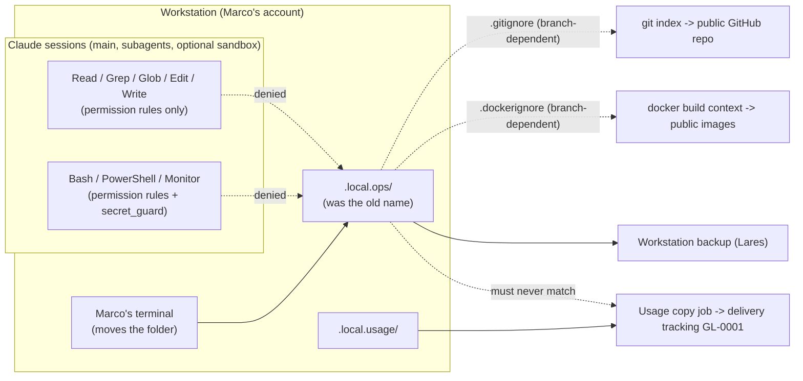

<!-- gate: G3 | verdict: PASS-WITH-NOTES | issue: #259 -->

# Threat delta #259: the operations folder becomes `.local.ops/` (N-016)

Scope: the rename steps (1) guard the new name next to the old one, (2) Marco moves the folder in his own terminal and Lares changes the backup entry in the same sitting, (3) a refusal test, (4) drop the old name's guards except its `.gitignore` line, and update the living docs. Assurance level: ASVS 5.0 L2 (addendum). Nothing inside the folder was read for this review. Its content, as recorded in `docs/ai/pipeline/124.md`, is private network addresses, the VLAN layout, account names and the backup schedule, with no credentials.

Inputs read: `docs/ai/pipeline/259.md`, `.claude/project.json`, `.gitignore`, `.dockerignore`, `.claude/settings.json`, the rule lines of `.claude/settings.local.json` that name a local folder, `.claude/boundaries.json`, `.claude/hooks/secret_guard.py` (`patterns_for`), `.claude/scripts/_claudecfg.py` (`guard_blocks`, the usage-folder check), `.claude/tests/test_local_only_paths.py`, `.claude/tests/test_settings_adoption.py`, `deploy/tests/test_no_home_addresses.py` (file selection), `.devcontainer/compose.yaml` (mounts), and the tree walkers in `.claude/scripts`.

## Data flow and trust boundaries

Boundaries: Claude session | the folder; working tree | public repository; working tree | public image build context; workstation | backup; workstation | delivery tracking (the usage copy job).

What the guards cover today:
- `secret_guard` reads `blocked_folders` from the tracked `project.json`. It scans only Bash, PowerShell and Monitor commands. Read, Grep, Glob, Edit and Write are covered only by permission rules.
- The old name's permission rules live only in Marco's untracked `settings.local.json`, as absolute paths under this account's home: `Read(~/source/repos/dev/decisya/<old>/**)`, `Edit(...)`, `Bash(*<old>*)` and `PowerShell(*<old>*)`.
- With `.local.ops` listed, the guard matches `.local.o…`, `.local.*`, `.local.?…` and the class or brace forms. It does not match `.local.usage` or `~/.local/`, and the loader refuses a list that would block the capture folder (`guard_blocks`).

## Threats

| Id | Element / flow | STRIDE | Threat | Severity | Mitigation | ASVS 5.0 id | Status |
| --- | --- | --- | --- | --- | --- | --- | --- |
| T-01 | Folder → git index during the window | I | Between the move and the merge, every guard of the new name is branch-dependent (`.gitignore`, `.dockerignore`, `blocked_folders`). On `main` or any other branch, such as a Dependabot PR checked out in this window, `.local.ops/` shows as untracked. A `git add -A` or `git add .` by a session stages it, and a push publishes it to the public repository. The address scan (`git ls-files --others --exclude-standard`) also reads it there. | Medium | M1 | V13.4, V14.2 | Open (G4) |
| T-02 | Claude session → folder (file tools) | I | The secret guard does not cover the file tools. The Read/Edit deny lives only in one clone's local file, as an absolute path under one account's home. A second Windows account, a fresh clone or a reset `settings.local.json` then has no file-tool deny for the folder. That fails the Done-when line "denied to every Claude session". | Medium | M2 | V14.2, V13.1 | Open (G4) |
| T-03 | Retiring the old name's guards | I | Step 4 drops `Bash(*<old>*)`, `Read`/`Edit` and the old `.dockerignore` line while a folder with the old name still exists: a partial move, a copy instead of a move, a restore, or the #164 scratch copy (`mut164`, `docs/ai/pipeline/164.md` line 134). That copy then has no guard left except `.gitignore`. | Medium | M3 | V14.2 | Open (G4) |
| T-04 | Workstation → backup | D | The backup entry still names the old path, or the backup tool skips dot-folders or `.local*` names, so the new folder is not backed up. One missed night is Low, but a silent exclusion would last until the notes are needed. | Medium | M3 (backup run verified) | n/a (operational; ASVS 5.0 has no backup control) | Open (G4) |
| T-05 | Refusal test (step 3) | I | A probe that reads content would expose the folder if a guard is wrong. A test that covers only one tool or one spelling passes while another path stays open. | Medium | M4 | V13.4 | Open (G4) |
| T-06 | Usage copy job → delivery tracking | I | The `.local.<name>` convention puts the operations folder next to the capture folder. A copy job whose source is `.local.*` or a parent glob sends the network notes to another project's tracking. | Medium | M5 | V14.2 | Open (G4) |
| T-07 | `blocked_folders` → capture | D | A wrong entry, such as one starting with `.local.u`, blocks the capture folder. The loader then refuses `project.json` and every hook denies every command. | Low | `guard_blocks` loader check (fail closed); M4 positive control | V13.1 | Mitigated |
| T-08 | Tools walking the tree | I | Recursive readers that never name the folder still read it (`grep -r`, `Get-ChildItem -Recurse`, `rg --no-ignore`, scripts an agent writes), and so do run-time-built names and 8.3 short names. The address scan's fallback walk, used only when git fails, reports path, line and kind, never the value. `capture.py` scans only its own folder, `literals.py` only its given targets, and `lock.py` only `.claude/`. | Low | Accepted residual (documented in `secret_guard.py`); unchanged by the rename | V13.4 | Accepted |
| T-09 | Optional sandbox | I | `.devcontainer/compose.yaml` binds the whole working tree read-write, so the folder (either name) is visible inside the sandbox. That sandbox is used when agents read untrusted content. The same guards apply there, because `.claude/` and `settings.local.json` are mounted. This was true before the rename. | Low | S4 (backlog) | V14.2 | Backlog |

No High. Every Medium has a MUST below.

## MUSTs (fix-now, all in this PR or its move sitting)

**M1 (T-01): branch-independent guards come before the move.**
- Before the move, Marco adds `.local.ops/` to `.git/info/exclude` in his terminal, so the folder stays ignored on every branch. It stays there at least until the PR merges; keeping it for good costs nothing.
- Marco's `settings.local.json` rules for the new name are also in place before the move: `Read`, `Edit`, `Bash(*.local.ops*)` and `PowerShell(*.local.ops*)`. They hold on every branch.
- The tracked guards from step 1 are committed on the branch before the move.
- Until the merge, no session runs `git add -A`/`git add .` on another branch, and no one runs `docker build` from the repository root on another branch.
- G4 evidence records the order.

**M2 (T-02): the file-tool deny is tracked.**
- Append Read and Edit deny rules for the new name to the tracked `.claude/settings.json` in a project-relative form that covers any depth, for example `Read(/.local.ops/**)`, `Read(**/.local.ops/**)` and the same two for `Edit`.
- Appending is allowed: `test_settings_adoption.py` permits appends to `deny`, and the floor can only grow.
- Marco's local rules stay as a second layer.
- With this and `blocked_folders`, every clone and every account is covered by tracked files, not only this one.

**M3 (T-03, T-04): retire the old name only after two confirmations.** Step 4 starts after both, and G4 evidence records them as statements, not content:
- Marco confirms in his own terminal that no folder with the old name exists in this clone, in any other clone or worktree, or in a scratch copy, including `mut164` from #164.
- Lares confirms in the exchange thread that a backup run after the move holds `.local.ops/`, giving file names or a count, never content. Changing the entry alone is not enough.
- The old `.gitignore` line stays, as planned.

**M4 (T-05, T-07): a harmless and complete refusal test.**
- Every probe would expose nothing even if it were allowed: a `Read`, `Grep` or `Glob` of a non-existent file name such as `.local.ops/probe-259.txt`, and `git check-ignore -q .local.ops/probe-259.txt` for the shell.
- The probes cover `Read`, `Grep` and `Glob` with a path inside the folder, Bash, PowerShell, and the glob spellings `.local.o*` and `.local.*`.
- Positive control: a command that names `.local.usage` is allowed, and `capture.py` still runs.
- The main session runs the probes; there is no need to freeze a subagent. Record each tool, the decision and the rule that decided it in `docs/ai/pipeline/259.md`.

**M5 (T-06): the usage copy job names its folder exactly.** Marco confirms that the copy job's source is the exact `.local.usage` path in each clone and copies only `capture-*.json` (246 S-2), with no `.local*` glob or parent-folder copy. The backup entry names `.local.ops` exactly. Recorded in G4 evidence.

## SHOULDs

- S1 (fix-now, Low, files this PR changes):
  - In `.gitignore`, write the new line unanchored (`.local.ops/`), so it matches at any depth like the old line.
  - Extend `test_local_only_paths.py` to the new name for all three checks: ignored at any depth, never tracked, and listed in `.dockerignore`.
  - Update `test_settings_adoption.py` line 73 to `[".local.ops"]`; it pins `[]` today, so the suite fails otherwise.
- S2 (Low, backlog #243 unless `boundaries.json` is touched anyway): add `.local.ops/**` to `boundaries.json` `deny`, as was done for `.local.usage/**`. No agent's allow-list reaches the folder today, so this is defence in depth only.
- S3 (Low, Marco's decision): keep the old `.dockerignore` line next to the old `.gitignore` line, against a restore under the old name.
  - Recommendation: drop it as planned once M3 is confirmed.
  - Risk: a later restore under the old name would enter a root build context.
  - This needs the Done-when line reworded only if he keeps it.
- S4 (Low, backlog #243): in the sandbox, mask `.local.ops` with an empty read-only volume, as `.vs` is masked (G4-04). This is pre-existing and not changed by the rename. `.devcontainer/**` is a host-run, review-required change, so it is out of this issue.
- S5 (docs, fix-now under the Done-when): living mentions of the old name are:
  - `deploy/compose/address-allowlist.txt` line 10;
  - the assertion message in `deploy/tests/test_no_home_addresses.py` line 196;
  - `docs/runbooks/deployable-stack.md` line 16;
  - `docs/architecture/deployable-stack.md` line 127;
  - the docstring and test names of `test_local_only_paths.py`.

  Dated records keep the old name: the ADRs, the threat models and the pipeline records. The mention in `secret_guard.py` line 102 is core text about `.local.ops` and is locked.
