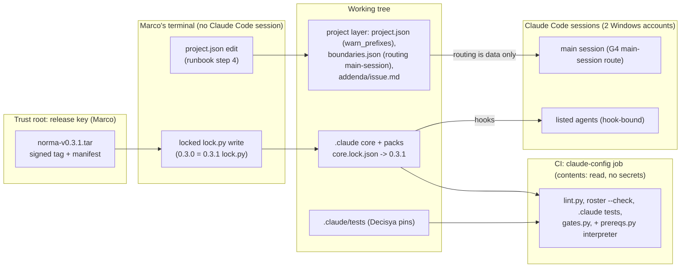

<!-- gate: G3 | verdict: PASS-WITH-NOTES | issue: #261 -->

# Threat delta: bump Norma 0.3.0 to 0.3.1 (issue #261)

Scope: the bump installs Norma 0.3.1 (core plus the `dotnet` and `npm` packs) with the project's own locked `lock.py write`. It also makes three project-layer edits: a `main-session` row in `boundaries.json` `routing.G4`, `prepush.warn_prefixes: [".github/zap/"]` in `project.json`, and a `prereqs.py interpreter` step in `ci.yml`. No product code, module, contract, data flow or endpoint changes. As in the #246 threat model, ASVS 5.0 ids apply by analogy to developer tooling:
- V15.2: dependencies and supply chain.
- V15.3: defensive coding, fail closed.
- V8.2: authorization design, here the agent write lanes.
- V13.3: secret management.
- V14.2: data protection.

Inputs, all read as data:
- The manifest, ADR-0023 and the #246 threat model.
- The installed `core.lock.json` and the 0.3.1 `core.manifest`.
- Both trees of `hooks/`, the changed `scripts/`, `test-engineer.md`, `rules/core.md`, the `issue` skill and `packs/dotnet.json`.
- Decisya's `settings.json`, `boundaries.json`, `project.json`, `addenda/issue.md`, `ci.yml` (job `claude-config`) and the `.claude/tests` pins.
- The 0.3.1 CHANGELOG and consumer guide.

The branch has no changes yet (`git diff --name-only origin/main...HEAD` is empty).

## What changes in the core (by SHA-256: 0.3.0 `core.lock.json` against 0.3.1 `core.manifest`)

- **Unchanged, byte for byte:** `secret_guard.py`, `lock.py` (`5f0f125f…`), `gates.py`, `commitlint.py` and `literals.py`; `base-settings.json` and `github-features.json`; four of the five agents (architect, product-owner, security-reviewer, tech-writer); `npm.json`; and every skill except `issue`, `bootstrap`, `ef-migration` and `testcontainers`.
- **`agent_boundaries.py`:** the only change is `instead()`. A deny that is already decided gets a sentence that names the right tool (Grep, Glob, Read, Edit or Write). The decision logic is identical: allow-list, option checks, Docker, npm, `_DENIED`, the write lanes and the freeze.
- **`_hooklib.py`:** `main-session` becomes a reserved name. `validate_boundaries` refuses it as an agent and accepts it only as a `routing.G4` owner. No decision reads `routing`, so the row grants nothing to any hook.
- **`_claudecfg.py` (+12 lines):** two optional keys.
  - `prepush.warn_prefixes`: 1 to 20 unique repository-relative paths, used only to add warnings.
  - top-level `lint_patterns`: validated by `_pattern`, which refuses inline flags, back-references and ambiguous repeats.

  `GRANT_PROGRAMS`, `EXACT_GRANTS`, `REVIEWED_OPTIONS`, `REVIEWED_VERBS` and `grant_problem` are identical, so there is **no new grant and no wider tool rule**.
- **`dotnet.json`:** one lint message text changes. `agent_tools` and `allowed_options` are identical.
- **`test-engineer.md`:** its tools line is unchanged. It gains a stricter rule: Edit and Write only, never through the shell.
- **`floors.py`:** stricter. `PROTECTED` now also catches doubled separators, `.` and `..` segments and trailing dots, through `_flat`. Decisya's `settings.json` names `.claude` only in the two core hook registrations, which floors.py skips, and in permission rules, so nothing in it trips the check.
- **`prereqs.py`:** `interpreter` also requires git 2.31 or newer. It probes programs on PATH only (never the current folder) and strips `PYTHON*` from their environment.
- **`lint.py`:**
  - It skips `main-session` routing rows.
  - It warns when an agent's write lane covers `lock.signers_file` and no deny entry covers it.
  - It accepts `not a bash lookup` anywhere on a line.
- **`roster.py`:** renders the main-session route. Its fields pass through `LABEL` and `ROUTE_PATHS` and are sanitised by `md_cell` and `mermaid_label`.
- **`capture.py`:** also counts sessions whose `cwd` is the 8.3 short form of this repository's own roots. It skips UNC paths and remote drives.
- **`bootstrap.py`:** changes only the first install. A locked project never runs it (ADR-0023 §2, §7).
- **`rules/core.md`:** adds one loosening: "A project's own entry in `secret_guard.blocked_folders` may be removed once no clone holds a folder of that name."
- **`issue` skill:**
  - G4 routes `main-session` rows to the orchestrator.
  - The tool rules are stricter (search paths, Edit and Write only).
  - The agent prompt lists the verdict `N/A`.

**No deny becomes an allow, no tool rule gets looser, and no fail-open path is added.**
- An unknown `project.json` key still fails closed: the hooks deny every shell command, the main session's included.
- An invalid `boundaries.json` still denies every listed agent's write, and Docker for every listed agent.

## Data flow and trust boundaries

## Threats

| Id | Element / flow | STRIDE | Threat | Severity | Mitigation | ASVS 5.0 | Status |
| --- | --- | --- | --- | --- | --- | --- | --- |
| T-01 | Install and trust root | S, T | A tampered or wrong-key bundle installs altered hooks | Medium (inherent) | The signature and the hash are already checked. `lock.py` is unchanged, so the checker that installs 0.3.1 is the one already reviewed. M-1 | V15.2 | Open (G4) |
| T-02 | Install order | D | The `warn_prefixes` key or the `main-session` row lands while the 0.3.0 loader is installed. The loader refuses it: every shell command is denied, the main session's included, and every listed agent's write is denied. This fails closed, not open | Low | M-1 (order) | V15.3 | Open (G4) |
| T-03 | Hook engines | T, E | A Decisya deny silently becomes an allow | Low | Verified above (decisions identical). M-3 (pins run against 0.3.1) | V8.2, V13.3 | Open (G4) |
| T-04 | `routing.G4` `main-session` row | E | The orchestrator, which no lane binds, takes over lane work through a broad glob (`src/**`), or the row names the signer files as G4 work. `lint.py` skips these rows entirely, and the loader checks only the glob syntax | Medium | M-2 | V8.2, V15.2 | Open (G4) |
| T-05 | `addenda/issue.md` edit | T, R | Removing the "workaround text" also drops the scope list or the "Marco approves each write" rule | Low | M-2 | V8.2 | Open (G4) |
| T-06 | `prepush.warn_prefixes` | T | The key could hide a warning | None | It only adds warnings: values are lowercased and matched by prefix, and the code cannot remove a core prefix. `.github/zap/.+` is already review-required | V15.2 | No action |
| T-07 | Signer files and the devops lane `.github/**` | T, S | devops rewrites `.github/allowed-signers/norma` | Low | `decide_write` checks `deny` before the lanes. `.github/allowed-signers/**` and `.github/allowed_signers` are in deny, so the new lint warning stays silent. Pinned by `test_guardrail_carryover.py` lines 65–67 | V15.2 | Mitigated |
| T-08 | CI `prereqs.py interpreter` step | T, E | Code from the PR checkout runs in CI with a token or secrets | Low | It runs in `claude-config`: workflow `permissions: contents: read`, `persist-credentials: false`, no secrets, no new action. The job already runs PR code (`lint.py`, tests). M-4 | V15.2 | Open (G4) |
| T-09 | `rules/core.md` loosening | I | The `.local.ops` entry in `blocked_folders` gets removed under the new core sentence | Low | Decisya pins `blocked_folders == [".local.ops"]` (`test_settings_adoption.py:83`). Where rules conflict, the stricter one applies (core.md line 4). M-3 | V13.3 | Mitigated |
| T-10 | `capture.py` session discovery | I | The corrected 0.3.1 text says `finish` parses the first records of every session file on the account, other projects' included, keeping only whether the `cwd` is this repository's. ADR-0023 §5 says it reads only this repository's records. The 0.3.0 code is the same (`first_cwd`), so nothing new runs; the record is inaccurate | Low | S-1 | V14.2 | Backlog |
| T-11 | `issue` skill prompt lists `N/A` | R | `gates.py` (unchanged) passes `N/A` with a reason at any gate, so a full-tier G3 or G6 could pass as `N/A` | Low | Marco reads the verdicts, and the security-reviewer agent allows `N/A` only for the light-tier G3 line. S-2 | V15.3 | Backlog |
| T-12 | `lint.py` bash-lookup marker | T | A string containing `not a bash lookup` hides a real bash or WSL lookup | Low | It is a lint check, not a boundary. Covered by review | V15.3 | Accepted |

No High threat. T-04 is the only Medium that needs project action.

## MUSTs (all fix-now, G4)

**M-1: install as ADR-0023 §7 and the 0.3.1 runbook say, in this order.**
- Run `git --version` on both Windows accounts, and check that each reports 2.31 or newer, before the bump.
- In Marco's own terminal, with no Claude Code session open on either account: first the `project.json` `warn_prefixes` edit, then at once the locked `lock.py write --bundle … --tag v0.3.1 --packs dotnet,npm`.
- Add the `main-session` routing row only after the install.
- Record in the G4 evidence:
  - `lock.py verify` names 0.3.1;
  - `.claude/scripts/lock.py` is still `5f0f125f…`;
  - `core.lock.json` `signer` is unchanged (`SHA256:FN0F…`) and `.github/allowed-signers/norma` is not in the diff. If the release key changed, stop: that is the two-PR sequence;
  - `floors.py`, `lint.py` (no warnings) and `prereqs.py interpreter` all pass;
  - after a Claude Code restart, `cat no-such-folder/.env` is refused.

**M-2: the main-session route stays a record of the shared deny, and a Decisya test pins it.**
- The row names only globs that a `boundaries.json` `deny` entry covers: build logic and dependency manifests.
- It names no lane path, and not `.github/allowed-signers/**` or `.github/allowed_signers`. Signer lines change only after Marco's fingerprint check (ADR-0023 §4), not as routine G4 work.
- Add a test in `.claude/tests` that:
  - asserts every backticked glob of each `main-session` row matches a deny glob (as the hook does: deny without case);
  - asserts the signer paths are absent from the row;
  - asserts no agent is named `main-session`.

  `lint.py` no longer checks these rows (line 361).
- In `addenda/issue.md`, remove only the sentence "A routing row cannot name the main session … this line is the record (#246)." Keep the scope list and "Marco approves each write". Add a `test_decisya_addenda.py` pin for the approval phrase.

**M-3: the Decisya pins pass against the installed 0.3.1 with no expectation weakened.**
- Run every `.claude/tests` suite in full, with bounded run times: `test_guardrail_carryover.py`, `test_guardrail_cases.py` (about 550 cases), `test_settings_adoption.py` (including the `blocked_folders` and signer pins), `test_decisya_addenda.py`, `test_decisya_lint.py` and `test_capture_canary.py`. Also run the new zap-warning test.
- Deny reasons now end with the `instead()` sentence. A test may change only where it asserts reason text, never a deny or allow decision or a case count. Name any such edit in the G4 evidence.

**M-4: the CI step.**
- Add one `run:` step, `python3 .claude/scripts/prereqs.py interpreter`, to the existing `claude-config` job, beside `lint.py`. Use:
  - no new action (no `setup-python`);
  - no `${{ }}` in `run:`;
  - no `continue-on-error` and no `|| true`;
  - no job-level `permissions` wider than the workflow's `contents: read`;
  - no `env:` secret.
- The check probes `python`, the hook token in `settings.json`. If `python` on `ubuntu-latest` is missing or older than 3.12, report it to Marco. Do not change the hook token or add an action without his approval.
- The Done-when also says `floors.py` passes in CI, and today no CI step runs it. Add `python3 .claude/scripts/floors.py` to the same job, or record Marco's decision against it. These are a few lines in a file this PR changes.

## SHOULDs and backlog (#243)

- **S-1 (Low, backlog):** amend ADR-0023 §5 (and, if Marco wants, the A-011 note) to match the corrected capture text: `finish` parses the head of every session file on the account to find this repository's sessions. It keeps and prints nothing from other projects. Mention it in the G7 PR body so Marco sees it at merge.
- **S-2 (Low, backlog):** pin in Decisya that a full-tier G3 or G6 artifact never carries `verdict: N/A`. This could be a Decisya test over `docs/security/**` verdict lines, or an `issue` addendum line.
- **S-3 (Low, backlog):** "Marco approves each write" of build logic holds only in default permission mode. `settings.json` `ask` covers the dependency manifests, but not `*.csproj`, `*.props`, `*.targets`, `Directory.Build.*` or `global.json`. In accept-edits or auto mode, those writes need no prompt; the pre-push build-logic warnings, G6 and Marco's `git diff` still cover them. Consider adding `ask` entries for them.
- **S-4 (Info):** the CI lock check (#243 item 246-1) is still open, so for this bump the lock is verified only by pre-push and the G4 evidence. G6 checks that evidence.

## Decisions for Marco

1. **Signer files in the main-session row (M-2).** My recommendation: leave them out of the row and keep them under ADR-0023 §4 only. Risk: the roster no longer lists the signer files as main-session work; the addendum and ADR-0023 still do.
2. **`floors.py` in CI (M-4).** My recommendation: add it to `claude-config` now, since the Done-when names it and it is two lines. Risk: CI fails if a later settings edit trips the stricter path-form check, which is the intent.
