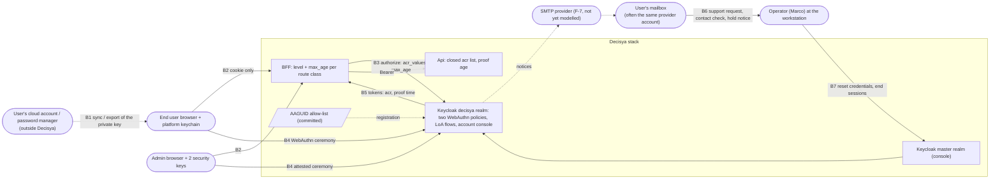

<!-- gate: G3 | verdict: PASS-WITH-NOTES | issue: #266 -->
# Threat delta: end-user authenticators at ASVS Level 3, synced versus device-bound passkeys (issue #266)

- Inputs:
  - manifest `docs/ai/pipeline/266.md` (Marco's G1 decisions 1 to 5, the G2 summary, the orchestrator's ASVS check against OWASP `v5.0.0`);
  - ADR-0025 `docs/adr/0025-authenticators-at-asvs-level-3.md` (Proposed);
  - the G2 note `docs/architecture/266-end-user-authenticators-l3.md`;
  - G1 `docs/requirements/266-end-user-authenticators-l3.md` and NFR-63 to NFR-68;
  - baselines: `production-identity.md` (#121), `keycloak-realm.md` (#17), `system-baseline.md` (C-01, C-02), `asvs-l2-baseline.md` (V6, V7 rows).
- Mode: threat delta of the **target design**, before acceptance. No code, realm or test changes in #266. The MUSTs below are changes to ADR-0025 (and, where named, the G2 note), to be made **before Marco accepts it**. The SHOULDs go to the implementation follow-ups F-1 to F-11.
- Level: ASVS 5.0 L2, with V6 and V7 at **L3**. Ids are mapped at the row level the ASVS baseline uses. Check the numbers against the official 5.0 text before copying them into a compliance artefact.
- Ids: T266-xx (threats), M266-xx (MUSTs for the ADR), S266-xx (SHOULDs). M-1 to M-11, U-1 to U-10, P-1 to P-4, I-1 to I-5 and F-1 to F-11 are ADR-0025's and the G2 note's.
- Reviewer: security-reviewer agent, 2026-11-03. Mode: G3. Reads only; no network fetch.

## Verdict

**PASS-WITH-NOTES.** Option B (synced passkeys for end users under 6.3.3's relaxation clause) is a defensible choice. Keeping phishing resistance and user verification for every user, and device-bound keys for admins, is the right split. The level model, fail-closed `acr` parsing, the stop rules on U-1 and U-5, and the ban on SMS, email links, TOTP and recovery codes are sound.

One **High** sits in the design as written: the total-loss support procedure (decision 6) can be passed by whoever controls the registered email, which is often the same cloud account that syncs the passkey (T266-02, hypothesis H1 confirmed). It is mitigated only if the ADR carries M266-01. With M266-01 to M266-05 in the ADR, nothing High is left open. **If the ADR reaches G6 without M266-01 to M266-05, G6 gives BLOCK.**

## Data flow and trust boundaries (target)

- **B1** is the accepted residual R-CLOUD: Decisya sees neither side of it. Passkeys can now also be exported between password managers, so the key's custody is the provider's and the user's.
- **B6** is new and is the weakest boundary in the design. A person decides on evidence that arrives through the user's mailbox. In the R-CLOUD case the mailbox and the passkey often belong to the same compromised account.
- **B7** is the operator path, through the master realm, which today is protected by TOTP (P-2).
- **B3/B5** carry the level and the proof time across the BFF to the Api. The Api is the enforcement point, as in #121.

## Threats

| Id | Element / flow | STRIDE | Threat | Severity | Mitigation | ASVS 5.0 id | Status |
| --- | --- | --- | --- | --- | --- | --- | --- |
| T266-01 | B1, end-user sign-in | S, I, T | Whoever controls the cloud account that syncs a user's passkey signs in at `passkey` level. They read the whole tenant and make every non-sensitive write (transactions, budgets, alerts), in sessions of up to 10 h (Keycloak idle 1800 s, max 36000 s; BFF absolute 10 h, non-sliding), renewable for as long as the credential stays registered at Decisya. Regaining the cloud account may not end it, because the key may have been copied or exported. | Medium (accepted) | Accepted residual R-CLOUD (Marco, 2026-11-03); M-1 for six operations; one tenant per user (ADR-0001). The ADR understates the extent: M266-02 | V6.3.3 (relaxed), V7.1.1, V7.3 | Accepted; wording → M266-02 |
| T266-02 | B6, B7, total-loss recovery | S, E | The support procedure's checks are control of the registered email and the registered name. The name is self-asserted and visible to anyone in the session or the provider account. So email control alone passes. An R-CLOUD attacker (or anyone who compromised only the mailbox) asks for recovery, deletes the 72 h notice in the same mailbox, and after the reset registers two own authenticators, including an own attested key. The account is then the attacker's at `device-bound`, the owner is locked out, and a user who added a device-bound key for protection gained nothing. NFR-64 holds in letter (the level is not lower) but not in substance: the identity proof behind the recovery is weaker than every authenticator it replaces, and email becomes a de-facto recovery factor that T1 and M-2 ban as a link. | **High** | M266-01 | V6.3.4, V6.3.6, V6.4 (6.4.4 to 6.4.6), V6.5 | Mitigated by requirements (ADR) |
| T266-03 | B6, support route for export and deletion | I, D, T | Decision 4 sends export and deletion for users without a device-bound key to support "with the same identity checks". Export adds little to T266-01 (the session already reads everything). Deletion is irreversible: an attacker with the mailbox destroys the user's financial records, which is outside the accepted residual ("outside the sensitive operations"). | Medium | M266-01 (deletion through support is restorable for a grace period, with the in-app notice) | V6.4, V14.2, V7.5.3 | Mitigated by requirements (ADR) |
| T266-04 | Profile attributes used by recovery | T, E | Changing the registered name is not a sensitive operation (decision 4 lists the email, not the name), and M-9/I-4 cover credentials only. An attacker session changes the name, so the owner's legitimate recovery later fails the name check while the attacker keeps access. Whether the account console can change the email outside the Api's step-up is not stated either (U-7 asks only about credentials). | Medium | M266-01 (every attribute recovery relies on is changeable only at `device-bound` or through support, on every path, including the account console) | V6.4, V7.5.1, V8.2 | Mitigated by requirements (ADR) |
| T266-05 | B3, step-up flow | E | The `device-bound` sub-flow offers registration when the account has no device-bound credential (today's OTP sub-flow forces setup), so a `passkey` session registers its own key and escalates. | High if present | M-8, I-2, stop rule on U-5; realm-file test `userSetupAllowed: false` (G2 rules) | V6.3.3, V6.5, V7.5.3 | Mitigated by requirements (F-1) |
| T266-06 | Registration, device-bound policy | S, E | "Attestation" shipped as an AAGUID match, which the authenticator writes itself, so a synced or software credential claims an allow-listed model and gets `device-bound`. Attachment is only a hint (U-3). | High if present | Decision 7 stop rule on U-1; level never above the class (M-7). Conditional consequences for D-012: M266-04. Hardening: S266-01 | V6.3.3, V6.5, V11 | Mitigated by requirements (F-1) |
| T266-07 | Account console, `kc_action` | E | A `passkey` session adds, removes or replaces credentials through Keycloak's account console or an application-initiated action, around the Api's step-up. | High if present | M-9, I-4, U-7. Fallback if Keycloak cannot restrict it: the account console client and `kc_action` credential actions are disabled for the realm (stated in M266-04) | V6.5, V7.5.1, V7.5.3 | Mitigated by requirements (F-1) |
| T266-08 | Required actions | E | Keycloak's default required actions re-enable TOTP, recovery codes or WebAuthn registration paths. | Medium | M-2, I-5, U-8; explicit `requiredActions` list pinned by a realm-file test | V6.3.4 | Mitigated by requirements (F-1) |
| T266-09 | B5, proof age | E | The `device-bound` level survives refresh beyond 300 s (T121-03 pattern), or the Api checks `auth_time` of any authentication instead of the time of the device-bound proof. A session that once stepped up is `device-bound` for its remaining 10 h. | Low | U-6; S266-04 | V7.5.3, V9.2 | Backlog (F-2) |
| T266-10 | `acr` handling | S, E | A level outside the closed list, a duplicated or array claim, or a level higher than the class used is honoured. | Medium | M-7, NFR-66, fail-closed parsing as `CallerIdentity` today; coupling tests (G2 rules) | V6.8.4, V9.2, V8.2 | Mitigated by requirements (F-2) |
| T266-11 | B7, master realm | S, E | The master-realm operator stays on TOTP (P-2). It can grant `platform-admin`, change the WebAuthn policies, reset any credential, impersonate users and clear events. It is the strongest account in the system and the only one left on a phishable factor. The workstation-only console (#121 Q8) blunts remote relay, but D-012's "platform admins only with two device-bound keys" overstates the admin class while it stays. | Medium | M266-04 (P-2 decided at acceptance) | V6.3.3 (L3), V8.2, V6.5 | Mitigated by requirements (ADR) |
| T266-12 | Impersonation | E | Keycloak impersonation by an admin creates an end-user session; if it carries a level from the closed list, an admin (or the TOTP master-realm account) reaches tenant data as the user without a cross-tenant audit record. | Low | S266-03 | V8.2, V16.3 | Backlog (F-1) |
| T266-13 | Detection | R | No notice of a new sign-in, a new credential, a recovery request or a sensitive operation (V6.3.5, V6.3.7 open, Low, P-4). Under R-CLOUD these are the owner's only signals, and an email-only notice goes to the mailbox the attacker may hold. | Medium | M266-03 (notices become a mitigating control, delivered in-app and by email, before the first non-synthetic sign-up) | V6.3.5, V6.3.7, V16.3 | Mitigated by requirements (ADR) |
| T266-14 | Remediation by the owner | D | An owner who notices misuse cannot remove the compromised synced passkey without a device-bound key (removal is a sensitive operation), so remediation runs through support, which T266-02 weakens. "Sign out other devices" (V7.4.3) does not help: the attacker signs in again. | Medium | Stated plainly (M266-02); the support path strengthened (M266-01) | V6.5, V7.4.3 | Mitigated by requirements (ADR) |
| T266-15 | User verification | S | An assertion with the UV flag unset is accepted, so a synced passkey stops being multi-factor and the "MFA for every user" claim fails. | Medium | M-5 (policy `required`); S266-02 adds a behavioural case | V6.3.3, V6.5 | Mitigated by requirements (F-1) |
| T266-16 | AAGUID allow-list data asset | T | The committed list is swapped or widened to include synced models. | Low | Reviewed data asset with `.SOURCE.md` (G2); S266-01 adds a SHA-256 pin and a test, as `common-passwords.txt` (T121-14) | V15.2, V13.1 | Backlog (F-1) |
| T266-17 | B6, support channel | D, S | Request floods, or social engineering of a solo operator under time pressure. | Low | S266-05 | V2.4, V6.4 | Backlog (F-5) |
| T266-18 | Auth events and logs | I | WebAuthn events or BFF/Api logs carry credential ids, user handles, public keys or attestation certificates, which identify a person's devices. | Low | S266-09 | V16.2.5, V14.2 | Backlog (F-1, F-2, F-3) |
| T266-19 | ASVS wording and reading | R | The ADR still marks every quote "unverified", and does not state how a "must" in the V6.3 introduction can be relaxed by 6.3.3's clause. A strict reader at Greenlight could reject the relaxation on that reading. | Low | M266-05 | — | Fix-now (ADR) |

## MUSTs for ADR-0025 (before Marco accepts it)

**M266-01 (T266-02, 03, 04; High, fix-now): total-loss recovery and the support route must not be passable by email control alone.**
Decision 6 and decision 4 must carry the following, and decision 3's control table gains a row (M-12, "recovery identity assurance", test target the F-5 runbook review by G3 and an NFR the product owner adds next to NFR-64):
- (a) **The ADR names what the support checks prove, and what they do not.** Either the identity check includes at least one element independent of the registered email and of the user's cloud account, or Marco accepts, by name and date, a second residual R-RECOVERY: "whoever controls the registered email can, after the hold, take over the account, including its device-bound capability". Without one of the two, M-3 and decision 9 overstate the guarantee. Marco decides which; I do not choose the independent element for him. Candidates proportionate to a solo operator: something only the owner was shown inside a session at enrolment (not a recovery code, which T1 bans, but for example a reference the operator can compare); or, for accounts that held a device-bound credential, no remote removal of that credential on email evidence at all.
- (b) **Whatever (a) decides, these hold:**
  - every support case that resets, adds or replaces a credential, or deletes the account, starts the hold and shows a pending-case notice **in the application** at the next sign-in with any registered credential, as well as by email. A sign-in during the hold lets the user stop the case; a stopped case goes to the operator for review, never straight to completion;
  - account deletion through support is a restorable deletion for a grace period at least as long as the hold. The data is kept but unreachable, then erased. GDPR compatibility (the one-month response window) is checked in F-5;
  - every attribute the support check relies on (the email and the registered name, or whatever replaces it) is changeable only at `device-bound` or through support, on every path: Api, account console and `kc_action` (extends M-9 and I-4 beyond credentials). The operator compares against the value held at enrolment, or the change history, not only the current value;
  - P-3's hold is reconsidered: 72 h is short when the only notice may reach the attacker. My recommendation is at least 7 days, and 14 days for an account that held a device-bound credential. Marco decides the values at acceptance.
- (c) Decision 4's "Data-subject rights" bullet and the "Bad" consequence ("outside the sensitive operations") are corrected to match (a) and (b).

**M266-02 (T266-01, 14; Medium, fix-now): state the accepted residual at its real extent.**
In decision 3 ("Stated plainly"), in Consequences and in decision 9's "No longer guaranteed", the ADR says:
- an R-CLOUD attacker reads the whole tenant and makes every non-sensitive write (transactions, budgets, alerts, categories);
- each session lasts up to 10 h (Keycloak idle 1800 s, max 36000 s; BFF absolute 10 h), and new sessions can be opened for as long as the credential stays registered at Decisya;
- regaining the cloud account does not necessarily end it, because a synced passkey can be copied or exported;
- removing the compromised credential needs a device-bound key or the support procedure.

"Decisya limits what such a session can do (M-1)" becomes "Decisya refuses six named operations to such a session (M-1)".

**M266-03 (T266-13; Medium, fix-now): make detection part of the "comprehensive set of mitigating controls".**
Add a control M-13 to decision 3: notices of a new credential, a recovery request, a support case, a sensitive operation and a sign-in from a new device. Each notice is shown in the application and sent by email, and is required **before the first non-synthetic sign-up**. P-4 (SMTP, F-7) then stops being a recommendation. It becomes a dependency of the C-02 switch-on, which recovery and email verification already need.

Broaden M-11's revisit triggers beyond payment initiation:
- any feature that stores or uses third-party financial credentials or tokens (account aggregation);
- tenant memberships for other people;
- a confirmed R-CLOUD incident;
- at the latest, each phase exit.

**M266-04 (T266-06, 07, 11; Medium, fix-now): the admin and attestation guarantees must survive the spike's outcomes, or the ADR says how they change.**
- **P-2 is decided at acceptance, not left open.** The recommendation is the right one: the master-realm operator accounts move to device-bound keys with the admin class. If Marco keeps TOTP there, decision 9's admin bullet names the exception ("the Keycloak master-realm operator, workstation-only, stays on TOTP until …"), and register C-01 stays open at Level 3 for it.
- **Decision 7 states the consequence of a negative on U-1.**
  - If "enrolment witnessed at the workstation" is chosen for admins, the admin class is "device-bound, enrolled under witness" and no longer "attested". Decision 9's text is amended to say so before the go-live gate's admin item closes.
  - The end-user `device-bound` class is suspended in that branch, because an AAGUID match cannot be trusted. Every sensitive operation then goes to support, so M266-01 carries the full load.
  - A negative on U-1 or U-5 (and on U-7, if the account console and `kc_action` credential actions cannot simply be disabled) re-opens decision 1 and the D-012 text by a dated amendment, and Greenlight is told in the same thread.

**M266-05 (T266-19; Low, a few lines, fix-now): the ASVS wording section matches what was checked.**
- Replace "Status: unverified" with what the orchestrator recorded on 2026-11-03 against `OWASP/ASVS` tag `v5.0.0`, file `5.0/en/0x15-V6-Authentication.md`:
  - the heading "V6.3 General Authentication Security";
  - the V6.3 introduction sentences, verbatim;
  - 6.3.3 as a Level 2 requirement whose opening words are verbatim, and whose Level 3 hardware clause and relaxation clause are present and **confirmed in substance only**: the exact sentences are as recorded in G-008.
- Say that the decision depends only on the substance of those two clauses.
- Add one sentence on the reading relied on: the introduction's "L3 applications must use hardware-based authentication …" explains 6.3.3's Level 3 clause, so 6.3.3's relaxation clause applies to it.
- The "6.4.4's rule" in decision 6 and the row ids in decision 10 stay marked "to be checked".

## SHOULDs for the implementation follow-ups (backlog)

- **S266-01 (F-1, T266-06, 16).**
  - The device-bound class also requires the backup-eligible flag to be false at registration and the backup-state flag to be false at every assertion, where Keycloak exposes them (U-4).
  - Trust anchors come only from a committed metadata snapshot of the allow-listed models, never a general CA store. Where the attestation certificate carries an AAGUID extension, it must equal the authenticator data's AAGUID.
  - The allow-list and the snapshot carry a SHA-256 pin in `.SOURCE.md`, with a `deploy/tests` test, as for `common-passwords.txt`.
- **S266-02 (F-1, F-8, T266-15).** Integration cases with a software authenticator, depending on U-10: an assertion with UV unset is refused, and a `none` attestation offered to the device-bound policy registers nothing in that class.
- **S266-03 (F-1, T266-12).** Add unknown U-11 to the spike: does an impersonated session carry a level from the closed list? Impersonation is disabled for the `decisya` realm, or an impersonated session reaches no Api endpoint, and the admin event is recorded.
- **S266-04 (F-2, T266-09).** The Api enforces the age of the device-bound proof itself, not `auth_time` of any authentication. If U-6 shows that is impossible, an ADR amendment records the degraded guarantee.
- **S266-05 (F-5, T266-17).** Support channel:
  - a per-account limit of one open case and a rate limit on new cases;
  - the runbook tells the operator that the requester controls the email by definition, and that pressure to skip the hold is a signal.
- **S266-06 (F-4).** The enrolment screen says in plain words that a synced passkey is as safe as the account that syncs it, and offers the device-bound option. "The user bears it" is fair only if the user was told.
- **S266-07 (F-6, P-2).** Document the last-resort break-glass path for when every admin and master-realm key is lost: Keycloak's host-level bootstrap admin, run from the stack folder, then removed.
- **S266-08 (F-9).** If P-1 is accepted, C-02's password rows (V6.2.4, V6.2.11, V6.2.12) become N/A for end users and stay for admins, who keep the password first step. Decision 10's "password-check parts unchanged" then needs this qualification.
- **S266-09 (F-1 to F-3, T266-18).** Authentication events carry the level and class from the closed list only, never a credential id, user handle, public key, AAGUID per user or attestation certificate (S-121-01 pattern).
- **S266-10 (F-2).** Carry S-121-05 forward: consider a proof age shorter than 1800 s for non-GET `/api/admin` requests.

## Answers to the brief

**H1: confirmed, High (T266-02, T266-03).**
- The check rests on email control plus a self-asserted name, which is no independent evidence. For consumer platforms the email is very often the provider account that syncs the passkey, so one compromise passes both. The 72 h notice goes to that same mailbox.
- Even without R-CLOUD, a mailbox-only compromise passes the check, and that is a weaker attack than the one Marco accepted.
- After the reset, the attacker can register their own attested key and lock the owner out. A user who bought a key for protection gains nothing against this path.
- NFR-64 still holds in letter, because it measures the level and not who obtains it, but not in substance. Decision 9's "recovery never lowers an account's level" overstates the guarantee.
- The support route for deletion is the second harm: it is irreversible and outside the accepted residual.
- Fix: M266-01. The product owner should add an NFR next to NFR-64 for the identity assurance of recovery; NFR-64's own wording is G1's call.

**H2: confirmed, Medium.**
- (a) The registered name: confirmed (T266-04). Its change is not sensitive, and the account console path is not covered for profile attributes. Folded into M266-01 (b).
- (b) Ledger reads and writes at `passkey` level: confirmed, and wider than the hypothesis. Non-sensitive writes are open too. The real bound is not the session lifetime: sessions are renewable for as long as the credential is registered. Fix: M266-02.

**H3: confirmed, Low.** The ADR still says "unverified", while the manifest records the V6.3 introduction verbatim and 6.3.3 in substance against `v5.0.0`. I rely on the manifest's record; I did not fetch the text myself. Fix: M266-05, which also adds the one-sentence reading of the introduction's "must".

**1. Does decision 1 meet 6.3.3's relaxation clause?**
- **The rationale is substantially documented:** accessibility, consumer devices, phishing resistance kept, and scope one tenant. Two claims overstate it: "bounded to the person who chose the syncing cloud account", and "Decisya limits what such a session can do". M266-02 corrects both, and S266-06 makes "chose" true.
- **M-1 to M-11 are not yet "comprehensive".** Missing:
  - the identity assurance of recovery and of the support route (M266-01, the main gap);
  - detection and notices, today a Low backlog item and open point P-4, although they are the owner's only signal under R-CLOUD (M266-03);
  - control of the profile attributes recovery depends on (M266-01 (b));
  - revisit triggers beyond payment initiation (M266-03).

  With M266-01 to M266-03 in, I judge the set comprehensive for a Phase 1 consumer product without money movement.

**2. Admins.**
- Device-bound, attested, two keys each, one sitting, and no TOTP: sound and proportionate.
- On U-1, the ADR is right that an AAGUID alone proves nothing, and right to stop rather than ship matching as attestation. What is missing is the consequence of the fallbacks for the D-012 text and for the end-user class (M266-04). For one or two admins, witnessed enrolment is a sound equivalent in practice, but it is not "attested", and the text must say which one holds.
- P-2: the master realm is the strongest account and the last one on TOTP. Decide it at acceptance (M266-04). The recommendation, device-bound keys, is correct. The workstation-only console reduces but does not remove the relay risk.

**3. Should any of U-1 to U-10 block acceptance?** No. Acceptance decides the target and posts it as a target ("In force" paragraph). The spike tests feasibility, and the ADR already stops on U-1 and U-5. Two conditions:
- the ADR records that a negative on U-1 or U-5, and on U-7 if the console cannot simply be disabled, re-opens decision 1 and the D-012 text by amendment, with Greenlight told (M266-04);
- M266-01 does not depend on any U-item, so it is fixed before acceptance.

**4. Is the D-012 text (decision 9) accurate?** Not yet. Corrections:
- "recovery never lowers an account's level": true for the level only. Add what the support check proves, or name R-RECOVERY (M266-01 (a)).
- "MFA for every user": true for sign-in. Recovery through support is not multi-factor, so say so.
- "no … email-link … factor anywhere": add that email is used only as a contact check in the human support procedure, and never signs anyone in.
- The admin bullet: the master-realm exception if P-2 is not accepted, and "attested" versus "witnessed" after U-1 (M266-04).
- "No longer guaranteed": the extent in M266-02, including non-sensitive writes and the renewability of sessions.
- "bounded to that user's tenant": correct today (ADR-0001). It should read "the tenants that user can reach" once memberships exist; granting access is already a sensitive operation.
- The other bullets are accurate as targets: two authenticators, the sensitive operations at 300 s, sign-in depending on nothing beyond Keycloak, the revisit, and "In force".

**5. P-1 and P-3.**
- **P-1 (no end-user password): supported from a security view.**
  - It removes credential stuffing, password-reset paths (which would be another email-based recovery) and brute-force lockout used as denial of service. It also makes the C-02 password rows N/A for end users (S266-08).
  - The "MFA" claim then rests wholly on user verification being required and enforced (M-5, S266-02).
  - If a password is kept, `resetPasswordAllowed` must stay false. Otherwise it reopens an email-link path that T1 bans.
- **P-3, 300 s:** sound for end-user sensitive operations. It is stricter than the admin 1800 s, which is defensible because admin writes are behind a key every time anyway. Enforcement depends on U-6 (S266-04).
- **P-3, 72 h:** too short as long as the notice may reach the attacker. The value should follow M266-01: at least 7 days, 14 days for accounts that held a device-bound credential, plus the in-app notice and stopping by sign-in. Marco decides.

## Residual risk after #266 (with the MUSTs in the ADR)

- **R-CLOUD** (accepted, Marco, 2026-11-03): an end user's tenant is readable and writable, outside six operations, by whoever controls the syncing cloud account, until the credential is removed at Decisya.
- **R-RECOVERY**, only if Marco chooses it under M266-01 (a): whoever controls the registered email can take over the account after the hold, against the in-app notice and the stop by sign-in.
- **R-SPIKE:** every Keycloak behaviour is unverified at 26.7.5 (U-1 to U-10, plus U-11 from S266-03). The design stops on the negatives that matter.
- **R-SMTP:** notices and recovery depend on an SMTP integration that has no threat model yet (F-7).
