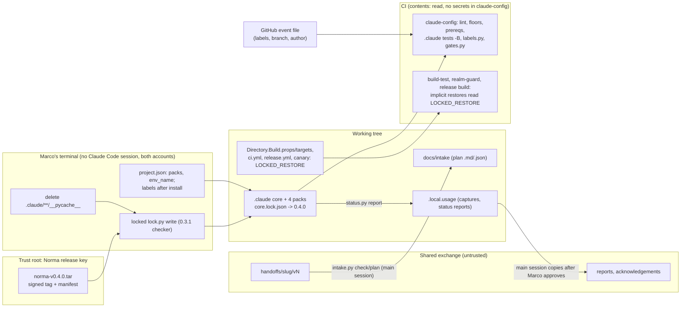

<!-- gate: G3 | verdict: PASS-WITH-NOTES | issue: #279 -->

# Threat delta: bump Norma 0.3.1 to 0.4.0 (issue #279)

Scope: the bump installs Norma 0.4.0 with the `dotnet` and `npm` packs and two new packs, `intake` and `status`. It also makes these project-layer edits (Marco's G0 decisions, manifest):
- the label set (`labels.extra`) and its CI step;
- the rename of `DECISYA_LOCKED_RESTORE` to `LOCKED_RESTORE` in every live reader;
- the architect lane narrowed to `docs/**`;
- the bytecode clean-up and `-B` for the `.claude` tests.

No product code, module, contract, endpoint or tenant data flow changes. As in the #246 and #261 deltas, ASVS 5.0 ids apply by analogy to developer tooling:
- V15.2: supply chain.
- V15.3: defensive coding, fail closed.
- V8.2: authorization design (agent lanes).
- V13.3: secret management.
- V14.2: data protection (data that leaves the repository).
- V1.2: injection prevention (untrusted event data).

Inputs, all read as data:
- The manifest and the #261 delta.
- The 0.4.0 CHANGELOG ("0.4.0 - 2026-11-04"), the consumer guide ("What your CI runs", "Delivery labels", "Intake pack", "Status pack", "Usage capture", "Local-only folders and secrets", "Your own tests that import a core module"), `docs/project-json.md` (dotnet, intake and status packs, `labels.extra`) and `docs/runbooks/bump-a-consumer.md`.
- Decisya's `project.json`, `boundaries.json`, `addenda/architect.md`, `core.lock.json`, `ci.yml`, `release.yml`, `dependency_canary.py`, `Directory.Build.props` and `Directory.Build.targets`.
- The `.claude/tests` pins: `test_guardrail_carryover.py`, `test_settings_adoption.py`, `test_build_policy.py` and `test_ruleset.py`, plus `deploy/tests/test_ci_workflow.py`.

Nothing is committed on the branch yet. The bundle's contents (`core.manifest`, the new `lock.py`) were not read: the tar cannot be opened without a command (open question Q-1).

## What changes, as it bears on Decisya

- **Install path:** the locked `lock.py` installs 0.4.0, the one already installed (`5f0f125f…`; 0.3.1 is on the CHANGELOG's list). The new release ships its own `lock.py`. From then on, that file checks every later bump. It refuses any bytecode in core folders and accepts a second, dated signer line (key rotation).
- **Bytecode:** `.claude/hooks/__pycache__` and `.claude/scripts/__pycache__` hold `.pyc` files today (`_hooklib`, `agent_boundaries`, `secret_guard`, `gates`, `lint`, `prepush` and others), and `.claude/tests/__pycache__` holds stale files of tests that no longer exist. The hooks start as `python -I`, which still loads `_hooklib` from `__pycache__` while the header matches the source. Today's CI step runs `python3 -m unittest discover` without `-B`. `ReviewRequiredTests` loads `gates.py` with `spec_from_file_location`, which writes bytecode.
- **Locked restore:** the dotnet pack now takes only `LOCKED_RESTORE`, `CI`, `GITHUB_ACTIONS`, `TF_BUILD` or `GITLAB_CI`. Six live readers carry the old name:
  - `project.json`;
  - `ci.yml` and `release.yml` (workflow `env`);
  - `dependency_canary.py` (`-p:DECISYA_LOCKED_RESTORE=false`);
  - `Directory.Build.props` (the `RestoreLockedMode` condition) and `Directory.Build.targets` (DECISYA0009).

  Five places pin the old name: `test_build_policy.py`, `test_settings_adoption.py:77`, `test_decisya_addenda.py` (99, 117), `addenda/testcontainers.md:11` and `deploy/tests/test_ci_workflow.py` (124, 125, 135). `docs/runbooks/ci-security-gates.md` names it as well.

  Implicit restores rely on the variable alone in these places: the `realm-guard` job (`dotnet test`, no explicit restore), `release_images.py`'s publish, and every local pre-push build and test. Every explicit `dotnet restore` also passes `--locked-mode`, so a reader that keeps the old name passes silently.
- **Labels:** `labels.py check --event "$GITHUB_EVENT_PATH"` reads only the event file and needs no token. It needs `pull_request` `types: [opened, synchronize, reopened, labeled, unlabeled]`. Decisya's `test_ruleset.py:235` (G6-80-13) flags **any** `types` on a required-check workflow, and `claude-config` is a required check. No workflow reads labels in a condition today, and none uses `pull_request_target`.
- **Core agents write in their lanes** (architect, product-owner, tech-writer). Decisya narrows the architect lane from `docs/**` plus `src/Modules/*/Decisya.Modules.*.Contracts/**` to `docs/**`, which tightens it. `docs/**` (architect, tech-writer) also covers the new `docs/intake/**`, the plan data the status report trusts.
- **Secret guard:**
  - Stricter: recursive searches from the root (`grep -r`, `rg --hidden`, `find -exec`, `git grep --untracked`), wildcard and 8.3 forms of blocked folders, and multi-line commands checked line by line.
  - One loosening: a line that only ends in `.local.` is no longer refused. Decisya's own settings `deny` rules for `.local.ops` are unchanged.
- **Boundaries hook and pack scripts:** the boundaries hook now refuses every subagent's file write while `project.json` cannot be loaded (fail closed). A tools line may name only the core's own scripts. Decisya's agents name only `lint.py` (devops), which is a core script. `intake.py` and `status.py` are run by the main session only.
- **`gates.py`:**
  - It refuses `N/A` at a full-tier G3 or G6, which closes #261 S-2.
  - It reads verdict and findings lines outside fences and HTML comments only.
  - It fails a third-party package addition without a required G3.
  - With the `status` pack, every G6 needs exactly one findings line.
- **Status pack:** reports are written into `.local.usage/`, which is denied to every agent and git-ignored, and checked with the `literals.py` patterns (IPv4, IPv6, email, machine paths, foreign ids). The main session copies them to the exchange after Marco approves; the copy job takes only `capture-*.json`.
- **Intake pack:** checks a handoff folder against its `MANIFEST.sha256` and contract major 1, and prints counts only. It writes `docs/intake/<slug>.md` and `.json` from an allow-list of fields (no persona, business-case or risk text), and the acknowledgement goes out only after Marco approves. The repository is **public**, so the plan becomes public when committed.
- **Unchanged for Decisya:**
  - `settings.json` has no `env` entry.
  - `.local.usage/**` is already in `deny`.
  - No `reference_folders` and no `lock.revoked_file` (not adopted).
  - The `main-session` row's globs are all in `deny` exactly, as 0.4.0 now requires.
  - The `not a bash lookup` marker sits in a `#` comment (`tests/gitbash.py:40`).
  - The Norma signers file stays pinned byte for byte (`test_settings_adoption.py:150-162`).

## Data flow and trust boundaries

## Threats

| Id | Element / flow | STRIDE | Threat | Severity | Mitigation | ASVS 5.0 | Status |
| --- | --- | --- | --- | --- | --- | --- | --- |
| T-01 | Install and trust root | S, T | A tampered or wrong-key bundle installs altered hooks, or the new `lock.py` differs from the signed one | Medium (inherent) | Hash already checked. The install runs the reviewed 0.3.1 checker. Signer unchanged and pinned. M-1 | V15.2 | Open (G4) |
| T-02 | Install order | D | `labels`, `packs.intake`/`status` or another new key lands while the 0.3.1 loader runs, or a session is open: every shell command and subagent write is denied. This fails closed | Low | M-1 (order, no session) | V15.3 | Open (G4) |
| T-03 | Bytecode in core folders | T, E | A stale or planted `__pycache__/_hooklib*.pyc` whose header matches is executed by `python -I` hooks instead of the source. Test runs keep writing new bytecode, so the next `lock.py verify` or `write` fails | Low (needs local write; agents are denied `.claude/**`) | Delete in each clone before the install. `-B` everywhere. Verify by hand after the suites. M-1, M-4 | V15.2, V15.3 | Open (G4) |
| T-04 | Locked-restore rename | T, D | One reader keeps the old name, so implicit restores (realm-guard, release publish, pre-push) run unlocked. DECISYA0009 is silent and the explicit `--locked-mode` steps still pass: **fail open, no signal** | Medium | One commit for all readers. A guard test keyed on `project.json`. An MSBuild probe as evidence. M-2 | V15.2, V15.3 | Open (G4) |
| T-05 | Project files | T | A `*.csproj` sets both the switch property and `RestoreLockedMode` to false, which defeats DECISYA0009. Pre-existing, carried over by the rename | Low | `*.csproj` is in `deny`. M-2 guard: no project file names either property | V15.2 | Open (G4) |
| T-06 | `ci.yml` trigger `types` vs `test_ruleset.py` G6-80-13 | T, D | The guard is loosened beyond the label types, so a later `types: [opened]` or `[labeled]` drops `synchronize`: required checks stop running on new pushes, or wait forever | Medium | M-3 (relax to a superset of the three defaults plus exactly `labeled`/`unlabeled`; keep the negative cases) | V15.3 | Open (G4) |
| T-07 | Event file into `labels.py` | T, I | Workflow-command or shell injection through event text (branch, title, labels) | Low | No `${{ }}` in `run:`, no new action, workflow `contents: read`, `persist-credentials: false`, no secret. Git refs cannot hold `:`. Fork authors cannot set upstream labels. Q-3 | V1.2 | Open (G4) |
| T-08 | Label events on bot and fork PRs | E, D | A human label on a Dependabot PR makes the actor human: the CI gate exemptions drop and the run fails (fail closed). A label on a fork PR starts a run with the fork's code | Low | Fork runs keep a read-only token and no secrets. Runbook line: never label a Dependabot PR by hand, and label a fork PR only after reading its diff. S-6 | V15.3 | Open (G4) |
| T-09 | release-please PR | D | Not exempt from the label check: red until labelled | Low | Labelled by hand (G0 decision 1), documented. M-3 | V15.3 | Open (G4) |
| T-10 | `labels.extra` | T | A broad allow-list hides a label that grants something | None | No workflow condition reads labels (verified: no `label` or `pull_request_target` in `.github/workflows/`). M-3 pins it | V8.2 | No action |
| T-11 | `labels.py` and `gates.py` run from the PR checkout | T | A PR edits the checker to pass | Low | Tamper evidence through review only. The CI lock check is still open (#243 item 246-1). S-4 | V15.2 | Backlog |
| T-12 | Intake handoff (exchange to repo) | T, I | Injected instructions or crafted fields in `handoff.json`/`PRD.md`. Plan text that reaches agents | Low | Hashes against the manifest and the thread. Contract major 1, field allow-list, counts-only output. Main session only, nothing run. Plan read as data (CLAUDE.md). S-5 | V1.2, V14.2 | Accepted (later issue) |
| T-13 | Intake plan in a public repository | I | Handoff fields (NFRs, constraints, regulatory notes, dates) or personal data become public on commit | Low | Persona text is excluded by the pack. Marco reads the plan diff and runs the literals scan before commit. S-5 | V14.2 | Accepted (later issue) |
| T-14 | `docs/intake/**` in `docs/**` lanes | T, R | Architect or tech-writer edits the plan JSON (epics, planned dates) that the status report trusts | Low | S-1 (`docs/intake/**` in the shared `deny`) | V8.2 | Open (fix-now) |
| T-15 | Status report egress | I | Free text (lessons, missing reasons) carries personal data or `.local.ops` content into the exchange | Low | Capture folder denied to agents and git-ignored, literals patterns, Marco approves each copy. S-5 | V14.2 | Accepted (later issue) |
| T-16 | Core agents' lanes and architect narrowing | E | An agent writes outside its intended area | None (tighter) | M-4 pin (architect denied on a Contracts path) | V8.2 | Open (G4) |
| T-17 | Secret guard behaviour | I | Root-level recursive search reads `.local.ops` or `.env` content. The trailing-`.local.` loosening | Low | 0.4.0 refuses the root forms. Decisya pins them (S-2). The settings `deny` rules for `.local.ops` are unchanged | V13.3 | Open |
| T-18 | Gate integrity across the bump | R | An open issue's or this bump's G3/G6 fails (`N/A`, fences, a missing findings line), or a merged review is edited to fit the status pack | Low | M-5 | V15.3 | Open (G4) |
| T-19 | Second signer line (`valid-before`) | S | A PR adds an extra key that `lock.py` 0.4.0 accepts until its date | Low | Signers file byte-exact pin, in `deny`, review-required | V15.2 | Mitigated |
| T-20 | `Directory.Build.props` tier | T | The file holding the locked-restore and audit switches is a `ci_tooling_paths` entry, not review-required, so a later change could take the light tier with G3 `N/A` | Low | S-3 | V15.2 | Open (fix-now) |

No High. T-04 and T-06 are the Mediums that need project action. T-01 is inherent and handled by the install procedure.

## MUSTs (all fix-now, G4)

**M-1: install in this order, then verify.**

Before the install, on both Windows accounts:
- Delete every `__pycache__` folder and `.pyc` file under `.claude/` in each clone. Marco does this in his own terminal.
- Confirm that `git --version` reports 2.31 or newer and that Claude Code is 2.1.295 or newer.

The install, in Marco's own terminal with no Claude Code session open on either account:
- Runbook step 3 (all outside `project.json`): the rename edits (M-2), the CI edits (M-3) and the test edits.
- Step 4: in `project.json`, set `env_name` to `LOCKED_RESTORE` and add `packs.intake: {}` and `packs.status` (`factory`, `phases`).
- Step 5, at once: `lock.py write --bundle … --tag v0.4.0 --packs dotnet,npm,intake,status`.
- Add `labels` only after step 5.

Record in the G4 evidence:
- `lock.py verify` names 0.4.0.
- The installed `.claude/scripts/lock.py` SHA-256 equals the bundle manifest's entry. Give both the old (`5f0f125f…`) and the new hash.
- `core.lock.json` `signer` is unchanged (`SHA256:FN0F…`) and `.github/allowed-signers/norma` is not in the diff. If the release key changed, stop: that is the two-PR sequence.
- `core.lock.json` lists exactly the four packs, and `labels.py`, `intake.py` and `status.py` are locked files.
- No agent `tools` line names `intake.py`, `status.py` or `labels.py`.
- `roster.py`, `lint.py`, `floors.py` and `prereqs.py interpreter` pass. Report every `lint.py` warning, each resolved or explained.
- After every suite has run with `-B`, a hand-run `lock.py verify` still prints `lock: ok`. This proves the runs wrote no bytecode.
- After a Claude Code restart, each of these is refused for the main session: `cat no-such-folder/.env` and `grep -r x .`.

**M-2: the rename is one commit across every live reader, and a test proves the names agree.**

The edits:
- Change these together: `project.json` `env_name`; the `ci.yml` and `release.yml` workflow `env`; `dependency_canary.py` `UNLOCKED_RESTORE_ARGS` (`-p:LOCKED_RESTORE=false`, keeping `-p:RestoreLockedMode=false`); the `Directory.Build.props` condition; `Directory.Build.targets` DECISYA0009 (condition and text); the comments that name it; `addenda/testcontainers.md`; `docs/runbooks/ci-security-gates.md`; and the existing pins (`test_build_policy.py`, `test_settings_adoption.py`, `test_decisya_addenda.py`, `deploy/tests/test_ci_workflow.py`).
- History stays as written: ADRs, threat models, reviews and pipeline files.
- A person edits the build files (they are in `deny`).

One guard test in `.claude/tests` (old name built at run time) asserts:
- `project.json`'s `env_name` is `LOCKED_RESTORE`.
- `Directory.Build.props`'s `RestoreLockedMode` condition and `Directory.Build.targets`' DECISYA0009 condition both read `$(<env_name>)`.
- `ci.yml` and `release.yml` each set `<env_name>: "true"` once at workflow level.
- The canary passes `-p:<env_name>=false`.
- The old name appears in no tracked file under `.github/`, `.claude/` (outside this test), `deploy/`, `.devcontainer/`, `src/`, `tests/`, `docs/runbooks/` or the root build files.
- No tracked project file (`*.*proj`, other `*.props`/`*.targets`) names `LOCKED_RESTORE` or `RestoreLockedMode` (T-05).

The G4 evidence also records an MSBuild probe on one project, `dotnet msbuild src/Decisya.Api/Decisya.Api.csproj -getProperty:RestoreLockedMode`, run three ways:
- with `LOCKED_RESTORE=true`, it prints `true`;
- with neither variable, it prints empty;
- with only the old name set to `true`, it prints empty.

The CI run of this PR must show `Dependency canary (NuGet)` green on the expected NU190x code. A DECISYA0009 failure there means a reader was missed.

**M-3: the delivery-label step and its trigger.**

The step:
- One step in the existing `claude-config` job (a required check): `python3 .claude/scripts/labels.py check --event "$GITHUB_EVENT_PATH"`.
- No `${{ }}` in `run:`, no new action, no `continue-on-error` or `|| true`, no job `permissions` wider than the workflow's `contents: read`, no `env:` secret.
- Gate it `if: github.event_name == 'pull_request'` unless Q-2 shows that `labels.py` passes on push, schedule and dispatch events.

The trigger:
- `ci.yml` `pull_request` gets exactly `types: [opened, synchronize, reopened, labeled, unlabeled]`.
- In `test_ruleset.py`, relax G6-80-13 only this far: `types` passes when it holds all three of `opened`, `synchronize` and `reopened`, and nothing beyond `labeled` and `unlabeled`.
- `paths`, `paths-ignore`, `branches` and `branches-ignore` stay flagged.
- Keep the `types: [opened]` negative case, and add negatives for `[opened, labeled]` and `[opened, synchronize, reopened, edited]`.

Pins and labels:
- Add a pin that no workflow uses `pull_request_target` and no `if:` reads `labels`.
- Pin `labels.extra` to the G0 list exactly: `dependencies`, `.NET`, `javascript`, `docker`, `github_actions`, `security`, `autorelease: pending`, `autorelease: tagged`.
- Leave the Dependabot and release-please exemptions in `ci.yml` unchanged.
- Document the manual labelling of the release-please PR.
- #279 and #264 carry their `kind:` and `phase:` labels before this step first runs. Marco runs those `gh` commands.

Cost line: the repository is public, so the runs are not billed. Each label change re-runs the whole CI workflow (minutes of runner time). It joins the same concurrency group, so it cancels a run in progress.

**M-4: the guardrail pins pass against 0.4.0 with no deny turned into an allow.**
- Run every `.claude/tests` suite in full, bounded, with `-B`, both in the CI step (`python3 -B -m unittest discover -s .claude/tests -p "test_*.py"`) and locally. The pre-push check already uses `-B`. Also run `deploy/tests` in full.
- A pinned case may change in only two ways: an allow that 0.4.0 now refuses (a stricter core), or a reason text. Each such edit is named in the G4 evidence. A deny never becomes an allow, and no case is dropped.
- Architect lane: `boundaries.json` `architect: ["docs/**"]`. Update `addenda/architect.md` "Scope": drop the Contracts sentence, and add that a G2 note changing a Contracts project specifies the change precisely for backend-dev. Update its pin in `test_decisya_addenda.py`. Add to `test_guardrail_carryover.py` `WRITE_DENY`: `("architect", "src/Modules/X/Decisya.Modules.X.Contracts/x.cs")`.

**M-5: gate integrity across the bump.**
- After the install, `gates.py` passes for #279 and for every issue open across the bump, with no `N/A` at a full-tier G3 or G6 and no unclosed fence or comment before a verdict line.
- With the `status` pack installed here, this PR's G6 review, and every open issue's, carries exactly one findings line.
- The mid-phase adoption gap covers the eight Phase 1 issues closed before the install, named by issue number (reviews are filed per issue, `docs/security/reviews/<n>.md`): #244, #246, #247, #259, #261, #231, #230 and #266. Marco's decision applies to all eight alike, once Norma answers exchange thread D-017. Until then, the Phase 1 delivery report stays blocked. If a findings line is added to a merged review:
  - its counts come from that review's own findings table, as of its final state;
  - the verdict line and the finding statuses stay untouched;
  - the edit goes through a reviewed PR's G6.

  Otherwise, use the "missing" reason Norma approves in D-017. A count is never invented as zero.

## SHOULDs and backlog (#243)

- **S-1 (Low, fix-now):** add `docs/intake/**` to the shared `deny` in `boundaries.json`. The main session writes the plan through `intake.py`, so no agent needs that path. Pin it in `test_settings_adoption.py`. This is a few lines in files this PR changes.
- **S-2 (Low, fix-now if `test_guardrail_carryover.py` is edited for M-4, which it is):** add these to `MAIN_DENY` (Bash and PowerShell), as evaluated strings only:
  - `grep -r x .`, `rg --hidden x .`, `find . -type f -exec cat {} +` and `git grep --untracked x`;
  - a wildcard form of the blocked folder (`cat .local.o*/x`, `cat *.ops/x`), names built at run time.

  These pin the 0.4.0 denials that protect `.local.ops` against a later release.
- **S-3 (Low, fix-now):** add `Directory\.Build\.props` to `gates.review_required_paths` in `project.json`, and add it to `ReviewRequiredTests.PATHS`. It holds `RestoreLockedMode`, `NuGetAudit` and the release image settings, and `Directory.Build.targets` is already review-required.
- **S-4 (Info, backlog):** the CI lock check (#243 item 246-1) is still open. `labels.py`, `gates.py` and `lock.py` all run from the PR checkout, so for this bump the lock is checked by the G4 evidence and G6 only. Once it lands, use the guide's step that takes `lock.py` from the base commit.
- **S-5 (Low, for the intake run and the first phase-exit, not this PR):**
  - Before committing `docs/intake/<slug>.*` to this public repository, Marco confirms that the handoff's fields may be public. Read the diff, and run the `literals.py` patterns over it (Q-4).
  - Before any status report is copied to the exchange, Marco reads it: no names, machine details or `.local.ops` content in free text.
  - Acknowledgements and reports follow the draft, approve, then write rule.
- **S-6 (Low, backlog, docs):** add a runbook line. Never label a Dependabot PR by hand: the run's actor turns human and the gates fail. Use `@dependabot recreate`. Label a fork PR only after reading its diff.
- **S-7 (Info):** 0.4.0's `gates.py` closes #261 S-2 (`N/A` at a full-tier G3/G6). Mark it done in #243 at G7.

## Open questions (each needs a command, so G4 answers it)

- **Q-1:** the SHA-256 of `lock.py` in the 0.4.0 bundle, and whether it differs from `5f0f125f…`. Record it under M-1.
- **Q-2:** `labels.py check` on a push, schedule or dispatch event file: does it pass, skip or fail? This decides the step's `if:` (M-3).
- **Q-3:** does `labels.py` print event text other than label names, such as the title or the branch? If it prints the title, check that it escapes a leading `::`.
- **Q-4:** does `intake.py plan` scan what it writes with the `literals.py` patterns? If not, S-5's manual scan applies.

## Decisions for Marco

1. **Where the label step runs (M-3).** My recommendation: in `claude-config`, as Norma's guide says, with the five `types` and the narrow `test_ruleset.py` relaxation.
   - Risk: every label change re-runs and cancels the whole CI (minutes; no bill on a public repository).
   - The alternative is a separate `labels.yml` workflow. It needs a new required check, ruleset and `test_ruleset.py` changes, and it is a second place to keep pinned.
2. **CI proof of locked mode (M-2).** My recommendation: also add one step to `build-test` asserting that `dotnet msbuild … -getProperty:RestoreLockedMode` prints `true`. It takes seconds and proves CI evaluates the switch, not only that the names agree.
   - Risk: one more step to keep, and it duplicates the static guard.
   - Without it, the G4 probe evidence and the canary are the proof.
3. **`Directory.Build.props` review-required (S-3).** My recommendation: yes, in this PR.
   - Risk: every later props change needs G3 and G6 (the full tier), which is the intent.
