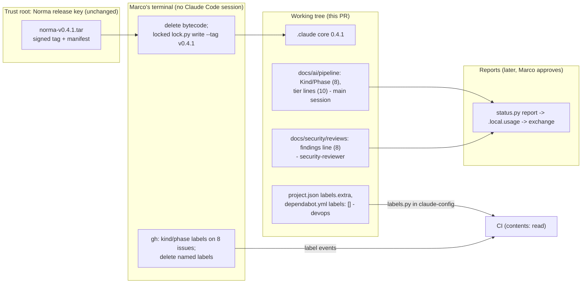

<!-- gate: G3 | verdict: PASS-WITH-NOTES | issue: #281 -->

# Threat delta: bump Norma 0.4.0 to 0.4.1 and backfill the Phase 1 status records (issue #281)

Scope (manifest, Marco's G0 decisions):
- install Norma 0.4.1 with the same four packs (`dotnet`, `npm`, `intake`, `status`);
- the D-017 option A backfill: one findings line in each of the eight merged Phase 1 G6 reviews, and `Kind`/`Phase` lines in their manifests;
- the exact tier line in ten older manifests;
- the two G-002 label gaps (D-019): `labels.extra`, Dependabot `labels: []`, and deleting GitHub's default labels plus `phase-0` and `security`.

No product code, module, contract, endpoint or tenant data flow changes. As in the #261 and #279 deltas, ASVS 5.0 ids apply by analogy to developer tooling:
- V15.2: supply chain.
- V15.3: defensive coding, fail closed.
- V8.2: authorization design (who writes which record).
- V16.2/V16.3: integrity of security records (the gate and review records stand in for security logs here).

Inputs, all read as data:
- The manifest `docs/ai/pipeline/281.md` and the #279 delta.
- The 0.4.1 CHANGELOG ("0.4.1 - 2026-11-06") and the consumer guide ("Delivery labels", "Status pack", "Adopting the status pack in the middle of a phase", "Terms").
- The D-017 thread, last entry (Norma, 2026-11-06, option A).
- Decisya's `project.json`, `boundaries.json`, `settings.json`, `core.lock.json`, `.github/dependabot.yml`, `ci.yml` (label step and concurrency), `release-please-config.json` and the installed (0.4.0) `gates.py` `manifest_tier`.
- The ten manifests and their reviews' G3 lines, the eight Phase 1 reviews, and the `.claude/tests` pins `test_ruleset.py` (`test_labels_extra_is_the_g0_list`), `test_dependabot.py` and `test_capture_canary.py`.

Facts taken from the orchestrator, not re-checked here:
- the bundle's SHA-256 matches N-023;
- its signature verifies against `.github/allowed-signers/norma` (same key);
- all 54 files match the signed manifest;
- `lock.py` is unchanged from 0.4.0 (`BA53EE70…`);
- no sibling project folder exists on this machine.

Nothing is committed on the branch yet. The bundle (a tar) and 0.4.1's `gates.py` cannot be read without a command (Q-1).

## What changes, as it bears on Decisya

- **Install path:** the same as #279. The locked 0.4.0 `lock.py` installs 0.4.1, and no `project.json` key is new, so #279's T-02 install-order hazard does not recur. 0.4.1's changed core files are:
  - `gates.py`, which now fails on an unreadable or second tier line;
  - `capture.py`, where `finish` opens only exact folders;
  - the `issue` skill (`--no-track`, `status.py end` at the merge confirmation);
  - documentation.
- **`gates.py` tier lines:** 0.4.0 reads only a line that fully matches `- Tier:[ \t]*(\S+)[ \t]*` above the table, and otherwise counts the issue as Full (`gates.py:175-192`). 0.4.1 fails instead. Of the ten manifests named:
  - Nine are Light by their own record and by their review's G3 line (`reason: light tier`):
    - #84 and #185 write the tier as `- Tier: light (…)` or `- Tier: Light (…)`;
    - #145, #217, #244 and #247 write it as `- **Tier…:** light…`;
    - #116, #124 and #147 state it only inside their `- Decisions` line.
  - **#87 is not Light.** Its line is `- Tier: bug-fix path (Marco 2026-09-28)`, and its G3 reason is `bug fix inside the #18 design, no new trust boundary` (`reviews/87.md:1`), which `LIGHT_REASON` does not match. It is `fix(bff)`: identity-dev changed the BFF's Redis ticket-store connection. That is an auth and session area, which #84's own tier rule (`84.md:35`) puts at Full.
  - Eleven more manifests start a line with `- Tier:` that is not exact, all of them Full: #18, #19, #20, #21, #22, #135, #148, #178, #183, #187 and #188. Many more use a bold `- **Tier:** full…` sentence. Whether 0.4.1 treats these as unreadable is Q-1.
- **Findings lines:** with the `status` pack, a G6 needs exactly one `<!-- findings: … | rechecks: … -->` line, and a report that holds a review without one stops. The eight reviews have no fences or multi-line comments. Each starts with single-line verdict comments, and the findings live in tables, plus, in #244, the sentence "No fix-now or backlog findings". Three reviews record PASS after one re-check with Lows on record: #230, #231 and #266.
- **Write lanes:** `docs/ai/pipeline/**` is in the shared `deny`, so only the main session writes manifests. `docs/security/**` is the security-reviewer's lane, **but** the architect and tech-writer lanes (`docs/**`) also cover `docs/security/reviews/**`, and the main session is not restricted. "Only the security-reviewer writes reviews" is therefore a convention that review checks, not a hook boundary.
- **Labels:**
  - No workflow reads labels in a condition, and none runs on `pull_request_target` (pinned, `test_ruleset.py:493-497`).
  - The label step already carries an `if:` for pull requests, and label events have their own concurrency group (`ci.yml:39`, `ci.yml:300-302`). 0.4.1's label ACTION REQUIRED line is therefore already met. `github.event_name == 'pull_request'` is equivalent to the guide's `startsWith` form for this workflow's triggers.
  - `dependabot.yml` has **12** `updates` entries and no `labels` key. Dependabot has no top-level `labels`, so `labels: []` must sit in every entry. An entry without it keeps the default labels and re-creates any deleted ones.
  - release-please uses its default `autorelease: pending` and `autorelease: tagged` labels to find and close its release PR (`release-please-config.json` sets no label override).
- **`issue` skill:** branches are created with `--no-track`, so `origin/main` is no longer their upstream. Sessions are denied `git push` (`settings.json:23,51`), so the first push stays Marco's. Branches created under 0.4.0, this one included, may still track `origin/main` (Q-6).

## Data flow and trust boundaries

## Threats

| Id | Element / flow | STRIDE | Threat | Severity | Mitigation | ASVS 5.0 | Status |
| --- | --- | --- | --- | --- | --- | --- | --- |
| T-01 | Install and trust root | S, T | A tampered or wrong-key bundle installs altered hooks or `gates.py` | Medium (inherent) | Hash, signature and manifest already checked. The locked checker installs it. Signer unchanged and pinned. M-1 | V15.2 | Open (G4) |
| T-02 | Bytecode in core folders | T | Stale `.pyc` makes `lock.py verify` fail, or runs instead of the new source | Low | Delete first in Marco's terminal; `-B` everywhere; verify after the suites. M-1 | V15.2 | Open (G4) |
| T-03 | Findings counts (8 reviews) | T, R | Counts that do not match the review, written after the fact, enter a delivery report sent to Greenlight. Bias towards zero, or towards counts that satisfy a report cross-check | Medium | Counting rule fixed before counting, one line per review, ids listed in the PR body, independent re-count at G6. M-2 | V16.3 | Open (G4) |
| T-04 | Merged reviews | T, R | A verdict line, a finding's status or other text is altered, or the history of the file is rewritten | Medium | Diff shows exactly one added line per review and no removed line, on a new commit. M-2 | V16.3 | Open (G4) |
| T-05 | Who writes the reviews | E, R | An agent other than the security-reviewer (architect or tech-writer, whose `docs/**` lanes cover `docs/security/reviews/**`), or the main session, writes a findings line | Low | Convention plus review: the PR body names the writer; G6 re-counts. Pre-existing lane overlap, not widened here. S-3 | V8.2 | Open (G4) / backlog |
| T-06 | Tier rewrite: #87 | T, R | `- Tier: light` relabels a BFF session-store fix (Full by #84's rule, G3 reason "bug fix") as Light. The record then reads as if the light tier had been approved for an auth change. It still fails `gates.py` (reason mismatch), so it buys nothing | Low | `- Tier: full` for #87, its sentence kept as a note. M-3 | V16.3 | Open (fix-now) |
| T-07 | Tier rewrite: the nine Light manifests | T | The rewrite drops the approval wording, changes a gate row, or lands on a Full manifest | Low | Note kept word for word; no table row in the diff; gates.py before/after table; guard test. M-3 | V15.3, V16.3 | Open (G4) |
| T-08 | `labels.extra` shrink | D | An open human PR that carries `dependencies`, `security` or another dropped label goes red on its next run | Low (fails closed) | List the open PRs first (Q-4). M-4 | V15.3 | Open (G4) |
| T-09 | Label deletion | D, T | A loop or wildcard over `gh label list` also deletes `autorelease: pending`/`autorelease: tagged` or a `kind:`/`phase:` label. release-please loses its open release PR, and the label check fails on every PR | Medium | Delete by explicit name only, after this PR merges. M-4 | V15.3 | Open (G4) |
| T-10 | Dependabot `labels: []` | T, D | An entry without `labels: []` keeps adding default labels and re-creates the deleted ones. The done-when fails quietly. Bot PRs stay exempt from the label check, so CI does not show it | Low | `labels: []` in all 12 entries; pin by entry count. M-4 | V15.3 | Open (G4) |
| T-11 | Deletion events on open Dependabot PRs | D | If deleting a label fires `unlabeled` on an open Dependabot PR, the run's actor is Marco. The bot exemption then drops, and the gates step fails (fails closed) | Low | Q-3. Recover with `@dependabot recreate`, never `gh pr update-branch` | V15.3 | Open (G4) |
| T-12 | Labelling closed issues | D | Labels put on the merged PRs instead of the issues start label-event runs on stale heads | Low | Label the eight **issues** only, as the guide says. M-4 | V15.3 | Open (G4) |
| T-13 | Report selection | R | An issue of the eight without `start-<n>.json` is silently absent from the Phase 1 report (0.4.0/0.4.1 behaviour) | Low | Q-2, checked by Marco before the first report | V16.3 | Open (before report) |
| T-14 | `capture.py finish` folders | I | A later release brings back prefix matching on sibling project folders. Decisya's canary test would not notice, because sibling records were dropped by `cwd` | Low | S-1 | V14.2 | Backlog |
| T-15 | Branch upstream | T | A branch made under 0.4.0 tracks `origin/main`, so a bare `git push` targets `main`. The ruleset refuses it, and sessions cannot push | Low | Marco pushes with `git push -u origin issue/281-norma-0-4-1`. Q-6 | V15.3 | Open (G7) |

No High. T-03, T-04 and T-09 are the Mediums that need project action; T-01 is inherent and handled by the install procedure.

## MUSTs (all fix-now, G4)

**M-1: install as in #279, then verify.**

Before and during the install:
- In Marco's own terminal, with no Claude Code session open on either Windows account, delete every `__pycache__` folder and `.pyc` file under `.claude/` in each clone.
- Then run `python .claude/scripts/lock.py write --bundle <tar> --tag v0.4.1 --packs dotnet,npm,intake,status`.
- No `project.json` edit precedes the install. The `labels.extra` change follows it.

Record in the G4 evidence:
- `lock.py verify` names 0.4.1.
- `core.lock.json` shows tag `v0.4.1`, `signer` unchanged (`SHA256:FN0F…`) and exactly the four packs.
- `.github/allowed-signers/norma` is not in the diff.
- `.claude/scripts/lock.py` SHA-256 is still `BA53EE70…`.
- Every locked file in `git diff --name-only` is one whose hash changed in the bundle manifest. No project-layer file (`settings.json`, `boundaries.json`, `project.json`, the addenda) is changed by the install itself.
- `roster.py --check`, `lint.py`, `floors.py` and `prereqs.py interpreter` pass, with every `lint.py` warning reported.
- If 0.4.1's deny/tool-rule warning names a Decisya agent, the fix only adds the two sentences: no `tools:` line in `.claude/agents/` changes.
- After every suite has run with `-B`, a hand-run `lock.py verify` still prints `lock: ok`.

**M-2: the eight findings lines (D-017 option A), counted by a fixed rule and provable from the diff.**

Writer: the security-reviewer agent, in a G4 run of its own, writes the line in all eight reviews (#244, #246, #247, #259, #261, #231, #230, #266). No other agent or session edits `docs/security/reviews/**` in this PR.

Counting rule, applied as written:
- A finding is an item the review itself reports with an id and a severity, in any findings table or in prose: first pass or re-check, fix-now or backlog, fixed or open. Example: #247 counts L-1 and B-1, which sit in two tables.
- G3 MUST/SHOULD statuses, register entries, checks, questions, notes and "Not checked" items without a severity are not findings.
- A severity of None or Info counts as `info`. The final severity is used where a re-check changed one.
- `rechecks` is the number of re-check rounds the review records (0 or 1). More than one, or a finding whose severity cannot be read, means stop and report to the orchestrator for Marco. A count is never guessed, and zero is never written for "unknown".

Form and placement:
- One line per review, directly after its G6 verdict line, as a single-line comment outside any fence: `<!-- findings: high=<n> medium=<n> low=<n> info=<n> | rechecks: <n> -->`.
- Line endings are kept.

Proof:
- `git diff origin/main...HEAD -- docs/security/reviews/` shows, for each of the eight files, exactly one `+` line (the findings line) and no `-` line.
- The verdict lines and every status cell are byte-identical.
- The change is a new commit on this branch; no merged commit is amended or rebased.
- `gates.py <n>` passes for all eight under 0.4.1.

PR body and G4 evidence, a table with one row per issue:
- the review path;
- the counts;
- the finding ids counted under each severity;
- `rechecks`;
- "counted by the security-reviewer agent on <date> from that review's final text".

G6 of this PR re-counts all eight on its own from the same rule.

If `status.py report` later stops on a cross-check, for example a PASS verdict with Low findings on record (#230, #231 and #266, Q-5):
- the counts and verdicts stay as written;
- the case goes to Norma through the exchange.

**M-3: tier lines change the form, never the tier, and the proof is in the diff.**

The edits:
- **#87 gets `- Tier: full`** (T-06). Its G3 `N/A` stays as history and keeps failing `gates.py` when run by hand, like the other pre-install records. This is Marco's call, because the tier is his. My recommendation is `full`. The alternative, `light`, relabels an auth-area change and still fails.
- The nine Light manifests each get exactly one `- Tier: light` line above the table:
  - #84, #116, #124, #145, #147, #185, #217, #244 and #247;
  - where a tier sentence existed, its words stay on the next line, word for word, as a note in the #279/#281 form (`- **Tier (…):** …`). Only the leading marker changes.
  - #116, #124 and #147 keep their `- Decisions` line unchanged and gain the one new line.
- No gate-table row (`|` line) changes in any manifest. The eight Phase 1 manifests also gain only the `- Kind:` and `- Phase: 1` lines, with the kinds Marco approved.

G4 evidence:
- `git diff origin/main...HEAD -- docs/ai/pipeline/` touches only the lines above.
- A before/after table of `gates.py <n>` for all ten. The only allowed change is that G3 goes from fail to pass on the nine Light ones. #87 stays unchanged, and G6 keeps failing on the Phase 0 ones.

A Decisya guard test in `.claude/tests`, run over every manifest, asserts:
- at most one line starts with `- Tier:`, and it is exactly `- Tier: light` or `- Tier: full`;
- every manifest with `- Tier: light` whose G3 row is `required` points to an artifact whose G3 line carries `reason: light tier`. This fails on #87 marked Light and on any Full issue flipped to Light.

**M-4: the label gaps close without breaking release-please or open PRs.**

Configuration:
- `labels.extra` becomes exactly `["autorelease: pending", "autorelease: tagged"]`. `test_labels_extra_is_the_g0_list` is pinned to that list. This is a tightening, named in the G4 evidence.
- devops adds `labels: []` to all 12 `updates` entries in `.github/dependabot.yml` and changes nothing else in it: the diff shows only those lines. It is a review-required path.
- `test_dependabot.py` asserts that every parsed entry carries exactly `labels: []` and that the number of entries with it equals the number of entries. The existing group and ignore tests stay green.

Marco's `gh` steps:
- Before merging, Marco lists the open PRs and their labels (Q-4) and removes a dropped label from any open **human** PR.
- **After this PR merges**, so that Dependabot no longer re-creates them, Marco deletes labels **by explicit name only**:
  - GitHub's nine defaults present in the repository, plus `phase-0` and `security`;
  - never a loop or filter over `gh label list`;
  - never `autorelease: pending`, `autorelease: tagged` or any `kind:`/`phase:` label.
- Marco labels the eight **issues**, not their merged PRs, with their `kind:` and `phase:1` labels.
- The orchestrator gives the exact commands; Marco runs them. Cost line: public repository, no bill. Each label change on an open PR re-runs CI in its own concurrency group.

**M-5: 0.4.1's behaviour changes leave Decisya's guardrails green, with no deny turned into an allow.**
- Run every `.claude/tests` suite and `deploy/tests` in full, bounded, with `-B`.
- A pinned case may change only towards stricter behaviour, or in a reason text. Each change is named in the G4 evidence.
- `test_capture_canary.py` must pass unchanged under 0.4.1's exact-folder `finish`. If it fails because the temporary repository's path differs from the path `capture.py` resolves (for example 8.3 short names), report the exact error and stop. Do not move the fixture into a broader folder.
- `gates.py 279` and `gates.py 281` pass under 0.4.1. This proves that an exact tier line followed by a bold `- **Tier (…):**` note is not read as a second tier line.

## SHOULDs and backlog (#243)

- **S-1 (Low, backlog unless `test_capture_canary.py` is touched here):** add a sibling folder (`<name>-x`, `<name>.x`) to the canary fixture. Its records carry the test repository's own `cwd` and extra token counts. Assert that the totals stay 160/39. This pins 0.4.1's fix: a prefix match would count them.
- **S-2 (Low, fix-now if the guard test of M-3 is written, which it is):** add the 0.4.1 behaviour itself as a negative case, run against the installed `gates.py`: a fixture manifest with `- Tier: light (note)` must fail, and one with two tier lines must fail.
- **S-3 (Info, backlog):** the architect and tech-writer `docs/**` lanes include `docs/security/reviews/**` and `docs/security/threat-models/**`, the gate artifacts G3 and G6 depend on. Consider a deny for those paths for every agent except the security-reviewer. This needs a per-agent exception the current `boundaries.json` form may not offer, so it is a Norma question. Not widened by this PR.
- **S-4 (Low, fix-now, a few lines):** in this PR the Phase 1 manifests that are Full (#246, #259, #261, #231, #230, #266) also get an exact `- Tier: full` line, with their bold sentence kept as the note. This adds no gate change (Full either way). The tier then no longer depends on how 0.4.1 parses bold sentences (Q-1), and "every manifest's tier line has the exact form" holds for the reported issues.
- **S-5 (Info):** the eleven `- Tier: Full, …`/`- Tier: **full**…` lines of Phase 0 manifests (#18 to #22, #135, #148, #178, #183, #187, #188) become `- Tier: full`, with their note kept, if Q-1 shows 0.4.1 rejects them. The M-3 guard test needs it anyway. Full stays Full, so this is fail-closed and changes no gate state.
- **S-6 (Info):** deleting `phase-0` strips that label from every Phase 0 issue. The milestone keeps the grouping. Marco decided this in D-019. Record it in the PR body so the loss is visible.

## Open questions (each needs a command, so G4 or Marco answers it)

- **Q-1:** which lines does 0.4.1's `gates.py` treat as tier lines: only those starting `- Tier:`, or also the bold `- **Tier…:**` forms? Run `gates.py <n>` under 0.4.1 over every manifest and list each tier-line failure. This decides S-4 and S-5.
- **Q-2:** does `.local.usage/` hold `start-<n>.json` for each of the eight issues? Marco checks this in his own terminal (the folder is denied to every session). An issue without one is not in the report at all.
- **Q-3:** does deleting a repository label fire `unlabeled` events, and so CI runs, on the open PRs that carry it? Watch the Actions tab on the first deletion. If it does, recreate the affected Dependabot PRs.
- **Q-4:** `gh pr list --state open --json number,author,headRefName,labels`: which open PRs carry a label that leaves `labels.extra`?
- **Q-5:** do `status.py report`'s cross-checks accept a PASS verdict with Low findings on record? The first on-request report after the merge answers this. M-2 says what to do if they do not.
- **Q-6:** `git rev-parse --abbrev-ref issue/281-norma-0-4-1@{upstream}`: if it prints `origin/main`, Marco's first push uses the explicit `git push -u origin issue/281-norma-0-4-1` form, which the G7 commands already give.

## Decisions for Marco

1. **#87's tier line (M-3).** My recommendation: `- Tier: full`, with the "bug-fix path" sentence kept as a note.
   - Risk: none to any live gate, since #87 is merged and Phase 0. `gates.py 87` keeps failing by hand, as for the other 57 pre-install reviews.
   - With `light`, the record would say an auth-area change ran the Light tier, which #84's rule did not allow, and `gates.py 87` would still fail on its G3 reason.
2. **Exact `- Tier: full` lines on the six Full Phase 1 manifests (S-4).** My recommendation: yes, in this PR.
   - Risk: six more one-line edits to merged records, each provable from the diff.
   - Without them, the reported issues' tier depends on how 0.4.1 reads a bold sentence (Q-1).
