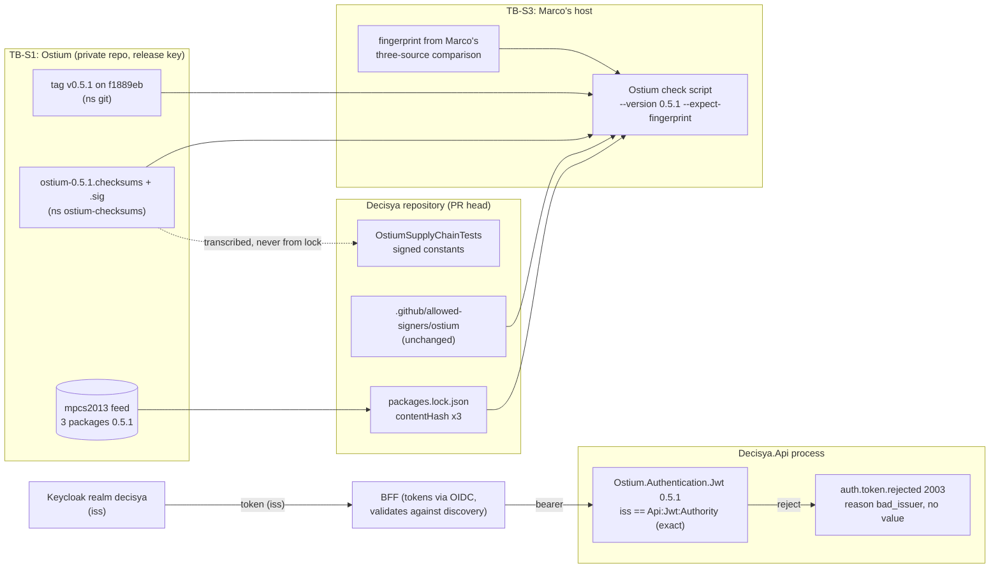

<!-- gate: G3 | verdict: PASS-WITH-NOTES | issue: #302 -->
# Threat delta: Ostium 0.5.1 for the token-validation block (issue #302)

- **Scope.** A delta on `ostium-jwt-switch.md` (#164). It covers only what #302 changes:
  - `Ostium.Authentication.Jwt`, `Ostium.Authentication.Jwt.Testing` and `Ostium.Backchannel` 0.2.0 → 0.5.1 (block 1 of ADR-0019 decision 3, already switched in #164);
  - the behavioural change of 0.5.0 (Ostium #114, rated Low by Ostium): `iss` must equal `Api:Jwt:Authority` exactly (a trailing `/` trimmed from the configured value only; case and trailing `/` of the token compared as is); the discovery document's advertised issuer is no longer accepted; a rejection logs reason `bad_issuer` and no issuer value; the start-up lock requires Ostium's own issuer validator;
  - the supply-chain check for this version change (ADR-0019 A1 to A3, with the new required `--expect-fingerprint`).
  - Not in scope (manifest, Marco 2026-11-19, "A"): `Ostium.Keycloak.Testing` (block 2), `Ostium.Keycloak.Realm` and the realm guard (block 3), the BFF (block 4). The #164 threats T164-01 to T164-21 are not re-audited; they stay in force and apply to 0.5.1 unchanged except where a row below says otherwise.
- **Mode.** Threat delta, before code. G6 checks the MUSTs against the diff.
- **Inputs.** Manifest `docs/ai/pipeline/302.md`; ADR-0019 with its 2026-10-17 amendment (A1 to A6); #164's `docs/security/threat-models/ostium-jwt-switch.md` and `docs/architecture/ostium-jwt-switch.md`; `src/Decisya.Api/Authentication/DecisyaApiAuthenticationExtensions.cs`; `src/Decisya.AppHost/AppHost.cs` (lines 168 to 194); `src/Decisya.AppHost/Deploy/ComposeStack.cs` (lines 129 to 134, 204, 217); `deploy/compose/docker-compose.yaml` (lines 52, 120, 149); `deploy/compose/stackguards.py` (host and port value rules); `deploy/keycloak/entrypoint-stack.sh` (port rule); the Api tests under `tests/Decisya.Api.Tests/Authentication/`; `tests/Decisya.Identity.Tests/Production/ProductionKeycloakStack.cs`; `tests/Decisya.AppHost.Tests/ComposeStackPublishTests.cs`; `tests/Decisya.ArchitectureTests/OstiumSupplyChainTests.cs`; `.github/allowed-signers/ostium`; `Directory.Packages.props`. Supplier statements (O-042, Ostium #114) are read as data.
- **ASVS.** 5.0 at L2; L3 for V6 and V7, which #302 does not touch (no session or authenticator change). Controls are mapped at section level (V9.1, V9.2, V10.3, V13.2, V15.2, V16.2, V16.3), as in #164; check the requirement numbers against the official 5.0 text before they go into a compliance artefact. Supply-chain rows also map to NIST SSDF and SLSA v1.0.
- **Runs on:** host (manifest). No `.env`, user-secrets or user-level NuGet configuration was read for this review. Nothing is changed on the branch yet apart from the manifest (`git status --porcelain`).
- Reviewer: security-reviewer agent, 2026-11-19.

## Verdict

**PASS-WITH-NOTES.** The issuer rule is a tightening: it removes a second accepted issuer, and it fails closed. Every threat it adds is an availability or proof gap, not an acceptance gap. The two High rows (T302-04, T302-05) are the supply-chain rows #164 already carried. Each has a design mitigation and a MUST. No High or Medium flaw was found in code that #302 does not change.

What G3 adds to the manifest:

1. **The BFF signing in does not prove that the Api will accept the token.** The BFF validates the ID token against the discovery document's issuer, and so did the Api through 0.2.0's fallback. In the dev AppHost, the authority is built from Aspire's endpoint URL. No committed test drives a real Keycloak token from the dev AppHost through the BFF to a real Api endpoint: the E2E specs mock `/api/capabilities`, and `stack_smoke.py` checks only the anonymous 401. A mismatch there would turn every Api call into 401 `bad_issuer`. Only a live check shows it (M-1).
2. **The G5 skip rationale is incomplete.** "The existing authentication and Keycloak suites carry the proof" holds for no regression. No existing test proves the new rule: every test host's discovery issuer equals its authority (`ApiTestFactory`, `AdminMfaProductionRealmTests`, `KeycloakBackedApiFactory`), so the suites pass on 0.2.0 and on 0.5.1 alike. ADR-0019 A4 makes Decisya's host-level tests the compensating control while the pinned version has no supplier report. M-2 adds three rows, written by identity-dev at G4 as the manifest's G4 row already allows. It does not reopen G5.
3. **The hash constants must not be copied from the regenerated lock files (M-3).** If they are, the static test checks the lock files against themselves.
4. **The bump spans 0.3.0, 0.4.0, 0.5.0 and 0.5.1.** The inputs describe only 0.5.0's issuer rule and 0.5.1's README sections. M-5 makes G4 record the change list of the three packages in every intermediate version.

## No Decisya test relies on the old fallback (review finding, confirmed by the suite run)

- `ApiTestFactory` builds its static discovery document with `Issuer = DecisyaTestTokens.Issuer`, the same value as its default `Api:Jwt:Authority`.
- `AdminMfaProductionRealmTests` sets the discovery issuer and the authority to the same `ProductionKeycloak.Issuer`.
- `KeycloakBackedApiFactory` uses `fixture.Authority` for the Api, and the login uses the same base address, so Keycloak derives `iss` from that same address.
- `JwtBearerOptionsPinnedTests` configures an authority with a trailing `/` and asserts `ValidIssuer` without it. That matches the 0.5.0 rule ("trailing `/` removed from the configured value only").
- The tests that set other authorities (`ApiJwtOptionsTests`, `AdminMfaPolicyTests`, `CallerContextTests`, `HealthEndpointTests`, `LoggingProvidersTests`, `TracingTests`) either assert options and registrations only, or use the `issuer.test` value that their tokens carry.
- No test sets `IssuerValidator` or `ValidIssuers`. The only `PostConfigure<JwtBearerOptions>` (`ApiTestFactory`) replaces `ConfigurationManager`, so the stricter start-up lock should not trip. The full suite run on 0.5.1 is the proof.

## Where the authority meets the token issuer

| Environment | Configured authority | Token `iss` source | Equal by construction? | Proof |
| --- | --- | --- | --- | --- |
| Dev AppHost (`AppHost.cs:169`) | Keycloak `http` endpoint `Url` + `/realms/decisya` | Keycloak in dev mode, no `KC_HOSTNAME`: derived from the request URL. The BFF requests tokens from that same endpoint expression (`AppHost.cs:190`) | Probably. Scheme and port follow Aspire's auto-HTTPS for Keycloak (dev certificate; see the #70 skip in `KeycloakResourceTests`). A difference between the `Url` Aspire renders and the URL Keycloak sees (scheme, host spelling, an extra `/`) was hidden by the 0.2.0 fallback | **Live check only (M-1)** |
| Api Keycloak integration (`KeycloakApiFixture`) | `GetBaseAddress()` trimmed + `/realms/decisya` | The login uses the same base address | Yes | `ApiKeycloakAuthenticationTests` on 0.5.1 (M-1) |
| Production realm fixture (`ProductionKeycloakStack`) | `https://{IdHost}:8443/realms/decisya` | `KC_HOSTNAME=https://{IdHost}:8443`, which is fixed and request-independent | Yes. 8443 is not a default port, so Keycloak keeps it in `iss` | `AdminMfaProductionRealmTests` on 0.5.1 (M-1) |
| Published Compose stack (`docker-compose.yaml:52,120`) | `https://${DECISYA_ID_HOST}:${DECISYA_HTTPS_PORT}/realms/decisya` | `KC_HOSTNAME=https://${DECISYA_ID_HOST}:${DECISYA_HTTPS_PORT}` | Yes. Both use the same placeholders (`ComposeStackPublishTests` pins both strings). `stackguards.py` allows only a lowercase DNS name for the host and only 8443 for the port, and `entrypoint-stack.sh` refuses any other port. So Keycloak never drops a default `:443`, and the case always matches. No trailing `/` | Static. A signed-in smoke check of the deployed stack is backlog (B-1) |
| Identity tests | n/a (no Api, no `Ostium.*` in the graph) | | | Regression run only (Done-when) |

## Data flow and trust boundaries (change only)

- **TB-S1 to repository.** The trust anchor stays the release key. The check now also requires an expected fingerprint supplied from outside the repository. It is never read from the file under check.
- **Keycloak to Api (changed).** The Api trusts exactly one issuer string: the configured authority. Discovery is used only for keys and metadata.

## Threats

| Id | Element / flow | STRIDE | Threat | Severity | Mitigation | ASVS 5.0 / SSDF / SLSA | Status |
| --- | --- | --- | --- | --- | --- | --- | --- |
| T302-01 | Authority vs token `iss`, per environment | D | The configured authority differs from the realm's `iss` in scheme, host spelling or case, port, or trailing `/`. Every token is rejected with `bad_issuer` and the Api returns 401 on every call. It fails closed (nothing is accepted that should not be), but it is a total outage of the authenticated Api. The dev AppHost is the one place where equality is not shown by construction | Medium | M-1 (live dev check plus the Keycloak-backed suites on 0.5.1); Compose: same placeholders, lowercase-host and 8443 guards; S-1 runbook row | V9.2, V13.2 | M-1 |
| T302-02 | Issuer acceptance | S | Through 0.2.0, a token whose `iss` equalled the discovery document's advertised issuer was accepted even when it differed from the authority. That issuer could come from a Keycloak with a wrong hostname, or from metadata served over a compromised back channel. 0.5.0 removes the second accepted issuer | Low (Ostium's rating) | The bump itself; M-2 proves it on Decisya's host | V9.1, V9.2, V10.3 | M-2 |
| T302-03 | Proof of the new rule | S, E | The rule is absent or defeated in Decisya's composition (a later package, or Decisya code replacing the validator) and no Decisya test notices: every current test host has discovery issuer = authority, and G5 is skipped. The pinned version has no supplier report on record (A4) | Low | M-2 (three host-level rows, one of them red on 0.2.0); the start-up lock on Ostium's issuer validator; the #164 pinned-options test (`ValidIssuer`) stays | V9.2, V15.2; SSDF PW.8.2 | M-2 |
| T302-04 | Feed to restore (0.5.1) | T | A replaced or republished 0.5.1 package; the lock files regenerated from a tampered feed, and the static constants copied from those lock files, so CI pins the wrong bytes | High | Locked restore (NU1403); M-3 (constants transcribed from the signed checksums file only); M-4 (A3 check over every lock entry and every restored `.nupkg`) | V15.2; SSDF PW.4.1, PW.4.4; SLSA consumer verification | M-3, M-4 |
| T302-05 | Signer pin and `--expect-fingerprint` | S, T | The expected fingerprint is taken from `.github/allowed-signers/ostium` or from an exchange message. A branch that swaps both the signer line and the packages then verifies against itself | High | M-4 (value only from Marco's three-source comparison); M-3 (the signer file is not in the diff); A2 (the line changes only in a PR where Marco checked the key on his own machine) | V15.2; SSDF PW.4.4, RV.2.2 | M-3, M-4 |
| T302-06 | Merge evidence | R, T | The `RESULT: PASS` block belongs to an earlier head (lock files or pins changed after the check), is missing, or was run with `--version 0.2.0` | Medium | M-4 (the #164 M-4 binding rule, carried forward) | V15.1; SSDF PW.4.4 | M-4 |
| T302-07 | Unreviewed intermediate releases | T, E | 0.3.0, 0.4.0 or 0.5.0 changed other behaviour of the three packages (options, defaults, challenge, back-channel trust, telemetry or log fields). This delta does not cover such a change | Medium | M-5 (change list per package and version, from Ostium's signed release material; anything beyond the issuer rule and README returns to G3); the #164 M-2 host suite unchanged in expectation | V15.2, V9.2; SSDF PW.4.4 | M-5 |
| T302-08 | Transitive graph and scope | T | The bump adds a package id (new Ostium dependency, `Ostium.Keycloak.*`, `Ostium.Keycloak.Realm`) or raises a Microsoft floor above the central pin (NU1605), or `Ostium.*` reaches `Decisya.Identity.Tests` or the BFF | Low | M-3 (lock diff limited to the three entries; `OstiumSupplyChainTests` items 5 and 6 stay green; any new id stops G4 for Marco's approval) | V15.2; SSDF PW.4.1 | M-3 |
| T302-09 | Rejection log | I, R | The `bad_issuer` record carries no issuer value. That is good for disclosure and stricter than Decisya's rules need. The cost is diagnosis: under a T302-01 outage, an operator may be tempted to log raw tokens or switch on `ShowPII` | Low | Existing `AuthLogCanaryTests` (canary `iss` on the wrong-issuer path) and the `IdentityModelEventSource` run-time check in `JwtBearerOptionsPinnedTests`; S-1 runbook row (compare the configuration with the realm's discovery `issuer`; never log a token) | V16.2, V16.3 | S-1 |
| T302-10 | Start-up lock | D | 0.5.0's lock requires Ostium's own issuer validator, so a Decisya host or test factory that customises token validation fails to start | Low | None needed today: Decisya sets no validator; `ApiTestFactory` replaces only `ConfigurationManager`. The full suite on 0.5.1 shows it | V13.2 | Suite run |
| T302-11 | Advisory coverage | I | NuGetAudit never reports Ostium advisories (T164-18) | Low | Ostium announces security releases; ADR-0019 decision 2: before each deployment Marco checks Ostium's open High and Medium findings against the pinned version (S-3) | SSDF RV.1.1 | Accepted (as #164) |

## Requirements for G4 and before merge

Five MUSTs, all **fix-now**.

- **M-1. The authority equals the token issuer in every environment, shown on 0.5.1 (T302-01; Done-when 2).**
  - **Dev AppHost, live (main session or identity-dev, with Marco's normal trusted dev certificate):**
    1. Start `dotnet run --project src/Decisya.AppHost`, sign in through the BFF as `dev-alice`, and call a real Api endpoint through the BFF, unmocked (for example `/api/whoami` or `/api/capabilities`).
    2. Record in the G4 evidence: the status is 200; the Api's log has no `auth.token.rejected` record with `bad_issuer`; the `Api__Jwt__Authority` value the dashboard shows and the access token's `iss` are equal character for character. Record the scheme and port and the word "equal", not the token.
    3. If they differ, stop and report it to Marco (decision D-1). The fix is the configuration (AppHost), never a relaxation: no `ValidIssuers`, no custom `IssuerValidator`, no second authority.
  - **Test fixtures:** `ApiKeycloakAuthenticationTests` (real realm login, `KeycloakApiFixture`) and `AdminMfaProductionRealmTests` (production realm, `KC_HOSTNAME` fixed) pass on 0.5.1 with **no change to their expectations**. The Identity Integration suite passes as a regression run.
  - **Compose:** `ComposeStackPublishTests` (both strings pinned to the same placeholders) and the deploy guard tests (`deploy/tests`, the lowercase-host and 8443 rules) pass unchanged. G6 checks that the diff changes none of `AppHost.cs:169`, `ComposeStack.cs:129/204`, `docker-compose.yaml:52/120`, `stackguards.py` or `entrypoint-stack.sh`, unless D-1 required it.
- **M-2. Host-level proof of the issuer rule through `AddDecisyaApiAuthentication` (T302-02, T302-03; ADR-0019 A4).** identity-dev, in `tests/Decisya.Api.Tests/Authentication/`:
  1. `InvalidTokenCaseCatalog` gains two rows, each with a genuine key and RS256:
     - `iss` = the authority plus a trailing `/`;
     - `iss` = the authority with its host in upper case.
     `TokenRejectionEventTests.ExpectedReasons` maps both to `bad_issuer`. Both rows are bare 401s, and `TokenValidationTests` covers them through the shared catalogue.
  2. One new test, red on 0.2.0 and green on 0.5.1:
     - set up `ApiTestFactory` with a `StaticConfigurationManager` whose discovery `Issuer` is a different absolute URL (for example `https://discovery-only.test/realms/decisya`), and leave the authority at `DecisyaTestTokens.Issuer`;
     - send a token signed with the genuine key whose `iss` equals the discovery issuer;
     - expect a bare 401 and exactly one `auth.token.rejected` record with `Reason=bad_issuer`;
     - expect that no record contains either issuer string. Record the 0.2.0 red run in the G4 evidence; it is run in a scratch copy, never with `git stash`.
  3. Every existing row and the #164 pinned-options test stay unchanged in expectation. If a row differs on 0.5.1, G4 stops and reports a supplier defect (as #164 M-2). G4 never adapts a test to make it pass.
- **M-3. The lock diff and the static pins match Ostium's signed 0.5.1 values, and nothing else in the supply chain moves (T302-04, T302-05, T302-08; Done-when 1 and 3).**
  - The three `SignedContentHashes` constants and the `"0.2.0"` resolved-version check in `OstiumSupplyChainTests` move to 0.5.1. Transcribe the constants from the signed checksums file `docs/releases/0.5.1/ostium-0.5.1.checksums` (O-042 point 4), **never from the regenerated `packages.lock.json` files**. G4 records that it did so, and that each lock-file `contentHash` equals the constant.
  - The lock-file diff changes only the `Ostium.*` entries (version and `contentHash`) of the projects that already have them. It adds no package id, and no `Ostium.Keycloak.*`. `Microsoft.AspNetCore.Authentication.JwtBearer` stays resolved at the central pin 10.0.15. If any other id or version changes, G4 lists it, and a new id stops G4 for Marco's approval with a one-line justification (core rule).
  - `NuGet.config`, `.github/allowed-signers/ostium` and `.gitattributes` are not in the diff. `OstiumSupplyChainTests` items 5 and 6 stay green: no `Ostium.` in the BFF or Identity.Tests, and only `Decisya.Api.csproj` under `src/`.
  - `dotnet restore --locked-mode` passes, and `dotnet list package --vulnerable --include-transitive` shows no High or Critical.
- **M-4. Marco's A3 check binds the signed values and the release key to the commit that merges (T302-04, T302-05, T302-06; Done-when 1).**
  - Marco runs Ostium's check script with `--version 0.5.1` and `--expect-fingerprint <value>`, from his own Ostium clone, against the PR head after a locked restore, on his own branch (A3).
  - `<value>` comes only from Marco's three-source comparison. It is never read from Decisya's `.github/allowed-signers/ostium`, from the exchange alone, or from an agent's message. The expected value today is `SHA256:rRaNoF/hJgpjYhrZ61pZ7jnRdOnQYYvDo/eEZpWCctI`; if the comparison gives anything else, stop under A5.
  - The pasted block ends in `RESULT: PASS` and names the Decisya commit it checked. At merge, that commit is the PR head, or no later commit touches `NuGet.config`, `Directory.Packages.props`, `Directory.Build.*`, `**/packages.lock.json`, `**/*.csproj` or `.github/allowed-signers/**` (the #164 M-4 rule). G7 does not mark the PR body ready without the block; G6 checks it.
- **M-5. Every change in the three packages between 0.2.0 and 0.5.1 is known (T302-07).**
  - G4 records, from Ostium's release notes or signed release material (read as data, through the exchange), the change list of `Ostium.Authentication.Jwt`, `.Jwt.Testing` and `Ostium.Backchannel` for 0.3.0, 0.4.0, 0.5.0 and 0.5.1.
  - Two kinds of change return the issue to G3 before merge:
    - any behavioural change besides the issuer rule and the 0.5.1 README sections (options, defaults, challenge or 403 shape, back-channel trust, log fields or event ids, telemetry names or tags);
    - any new public API that Decisya's composition starts to use.
  - Additive, opt-in options that Decisya does not set are listed and stay unset, like `ResourceMetadataUrl` in 0.2.0 (T164-21).

### SHOULD

**Fix-now (Low, a few lines):**
- **S-1 (T302-01, T302-09).** Add a troubleshooting row to `docs/runbooks/deployable-stack.md`: every Api call returns 401 and the log shows `auth.token.rejected` with `bad_issuer`. Compare `Api__Jwt__Authority` with the `issuer` in the realm's discovery document (scheme, host case, port, trailing `/`) and fix the configuration. Never relax validation, log a token or enable IdentityModel PII. Fix-now if the PR touches the runbook; otherwise backlog (#243).
- **S-2 (A4).** G4 records whether the 0.5.1 checksums file lists a `file` line (an ASVS report). If it does, the A4 gap closes for block 1: update the Ostium row of `docs/compliance/standards-register.md` (pinned version 0.5.1, report reference). If it does not, the row says 0.5.1 with the gap still open. In both cases, update the files that name 0.2.0 as the pinned version, such as the `Directory.Packages.props` comment and `.claude/skills/keycloak/SKILL.md`, if they say so.
- **S-3 (T302-11).** In the PR's evidence, Marco notes that Ostium lists no open High or Medium finding against 0.5.1 for these three packages (ADR-0019 decision 2). This is required before any deployment, the NAS bring-up (#132) included.

**Backlog (#243):**
- **B-1 (T302-01).** A signed-in smoke check of the published stack. Today `stack_smoke.py` checks only the anonymous 401, so a deployed authority/`iss` mismatch shows up only as user-facing 401s. Best placed with the NAS bring-up (#132).

## Checks the orchestrator and Marco make

| When | Who | Check |
| --- | --- | --- |
| G4 | main session | Pins moved to 0.5.1; lock files regenerated once; `dotnet restore --locked-mode` passes; lock diff limited per M-3; JwtBearer still at 10.0.15; vulnerable-package check clean; constants transcribed from the signed checksums file (M-3); intermediate change list recorded (M-5); report state recorded (S-2) |
| G4 | identity-dev | The three M-2 rows; the 0.2.0 red run of the discovery-only test, in a scratch copy |
| G4 | main session, with Marco running the AppHost if he prefers | Live dev AppHost check (M-1) with the evidence it lists |
| G4 | main session | Full suites: unit, the Api and Identity Integration suites on 0.5.1 (with Docker shared, one project at a time), AppHost tests, `deploy/tests`, `.claude` suites; report any error code and stop |
| G6 | security-reviewer | The MUSTs against the diff; no change to the authority settings unless D-1; no `ValidIssuers`/`IssuerValidator` anywhere in `src/` or the test factories; the `RESULT` block is present and bound to the head |
| Before merge | Marco | The A3 check with `--version 0.5.1 --expect-fingerprint` (value from his three-source comparison); paste the block; confirm the head binding; S-3 |

## Decisions for Marco

- **D-1 (only if M-1's live check finds a mismatch).** The dev AppHost's authority does not equal the dev realm's `iss`. Options:
  - (a) Change the AppHost so both come from the same value. For example, keep the endpoint expression and pin Keycloak's dev hostname to the same URL. This stays inside #302's Done-when ("equal in every environment") and needs a G6 look at `AppHost.cs`.
  - (b) Split the fix into its own issue and keep #302 open until it lands.
  - Recommendation: (a). The change is small, and splitting it leaves 0.5.1 unmergeable in the meantime.
  - Risk of (a): the dev Keycloak hostname setting changes how the browser and the BFF reach Keycloak. The BFF login flow and the AppHost tests must stay green.
  - Never acceptable: adding a second valid issuer, or a custom validator.
- **Recorded, no new decision needed:** the M-2 tests are written by identity-dev at G4, which the manifest's G4 row allows ("identity-dev only if a test needs the issuer rule's new behaviour"). G5 stays skipped as approved; M-2 does not reopen it.

## Proportion note

T302-08 to T302-11 are recorded for completeness; only T302-01 and T302-03 to T302-07 shape the MUSTs. The threat-model skill asks for the artifact path to be recorded under G3 in the manifest. This gate was told not to edit the manifest, so the orchestrator records it.
