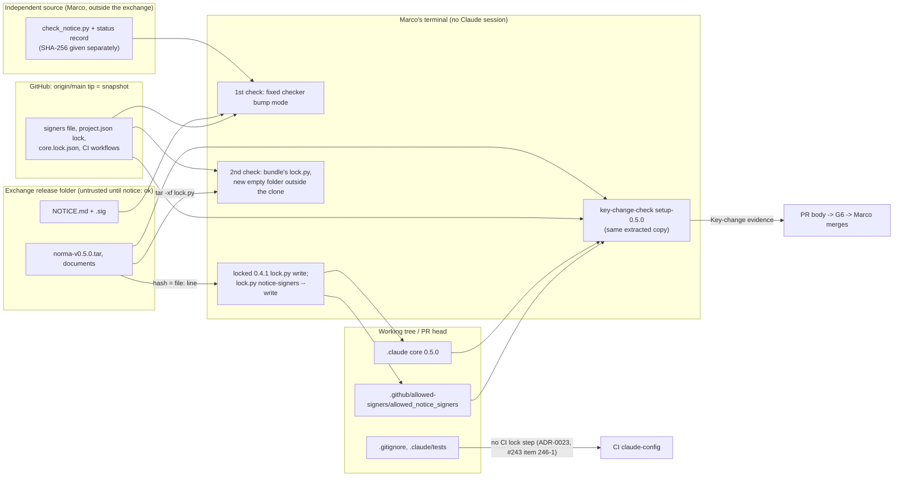

<!-- gate: G3 | verdict: PASS-WITH-NOTES | issue: #322 -->

# Threat delta: bump Norma 0.4.1 to 0.5.0, the signed release notice (issue #322)

Scope (manifest, Marco's G0 decisions):
- install Norma 0.5.0 with the same four packs (`dotnet`, `intake`, `npm`, `status`), in Marco's terminal, as #281;
- the 0.5.0 trust setup: the notice-signers file, kept LF, and the second notice check with the checked bundle's `lock.py`;
- `/.local.*/` in `.gitignore`.

No product code, module, contract, endpoint or tenant data flow changes. As in the #261, #279 and #281 deltas, ASVS 5.0 ids apply by analogy to developer tooling:
- V15.2: supply chain (the release, its checker and its trust inputs);
- V15.3: defensive coding, fail closed;
- V8.2: authorization design (who writes the trust files);
- V13.4: unintended information leakage (local-only folders);
- V16.3: integrity of security records (the notice and key-change evidence in the PR).

Inputs, all read as data:
- The manifest `docs/ai/pipeline/322.md`, the #281 delta and ADR-0023.
- The 0.5.0 release documents, after the orchestrator's `notice: ok`: the CHANGELOG entries 0.5.0 and 0.4.2 (0.4.2 lies between the installed 0.4.1 and 0.5.0), `docs/runbooks/bump-a-consumer.md` ("Steps", "The order on each path", "When the release key changes", "Checking a key change"), `docs/consumer-guide.md` ("Checking a release notice", "What your CI runs"), `docs/project-json.md` (`lock` keys).
- The extracted bundle (read only, never run): `core/.claude/core.manifest`, `lock.py`, `_claudecfg.py`, `lint.py`, `commitlint.py`, `gates.py`, `prereqs.py`, `secret_guard.py`, the `security-reviewer` agent, the `issue` skill, `rules/core.md`.
- Decisya's `project.json`, `boundaries.json`, `core.lock.json`, `.gitattributes`, `.gitignore`, `.dockerignore`, `.github/workflows/ci.yml` and the `.claude/tests` suites that touch the changed scripts.

Facts taken from the manifest, not re-checked here: the fixed checker's and the status record's SHA-256, the first `notice: ok` and its `file:` lines, the bundle's SHA-256 `81c98167…3edc72`.

Facts checked here:
- `git fetch origin` then `git log origin/main` (2026-11-18): `origin/main` is at `182e679` (#323). The first notice check's snapshot was `39f0da6`. **The default branch has moved since the first check.**
- The branch `issue/322-norma-0-5-0` is at `182e679`; only the manifest is uncommitted.

## What changes, as it bears on Decisya

**Locked files.** I compared the bundle's `core.manifest` hashes with `core.lock.json` (0.4.1). For Decisya's units (core, dotnet, intake, npm, status):

- 15 files change: `agents/security-reviewer.md`, `rules/core.md`, `skills/issue/SKILL.md`, and the scripts `_claudecfg.py`, `bootstrap.py`, `capture.py`, `commitlint.py`, `floors.py`, `gates.py`, `labels.py`, `lint.py`, `literals.py`, `lock.py` (now `ed207a71…`), `prepush.py`, `prereqs.py`.
- Everything else is byte-identical, including all three hooks (`_hooklib.py`, `agent_boundaries.py`, `secret_guard.py`), `base-settings.json` and every `dotnet`, `intake`, `npm` and `status` pack file (`intake.py` and `status.py` included).
- **So 0.5.0 adds no deny and no settings floor.** The agents' allowed command forms, the secret guard's blocked folders and the Git Bash and PowerShell guards behave as today.
- The `planning` and `python` units are in the bundle but are not installed. `lint.py` fails with both `planning` and `intake`, so `--packs` must not change.

**Trusted program path (BEHAVIOUR CHANGE).** `_claudecfg.trusted_program` and `lock.py`'s own copy now start `git` and `ssh-keygen` only from an absolute PATH entry outside the repository. On Windows they also take only `<name>.exe`, skip UNC entries, and set `NoDefaultCurrentDirectoryInExePath=1` for the script and its children.

Decisya's places all resolve to an `.exe` outside the clone:
- Git for Windows `cmd\git.exe`;
- inside a git hook, `mingw64\libexec\git-core\git.exe`;
- the Windows OpenSSH `ssh-keygen.exe`, or Git's `usr\bin` copy in Git Bash;
- `/usr/bin/git` on the CI runners and in the sandbox.

The lookup fails closed ("not found on PATH outside the repository"). It does not break a flow, but it **does break one Decisya test** (T-05).

**`lint.py`.**
- New problem: the notice-signers file is missing or differs from its derivation (after the install).
- New problem: a `--revoked` that CI passes while `lock.revoked_file` is not set.
- New: a scan of every file under `.github/` for `--revoked`, including its prefixes. Grep finds none in `.github/`. There is no link and no submodule, every tracked file is far below 2 MB, and the workflows are UTF-8.
- The git-ignored `.github/scripts/__pycache__/*.pyc` files are read too. They are readable, so they give no warning.
- `docs/intake/**` is **already** in the shared `deny` list (`boundaries.json` line 5, added in the 0.4.0 bump #280, and pinned by `test_guardrail_carryover.py` lines 57-59). The intake ACTION line therefore needs no edit. `docs/intake/` does not exist yet. Only `intake.py`, run by the main session, writes it.

**`lock.py`.**
- New commands: `notice`, `notice-signers [--write]` and `key-change-check`.
- `notice-signers --write` writes LF bytes through a temporary file with a link check.
- The derived content for Decisya's one open-ended signer line is exactly `norma-release namespaces="norma-notice" ssh-ed25519 AAAAC3NzaC1lZDI1NTE5AAAAICbE/7Syfn+2hYqCSQT8sBxdTwslZFcsP/Cpfz93a6SF` plus LF.
- The default path is `allowed_notice_signers` in the signers file's folder, so **`.github/allowed-signers/allowed_notice_signers`**, not `.github/allowed_notice_signers`.
- That path is already covered by:
  - the shared deny `.github/allowed-signers/**`, which wins over devops' `.github/**` lane, so `lint.py` gives no lane warning;
  - Decisya's review-required `\.github/allowed-signers/.+`, and from 0.5.0 also Norma's floor;
  - `.gitattributes` `.github/allowed-signers/* text eol=lf`.

**`key-change-check --kind setup-0.5.0`.** It refuses the bump unless all of the following hold:
- the checker is byte-equal to the `lock.py` the head installs;
- the head contains the snapshot;
- the head's notice-signers file is the derived one;
- no trust field changes other than `core.lock.json`, the notice-signers file, `lock.notice_signers_file` and `lock.revoked_file`;
- the snapshot's CI lock checks pass one `--revoked` file or none.

Decisya's CI has **no** `lock.py verify` step at all: `.github/` holds no `lock.py` call, and the claude-config job runs `lint.py`, `roster.py --check`, `floors.py`, `prereqs.py interpreter`, the `.claude` tests, labels and gates. With no call there is no `--revoked`, so `lock.revoked_file` stays unset (the `--revoked` ACTION line does not apply) and the check passes on this point. The security-reviewer agent's tools (both 0.4.1's and 0.5.0's) do not include `python` or `tar`, so the agent cannot run this check itself (T-09).

**Other behaviour changes reviewed, no Decisya edit needed:**
- `gates.py` (from 0.4.2) reads an unreadable non-Light tier line as Full with a `NOTE`. The #281 guard test `test_manifest_tiers.py` still holds: a Light note and a second line still fail. Manifest 322's `- **Tier, as recorded:**` line does not match `TIER_LIKE`.
- `capture.py` (0.4.2) follows a project folder's name from the drive root. It makes a capture `partial` on a name collision or after 10,000 entries. Decisya runs the capture (`usage` section), so 0.4.2's ACTION line ("bump to 0.4.2") applies and is met by this bump.
- `literals.py` now reports an unparsable link as a `url` finding instead of exiting 2 with no file named. No Decisya workflow or test runs it.
- `prereqs.py` only adds an OpenSSH `NOTE`.

**`/.local.*/`.**
- An anchored line ignores every root folder `.local.<name>`. That covers `.local.norma-check/`, which today is ignored only through this clone's `.git/info/exclude`.
- `test_local_only_paths.py` pins the existing lines `ops.local/` and `.local.ops/` (unanchored, any depth) and checks `.local.usage`, so those lines stay.
- `secret_guard.blocked_folders` must not change. A `.local.*` or `.local.u…` entry would block the capture folder, and the loader then denies every command (ADR-0023 §6).
- `.dockerignore` names `.local.ops` and `.local.usage` but not other `.local.*` folders (T-10).

## Data flow and trust boundaries

## Threats

| Id | Element / flow | STRIDE | Threat | Severity | Mitigation | ASVS 5.0 | Status |
| --- | --- | --- | --- | --- | --- | --- | --- |
| T-01 | Snapshot (TB3) | T, S | The first check's snapshot (`39f0da6`) is no longer the tip (`182e679`). The second check then names another commit, or trust inputs read at different commits are mixed. If main moves again, the head no longer contains the snapshot | Medium (fails closed, but evidence would not match) | Re-run the fixed checker after `git fetch origin`, then do the second check and `key-change-check` on that same snapshot; re-run both on any move. M-1 | V15.2, V15.3 | Open (G4) |
| T-02 | Fixed checker and record kept inside the clone (`.local.norma-check\`, not a blocked folder) | T | A session or tool changes the checker or record between runs; a re-run would trust it | Low | Re-hash both against Marco's values before every run (M-1). Keep them outside the clone from the next check on (S-4) | V15.2 | Open (G4) / S-4 |
| T-03 | Install (TB4) | T | A wrong bundle, stale bytecode, a Claude session open on the clone, a changed `--packs`, or a `project.json` edit that key-change-check refuses | Medium (inherent) | #281's install procedure. Bundle hash from the `file:` line. No `project.json` key with the default notice path. Evidence list in M-2 | V15.2 | Open (G4) |
| T-04 | Notice-signers file | T, E | Hand-edited, written before the install, CRLF in the blob, written at another path, or later in an agent's lane. Every later notice check then fails, or trusts a wrong key line | Medium | Only `lock.py notice-signers --write` after the install; content equal to the derived line; LF blob proven; deny, review-required and LF coverage already in place; a Decisya guard test pins it. M-2, M-4, S-1 | V8.2, V15.2 | Open (G4) |
| T-05 | Decisya test vs trusted `git` | D | `test_commitlint.py:53` asserts `argv[0] == "git"`. 0.5.0 passes the absolute path, so CI and pre-push go red. A careless fix deletes or skips the test | Low (fails closed) | Tighten the test, never drop it. M-4 | V15.3 | Open (fix-now) |
| T-06 | Second check uses the wrong `lock.py` | S, T | The working tree's or the PR's `lock.py` checks the notice that installed it, so it checks itself | Medium | Extract from the checked tar into a new empty folder outside the clone; SHA-256 = `ed207a71…` = installed copy; `python -I`. M-3 | V15.2 | Open (G4) |
| T-07 | Done-when "`lock.py verify` … in CI" | R | CI runs no lock check, so the done-when cannot be met as written. Read loosely, it implies a control that does not exist | Low | Decision D-1 | V16.3 | Decision |
| T-08 | Key-change evidence | R, T | No `key-change-check` output in the PR, output run from a PR copy, or output that goes stale after a push or a main move | Medium | Marco runs it with the M-3 copy and records it in full in the PR; G6 reads it; `git ls-remote` before the merge. M-5 | V16.3, V15.2 | Open (G6) |
| T-09 | Reviewer tooling | R | The runbook makes `key-change-check` the reviewer's step, but Decisya's security-reviewer agent cannot run `python` or `tar` | Low | Marco runs it (M-5); report the gap to Norma (S-5) | V16.3 | Open / S-5 |
| T-10 | `/.local.*/` and local-only folders | I | A `.local.*` folder other than `.local.ops` or `.local.usage` (the checker folder, `.local.docs`) enters a root `docker build .` context. A `blocked_folders` edit made "for symmetry" blocks the capture folder and so denies every command | Low | S-2 (gitignore line and test), S-3 (`.dockerignore`, backlog); no `blocked_folders` change | V13.4 | Open (S-2 fix-now, S-3 backlog) |
| T-11 | `NoDefaultCurrentDirectoryInExePath` in child processes | D | Pre-push steps (`dotnet`, `npm`) started by `prepush.py` inherit it; a step that relies on finding a program in the current folder stops | Low (fails closed) | One pre-push run as a git hook runs it (runbook step 7), in M-4 | V15.3 | Open (G4) |

No High. T-01, T-03, T-04, T-06 and T-08 are the Mediums. Each is closed by the procedure below, and each fails closed if skipped: a wrong snapshot or copy gives no `notice: ok`.

## MUSTs (all fix-now, G4 unless named)

**M-1: one fresh snapshot for every check.** Main moved from `39f0da6` to `182e679` after the first check, so redo point 1 before anything else:
- `git fetch origin`.
- Re-hash `check_notice.py` (`c6a51c46…669463`) and the status record (`d8ffd9a7…d0d9`) against Marco's values. The record is valid until 2026-12-17.
- Re-run the fixed checker's `bump` mode with the same arguments.
- It must print `notice: ok (norma 0.5.0, signed by SHA256:FN0FhN2iaOAzUvB2d6zWXoORMikapGpRS1wXUt9noCo; fixed checker 1)`, a `snapshot:` line naming the current tip, and the same six `file:` lines (bundle `81c98167…3edc72`).
- The second check (M-3) and `key-change-check` (M-5) must name this same commit. If `main` moves in between, fetch and run both checks again.
- Merge nothing to `main` until G7.

**M-2: install and derive in Marco's terminal, in the runbook's order, and prove it from the diff.**

Procedure:
- As #281: no Claude Code session open on this clone (either Windows account), clean tree apart from this PR's own edits, and every `__pycache__`/`.pyc` under `.claude/` deleted first.
- With the default notice path, no `project.json` edit precedes the install (D-3).
- Then `python .claude/scripts/lock.py write --bundle <release folder>\norma-v0.5.0.tar --tag v0.5.0 --packs dotnet,intake,npm,status` must print `lock: ok (norma 0.5.0, …)`.
- Then `python .claude/scripts/lock.py notice-signers --write` must print `notice-signers: written`. Never edit the file by hand.

Evidence in the G4 record:
- `git diff --name-only` over `.claude/` lists exactly the 15 locked files above, plus `core.lock.json` (and `core.manifest` if tracked). No hook, no `base-settings.json`, no pack file, no `settings.json`, `boundaries.json` or addendum changes through the install.
- `core.lock.json` names `0.5.0`/`v0.5.0`, the same signer `SHA256:FN0F…noCo` and exactly the four packs.
- `.github/allowed-signers/norma` is not in the diff.
- `project.json` `lock` is still only `signers_file`: no `revoked_file`, `notice_signers_file` (unless D-3), `repository_url` or `key_change_serial`.
- The new file `.github/allowed-signers/allowed_notice_signers` holds exactly the one derived line above with LF. `git ls-files --eol` on it shows `i/lf`. `git check-attr text eol` on it shows the effective rule chosen in D-2.
- `lock.py notice-signers` (no `--write`) prints `matches`.

**M-3: the second check with the checked bundle's `lock.py`, never the working tree's.** After steps 6 and 7 and before the commit:
- `tar -xf <release folder>\norma-v0.5.0.tar -C <new empty folder outside the clone> core/.claude/scripts/lock.py`.
- The extracted copy's SHA-256 equals `ed207a7100f0686cd2d16c36d5ba80e049ed0c6b330b8994eb748131c6ea4441` (the bundle manifest) and the installed `.claude/scripts/lock.py`.
- Run `python -I <that folder>\core\.claude\scripts\lock.py notice --root <clone> --version 0.5.0` with the same `--release-folder`, `--expected-url https://github.com/mpcs2013/decisya`, `--branch main` and `--status-record` as M-1.
- It must print `notice: ok`, the `note:` line for the second check of the 0.5.0 bump, and a `snapshot:` line naming M-1's commit.
- The PR body lists both checks' `notice:` and `snapshot:` lines.

**M-4: Decisya's suites stay green without weakening any guard.**
- `test_commitlint.py::test_range_passes_end_of_options_to_git` (line 53) expects a bare `git`. Change it to assert:
  - `argv[1:4] == ["rev-list", "--reverse", "--end-of-options"]`;
  - `argv[0]` is an absolute path whose file name is `git` or `git.exe`;
  - `argv[0]` lies outside `ROOT`.

  Never delete or skip the test.
- Add the notice-signers file to the existing pins, a few lines each:
  - `NormaSignerTests`: its exact bytes;
  - `ReviewRequiredTests.PATHS`: its path;
  - `test_guardrail_carryover.py` `WRITE_DENY`: `("devops", ".github/allowed-signers/allowed_notice_signers")`.
- Run in full, bounded, with `-B`: every `.claude/tests` suite, `deploy/tests` and the .NET unit suite. Run the pre-push hook once as a git hook runs it, with git's `libexec\git-core` first on PATH (T-11).
- `test_capture_canary.py` and `test_manifest_tiers.py` must pass unchanged. If the canary turns `partial` under 0.4.2's root walk (a large `%TEMP%`), report the exact output and stop. Do not move the fixture.
- Then `lint.py` (no problem; report every warning), `floors.py`, `roster.py --check`, `prereqs.py interpreter`, and a hand-run `lock.py verify`: `lock: ok (norma 0.5.0, packs: dotnet, intake, npm, status, …)` with 0 bytecode.
- Any other failure: report the exact error and stop.

**M-5 (G6): `key-change-check --kind setup-0.5.0`, run by Marco and recorded in the PR.**
- After the push, from the clone root, with the PR head fetched (a full clone), Marco runs `python -I <M-3 folder>\core\.claude\scripts\lock.py key-change-check --root <clone> --expected-url 'https://github.com/mpcs2013/decisya' --branch main --head <head commit> --kind setup-0.5.0`.
- It must print `key-change-check: ok (setup-0.5.0)` with every `checked:` line. Its full output goes into the PR as "Key-change evidence", with the status record's source and date.
- G6 does not pass without it.
- Right before the merge, `git ls-remote origin refs/heads/main` must still print the snapshot commit; otherwise run M-1, M-3 and this check again on the new tip.

## SHOULDs

- **S-1 (Low, Decision D-2):** keep the notice-signers file LF. Decisya's existing `.github/allowed-signers/* text eol=lf` already normalises it to LF in the blob and the working tree. The release's literal `<path> -text` would turn that normalisation off for this one file.
- **S-2 (Low, fix-now, a few lines):** add `/.local.*/` as a new line under the local-only block of `.gitignore`, with a one-line comment. Keep `ops.local/`, `.local.ops/` and `/.local.usage/` as they are, since tests pin them. Add one check to `test_local_only_paths.py` that a root `.local.<x>/file` is ignored. Do not touch `secret_guard.blocked_folders`.
- **S-3 (Low, backlog #243):** `.local.*` in `.dockerignore` (review-required), so no local-only folder can enter a root build context.
- **S-4 (Low, backlog #243):** from the next check on, keep the fixed checker and status record in a folder outside the clone (for example `temp\norma-check\`), as the consumer guide places them.
- **S-5 (Info, exchange):** report to Norma, as an improvement:
  - the runbook makes `key-change-check` the reviewer's step, but the core `security-reviewer` agent cannot run `python` or `tar`;
  - say who runs it, and how the agent consumes its output.

  Draft first; Marco approves.
- **S-6 (Info, PR body):** list the CHANGELOG actions:
  - 0.4.2's capture line: met by this bump.
  - 0.5.0 lines:
    - notice check: done;
    - notice-signers: done;
    - LF: done, as D-2 decides;
    - `--revoked`/`lock.revoked_file`: N/A, because no CI lock check passes `--revoked` and the key is unset;
    - next-bump procedure: noted;
    - intake `docs/intake/**` deny: already present since #280.
  - The BEHAVIOUR CHANGE lines: reviewed, as above.
- **S-7 (Info, backlog #243):** after the merge, two follow-ups:
  - ADR-0023 §7 gains the notice-check rule for later bumps: `main`'s own `lock.py` via `git show` from Git Bash or PowerShell 7.4 or later, or the fixed checker if the record retires it.
  - Plan the `enroll` key change (`usage.project_id` `GL-0001` plus the canonical URL from Decisya's records) as its own issue. Without it, no statement-backed key change (abandon, extend, restore) is possible.

## Checks at G4, in the runbook's order ("The order on each path", bump to 0.5.0)

1. **Point 1 (orchestrator or Marco):** M-1, the fresh fixed-checker run; keep its `snapshot:` line.
2. **Step 2:** the bundle and each document beside it match the `file:` lines, re-confirmed only if M-1's `file:` lines differ.
3. **Step 3 (main session):**
   - the `.gitignore` line (S-2) and the LF decision (D-2);
   - no `boundaries.json` edit (`docs/intake/**` is present);
   - no CI `--revoked` change;
   - Marco deletes bytecode under `.claude/` in his terminal.
4. **Step 4:** no `project.json` edit (default path). With D-3's named path only: Marco sets `lock.notice_signers_file` with the runbook's edit script, then step 5 at once.
5. **Step 5 (Marco's terminal):** `lock.py write`, then `lock.py notice-signers --write` (M-2).
6. **Step 6:** `roster.py`, `lint.py`, `floors.py`, `prereqs.py interpreter`.
7. **Step 7:** M-4's test edits and full suites, the pre-push run as a hook, `lock.py verify`, then read `git diff`.
8. **Point 5:** M-3's second check, same snapshot.
9. **Step 8:** `git add -A`, `roster.py`, `git add -A`, `lint.py`, commit. The PR body carries both checks' lines and S-6.
10. **Point 7 (G6):** M-5.

## Decisions for Marco

1. **D-1: the done-when "`lock.py verify` passes locally and in CI".** CI has no lock step (ADR-0023 "Bad", #243 item 246-1). My recommendation: reword it to "locally and in the pre-push check; CI has no lock step until #243 item 246-1".
   - Risk: until 246-1 lands, a push with `--no-verify` that edits a core file is caught only by review.
   - Option: add the base-branch lock step to `ci.yml` in this PR. Risks:
     - it mixes a workflow change into a key-change PR;
     - it adds a devops G4 lane;
     - every later CI lock call must keep the `--revoked` rule.

   Better as its own issue after this one.
2. **D-2: LF rule for the notice-signers file.** My recommendation: rely on the existing `.github/allowed-signers/* text eol=lf`, and record the ACTION line as met, with `git check-attr`/`git ls-files --eol` evidence.
   - Risk: it departs from the release's literal wording. A later Norma lint could look for `-text`.
   - Option: add `.github/allowed-signers/allowed_notice_signers -text` as written. Risk: it turns normalisation off for that file, so a CRLF copy would be committed as CRLF. That fails every notice check (fail closed), not a bypass.
3. **D-3: the notice-signers path.** My recommendation: the default `.github/allowed-signers/allowed_notice_signers`. It needs no `project.json` edit and no install-order step, and the deny, review-required and LF rules already cover it.
   - Option: `lock.notice_signers_file` = `.github/allowed-signers/norma-notice`, for naming that matches `norma`/`ostium`. Risks:
     - a `project.json` edit in Marco's terminal right before step 5;
     - a later rename is a `path-change` key change of its own.
