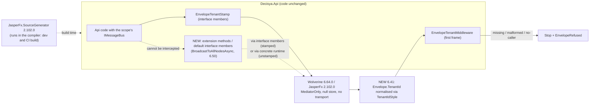

<!-- gate: G3 | verdict: PASS-WITH-NOTES | issue: #326 -->
# Threat delta: WolverineFx 6.39.1 → 6.64.0 (issue #326)

- **Scope.** What changes when `WolverineFx`, `WolverineFx.Postgresql` (unreferenced pin) and `WolverineFx.RuntimeCompilation` (test-only, R15) move to 6.64.0, with `JasperFx`, `JasperFx.Events` and the `JasperFx.SourceGenerator` analyzer moving 2.73.2 → 2.102.0. Decisya's own code, boundaries and contracts do not change. What changes is the third-party surface the #231 controls depend on. This is a delta against `231-wolverine-tenant-safety.md` (T-01 to T-20, G4-231-01 to G4-231-09, S-01 to S-12). Unchanged areas are not re-audited.
- **Mode.** Threat delta before implementation (G3). The MUSTs below are design input for G4 (the main session and backend-dev). G6 checks each one against the diff.
- **Inputs read.**
  - The manifest `docs/ai/pipeline/326.md` and the G2 note `docs/architecture/326-wolverinefx-6-64.md` (PASS-WITH-NOTES).
  - The WolverineFx release notes 6.40.0 to 6.64.2, fetched by the orchestrator (third-party text, read as data only).
  - ADR-0024 with amendments 1 and 2, and the #231 threat model.
  - `src/Decisya.Api/Messaging/*` (stamp, facts, extensions, bindings).
  - `tests/Decisya.Api.Tests/Messaging/*`: `EnvelopeStampTests`, `EnvelopeChainTests`, `MessagingRuntimeTests`, `WolverineSurfaceTests` and `BusCalls`.
  - From `tests/Decisya.ArchitectureTests`: `IlScan.IsWolverineFamily` and the R6 name match.
  - `Directory.Packages.props`, `NuGet.config` and `Program.cs` (searched for `RunJasperFxCommands`).
- **Added 2026-11-19 (TD-326-09):** the orchestrator's `C:\Users\dev\source\repos\dev\temp\wolverine-6-64-0\lockdiff.txt` and `git diff -- src/Decisya.Api/packages.lock.json`.
- **Working tree.** `git diff --name-only origin/main...HEAD` is empty. The only uncommitted files are the manifest and the G2 note. Nothing had been built or restored on 6.64.0 yet, so no lock diff existed to read. By the 2026-11-19 addition, the restored lock files were also uncommitted.
- **ASVS.** 5.0, Level 2 (V6 and V7 are Level 3, but #326 does not touch them). Ids are cited the way the #231 model cites them. Check each against the official 5.0 text before you copy it into a compliance artefact.
- **Ids.** TD-326-xx, G4-326-xx and S-326-xx are local to this file.
- **Reviewer.** security-reviewer agent, 2026-11-19.

## Verdict

**PASS-WITH-NOTES.** The G2 note is sound. G3 accepts its version choice (6.64.0), its stop rule and the new tests R2 (a), R2 (b) and R3, with additions. No High or Medium threat is open.

One gap in the proof changes what G4 must deliver. G2's surface-diff evidence (item 3) lists extension methods that *return* a bus or context. It does not list extension methods that *take* one as `this` and send, and `BroadcastToAllNodesAsync` is exactly that kind. The evidence also does not cover DI service types that resolve to an unstamped bus. And it relies on `Wolverine.xml`, which holds only documented members. G4-326-03 closes this with two reflection-based pins on the built host, so the next bump checks itself. The release notes show the maintainers add members both as extension methods (6.50, #4993) and as default interface members (6.64.0, GH-5446, `IWolverineObserver.CircuitBreakerReset`). So both of G2's new R2 checks are justified.

## Why this is a delta, and what holds it fail-closed

The receive middleware (ADR-0024 point 3) is the backstop for every send path the stamp cannot see:

- **No stamp, no tenant.** A path that bypasses `EnvelopeTenantStamp` carries no tenant unless it sets one. That is refused as `missing`.
- **No stamp, no caller.** It carries no `decisya-caller-id` header either, so it is refused as `no-caller`.
- **A chosen tenant needs a banned member.** Choosing a tenant needs a member whose name contains `Tenant`, and R6 bans those outside the stamp. `IlScan.IsWolverineFamily` covers `Wolverine`, `Wolverine.*` and `JasperFx*`, so any new JasperFx 2.102 assembly falls under it.
- **Default bodies run through the stamp.** A default interface member or an extension method that only calls `IMessageBus` members runs those calls on the stamp, and the stamp stamps them.
- **What escapes the stamp still fails closed.** The residual case is code that casts the bus to a concrete Wolverine type or reaches the runtime some other way. That code sends without a stamp, and the middleware refuses it.

So a new send path in 6.64.0 can at worst cause a refusal or a silent drop. It cannot cause a cross-tenant delivery unless a test that pins a #231 behaviour also turns red. For that reason, the #231 refusal matrix and the `MediatorOnly` refusals are stop conditions. They are not suites to update.

Trust boundaries are unchanged from #231 (B1 HTTP to bus, B2 envelope to handler scope, B4 process to telemetry). #326 adds one supply-chain boundary: **B6, the package graph into the build and the Api process**, which includes an analyzer that runs inside the compiler.

## Threats (delta)

| Id | Element / flow | STRIDE | Threat | Severity | Mitigation | ASVS 5.0 id | Status |
| --- | --- | --- | --- | --- | --- | --- | --- |
| TD-326-01 | `Envelope.TenantId` normalisation (6.41, #4640); #231 T-01 | T, S | A non-default `TenantIdStyle`, or a changed default, rewrites the envelope tenant before the middleware reads it. An upper-case tenant would then arrive lower-cased and pass the exact-canonical check. | Low | **Why Low:** a case change of a GUID names the same tenant, so the effect is on the canonical-text rule and on log fidelity, not on isolation. A `ForceUpperCase`-style setting would turn every stamped (lower-case) tenant into `malformed`: loud and fail-closed. **Controls:** R6 keeps `TenantIdStyle` unreachable from `src` (name contains `Tenant`). The real-chain `upper` case (`EnvelopeChainTests`, sent through Wolverine's own `IMessageContext.InvokeAsync`, so through whatever normalisation 6.64.0 applies on invoke) must stay `malformed`. The `padded`, `default-star` and `missing` cases must stay as they are. S-326-01 adds a direct pin. | V8.4.1, V2.2.1 | Mitigated by existing test; G4 proves on 6.64.0 (G4-326-04) |
| TD-326-02 | New send path `BroadcastToAllNodesAsync` (6.50, #4993, an extension method on `IMessageBus`); #231 T-03 | T, E | The stamp cannot intercept an extension method. If the method reaches Wolverine's runtime without going through the stamp's members, it sends an unstamped envelope. If `MediatorOnly` stops refusing it, a non-invoke path becomes live without the per-path stamp test that ADR-0024 amendment 1 item 1 requires. | Low (fail-closed by the middleware; Medium if a handler runs) | R2 (b) as G2 wrote it, with the G4-326-02 additions. The notes say "`MediatorOnly` refuses it just like `PublishAsync()`". That is taken as a claim to test, not as a fact. | V8.4.1, V8.2.2 | Open → G4-326-02 |
| TD-326-03 | Unlisted bus surface: default interface members, `this IMessageBus` extension methods, new DI service types that resolve to `MessageContext` (for example `ICommandBus`, if registered); #231 T-03 and amendment 1 item 3 | T, E | #231 G3 item 2 says "every `IMessageBus` member is stamped or throws". That is proven by enumerated calls only. A member Wolverine adds as a default body, as an extension, or as a separately registered service type escapes both the stamp and R14 (which names four exact targets). G2's evidence item 3 misses the last two shapes, and `Wolverine.xml` omits undocumented members. | Low (backstop as above) | R2 (a) (interface map). G4-326-03 adds reflection pins for extension methods and DI service types. Each new entry is classified in the G4 evidence. Any route to an unstamped bus beyond R14's four targets is a stop. | V8.4.1, V15.1 (architecture rules) | Open → G4-326-01, G4-326-03 |
| TD-326-04 | #231 behaviours pinned by tests: construction order (R16), the four chain-less handlers (R4, R17), nested-invoke `no-caller`, the composed-runtime sets (R3), `MediatorOnly` refusals; #231 T-02, T-10, T-12 | T, E, I | 6.44 to 6.52 change continuation numbering, chain construction and internal messaging (node-control broadcast, timer agents), and JasperFx moves 29 minor versions. A changed behaviour is absorbed by "updating the test", and a control silently changes. | Medium if absorbed; none if it stops | G2's stop rule, accepted: any red #231 test is a stop. A change needs a dated ADR-0024 amendment under G2 and G3. A test is never relaxed. G6 verifies by diff (G4-326-04). | V15.1, V8.4.1, V16.5.3 | Mitigated by stop rule; G6 verifies |
| TD-326-05 | Composed runtime: new hosted services and background work from JasperFx 2.102 / Wolverine 6.64 (resource setup "regardless of `AutoCreate`", 6.64.0 #5445; timer agents 6.52 and 6.61); #231 T-12 | T, D | A new hosted service runs on the Api host: resource setup, an agent or a command-line hook. It touches storage or starts background messaging that `MessagingRuntimeTests` does not see, because R3 pins options, stores, transports and endpoints, not hosted services. | Low today (null store, `MediatorOnly`, `ExtensionDiscovery.ManualOnly`); Medium once 231-1 adds a store | G4-326-03 (b) pins the hosted services `AddDecisyaMessaging` adds on the composed Production host. A new one is a stop. 231-1 inherits the pin (Backlog). | V13 (options fail closed), V15.2 | Open → G4-326-03 |
| TD-326-06 | Package graph (B6): `JasperFx*` 2.73.2 → 2.102.0, `JasperFx.SourceGenerator` (analyzer, runs at Api build time), `JasperFx.RuntimeCompiler` 5.0.0 → **5.1.0** (test graph; corrected 2026-11-19 from the restore, G2 and G3 had expected 5.0.1), any new transitive (`System.Linq.Dynamic.Core`, TD-326-09); #231 T-19, S-08 | T, D | A vulnerable or unexpected package enters the Api runtime or build. The analyzer runs code inside the compiler on developer machines and CI. JasperFx 2.101 "runs the command line from a Native AOT binary", so the package may now ship a native executable or MSBuild `build`/`buildTransitive` targets. A central `JasperFx*` pin that splits `JasperFx.Events` from its generator breaks projections at run time (6.62 notes). The JasperFx 2.74 to 2.102 release notes were **not** among the inputs. | Medium (unverified until the lock diff exists) | Locked restore (ADR-0019 A6). Source mapping already sends every non-`Ostium.*` id to nuget.org only. G4-326-05 requires the lock-diff summary, native and MSBuild content, the audit, and no `JasperFx*` central pin. R15 and S-11 keep the runtime compiler out of `src`. `Program.cs` still ends in `app.Run()` (checked: line 90; no `RunJasperFxCommands`). | V15.2.1, V15.1.2, V15.2.5, V13 | Open → G4-326-05; G6 verifies |
| TD-326-07 | Wolverine telemetry: 6.61 (GH-5311) records `exception.message` and stack on handler spans by default; 6.52 `handler.type` tag; 6.41 activity parenting; #231 T-14 | I | Exception messages can carry application or tenant data. Once someone subscribes the `Wolverine` source, they reach OTLP. | Low (source and meter unsubscribed and test-pinned) | Unchanged control: `DecisyaTelemetry` subscribes `Decisya.*` and `Ostium.*` only (an allow-list, so a renamed Wolverine source stays unsubscribed). `MessagingRuntimeTests` pins it. G3 confirms G2's note for any later subscription: set `Tracking.RecordExceptionsOnSpans = false` **and** assert it on the composed host in the same PR (S-326-04). | V16.2.5, V14.2 | Mitigated; note confirmed |
| TD-326-08 | Deduplication flag (6.45, GH-4757; the #317 break) | T | The R3 assertion is rewritten in a way that accepts a non-`None` mode (`NotBe(CompareByHash)` accepts `CompareByString`), or the warning is hidden with a `#pragma`. A later edit could then switch on a deduplication store unnoticed. | Low | G2 decision 3, accepted: `MessageDeduplicationMode.Should().Be(MessageDeduplicationMode.None)`, no `#pragma`, no `NoWarn`, no read of the obsolete member. | V13, V15.2 | Open → G4-326-04 |

| TD-326-09 | New transitive `System.Linq.Dynamic.Core` 1.7.4 in the Api runtime (through `JasperFx` 2.102.0); added 2026-11-19 | T, E, I | Api code parses a string from a request, a message or configuration as a dynamic LINQ expression (`DynamicExpressionParser`, string `Where`/`OrderBy`/`Select`). That is the class of GHSA-w65q-jcmv-28gj (Critical, < 1.3.0) and GHSA-4cv2-4hjh-77rx (High, < 1.6.0): an expression that reaches members it should not, or runs arbitrary methods. A string `Where` on an `IQueryable` from a `TenantDbContext` could also reshape a query in ways the BOLA review never saw. The package is compile-visible to the Api and its tests as a transitive, so a later use needs no `PackageReference` and no `Directory.Packages.props` line. It would skip the "new package" review entirely. | Low (unreachable today) | **Unreachable today:** no `src` file references the package (searched); the Api has no handler, no Wolverine.HTTP, no CritterWatch and no JasperFx command line; modules cannot see it (R5: no Wolverine reference). 1.7.4 is above both fixed versions. **Lasting control:** G4-326-06 bans any KeyScope reference to the assembly. **JasperFx's own use** is internal; G4 names the public JasperFx/Wolverine member, if any, that accepts a string expression. | V1.2, V1.3.2 (no dynamic code execution from untrusted input), V15.2.1, V15.1 | Open → G4-326-06; G6 verifies |

No High in the delta. No High or Medium flaw was found in unchanged code.

### New transitive dependency: `System.Linq.Dynamic.Core` 1.7.4 (added 2026-11-19)

- **Facts.** These come from the orchestrator's forced and locked restores (`C:\Users\dev\source\repos\dev\temp\wolverine-6-64-0\lockdiff.txt`) and are checked against `git diff -- src/Decisya.Api/packages.lock.json`:
  - the new dependency line is `JasperFx` 2.102.0 → `System.Linq.Dynamic.Core` 1.7.4;
  - it appears as a `Transitive` entry in the locks of the Api, the ArchitectureTests project and its two fixtures, and Api.Tests;
  - no other id is added or removed.
- **The publisher.** Apache-2.0, ZZZ Projects and others. A long-lived, widely used library. It comes from nuget.org through the existing `*` source mapping. The lock `contentHash` makes the bytes exact.
- **Known advisories.** Both are below the resolved version: GHSA-w65q-jcmv-28gj, fixed in 1.3.0, and GHSA-4cv2-4hjh-77rx, fixed in 1.6.0. G4's audit and G6's re-run must still show nothing for 1.7.4.
- **The risk is reachability, not the version.** The advisories' class is dynamic LINQ built from untrusted strings. Decisya never builds a query from a string, and nothing in `src` references the package today. The gap is that a transitive package's compile assets flow to the Api, so the first use would arrive without the package review that CLAUDE.md requires for a new package. G4-326-06 turns "not used" into a check.
- **Rejected alternative.** A direct `PackageReference` with `ExcludeAssets="compile"` would hide the API from the compiler. But it adds a central `PackageVersion` line and a direct reference for a package Decisya does not use, and it does not cover the test projects. The architecture rule is smaller and fails with a reason.

## Answers to G2's "For G3 to check"

1. **T-01, `TenantIdStyle` (6.41).** The `upper` real-chain case is the right proof:
   - It goes through Wolverine's own invoke path in the Production composition. The chain host differs only in `TypeLoadMode`, and `The_test_hosts_only_Wolverine_override_is_TypeLoadMode` compares every public enum, primitive and string option value for value. So whatever normalisation 6.64.0 applies on invoke, and whatever default style it ships, is exercised.
   - A lower-casing style or default turns it red, and that is a stop.
   - What it does not prove: normalisation on paths that do not exist yet (envelopes read back from a store or a transport). Those belong to 231-1 (Backlog).
   - S-326-01 adds a cheap direct pin of the effective style. The test project is outside KeyScope, so R6 does not apply to it.
2. **T-03, R2 (a) and (b).**
   - **Both accepted.** R2 (a) closes default interface members. R2 (b) closes the one named extension method.
   - **What they leave open.** Neither closes extension methods or service types in general. G4-326-03 does.
   - **Ownership is not stamping.** R2 (a) proves the stamp *owns* each member, not that it *stamps* it. A later pass-through override would pass R2 (a). On #326 `src` does not change (G4-326-04), so this is a SHOULD (S-326-02).
3. **T-10 and T-12, chain walk and composed runtime.**
   - Accepted as stop conditions, exactly as G2 wrote them. A fifth chain-less pair, a larger transport, serializer or durable-endpoint set, or a renamed `_serializers` field is a G2 and G3 change, never a test update.
   - The construction-order case: if `built.Should().NotBeEmpty(...)` turns red because 6.64.0 builds dependencies *after* the middleware, G3 rates that an improvement. It is still a stop, and it needs a dated amendment so that R16's rationale is restated.
4. **T-14, telemetry.** Confirmed (TD-326-07, S-326-04).
5. **T-19 and S-08, supply chain.** Accepted with the evidence in G4-326-05. The JasperFx release notes were not read (see "Decision for Marco").
6. **Version choice.** **6.64.0 confirmed.**
   - The 6.64.1 fixes are not on Decisya's paths and add no public API: `codegen-preview`/`describe` with a recurring schedule, Polecat solo agents, the native-ack idempotency guard, inline-retry spans and MySQL deadlocks. Decisya has no JasperFx command, no recurring schedule, no transport, no retry policy and no Wolverine span subscription.
   - 6.64.2 changes only Wolverine.HTTP, which is not referenced.
   - Neither release adds a security fix that reaches Decisya's graph. 6.64.1's Aspire item concerns samples only.
   - The next Dependabot 6.64.x PR re-runs every pin below, so the delta stays checked.

## Requirements

### MUST (fix-now; G6 gives BLOCK if any is missing)

- **G4-326-01: R2 (a), the stamp owns every bus member** (TD-326-03). As G2 wrote it, in `WolverineSurfaceTests`:
  - **Assertion.** For `typeof(IMessageBus)` and every interface in `GetInterfaces()`, every `GetInterfaceMap(...).TargetMethods` entry has `DeclaringType == typeof(EnvelopeTenantStamp)`. Property accessors are included. The failure names each unowned member.
  - **If red on 6.64.0:** stop and report to G2 and G3. Do not add a pass-through.
  - **Evidence.** The G4 evidence states the interface count and member count the test walked, so G6 can see that it is not vacuous.
  - ASVS: V8.4.1, V15.1.
- **G4-326-02: R2 (b), broadcast is refused** (TD-326-02). As G2 wrote it, in `EnvelopeStampTests` (chain host, Production composition), with three additions:
  1. Assert that the bus resolved from the tenant A scope is `EnvelopeTenantStamp` before calling `BroadcastToAllNodesAsync`.
  2. Add the same call from a scope whose ambient was never set. It must throw, either with the stamp's exception or the `MediatorOnly` one, and no probe handler may run.
  3. Name the method's declaring type and signature in the G4 evidence.

  **G3's position on the outcomes, given in advance** (G2's stop rule still applies for G2):
  - **Expected, accepted.** `InvalidOperationException` naming `MediatorOnly`, and no handler runs.
  - **Accepted by G3 as fail-closed (Low), with no further G3 round.** A different exception (for example a failed cast to a concrete Wolverine type), with no handler run. The test pins the actual type and a message fragment, and the G4 evidence records it.
  - **A G3 stop.** No exception, or any handler run. That is true even if the handler arrives stamped as tenant A: a live non-invoke path needs ADR-0024 amendment 1 item 1's per-path stamp test first.

  ASVS: V8.4.1, V8.2.2.
- **G4-326-03: the bus surface, pinned by reflection on the built host** (TD-326-03, TD-326-05). This replaces the "extension methods" part of G2's evidence item 3; the rest of item 3 stays. In `WolverineSurfaceTests`, each as an exact, ordered list, with a failure that names the difference:
  - **(a) Extension methods.** List every public static method marked `[Extension]` in the loaded `Wolverine`, `Wolverine.*` and `JasperFx*` assemblies whose first parameter type is `IMessageBus`, `ICommandBus`, `IMessageContext`, any interface `IMessageBus` extends, or `MessageContext` / `MessageBus`. Pin them by full name and parameter types.
  - **(b) Service registrations.** Take the services that `AddDecisyaMessaging` (with `AddWolverine`) adds to a `WebApplicationBuilder`, as in the existing registration test.
    - Pin the descriptors whose service type is assignable to `IMessageBus`, `ICommandBus` or `IMessageContext`, or is `MessageContext` / `MessageBus`.
    - Separately pin the `IHostedService` implementation types.
  - **Evidence.** The G4 evidence classifies every entry that is new since 6.39.1 (compared with the 6.39.1 `Wolverine.xml` and the 6.39.1 lock, as G2 asked) as one of four kinds:
    - not a send;
    - a send that only calls interface members, so the stamp stamps it;
    - refused under `MediatorOnly` (by a test, like G4-326-02);
    - a **stop**: a route to an unstamped bus beyond R14's four targets, a new bus service type that R14 does not name, or a new hosted service.
  - **Why reflection.** It is authoritative because `Wolverine.xml` lists only documented members. If a reflection read is impossible for a type, the evidence says so.
  - ASVS: V8.4.1, V15.1, V13.
- **G4-326-04: #231 behaviour unchanged, proved and visible in the diff** (TD-326-01, TD-326-04, TD-326-08).
  - **G2's G4 evidence item 2.** Every named test is green on 6.64.0 and unchanged: the full refusal matrix including `upper`, `padded` and `default-star`; proofs (a), (c) and (e); the four chain-less pairs; `The_test_hosts_only_Wolverine_override_is_TypeLoadMode`; `no-caller`; the cascade, publish, send and schedule refusals; `MessagingRuntimeTests` including `_serializers`; `WolverineSurfaceTests`; R14 to R17. Any red one is a stop.
  - **R3.** The assertion reads exactly `options.Durability.MessageDeduplicationMode.Should().Be(MessageDeduplicationMode.None);`. There is no `#pragma warning disable CS0618`, no `NoWarn`, and no read of `EnableMessageDeduplication`.
  - **The diff (G6 checks it):**
    - no change under `src/**`;
    - `tests/Decisya.Api.Tests/Messaging/**` and `tests/Decisya.ArchitectureTests/**` show additions only, apart from the one R3 line;
    - no assertion is removed, weakened or re-targeted;
    - no new exemption appears in R6, R14, R16 or R17.
  - ASVS: V8.4.1, V16.5.3, V15.1.
- **G4-326-05: supply-chain evidence for the new graph** (TD-326-06). In the manifest's G4 evidence, and summarised in the PR body (S-08):
  1. **Per-lock summary.** For each changed `packages.lock.json`, list the added, removed and moved ids with their versions. Name every analyzer or source generator. Name every package that carries MSBuild `build`/`buildTransitive` targets, `tools/` content or native `runtimes/` binaries. Check this especially for `JasperFx` 2.102.0, given the 2.101 Native AOT command line. State whether any native or tool file is copied into the Api's publish output.
  2. **Locked restore** (`LOCKED_RESTORE=true`) is clean.
  3. **Vulnerability audit.** `dotnet list package --vulnerable --include-transitive` finds no High or Critical. Any Moderate or Low is listed by id.
  4. **R15 / S-11.** No `src/**/packages.lock.json` contains `JasperFx.RuntimeCompiler` or `WolverineFx.RuntimeCompilation`. `JasperFx.RuntimeCompiler` is **5.1.0** in the test graph only (corrected 2026-11-19 from the restore; G2 and G3 had expected 5.0.1). It is the same publisher and line, and the minor bump needs no new decision.
  5. **No central pin.** No `PackageVersion` for any `JasperFx*` id in `Directory.Packages.props`. Transitive pinning is on, so a pin there would split `JasperFx.Events` from its generator.
  6. **Restore inputs unchanged.** No change to `NuGet.config` or to the CI workflows.

  G6 re-runs the audit on the final diff and reads every lock diff against this summary. ASVS: V15.2.1, V15.1.2, V15.2.5, V13.
- **G4-326-06: no Decisya code references `System.Linq.Dynamic.Core`** (TD-326-09; added 2026-11-19).
  - **The rule.** Add the assembly name `System.Linq.Dynamic.Core` to an existing banned-reference rule over `KeyScope.Assemblies` in `Decisya.ArchitectureTests`. The same shape as `RuntimeCompilerRule.BannedReferenceNames` is enough. The rule:
    - is green on today's `src`;
    - has an exact, **empty** exemption list;
    - has a red fixture: one call to `DynamicExpressionParser` or a string `Where`. The fixtures already resolve the package transitively.
  - **The evidence.**
    - The audit result for 1.7.4.
    - The public JasperFx 2.102.0 or Wolverine 6.64.0 member(s) that expose a string expression backed by this package, from `JasperFx.xml` / `Wolverine.xml` or by reflection, or "none found".
    - Confirmation that the Api calls none of them.
  - **When a use is wanted.** The first issue that needs dynamic LINQ removes the ban under its own G2 and G3, with a direct `PackageReference`, Marco's approval and an allow-list of parseable members. It never parses request text.
  - ASVS: V1.2, V1.3.2, V15.1, V15.2.1.

### SHOULD

- **S-326-01** (fix-now, Low; `MessagingRuntimeTests`, which the PR changes): assert the effective `TenantIdStyle` on the composed Production runtime is the case-preserving default. G4 takes the member's location from the 6.64.0 `Wolverine.xml`. If the effective value is not readable, record that and rely on `upper`. (TD-326-01)
- **S-326-02** (fix-now, Low; `EnvelopeStampTests`): a completeness check that every stamp member found by R2 (a) which takes a message is either in `BusCalls.All` or in the `NotSupportedException` set. Ownership then implies "stamped or throws", and a future pass-through cannot hide. Backlog if it needs a `BusCalls.cs` change larger than a few lines. (TD-326-03)
- **S-326-03** (Info): `IWolverineObserver` gained a default interface member in 6.64.0 (GH-5446). Decisya implements no `IWolverineObserver`, so nothing to do. Recorded only as evidence that Wolverine uses default interface members on its public interfaces.
- **S-326-04** (backlog #243; with the item that first subscribes the `Wolverine` activity source): set `Tracking.RecordExceptionsOnSpans = false` and assert it on the composed host in that PR. Review `handler.type` and the other Wolverine tags for tenant or caller data before subscribing. (TD-326-07)

## Backlog (#243, one command at G7)

G3 agrees with G2's added criteria for **231-1** and **code-generation mode**, and adds:

- **231-1, broadcast.** `BroadcastToAllNodesAsync` joins publish, send, schedule and cascade as a path with its own stamp test. On a store, a broadcast "goes through the outbox like any other outgoing message" (6.50 notes), so its rows fall under T-20's grants and retention.
- **231-1, normalisation on read-back.** Re-run the `upper`, `padded` and `default-star` cases against envelopes read back from the store and, if a transport arrives, from it, since 6.41 normalisation may apply there. NATS `TrustTenantIdHeader` (6.50) stays off unless that issue's G3 says otherwise.
- **231-1, hosted services.** The G4-326-03 (b) hosted-service pin is updated under that issue's G2 and G3, never as a test fix. That includes the resource-setup service (6.64.0 #5445).
- **231-1, dead-letter admin.** The 6.54 tenant-filtered dead-letter query and replay is a cross-tenant admin path: ADR-0012, `[AllowCrossTenant]`, audited (as G2 says).

## Decision for Marco

1. **ADR-0024 amendment 3 (G2's question).**
   - **G3 recommends: yes.** Write it after the G4 evidence and before G7.
   - **What it adds.** Besides G2's text, it names G4-326-02's actual broadcast outcome and the G4-326-03 pins as part of "Enforced by".
   - **Risk of no.** ADR-0024 keeps reading as specific to 6.39.1, and the broadcast and surface pins are not traceable to a decision.
   - **Risk of yes.** None, provided it is written from the evidence and not before it.
2. **The JasperFx 2.74 to 2.102 release notes were not read** (TD-326-06).
   - **Option A (G3 recommends).** Do not fetch them. Rely on the behavioural pins (G4-326-03 hosted services and bus surface, the composed-runtime and chain tests) and on G4-326-05's package-content check.
     - Risk: a JasperFx change with no behaviour the pins observe, such as a new command-line verb, is not seen. Today it is unreachable, because the Api never calls `RunJasperFxCommands`.
   - **Option B.** The orchestrator fetches the notes as data, and G6 reads them with the lock diff.
     - Risk: about 29 releases of extra reading at G6 for changes most likely off Decisya's paths.
     - Gain: the analyzer's and the native command line's changes are reviewed from their source rather than inferred.

3. **Accept `System.Linq.Dynamic.Core` 1.7.4 as a new transitive dependency of the Api** (TD-326-09; added 2026-11-19). The manifest says "no new package". This one arrives through the approved bump, not through a `PackageReference`.
   - **G3 recommends: accept.** Name it in the PR body with a one-line justification: "transitive through JasperFx 2.102.0; not referenced by Decisya; banned by G4-326-06".
   - **Risk of accepting.** A library whose earlier versions had Critical and High injection advisories sits in the Api process. It is unreachable while G4-326-06 holds, and future advisories reach it through the audit and Dependabot.
   - **Risk of refusing.** WolverineFx stays at 6.39.1, or Decisya pins JasperFx below 2.102.0. Either is blocked: the first by #326's purpose, the second by the 6.62 central-pin warning. Dependabot #317 stays open.

## Not checked

- Wolverine's 6.64.0 code: how `BroadcastToAllNodesAsync` reaches the runtime, where `TenantIdStyle` normalisation is applied, and which services `AddWolverine` registers. The package cache is outside this agent's working folders, so G4-326-02 and G4-326-03 establish these by test.
- Lock files and the vulnerability audit: when this file was first written, nothing had been restored on 6.64.0. Update 2026-11-19: the orchestrator's lock diff and the Api lock diff were read for TD-326-09. The audit was not run by G3; G6 runs it.
- What JasperFx 2.102.0 uses `System.Linq.Dynamic.Core` for. The package cache is outside this agent's folders; G4-326-06's evidence names it.
- The JasperFx release notes (decision 2).

## G4 stop: the `binary/wolverine+gzip` serializer (2026-11-19)

- **Why this section.** G4 stopped under the G2/G3 stop rule. On 6.64.0, the #231 R3 pin `System_Text_Json_is_the_default_serializer_and_the_only_one_beyond_Wolverines_intrinsic_two` finds a fourth registry entry, `binary/wolverine+gzip`. Every other #231 proof passes: 464 of 465 non-integration Api tests, and `MessagingBoundaryTests` 23 of 23 including G4-326-06. Marco chose option A on 2026-11-19: one G2 and G3 round on this change only. This section is G3's round.
- **Inputs.** The manifest's G4 "STOP" item and the 6.44 release notes. GH-4720 adds `Durability.CompressAgentCommands`, off by default: "gzip agent command payloads under their own `binary/wolverine+gzip` content type … reading works from this version forward". So the **reader** is always registered from 6.44 on, and only the **writer** is opt-in. The release-note table in the G2 note rated `CompressAgentCommands` inert, but did not foresee that the registry would grow.
- **The verdict is unchanged (PASS-WITH-NOTES).** The entry is accepted as inert under `MediatorOnly`. The R3 pin may be updated to the exact four-entry set, on the conditions in G4-326-07. G6 gives BLOCK if G4-326-07 is missing.

| Id | Element / flow | STRIDE | Threat | Severity | Mitigation | ASVS 5.0 id | Status |
| --- | --- | --- | --- | --- | --- | --- | --- |
| TD-326-10 | `binary/wolverine+gzip` deserializer in the composed runtime's serializer registry; #231 T-11 | D, T, E | **(1) Decompression bomb.** A small gzip body inflates to gigabytes and exhausts memory or CPU in the Api process. **(2) Format and type confusion.** A second binary format is chosen by the envelope's content-type header, which is sender-controlled once bytes come from outside. A writer that can put bytes on a transport or into the store picks a deserializer other than System.Text.Json and reaches Wolverine's binary readers instead of the STJ settings (`RespectRequiredConstructorParameters`, `TenantIdJsonConverter`). Its intended payload is an **agent command**: the `IAgentCommand` → `AgentCommandHandler` route is one of the four chain-less handlers, which run **no** middleware and so no tenant check (amendment 2 item 3). | Low today; **High once any transport or durable store reads envelope bytes** (231-1) | **Unreachable today:**<ul><li>`MediatorOnly`, invoke-only. Local messages pass by reference; no envelope is ever serialized or read from bytes (#231 G4 delta item 4).</li><li>No transport beyond `local`/`stub`/`tcp`, with no network endpoint or listener (R3).</li><li>The null store, no node control endpoint, no agents.</li><li>R17 bans Decisya types that implement `IAgentCommand`.</li><li>The writer `CompressAgentCommands` is off.</li></ul>**Proof:** G4-326-07. **Before bytes are read:** the 231-1 criteria below. | V15.2 (resource limits), V1.5.2 (safe deserialization), V13 (options fail closed), V8.4.1 | Accepted as inert (Low); G4-326-07; linked: #243 item 231-1 |

### Answers

1. **Reachability today: none.**
   - A deserializer runs only when Wolverine reads an envelope's bytes, which needs a listener, a transport or a store.
   - Under `MediatorOnly` the only path is in-process invoke, with objects passed by reference.
   - R3 and the chain walk prove there is no network endpoint, no listener and no store, and those tests stay green on 6.64.0.
   - The gzip reader is therefore dead code in the Api process, like `binary/envelope` and `binary/wolverine`, which #231 accepted the same way.
2. **May the R3 pin become the exact four-entry set? Yes.** Amendment 1 item 4 makes adding to the set a G2 and G3 change, and this section is that change. It is not a relaxation, provided the pin stays an exact equality (never a subset, a prefix or a `binary/*` match) and carries the conditions in G4-326-07. A fifth entry still fails.
3. **What 231-1 must do before any transport or durable store reads envelopes.** Marco's option A makes the decompression limit a must-have of 231-1. G3 agrees and adds three criteria; all four are below.

### MUST (fix-now)

- **G4-326-07: R3 pin updated, with the reason, and the gzip writer pinned off** (TD-326-10). In `MessagingRuntimeTests`, which the PR already changes:
  - **The exact set.** The registry keys are exactly `application/json`, `binary/envelope`, `binary/wolverine` and `binary/wolverine+gzip` (ordinal, equality). The `because` text names #326, GH-4720 (6.44) and this section.
  - **The writer is off.** `Options.Durability.CompressAgentCommands` is `false` on the composed Production runtime. G4 takes the member's location from the 6.64.0 `Wolverine.xml`. If it is not readable, record that in the evidence.
  - **Value types (a few lines).** Each registry value's concrete type is declared in the `Wolverine` assembly. Name the four type full names in the G4 evidence. This also catches a third party that replaces one of the existing keys, which a keys-only pin misses.
  - **Unchanged.** The test's other assertions (default serializer `application/json` and `SystemTextJsonSerializer`, the `_serializers` field present) stay as they are.
  - **ADR-0024 amendment 3** records the four-entry set and this reason, as Marco's option A says.
  - ASVS: V1.5.2, V13, V15.2.

### Backlog (#243 item 231-1, added criteria; one command at G7)

Before any transport or durable store reads envelope bytes:

1. **Decompression limit (must-have, Marco option A).**
   - **The bound.** Any gzip-decoded envelope body has a hard cap on decompressed size, and preferably a ratio cap too, enforced while streaming and not after full inflation.
   - **Over the cap.** It is refused without a retry, under a closed reason, with no payload in the log.
   - **Wolverine's own bound.** If Wolverine offers no bound on its gzip reader, 231-1 shows that no listener or store reader can reach it (point 2), or stops and revises ADR-0024.
   - **The proof.** A test sends a small-to-huge gzip body and asserts the refusal with bounded memory.
2. **Content-type allow-list per endpoint.**
   - Module message endpoints accept `application/json` only. Every `binary/*` type is refused there, so a sender cannot switch the deserializer by header.
   - If Wolverine needs `binary/*` at all, it is accepted only on the node control endpoint, and only if that endpoint exists.
   - Tested with a forged content type on each endpoint.
3. **Agent commands stay out of reach.**
   - `CompressAgentCommands` stays off unless that issue's G3 approves it.
   - Whoever can write to a control queue or table must be no one but the dispatcher role (T-20). A row there is an agent command that runs with no tenant middleware.
   - R17 stays green.
   - Re-review all three binary serializers (`binary/envelope`, `binary/wolverine`, `binary/wolverine+gzip`) as #231's backlog already asks, now including gzip.
4. **Envelope size limit before decompression.** The transport or store reader caps the raw body length, so the cap in point 1 is not the only bound.

No new High or Medium flaw in unchanged code was found.

## G6 stop: `buildTransitive\JasperFx.Events.targets` (2026-11-19)

- **Why this section.** G6-326-01 found one new MSBuild file in the moved packages. G6's rule stops on any new target, tool or native file until G3 rules. The file is `JasperFx.Events` 2.102.0 `buildTransitive\JasperFx.Events.targets`; 2.73.2 had none. It is imported transitively into the Api, ArchitectureTests and Api.Tests.
- **What G3 read.**
  - The file itself, from the local NuGet cache, read as data.
  - A search of `src`, `tests`, `Directory.Build.props` and `Directory.Build.targets` for `JasperFxEvents` and `JFXEVT`. Nothing matched. Neither build file names `JasperFx` at all, so none of the file's three opt-in or opt-out properties is set and no `JFXEVT` code is in a `NoWarn`.
  - `Directory.Build.props` sets `TreatWarningsAsErrors`.
- **The orchestrator's facts, accepted.** No other moved or added package changed shape: `lib` only, `JasperFx.SourceGenerator` still `analyzers` only, no `tools/`, no `runtimes/`, no native file. `dotnet publish` of the Api under locked restore adds exactly one file, `System.Linq.Dynamic.Core.dll`, which TD-326-09 and G4-326-06 already cover.

### Ruling: acceptable

The file is build-time item bookkeeping with no side effect outside the compiler's analyzer list:

- **It runs nothing.** It has no `Exec`, no custom `UsingTask` or inline task, no download, no file write or copy, no import of another file and no environment read. It uses only built-in `ItemGroup`, `PropertyGroup`, `Message`, `Warning` and `Error`, plus string property functions (`Replace`, `ToLowerInvariant`, `Contains`).
- **It can touch only one file name.** It acts only on `Analyzer` items whose file name is exactly `JasperFx.Events.SourceGenerator.dll`. Decisya has none (`JasperFx.SourceGenerator.dll` is a different file), so:
  - the dedupe target finds no duplicates and changes nothing;
  - `JFXEVT1138` cannot fire, because no copy of that file was dropped;
  - `JFXEVT900` is opt-in through a property Decisya never sets.
- **It cannot hide or remove Decisya's analyzers.** No analyzer Decisya relies on (`BannedApiAnalyzers`, the SDK analyzers, `JasperFx.SourceGenerator`) can be removed by it, because the `Remove` is keyed to that one file name.
- **Its failure modes are loud.** Under `TreatWarningsAsErrors` and `-warnaserror`, a `JFXEVT` warning fails the build. It cannot pass silently.
- **Its integrity is pinned.** It arrives inside a package whose bytes the lock's `contentHash` pins (ADR-0019 A6).

The residual risk is the general one of any `buildTransitive` file, code that runs inside MSBuild on developer and CI machines. It is Low and covered by the existing pinning, plus G6's rule that any *further* new target, tool or native file in a later bump stops again. The verdict line is unchanged (PASS-WITH-NOTES).

### G6 checks

1. **The build logs are clean.** The `-warnaserror` build of the solution (and of the three importing projects, if built separately) shows no `JFXEVT902`, `JFXEVT1138` or `JFXEVT900` line, and no `JasperFx.Events:` message line. A message line would mean duplicate generator copies were found.
2. **Decisya stays out of the file's switches.** The diff sets none of `JasperFxEventsDedupeSourceGeneratorAnalyzers`, `JasperFxEventsReportLostSourceGenerator` or `JasperFxEventsRequireSourceGenerator`, and adds no `JFXEVT*` to `NoWarn` or `WarningsNotAsErrors`.
3. **The PR body names the file** next to the analyzer, under S-08: "`JasperFx.Events` 2.102.0 adds `buildTransitive/JasperFx.Events.targets` (analyzer dedupe and diagnostics only; reviewed at G3)".
