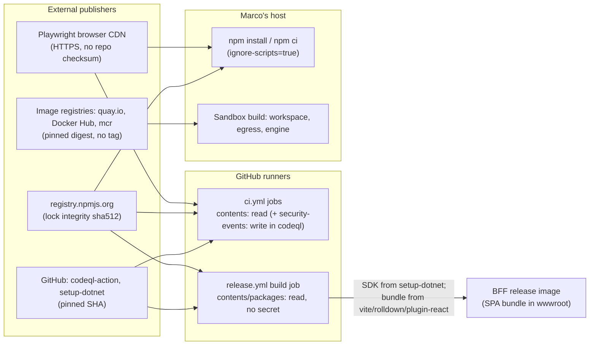

<!-- gate: G3 | verdict: PASS-WITH-NOTES | issue: #329 -->
# Threat delta: the 2026-11 Dependabot batch (issue #329)

- **Scope.** Ten bot updates in one PR. No Decisya code, contract or boundary changes:
  - workflows: `github/codeql-action/init` and `/analyze` 4.39.1 → 4.39.2 (`ci.yml`); `actions/setup-dotnet` 6.0.0 → 6.1.0 (seven uses in `ci.yml`, one in `release.yml`);
  - agent sandbox images (ADR-0010): `quay.io/podman/stable` `f7a17ef` → `6999889` (engine), `debian` `9cc0800` → `9c6e381` (egress proxy), `mcr.microsoft.com/dotnet/sdk` `212fe4c` → `65f3c7c` (workspace);
  - SPA dev dependencies: `vitest` 5.1.0, `@vitejs/plugin-react` 6.3.0, `@playwright/test` 1.65.0, `typescript-eslint` 8.72.2, `vite` 8.3.8, with `package-lock.json` regenerated once.
- **Mode.** Threat delta before implementation (G3). The MUSTs are design input for G4 (devops, the main session, Marco). G6 checks each one against the diff.
- **Inputs read.**
  - The manifest `docs/ai/pipeline/329.md`.
  - The ten bot diffs: `git diff origin/main...origin/dependabot/...` for each branch, and `git log -1` of the three image branches. All ten are based on `b77505c`, which is `origin/main` today.
  - `.github/workflows/ci.yml` (setup-dotnet, codeql, e2e jobs), `.github/workflows/release.yml` (build job), `.github/dependabot.yml`, `.github/scripts/spa_package_guard.py`.
  - The three `.devcontainer` Dockerfiles, `docs/runbooks/agent-sandbox.md` ("Verify", digest updates).
  - `src/Decisya.Web/package.json`, `.npmrc`, `package-lock.json` (`hasInstallScript`).
  - ADR-0010 and ADR-0014.
- **Not read.** The action sources at the new SHAs, the image registries and the npm registry. This agent has no network access; the checks that need it are G4 MUSTs.
- **ASVS.** 5.0, Level 2. Ids are cited at requirement level; check each against the official 5.0 text before you copy it into a compliance artefact.
- **Ids.** TD-329-xx, G4-329-xx and S-329-xx are local to this file.
- **Reviewer.** security-reviewer agent, 2026-11-20.

## Verdict

**PASS-WITH-NOTES.** No High threat. Two Medium threats are open and closed by G4 MUSTs:

- **TD-329-04: CI proves nothing about the three sandbox digests.** Its filesystem scan excludes `.devcontainer/` and no job builds those images, so "passed full CI" covers only the pin form. The three `FROM` lines carry a digest and **no tag**. For a digest-only reference Dependabot most likely follows the image's `latest` tag. For `dotnet/sdk`, `latest` moves to a new major at each GA, and .NET 11 is due to reach GA in November 2026. The new digest has to be proven to be a 10.0 SDK before it is merged.
- **TD-329-05: regenerating the lock with `npm install` can resolve transitive versions newer than any bot lock.** Those versions get no Dependabot cooldown (ADR-0014 item 4) and no CI run on their own. The regenerated lock must be compared entry by entry with the five bot locks.

## Data flow and trust boundaries

The boundaries are the existing supply-chain ones:

- **B1, third-party code into CI.** Actions run with the job's token.
- **B2, the npm graph into the host, CI and the release build.** This includes code that shapes the shipped bundle.
- **B3, base images into the agent sandbox.** The egress proxy and the engine are part of the sandbox boundary.

No new boundary is added.

**What reaches a runtime artifact.** The Api and the BFF get no package change. The release base images (`.github/release/**`) are unchanged. Two paths do reach the shipped BFF image:

- **The SDK.** `setup-dotnet` installs the SDK that compiles the release images (TD-329-02).
- **The SPA bundle.** `vite`, `rolldown` (with native bindings) and `@vitejs/plugin-react` transform the code that ships in the BFF image's `wwwroot` (TD-329-06). npm marks them dev-only, but they act on shipped code.

The sandbox images never ship.

## Threats (delta)

| Id | Element / flow | STRIDE | Threat | Severity | Mitigation | ASVS 5.0 id | Status |
| --- | --- | --- | --- | --- | --- | --- | --- |
| TD-329-01 | Workflow pins (B1): codeql `init`/`analyze`, eight `setup-dotnet` uses | T | A hand-applied SHA differs from the bot's: a typo, a different commit, or a missed use. That leaves mixed SHAs for one action. Or the version comment no longer matches. | Low | Both bot diffs keep the ADR-0014 form: a 40-hex SHA, `# vX.Y.Z`, the same `owner/repo`. `init` and `analyze` share one SHA (#247). `test_ci_pins.py` enforces the form and one SHA per action. G4-329-01 proves the diff equals the bot diffs. | V15.2.1, V15.1.2 | Open → G4-329-01 |
| TD-329-02 | `setup-dotnet` 6.1.0 in every .NET job and in the release `build` job (B1) | T, I | A minor release brings in a new input that is on by default, such as package caching (as setup-node v5 did). That restores a cache across runs into the release build, which G4-119-04 forbids. Other changes: SDK resolution under `global-json-file` plus `dotnet-quality: preview` picks a different SDK for the release images, or the action starts using a token or a new download host. | Low (Medium if a default-on cache reached the release build) | The jobs already run with least privilege: `contents: read`, and `packages: read` where needed. No secret is passed. The Ostium credential sits only on the restore step's `env`, never on the action. G4-329-02 reads the action at the new SHA and compares the SDK version in the logs. | V13 (fail-closed options), V15.2.1 | Open → G4-329-02 |
| TD-329-03 | `codeql-action` 4.39.2 in the `codeql` job (B1) | T, E | The job holds `security-events: write`, so a compromised action could tamper with or suppress alerts. | Low | The patch bump keeps the same identity and the same job permissions (`contents: read`, `security-events: write`, `packages: read`), with `persist-credentials: false`. The bot applied the 7-day cooldown. The job does not gate merge (alerts are advisory, #83). | V15.2.1 | Mitigated (G4-329-01 covers the pin) |
| TD-329-04 | Sandbox base images (B3): workspace SDK, egress `squid-openssl` on Debian, rootless Podman engine | T, E, D | **No CI build.** CI never builds these images, so a broken or changed base reaches `main` unseen. **Major moves.** A digest-only `FROM` follows `latest`, so a digest bump can silently move major. For `dotnet/sdk` that means an 11.0 SDK, which breaks `global.json` and ADR-0009. For `debian` it means a new release with a different squid. **Cooldown.** It is unclear for digest-only updates, so a digest may be younger than 7 days. **Egress.** A squid change could alter `ssl_bump` and SNI behaviour. **Provenance.** The podman bot commit names its source as `podman-container-tools/image_build`, and its metadata says `dependency-version: 1d280cf…` while the `FROM` line is `6999889…`. | Medium | **Most failures are loud:** the engine's pass-3 setuid and capability assertion fails the build, squid refuses a config it cannot parse, and a wrong SDK fails `dotnet build`. **What is still needed:** proof of the base version and age, plus the runbook's Verify rows, including that egress is refused. That is G4-329-03. S-329-01 adds the tag so Dependabot stays on the major line. | V15.2.1, V15.1.2, V13 | Open → G4-329-03 |
| TD-329-05 | Single `package-lock.json` regeneration (B2) | T | `npm install` resolves new transitive versions inside the ranges that the five bumps open. Example: `vite` 8.3.8 needs `rolldown ~1.2.18`, so npm may pick a release newer than the bot's 1.2.19, published hours ago. Those versions passed no bot CI and no cooldown. npm may also keep older entries the bots had moved, such as `magic-string` 1.4.3 instead of 1.4.5. That is harmless but makes the lock differ from the bot locks. | Medium | G4-329-04: entry-by-entry comparison with the five bot lock diffs. Any version newer than every bot lock is listed with its publish date and must be at least 7 days old, or the lock is regenerated with `--before`. | V15.2.1, V15.1.2, V15.2.4 (L3, guidance) | Open → G4-329-04 |
| TD-329-06 | Build and test toolchain on Marco's host, in CI and in the release build: `vite`, `rolldown` native bindings 1.2.14 → 1.2.19, `@vitejs/plugin-react`, `vitest`, `typescript-eslint`, `playwright` (B2) | T, E | A compromised release runs code with Marco's user rights or a runner's token at build or test time. For the bundler and the React plugin, it can also inject code into the SPA bundle that ships in the BFF image. | Low | Exact versions with lock `integrity`. `npm audit signatures` runs in CI and in the release build (registry signatures and provenance). The bot cooldown applies. `ignore-scripts=true` plus `spa_package_guard.py`. The release build runs with a read-only token and no secret, and then scans the image (grype, gitleaks). The BFF's CSP limits what injected script can reach. G4-329-05; S-329-02. | V15.2.1, V15.2.4 (L3, guidance), V3 (CSP) | Open → G4-329-05 |
| TD-329-07 | New packages and install scripts in the graph (B2) | T, E | **Seven new optional packages from `vite` 8.3.8:** `@rolldown/binding-wasm32-wasi`, `@napi-rs/wasm-runtime`, `@tybys/wasm-util`, `tslib`, `@emnapi/wasi-threads`, plus the **prereleases** `@emnapi/core` and `@emnapi/runtime` 2.0.0-beta.2. **Install scripts:** a new package could carry one. | Low | All seven are `dev` and `optional`, behind `cpu: wasm32`. They are not installed on win32-x64 or linux-x64. None of the five bot diffs adds `hasInstallScript`; the only one in the lock is `fsevents` (macOS, optional, already on `main`). `ignore-scripts=true` holds for `npm install` and `npm ci`. G4-329-04 (c). | V15.2.1, V15.1.2 | Open → G4-329-04 |
| TD-329-08 | Playwright 1.65.0 browser download (CI e2e job, Marco's host) | T | New Firefox and Chromium builds are fetched over HTTPS from the Playwright CDN. The repository holds no checksum for them. | Low (residual, unchanged in kind) | CI uses `npx --no-install`, so the Playwright version comes from the lock. The browsers run only the test harness against the local AppHost. Unchanged residual; S-329-03 for the host. | V15.2.1 | Accepted (residual) |

No High in the delta. No High or Medium flaw was found in unchanged code.

## Requirements

### MUST (fix-now; G6 gives BLOCK if any is missing)

- **G4-329-01: the pins are exactly the bot pins** (TD-329-01, TD-329-03, TD-329-04).
  - `git diff origin/main...HEAD -- .github/workflows .devcontainer` shows exactly these changes:
    - two codeql lines: `9b3254085494b55a0f7c4c2b3d2d52cc712ce370  # v4.39.1` → `1fc58d04a4d4374f921bdac573c3811c240f9c26  # v4.39.2`;
    - seven `setup-dotnet` lines in `ci.yml` and one in `release.yml`: `a98b56852c35b8e3190ac28c8c2271da59106c68  # v6.0.0` → `0f4a354dd5547a28c70b7853dbd95d5b67886e73  # v6.1.0`;
    - three `FROM` digests: `…f7a17ef9…` → `699988997a6bec77661e2f0f489d96df8dd3fff47996e306acc41e268254fad3`, `…9cc08002…` → `9c6e381421d0f48d1b8133e573f33c185ee16cbf505eda9c4a8a4791b25ea8a6`, `…212fe4cb…` → `65f3c7c6a25a239ab3e6719f2896147e7b68242ff2d8818dd70498bde6ef8bea`.
  - Nothing else changes in those paths, unless Marco takes S-329-01. An update that is taken out under the Done-when rule is removed as a whole.
  - The `.claude` suite passes, including `test_ci_pins.py` and the `sandbox-config` check of `lint.py`.
  - The podman digest is the `FROM` line's `6999889…`, not the `1d280cf…` in the bot commit's metadata. The PR body names that mismatch.
  - ASVS: V15.2.1, V15.1.2.
- **G4-329-02: the two actions behave as before** (TD-329-02).
  - **Read the new action code.** The orchestrator or Marco reads `action.yml` at `0f4a354` (setup-dotnet) and at `1fc58d0` (codeql-action), and their release notes, as data. Compare with the old SHAs.
  - **Expected.** No new input defaults to on. In particular, setup-dotnet's `cache` stays `false`, or has no default that enables caching. No new token input defaults to `${{ github.token }}`. No new permission is required. No new download host for setup-dotnet beyond Microsoft's.
  - **Same SDK.** On the PR's CI run, setup-dotnet resolves the same SDK version as the last green run on `main`. Compare its log line in one `ci.yml` job and in `release.yml`'s `build` job, which runs on this PR because `package-lock.json` changes.
  - **If any check fails,** take that update out; it stays a bot PR.
  - ASVS: V13, V15.2.1.
- **G4-329-03: each sandbox digest is proven on the host before merge** (TD-329-04). CI does not build these images. For each new digest, record the following in the G4 evidence (from `docker buildx imagetools inspect <ref>@sha256:<digest>` or a pull followed by `docker image inspect`):
  1. **The version it carries.**
     - `dotnet/sdk`: `DOTNET_SDK_VERSION` is a 10.0 SDK that `global.json` accepts. An 11.x SDK means #305 is taken out (decision 1).
     - `debian`: `VERSION_CODENAME` is the same as the old digest's.
     - `podman/stable`: the Podman version, with the major unchanged, and the `org.opencontainers.image.source` label of the new digest.
  2. **Its creation date.** It is at least 7 days before the merge (ADR-0014 item 4). A younger digest waits, or Marco accepts it in his own words.
  3. **The runbook's Verify table passes on the rebuilt images** (`docs/runbooks/agent-sandbox.md`):
     - exactly the services `workspace` and `egress`;
     - `dotnet --version` is 10.0.x;
     - `dotnet restore`, then `dotnet build -warnaserror`;
     - NuGet returns `200`;
     - `https://example.com` is **refused**;
     - `host-review.py` is clean;
     - `up --with-docker` builds the engine (its pass-3 assertion runs) and the Testcontainers `SELECT 1` returns `1`;
     - `up` again turns the engine off.
  4. **Squid is the OpenSSL build.** `squid -v` in the egress container reports `--with-openssl` (U-22).
  - **If one image fails,** take that digest out; it stays a bot PR. If Marco does not want to rebuild the sandbox in this issue, all three are taken out (decision 2).
  - ASVS: V15.2.1, V15.1.2, V13.
- **G4-329-04: the regenerated lock changes only what the five bumps change** (TD-329-05, TD-329-07).
  - **How the lock is regenerated.** Marco runs `npm install` once, in `src/Decisya.Web`, so `.npmrc` applies (`ignore-scripts=true`, `save-exact=true`). He uses the Node major in `.node-version` and passes no package arguments, after the main session has set the five versions in `package.json`.
  - **Then the orchestrator checks the diff** `git diff origin/main...HEAD -- src/Decisya.Web/package.json src/Decisya.Web/package-lock.json` against the five bot diffs:
    - (a) `package.json` changes exactly the five `devDependencies` lines. `dependencies` (`react`, `react-dom`, `react-router`) are unchanged, and so is every lock entry in their trees.
    - (b) Every changed or added lock entry is either equal to an entry in a bot lock diff (same `version`, `resolved` and `integrity`) or is the `main` entry left in place. Every other entry is listed in the G4 evidence with its publish date. A version newer than every bot lock must be at least 7 days old. Otherwise Marco re-runs `npm install --before=<the bot PRs' creation date minus 7 days>`, or that update is taken out. The same `version` with a different `integrity` from a bot lock is a stop.
    - (c) No entry gains `hasInstallScript`. Every `resolved` is under `https://registry.npmjs.org/`. `lockfileVersion` is unchanged. The seven new `vite` 8.3.8 packages are `dev: true` and `optional: true`.
  - ASVS: V15.2.1, V15.1.2.
- **G4-329-05: audits and the SPA gates on the final lock** (TD-329-06, TD-329-07, TD-329-08).
  - **On Marco's host, before the push:**
    - `npm ci --ignore-scripts`;
    - `npm audit --audit-level=high` exits 0, so no High or Critical. Any Moderate or Low is listed by package and advisory id in the G4 evidence;
    - `npm audit signatures` reports every package verified, with no missing or invalid signature;
    - `npx --no-install playwright install firefox chromium`, never a bare `npx playwright`;
    - lint, unit tests, build, and E2E on Firefox and Chromium, with zero axe violations.
  - **On the PR:** CI repeats the audit and the signatures check. `release.yml`'s `build` job is green, which means the BFF image with the new bundle passed its pre-push checks (gitleaks, grype).
  - ASVS: V15.2.1, V15.2.4 (L3, guidance).

### SHOULD

- **S-329-01** (fix-now Low, three lines in Dockerfiles the PR changes, **Marco's decision 1**; otherwise backlog #243).
  - **The change.** Add the tag that each new digest belongs to, keeping the digest byte for byte, in the ADR-0014 item 3 form `<image>:<tag>@sha256:<digest>`. For example `mcr.microsoft.com/dotnet/sdk:10.0@sha256:65f3…`, `debian:<codename or major>@sha256:9c6e…` and `quay.io/podman/stable:v<major>@sha256:6999…`.
  - **Where the tag comes from.** G4-329-03 step 1 proves each tag from the registry's tag list. Never guess a tag.
  - **The effect.** Dependabot then stays on that line, and a major move becomes a visible tag change.
  - **In the same edit,** replace the engine's stale "Digest recorded 2026-09-24" comment with a date-free sentence.
  - **What else to check.** `lint.py sandbox-config` must accept the tagged form.
  - (TD-329-04)
- **S-329-02** (fix-now, evidence only): build the SPA on `main` and on the branch and compare `dist/`:
  - the same set of output files apart from content hashes;
  - a size change within a few percent;
  - no new absolute `http(s)://` origin and no new `eval` or `new Function` in the emitted JS.

  Record the result in the G4 evidence. (TD-329-06)
- **S-329-03** (Info, residual): Playwright browser downloads have no repository-side checksum. Nothing changes here. If a pinned-checksum mechanism appears upstream, take it in a later issue. (TD-329-08)
- **S-329-04** (Info): after `npm ci`, `npm ls @rolldown/binding-wasm32-wasi @emnapi/core` shows them not installed on win32-x64. That confirms the prerelease `@emnapi/*` code never runs on Decisya's platforms. (TD-329-07)

## Decisions for Marco

1. **The `dotnet/sdk` digest and the missing image tags** (TD-329-04, S-329-01).
   - **G3 recommends:** take S-329-01 in this PR, once G4-329-03 has proven each tag. If `65f3c7c` turns out to be an 11.x SDK, take #305 out (it stays a bot PR, and you close it), and add the `:10.0` tag to the **current** digest instead. Dependabot then proposes the newest 10.0 digest itself.
   - **Risk of yes.** Three lines beyond the bot diffs, against the Done-when's "exactly as in the bot diffs". The digests stay the same, so the pinned bytes do not change.
   - **Risk of no.** Every later digest bump of these three images can again move major unseen, because CI does not build them.
2. **Verify the sandbox in this issue, or take the three image updates out** (G4-329-03).
   - **G3 recommends:** verify. It is a host rebuild plus the runbook's Verify rows.
   - **Risk of taking them out.** #303, #304 and #305 stay open and each needs `@dependabot rebase` under the strict ruleset.
   - **Risk of merging unverified.** Not accepted by G3. The egress proxy and the engine are the sandbox boundary.
3. **Accept seven new optional transitive packages from `vite` 8.3.8**, including the prereleases `@emnapi/core` and `@emnapi/runtime` 2.0.0-beta.2 (TD-329-07).
   - **G3 recommends: accept.** Name them in the PR body with a one-line justification: "optional wasm32 fallback of rolldown 1.2.19 via vite 8.3.8; not installed on win32-x64 or linux-x64".
   - **Risk of accepting.** Prerelease code sits in the lock and in the audit scope, but it never installs on the platforms Decisya uses.
   - **Risk of refusing.** `vite` stays at 8.3.5 and #311 stays open.

## Not checked

- The action code at `1fc58d0` and `0f4a354`, and the SHA-to-tag match. Dependabot wrote both; G4-329-02 reads the code.
- The registry contents, tags, labels and creation dates of the three new digests (G4-329-03).
- The npm publish dates and provenance of the resolved versions (G4-329-04, G4-329-05).
- The regenerated lock itself, which does not exist yet. G6 reads it against G4-329-04.
