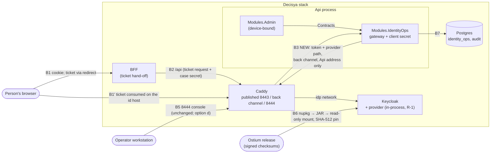

<!-- gate: G3 | verdict: PASS-WITH-NOTES | issue: #333 -->
# Threat delta: admin path from the application to the identity service (issue #333, ADR-0026)

- Inputs:
  - manifest `docs/ai/pipeline/333.md` (tier full; Marco's G1 N-1 and G2 Q-1 to Q-3, 2026-11-20);
  - G1 `docs/requirements/333-admin-path-identity-service.md` and NFR-70 to NFR-74 (`docs/requirements/nfr.md`);
  - G2 `docs/architecture/333-admin-path-identity-service.md` (its "Notes for G3" 1 to 7);
  - ADR-0026 `docs/adr/0026-admin-path-to-the-identity-service.md` (Proposed) and the ADR-0016 amendment 2026-11-20;
  - for facts only: `deploy/caddy/Caddyfile`, `deploy/compose/docker-compose.stack.yaml`, ADR-0016 R9.6 and R9.8, ADR-0019 A1 to A3, ADR-0024 points 3 to 5, ADR-0025 M-9 and M-12, threat delta `266-end-user-authenticators-l3.md`.
- Mode: threat delta of the **target design**, before acceptance. #333 ships documents only. The MUSTs below are changes to ADR-0026, the ADR-0016 amendment or an NFR row, to be made **before Marco accepts them**. Each names where it lands. The SHOULDs go to the follow-ups D-1 to D-9, Ostium's R-1 to R-5, or backlog #243.
- Level: ASVS 5.0 L2, with V6 and V7 at **L3**. Ids are given at section level, as in the baseline. Check the numbers against the official 5.0 text before copying them into a compliance artefact.
- Ids: T333-xx (threats), M333-xx (MUSTs), F333-xx (fix-now, a few lines), S333-xx (SHOULDs). D-, R-, V-, OP- and Q- ids are ADR-0026's.
- Reviewer: security-reviewer agent, 2026-11-20, G3. Reads only; no network fetch. The skill's step "record the path in the manifest" is left to the orchestrator: the caller told me not to edit the manifest.

## Verdict

**PASS-WITH-NOTES.** Option (b) is the right choice:
- Keycloak itself refuses everything outside a named list.
- No `realm-management` right exists anywhere.
- `/admin` stays off every container.
- The calls run off the request path, with a committed intent record before each one.

Rejecting (a1) and (a2) is correct. A generic user update that the edge cannot inspect is exactly the residual NFR-70 forbids.

One **High** sits in the design as written (T333-01): an Api compromise can mint enrolment tickets, which decision 7's cap does not count. The attacker can then register their own passkey on every account, and that access outlives the clean-up of the Api. One more threat is **High if present** (T333-02): the ADR does not say where the case binding of the ticket is checked.

Both are mitigated in the ADR by M333-01 and M333-02, which are text changes plus named follow-ups. With M333-01 to M333-05 in the ADR before acceptance, no High is left open. **If the ADR reaches G6 without them, G6 gives BLOCK.** No finding needs a BLOCK now: the ADR can carry every one.

## Data flow and trust boundaries (target)

- **B3** is the boundary this ADR adds. Behind it sits code (B4: the provider) that runs inside Keycloak with access to every user and credential in the realm. So NFR-70's "refused by the identity service" is exactly as strong as the provider's own checks.
- **B1, B1', B2** carry a new bearer value, the enrolment ticket. It registers an authenticator for someone who cannot sign in.
- **B6** is a new kind of artifact (a Keycloak provider JAR) that no Decisya image scan covers today.
- The Api process is the single point that holds the client secret, decides the tenant, checks the case binding and writes the audit. An attacker who controls it controls all four (T333-01).

## Threats

| Id | Element / flow | STRIDE | Threat | Severity | Mitigation | ASVS 5.0 id | Status |
| --- | --- | --- | --- | --- | --- | --- | --- |
| T333-01 | Api process, B3 | E, T, S, R | An attacker who controls the Api runs the listed operations on any end user of any tenant. The scope-attribute and case checks run in the process they control. `issue-enrolment-ticket` is **not** in decision 7's destructive cap, so they mint tickets for every account and register their own passkey, at the device-bound class if they ask for it. That access survives patching the Api and rotating its secret. `change-email` within the cap opens R-RECOVERY. Detection rests on a manual daily comparison and on V-5, which is unverified. Calls made through the gateway write matching records, so the counts agree. | **High** | Present: the edge admits only the Api's address, no `/admin`, protected accounts refused, a cap of 30 destructive operations, admin events. Added: M333-01 | V8.2, V2.4, V6.4, V16.3 | Mitigated by requirements (ADR, D-8); residual named for Marco |
| T333-02 | B2, the ticket endpoint | S, E | The Api endpoint the BFF calls mints a registration for a person who cannot sign in. Decision 4 says "after the case binding is checked" but not where or how. If the check runs only in the BFF, or the case secret is stored in clear, guessable, reusable or not rate-limited, then whoever reaches the BFF registers a passkey on someone else's identity. | High if present | M333-02 (a) | V6.4, V2.4, V8.2 | Mitigated by requirements (ADR; D-4, D-5, EP-25) |
| T333-03 | B1', ticket in transit | I | An action token reaches Keycloak as a URL query value. Caddy's JSON access log records the request URI with its query on the id host, and it redacts only `Authorization` and `Cookie`. The BFF or YARP may log the redirect `Location`. The single use and the 300 s life bound replay from stored logs, but a reader of live logs can race the owner. | Medium | M333-02 (b) | V16.2, V14.2 | Mitigated by requirements (D-3, D-4, D-5) |
| T333-04 | Decision 9, unlimited retries | T | A `remove-credentials` (all), `change-email` or `change-name` call that stays pending for days fires when Keycloak or the secret comes back, after the facts have changed. It wipes credentials the person registered meanwhile, or applies an email change a review reversed or a later change replaced. No cancel or expiry path is stated. | Medium | M333-03 | V2.3, V8.2 | Mitigated by requirements (ADR decision 9; D-4) |
| T333-05 | B6, provider supply chain | T, E, D | Third-party code with full realm access runs inside Keycloak, outside the ADR-0015 scan. Nothing ties the SHA-512 pin to the package the A3 check verified. "Every Keycloak bump waits for a compatible provider" can hold a Keycloak security fix behind Ostium's dates. | Medium | M333-04 | V15.2, V13.3 | Mitigated by requirements (ADR; D-2) |
| T333-06 | B3, edge refusal | S, E | The amendment writes the refusal as `/realms/<app realm>/<provider path>/*`. Paths that Keycloak's JAX-RS layer may resolve to the same resource miss that pattern and fall through to the broad `/realms/decisya/*` admitting routes: the segment without a trailing slash, the segment with a path parameter (`<segment>;x/...`), the segment with a suffix. This matters when the secret leaks: the token endpoint is on the published route, so the edge is the barrier the ADR relies on ("an exfiltrated secret is useless outside the stack"). | Medium | M333-05 | V8.2, V13.2 | Mitigated by requirements (ADR-0016 amendment; D-3) |
| T333-07 | B3, the Api's fixed address | S | The back-channel network has no reserved dynamic range (verified: no `ip_range`). While the Api is stopped, Docker can hand its address to another member that starts, such as the BFF after a restart, and that member then passes the single-address check. The BFF holds no client secret, so this weakens defence in depth only. | Low | S333-01 | V8.2 | Backlog (D-3) |
| T333-08 | B4, the provider's token check | S, E | R-1 (2) says "issued to the configured client's service account" but does not list the checks. A provider that checks only "the token holds role X" could accept a token from another realm, an exchanged token, or a weak algorithm. | Low (R-3's mapping rules limit who holds the role) | F333-01 | V9.1, V9.2, V10.4 | Fix-now (ADR R-1) |
| T333-09 | B7, pending email or name | I | The new value sits in `identity_ops.identity_operations` until the operation settles. That is a second copy of personal data. Under unlimited retries it has no time bound, and it reaches the dumps. | Low | S333-03; the expiry in M333-03 | V14.2 | Backlog (D-4's G2) |
| T333-10 | First cross-tenant durable send | E, T | An operator command sends for an explicit target tenant. A raw `TenantId`, a tenant taken from the body, an `[AllowCrossTenant]` receiver, or a load by id outside the filter would let an operation run in another tenant. | Medium if present | ADR-0024 points 4 and 5 already require one exact entry under G2 and G3. S333-04 states the shape | V8.2 | Mitigated by an existing rule (D-4's G3) |
| T333-11 | B4, provider availability | D | A provider fault, such as a start failure at augmentation, an exception or a slow call, takes down Keycloak and with it every sign-in. NFR-73 covers "unreachable", not "broken by the provider". | Low | S333-05 | V15.1, V13.2 | Backlog (R-1, D-2, D-8) |
| T333-12 | Client secret custody | I | The secret lives in the Api, in Keycloak's database (recoverable) and in the wrapper's environment. The realm import reads the placeholder only on an empty database, so a rotation that misses the wrapper's file brings the old secret back on a rebuild. | Low | S333-06 | V11, V13.3 | Backlog (D-1, D-8) |
| T333-13 | OP-4, SSO session (Q-3) | E | "A live identity-service session reaches no page, data or action" overstates it. Keycloak's account console still accepts the SSO session, within ADR-0025 M-9 and M-12. | Low | F333-02 | V7.4 | Fix-now (ADR decision 2) |
| T333-14 | Option (d) | R, T | Decisya cannot verify a console deletion. A link removed on a recorded step whose identity still exists lets the closed person sign in again and get a new link. | Low | S333-07 | V16.3 | Backlog (D-9) |
| T333-15 | Keycloak user events | I | A provider-driven email change may emit user events whose details carry the old and new address, kept 90 days. | Low | S333-08 | V16.2, V14.2 | Backlog (R-1) |
| T333-16 | Service account roles | E | Keycloak gives a new service-account user the realm's default-roles composite (account roles, `offline_access`) unless it is removed. | Low | S333-09 | V8.2 | Backlog (R-3, D-2) |
| T333-17 | NFR-71 wording | R | The row says "write one audit record", but the ADR and its test expect one intent record before the call and one outcome record after it. | Low | F333-03 | V16.3 | Fix-now (NFR row) |

## MUSTs (before Marco accepts ADR-0026 and the ADR-0016 amendment)

**M333-01 (T333-01; High, fix-now): put every operation that can change who controls an account under the cap, make the detection independent of the Api, and state the residual at its real extent.**
Lands in ADR-0026 decision 7, decision 14, R-1 (8) and (9), and Consequences. The runbook part lands in D-8.
- (a) **Caps per kind.** `issue-enrolment-ticket`, `change-email` and `change-name` each get their own per-hour and per-24-hour cap, sized to support-case volume. The destructive operations keep 30 per hour and gain a 24-hour cap. The values are realm configuration, which the client cannot change because it holds no realm-settings right. My recommendation: at most 5 per hour and 10 per 24 h each for tickets and for email or name changes; destructive operations at most 30 per hour and 60 per 24 h. Marco sets the values. R-1 (9) widens to "a per-realm cap per operation kind, per rolling hour and per rolling 24 h".
- (b) **R-1 (8).** Each admin event names the target user (its resource path) as well as the operation and the client, so an incident can list every identity that was touched.
- (c) **Decision 14.** A negative on **V-5** also stops D-2, unless the provider records each call in a store the Api cannot write. The detective control for this threat must not depend on the Api.
- (d) **The Bad consequence** adds: within the ticket cap, the attacker can register their own passkey on any account, and that access persists after the Api is cleaned. Name the residual (for example R-APIOPS) so that Marco accepts it by name at acceptance, as with R-RECOVERY.
- (e) **D-8's runbook** gains a compromise response:
  - rotate the client secret at the console, or unmap the roles;
  - list the provider's admin events since the earliest suspect time;
  - for each identity touched, review with the person, through support, every credential registered by ticket and every email or name change.

  The daily comparison runs on a schedule, not from memory, and flags any day whose count per kind exceeds a set threshold, even when Decisya's records agree.

**M333-02 (T333-02, T333-03; High if present, fix-now): the ticket is minted only on a binding the Api checks, and is never written down.**
Lands in ADR-0026 decision 4 and R-1 (7), and in the ADR-0016 amendment's guards list. The implementation lands in D-3, D-4, D-5 and EP-25.
- (a) **Decision 4 says where the binding is checked: in the Api** (the case's owning module or IdentityOps), on the case secret the BFF forwards, never only in the BFF. The case secret:
  - is stored only as a hash and compared in constant time;
  - is bound to one case and one person;
  - is good for one ticket at a time;
  - ends with the enrolment period.

  The ticket endpoint is rate-limited per case and per source, and it locks the case for operator review after a small number of failures.
- (b) **The ticket appears in no log, record or URL that is kept:**
  - Caddy's access log on the id host drops the query parameter that carries it (a log filter, with a `deploy/tests` guard, D-3);
  - the BFF, YARP and the Api never log the ticket response or the redirect `Location` (D-4, D-5);
  - the realm keeps its `Referrer-Policy: no-referrer` default (D-2).
- (c) **R-1 (7).** Consuming the ticket creates no Keycloak SSO session. The person then signs in through the BFF, where Q-3's forced authentication applies. Issuing a ticket counts toward M333-01's cap.

**M333-03 (T333-04; Medium, fix-now): unlimited retries only for operations whose goal cannot go stale.**
Lands in ADR-0026 decision 9 and the R-1 row; implemented in D-4.
- Retries "without limit" stay for `delete-identity`, `read-identity-state` and `end-identity-sessions`.
- `remove-credentials`, `change-email` and `change-name` carry a not-after time, a Decisya value. My recommendation is 7 days, or the end of the case's enrolment period if that comes first. After it, the operation becomes "expired, operator review" and is never sent.
- The operator can cancel any pending operation by an audited command. The pending value is cleared on settlement, expiry or cancellation.
- R-1 adds a parameter to `remove-credentials` (all): only credentials created before the operation was requested are removed. A stale retry then never removes a credential the person registered later.

**M333-04 (T333-05; Medium, fix-now): the provider is scanned and pinned like an image, and never holds back a Keycloak security fix.**
Lands in ADR-0026 R-1 (10) and Consequences; implemented in D-2.
- (a) The provider JAR, or the SBOM that R-1 (10) supplies if the scanner covers it equally, joins the ADR-0015 scan targets, with the same thresholds and the same exception rules as the images. R-1 adds that the provider bundles no third-party library beyond what Keycloak provides, or lists every bundled one in its SBOM. A shaded library would escape the Keycloak image's scan.
- (b) A test derives the committed SHA-512 pin from the JAR inside the `.nupkg` that ADR-0019's A3 check verified, and compares the two. The pin is never taken from a file downloaded separately.
- (c) "Every Keycloak version bump now waits for a compatible provider release" is replaced by this rule: **a Keycloak security bump never waits for the provider.** If no compatible provider exists, Keycloak is bumped and the provider is unmounted. The identity operations stay pending (decision 9), (d) covers beta closures, and Ostium is asked for a compatible release.

**M333-05 (T333-06; Medium, fix-now): the edge refusal cannot be bypassed by a path variant.**
Lands in the ADR-0016 amendment, change 2 and its guards list; implemented in D-3.
- The refusal on the published realm route and on the back-channel realm route matches the provider segment as a prefix **without** a trailing slash: `/realms/<app realm>/<provider segment>*`. That form also catches the bare segment, a path parameter (`;…`) and any suffix. The admitting back-channel route uses the same prefix.
- Alternatively, or in addition, the id host refuses any path that contains `;`, if D-3 confirms that Keycloak needs none.
- The guards gain a can-fail case for each variant: no trailing slash, `;x` on the segment, upper case, and a percent-encoded character in the segment.

## Fix-now, a few lines (SHOULD level)

- **F333-01 (T333-08; ADR-0026 R-1 (2) and R-3).** R-1 (2) lists the checks:
  - signature with the realm's active keys and an RS256/ES256 allow-list;
  - `iss` is the app realm;
  - `exp`;
  - `typ` `Bearer`;
  - `azp` is the configured client;
  - `sub` is that client's service-account user;
  - the configured client is in `aud`.

  R-3 adds: standard token exchange off on every client of the realm, and the legacy token-exchange feature off.
- **F333-02 (T333-13; ADR-0026 decision 2, OP-4).** "reaches no page, data or action" becomes "reaches no Decisya page, data or action; Keycloak's account console still accepts the SSO session, and ADR-0025 M-9 and M-12 limit what it can change".
- **F333-03 (T333-17; `docs/requirements/nfr.md` NFR-71).** "write one audit record (…)" becomes "write one intent record before the call and one outcome record after it (…)", to match ADR-0026 decision 5 and the `IdentityOpsAuditTests` rule.

## SHOULDs for the follow-ups (backlog)

- **S333-01 (D-3, T333-07).** Give the back-channel network an `ip_range` that excludes every fixed address, or give every member a fixed address, with a Compose guard. The amendment's change 1 can say so in one line.
- **S333-02 (D-8, Q-2).** Add an operator alert for any operation pending more than 24 h, besides the 7-day overdue warning. With retries capped at 1 hour, 24 hours of failure is an incident, whatever the deadline.
- **S333-03 (D-4's G2, T333-09).** Preferred: the pending email or name stays in the support case and is read at call time through the case owner's Contracts. Then there is one copy, erased with the case. If it stays in `identity_ops`, it is:
  - `[Sensitive]`, and validated for format and length before it is stored;
  - cleared on settlement, cancellation or expiry (M333-03);
  - in the erasure job's scope;
  - never in a message, log, audit record or metric.

  Either design is acceptable. Neither blocks.
- **S333-04 (D-4's G3, T333-10).** The one send-side entry:
  - The sender is the IdentityOps request path, invoked from an `[AllowCrossTenant]`, audited admin handler, and passing the `TenantResolution` that handler minted.
  - The receiving handler is not `[AllowCrossTenant]`. It loads the operation by id under the envelope tenant and refuses on a miss.
  - A closure that becomes due at the end of its grace period arrives as a scheduled message that carries the original requester's caller id.
  - Any trigger without an HTTP caller gets its service actor defined under D-4's G3 (ADR-0024 Consequences).
- **S333-05 (R-1, D-2, D-8; T333-11).** R-1's acceptance includes:
  - Keycloak starts and serves sign-in with the provider mounted and its configuration missing or wrong: the operations fail closed and Keycloak stays up;
  - every call has a bounded execution time.

  D-8's runbook names unmounting the provider as the rollback. The cap counters' behaviour across a Keycloak restart is stated.
- **S333-06 (D-1 request, D-8; T333-12).** Ask for signed-JWT client authentication (`private_key_jwt`) as an option of R-2 and R-3, so that Keycloak holds only a public key. Until then:
  - a rotation updates the Api's secret file and the wrapper's together;
  - after an OP-12 restore, the raised cap is lowered again (a runbook check).
- **S333-07 (D-9; T333-14).** Under (d), the operator re-reads the user in the console before recording the step. When `delete-identity` goes live, a one-off reconciliation runs `read-identity-state` for every (d) closure, from the identity change log.
- **S333-08 (R-1; T333-15).** The provider triggers no user event whose details carry the old or new email or name.
- **S333-09 (R-3, D-2; T333-16).** The service account holds no realm role, including the default-roles composite. R-3's "exactly the listed roles" checks realm roles too.

## Answers to the brief

**1. Residual: an Api compromise (G2 note 1).**
- **The design as written: High.** The ticket is outside the cap (T333-01), so "within the rate cap" is not true for the worst operation. The harm also outlives the compromise.
- **The architect's controls work, and they are the right ones:** the single address, no `/admin`, protected accounts, the cap, and Keycloak's events, which the Api cannot write.
- **What was missing:** caps per kind, a 24-hour cap, the target in the admin event, V-5 in the stop rule, and a written response.
- **With M333-01, the residual is Medium.** Its precondition is code execution in the Api. Its reach is bounded per day, it is detectable from a store the Api cannot write, and it is reversible through support. Marco accepts it by name.
- **Rejecting a separate worker process is correct.** It would move the same decision into a process that the same attacker feeds.

**2. The enrolment ticket (note 2).**
- The life (at most 300 s), single use and class check in R-1 (7) are sound for a value the browser uses at once.
- What it needs is **the binding checked in the Api** and **no logging**: Caddy logs the query, and that is the concrete leak. Both are in M333-02.
- With Q-3, any SSO session left over from consuming the ticket reaches nothing.

**3. The pending email or name at rest (note 3).** Low (T333-09). Keeping the value in the case is preferable, for one copy and one erasure. Keeping it in `identity_ops` with clearing and expiry is acceptable (S333-03). M333-03's expiry bounds how long it stays in either design.

**4. The provider's supply chain (note 4).**
- Locked restore and the A1 to A3 chain cover the `.nupkg`, not what is mounted, and no scanner looks inside. So: the provider joins the scan targets, the pin comes from the verified package, and a security bump wins over compatibility (M333-04).
- The rule "every Keycloak bump waits for the provider" is **unsafe as worded**: it lets a third party hold back a security fix to the identity service.

**5. The first cross-tenant durable send (note 5).** ADR-0024 already requires one exact entry under G2 and G3. The ADR's design fits it: the message carries only the operation id, and the record is loaded under the envelope tenant. S333-04 states the shape for D-4's G3. Nothing more is needed now.

**6. V-1 to V-6 (note 6).**
- The stop rule on V-1, V-2 and V-3 is right. **V-5 must join it** (M333-01 (c)): without it, the only independent detective control for the High disappears.
- A negative on V-4 has a stated fallback (`end-identity-sessions` at every session end). That fallback is acceptable: it is not a destructive operation and does not count toward the cap.
- A negative on V-6 is Low. Refresh tokens live only in the BFF's ticket store, which R-5 empties.

**7. Option (d) (note 7).** The start-up refusal tied to open sign-up is the right hard stop, as N-1 asks. The unverifiable console step is Low with S333-07.

**8. The edge amendment.**
- One route from one address, the provider path refused on every other route, no `/admin` for any container, and 8444 unchanged: sound.
- The `cap_drop: [ALL]` claim for the Api and the BFF holds in `docker-compose.stack.yaml`, so neither can spoof a source address.
- Two gaps:
  - the refusal pattern can be bypassed by a path variant (M333-05, Medium);
  - the fixed address is not reserved from dynamic allocation (S333-01, Low).

**Q-2, Marco's accepted values.** None is unsafe once the MUSTs are in:
- **Retries from 1 minute, doubling to 1 hour, without limit:** safe for delete, read and end-sessions. **Not safe without limit** for `remove-credentials`, `change-email` and `change-name`, where it becomes safe with M333-03's expiry and cancel.
- **Overdue warning 7 days before the deadline:** not unsafe. Its fit with the hold, the grace period and the response window is F-5's check, as the ADR says. Add the 24-hour pending alert (S333-02).
- **Client secret rotated every 90 days:** acceptable for a secret that only one address can use. ASVS sets no period. Prefer `private_key_jwt` (S333-06), and rotate at once on any suspicion, as decision 7 already says.
- **At most 30 destructive operations per hour:** acceptable as a burst limit. **Not sufficient as the only blast-radius limit:** 720 a day covers the whole beta, and it leaves out the ticket and the email change. It becomes sufficient with M333-01 (a): caps per kind and a 24-hour cap.

**Q-3, forced authentication at every BFF sign-in: safe, and recommended.**
- It makes OP-4 hold without the admin right.
- It also covers the SSO session left after a ticket is consumed and during a support closure's grace period.
- F333-02 corrects the one overstatement: the account console.

**Documents checked for IP literals, secret values and personal data: none found.**
- I searched ADR-0026, the G2 note and G1 for IPv4 and IPv6 literals, email addresses, key material and secret assignments. The only hit, in decision 9, is the word "secret" in prose.
- The ADR-0016 amendment, the README row and NFR-70 to NFR-74 (read in `git diff`) hold none either.
- The amendment describes the Api's address by its role and never quotes it.
- The only personal name is the owner's, as decider, as in every ADR.
- The committed subnet literals in the Caddyfile and the Compose file already exist and are outside this change.

## Residual risk after #333 (with the MUSTs in the ADR)

- **R-APIOPS** (named for Marco's acceptance under M333-01 (d)): whoever controls the Api process can, within the per-kind caps, delete identities, remove credentials, change emails, and register their own passkey on any end user's account in any tenant, until the operator responds. Detection comes from Keycloak's admin events, which the Api cannot write.
- **R-PROVIDER:** third-party code with full realm access runs inside Keycloak. It is covered by Ostium's signed chain, the pin and the scan (M333-04). Its correctness is what NFR-70 rests on, and that is tested only by D-2's Integration tests.
- **R-SPIKE-0026:** V-1 to V-6 are unverified at 26.7.5. The stop rule covers V-1, V-2, V-3 and V-5.
- **R-OSTIUM-DATES:** no date from Ostium. Option (d) is the beta's only identity step until R-1 ships (Q-1 (i)).
