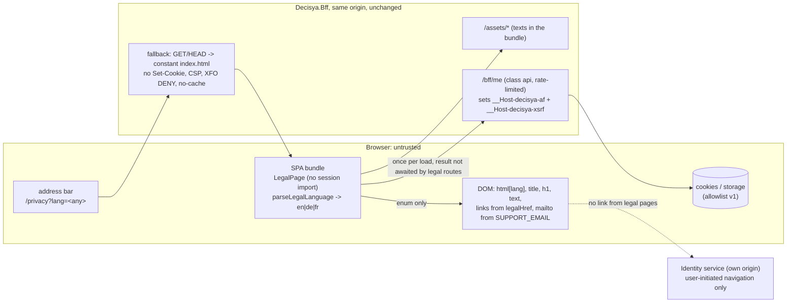

<!-- gate: G3 | verdict: PASS-WITH-NOTES | issue: #338 -->
# Threat delta: public privacy notice, terms and contact page (issue #338)

- Scope: `docs/architecture/338-public-legal-pages.md` (G2, cited as **D1** to **D9**), `docs/requirements/338-public-legal-pages.md` (G1, Stories 1 to 11), NFR-75 to NFR-79 in `docs/requirements/nfr.md`. Code read to check the design's claims: `src/Decisya.Bff/Spa/SpaHosting.cs`, `Security/SecurityHeaders.cs`, `Security/ReturnUrlValidator.cs`, `Endpoints/BffEndpoints.cs` (`/bff/me`, `IssueXsrfCookie`), `RateLimiting/RouteClassifier.cs`, `src/Decisya.Web/src/App.tsx`, `src/session.ts`, `src/api/bff.ts`, `src/static-rules.test.ts`, `vite.config.ts`, `e2e/fixtures.ts`, `tests/Decisya.Bff.Tests/SpaHostingTests.cs`.
- This is a delta. Parent models: `spa-shell.md` (#26: fallback, CSP, S-b to S-f), `bff-session.md` (#18: antiforgery pair, return URL), `rate-limit-key-ring.md`. Areas the change does not touch are not re-audited.
- Mode: G3, before any code. Full tier, host run (manifest). Branch diff against `origin/main`: four documents, no code.
- Level: ASVS 5.0 Level 2. V6 and V7 (Level 3) are not engaged: no authentication or session behaviour changes. `/bff/me`, the cookie pair and the session cookie stay as they are, and the legal routes read no session.
- Reviewer: security-reviewer agent, 2026-11-20.

## Verdict

**PASS-WITH-NOTES.** The change is client-side only. It adds no BFF endpoint, header, cookie or package, and the three paths are served by the existing fallback, which already serves any unreserved path anonymously as a constant, cookie-free document under the strict CSP. The design already has the controls this delta would ask for:
- `lang` is parsed to a closed enum and the raw value is never rendered;
- texts are React elements, never HTML strings;
- links are built only from a fixed table and the enum;
- the support address is one constant in the reserved `.invalid` domain;
- the allowlist pins its two prefix entries;
- the storage test carries a positive pin on the two security cookies.

No High and no Medium. The four MUSTs make sure G4 builds what G2 designed and that the new tests cannot pass vacuously. They land in this issue's G4. Two SHOULDs are for #340.

## Data flow

Trust boundaries:
- Unchanged: TB1 → TB2. The same fallback, assets and `/bff/me` serve the new paths. No new server input is read: the fallback ignores the query.
- New, inside TB1: request-controlled `location.search` (`lang`) and `location.pathname` now decide what the client renders before the session is known (D1, D6).
- Not crossed: no third-party origin (CSP `default-src 'self'`, no `frame-src`, `frame-ancestors 'none'`).

## Threats

| Id | Element / flow | STRIDE | Threat | Severity | Mitigation | ASVS 5.0 id | Status |
| --- | --- | --- | --- | --- | --- | --- | --- |
| T-01 | `?lang` → DOM, attributes, `document.documentElement.lang`, title | T, I | Reflected or DOM-based injection: a crafted `lang` (markup, quotes, `javascript:`, over-long) reaches text, an attribute, the title or a link | Low | D1: `parseLegalLanguage` returns only `'en' \| 'de' \| 'fr'`, case-sensitive, first value wins; the raw value is never rendered, put into an attribute or used in a link; `get('lang')` is confined to `pages.ts`/`LegalPage.tsx` by a Vitest rule. React escapes text. The CSP has no `unsafe-*`, and the S-c rules (`innerHTML`, `dangerouslySetInnerHTML`, `eval`) apply to the text files. **M1** adds the hostile-value probe | V1.2, V1.1, V2.2, V3.4 | Mitigated by design; MUST M1 |
| T-02 | `location.pathname` → DOM | T, I | The path, for example `/privacy/<x>` or a mixed-case path, is echoed or decides what renders | Low | Exact route matches only; any other path gets `NotFoundPage`, which shows a fixed heading and does not echo the path. The fallback serves the constant shell and builds nothing from the path (#26 W-01). Legal-path detection for D6: **M2** | V1.2, V8.2 | Mitigated by design; MUST M2 |
| T-03 | `legalHref`, footer links, language choice | T, S | Link manipulation or open redirect: a link target built from request data, or a link that leaves the origin | Low | D1: `` `${path}?lang=${language}` `` from the fixed `legalPages` table and the parsed enum only. Relative same-origin paths, rendered as push navigations. No legal page shows a sign-in link. The existing `loginUrl` encodes `pathname + search`, and `ReturnUrlValidator` (framework `IsLocalUrl`) still decides the return target, so a `?lang=` value in a return URL changes nothing. S-a | V3.7, V1.2 | Mitigated by design |
| T-04 | `mailto:` link (footer, contact) | T | A mail link whose address, subject or body comes from page state, or a second hard-coded address that drifts | Low | D5: one `SUPPORT_EMAIL` constant; the D8 rule bans every other `mailto:` or address literal in `src/**`; no `subject`/`body` parameters. The placeholder is `example.invalid` (RFC 2606), which nobody can register, so a message cannot reach a third party. #339 blocks the release while the placeholder is present | V1.2, V13.4 | Mitigated by design |
| T-05 | D6: legal routes render before and independently of the session | E, I | Taking the legal branch out of the session gate opens a path where a session-derived or gated element renders while the session is unknown (loading, 429, network failure). Or legal-path detection is looser than the route match, for example `startsWith('/privacy')`, and widens the ungated branch | Low | D6: `src/legal/**` imports nothing from `session` or `api` (Vitest rule); `LegalPage` takes no session. The header shows identity only when `session !== null && signedIn` (`App.tsx:174`). The primary navigation shows only `feature: null` entries until a session exists (`App.tsx:161-165`). The server stays the control: `/api` authorizes regardless of what the SPA renders. **M2** pins the wiring | V8.2, V8.3, V15.1 | Mitigated by design; MUST M2 |
| T-06 | Anonymous load of a legal page | I | The page load sets or reveals something new: a cookie, a header, a CSP relaxation, a new endpoint | Low | None new. The fallback sets no `Set-Cookie` (pinned). `/bff/me` sets the same two security cookies it sets on every SPA load today. The anonymous body is `{isAuthenticated:false}` (`MeResponse.Anonymous`). The CSP and headers are unchanged and always overwritten (#26 S-b). Source maps are off (`vite.config.ts`). The allowlist JSON is not imported by application code in #338. **M4** pins the three paths | V3.3, V3.4, V13.4, V14.3 | Mitigated; MUST M4 |
| T-07 | Framing of the public pages | S, T | Clickjacking, or a hostile site framing the notice or contact page under a fake overlay (a false "consent" or a swapped contact address) | Low | `frame-ancestors 'none'` and `X-Frame-Options: DENY` on every BFF response, the fallback included (`SecurityHeaders.Apply`, first middleware, `OnStarting`). The `SpaHostingTests` theory asserts the exact headers per path. **M4** adds the legal paths | V3.4 | Mitigated; MUST M4 |
| T-08 | Rate-limit and error paths for anonymous visitors | I, D | A 429, 5xx or network failure of `/bff/me` now leaves a legal page rendered. Could that show more than today: identity, limits, body fields, a stack trace? | Low | The legal page renders static text only. The `role="status"` notice shows the fixed `TOO_MANY_REQUESTS_MESSAGE` (no seconds, limits or body fields), and `fetchMe` maps every non-200 to anonymous. The shell document is not rate-limited, as for every path today: it is static and identical. The 429 comes only from `/bff/me` (class `api`), and its handling does not change | V4.4, V16.5, V2.4 | Mitigated by design |
| T-09 | Storage allowlist test (D8), language-choice storage test | R, T (test integrity) | The test passes without observing anything. Examples: it reads cookies before `/bff/me` answered; it reads `document.cookie`, which misses HttpOnly `__Host-decisya-af`; a click does not navigate, so before equals after; `indexedDB.databases` is undefined and is read as empty; the signed-in run never actually signed in; the BFF cross-check finds no JSON file and asserts over an empty list. NFR-77 then holds only on paper | Low (the CSP blocks third-party loads anyway; the evidence is what #339 and the notice rely on) | D8's positive pin on the two security cookies. **M3** closes the remaining paths | V15.1, V14.3 | MUST M3 |
| T-10 | Third-party origin test (D8) | R, T (test integrity) | In development and CI the BFF and the identity service are both on `localhost` on different ports. A check that compares host names, or skips URLs whose origin is `null` (`data:`, `blob:`), passes while a cross-origin request is made. A listener attached after `goto` records nothing | Low (CSP backstop) | **M3**: full-origin comparison, listener before navigation, non-zero recorded set | V3.6, V15.1 | MUST M3 |
| T-11 | Placeholder token and bundle content (D4) | I | The placeholder token, passage ids, version labels or anything else in the public bundle reveals internal facts: hosts, code paths, people, unpublished plans | Low | The token `decisya-placeholder-not-final`, the passage ids (`operator-access`, `sign-in-risks` and so on) and the `.invalid` address describe public sections and reveal nothing internal. `sourcemap: false`. The D7 JSON, whose `source` field names server files and test classes, is not bundled in #338 (G6 checks the build output). S-c covers #340, which will import it | V13.4, V14.2 | Mitigated for #338; SHOULD S-c for #340 |
| T-12 | Placeholder count tests (D4, NFR-79) | R (test integrity) | Source count = bundle count = 0 passes when the import set is empty or the build is not scanned, so #339 later reads "no placeholder left" | Low | D4 compares counts for equality, which fails closed on a merged literal. **M3** adds lower bounds | V15.1 | MUST M3 |
| T-13 | Allowlist v1 content (D7) | E (policy) | A wide entry, for example a `__Host-` prefix, lets any future cookie pass. Or a cookie the app sets with an identity-service name passes, because the match is by name across both hosts | Low | D7: `prefix` only for the two framework OIDC names (Vitest rule), and every `setBy: app` cookie is cross-checked in both directions against the BFF's configured names (`DeviceStorageAllowlistTests`). Residual: matching by name across hosts (S-e) | V14.3, V3.3 | Mitigated; SHOULD S-e |
| T-14 | Third-party content and trackers | I | A script, font, pixel, preconnect or CSS `@import` to another origin, or a tracking package | Low | CSP `'self'` on every fetch directive plus `frame-src 'none'`. The D8 source rules. `SpaPackageTests` pins the exact dependency set. S-b closes a gap in the source rule | V3.6, V15.2 | Mitigated; SHOULD S-b |
| T-15 | Security cookies set before any sign-in, as the notice describes them | I (transparency) | A visitor who only opens the notice gets `__Host-decisya-af` and `__Host-decisya-xsrf`. If the notice in #340 did not say so, its storage section would be wrong | Low | They are strictly necessary security cookies (`Secure`, `SameSite=Strict`, `__Host-`, session-length) and stay, as G1 Story 7 requires. G2 asked for a rating: **yes**, the #340 notice must say that both are set on every visit, signed in or not (S-d) | V14.2 | SHOULD S-d (#340) |

Not applicable: Repudiation in the audit sense. The pages write nothing and call no state-changing endpoint, so there is no audit record to add.

Unchanged and not re-rated:
- `?lang` in the BFF request telemetry: any query on any path reaches it today;
- the unlimited static fallback (#26 W-01).

## MUSTs for G4 (four, all in this issue)

- **M1, hostile `lang` probe (T-01).** frontend-dev, `e2e/legal.spec.ts` plus the planned `parseLegalLanguage` unit table:
  - Extend G2's `?lang=xx` and markup case to at least these values: a `"><svg onload=…>` markup string, `de"` (a quote suffix), `javascript:alert(1)`, `de&lang=fr` (the first value wins → `de`), `DE`, an empty value, and a 2 KB value.
  - For each value, assert that English is shown and that `document.documentElement.lang` is `en`.
  - Assert that the raw value is absent from `document.documentElement.outerHTML` and from `document.title`. Skip that check for values that are themselves a valid code.
  - Assert that the CSP-violation monitor stays empty and that no dialog opens.
  - `document.documentElement.lang`, `hreflang`, `lang` and every legal `href` take the parsed value only, never `searchParams.get` directly. The Vitest rule already planned confines `get('lang')` to `pages.ts`/`LegalPage.tsx`.
- **M2, narrow session-independent branch (T-02, T-05).** frontend-dev, `App.tsx`:
  - Legal-path detection uses the `legalPages` table with React Router's own matcher, with `end: true` and the same case rule as the `<Route>`. No `startsWith`, `includes` or regex on `pathname`.
  - When it matches, `<main>` holds only the existing status notice and `<LegalPage>`. No other element of the route table renders and no `session` value is passed to it.
  - Every other path keeps its current branch. G5 adds one assertion for this: with `/bff/me` held unanswered, `/` and `/transactions` still show "Loading" and no gated heading. G2's 429 case already covers the rate-limited branch.
- **M3, tests that cannot pass vacuously (T-09, T-10, T-12).** frontend-dev (E2E, Vitest) and test-engineer (C#), in the files the PR adds:
  - **Cookies.** Read them through `context.cookies()`, never `document.cookie`, and only after the `/bff/me` response has arrived (wait on the response, not a timeout). The anonymous runs pin `__Host-decisya-af` and `__Host-decisya-xsrf` as present. The signed-in run also pins `__Host-decisya-session`, so it proves that sign-in happened.
  - **Language change.** Before comparing with the snapshot, assert that the address now carries `lang=<code>` and that `html[lang]` equals `<code>`. Compare names and values. A changed `__Host-decisya-xsrf` value means a full reload happened, which is a defect (S-a), not a reason to compare names only.
  - **IndexedDB.** If `indexedDB.databases` is not a function in a browser, the test fails. It never reads that as "no databases".
  - **Origins.** Attach the request listener at context level before the first `goto`. Compare `new URL(url).origin` with the app's full origin (scheme, host and port). Treat an opaque `null` origin (`data:`, `blob:`) as a failure. Assert that the recorded set is not empty and contains the entry script under `/assets/` and `/bff/me`.
  - **`DeviceStorageAllowlistTests`.** Fail when the JSON file is missing or has zero entries. Resolve its path from the repository root, not from a copy in the output folder.
  - **Placeholder counts.** Assert a lower bound next to each equality: the structural count is at least the size of the D2 passage-id table times three, plus the footer and the support address. The bundle scan asserts that it fetched at least one JS asset.
- **M4, the new public paths are pinned at the server (T-06, T-07).** test-engineer, `SpaHostingTests`:
  - Add `/privacy`, `/terms`, `/contact`, `/privacy?lang=de` and `/Privacy` as `InlineData` rows of `Client_routes_get_the_shell_with_the_exact_security_headers_and_no_cookie`. That theory already asserts the constant body, the exact CSP, `X-Frame-Options: DENY`, `no-cache` and no `Set-Cookie`.
  - The existing `ReservedPrefixes` equality test stays unchanged. With the rows above it proves that the legal paths are served and never reserved.

## SHOULDs

| Id | Item | Disposition |
| --- | --- | --- |
| S-a | `LanguageChoice` and the footer links render with React Router `<Link to={legalHref(…)}>`, a push navigation. A plain `<a href>` reloads the page, re-runs `/bff/me` and rotates the `__Host-decisya-xsrf` value (T-03, M3). No `window.location` assignment in `src/legal/**` | **fix-now** (part of the files G4 creates) |
| S-b | The D8 source rule also matches protocol-relative URLs (`//host`) in `src`, attributes and `index.html`, and `url(` with an absolute or protocol-relative target in CSS. The allow set stays the SVG namespace only (T-14) | **fix-now** (one or two patterns in `static-rules.test.ts`, which this PR changes) |
| S-c | When #340 imports `device-storage-allowlist.json` for the notice, ship only `name`, `store`, `purpose` and `lifetime` in the bundle (a typed projection or a build-time subset). The `source` field names server files, test classes and framework internals that the public notice does not need (T-11) | **backlog**: one #243 item at G7, "#340: allowlist `source` field stays out of the bundle" |
| S-d | The #340 notice's device-storage section says that the two security cookies are set on every visit, before any sign-in, with their purpose and lifetime (T-15; answers G2's question for G3) | **backlog**: the same #243 item, for #340 |
| S-e | When EP-14 extends the allowlist test to deployed hosts, where the app and the identity service are on different hosts, match cookies by name **and** by the host that set them (`setBy`), not by name across the union (T-13) | **backlog**: #243 item for EP-14 |

## Notes for G4, G5 and G6

- Nothing here touches V6 or V7. If G4 finds it needs a BFF, header, cookie or `/bff/me` change, the design no longer holds: stop and return to G2/G3.
- G6 checks that the build output under `src/Decisya.Bff/wwwroot/assets` contains no allowlist `source` text (for example `.AspNetCore.Correlation.` or `SecureCookieRelayHandler`). It also checks that `PLACEHOLDER_TOKEN` is imported by no non-test module.
- The identity-service cookie rows of D7 are confirmed at G4 from a signed-in run, as G2 states. An unlisted identity-service cookie that serves anything other than sign-in or the session goes to Marco and, through the exchange, to Ostium. It is never added to the allowlist to make the test pass.
- The sign-in-page legal link (G1 note 1, G2 decisions) is already a planned #243 item and is not repeated here.
- Documents checked for G3: the G1 requirements, the G2 note and NFR-75 to NFR-79 hold no IP address literal, no secret and no personal data. The only address is the reserved `support@example.invalid`, and `dev-alice` is a seeded development user. This file holds none either.
- No High or Medium flaw was found in unchanged code.
