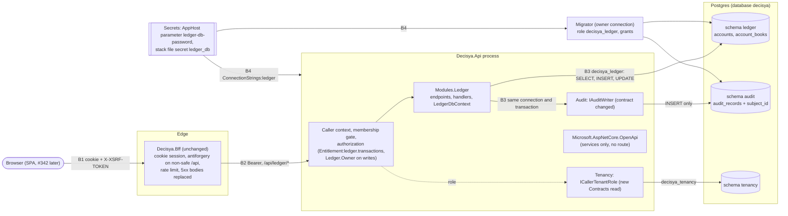

<!-- gate: G3 | verdict: PASS-WITH-NOTES | issue: #341 -->
# Threat delta: Modules.Ledger, accounts and the two-account limit (issue #341)

- Inputs:
  - manifest `docs/ai/pipeline/341.md` (Full tier; Marco's G0, G1 (A1 to A5 kept) and G2 Q1 to Q3, 2026-11-21);
  - G1 `docs/requirements/341-ledger-accounts.md` (Stories 1 to 8) and NFR-80 to NFR-87 (`docs/requirements/nfr.md`);
  - G2 `docs/architecture/341-ledger-accounts.md` (D1 to D10, R-L1 to R-L20, "Notes for G3");
  - ADR-0027 (Proposed) and ADR-0013 amendment 1 (Proposed).
  - For facts only: `src/Decisya.Api/Program.cs`, `Authentication/DecisyaApiAuthenticationExtensions.cs`; `src/Decisya.Bff/Proxy/ApiAntiforgeryMiddleware.cs`, `Security/AntiforgeryCheck.cs`, `Proxy/ProxyConfiguration.cs`, the BFF rate limiter; `src/Decisya.Infrastructure.Persistence/TenantDbContext.cs`; `src/Decisya.Infrastructure.Migrator/MigrationRunner.cs`; `src/Modules/Audit/.../AuditWriter.cs`; `src/Modules/Tenancy/.../TenantMembershipMiddleware.cs` and `TenantOwnerAuthorizationHandler.cs`; `src/Modules/Admin/.../AdminEndpoints.cs` and `AdminJson.cs`; `src/Decisya.AppHost/AppHost.cs`; `deploy/compose/stackctl.py`; `Directory.Packages.props`; `NuGet.config`.
- Mode: threat delta of the target design, before code. The branch holds documents only (`git diff --name-only origin/main...HEAD`: two ADR files, the ADR index, the manifest, the G1 and G2 notes, `nfr.md`).
- Level: ASVS 5.0 L2. Authentication and session behaviour do not change (bearer at the Api, BFF cookie unchanged), so the L3 parts of V6 and V7 are not re-assessed. Ids are given at section level. Check them against the official 5.0 text before copying them into a compliance artefact.
- Ids: T341-xx (threats), M341-xx (MUSTs), F341-xx (fix-now, a few lines), S341-xx (SHOULDs, backlog #243).
- Reviewer: security-reviewer agent, 2026-11-21, G3. Reads only; no network fetch; the dependency audit is left to G6, because the new package is not in the tree yet. The skill's step "record the path in the manifest" is left to the orchestrator: the caller told me not to edit the manifest.

## Verdict

**PASS-WITH-NOTES.** The design is sound, and no High is open.
- The isolation rests on mechanisms that already carry the platform: the tenant filter, the SaveChanges guard, the `TenantId` concurrency token and the membership gate. The design adds no bypass: no `[AllowCrossTenant]`, no raw SQL, no `IgnoreQueryFilters`.
- The limit mechanism (a per-space row lock taken by an `UPDATE`, then a count under READ COMMITTED) is exact. I walked the interleavings: two first creates racing on the book insert, a create waiting on the lock, a refused create rolling back. None lets a third account in.
- The Audit change keeps ADR-0013's guarantees. It tightens the ambient rule for the new actions: `None` is refused, so an admin path cannot write a tenant user's record.

The notes are six MUSTs that bind the security-relevant parts of the design to G4 and G5, and four fix-now items. Two MUSTs close real gaps that the note leaves open:
- the entitlement policy copies the fallback policy's requirements by hand (T341-04);
- the strict number rule must not be lost by copying the Admin precedent (T341-12).

Both ADRs are acceptable from a security view. ADR-0013 amendment 1 should gain one sentence (F341-01) before Marco accepts it.

## Data flow and trust boundaries

- **B1 and B2** are unchanged. The BFF forwards only `/api/{**catch-all}`. It enforces antiforgery with a safe-method allow-list, so PUT and POST are checked by construction. The Api accepts bearer tokens only, so there is no cookie to forge against it.
- **B2 into Ledger** is the new surface: five operations, the first money input, and the first free text that tenant users write (the account name).
- **B3** is a new database role. It is also the second role that may insert into `audit.audit_records`.
- **B4** is a new secret, with the same shape and path as `entitlements_db`.

## Threats

| Id | Element / flow | STRIDE | Threat | Severity | Mitigation | ASVS 5.0 id | Status |
| --- | --- | --- | --- | --- | --- | --- | --- |
| T341-01 | B2, by-id read, rename and currency change | I, T, E | A caller in space B reads or changes space A's account by its id (BOLA, invariant 1), or tells "exists elsewhere" apart from "missing". | High (inherent) | Tenant filter on `Account` and `AccountBook`, the SaveChanges guard, `TenantId` as a concurrency token, the identical 404 for missing, foreign and malformed ids, no `[AllowCrossTenant]` (R-L4), the two-tenant matrix (NFR-80). Bound by M341-01 | V8.2, V8.4 | Mitigated by design; M341-01 |
| T341-02 | `LockBookAsync` (`ExecuteUpdateAsync`) | T, E | A bulk statement bypasses `TenantDbContext`'s SaveChanges guard. It relies on the filter alone, so a second `ExecuteUpdate`/`ExecuteDelete`, an `IgnoreQueryFilters`, or a `TenantId` in a `SetProperty` would touch another space's rows unseen. | Medium (inherent) | The filter (under `None` the parameter is null and matches no row, so `locked != 1` gives a 500), `BulkTenantMoveRule` (R-L8), `CrossTenantQueryRule`. M341-02 adds "exactly one bulk statement" | V8.4, V15.3 | Mitigated by design; M341-02 |
| T341-03 | Writes by a member | E | A member creates, renames or changes an account, or a later role value maps to "allowed". | Medium | `Ledger.Owner` succeeds only on `== TenantMemberRole.Owner`. It runs before any ledger query and before the 404. `null` (no membership, `None`, `Invalid`) fails. R-L19 mirrors the values. Bound by M341-01 | V8.2, V8.3 | Mitigated by design; M341-01 |
| T341-04 | First entitlement policy (D4) | E, S | A group policy replaces the fallback policy's requirements. The note repeats "authenticated user with `sub`" by hand, as the admin MFA policy does. If a later Ostium release adds a requirement or a scheme to its fallback (Ostium owns it, `AddApiAuthentication`), the ledger endpoints silently lose it. This is the first tenant-data group that leaves the fallback. | Low today; Medium on an Ostium bump | M341-01 (c): a test derived from the live fallback policy, not from a copy | V8.2, V13.2 | Fix-now (G5 test); M341-01 |
| T341-05 | Create under concurrency | T | Parallel creates pass the limit of 2 (AC-02-5). | Medium | Book-row `UPDATE` lock in the create transaction, then an exact count. READ COMMITTED with no isolation argument (R-L3). No retrying execution strategy (ADR-0013 point 4). The 16-way, 20-round race as `decisya_ledger`, one round over HTTP (NFR-81). Bound by M341-02 | V2.3, V15.4 | Mitigated by design; M341-02 |
| T341-06 | Limit by crafted request or setting | T, E | A body field, a header, a configuration key, a trial or an override lifts the limit. | Low | One `const` (R-L6), no configuration or options reader, no `IEntitlementService` in Ledger (R-L7), unknown members refused. The configuration and trial tests of the note | V2.3, V13.2 | Mitigated by design |
| T341-07 | Audit contract (ADR-0013 am. 1) | R, S, T | Records with the wrong actor, tenant or action. An admin path writes a tenant user's record. A module writes another module's action family: today any holder of `IAuditWriter` may append any `AuditAction`, so a ledger bug could write `entitlements.trial.start` under its own tenant. Forged rows through raw SQL as `decisya_ledger`. | Medium | The writer reads actor, time and trace itself. Per-action shape and per-family ambient checks run before SQL, and ledger actions refuse `None`/`Invalid`. DB checks on `subject_id`, `feature_key` and `action`. INSERT only. Raw SQL banned (`RawAdoNetRule`, `CrossTenantQueryRule`). Bound by M341-03; the action family by F341-01. Residual: raw-SQL forgery, as ADR-0013 accepts | V16.3, V8.2 | Mitigated by design; M341-03, F341-01 |
| T341-08 | Write and record atomicity | R | A write commits without its record, or a record without its write; a refusal leaves a record. | Medium | One explicit transaction on the module context, `AppendAsync(entry, tx)`, then commit; refusals dispose uncommitted; the fault matrix (NFR-83). Bound by M341-03 | V16.3, V2.3 | Mitigated by design; M341-03 |
| T341-09 | `subject_id` | I | The subject leaks a name or an amount, or lets a tenant infer something. | Low | It is an opaque v7 uuid, and the contract cannot express a value. No tenant read path exists on the audit table. A v7 id carries its creation time, which the account's own `created_at` already holds | V14.2 | Accepted (Info) |
| T341-10 | Role `decisya_ledger` | E | The API process can `DROP`, `ALTER`, `DELETE` or `TRUNCATE`, or read another schema, or the new revoke-then-grant step widens a role on a re-run. | Medium | `SELECT, INSERT, UPDATE` from an allow-list. `REVOKE ALL` then `GRANT` in one transaction. No `CREATE`, owns nothing. The history table is revoked. `REVOKE ALL ON DATABASE ... FROM PUBLIC` already removes `TEMP`. R-L17. Bound by M341-04 | V13.2, V8.2 | Mitigated by design; M341-04 |
| T341-11 | Secret `ledger_db` / `ledger-db-password` | I | The password reaches source, a log, a SQL text, a Postgres log or an error message. A missing secret on an existing stack is answered with a weaker fallback. | Medium | The `MigrationRunner` precedent: alphanumeric shape check of at least 32 characters, naming the key only; only a SCRAM verifier in SQL, via `format(%L)`. AppHost `secret: true` parameter with `Special = false`. The stack file secret and connection string without `Include Error Detail`. A missing value fails closed. Bound by M341-04 | V13.3, V11, V16.2 | Mitigated by design; M341-04 |
| T341-12 | Money input (ADR-0027) | T | `"125000"`, `12.5`, `1e3`, `125000.0` or a value beyond 2^53 - 1 is accepted, rounded or clipped. The Admin precedent's `AdminJson` does **not** set `NumberHandling = Strict`. A G4 that copies it as "the #25 shape" would accept string amounts under the Web defaults. | Medium if present | ADR-0027 points 2 and 3, `LedgerJson.Options` as the note lists them, the range check in `[MinAmountMinor, MaxAmountMinor]`, the ADR-0027 contract cases. Bound by M341-05 | V2.2, V15.3 | Mitigated by design; M341-05 |
| T341-13 | Request bodies | T | Mass assignment (`tenantId`, `id`, `balance`, `currencyLocked`, `iban`). Duplicate members, also in another letter case under the case-insensitive Web defaults. A charset other than UTF-8 causing a logged 500. | Low | `UnmappedMemberHandling.Disallow`, `AllowDuplicateProperties = false`, request records without those members, the content-type and charset helper (G6-25-01). Bound by M341-05 | V15.3, V4.1 | Mitigated by design; M341-05 |
| T341-14 | Request size and depth | D | Unbounded bodies or nesting. A body limit that silently vanishes when the server feature is read-only. | Low | 4 KiB, with `LimitBody`'s fail-closed branch (a read-only feature plus no `Content-Length` is refused), `MaxDepth = 4`, 80-character names, at most 2 accounts per list. The BFF's `/api` rate limit | V2.2, V4.2 | Mitigated by design; M341-05 |
| T341-15 | Account name content (A1) | T, I | Control characters or a lone surrogate become a 500 (Postgres refuses `\0`). Bidi overrides (U+202A to U+202E, U+2066 to U+2069) or zero-width-only names pass the "required, trimmed" rule and display deceptively. A later CSV export opens formula injection (`=`, `+`, `-`, `@`). Only the owner writes and only the same space reads, so the spoofing stays in one household. | Low | Control characters and lone surrogates refused (`AccountName`). Markup safety at render (#342). S341-01 for the rest | V1.2, V2.2 | Partly mitigated; S341-01 (backlog, reopens A1) |
| T341-16 | Logs, traces, metrics, problem bodies | I | An account name or amount reaches a log, a span, a metric attribute or a problem body. The channels are: a parser message (it can echo a member name or value); an exception message logged by `UseExceptionHandler`; EF sensitive-data logging; Npgsql error detail; a user, tenant or account id in a metric attribute. | Medium (inherent) | Parser exceptions are never logged with their message. `[Sensitive]` on the name. A source-generated `LedgerLog` with bounded fields. Metric tags from bounded sets with no ids. No `EnableSensitiveDataLogging` or `Include Error Detail` anywhere today (checked in `src` and `deploy`). The canaries of NFR-87. F341-02 extends the canaries to the failure path | V16.2, V16.5, V14.2 | Mitigated by design; F341-02 |
| T341-17 | Writes without antiforgery | S, T | Cross-site POST or PUT. | Low | The BFF `ApiAntiforgeryMiddleware` (safe-method allow-list, header required before any form read), bearer-only Api, a JSON content type required. G5 proves it on one ledger POST and one PUT | V3.5, V4.1 | Mitigated (existing) |
| T341-18 | Responses cached | I | Balances kept in a shared or browser cache. | Low | `UseNoStoreResponses` on every response, plus the group filter; G1 Story 2 test | V14.3 | Mitigated (existing) |
| T341-19 | New package `Microsoft.AspNetCore.OpenApi` | T, I | Supply chain: a new package and its transitive `Microsoft.OpenApi`, with a Roslyn source generator that runs in the build. Document exposure: a mapped `/openapi/*` route. A version drift from the shared framework. | Low | Microsoft, MIT, nuget.org only by source mapping (never the Ostium feed). Locked restore. No `MapOpenApi` (R-L15). The default `/openapi/...` path is outside the BFF's `/api/{**catch-all}` route anyway. Bound by M341-06 | V15.2, V13.4 | Mitigated by conditions; M341-06 |
| T341-20 | Book-row lock | D | A slow create blocks the space's other creates for up to the 30 s command timeout (each waiter gets a 500). Many waiters hold connections from the one `decisya_ledger` pool that every tenant shares. | Low | The lock is held for milliseconds: no external call runs inside it, and an aborted request rolls back. Only the space's owner can create. The BFF's per-session `/api` rate limit bounds the waiters | V15.4, V2.4 | Accepted (residual) |
| T341-21 | `ICallerTenantRole` (new Contracts read) | E, I | A later consumer reads "not `Member`" as "Owner", or uses the answer outside authorization. | Low | It answers only the caller's own role in the ambient tenant, and `null` otherwise. M341-01 (d) states the deny-by-default use in its doc comment | V8.2 | Mitigated by M341-01 |
| T341-22 | `AddAuditSubjectId` rollback | R, T | The rollback header tells an operator to delete ledger audit rows so that `Down` can restore the old check. That is audit tampering presented as a procedure. | Low | F341-03 | V16.4 | Fix-now (migration header) |

## MUSTs (bind G4 and G5 in this issue)

**M341-01 (T341-01, T341-03, T341-04, T341-21; fix-now): the authorization chain holds on every ledger endpoint, and its proofs do not depend on copied values.**
Lands in G4 (backend-dev: `LedgerEndpoints`, `LedgerOwnerAuthorizationHandler`, `src/Decisya.Api/Authorization/EntitlementAuthorization.cs`, `ICallerTenantRole`) and G5 (test-engineer).
- (a) Every by-id operation parses the id with `Guid.TryParseExact(..., "D", ...)` and loads only through `LedgerDbContext`'s filter. Missing, foreign and malformed ids give one byte-identical problem body (`status`, `title`, `traceId`). No Ledger type carries `[AllowCrossTenant]`, `IgnoreQueryFilters` or a `TenantId` taken from the request.
- (b) `Ledger.Owner` succeeds only on `await roles.GetAsync() == TenantMemberRole.Owner`, and is on every non-GET ledger endpoint (R-L13). A member's write returns 403 before any ledger query. G5 proves this with the unreachable-database host, for each of create, rename and currency change.
- (c) **New test (T341-04):** for each `/api/ledger` endpoint, the combined policy holds every requirement type and every authentication scheme of the fallback policy that `IAuthorizationPolicyProvider.GetFallbackPolicyAsync()` returns at run time, plus `EntitlementRequirement`. The expected set is read from the live fallback, never written down. The same test covers the admin group's `Api.AdminMfa` policy, which has the same exposure (a few lines in a test class this PR changes).
- (d) `ICallerTenantRole`'s doc comment says that callers grant only on an exact role match, never on "not `Member`". `CallerTenantRole` reads the tenant and the caller at use time (R16). It runs no query unless the resolution is `Tenant` (R-L19).
- (e) The two-tenant matrix of NFR-80 runs in module tests and once through the Api host, including the usage figures per tenant.

**M341-02 (T341-02, T341-05; fix-now): the limit stays exact, and the one bulk statement stays the only one.**
Lands in G4 (backend-dev: `CreateAccountHandler`, `LedgerDbContextOptions`) and G5.
- (a) As the note says: READ COMMITTED with no isolation argument; no `EnableRetryOnFailure`; `LockBookAsync` exactly as written; `locked != 1` is a 500, never "go on"; the 23505 path matches `SqlState` and `ConstraintName` (`ux_account_books_tenant`) only, and every other exception propagates.
- (b) If G4 finds that the `UPDATE` does not hold the row lock inside the explicit transaction on the pinned EF Core and Npgsql versions, G4 **stops and reports** (the note's rule). It does not switch to the slot fallback without a G2 and G3 re-check.
- (c) **New rule:** `Decisya.Modules.Ledger` has exactly one call site of `ExecuteUpdate`/`ExecuteUpdateAsync`, in `LockBookAsync`, and none of `ExecuteDelete`/`ExecuteDeleteAsync`. Add it to R-L8's test class, with a red fixture.
- (d) The race matrix of NFR-81 (0, 1 and 2 existing, 16-way, 20 rounds) runs as `decisya_ledger` against the migrated schema, and one round per scenario runs through HTTP with no 5xx. It also asserts exactly `2 - existing` ledger audit records and `lock_version` unchanged after an all-refused round.

**M341-03 (T341-07, T341-08; fix-now): the Audit contract change keeps who may write what.**
Lands in G4 (backend-dev: `AuditEntry`, `AuditAction`, `AuditWriter`, `AuditRecord`, `AuditActionConverter`, `AddAuditSubjectId`, `MigrationRunner`) and G5.
- (a) The writer runs the per-action shape check and the per-family ambient check **before any SQL**. Ledger actions need ambient `Tenant` equal to `entry.TenantId`; `None` and `Invalid` throw. `SubjectId` is non-null and not `Guid.Empty`, and the feature key is null. The Entitlements behaviour is unchanged. Messages stay fixed strings with no entry values. An `AuditAction` value outside the closed set still throws.
- (b) The three database checks of amendment point 7 exist and are proven: a raw insert as the owner, violating each check, is refused (`AuditModelTests` or an integration case). This is the layer that holds if the writer is bypassed.
- (c) `decisya_ledger` joins **both** `writerRoles` and `moduleRoles` of `ProvisionAppendOnlyGrantsAsync`. Being in `moduleRoles` is what revokes anything else it might hold in `audit`. `AuditGrantsIntegrationTests` asserts its exact privileges (USAGE on the schema, INSERT on the table, nothing on the history table) before and after a second run.
- (d) The record holds no name, amount, currency or free text, and `AuditEntry` has no member that could carry one (R-L18). The NFR-83 fault matrix runs end to end as `decisya_ledger`.

**M341-04 (T341-10, T341-11; fix-now): `decisya_ledger` is least-privileged, and its password follows the existing secret path exactly.**
Lands in G4 (backend-dev: `MigrationRunner`, migrator `Program.cs`; platform-dev: `AppHost.cs`; devops: `docker-compose.stack.yaml`, `stackctl.py`, `stackguards.py`, `deploy/tests`) and G5 (R-L16, R-L17).
- (a) The table-privilege allow-list is `{SELECT, INSERT, UPDATE, DELETE}`; any other value throws before SQL. Ledger passes `SELECT, INSERT, UPDATE`. `REVOKE ALL ON ALL TABLES IN SCHEMA`, the grant and the history-table revoke run in one transaction. Tenancy's and Entitlements' effective privileges stay as before (their existing role tests stay green unchanged).
- (b) The password goes through the existing shape check (`\A[A-Za-z0-9]{32,}\z`, the failure names `Migrator:LedgerRolePassword`, never the value). Only the SCRAM verifier is placed in SQL, through `format(%L)`. No new path builds a statement with the password.
- (c) AppHost: `ledger-db-password` with `secret: true` and `Special = false`. The value reaches the migrator only as `Migrator__LedgerRolePassword`, and the Api only inside `ConnectionStrings__ledger` with `Username=decisya_ledger`. The Api gets no owner or migrator connection string (R-L16).
- (d) Stack: `ledger_db` joins `LOGICAL_SECRETS`, `NEXT_STEPS`, `DB_ROLES` and `files_for`, generated by the existing alphanumeric generator, and the connection string has no `Include Error Detail` and no `Persist Security Info`. The `deploy/tests` guard that loops over the database secrets (`test_stackctl.py`, the "include error detail" assertion) includes `ledger_db`. On a stack that predates #341, the missing secret is created by the existing init or rotate path, or the migrator fails closed. It is never defaulted or skipped. `stackctl.py` and `stackguards.py` are review-required paths.
- (e) R-L17 adds two cases (a few lines): `CREATE TABLE public.x` and `CREATE TEMP TABLE x` as `decisya_ledger` fail with 42501.

**M341-05 (T341-12, T341-13, T341-14; fix-now): the input boundary is the one the note lists, not the Admin copy.**
Lands in G4 (backend-dev: `Ledger/Endpoints`, `LedgerJson`, `AccountName`) and G5 (`Decisya.Api.Tests` contract cases).
- (a) `LedgerJson.Options` sets every option the note lists: Web defaults, **`NumberHandling = Strict`**, `UnmappedMemberHandling.Disallow`, `AllowDuplicateProperties = false`, `MaxDepth = 4`, `RespectRequiredConstructorParameters = true`, `RespectNullableAnnotations = true`. A unit test asserts each value on the options instance, so a copy of `AdminJson` fails it.
- (b) The order per write: content type and charset, then `LimitBody` (4 KiB, with the fail-closed branch for a read-only feature), then parse, then validation, then the database. `JsonException`, `BadHttpRequestException` and `NotSupportedException` give `ledger.body_invalid` and are never logged with their message.
- (c) The currency is checked with the ordinal `^[A-Z]{3}$` **before** `Currency.TryFromCode`, which trims and upper-cases. The same check applies to `openingBalance.currency`. The amount must lie in ADR-0027's range.
- (d) G5's contract cases add the ADR-0027 list (`12.5`, `1e3`, `125000.0`, `"125000"`, 2^53, -(2^53), `null` amount, `"eur"`, `"XXX"`, missing currency) plus: a duplicate member in another case (`"name"` and `"Name"`), `tenantId` and `currencyLocked` as unknown members, a body over 4 KiB with and without `Content-Length`, a `charset=utf-16` body, a name with `\u0000`, and a name that is a lone escaped surrogate (`"\ud800"`). Each is a 400 with no row and no audit record.

**M341-06 (T341-19; fix-now): `Microsoft.AspNetCore.OpenApi` enters on these conditions only.**
Lands in G4 (main session: `Directory.Packages.props`, `Decisya.Api.csproj`, lock files; backend-dev: `src/Decisya.Api/OpenApi/LedgerOpenApi.cs`) and G5 (R-L14, R-L15, R-L20), and is checked at G6.
- (a) Pin: `<PackageVersion Include="Microsoft.AspNetCore.OpenApi" Version="10.0.15" />`, an exact version equal to the ASP.NET Core 10 patch already pinned (`Microsoft.AspNetCore.Authentication.JwtBearer`, `...OpenIdConnect`, `Mvc.Testing` are 10.0.15). No range, no floating version, `PackageReference` in `Decisya.Api` only (R-L14). The PR body carries the justification line.
- (b) The lock-file diff adds exactly two packages: `Microsoft.AspNetCore.OpenApi` and its transitive `Microsoft.OpenApi`. Any other new package in `packages.lock.json` makes G4 stop and report. Both resolve from nuget.org (the `*` mapping), never from the Ostium feed. G6 runs `dotnet list package --vulnerable --include-transitive` and finds no High or Critical. If the transitive `Microsoft.OpenApi` resolves to a flagged version, it is lifted by a central pin in the same PR, with Marco's approval.
- (c) No route: no reference to `MapOpenApi` in any `src` assembly (R-L15). **Plus a behavioural test** in the Api host under the `Production` environment: an authenticated `GET /openapi/ledger.json` and `GET /openapi/v1.json` return 404. The contract test gets the document in-process only. If the pinned version has no in-process provider, G4 stops and reports (the note's rule) and does not map a route, not even in Development.
- (d) The package's source generator runs only in `Decisya.Api`'s build. That is accepted as a first-party compile-time component; no other project references the package.

## Fix-now, a few lines (SHOULD level)

- **F341-01 (T341-07; ADR-0013 amendment 1 and `Decisya.ArchitectureTests`).** Each module appends only its own action family.
  - Add to amendment point 2: "a module appends only actions of its own family: `ledger.*` from `Modules.Ledger`, `entitlements.*` from `Modules.Entitlements`".
  - Enforce it in the same way as R-L6, because enum values are inlined: a source scan finds `AuditAction.Ledger*` only under `src/Modules/Ledger/**` and `AuditAction.Entitlements*` only under `src/Modules/Entitlements/**` (the Audit module itself aside).
  - Add it now, while the set has two families.
- **F341-02 (T341-16; G5 canaries).** Run the NFR-87 canaries (`MARKER-7c1e`, `918273645`) on the failure paths too:
  - a create whose `SaveChanges` fails (the fault-matrix interceptor);
  - a create whose audit append fails;
  - a body refused by the parser (an unknown member named `MARKER-7c1e`).

  Assert the canary is absent from every captured log record, including the exception that `UseExceptionHandler` logs, and from every span event. The domain and handler exceptions (`Account.Open`, `TryChangeCurrency`, `locked != 1`) carry fixed messages with no values.
- **F341-03 (T341-22; header of `AddAuditSubjectId` and `deploy/sql/audit/<timestamp>.sql`).** Replace "needs the ledger rows deleted first" with: "`Down` is not supported once any ledger audit record exists. Roll forward. Never delete or update audit records to make a rollback pass (ADR-0013)."
- **F341-04 (T341-13; G5).** The `AccountDto` and `AccountListResponse` snapshot in the contract test asserts that the response has no `tenantId`, actor, role or permission member (G1 Story 2 scenario 4). That takes one line next to the shape assertion the note already plans.

## SHOULDs for the backlog (#243)

- **S341-01 (T341-15; reopens A1, Marco's call).** Refuse the bidi embedding, override and isolate controls (U+202A to U+202E, U+2066 to U+2069) in `AccountName`. Refuse a name with no visible character (only `Cf` or whitespace).
  - Keep U+200D (ZWJ), so emoji sequences still work.
  - The first issue that exports names (CSV) neutralises a leading `=`, `+`, `-` or `@`.
  - My recommendation is to leave A1 as written in #341 and record the item for #342 and the export issue. Risk of deferring: an owner can give an account a name that displays deceptively to their own household. Risk of doing it now: it changes an assumption Marco decided, for a Low.
- **S341-02 (T341-20).** When EP-03 lifts the limit or EP-04 adds work inside the create transaction, set a `lock_timeout` on the create, for example 5 s, so that waiters fail fast with a generic 503 rather than holding pool connections for 30 s. It is not needed while the lock covers milliseconds.
- **S341-03 (T341-09, Info; EP-12 and the person-id ADR #334).** Ledger audit records add a tenant user's `sub` to an append-only table. The erasure design of EP-12 and the person-id rework of #334 must say what happens to `actor_user_id` in records that cannot be deleted. No action in #341.

## Answers to the brief

1. **Cross-tenant reads and writes, the 404 rule.** Covered by the existing filter, guard and concurrency token. The design adds no bypass. The one new exposure is the bulk lock statement, which the guard does not see (T341-02, M341-02 (c)). A member gets 403 before any id lookup, so ids cannot be probed through role differences.
2. **BOLA and a member writing.** M341-01. The owner check is deny-by-default on an exact role match, read through Tenancy's Contracts with no reference to its implementation.
3. **Limit bypass.** Under concurrency, the `UPDATE` lock and then the count is exact under READ COMMITTED. A loser of the first-book insert race sees the winner's committed account. A refused create rolls back its `lock_version` increment. By a crafted request or a setting: no input or configuration reaches the check (R-L6, R-L7, `Disallow`).
4. **Audit contract.** Acceptable with M341-03 and F341-01. `SubjectId` leaks nothing a tenant could not already see, and no tenant can read the table. The ambient check is tightened for the new family (`None` refused). The residual (forged rows through raw SQL as `decisya_ledger`) is the one ADR-0013 already accepts for `decisya_entitlements`. It now covers two roles; raw SQL stays banned in both.
5. **`decisya_ledger` and its password.** M341-04. There is no `DELETE`, no DDL and no owner connection in the Api. The password never enters SQL text, only its SCRAM verifier does. The stack path copies `entitlements_db` exactly.
6. **Input validation.** M341-05. The one concrete trap is `NumberHandling.Strict`, which the Admin precedent lacks. A1's rules as applied stop the 500s (control characters, lone surrogates). The display-spoofing remainder is S341-01.
7. **Logs, traces and metrics.** The design is right: bounded tags, no ids in metrics, no name or amount in logs, `[Sensitive]` on every name member. Today no `EnableSensitiveDataLogging` and no `Include Error Detail` exists in `src` or `deploy`. F341-02 extends the canaries to the paths where an exception is logged.
8. **Antiforgery at the BFF.** Unchanged and correct. The safe-method allow-list covers POST and PUT, the Api is bearer-only, and G5 proves it on one ledger POST and one PUT.
9. **`Microsoft.AspNetCore.OpenApi`.** Acceptable on M341-06:
   - exact pin `10.0.15`, in `Decisya.Api` only;
   - exactly one new transitive (`Microsoft.OpenApi`), from nuget.org;
   - no route, proven by a static rule and a Production-environment request;
   - a clean audit at G6.

   The package brings a first-party source generator into one project's build. Even a mistaken `MapOpenApi` would sit outside the BFF's `/api` route.
10. **Documents.** I searched the four input documents and `nfr.md` for IPv4 and IPv6 literals, `Password=` values, e-mail addresses, token prefixes and private-key markers, and found none. The only personal name is the owner's first name, used as decider throughout the repository. No secret or personal data appears.

## Residuals for Marco (accepted by name at G7 or with the ADRs)

- **R-L-FORGE (ADR-0013 amendment 1):** a bug or an injection in Ledger's SQL path could insert forged audit rows as `decisya_ledger`. It cannot hide or change existing rows. Prevented by the raw-SQL ban, not contained beyond it. Detection: every genuine row carries a trace id.
- **R-L-LOCK (T341-20):** a stalled create blocks only that space's creates, for up to 30 s. There is no detection beyond the 500 count in `decisya.ledger.requests`.
