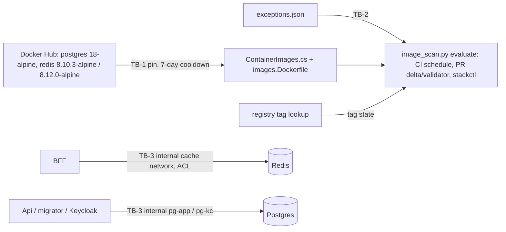

<!-- gate: G3 | verdict: PASS-WITH-NOTES | issue: #347 -->
# Threat delta: scan drift 2026-11-22, five new OpenSSL ids on postgres and redis, libxml2 on postgres, and the redis R-1 and zlib renewals (#347)

- Written 2026-11-26 by security-reviewer (G3, full tier), before G4.
- **Scope.** Only the planned change (manifest `docs/ai/pipeline/347.md`, Marco's scope "#347 + redis R-1/zlib (Rec.)"):
  - exceptions for CVE-2026-107493, -107494, -121482, -124709 and -84786 on `libssl3` and `libcrypto3` in postgres and redis, and libxml2 CVE-2026-86144 in postgres;
  - the renewal or clearing of redis R-1 (four older OpenSSL ids x 2 packages, expires 2026-12-02) and the redis zlib CVE-2026-4738 entry (expires 2026-12-09);
  - a possible postgres re-pin (to the `18-alpine` head) or redis move (to `8.12.0-alpine`), and the `deploy/tests/test_stackctl.py` caps.

  `image_scan.py`, `release_images.py`, ADR-0015/0022, `ci.yml`, the Compose files, `stackguards.py`, the keycloak, caddy and libc6 entries are not changed and are not re-audited. S-3 (postgres onto an OpenSSL 3.5.9-r1 rebuild, deadline 2026-12-18) stays its own follow-up unless Marco takes P-B with its sub-option (ruling 1).
- **Sources read (Read and Grep only; I ran no scanner and read no registry):** the manifest; #325's threat model with its modules addendum, and `docs/ai/pipeline/325.md`; `image_scan.py` (`approval_date` :208-219, `exception_errors` :222-295, `resolve_tag_state` :405-426, `_keeps_fixed_exception` :634-644, `evaluate` :647-699, `scan_targets` :724-780); `exceptions.json`; ADR-0015 amendment item 3; ADR-0022 items 1-5; `deploy/tests/test_stackctl.py` :718-734; `ContainerImages.cs` :13-113; `deploy/redis/redis.conf` :39 (`maxmemory-policy noeviction`); a search of `src` and `deploy` for `CREATE EXTENSION`, `xml2`, XML functions and `pgcrypto` (none outside a comment in `ContainerImages.cs`).
- **Scan data:** the orchestrator's four Grype v0.120.0 JSON files of 2026-11-26 (database 2026-11-26 06:22 UTC). I read from each, by search: the match ids, namespaces, fix states, version constraints, CVSS vectors and the advisory text of every High id. The registry and Alpine secdb facts are the orchestrator's, taken as data.

## Verdict

**PASS-WITH-NOTES.** G4 may start once Marco has decided D-1 to D-3 and approved the texts (D-4). The facts that decide the plan:

1. **What the script does with each row** (`evaluate`, :680-698):
   - A finding with fix state `unknown` (or anything other than `fixed`) is excepted by any active matching entry **whatever the tag state**. The five new OpenSSL ids are in this group on all three images. They are matched by NVD CPE (`>= 3.5.0, < 3.5.10`), and no Alpine fix is listed.
   - A finding with fix state `fixed` keeps its entry only under ADR-0015 item 3 (`_keeps_fixed_exception`, :634-644). All of these must hold: the tag state is `unchanged`, the alias is a pinned vendor image, the package type is `apk`, `deb` or `rpm`, and `expires - added` is 30 days or less.
     - On `moved` the row is FAIL, with "exception not applied: a fix is now available, bump the image (tag moved …)".
     - On `unknown`, which means the tag lookup failed, the row is FAIL with "D-2 applied".
     - The four older OpenSSL ids (fixed in 3.5.9-r1), libxml2 (fixed in 2.13.9-r3) and redis zlib (fixed in 1.4-r0) are in this group.
2. **On postgres `b6972e11…` (tag moved), at most 10 of the 19 rows can be excepted** (F-1). The five new ids on both packages can. The 8 S-3 rows and libxml2 cannot, while `18-alpine` points anywhere else. A libxml2 entry on this pin would validate and never apply, which is #325's T325-01 again.
3. **On redis the R-1 rows are no longer `unknown`** (F-2). The 2026-11-26 database matches the four older ids in the `alpine:distro:alpine:3.23` namespace as `fixed` 3.5.9-r1. R-1 is therefore held today only by item 3, because `8.10.3-alpine` is unchanged. The approved R-1 text says "fix state unknown for Alpine 3.23 (matched by NVD CPE …)", which is now wrong. The renewal has to state the item-3 basis.
4. **No image fixes the five new ids.** The fix is upstream OpenSSL 3.5.10, and neither Alpine 3.23 nor 3.24 lists one. Every available pin carries them: postgres `b6972e11…` and `0115267a…`, redis `7958cfbb…` and `5af80107…`. So #347 is closed by exceptions or not at all.
5. **Reachability for the five new ids and libxml2: class (b), loaded but the vulnerable path is not reached, on the advisory text**, provided the G4 symbol evidence (M-2) holds. None of them is on a path that Postgres or Redis uses: QUIC endpoints, DANE TLS clients, CMS or PKCS#7 verification, PEM_X509_INFO with a caller-supplied stack, and XInclude processing. Table in ruling 3.

No High or Medium flaw found in unchanged code.

## Data flow and trust boundaries (delta)

- **TB-1** Docker Hub → the pins (only under P-B or R-B): supply chain, under the 7-day cooldown.
- **TB-2** `exceptions.json` → the scan decision (CI schedule, PR modes, `stackctl` deploy gate).
- **TB-3** Internal peers → Postgres and Redis. Unchanged: no published port, and the stack is not deployed (deploy gate shut by Keycloak's guava, D-008).

## Rulings

### 1. Postgres: stay on `b6972e11…` or re-pin to the head `0115267a…` (decision D-1)

**What each pin gives, with the script as it is:**

| | P-A: stay on `b6972e11…` (tag moved) | P-B: re-pin to `0115267a…` after 2026-11-28 16:07 UTC (tag unchanged while it holds) |
| --- | --- | --- |
| Five new ids x 2 (`unknown`) | Excepted (10 entries) | Excepted (10 entries) |
| libxml2 CVE-2026-86144 (`fixed`) | **Cannot be excepted**: FAIL until a fixed rebuild is pinned | Excepted by item 3, but only while `18-alpine` = `0115267a…` |
| S-3's 4 ids x 2 (`fixed`) | FAIL (S-3, deadline 2026-12-18) | Excepted by item 3 under the same condition, only if Marco adds them to #347's scope (P-B+) |
| Image content | unchanged | identical rows (same PG 18.7, Alpine 3.24.4, OpenSSL 3.5.9-r0, libxml2 2.13.9-r2): bookkeeping only, no security gain |
| Done-when "libxml2 not blocking" | not met: needs a Done-when amendment that moves libxml2 to S-3's follow-up | met at merge, void again the moment the tag moves |

**Recommendation: P-A.**
- P-B changes nothing in the running image. It adds a supply-chain step (two-way digest read, provenance, cooldown, scan, CI integration and AppHost runs) only to make item 3 apply.
- `18-alpine` was rebuilt on 11-06, 11-15, 11-18 and 11-21. The P-B entries for the 9 fixed rows are therefore likely to go void within days. #325 S-2 describes that chase.
- The next rebuild is the real fix for libxml2. libxml2 is installed by `apk add` at image build, unlike libssl3, libcrypto3 and zlib, which come with the Alpine base image (inference from the image layout, not checked in this image). A rebuild after Alpine published 2.13.9-r3 should carry it. Under P-A, S-3's follow-up takes libxml2 as well: one bump to the first `18-alpine` rebuild past its cooldown that clears libxml2 and/or OpenSSL 3.5.9-r1, inside 2026-12-18. If that rebuild never comes, the follow-up may still use P-B then.
- **Risks of P-A:**
  - `main`'s postgres scan stays red on 9 rows (8 S-3, 1 libxml2). They are class (b), not deployed, and refused by `stackctl` anyway.
  - The Done-when must be amended for libxml2.
  - libxml2's ADR-0022 deadline (High, first seen 2026-11-21/22, about 2026-12-21) moves to the follow-up.
- **Risks of P-B:**
  - The merge is no earlier than 2026-11-28 16:07 UTC, with one more pin change.
  - The entries apply only while the tag holds. If `18-alpine` moves before the merge, M-1 stops the postgres item-3 entries.
  - A rebuild one day later voids 9 entries at once. That fails closed and visibly, so it is not a silent false record, but the Done-when is met only briefly.
  - S-3's scope merges into #347 only if Marco says so (P-B+).
- **Not an option:** writing item-3 entries on `b6972e11…`. They never apply (F-1).

### 2. Redis: stay on 8.10.3 and renew, or move to 8.12.0 (decision D-2)

- **R-A (recommended): stay on `8.10.3-alpine` (`7958cfbb…`).**
  - Renew R-1 and zlib in place under #347, and add the ten new-id entries.
  - All 19 rows are then excepted: 10 `unknown` rows regardless of tag state, and 9 `fixed` rows under item 3 while the tag is unchanged.
  - Risks:
    - (i) **Frozen-tag premise (T347-06).** With 8.12.0 published, docker-library may stop rebuilding 8.10.3-alpine. "Tag unchanged" would then prove nothing, and item 3 would keep 9 fixed rows to their expiry. M-1(c) checks that 8.10.3 is still in the official-images `library/redis` file. If it is not, stop and report: R-B becomes the route.
    - (ii) Any `8.10.3-alpine` rebuild voids the 9 item-3 entries at once (fail closed). If that rebuild carries OpenSSL 3.5.9-r1, bump to it after its cooldown.
- **R-B: move to `8.12.0-alpine` (`5af80107…`) after its cooldown (2026-12-01 06:06 UTC).**
  - It clears only zlib, which is class (a) "not loaded" and a weak reason to change. Its 18 OpenSSL rows (`unknown` and `fixed`, the same as 8.10.3) still need 18 entries on the new digest, with the same item-3 dependency.
  - Redis 8.12 is a minor upgrade and a `.0` release, so its behaviour changes are not reviewed here.
  - It still meets the Ostium.Bff requirement of Redis 7.0 or later with `noeviction`, which `redis.conf:39` sets whatever the version.
  - The changes to check before choosing it: the bundled modules (the R-1 and zlib texts name exactly four, and void on any other), the module linkage, and the ACL behaviour of the BFF's listed commands.
  - It needs M-2's checks on the new digest, the BFF Integration and AppHost suites, and a merge no earlier than 2026-12-01. R-1 expires 2026-12-02, so there is no slack.
  - Better done as its own issue after #347 (Dependabot proposes it), unless M-1(c) finds 8.10 frozen.

### 3. Reachability per id

The vectors are Grype's CVSS 3.1. "Class (b)" means the library is loaded and the affected function is not reached. The advisory text below is from the Grype record; nothing else about the advisories is known to me.

| Id | Grype | Affected code (advisory text) | Postgres 18.7 | Redis 8.10.3 + 4 modules |
| --- | --- | --- | --- | --- |
| CVE-2026-124709 | High 7.5 (OpenSSL itself: Low) | OpenSSL **QUIC server**: a rejected peer stream that the peer resets first is never collected, so memory grows (DoS) | No QUIC endpoint (TCP only) | No QUIC endpoint |
| CVE-2026-107494 | High 7.5 | OpenSSL **QUIC stack**, client or server: unbounded RETIRE_CONNECTION_ID queue (OOM) | No QUIC use in the server. libcurl (libpq-oauth only) is recorded by M-2 | No QUIC use |
| CVE-2026-121482 | High 7.5 | CRL distribution-point matching in `CMS_verify`/`PKCS7_verify` on a crafted SignedData, with `X509_V_FLAG_CRL_CHECK` set and no `*_NOCRL` (quadratic CPU) | No CMS/PKCS#7 verification. TLS chain checks take CRLs from local files only, and TLS is off in the stack (S-120-12) | No CMS/PKCS#7 |
| CVE-2026-84786 | High 7.5 | **DANE-enabled TLS client** mixing PKIX-TA(0)/PKIX-EE(1) with DANE-TA(2) TLSA records (NULL dereference, client crash) | The server is not a TLS client. libpq does not enable DANE (M-2 symbol check) | Not a DANE client (replication is unused) |
| CVE-2026-107493 | High 7.7, **AV:L** | `PEM_X509_INFO_read_bio_ex` with a caller-supplied non-NULL stack that is used after a failed read (use after free). "OpenSSL itself does not do this" | Certificate files are loaded through OpenSSL's own loaders (NULL stack) and are local configuration, not peer input | The same; no `tls-` option in the stack |
| CVE-2026-86144 | High (Alpine record 7.8; NVD 5.6) | libxml2 **XInclude** (`xmlXIncludeProcess*`) does not pass the caller's parse flags (e.g. `XML_PARSE_NONET`) to included documents. It matters only with a resource loader that fetches external resources (XXE, SSRF, DoS) | The server links libxml2 for the `xml` type and functions, but never runs XInclude. PostgreSQL installs its own external entity loader, which loads nothing external (from PostgreSQL's `xml.c`, not observed in this image). XInclude in libxslt is off unless a caller turns it on, and is reachable only through the `xml2` contrib extension, which the repository never creates. Only authenticated roles reach the server | n/a |

- The four older ids and zlib keep #325's ruling and its modules addendum: class (b) for the OpenSSL ids and class (a) "not loaded" for zlib. That evidence was gathered on this exact redis digest (`docs/ai/pipeline/325.md`, G4 2026-11-20), so it carries over under R-A.
- **Dev AppHost (record only, unchanged from #325).** `decisya-redis` runs with TLS on and no modules. TLS as a server reaches none of the paths above, but no text makes a claim about the dev host.

### 4. Expiry and form (decision D-3)

- **Recommended:** every #347 entry has `added` = D (Marco's approval date, not after the commit date) and `expires` **2026-12-18**. That covers the 10 new-id entries per image, the 8 R-1 renewals, the zlib renewal, and the P-B or P-B+ entries.
  - It is the same day as S-3's deadline, so there is one re-check date for every postgres and redis OpenSSL row.
  - It falls before the ADR-0022 High deadline of about 2026-12-21 for the new ids.
  - It avoids a lapse over the holidays.
  - The span is at most 22 days, inside item 3's 30.
- **Alternative:** `D + 30` (2026-12-26 to 12-31). Not recommended: the re-check would fall in the holidays.
- **Form:**
  - R-1 (8) and zlib (1) are edited **in place**: the same `image`/`package`/`id`, `issue` `#347`, new `added`/`expires`, and the new text. A second entry with the same key fails the validator as a duplicate.
  - New entries are appended.
  - `package` is Grype's `artifact.name` (`libssl3`, `libcrypto3`, `libxml2`, `zlib`).
  - Each text has exactly one `approved by Marco D`. Earlier approvals are worded as "first accepted … under #…", so that `approval_date()` (:208-219) still finds exactly one phrase.
  - No "dev-only", no IP literal, no backtick, and no "TLS off" claim about the dev host.

## Threats

| Id | Element / flow | STRIDE | Threat | Severity | Mitigation | ASVS 5.0 | Status |
| --- | --- | --- | --- | --- | --- | --- | --- |
| T347-01 | TB-2, fixed-state entries (libxml2, S-3 ids) on a moved postgres tag | T, R | Entries validate but never apply, reading as an acceptance that does not exist. The PR run (validator mode) does not show it | Medium (process) | F-1; D-1; M-1(b) tag state at commit and merge; M-4 local evaluation | V15.1.1, V15.2.1 | Open, fix-now (by decision) |
| T347-02 | TB-2, redis R-1 texts | R | The text says fix state `unknown` by NVD CPE, but the database now reports `fixed` 3.5.9-r1 and the entries rest on item 3 | Low | F-2; the renewal texts below | V15.1.1 | Open, fix-now (changed file) |
| T347-03 | Five new OpenSSL ids in postgres and redis (+ modules) | D, I, T | A QUIC, DANE, CMS/PKCS#7 or PEM_X509_INFO path is reached by a peer | Low (class (b)) | Ruling 3; M-2 symbol evidence; k5tls addendum and M-6 (postgres); TLS off in the stack (S-120-12); internal networks; not deployed | V15.2.1 | Accepted to 2026-12-18 if M-2 and M-6 hold |
| T347-04 | libxml2 XInclude in postgres | I, T, D | A query reaches XInclude with a network-capable loader (XXE/SSRF) | Low (class (b)) | Ruling 3; M-2; no `xml2` extension; only authenticated roles; P-A leaves it as drift owned by the follow-up | V15.2.1 | Accepted (P-B) or drift to the follow-up (P-A) |
| T347-05 | TB-1, re-pin (P-B) or redis 8.12.0 (R-B) | T, S | A rebuild is pinned inside its cooldown, or the pin is not the scanned digest | Medium | M-3 | V15.2.1 | N/A under P-A and R-A |
| T347-06 | Redis `8.10.3-alpine` after 8.12.0 | T | A frozen patch tag keeps item-3 entries for 9 fixed rows on a premise that no longer holds | Low | M-1(c) official-images check; 22-day expiry | V15.2.1 | Open, G4 checks |
| T347-07 | Approval record | R | An entry dated before Marco's approval, approved by an agent's message, or carrying two approval phrases | Medium (process) | M-5 | V15.1.1 | Open, fix-now |

## Findings

- **F-1 (fix-now, Medium, process; T347-01).** On `b6972e11…` no exception can cover libxml2 CVE-2026-86144 or S-3's eight rows: the fix state is `fixed` and the tag has moved, so `evaluate()` voids any entry (:681-693). The Done-when line "libxml2 not blocking" can be met only under P-B, and then only while the tag holds. Marco decides D-1. Under P-A no libxml2 entry is written, and the Done-when is amended.
- **F-2 (fix-now, Low, a few lines in `exceptions.json`, which this PR changes; T347-02).** The R-1 texts state a fix state that the 2026-11-26 database no longer reports. They are replaced by the renewal texts below, which name item 3 and end the entry when the tag moves.

## MUSTs for G4

- **M-1. Scan and tag evidence before writing any entry (T347-01, T347-06).**
  - (a) Scan every pin that gets entries with the pinned Grype at commit time. Record the database build time and, per row, `artifact.name`, version, id, namespace and `fix.state`. The expected rows are:
    - postgres: 19, as in the 2026-11-26 data;
    - redis `7958cfbb…`: 19;
    - five new ids `unknown`; the four older ids `fixed` 3.5.9-r1; libxml2 `fixed` 2.13.9-r3; zlib `fixed` 1.4-r0.

    Write an entry only for a row that is present. If any of the five new ids turns `fixed`, its entry on a moved postgres tag is void: stop and report. If any other High or Critical row appears, stop.
  - (b) Item-3 entries (the redis R-1 renewals, zlib, and libxml2/S-3 under P-B) only if the tag resolves to the pinned index digest. Read it two ways (Docker Hub tags API `digest` and the registry `Docker-Content-Digest` with the index `Accept` header) at commit time and again on the merge day. If the tag has moved: stop and report.
  - (c) R-A: record whether `8.10.3` is still listed in docker-library's official-images `library/redis` file, and the tag's last push. If it is not listed, stop and report (T347-06).
- **M-2. Reachability evidence, `docker run --network none`, on each digest that gets entries (T347-03, T347-04).**
  - `scanelf -s OSSL_QUIC_client_method,OSSL_QUIC_client_thread_method,OSSL_QUIC_server_method,SSL_new_listener,SSL_new_listener_from,CMS_verify,PKCS7_verify,CMS_encrypt,CMS_encrypt_ex,SSL_dane_enable,SSL_CTX_dane_enable,PEM_X509_INFO_read_bio,PEM_X509_INFO_read_bio_ex,PEM_X509_INFO_read,PEM_X509_INFO_read_ex -R` over `/usr/local /usr/lib /lib /bin /sbin /usr/bin /usr/sbin`. On redis this includes `/usr/local/lib/redis/modules`.
    - Expected: only `libcrypto.so.3` and `libssl.so.3` define these symbols, and nothing imports them.
    - **Postgres:** an importer may be accepted only if the `postgres` binary does not load it, directly or transitively (`scanelf -n`, recursively). Expected: libcurl, which only libpq-oauth loads in a client-side OAuth flow. Record it by name and use the text's libcurl clause.
    - **Redis:** no importer at all.
    - Any other importer: stop and report.
  - Postgres, libxml2 (P-B only, but record it under P-A too for the follow-up):
    - `scanelf -s xmlXIncludeProcess,xmlXIncludeProcessFlags,xmlXIncludeProcessFlagsData,xmlXIncludeProcessTree,xmlXIncludeProcessTreeFlags,xmlXIncludeProcessTreeFlagsData,xmlXIncludeProcessNode,xmlXIncludeNewContext -R` over the same paths.
    - Expected: no importer, or `libxslt.so.1` only. If `postgres` or any `/usr/local/lib/postgresql/*.so` other than through libxslt imports one: stop.
    - Record which files link libxml2.
  - Re-run neither the GCM-SIV count nor the zlib checks on redis `7958cfbb…`. #325's evidence is for this exact digest. Under R-B, re-run all of #325's M-2 checks and the module list on `5af80107…`.
- **M-3. Pins, only under P-B or R-B (T347-05).**
  - Two-way digest read, push time and cooldown end (`0115267a…` 2026-11-28 16:07 UTC; `5af80107…` 2026-12-01 06:06 UTC). Commit no earlier than that.
  - Provenance from the build attestation: revision and context; PG_VERSION or the Redis version; the Alpine version.
  - A scan that equals M-1(a).
  - `ContainerImages.cs` comment with the provenance and one line of history.
  - `images.Dockerfile` kept equal (`ContainerImageParityTests`).
  - The Compose file regenerated by the publish, never edited by hand.
  - Postgres Integration (Identity, Api, Bff) and AppHost tests for P-B; BFF Integration and AppHost tests for R-B; with bounded run times.
  - No cooldown waiver.
- **M-4. File set, caps and a local evaluation.**
  - Changed paths:
    - `exceptions.json`, `deploy/tests/test_stackctl.py`, docs and the manifest;
    - plus the pin files under P-B or R-B;
    - plus any `.claude/tests` fixture that pins these entries' issues or dates (outside my search scope; G4 checks).
  - Never touched: `image_scan.py`, `release_images.py`, `.github/image-scan/Dockerfile`, `ci.yml`.
  - `test_stackctl.py:726-734`:
    - every postgres and redis entry's `issue` is in the cap map, with `"#347": "2026-12-18"`;
    - drop `#265` and `#325` from the map once no postgres or redis entry carries them;
    - keep the "no postgres `#265`" assertion and the 30-day span loop.
  - **Local evaluation before commit.** Load `image_scan.py` with `python -I`. Run `exception_errors()` on the new file, then `evaluate()` on the M-1(a) JSONs, with `tag_state` set to the M-1(b) result. Expected:
    - P-A: postgres 10 excepted, 9 FAIL (8 S-3 + libxml2, note "tag moved"); redis 19 excepted, 0 FAIL (9 with the "still at the pinned digest" note);
    - P-B: postgres 11 excepted and 8 FAIL (S-3's rows); P-B+: postgres 19 excepted, 9 of them with the "still at the pinned digest" note.

    Any other count: stop.
  - The PR's `image-scan` runs in validator mode when only `exceptions.json` changes (ADR-0022 item 1). The local evaluation and the post-merge dispatched scan (M-5) are the proof.
  - Before the push, run the full .NET unit suite, `deploy/tests` and `.claude/tests` (Git Bash preflight in its own call).
- **M-5. Approvals, dates and the post-merge check (T347-07).**
  - Each text below is approved by Marco in his own words, with a date D.
  - `added` = D, never before the approval and never after the commit date.
  - Exactly one `approved by Marco D` in each text.
  - The texts are compared with the approved ones word for word by script, with the placeholders filled, as in #325.
  - After the merge, run a dispatched `image-scan` on `main`. Expected: the M-4 counts, with the redis tag state `unchanged`, and no `stale` note for any #347 entry. Anything else: stop and report.

## SHOULDs

- **S-1 (backlog #243, P-A).** Widen S-3's follow-up issue to "postgres onto the first `18-alpine` rebuild that clears libxml2 CVE-2026-86144 and/or OpenSSL 3.5.9-r0's four ids, after its cooldown". Keep the deadline 2026-12-18, with libxml2's own deadline (about 2026-12-21) recorded. One line at G7.
- **S-2 (unchanged, #243).** The item-3 premise fails on a frequently rebuilt tag (postgres) and on a frozen tag. #347 is a third instance. No new line, but G7 may add "#347" to the existing S-2 line.
- **S-3 (backlog #243, R-A).** Evaluate `redis:8.12.x-alpine` as its own issue once it has a patch release or Dependabot proposes it. Cover the module list, the ACL and the R-5 requirements. Together with #325's S-4 (stop loading the four unused modules), this would let future redis texts drop the module sentences.

## Proposed exception texts (for Marco's approval)

- **Placeholders:**
  - `D` is the approval date.
  - `<CVE sentence>` comes from the list after the texts; write it without quotation marks.
  - `<libcurl clause>` is one of the two forms in O-1, chosen by M-2.
  - Every other word is fixed.
- **Fields:** `issue` `#347`, `added` D, `expires` `2026-12-18`.

### O-1: postgres, five new ids x {libssl3, libcrypto3} = 10 new entries (P-A and P-B)

The digest is `b6972e1115a4...` under P-A and `0115267ab5a5...` under P-B. `<CVSS>` is 7.7 for CVE-2026-107493 and 7.5 for the others.

> `<id>`, `<package>` 3.5.9-r0 (Alpine apk, upstream openssl) in the Postgres 18-alpine image (sha256:`<digest>`, PostgreSQL 18.7, Alpine 3.24.4): Grype rates it High (CVSS 3.1 `<CVSS>`); fix state unknown (matched by NVD CPE, OpenSSL fixes it in 3.5.10; the Alpine secdb lists no fix for v3.24 on 2026-11-26), so the entry applies whatever the tag state. `<CVE sentence>` Reachability, class (b), loaded but the vulnerable path is not reached (G4 evidence on this digest, docker run --network none, recorded in docs/ai/pipeline/347.md): the server links libssl and libcrypto and uses libcrypto for SCRAM digests, HMAC and random numbers on every login, and libssl only for TLS over TCP, which the stack keeps off (S-120-12 guard); the server runs no QUIC endpoint, is not a DANE-enabled TLS client, creates or verifies no CMS or PKCS#7 message, and loads certificate files only through OpenSSL's own loaders, which pass no caller stack to PEM_X509_INFO_read_bio_ex. No binary or library that the server loads, other than libssl and libcrypto, imports the OpenSSL QUIC client or server methods, SSL_new_listener, CMS_verify, PKCS7_verify, CMS_encrypt, SSL_dane_enable, SSL_CTX_dane_enable or the PEM_X509_INFO read functions; `<libcurl clause>`. Postgres sits on the internal pg-app and pg-kc networks only and publishes no port, and only authenticated database roles reach it; the stack is not deployed today (deploy gate shut by Keycloak's guava, ADR-0022, D-008). Void if the server or any library or extension it loads imports one of those functions, or if a process in the container runs a QUIC endpoint, a DANE-enabled TLS client, CMS or PKCS#7 verification or an OAuth client flow. Ends when a Postgres image with an OpenSSL that fixes it is pinned, or at once if Grype reports a fix while 18-alpine no longer resolves to this digest. Issue #347, approved by Marco `D`; added `D`, expires 2026-12-18. Not renewed past this expiry without a new issue and a fresh G3.

`<libcurl clause>`:
- `no other file in the image imports them`, or
- `libcurl, which imports <symbols>, is not loaded by the server: only libpq-oauth loads it, in a client-side OAuth flow that neither the server nor any Decisya component uses`.

### O-2: redis, five new ids x 2 = 10 new entries, and R-1 renewed in place (four ids x 2 = 8), on `7958cfbb9d15...` (R-A)

`<fix sentence>` for the five new ids:

> Grype rates it High (CVSS 3.1 `<CVSS>`); fix state unknown (matched by NVD CPE, OpenSSL fixes it in 3.5.10; the Alpine secdb lists no fix for v3.23 on 2026-11-26), so the entry applies whatever the tag state.

`<fix sentence>` for the R-1 renewals:

> Grype rates it High; Alpine fix 3.5.9-r1 exists (secdb v3.23), but no 8.10.3-alpine rebuild carries it, so ADR-0015 item 3 applies while the tag 8.10.3-alpine resolves to this digest, and the entry ends at once when the tag moves. History: first accepted on 2026-11-20 under #325, when Grype matched it by NVD CPE with fix state unknown; renewed under #347 as a fresh acceptance.

Text, for both:

> `<id>`, `<package>` 3.5.9-r0 (Alpine apk, upstream openssl) in the Redis 8.10.3-alpine image (sha256:7958cfbb9d15..., Redis 8.10.3, Alpine 3.23.8): `<fix sentence>` `<CVE sentence>` Reachability, class (b), loaded but the vulnerable path is not reached (G4 evidence on this digest, docker run --network none, recorded in docs/ai/pipeline/347.md and docs/ai/pipeline/325.md): redis-server links libssl and libcrypto because the image is built with TLS support. The stack keeps the image entrypoint, which loads the image's four bundled modules (redisbloom.so, redisearch.so, redistimeseries.so and rejson.so) whenever it starts redis-server; redisearch.so and redistimeseries.so also link libssl and libcrypto, and redisbloom.so and rejson.so do not. Redis and its modules run no QUIC endpoint, are not DANE-enabled TLS clients, create or verify no CMS or PKCS#7 message and never use AES-GCM-SIV; no binary or module in the image other than libssl and libcrypto imports the OpenSSL QUIC client or server methods, SSL_new_listener, CMS_encrypt, CMS_encrypt_ex, CMS_verify, PKCS7_verify, SSL_dane_enable, SSL_CTX_dane_enable or the PEM_X509_INFO read functions, and neither redis-server, redis-cli nor any of the four modules contains the GCM-SIV cipher name. The stack's redis.conf and Compose service set no tls- option (S-120-12 guard). Redis sits on the internal cache network only and publishes no port, with the BFF as its only client; its ACL grants no module command to any enabled user (the default user is off, the health user may only PING, and the BFF has a fixed list of session commands). The stack is not deployed today (deploy gate shut by Keycloak's guava, ADR-0022, D-008). Void if redis-server, redis-cli, a loaded module or any other process in the container imports one of those functions or uses AES-GCM-SIV, if the stack loads a module other than these four, or if a module command is granted to any enabled ACL user. Ends when a Redis image with an OpenSSL that fixes it is pinned. Issue #347, approved by Marco `D`; added `D`, expires 2026-12-18. Not renewed past this expiry without a new issue and a fresh G3.

### O-3: redis zlib CVE-2026-4738, renewed in place (R-A)

The `issue` changes from `#265` to `#347`, with `added` D and `expires` 2026-12-18.

> CVE-2026-4738, zlib 1.3.2-r1 (Alpine apk) in the Redis 8.10.3-alpine image (sha256:7958cfbb9d15..., index pushed 2026-11-11 21:05 UTC, Redis 8.10.3, Alpine 3.23.8): Grype rates it Critical; Alpine fix 1.4-r0; affected code: the advisory (Grype's record) names the frmts/zlib/contrib/infback9 modules, program file inftree9.c, that is zlib's optional contrib inflateBack9 and inflate_table9 code. No 8.10.3-alpine rebuild carries the fix, so ADR-0015 item 3 applies while the tag 8.10.3-alpine resolves to this digest (re-read two ways under #347), and the entry ends at once when the tag moves. Reachability, class (a), not loaded (G4 evidence on this digest, docker run --network none, recorded in docs/ai/pipeline/325.md): the shipped /usr/lib/libz.so.1.3.2 (108376 bytes) contains no inflateBack9 and no inflate_table9, so the affected contrib code is not compiled into the image's libz. Neither redis-server nor redis-cli links libz.so, and none of the four bundled modules the image entrypoint loads (redisbloom.so, redisearch.so, redistimeseries.so and rejson.so) links libz; only /sbin/apk and libapk.so do, which the stack never runs (read-only root filesystem, every capability dropped). The stack disables persistence (no RDB, no AOF). Redis sits on the internal cache network only and publishes no port, with the BFF as its only client; its ACL grants the BFF session commands only (no DUMP, RESTORE, MODULE, CONFIG or module command), the default user is off and the health user may only PING. The stack is not deployed today (deploy gate shut by Keycloak's guava, ADR-0022, D-008). Void if redis-server, redis-cli or any loaded module links or maps libz, if the stack loads a module other than these four, if a module command is granted to any enabled ACL user, or if any service runs a program inside the Redis container that uses zlib. History: first accepted on 2026-11-09 under #265; text rewritten for this digest under #325 on 2026-11-20; renewed under #347 as a fresh acceptance, approved by Marco `D`; added `D`, expires 2026-12-18. Not renewed past this expiry without a new issue and a fresh G3.

### O-4: only under P-B, on `0115267ab5a5...`

All O-4 entries are item 3 only. Write them only if M-1(b) holds at commit time and on the merge day.

- **libxml2 (1 entry):**

  > CVE-2026-86144, libxml2 2.13.9-r2 (Alpine apk) in the Postgres 18-alpine image (sha256:0115267ab5a5..., PostgreSQL 18.7, Alpine 3.24.4): Grype rates it High (Alpine record, CVSS 3.1 7.8); Alpine fix 2.13.9-r3 exists (secdb v3.24), but no official 18-alpine rebuild carries it, so ADR-0015 item 3 applies while the tag 18-alpine resolves to this digest, and the entry ends at once when the tag moves. `<CVE sentence>` Reachability, class (b), loaded but the vulnerable path is not reached (G4 evidence on this digest, docker run --network none, recorded in docs/ai/pipeline/347.md): the server links libxml2 for the xml type and its functions but never runs XInclude processing; the postgres binary imports no xmlXInclude function, and PostgreSQL installs its own external entity loader, which loads no external resource. `<libxslt clause: "The only other file that imports XInclude is libxslt, which processes XInclude only when a caller turns it on and is reached only through the xml2 contrib extension, which the repository never creates." | "No other file in the image imports XInclude.">` No Decisya component uses XML functions. Postgres sits on the internal pg-app and pg-kc networks only and publishes no port, and only authenticated database roles reach it; the stack is not deployed today (deploy gate shut by Keycloak's guava, ADR-0022, D-008). Void if the server or any library or extension it loads, other than libxslt, imports an xmlXInclude function, if the xml2 extension is created, or if any process in the container runs XInclude processing. Ends when a Postgres image with libxml2 2.13.9-r3 or later is pinned. Issue #347, approved by Marco `D`; added `D`, expires 2026-12-18. Not renewed past this expiry without a new issue and a fresh G3.

- **P-B+ only, S-3's four ids x 2 (8 entries).**
  - Use #325's P-1 text as written in its threat model, with these changes:
    - the digest becomes `0115267ab5a5...`;
    - the evidence reference becomes docs/ai/pipeline/347.md;
    - the closing becomes `Issue #347, approved by Marco D; added D, expires 2026-12-18. Not renewed past this expiry without a new issue and a fresh G3.`
  - The `<libcurl …>` slot follows O-1's M-2 result.
  - #325's `<CVE sentence>` per id applies.
  - M-2 adds to the scan list: the GCM-SIV count (case-insensitive) in `postgres` and `pgcrypto.so`.

### `<CVE sentence>` per id

- CVE-2026-124709: "Affected code: the OpenSSL QUIC server's handling of peer-opened streams that the server rejects and the peer resets first, whose state is never released (memory growth, denial of service; OpenSSL rates it Low); only a process acting as an OpenSSL QUIC server."
- CVE-2026-107494: "Affected code: the OpenSSL QUIC stack, which queues a RETIRE_CONNECTION_ID frame for every retransmitted NEW_CONNECTION_ID frame without limit (memory exhaustion, denial of service); only a process that runs an OpenSSL QUIC connection, as client or server."
- CVE-2026-121482: "Affected code: CRL distribution-point matching when CMS_verify or PKCS7_verify checks a crafted CMS or PKCS#7 SignedData message with CRL checking enabled (quadratic CPU time, denial of service); only applications that verify such messages with X509_V_FLAG_CRL_CHECK set and without CMS_NOCRL or PKCS7_NOCRL."
- CVE-2026-84786: "Affected code: DANE verification in an OpenSSL TLS client that has DANE enabled and combines PKIX-TA(0) or PKIX-EE(1) with DANE-TA(2) TLSA records (NULL pointer dereference, client crash); only TLS clients that enable DANE."
- CVE-2026-107493: "Affected code: PEM_X509_INFO_read_bio_ex when the caller passes an existing stack and keeps using it after a failed read (use after free; a local attack vector); OpenSSL states that it does not do this itself."
- CVE-2026-86144: "Affected code: libxml2 XInclude processing (xmlXIncludeProcess and xmlXIncludeProcessTree), which does not pass the caller's parse flags such as XML_PARSE_NONET to included documents; it matters only to a program that runs XInclude processing with a resource loader that can fetch external resources (external entity injection, server-side request forgery or denial of service)."
- The four older ids: #325's sentences, unchanged.

## Decisions for Marco

- **D-1. Postgres** (ruling 1).
  - **Recommended: P-A.** Stay on `b6972e11…` and write O-1 (10 entries).
    - libxml2 stays red as drift. Amend the Done-when so that libxml2 moves to S-3's follow-up (S-1), with its deadline of about 2026-12-21.
    - Risk: 9 red rows on `main` (class (b), not deployed).
  - **P-B.** Re-pin to `0115267a…` after 2026-11-28 16:07 UTC, with O-1 and O-4 libxml2.
    - **P-B+** also takes S-3's 8 rows into #347.
    - Risks: one more pin change for no content gain; the entries void when `18-alpine` next moves, and it moved four times in 15 days.
- **D-2. Redis** (ruling 2).
  - **Recommended: R-A.** Stay on `8.10.3-alpine`, renew R-1 and zlib in place, and add 10 entries (O-2, O-3).
    - Risk: a frozen-tag premise, which M-1(c) checks.
  - **R-B.** Move to `8.12.0-alpine` after 2026-12-01 06:06 UTC.
    - Risks: a `.0` minor upgrade; the module and ACL re-evidence; 18 entries on the new digest anyway; a merge on the day before R-1 lapses.
- **D-3. Expiry** 2026-12-18 for every #347 entry (recommended), or D + 30.
- **D-4. Approve the texts O-1 to O-3 (and O-4 under P-B)** in your own words, with a date. Approving D-1 to D-3 does not approve the texts.

## Could not check

- The registry and Alpine secdb facts: they come from the orchestrator's 2026-11-26 reads.
- Whether `8.10.3` is still in docker-library's maintained Redis list (M-1(c)).
- Whether libcurl in the postgres image imports any OpenSSL QUIC or PEM_X509_INFO symbol (M-2).
- PostgreSQL's external entity loader and libxslt's XInclude default: stated from upstream source knowledge, not observed in the image.
- What `18-alpine3.23` (`339a86bf…`) carries: not scanned. It is not proposed, because a variant change needs its own review.
- `.claude/tests` pins of entry issues or dates: outside my search scope.

## G3 addendum, 2026-11-26: k5tls

- **Scope.** Only the importer that G4's M-2 found on postgres `b6972e11…` and that M-2 did not foresee: `/usr/lib/krb5/plugins/tls/k5tls.so`, which imports `PEM_X509_INFO_read` (Marco 2026-11-26, "(a) as recommended"). Everything else above stands. The verdict stays **PASS-WITH-NOTES**. T347-03 now also depends on M-6.
- **Sources.** These were observed:
  - the orchestrator's M-2 log of 2026-11-26 (`temp\scan-drift-pg-redis\2026-11-26\m2.log`), which shows:
    - k5tls imports `PEM_X509_INFO_read` and no other listed symbol;
    - libcurl imports `PEM_X509_INFO_read_bio` only;
    - only `libpq-oauth-18.so` needs libcurl;
    - `postgres` NEEDED includes `libgssapi_krb5.so.2`.
  - `deploy/compose/docker-compose.stack.yaml`: the `postgres` service is only on `pg-app` and `pg-kc`, both `internal: true`.
  - A search of `deploy/` and `src/` for `krb`, `KRB5`, `gss`, `kerberos`, `GssEnc` and `pg_hba`. It found nothing except a pin-history comment in `ContainerImages.cs`.

  Everything about krb5's and PostgreSQL's internals below comes from my knowledge of upstream source and documentation. None of it was observed in this image. Each such point is marked **(upstream)**.

### Ruling k-1: can the postgres server load k5tls.so?

- **How it gets loaded (upstream).** k5tls is not in any NEEDED chain. libkrb5's KDC transport (`sendto_kdc.c`) dlopens it only when it sends a request to a KDC or kpasswd server over HTTPS. That is the MS-KKDCP proxy path, which needs one of these:
  - a `kdc = https://…` (or `kpasswd_server`) entry in krb5.conf;
  - a DNS URI record (`_kerberos` URI with `krb5srv:…:kkdcp:https://…`), which libkrb5 looks up for a realm that krb5.conf does not name.

  Nothing else in libkrb5 or in GSSAPI loads it.
- **Normal operation: not loaded.**
  - As a GSSAPI acceptor, the server uses a keytab and does not contact a KDC (upstream).
  - Decisya configures no Kerberos at all (observed): no krb5.conf or keytab of its own, no `KRB5_` variable, no `krb_server_keyfile`, and no `gss` or `hostgssenc` line. The stack uses the image's default pg_hba.
  - No `postgres_fdw` or `dblink` is created, so there is no libpq client inside the server.
- **Not ruled out: a peer-driven path** (upstream; I am less certain of it than of the rest):
  - A GSS-enabled PostgreSQL answers a client's GSS-encryption request before it reads pg_hba.conf.
  - MIT krb5's IAKERB acceptor forwards a client's KDC messages to the KDC of a realm that the client names.
  - So a peer on `pg-app` or `pg-kc` (Api, migrator or Keycloak) might make libkrb5 look up a KDC. If DNS then returned an HTTPS KDC, k5tls would load.
  - The postgres networks are `internal: true` (observed), so a KDC outside the stack is unreachable. I do not claim that this prevents the dlopen.

  **The ruling therefore does not rest on k5tls never loading.** It rests on k-2.

### Ruling k-2: does k5tls call PEM_X509_INFO_read with a caller-supplied non-NULL stack?

- **No (upstream).**
  - k5tls's OpenSSL module calls `PEM_X509_INFO_read(fp, NULL, NULL, NULL)` in one place only: its `load_anchor_file`, also reached through `DIR:` anchors. That reads trust anchors named by the realm's `http_anchors` setting in krb5.conf (`FILE:` or `DIR:`, or `ENV:` pointing to one of them).
  - The stack argument is NULL. On a failed read, OpenSSL frees the stack that it allocated itself, so the CVE-2026-107493 condition is not met.
  - Without `http_anchors`, k5tls uses OpenSSL's default verify paths and never calls the function. The krb5.conf documentation describes this default ("if left unspecified, the system-wide default set of CA certificates is used").
  - The file is local configuration, never peer input. That matches the id's AV:L.
- **What can be observed offline, and is now required (M-6 below):**
  - which package owns k5tls and its version, which ties the upstream claim to a release;
  - that no Kerberos configuration in the image sets an HTTPS KDC or `http_anchors`;
  - that nothing NEEDs k5tls.

  The NULL argument itself cannot be confirmed without a disassembler. The image has none, and a tool image would be a new tool that needs Marco's approval. **I do not require it.** The claim is of the same kind as O-1's existing "OpenSSL's own loaders pass no caller stack". With M-6 holding, the function is not called at all.
- **The entries can still be written** once M-6 holds and Marco approves the revised O-1 (D-4). Class (b) holds for CVE-2026-107493 whether or not k5tls loads. k5tls imports no QUIC, DANE, CMS or PKCS#7 symbol (observed), so the other four ids are unaffected.

### M-6 (MUST, G4, postgres `b6972e11…` only, before any O-1 entry is written)

Run one `docker run --rm --network none --entrypoint sh postgres@sha256:b6972e11… -c '<commands>'` and append the output to `m2.log`. The commands:

- `apk info -W /usr/lib/krb5/plugins/tls/k5tls.so; apk info -v krb5-libs`: record the owner and version.
- `scanelf -q -R -N k5tls.so /usr /lib /bin /sbin`. Expected: no output.
- `ls -la /etc/krb5.conf /etc/krb5.conf.d /etc/krb5.keytab 2>&1`, then `grep -rniE 'https|http_anchors|kkdcp|includedir|^[[:space:]]*include' /etc/krb5.conf /etc/krb5.conf.d 2>&1`. Expected:
  - no line with `https`, `http_anchors` or `kkdcp`;
  - no keytab.
- `env`: expected, no variable that starts with `KRB5`.

Stop and report on any of these:

- a match;
- an `include` or `includedir` line that names a path outside the grep;
- a keytab;
- a `KRB5` variable;
- a file that NEEDs k5tls;
- k5tls owned by a package other than the krb5 libraries.

The search of `deploy/` for Kerberos and GSSAPI configuration is done above. G4 repeats it at commit time if `deploy/` changes.

### O-1 revised (supersedes O-1 above; Marco approves this version under D-4)

Two sentences of O-1 change, and the `<libcurl clause>` slot becomes one fixed `<importer clause>`. Every other word of O-1 is as written above.

1. **Changed.**
   - Was: "No binary or library that the server loads, other than libssl and libcrypto, imports … the PEM_X509_INFO read functions; `<libcurl clause>`."
   - Now: "No binary or library that the server links, directly or through the libraries it links, other than libssl and libcrypto, imports … the PEM_X509_INFO read functions; `<importer clause>`."
   - Reason: k5tls is not linked, but libkrb5 may dlopen it (k-1). "Loads" would be a claim I cannot make.
2. **Changed.**
   - Was: "Void if the server or any library or extension it loads imports one of those functions, or if a process in the container runs a QUIC endpoint, a DANE-enabled TLS client, CMS or PKCS#7 verification or an OAuth client flow."
   - Now: "Void if the server or any library or extension it loads, other than k5tls.so as described above, imports one of those functions, if a process in the container runs a QUIC endpoint, a DANE-enabled TLS client, CMS or PKCS#7 verification or an OAuth client flow, or if the stack adds Kerberos or GSSAPI configuration (a krb5.conf or keytab of its own, a KRB5 variable, krb_server_keyfile, an HTTPS KDC or an http_anchors setting, or a gss or hostgssenc line in pg_hba.conf)."
   - Reason: without the carve-out, a k5tls load on the k-1 path would void the entry for a call that does not meet the CVE condition. The added condition ends the entry if Decisya ever configures the paths that k-1 and k-2 rely on being absent.
3. **`<importer clause>` (fixed, one form):** two other files in the image import one of them, and neither imports a QUIC, DANE, CMS or PKCS#7 function: libcurl imports PEM_X509_INFO_read_bio and is not loaded by the server, because only libpq-oauth loads it, in a client-side OAuth flow that neither the server nor any Decisya component uses; and k5tls.so, MIT Kerberos's TLS plugin, imports PEM_X509_INFO_read and is not linked by the server: libkrb5 loads it only to reach a Kerberos KDC over HTTPS (MS-KKDCP), which the stack does not configure, and it calls that function only to read trust anchors named by an http_anchors setting in krb5.conf, which the image does not set, from a local file and with no caller stack
- **The clause applies to all five ids.** It stands in all 10 entries, word for word, because every O-1 text lists the PEM_X509_INFO read functions in the importer sentence. Without the clause, that sentence would be false in every text. Its substance concerns only CVE-2026-107493. For the other four ids, it records that neither importer imports their symbols.
- **D-4 is unchanged in form.** Marco approves O-1 (this version), O-2 and O-3 in his own words, with a date. M-5's word-for-word comparison uses this version.

### Recorded for S-3's follow-up only (no #347 entry under P-A)

- `/usr/bin/xsltproc` imports `xmlXIncludeProcessFlags` (observed). It is a CLI that the server does not load.
- O-4's libxslt clause ("The only other file that imports XInclude is libxslt") would therefore be false. A future libxml2 text has to name xsltproc as a program that the stack never runs.
- The P-B+ `<libcurl …>` slot takes the `<importer clause>` above.
