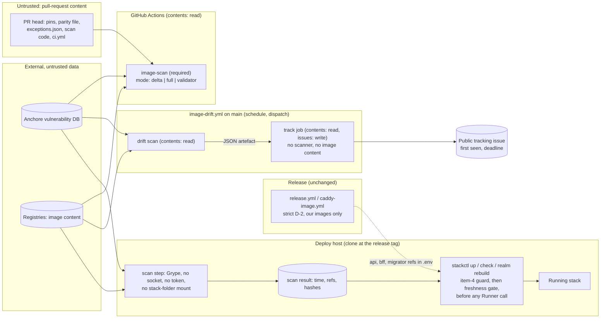

<!-- gate: G3 | verdict: PASS-WITH-NOTES | issue: #216 -->
# Threat delta: ADR-0022, a pull request is gated on its own image changes, drift is tracked on a schedule, and deploy keeps the strict gate (#216)

- Scope: the policy change itself, as written in `docs/adr/0022-image-scan-pr-delta-gate.md` (Proposed) and the G2 note `docs/architecture/adr-0022-pr-gate-delta.md` (O1 to O4, Q1 to Q9). This issue contains no code. The MUSTs below are either text the architect changes in ADR-0022 before Marco accepts it (M-1) or conditions the implementation issue must meet (M-2 to M-5). Areas the ADR does not touch are not re-audited.
- Sources read: manifest `docs/ai/pipeline/216.md`; ADR-0022; the G2 note; ADR-0015 (decision items and both amendments); ADR-0021 (items 5, 7 and 8, and E1); `docs/security/threat-models/deployable-stack.md` (D-1 rule, S-120-07, S-120-08, T120-12); `deploy/compose/stackctl.py` (`vendor_binary_problems`, `cmd_check`, `cmd_up`, `cmd_realm_rebuild`, the keyring paths); `.github/workflows/ci.yml` (`changes` images lane, `image-scan`, schedule); `.github/workflows/release.yml` (triggers); `.github/scripts/image_scan.py` (`parse_targets`, `SCAN_ENV`, `evaluate`, `run`); `.github/scripts/release_images.py` (`_grype`); `.github/image-scan/exceptions.json`; `.claude/scripts/gates.py` (`REVIEW_REQUIRED_PATHS`); `.claude/tests/test_ruleset.py:20, :368`; `docs/security/threat-models/release-supply-chain.md` (searched).
- All repository, issue and advisory text was treated as data. Reviewer: security-reviewer agent, 2026-10-30.

## Verdict

**PASS-WITH-NOTES.** Option 2 keeps the security property if the MUSTs below are met. The property is "no known High or Critical reaches a running stack or a release without a recorded decision". Option 2 does not weaken it beyond what conditions can fix. It moves the strict point from merge to deploy, and the deploy gate is stronger than today's merge gate: it requires a fresh scan of the exact set of images that will run. Two parts of the draft do not hold as written:
- The release clause for third-party images has no mechanism. M-1 settles it as G2 Q1 option (c).
- The text does not say that a drift deadline is never a deploy grace period. M-1 adds this.

M-1 must be in ADR-0022 before Marco accepts it. M-2 to M-5 become the "Done when" conditions of the implementation issue. I found no High or Medium flaw in unchanged code that needs escalating.

## Data flow (after the implementation issue)

Trust boundaries that are new or moved:
- The pull-request check now computes a comparison (base against head). The PR's own code computes it, as today (review-required paths).
- `issues: write` appears for the first time in a workflow that touches scanner output.
- The deploy host now runs the scanner and depends on its own clock for freshness. The item-4 guard was clock-free by design.

## Rulings

### 1. Does the property survive?

Yes, with M-1 to M-5. The property is now enforced at deploy for every image, and at release for our own images. It is no longer enforced at merge, by design. Gap by gap:

| Gap | Ruling |
| --- | --- |
| **Third-party images have no release scan** (G2 Q1, O-5) | **MUST (M-1, ADR text): option (c).** A release reaches a running stack only through `stackctl up` from a clone at the release tag, and M-3's gate covers every image there with a fresh scan. That is stronger than any release-time check. Option (a) would put a clock- and DB-dependent drift check on `release.yml`, which runs on every push to `main`. It would bring back drift blocking unrelated work, on the release path this time. Option (b) makes a public, editable issue body into gate input: rejected. Residual: a published release's assets can name third-party digests with a known finding. Nobody outside this project deploys them, and our own deploy refuses. Accepted (Low). |
| **Exceptions-only PRs are no longer red** (O1, Q9) | **Acceptable, mitigated by the deploy gate.** Deleting or shortening an entry is a reviewed change to a review-required path (`gates.py:328`). The next daily drift run reports it, and `up` refuses because the gate reads the clone's `exceptions.json` and binds its hash (M-3). The validator still runs. |
| **A bump to a digest that is worse in an unchanged package** | **Partly gated, rest by the deploy gate.** A new id, a severity rise, a renamed package or a changed package type count as new under M-2 and fail the PR. The same id at a worse version, or a pre-existing finding whose fix now exists (D-2), is not new on the PR. `up` refuses it until it is fixed or validly excepted. Acceptable. |
| **A scan-relevant file outside the delta's view** | **MUST (M-2): mode selection fails closed.** Changed aliases come from comparing the parsed references in `ContainerImages.cs` at `HEAD^1` and at `HEAD`, not from file names. Validator-only applies only when the PR's images-lane changes are exactly `exceptions.json`. Any other images-lane path that is not classified, an unknown base or `ALL` runs the full scan. A parity-file-only change scans nothing, and `ContainerImageParityTests` still blocks it (required `build-test`). **Q8 accepted:** a `.github/release/**`-only change scans nothing in `image-scan`. `image_scan.py` never scanned the release bases (O3), and `release.yml`'s strict build scans them on the PR and again before any push. Nothing is lost. |
| **Dependency bots** | **Acceptable.** A Dependabot `docker` bump of `images.Dockerfile` cannot merge without the `ContainerImages.cs` change (parity test). Once that change is pushed, the alias is delta-scanned. A scanner-pin bump runs the full scan (see note N-2). Dependabot `gomod`/`docker` PRs for `deploy/caddy/image/` keep `caddy-image.yml`'s strict scan (ADR-0021 item 5), and that is unchanged. |
| **`main` carries a known finding for up to its deadline** | **Acceptable.** Today `main` carries it too: drift reaches `main` without a PR. The difference is that unrelated work can continue. Local AppHost runs and the CI full-stack jobs run these images on loopback or on runners, as they do today. |
| **A running stack meets new drift** | **Unchanged from today** (the weekly run only notified). Nothing is deployed. S-3 assigns the deployed case to #132. |
| **Our images (`api`, `bff`, `migrator`) after release** | **MUST (M-3).** Today nothing rescans them after the release build. ADR-0022 item 4 promises a full scan of "the exact pinned set", so the set must include them. They are on the request path (S-120-07). |

### 2. Finding identity in the delta (Q2) and the base scan (Q3)

The rule, so it cannot be gamed (M-2):
- **Key:** (alias, `artifact.name`, `artifact.type`, `vulnerability.id`), matched exactly.
  - Do not match on related ids here. Both scans use the same scanner pin and the same DB snapshot, so the same flaw in the same package type carries the same primary id on both sides. Related-id matching only adds a hiding path: an aggregating GHSA whose related CVE set contains a base id would mask its other CVEs. Exceptions keep their related-id matching (`image_scan.py:648`). That matching exists for hand-written entries and is not affected.
  - **Version and fix state are not in the key.** Leaving them out means a bump that keeps a vulnerable version is not "new". D-2 catches a fix that appears, at deploy.
- **Base side:** the base image's raw High/Critical matches, S-05 elevated included, **before** exceptions. The delta then compares images, not policies, and stays consistent with O1.
- **Head side:** findings after the head's `exceptions.json` is applied with the full current policy (D-2, item 3 with tag state, item 4 with `ref`), so a PR can except a new finding in the same change.
- **Counts as new, fail closed:** a renamed package, a changed package type, a higher severity class than at the base, and a new id for a new version of the same package.
- **Re-pointed alias:** if the registry or repository of an alias changes, the alias is new and every head finding is gated. This covers #188 PR-2's switch to our Caddy, which `caddy-image.yml` has already scanned strictly.
- **Fail closed:**
  - A failed DB update, or an untrusted or failed head scan, fails the check.
  - A failed or untrusted base scan (a deleted base digest included) makes the alias "new": all head findings are gated, which is ADR-0015's behaviour for that alias. It never counts as "nothing at the base".
  - Base references are parsed by the same `parse_targets` from git at `HEAD^1` in the `image-scan` job itself, never from a `changes` output (Q3 accepted as written).
  - One `db update`, then both scans with `GRYPE_DB_AUTO_UPDATE=false`. The age check stays on (`image_scan.py:86`).
- Residual: the PR's own `image_scan.py` decides the mode and the delta. This is the same trust as today, when a PR could edit the script to exit 0. The paths are review-required. Accepted.

### 3. The deploy gate (Q4)

Accepted as G2 recommends, with these rulings (M-3):
- **Where it runs.** The scan runs on the deploy host from the clone's scanner pin and `image_scan.py`. No CI artefact is downloaded and no token is placed on the host.
  - The scanner container gets only a fresh DB directory and per-alias output directories outside the stack folder.
  - It never gets the stack folder, which holds the secret files, `.env`, or the Docker socket.
  - The result is written by the Python process, atomically, readable by the operator only.
- **What it is tied to.** The result records:
  - the UTC scan time, the scanner reference and `descriptor.db.built`;
  - the sha256 of the clone's `exceptions.json` and of its `image_scan.py`;
  - every scanned reference.

  The reference set must **equal** the set of images the assembled stack will run: every service image in the Compose configuration of the stack folder, plus the `api`, `bff` and `migrator` references from its `.env`. A subset is not enough. `api`, `bff` and `migrator` are evaluated on the strict release path (`evaluate()` without `ref` or `tag_state`), as `release_images.py` does.
- **Refusals.** `stackctl` refuses, before any `Runner` call, if:
  - the result is missing or unreadable;
  - any binding differs;
  - the scan is older than 24 hours or in the future;
  - the scan time is before `db.built`, or the host's current time is before `db.built` (a detectable clock error);
  - any scan was not trusted;
  - any High or Critical remains without a valid exception, whatever its age.
- **Which commands.** `up` and `check` run the gate, and so does every `stackctl` command that creates or starts a container from the assembled files. Today these are `realm rebuild` (`up -d keycloak`, `stackctl.py:1384`) and the keyring path's `create bff` (`stackctl.py:750`). Otherwise a re-assembled stack starts a newly pinned Keycloak without the gate.
- **Clock.** The freshness rule needs a clock. The item-4 guard does not, and it keeps that property: it stays first and clock-free until ADR-0021 E1 retires it. Clock residual: a host clock set behind by less than the gap to `db.built` makes a scan up to that gap older look fresh. That needs a misconfigured or compromised host, and a compromised host has already lost. Accepted (Low).
- **No override:** no flag and no environment variable. This is the same rule as the item-4 guard.
- **DB age:** Grype's own age check stays on. No separate bound is needed.

### 4. Drift tracking (Q5, Q6, Q7)

- **Placement (Q6): a separate `.github/workflows/image-drift.yml`** (M-4). It keeps `issues: write` out of `ci.yml`, which runs pull-request code, and keeps the other `ci.yml` lanes weekly. `.github/workflows/*.yml` is already review-required (`gates.py:324`), so G2's "a new workflow file needs the same check" needs no change.
- **Token scope.** The workflow-level setting is `permissions: {}` or `contents: read`.
  - The scan job has `contents: read` only.
  - The track job alone has `contents: read` and `issues: write`. It runs `gh` with `GITHUB_TOKEN`, with no PAT and no third-party action.
- **Untrusted text.** Scanner-derived text (package names, ids, versions, all from image content and the DB) reaches the issue only through `md_cell` neutralisation: no `@`, no links or URLs, and a size cap. It goes in through `--body-file`, never on an argv or in an interpolated `run:` line.
- **Public issue.** The repository is public. The body lists alias, package, version, id, severity, fix state, first seen and deadline only. It never includes exception justifications, network layout or reachability arguments.
- **First-seen dates.** Trusting a bot body that a collaborator can edit is acceptable, **because nothing gates on these dates** (M-1 makes the deploy gate block regardless of age). Tampering can only delay a reminder. If any gate ever reads them, they need provenance first (S-1).
- **When a deadline passes.**
  - The finding is marked OVERDUE in the issue, the issue is assigned to Marco, and the scheduled run is red, which notifies him.
  - Nothing new blocks in CI, on purpose: a vendor-bound finding (guava) cannot be fixed by us, and a block there would bring back the problem.
  - Deploy is already blocked by M-3 for every non-excepted finding.
  - A green run closes the issue with a dated comment. The next red run reopens the same issue, found by its label and the bot author.
- **Q7:** `{caddy, keycloak}` is a code constant with an exact-value test. If S-2 brings `api` and `bff` into the drift scan, they join it.
- **Deadlines:** Critical 7 days, High 30, High on the LAN request path 14. Accepted. They map to ASVS V15.1.1 (documented remediation time frames) and V15.2.1. An S-05 elevated finding counts as High.

### 5. Transition

- **Until the implementation PR merges, ADR-0015 applies unchanged**, also after Marco accepts ADR-0022. Accepting the ADR is not a reason to admin-bypass `image-scan` or skip a gate.
- **The paused chain (#213 → #214 → #215)** resumes only after the implementation PR merges (ADR Rollout 3). After the switch:
  - its bridge entries are not needed to merge, so none is added only to merge;
  - an entry that stays must meet every exception rule (S-120-07 approval, reachability, expiry), because the deploy gate honours it.
- **#187, #195 and #212** go ahead under ADR-0015 as planned, with their own gates. After the switch:
  - their entries remain valid records until they expire, and none is renewed only to merge;
  - the item-4 entries stay until #188 PR-2 removes them with item 4 (ADR-0021 E1);
  - the implementation issue does not touch the item-4 guard, its predicate or the tripwire.

  If item-4 entries are ever dropped without the Caddy bump, the fresh scan at deploy refuses on the fixed `go-module` findings. ADR-0022 therefore closes the residual "guard" risk listed in ADR-0015's 2026-10-17 amendment.
- **Guava (O2). Ruling: correct and intended.**
  - The PR lane is unblocked.
  - The finding is tracked in the drift issue (Keycloak is on the LAN path, so the 14-day High or 7-day Critical deadline applies).
  - `up` stays refused until a Keycloak release carries guava 33.7.2 or later. D-2 voids any exception, including a "not affected" record, for a fixed `java-archive` finding.
  - The deadline will pass with no action available, and that is accepted.
  - If Marco needs a deploy before Keycloak ships the fix (for example #132), that is a new ADR-0015 amendment with its own G3 (the option-3 class). It never goes through ADR-0022.

## Threats

| Id | Element / flow | STRIDE | Threat | Severity | Mitigation | ASVS 5.0 id | Status |
| --- | --- | --- | --- | --- | --- | --- | --- |
| T216-01 | PR delta comparison | T, E | A finding that is new at the head matches a base finding through related ids, a rename, a type change or a re-pointed alias, and passes | Medium | M-2 (exact key, new on rename/type/severity/re-point) | V15.2.1, V13.1 | Open, MUST for the implementation |
| T216-02 | Mode selection | T | A gate-relevant or unclassified images-lane change runs in delta or validator mode; a failed base scan is read as "no findings" | Medium | M-2 (fail-closed mode selection; failed base means new alias) | V15.2.1 | Open, MUST for the implementation |
| T216-03 | Release of third-party pins | E | ADR item 2 promises a release block that no mechanism enforces, and a third-party High is treated as blocked when it is not | Medium | M-1 (option (c): the deploy gate is the release blocker for third-party images) | V15.1.1 | Open, ADR text before acceptance |
| T216-04 | Drift deadline vs deploy | E | The deadline window is read as permission to deploy with a known finding | Medium | M-1, M-3 (every non-excepted finding blocks `up`, whatever its age) | V15.2.1 | Open, ADR text and implementation |
| T216-05 | Deploy freshness gate | E, T | A stale, mismatched or partial scan result lets `up` run; `realm rebuild` or `create bff` starts a new image without the gate; `api`/`bff`/`migrator` drift since release is never scanned | Medium | M-3 | V15.2.1, V13.1 | Open, MUST for the implementation |
| T216-06 | Deploy-host scanner | I | The scanner container on the host is given the stack folder (secret files, `.env`) or the Docker socket | Medium | M-3 (fresh directories only, no socket, no token) | V13.3, V13.2 | Open, MUST for the implementation |
| T216-07 | Deploy-host clock | T | A clock set behind makes an old scan look fresh | Low | M-3 (refuse if before `db.built`); item-4 guard stays clock-free | V13.1 | Accepted residual |
| T216-08 | `stackctl.py` integrity | T | A later PR weakens the only strict gate for third-party images with no G3/G6, because `deploy/**` is not review-required (S-120-08 was in backlog) | Medium | M-5 (review-required paths) | V15.1, V13.1 | Open, MUST for the implementation |
| T216-09 | `issues: write` token | E | The token reaches a job that runs pull-request code, a branch dispatch, or a third-party action | Medium | M-4 (separate workflow, schedule/dispatch only, track job on `main` only, `gh` with the job token) | V13.2 | Open, MUST for the implementation |
| T216-10 | Scanner text into the issue | T, S | Package names or ids from image content inject markdown, mentions or links into a public issue, or reach a shell | Low | M-4 (`md_cell`, no `@`, no links, cap, `--body-file`) | V1.2, V16.4 | Open, MUST for the implementation |
| T216-11 | Public tracking issue | I | The issue discloses reachability arguments or network layout | Low | M-4 (content allow-list) | V13.4 | Open, MUST for the implementation |
| T216-12 | First-seen dates | T | An edited body moves first-seen dates later and delays reminders | Low | Nothing gates on the dates (M-1); S-1 | V16.4 | Accepted residual |
| T216-13 | Transition | E | The paused chain or a bridge entry merges on "ADR accepted" before the deploy gate exists, or the delta gate goes live before the freshness gate | Medium | M-5 (one switch PR; ADR-0015 until then) | V15.1.1 | Open, MUST for the implementation |
| T216-14 | Exceptions-only PR (O1) | T | Deleting an exception no longer turns the PR red | Low | Review-required path, daily drift run, M-3 hash binding | V15.2.1 | Accepted |
| T216-15 | Guava case (O2) | E | Pressure to let a fixed vendor-bundled finding through with a "not affected" record | Low | M-1 (D-2 holds; any way round it is an ADR-0015 amendment with G3) | V15.2.1 | Mitigated by text |

## MUSTs

- **M-1 (ADR-0022 text, architect, before Marco accepts; T216-03, T216-04, T216-15).** Change decision item 2 and its two sub-bullets so that:
  - (a) **Q1 is decided as option (c).** The release blocker for third-party images is the deploy gate of item 4. `release.yml` and `caddy-image.yml` stay strict for our own images, as in item 3. No release-time drift check is added, and the tracking issue is never gate input. Restate the property once in the ADR: "no known High or Critical reaches a running stack (any image) or a published image of ours (release, `caddy-image.yml`) without a recorded decision".
  - (b) **A deadline is time to fix, not a grace period.** Every non-excepted High or Critical blocks `stackctl up` whatever its age. "Overdue" adds a notification (OVERDUE marker, issue assigned to Marco, red scheduled run), not a new block. Replace "An overdue finding is a release and deploy blocker" with this.
  - (c) **A "not affected" statement lets a deploy through only as a valid exception entry**, so D-2 and its two narrowings still void it for a fixed finding. State the guava consequence in the ADR. Any way round D-2 is an ADR-0015 amendment with its own G3.
  - (d) **In item 4,** "the exact pinned set" means every image the assembled stack runs, `api`, `bff` and `migrator` included. The gate covers every `stackctl` command that creates or starts containers. M-3 has the detail.
- **M-2 (implementation; T216-01, T216-02). The delta identity and the mode selection, as in ruling 2.**
  - The key is exact (alias, `artifact.name`, `artifact.type`, `vulnerability.id`), with no version or fix state. The base side is raw High/Critical with S-05 elevation, before exceptions. The head side is after exceptions under the full current policy.
  - A rename, a type change, a severity rise or a re-pointed registry/repository counts as new.
  - A failed or untrusted base scan makes the alias new, never empty. A failed head scan or DB update fails the check.
  - Base references come from git at `HEAD^1`, parsed by `parse_targets`. One DB update covers both scans.
  - Validator-only applies only when the images-lane changes are exactly `exceptions.json`. Any unclassified images-lane path, an unknown base or `ALL` runs the full scan.
  - Red tests cover each case. `image-scan` stays required with no job-level `if`.
- **M-3 (implementation; T216-04 to T216-07). The deploy gate, as in ruling 3.**
  - The scan runs on the host and never mounts the stack folder, the socket or a token.
  - The result binds the time, the scanner reference, `db.built`, the sha256 of `exceptions.json` and of `image_scan.py`, and a reference set equal to the assembled stack's images plus the `.env` release references. `api`, `bff` and `migrator` are evaluated strictly.
  - It refuses: on a missing or unreadable result; on any mismatch; when the scan is older than 24 hours or in the future; when the scan time or the current time is before `db.built`; on an untrusted scan; on any non-excepted finding.
  - It runs in `up`, `check`, `realm rebuild` and the keyring `create` path, before any `Runner` call. It has no override flag or environment variable. The item-4 guard stays first and clock-free until ADR-0021 E1.
  - Red tests in `deploy/tests/test_stackctl.py` cover each refusal with zero `Runner` calls. There is also a test that the scan argv has no stack-folder or socket mount.
- **M-4 (implementation; T216-09 to T216-11). The drift workflow, as in ruling 4.**
  - `image-drift.yml` has exactly the triggers `schedule` and `workflow_dispatch` (no inputs), and never `pull_request`, `pull_request_target` or `workflow_run`.
  - The scan job has `contents: read`. The track job has `contents: read` and `issues: write`, with `if: github.ref == 'refs/heads/main'`. It runs no scanner, and its only script is a stdlib script from the checked-out `main`.
  - It uses `gh` with `GITHUB_TOKEN`, with no PAT and no third-party action.
  - Scanner text goes through `md_cell` with no `@`, no links and a size cap, and through `--body-file` only.
  - The body contains only the listed fields. The issue is found by its label and the bot author.
  - Workflow tests assert each of these.
- **M-5 (implementation and transition; T216-08, T216-13).**
  - Add `deploy/compose/stackctl.py`, `deploy/compose/stackguards.py` and `deploy/tests/test_stackctl.py` to `REVIEW_REQUIRED_PATHS` in `.claude/scripts/gates.py`, with its test. The deploy gate is now the only strict gate for third-party images. This promotes that part of S-120-08 into this issue and opens no new tooling issue.
  - The delta gate and the deploy freshness gate go live in the same PR. The delta is never live without the freshness gate.
  - ADR-0015 applies until that PR merges. The paused chain resumes only after it.
  - The implementation does not change the item-4 guard, predicate or tripwire.
  - *(Added 2026-10-30, re-check R-1, R-2.)* The implementation PR's own `image-scan` run is the gate-change comparison (the bootstrap). Its base side loads `main`'s `image_scan.py` by file path from a separate checkout of the base commit and calls `main`'s functions, never a head module of the same name. That PR does not change the scanner pin. G6 reviews the mode selection, the base loading and the comparison code line by line. No bypass.

## SHOULDs

- **S-1 (fix-now in the implementation, Low).** First-seen dates only ever move earlier. The tracker takes the earliest of the parsed body value and the run artefacts (90-day retention covers the 30-day maximum). A date that is unparseable or in the future is replaced by today with a note. If a gate ever reads these dates, they need committed or artefact provenance first and a G3.
- **S-2 (backlog #83).** The daily drift scan also scans the latest release's `api`, `bff` and `migrator` digests, so a running stack's own images get deadlines. Q7's constant then includes `api` and `bff`.
- **S-3 (#132 G3).** For a deployed stack: a runbook action for an overdue Critical, or an overdue High on the LAN path, in a running service. Stop the service, or record a decision within a set time.
- **S-4 (#132).** Record the new deploy-time egress (the Anchore DB endpoint, the scanner image registry) in the host's egress allow-list. Confirm that the Grype binary needs nothing above x86-64-v2 (ADR-0016 F6).

## Notes (no change to the verdict)

- **N-1, G2 correction.** `.github/workflows/*.yml` is already review-required (`gates.py:324`), so `image-drift.yml` is covered without a change.
- **N-2, operational, for Marco.** *(Superseded 2026-10-30 by the re-check below.)* ~~Full mode for any `ci.yml`, scan-code or scanner-pin change is the secure default and is kept.~~ Marco chose the gate-change comparison ("option 1"), which this note anticipated. The re-check below rules on it. It keeps the property, and file-name heuristics stay excluded.
- **N-3, Q8 accepted** (see ruling 1). O3, the `release-supply-chain.md` claim about release bases, stays in backlog #83.

## Re-check 2026-10-30: the gate-change comparison and the bootstrap (the one allowed re-check)

- Scope: only the passages the architect changed after the rollout gap (manifest line "Rollout gap found after G3"; Marco 2026-10-30, "option 1"):
  - ADR-0022 decision item 1, sub-bullet "Gate-change comparison";
  - the new "Bad" bullet;
  - the `test_image_scan.py` bullet under "Enforced by";
  - the bootstrap sub-bullet under Rollout step 2;
  - the G2 note's dated "rollout gap" entry and its schema question.

  Everything else in this delta is unchanged and was not re-audited.
- Also read: `deploy/compose/stackguards.py:1689-1701` (`load_scan_module`), `.claude/tests/test_ruleset.py:189-190, :383` (the `pull_request_target` ban), and `image_scan.py` `run()` (exit code and log only, no machine-readable result).
- **Verdict unchanged: PASS-WITH-NOTES.** No new High or Medium. M-5 is updated in place (bootstrap). N-2 is superseded. Two Low items are below.

### Ruling A: the gate-change comparison keeps the property

The property: "no known High or Critical reaches a running stack or a published image of ours without a recorded decision".
- Its two enforcement points are unchanged by this passage:
  - the deploy gate (M-3), which needs a fresh full scan of every image the stack runs;
  - the strict release and `caddy-image.yml` scans.
- The comparison changes only what a gate-change PR must answer for: what it makes new, not the world's drift. That is the same trade as the delta for pin changes, which the original ruling 1 accepted.
- **Under-reporting.** A gate change that makes the head under-report is the one new concern. `stackctl` (`load_scan_module`) and `release_images.py` load the same `image_scan.py`, so a weakened module also weakens the deploy and release gates.
  - That is **not weaker than today**: under ADR-0015's full scan, a PR that breaks `image_scan.py` so it under-reports is just as green, and its own code runs the check just as here.
  - The control is review, as the new "Bad" bullet says. The path is review-required (`gates.py:328`), so every such PR carries G3 and G6.
  - Accepted.
- **Base side and the M-2 key.** The ADR says the base uses `main`'s "policy". For the comparison key that means `main`'s severity classification (S-05 elevation). The base finding set stays raw, before exceptions, as in M-2. M-2 governs. This is a wording point for the implementation issue's G2, not an ADR change.

### Ruling B: the bootstrap is acceptable without a further MUST

- **A base job from a fixed ref is not achievable here without a bypass or a banned trigger.**
  - On `pull_request`, GitHub runs the workflow file of the PR's merge commit. A checkout of the base commit inside that workflow is defined by the PR, and so is a reusable workflow `uses: …@<ref>`, because the PR picks the ref.
  - The triggers that run the base branch's file are `pull_request_target` (banned, `test_ruleset.py:189`, G4-80-06) and `workflow_run` (banned in `test_release.py:48`; it also brings a write-capable context).
  - A ruleset "required workflow" pinned to a ref is, to my knowledge, available only for organisation-owned repositories, not for this personal-account repository.
  - So against a malicious PR, the base-on-`main` scan protects nothing more than review does. Against an accident it does help, and that is what it is for.
- **Controls accepted:**
  - the base side runs `main`'s code;
  - G6 on the diff;
  - Marco's review;
  - no bypass;
  - ADR-0015 for every other PR until the merge.

  M-5 now spells out three of these:
  - "`main`'s code" means `main`'s `image_scan.py` loaded by file path from a separate checkout of the base commit, as `load_scan_module` does. `main`'s `run()` returns only an exit code and a log, so its functions are called and its output is not parsed.
  - The implementation PR does not bump the scanner pin.
  - G6 reads the mode selection, the base loading and the comparison code line by line.
- **R-1 (Low, fix-now in the implementation; a few lines in `image_scan.py`, which it changes).** When the scanner pin is unchanged, base and head use the same images, the same scanner and the same database snapshot. Grype's raw output must then be the same.
  - For that case, fail if any raw Grype match key (alias, `artifact.name`, `artifact.type`, `vulnerability.id`, any severity, before any policy) seen at the base is missing at the head.
  - Raw matches come from Grype, not from `evaluate()`, so a legitimate policy change cannot trip this. A changed scan invocation that loses matches (argv, platform, environment, output handling) does trip it.
  - "Fewer at the head is logged, not failed" then applies only when the scanner pin changes.
  - This tightens one ADR sentence ("it does not fail the comparison"). The implementation issue's G2 adjusts that sentence. It is not a condition on accepting ADR-0022.
- **R-2 (Low, fix-now as PR evidence for the implementation PR's G6).** Before G6, record a `workflow_dispatch` run of `ci.yml` on `main`. That run uses `main`'s own workflow file, so it is the one run the PR cannot shape.
  - G6 checks that every High or Critical key that run reports also appears in the PR's head scan for the same alias, the guava finding included.
  - This is the fixed-ref comparison that GitHub Actions does allow, done by a reviewer instead of a job. It needs no new action and no token.

### Ruling C: the schema question

- **Fail closed is accepted.** If the base and head scanners cannot read one database snapshot, the comparison is a failed scan, and every head finding counts as new. This holds for the implementation PR, which does not bump the scanner (M-5).
- **"Never two databases" is not a security requirement, and I do not adopt it as one.**
  - A two-database comparison cannot turn a finding at the head into an "old" one unless the base's own scan, with `main`'s scanner and database, reported that key.
  - Snapshot skew can only produce a false red (missing at the base) or an under-report at the head. After the merge, the drift scan and the deploy gate catch an under-report at the head with a fresh database.
- **Backlog #83.** If a schema-changing scanner bump is ever blocked by an unfixable drift finding (the guava class), the answer is the two-database variant under these conditions, never a bypass or an exception:
  - both `db update` runs in the same job;
  - both runs pass provenance checks;
  - each `descriptor.db.built` is recorded, and the two are at most 48 hours apart;
  - the comparison rule is unchanged.

  It then needs G6 only, not another G3.

## Always-check items

- BFF cookies and antiforgery, JWT validation, BOLA and tenant filters, SQL: not touched (no code; no product path).
- Secrets and logs: no token or secret on the deploy host for the scan (M-3). Scanner output is neutralised in the issue and in the step summary (M-4, `md_cell`).
- Dependencies: no new package or action. Grype is the existing pin. `actions/upload-artifact` and `actions/download-artifact` are already pinned (ADR-0014).
- AI lanes: not touched.
