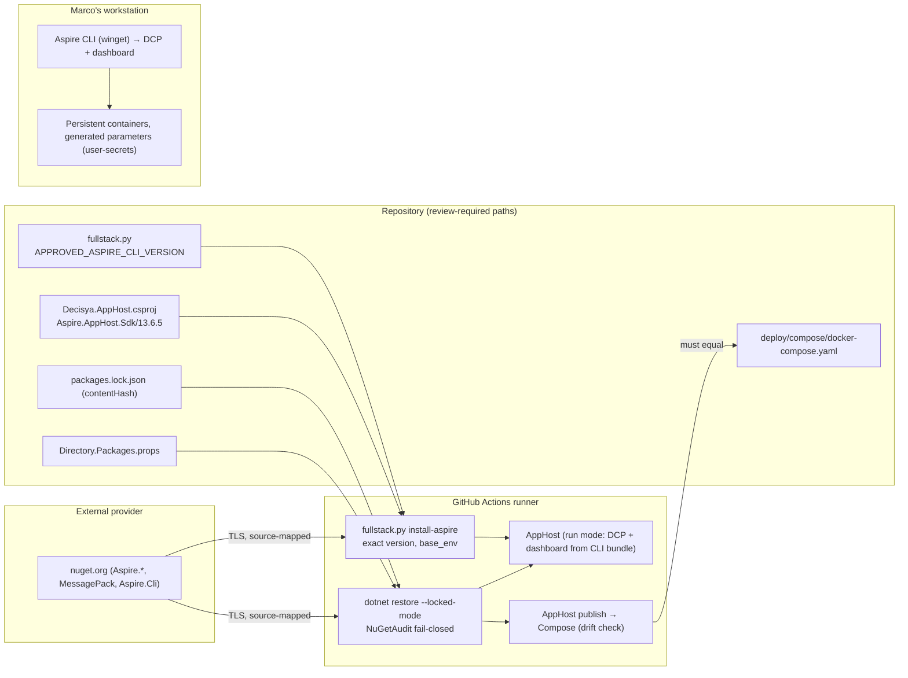

<!-- gate: G3 | verdict: PASS-WITH-NOTES | issue: #318 -->
# Threat delta: Aspire 13.6.5 (#318, GHSA-f7vh-h5g3-7jrh)

- Tier: full; class ci-tooling (re-classed by Marco on 2026-11-17). Host run. No new package id.
- Scope: this is a threat delta for the planned change, not a full model. Areas the change does not touch are not re-audited.
- Assurance: ASVS 5.0 Level 2 (addendum). V6 and V7 are not touched. The BFF's ticket-store client moves by one patch (T-10).
- Inputs read: the manifest `docs/ai/pipeline/318.md`, the uncommitted `Directory.Packages.props` diff, `src/Decisya.AppHost/Decisya.AppHost.csproj`, `NuGet.config`, `Directory.Build.props`, `Directory.Build.targets` (the property guards), `.github/scripts/fullstack.py` (`read_aspire_version`, `cmd_install_aspire`, `base_env`), `.github/workflows/ci.yml` (restore, the Aspire CLI steps, the drift check), `.github/dependabot.yml`, `.claude/tests/test_ci_fullstack.py:212-220`, the current `packages.lock.json` files, and these nuspecs in the local NuGet cache: `aspire.hosting/13.6.5`, `aspire.hosting.apphost/13.6.5` and `streamjsonrpc/2.25.29`.
- Not read: the advisory text itself. I fetched nothing from the network. The advisory facts come from the caller's summary: Aspire.Hosting and Aspire.Hosting.AppHost below 13.6.5 are vulnerable, and 13.6.5 is patched. I checked the graph facts against the cached nuspecs.

## Facts the delta rests on (verified)

1. Main is in a mixed state today. `src/Decisya.AppHost/packages.lock.json` has `Aspire.Hosting.AppHost` at 13.5.4 (Direct, from the SDK), `Aspire.Hosting` at 13.6.4 (Transitive), Docker, PostgreSQL and Redis at 13.6.4, and Keycloak at `13.5.4-preview.1.26464.4`. The Dependabot `aspire` group moved the `PackageVersion` lines but not the `Sdk="Aspire.AppHost.Sdk/<v>"` attribute, which is how the mix came about.
2. `aspire.hosting/13.6.5` declares `MessagePack 2.5.307` and `StreamJsonRpc 2.25.29`. `aspire.hosting.apphost/13.6.5` also declares `MessagePack 2.5.307` directly, in every TFM group. `streamjsonrpc/2.25.29` still declares `MessagePack 2.5.302`. Both Aspire packages sit nearer the root than StreamJsonRpc on every path, so without the pin MessagePack resolves to 2.5.307.
3. Today MessagePack appears only in `src/Decisya.AppHost/packages.lock.json` and `tests/Decisya.AppHost.Tests/packages.lock.json`. In both it is `CentralTransitive`, requested `[2.5.307, )` and resolved 2.5.307.
4. `aspire.hosting/13.6.5` declares `Microsoft.Extensions.DependencyInjection.Abstractions 10.0.14` (13.6.4 declared 10.0.12). `Directory.Packages.props` pins it at 10.0.13, and `CentralPackageTransitivePinningEnabled` is on. Expect a downgrade error (NU1109, or NU1605) at restore (see T-09 and D-1).
5. No `.csproj` references `Aspire.Npgsql.EntityFrameworkCore.PostgreSQL`, so moving its pin changes no graph. `Aspire.StackExchange.Redis` is referenced by `src/Decisya.Bff` only. The `Aspire.Hosting.*` packages are referenced by the AppHost, and `Aspire.Hosting.Testing` by the AppHost tests.
6. These controls are already in place and the change does not alter them: `NuGet.config` uses `<clear/>` with source mapping (Ostium.* to the private feed, everything else to nuget.org). Audit sources are nuget.org only. `NuGetAudit=true`, `NuGetAuditMode=all` and `TreatWarningsAsErrors` mean NU1901 to NU1904 fail the restore, and `Directory.Build.targets` keeps those settings on. `LOCKED_RESTORE=true` is set in CI, and CI also proves that `RestoreLockedMode` is on. `dotnet list package --vulnerable --include-transitive` fails CI on High or Critical. The CLI install runs `dotnet tool install Aspire.Cli --version <exact> --tool-path` from the repository root, so it uses `NuGet.config` and its source mapping. Its environment is `base_env()` (no tokens, and signature verification cannot be turned off), and afterwards `aspire --version` must equal the installed version.

## Data flow and trust boundaries

Boundaries: nuget.org → runner (supply chain), repository → CI harness (the version constant and the SDK attribute), AppHost → Compose file (the deploy input), and workstation → local stack.

## Threats

| Id | Element / flow | STRIDE | Threat | Severity | Mitigation | ASVS 5.0 id | Status |
| --- | --- | --- | --- | --- | --- | --- | --- |
| T-01 | nuget.org → restore (new versions) | S, T | A 13.6.5 package or a MessagePack version arrives from an unexpected source, or the lock file records a hash the locked restore never checks | Low | `NuGet.config` `<clear/>` and source mapping; DECISYA0008; lock-file `contentHash`; locked restore in CI; NuGet signature verification on by default. M-3 keeps them untouched | V15.2.4, V15.2.1 | Mitigated (existing); G4 verifies M-3 |
| T-02 | Removing #166's MessagePack pin | I, E | GHSA-qhrr-8q5h-9q3h comes back if any path resolves MessagePack 2.5.302 (StreamJsonRpc's floor) | Medium | Aspire.Hosting 13.6.5 and Aspire.Hosting.AppHost 13.6.5 declare 2.5.307 directly (fact 2). NuGetAudit `all` with warnings as errors fails the restore on NU1902 if this ever goes back. M-2 provides the lock-file evidence | V15.2.1 | Mitigated by design; G4 verifies M-2 |
| T-03 | A partial bump (SDK and packages out of step) | E, D | The advisory stays open through `Aspire.Hosting.AppHost` (from the SDK line), or mixed Aspire versions fail at run time (TypeLoadException). This is how main got here (fact 1) | High (the advisory) | The SDK line moves with the pins in the same PR. NU1903 fails the restore below 13.6.5. M-1 provides the one-version evidence. S-1 adds a regression guard | V15.2.1, V15.1.1 | Mitigated by the change; G4 verifies M-1 |
| T-04 | `APPROVED_ASPIRE_CLI_VERSION` and `install-aspire` | T, E | The constant moves without approval, or the edit loosens the fail-closed check (regex, equality, argv, environment, `--version` check). The runner then executes an unreviewed CLI that receives the stack's parameters | Medium | Marco approved CLI 13.6.5 on 2026-11-17 (manifest). M-4 limits the diff to the literal and its comments. The test binds the constant to the real `.csproj` | V15.2.1, V13.1 | Mitigated if M-4 holds; G6 checks the diff |
| T-05 | AppHost publish → Compose file | T, I | 13.6.5 (publisher patch, Keycloak preview moving across a minor) changes the published Compose file: a new published port, a dashboard service, an environment file, a secret value, or an image reference that is not digest-pinned | Low | Drift check (`diff -u`; only `docker-compose.yaml` may be written); `WithDashboard(false)`; digest pins in `ContainerImages`; the D10 deploy guards. M-5 | V13.1, V15.2.1 | Mitigated (existing); G4 verifies M-5 |
| T-06 | Dev: persistent containers and generated parameters | D, I | The new SDK or DCP recreates persistent containers, or renames a generated parameter. The local stack then fails on credentials, and a fix by hand reads or edits `secrets.json` or deletes the `decisya-postgres` data volume | Low | S-3: stop and report. Agents never read user-secrets (CLAUDE.md) | V13.3.1 | SHOULD |
| T-07 | Keycloak hosting preview `13.6.5-preview.1.26559.7` | T, E | The preview integration changes its defaults (start command, realm import, admin bootstrap, health endpoints) in dev and CI | Low | Image pinned by digest; KeycloakResourceTests; apphost-tests, e2e and zap in CI; the drift check for the deployed Compose file. The preview risk was already accepted in ADR-0002 | V15.2.1 | Mitigated (existing); CI must be green |
| T-08 | Workstation CLI bundle (`AspireUseCliBundle=true`) | E | Locally, DCP and the dashboard come from the installed CLI, which `docs/GETTING-STARTED.md:16` still describes as 13.5.x. The workstation can run a CLI that does not match the SDK. If the advisory's fix spans the bundled pieces, the workstation stays exposed | Medium (unknown: the advisory text was not read) | S-2: Marco updates the workstation CLI to exactly 13.6.5 and checks `aspire --version`. The docs line follows | V15.2.1 | SHOULD (Marco step) |
| T-09 | Version moves that restore forces (fact 4) | T | Restore raises NU1109 or NU1605 on Microsoft.Extensions.DependencyInjection(.Abstractions) 10.0.14. The error gets hidden (NoWarn, a suppression, transitive pinning switched off, an extra source), or the bump quietly spreads to more packages | Medium | M-3: stop and report the exact code. Any extra pin move is an existing package's version only, approved by Marco (D-1). `Directory.Build.targets` already refuses to switch off pinning, audit or locked mode | V15.2.1, V13.1 | Open; D-1 |
| T-10 | BFF graph: `Aspire.StackExchange.Redis` 13.6.4 → 13.6.5 (the session ticket store client) | T | A patch-level change in the production session path | Low | Patch release; BFF integration tests (Testcontainers Redis); the G6 lock-file diff review (M-3 list) | V15.2.1 | Mitigated (existing) |

No High is left without a mitigation. T-03 is the advisory itself, and this change closes it.

## MUSTs (for G4; G6 checks them)

- **M-1. One Aspire version, audit clean.**
  - `Aspire.AppHost.Sdk/13.6.5` is in the `.csproj`. Every `Aspire.*` `PackageVersion` is `13.6.5`, except Keycloak, which is `13.6.5-preview.1.26559.7`.
  - In every lock file that holds them, `Aspire.Hosting.AppHost` shows requested `[13.6.5, )` and resolved `13.6.5`, and `Aspire.Hosting` resolves `13.6.5`. No Aspire.* id resolves to any other version. This covers `src/Decisya.AppHost`, `tests/Decisya.AppHost.Tests`, and `src/Decisya.Bff` for `Aspire.StackExchange.Redis`.
  - A locked restore of the whole solution with `LOCKED_RESTORE=true` passes with no NU19xx, no NU1605 and no NU1109.
  - `dotnet list package --vulnerable --include-transitive` reports no High or Critical. Record its output in the G4 evidence.
- **M-2. MessagePack evidence.**
  - In `src/Decisya.AppHost/packages.lock.json` and `tests/Decisya.AppHost.Tests/packages.lock.json`, the top-level `MessagePack` entry is `"type": "Transitive"` and `"resolved": "2.5.307"`, and no `CentralTransitive` MessagePack entry remains.
  - No lock file anywhere resolves MessagePack below 2.5.303.
  - StreamJsonRpc's own dependency map still reads `"MessagePack": "2.5.302"`. That is the declared floor, not the resolved version, so it is not a finding.
  - `NuGetAudit` settings are unchanged. They are the backstop if this ever goes back.
- **M-3. Restore integrity, and nothing hidden.**
  - Lock files are regenerated only through the repository's `NuGet.config`: no `--source`/`--add-source`, no edit to `NuGet.config`, `Directory.Build.props` or `Directory.Build.targets`, and no `NoWarn`, `WarningsNotAsErrors` or `NuGetAuditSuppress` for any NU code.
  - The G4 evidence lists, for each changed lock file, every package id whose resolved version moved and every id added or removed. A new id in the Api, BFF or Migrator graphs needs a one-line justification in the PR body.
  - If restore raises NU1109 or NU1605 (expected from fact 4), stop and report the exact code. Do not move another pin before Marco decides D-1.
- **M-4. The CLI constant stays human-approved and fail-closed.**
  - The `fullstack.py` diff is limited to `APPROVED_ASPIRE_CLI_VERSION = "13.6.5"` and the comment above it. The comment cites Marco's approval of 2026-11-17 under #318, which replaces M3's 13.5.4 of 2026-10-09.
  - `VERSION_RE`, `SDK_RE`, the equality check, the `dotnet tool install` argv, `base_env()` and the `aspire --version` check do not change.
  - The `.claude/tests/test_ci_fullstack.py` test asserts 13.6.5 for both the literal and the real `.csproj`, and keeps every negative case. Add `13.5.4` to the rejected list, which proves the old approval is revoked.
  - The full `.claude` suite passes.
- **M-5. Compose drift.**
  - The deploy-guards drift check (a fresh AppHost publish equals `deploy/compose/docker-compose.yaml`) passes with the committed file unchanged.
  - If the publish output differs, stop and report. Never edit the Compose file by hand. The regenerated file then goes to G6, which checks: image digests unchanged, no dashboard service, no new published port, no environment file, no secret value.
  - CI build-test, apphost-tests, e2e, zap and deploy-guards are green on the PR head.

## SHOULDs

- **S-1 (fix-now, Low, a few lines in a changed file).** Add a test to `.claude/tests/test_ci_fullstack.py` that reads `Directory.Packages.props` and the `.csproj`. It asserts that every `Aspire.*` `PackageVersion` has the same `x.y.z` as `Aspire.AppHost.Sdk`, with a `-preview.*` suffix allowed only for `Aspire.Hosting.Keycloak`. A future Dependabot `aspire` group PR then fails until the SDK line moves with it. That is the gap that produced fact 1.
- **S-2 (Marco step; docs fix-now if the PR takes `docs/GETTING-STARTED.md`, otherwise backlog #243).**
  - Update the workstation Aspire CLI to exactly 13.6.5 by the route it was installed with, then confirm that `aspire --version` prints 13.6.5 before the next local AppHost run.
  - `docs/GETTING-STARTED.md:16` says "Aspire 13.5 CLI … → 13.5.x". It should say 13.6.
- **S-3 (G4 conduct).** If the local AppHost fails after the bump (persistent containers recreated, or a generated-parameter mismatch), stop and report the error. Do not read or edit user-secrets, and do not remove containers or the `decisya-postgres` volume without Marco.
- **S-4 (fix-now, Low, changed file).** `read_aspire_version`'s error message and the module docstring (line 25) name "M3". Reword them as "the Aspire CLI version Marco approved", so that the next bump does not leave a stale reference.
- **S-5 (backlog #243).** `Aspire.Npgsql.EntityFrameworkCore.PostgreSQL` is pinned in `Directory.Packages.props`, but no project references it (fact 5). Either remove the dead pin or record why it stays.

## Decision for Marco

- **D-1. Microsoft.Extensions 10.0.14 (only if restore asks for it, see T-09).** Aspire.Hosting 13.6.5 needs `Microsoft.Extensions.DependencyInjection.Abstractions` 10.0.14 or later, and the central pin is 10.0.13.
  - Recommendation (option A): allow #318 to move only the pins NuGet names in its error. Expected: `Microsoft.Extensions.DependencyInjection.Abstractions`, and `Microsoft.Extensions.DependencyInjection` with it. Both go 10.0.13 → 10.0.14, an existing Microsoft servicing release, with no new id. Leave the ASP.NET Core authentication, EF Core Design and Mvc.Testing pins at 10.0.13.
    - Risks: many lock files change. The 10.0.x pins split across two servicing levels until a separate bump. 10.0.14 may be inside the 7-day cooldown, so check its nuget.org publication date. A security fix justifies it either way, but record that.
  - Option B: move every 10.0.13 pin to 10.0.14.
    - Risk: the OIDC and JwtBearer packages then move as well. That puts V6, V7 and V10 code paths into G6's scope and widens a security-fix PR.
  - Option C: hold #318 and open a separate Microsoft.Extensions bump first.
    - Risk: the drift failure (NU1903 in six jobs) stays red longer, and #295 stays blocked.

## Checks the orchestrator makes at G4

1. Lock-file evidence for M-1 and M-2: the `git diff` of every changed `packages.lock.json`, plus a search for `"MessagePack": {` and `"Aspire.Hosting(.AppHost)?": {` with their `resolved` lines.
2. A locked restore (`LOCKED_RESTORE=true`), then `dotnet build -warnaserror`, then `dotnet list package --vulnerable --include-transitive`. Record the outputs.
3. The M-3 list of moved, added and removed package ids per lock file.
4. A local publish comparison, or the CI deploy-guards result, for M-5.
5. The `fullstack.py` and `.claude/tests/test_ci_fullstack.py` diffs (M-4), and a full `.claude` suite run.
6. CI on the PR head: build-test, apphost-tests, e2e, zap, deploy-guards and codeql all green.
