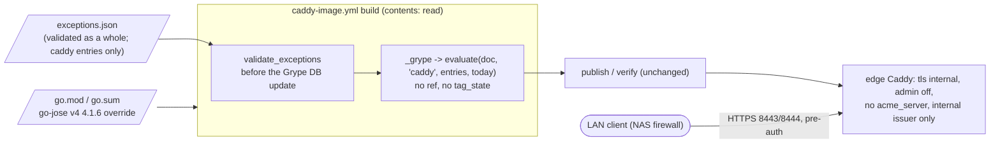

<!-- gate: G3 | verdict: PASS-WITH-NOTES | issue: #212 -->
# Threat delta: go-jose GHSA-mgcc-cww5-fp2q in the self-built Caddy image, v4 override and an unfixed v3 exception (issue #212)

- Date: 2026-10-29. Reviewer: security-reviewer (G3, Full tier), before G4.
- Scope: only the planned change. That is the go-jose v4 4.1.6 override in `deploy/caddy/image/go.mod`/`go.sum`, the build scan in `caddy_image.py inspect` applying the validated `caddy` entries of `.github/image-scan/exceptions.json`, one new `caddy` entry for go-jose v3, and the tests. Nothing else is re-audited.
- Inputs, all read as data: manifest `docs/ai/pipeline/212.md`; G2 note `docs/architecture/caddy-image-unfixed-exceptions.md`; ADR-0021 (item 5 and its 2026-10-29 clarification, items 3 and 7); ADR-0015 (D-2, items 3 and 4, as implemented in `image_scan.py`); `deployable-stack.md` (S-120-07 and the 2026-10-06 class rule); `self-built-caddy.md` (#188 G3); `.github/scripts/caddy_image.py` (`cmd_inspect`, `OVERRIDE_RE`); `.github/scripts/release_images.py` (`_grype`, `cmd_inspect`); `.github/scripts/image_scan.py` (`exception_errors`, `is_vendor_binary_entry`, `_vendor_binary_errors`, `_keeps_fixed_exception`, `_keeps_vendor_binary_exception`, `evaluate`); `deploy/caddy/image/go.mod`; `deploy/caddy/Caddyfile`; `deploy/compose/docker-compose.stack.yaml`; `deploy/compose/stackguards.py` (`caddy_problems`, `_proxy_route_list`); `deploy/compose/stackctl.py` (item-4 guard); `deploy/tests/test_caddy_image_script.py` (`StrictGrypeTests`); `.github/workflows/caddy-image.yml` (triggers). The precedent `image-scan-drift-195.md` does not exist under `docs/security/threat-models/`; I used the 2026-10-06 delta in `deployable-stack.md` and `self-built-caddy.md` as precedents.
- Advisory facts are the main session's (GitHub advisory database, 2026-10-29), taken as given: GHSA-mgcc-cww5-fp2q = CVE-2026-116587, DoS when parsing JWKs that contain RSA keys, High, `AV:N/AC:L/PR:N/UI:N/S:U/C:N/I:N/A:H`; v4 fixed in 4.1.6, v3 not fixed (<= 3.0.5).
- I could not read the Caddy v2.11.7 or smallstep v0.30.2 source in this gate (not in the repository). Ruling 1 rests on the Caddyfile, the adapted-JSON guards and Caddy's internal-issuer design. M-5 makes G4 confirm it from the module source.
- Ids: T212-xx (threats), M-1 to M-5 (MUSTs, all fix-now), S-1 to S-4 (SHOULDs). No address or host name appears below; the networks are named by role.
- No High or Medium in unchanged code to escalate. One drift note for the orchestrator (N-1).

## Verdict

**PASS-WITH-NOTES.** No High.
- **The v3 finding is not reachable** in Decisya's deployed configuration (ruling 1). The exception is acceptable as class (b) under item 4's validation now and under S-120-07 after #188 PR-2.
- **Passing the validated `caddy` entries to the build scan keeps strict D-2.** In the build, `ref` is `None` and `tag_state` is `None`, so item 3 and item 4 can never apply. Any entry for a **fixed** finding is dropped at once. Only an active entry for a finding **without a fix** excepts it (ruling 3).
- **The v4.1.6 override fits item 3** as a same-minor patch release past the cooldown, even though Caddy's master has not merged it yet (ruling 4).
- Five Medium MUSTs. They hold the entry's fields, the code shape, the red tests, the override evidence and the source confirmation of the reachability argument.

## Data flow and trust boundaries (delta)

- **TB-C (changed): the CI policy for the image we publish.** `exceptions.json` becomes an input to the build decision (T212-02, T212-03).
- **TB-E (unchanged runtime, new premise): the LAN to the edge.** The exception rests on a configuration premise: no network path makes Caddy parse a JWK (T212-01).
- **TB-S (changed by one module): the Go build list.** go-jose v4 moves to a version Caddy did not release with (T212-05).

## Rulings

### 1. Reachability of the go-jose v3 finding: not reachable (class (b))

**What is configured** (`deploy/caddy/Caddyfile`, adapted-JSON guards in `stackguards.caddy_problems`):
- **`tls internal` on every site block, and no other issuer.** The guard rejects any issuer other than `internal` (red case "acme issuer"). Caddy is never an ACME client and has no egress.
- **`admin off`.** There is no admin listener at all, so the `pki` admin endpoints and config loading over the network do not exist. The guard requires `admin.disabled: true` (red case "admin API on").
- **The `pki` app exists only implicitly**, as the `local` CA behind `tls internal`, with `install_trust: false` (guarded).
- **No `acme_server` directive.** No site block, route or snippet uses it. Every proxying route matches an exact edge table.
- **The only listeners are 8443 and 8444** (guarded: exactly two servers). Every route is `reverse_proxy` to Keycloak, the BFF or the Api, or a static 403.
- **Compose:** only Caddy publishes ports (8443 and 8444 on `DECISYA_BIND_ADDRESS`). The Caddyfile is a read-only config mount. The root goes out as a public certificate only (`caddy-root`), and Keycloak, the BFF and the Api trust it.

**Where go-jose v3 is parsed, and why none of it is reachable:**
- **The path is `modules/caddypki` → `smallstep/certificates/authority` → `go.step.sm/crypto/jose` → go-jose v3** (manifest, `go mod why`). The internal issuer builds an embedded smallstep authority with an empty provisioner list. It signs a CSR that certmagic generated in-process, through the authority's sign call with Go-typed options. No token is authorised and no JWK is read from a peer.
- **smallstep parses a peer-supplied JWK only when one of these exists:**
  - (a) an ACME server: the `jwk` in an ACME request's protected header, unauthenticated by design;
  - (b) a token-authorised provisioner (JWK, OIDC or X5C) behind step-ca's HTTP API, which Caddy exposes only through `acme_server`;
  - (c) an admin API that loads or changes the CA configuration.
  
  Decisya has none of (a) to (c).
- **The CA's on-disk material in `caddy-data` is PEM certificates and keys, not JWKs.** An attacker who can write that volume already holds the CA key, so the volume is not a JWK input path that matters.
- **The v4 path** (`acmeserver` → smallstep `acme` → `coreos/go-oidc`) is likewise unconfigured. It is fixed anyway by the override.
- **No other standard module parses JOSE from a request.** `caddyauth` is basic auth only, and `forward_auth` just proxies.
- **Impact if a premise failed:** availability only (A:H). The edge process would crash or stall on one crafted request before authentication. That is serious for the only LAN-facing process, which is why the premises below void the exception.

**Ruling: class (b), loaded but the vulnerable path is not reachable in the deployed configuration.** The code is linked into the binary, but no network-reachable path makes Caddy parse an attacker-supplied JWK. The exception is acceptable, so no route to Marco for the upstream fallback is needed.

**Voiding premises.** The exception becomes invalid at once, whatever its expiry, if any of these changes. The justification names them (M-1):
1. an `acme_server` directive or handler anywhere in the Caddyfile, or any `pki` CA other than the implicit `local` one;
2. the admin API turned on in any form (`admin` with a listen address, or remote admin);
3. any TLS issuer other than `internal`, or Caddy as an ACME client;
4. a Caddy module added to the build that verifies JWS/JWT or fetches JWKS (a change of `modules.txt` through a non-standard module).

Premises 2 and 3 are guarded in code today. Premise 1 is guarded only partly: `_proxy_route_list` compares the route list that holds the proxies, so an `acme_server` route placed beside the `request_body` route in the outer subroute may not be compared. It rests on review of a review-required path (S-2). Premise 4 is guarded by the `modules.txt` check in every build.

### 2. The v3 entry under item 4 and S-120-07, and the "no Caddy release carries the fix" condition

- **Item 4 validates the entry.** `is_vendor_binary_entry` is structural: image `caddy` and a package containing `/`. So `github.com/go-jose/go-jose/v3` is validated by `_vendor_binary_errors` until #188 PR-2 retires item 4, whatever the fix state. The fields are M-1. With `added` and the approval both 2026-10-29, the latest expiry is **2026-11-12** (min of added + 14, approval + 14, 2026-11-30).
- **S-120-07 also applies** (request path of a LAN-reachable service). It needs Marco's recorded approval, a reachability argument (ruling 1) and an expiry of at most 30 days. Fourteen days meets that.
- **Item 4's condition, "only while no Caddy release carries the fix", is satisfiable for a not-fixed finding: it holds trivially, because no fix exists anywhere.**
  - In code, `evaluate()` reaches `_keeps_vendor_binary_exception` only when Grype reports `fix.state == "fixed"`. A not-fixed finding is excepted on the plain path (active entry; image, package and id match), so the item-4 runtime predicate is never consulted for it.
  - **When a v3 fix appears:**
    - In the **build scan** (`ref=None`), the exception drops at once and the build goes red. The exit is an item-3 override to the fixed v3, which is correct.
    - In the weekly **`image-scan` of the still-pinned vendor image**, item 4 could keep the entry for at most its 14-day window and never past 2026-11-30. That is item 4's intended behaviour for a vendor binary.
- **Side effect, accepted:** the same entry also excepts the v3 row of the vendor `caddy:2.11.7-alpine` in the weekly `image-scan`. The argument transfers, because it is the same Caddyfile and the same Caddy 2.11.7 module set.

### 3. The code change in `caddy_image.py`: keeps strict D-2; no leak

- **Item 3 cannot leak.** `_keeps_fixed_exception` requires `tag_state == "unchanged"`. The build passes none (`None`).
- **Item 4 cannot leak.** `_keeps_vendor_binary_exception` requires `ref` to be a string that `split_ref` matches against `VENDOR_BINARY_ALIASES`. The build passes `ref=None`, so `parts is None` and the rule is false. An approved, in-window item-4 `caddy` entry for a fixed `go-module` (for example the #142/#187 `stdlib` and `golang.org/x/net` entries) is a FAIL in the build.
- **Other images' entries cannot leak.** `evaluate()` matches `e["image"] == alias`, and the alias is the literal `"caddy"`. Filtering to `caddy` before the call (M-2) is defence in depth.
- **The existing `caddy` entries are all for fixed findings** (#142 `stdlib` and `x/net`, #183 `curl`). None can ever apply in the build.
- **Residual (Low, T212-03).** Until PR-2, a future `caddy` entry for an unfixed finding written against the vendor image would also except the same package and id in our build. That is acceptable because the build summary shows it, and after PR-2 our image is the only `caddy`.
- **An invalid file must fail before scanning.** `release_images.cmd_inspect` already validates before the Grype DB update (line 601). The caddy path must do the same (M-2). One consequence is accepted: a malformed entry for any image now also stops the Caddy build. That fails closed.
- **The existing guard test must be rewritten, not deleted.** `StrictGrypeTests.test_the_inspect_step_passes_no_exception_list` forbids `EXCEPTIONS_FILE`/`exceptions.json` in the source. After the change it must still forbid `tag_state`, `resolve_tag`, `ref=` and any direct `ims.evaluate(` call in `caddy_image.py` (M-3).

### 4. The go-jose v4 4.1.6 override: accepted under item 3

- Item 3's condition holds. 4.1.6 fixes a published advisory, no Caddy release carries it (latest v2.11.7), and it is a patch in the same minor, past the 7-day cooldown (published 2026-10-14).
- "A version Caddy's master has already merged is preferred" is a preference. Master still requires 4.1.5 (read 2026-10-29), so the preference cannot be met. That is acceptable under the ADR's mitigations (`modules.txt`, the `caddy adapt` guards, the trust integration tests, the PR-2 smoke). The PR body records that master has not merged it.
- **The annotation `override CVE-2026-116587 #212` matches `OVERRIDE_RE`** (`CVE-\d{4}-\d{4,}`), so item 3's format is unchanged. A GHSA id in the annotation would not match, and must not be forced.
- The stale check is the exit: once Caddy's upstream build list reaches 4.1.6, `buildlist` fails and the override goes.
- No override for v3: no fixed version exists.
- G4's evidence is M-4.

### 5. The deploy guard and #188 PR-2

- **Deploy guard.** The v3 entry is an item-4 entry, so `stackctl up`/`check` refuse while it is in the file, **expired or not** (`vendor_binary_entries` ignores expiry). That is already true because of the #142/#187 entries. The v3 entry alone now keeps the stack undeployable until PR-2 retires the guard or the entry is removed. Its expiry (2026-11-12) does not unblock anything. Marco must know this. It is not a blocker.
- **PR-2** (retires item 4 and pins the published image):
  - It moves the v3 entry under S-120-07's 30 days. A renewal there needs Marco's fresh approval and a restated reachability argument.
  - With item 4 gone, nothing in code checks the entry's approval unless PR-2 carries #188 G3 **S-4** (one `approved by Marco YYYY-MM-DD` required in every `caddy` entry) in the same commit (S-4 below).
  - If PR-2 slips past 2026-11-12, the bridge is an item-4 renewal (at most 14 days, never past 2026-11-30). Never an extension of item 4.
  - After PR-2, the pinned image carries v4 4.1.6, so the vendor v4 row (N-1) disappears from `image-scan`. The v3 row stays excepted under the renewed entry.

## Threats

| Id | Element / flow | STRIDE | Threat | Severity | Mitigation | ASVS 5.0 id | Status |
| --- | --- | --- | --- | --- | --- | --- | --- |
| T212-01 | TB-E LAN to the edge | D | go-jose v3 JWK parsing becomes reachable before authentication (an `acme_server`, the admin API, a non-internal issuer, a JOSE-verifying module) while the exception still hides the High | Medium (if a premise fails); not reachable today | Ruling 1 premises in the justification (M-1); M-5 source confirmation; guards for admin/issuer; S-2 | V15.2, V13.1 | Accepted under M-1, M-5 |
| T212-02 | TB-C build scan | E, T | Passing entries re-opens item 3 or item 4 in the build, so a fixed finding passes and is published | Medium (if missed) | M-2 (no `ref`, no `tag_state`, `_grype` unchanged); M-3 red tests with the real `evaluate` | V15.2 | Open, fix-now |
| T212-03 | TB-C build scan | E | Entries for another image, or a `caddy` unfixed entry written for the vendor image, except a finding in our image | Low | `evaluate()` matches on image; M-2 filters to `caddy`; build summary shows excepted rows (S-1) | V15.2 | Accepted residual until PR-2 |
| T212-04 | TB-C exceptions file | T | A malformed `exceptions.json` is silently ignored or only partly applied in the build | Medium (if missed) | M-2 validates the whole file before the Grype DB update; M-3 red test | V15.2, V13.1 | Open, fix-now |
| T212-05 | TB-S go.mod | T | The override changes more than go-jose v4 (raised neighbours, `go.sum` drift, a module set change) without review | Medium (if missed) | M-4 evidence; `buildlist`, `modules.txt`, `go mod verify`/`tidy -diff` | V15.2 | Open, fix-now |
| T212-06 | Exception record | R | The approval in the entry is not Marco's own, or its dates break item 4's bounds | Medium (if missed) | M-1; item-4 validator in code | V15.1 | Open, fix-now |

## MUSTs (all fix-now; G4 implements, G6 checks)

- **M-1 (Medium; T212-01, T212-06). Exactly one new `exceptions.json` entry, with these fields.** Owner: devops.
  - `id` is `GHSA-mgcc-cww5-fp2q` (the id Grype reports in the FAIL line). `image` is `caddy`. `package` is exactly `github.com/go-jose/go-jose/v3`. `issue` is `#212`.
  - `added` is the commit date, at most today. `expires` is at most 14 days after `added`, at most 14 days after the approval date, and not after 2026-11-30. That is **2026-11-12 at the latest** with both on 2026-10-29.
  - **The justification contains:**
    - `#212`;
    - exactly one `approved by Marco YYYY-MM-DD`, dated no later than `added`, and the phrase appears nowhere else in the text;
    - the component: go-jose v3 3.0.5, JWK parsing of RSA keys, linked through `caddypki` → smallstep `authority` → `go.step.sm/crypto/jose`;
    - class (b) and ruling 1's argument in one or two sentences;
    - the four voiding premises;
    - "no fixed v3 release exists; v4 is raised to 4.1.6 under ADR-0021 item 3 (#212); remove when a fixed v3 or a Caddy release without v3 exists";
    - no address and no host name.
  - **Approval:** Marco writes it himself, or it is quoted from his own message with its date in the manifest, after he has read ruling 1. An orchestrator or agent message is never that approval. The G1/G5 skip approval does not cover it.
  - No go-jose v4 entry in this PR. The v4 row is fixed by the override, and a vendor-image entry is N-1's business.
- **M-2 (Medium; T212-02, T212-03, T212-04). `caddy_image.py inspect` applies the validated `caddy` entries and nothing else.** Owner: devops.
  - Validate `ri.EXCEPTIONS_FILE` with `ims.validate_exceptions` (the release path's validator, whole file) **before** `run_checked(ims.db_update_argv(...))`. An invalid file exits non-zero and nothing is scanned or pushed.
  - Call `ri._grype(scanner, db_dir, out, "caddy", ims, caddy_entries, today)`, where `caddy_entries = [e for e in entries if e["image"] == "caddy"]`. Keep the signature of `release_images._grype` unchanged.
  - `caddy_image.py` contains no `tag_state`, `tag_label`, `ref=`, `resolve_tag` and no direct `ims.evaluate(` call.
  - Update the module docstring (line 16, "no exceptions") and the comment at line 845 so that both say: strict D-2, validated `caddy` entries, an unfixed finding only (ADR-0021 item 5 clarification). This is a Low of a few lines in a changed file.
- **M-3 (Medium; T212-02, T212-04). Red tests, behavioural, using the real `image_scan` module** (validated through `exception_errors`, evaluated through the real `evaluate` reached via `_grype`, not the `RecordingEvaluate` fake). Owner: devops, in `deploy/tests/test_caddy_image_script.py`.
  - (a) An active, valid `caddy` entry excepts a **not-fixed** `go-module` High: no problem, one excepted row.
  - (b) A **fixed** finding of type `go-module`, `deb` and `binary`, each with an active matching `caddy` entry, is a FAIL. This includes an **item-4-shaped, approved, in-window** `stdlib` or `golang.org/x/net` entry, and an entry that would satisfy item 3's 30-day shape.
  - (c) An **expired** entry does not except. An entry for **another image** (same package and id, for example `keycloak`) does not except.
  - (d) An **invalid** `exceptions.json` (one malformed entry for any image) stops `inspect` before the Grype DB update. Assert that the DB-update argv was never run and the exit is non-zero.
  - (e) The source test is rewritten: the `_grype` call passes the filtered `caddy` entries; `tag_state`, `resolve_tag`, `ref=` and a direct `ims.evaluate(` stay absent. `test_the_real_evaluate_takes_no_ref_and_no_tag_state_by_default` stays.
  - (f) A test proves that the v3 entry as committed passes `exception_errors` with `today` set to `added`, and that the same entry with `expires` one day later fails (the item-4 bound).
- **M-4 (Medium; T212-05). Override evidence in the manifest.** Owner: devops plus the main session (Go runs only in the pinned builder, #188 M-5).
  - (a) The `go.mod` diff is exactly one line: `github.com/go-jose/go-jose/v4 v4.1.5 // indirect` becomes `github.com/go-jose/go-jose/v4 v4.1.6 // indirect; override CVE-2026-116587 #212`, in the `golang.org/x/net` shape and placement. **Any other changed line** (a neighbour raised by 4.1.6's own requirements, the `go` line, a `toolchain` line) **means stop and report.** It is not covered by this gate.
  - (b) The `go.sum` diff adds only `github.com/go-jose/go-jose/v4 v4.1.6` lines (`h1:` and `/go.mod h1:`). It removes at most the `v4.1.5 h1:` line, and the `v4.1.5/go.mod` line may stay for the module graph. `go mod verify` and `go mod tidy -diff` pass.
  - (c) The `buildlist` table shows `github.com/go-jose/go-jose/v4` as `override` and no other changed row. A `raised by an override` row means stop, as in (a).
  - (d) 4.1.5 to 4.1.6 is patch-only. The release notes or tag diff are read as data, and the manifest names what changed (expected: the JWK/RSA parsing fix, no API change).
  - (e) `modules.txt` is unchanged (the build's `list-modules` check is green). `go version -m` shows `github.com/go-jose/go-jose/v4 v4.1.6` and `github.com/go-jose/go-jose/v3 v3.0.5`. The syft SBOM has `pkg:golang/github.com/go-jose/go-jose/v4@v4.1.6`.
  - (f) The PR's scan shows 0 blocking and exactly the v3 row excepted (S-1 for how this becomes visible). The PR body records that Caddy's master has not merged 4.1.6.
- **M-5 (Medium; T212-01). Confirm ruling 1 from the source before Marco approves.** Owner: main session (or devops). Read only: the module source fetched in the pinned builder with M-5 (#188) flags, or the upstream repository at the exact tags. No execution.
  - In `caddyserver/caddy` v2.11.7, the internal issuer (`modules/caddytls/internalissuer.go`) and `modules/caddypki/ca.go` (`NewAuthority`):
    - the authority is built with no provisioners, or only Caddy-internal ones;
    - issuance goes through the authority's sign call on an in-process CSR, without token authorisation or JWK parsing.
  - `go.step.sm/crypto/jose` (v0.91.0) wraps go-jose v3, and the JWK-unmarshal entry points are reached only from provisioner, token or ACME code.
  - The manifest records the files and functions read and a one-line result. **If the internal issuer parses any JWK on the issuance path, or any listener can reach the authority, stop: the exception becomes BLOCK, and Marco decides on the upstream fallback.**

## SHOULDs

- **S-1 (fix-now, Low; `release_images.py` `_grype`, two lines).** Also log each excepted row (`EXCEPTED <package> <version> <id> <severity> fix=<fix>`). Today only FAIL rows and counts are logged, so the Done-when's "the scan shows the v3 row excepted" is visible only as a count. The file is already in `caddy-image.yml`'s `pull_request` paths, and the release path log gains the same row (benign). If the orchestrator keeps `release_images.py` out of the change set, G4 evidence instead shows "0 blocking, 1 excepted", plus the Grype match list's only High being the v3 row.
- **S-2 (backlog #83; fix-now in PR-2 if PR-2 renews the v3 entry under S-120-07 and touches `stackguards.py`).** `caddy_problems` positively refuses:
  - any node with `handler == "acme_server"` anywhere in the adapted JSON;
  - any `pki` certificate authority other than `local`;
  - any `apps` key other than `http`, `tls` and `pki`;
  
  each with a red case. That turns voiding premise 1 into a guard instead of review.
- **S-3 (backlog #83).** Add `.github/image-scan/exceptions.json` to `caddy-image.yml`'s `pull_request` paths only (never `push`, which would publish on every exceptions edit). A PR that changes a `caddy` entry then re-proves the build scan. The trigger test needs the same change.
- **S-4 (for #188 PR-2; process).** PR-2 lands #188 G3 S-4 (exactly one `approved by Marco YYYY-MM-DD` required in every `caddy` entry) in the same commit that removes `_vendor_binary_errors`. Otherwise the v3 entry's approval check disappears with item 4. The renewed v3 entry restates ruling 1 and gets Marco's fresh approval, with expiry at most 30 days after `added`.

## Notes for the orchestrator

- **N-1 (drift, not a #212 finding; "upstream drift first").** Fact 15 in the manifest says the still-pinned vendor `caddy:2.11.7-alpine` carries go-jose v4 4.1.5, a **fixed** finding with no item-4 entry. The weekly `image-scan` on `main` is therefore red on that row (or will be on its next run).
  - #212 does not touch it. The #212 v3 entry clears only the vendor v3 row.
  - It needs either its own issue (an item-4 entry: at most 14 days, Marco's approval, not past 2026-11-30, with the same class (b) argument, since `acmeserver`/`go-oidc` are unconfigured) or simply PR-2's re-pin. That is Marco's choice.
  - It is not a reachable flaw, so there is no High or Medium escalation.
- **N-2.** The `caddy` build now depends on the validity of the whole `exceptions.json`. A malformed Keycloak or Postgres entry also stops it. That fails closed and is accepted.

## Always-check items

- **BFF cookies, token handling, antiforgery, JWT validation, BOLA, tenant filter, schema validation, SQL:** not touched.
- **Secrets and logs:** no secret enters the build. The entry text holds no address, host name or personal data (M-1).
- **Dependencies:** one Go module patch raise (go-jose v4 4.1.6), justified by the advisory. No NuGet, npm, action or image pin changes.
- **AI lanes:** not touched.
