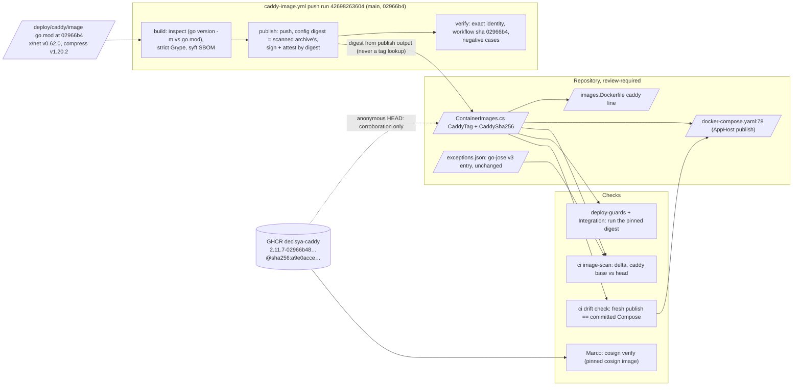

<!-- gate: G3 | verdict: PASS-WITH-NOTES | issue: #295 -->
# Threat delta: pin the Caddy image built with the x/net and compress overrides (issue #295)

- Date: 2026-11-17. Reviewer: security-reviewer (G3, Full tier), before G4.
- Scope: the planned re-pin of `caddy` from the #225 image to the image that `caddy-image.yml` published from `main` at the #265 merge. The change touches `ContainerImages.cs` (`CaddyTag`, `CaddySha256`, the comment above them), `.devcontainer/engine/images.Dockerfile:28-29` and `deploy/compose/docker-compose.yaml:78` (fresh publish). No product module, endpoint, token, cookie, tenant flow, SQL, scan policy, exception or workflow changes, so BOLA, tenant filters, validation, JWT validation, sessions and the AI lanes are not re-audited.
- Inputs, all read as data: the manifest `docs/ai/pipeline/295.md` (facts and Marco's approvals of 2026-11-17); the orchestrator's facts in the G3 request; the #225 precedent (`docs/ai/pipeline/225.md`, `docs/security/threat-models/225-caddy-switch.md`); the #265 G3 `image-scan-drift-265.md` (ruling 3, T265-06, D-2); ADR-0021 items 3, 5, 6, 7 and 8; `docs/runbooks/caddy-image.md` ("Verify an image", "Pin a published digest"). Code read: `.github/scripts/image_scan.py` (`IMAGES_LANE_RE`, `select_mode`, `changed_aliases`, `evaluate`, `compare_alias`); `.github/scripts/caddy_image.py` (`derive_flags`, `cmd_verify_command`); `.github/workflows/caddy-image.yml` (triggers); `.github/workflows/ci.yml` (the Compose drift check); `.github/image-scan/exceptions.json`; `deploy/caddy/image/go.mod`; `tests/Decisya.Identity.Tests/ContainerImageParityTests.cs`.
- Repository facts I checked myself:
  - `git log` gives the full hash of the #265 merge, `02966b4890d2d7098c9d5651151463b70506bc84`. It equals the 40 hex in the new tag.
  - On `origin/main`, the last commit that touches a `caddy-image.yml` push path (`deploy/caddy/image/**`, the workflow, `caddy_image.py`) is `02966b4`. No later push image was published, so this pin is the newest push build.
  - `deploy/caddy/image/go.mod` at HEAD: `golang.org/x/net v0.62.0` and `github.com/klauspost/compress v1.20.2` (both `override … #265`), `go-jose/v3 v3.0.5`, `go-jose/v4 v4.1.6`, Caddy `v2.11.7`.
- Citations of the live pin: only the three files above. `.claude/tests/test_image_scan.py:299` holds `8930453…` as a synthetic `OwnBuildTests` fixture, not a pin. It needs no change, and it sits under the locked core. No guard or test in `tests/`, `deploy/tests/` or `.github/` names the old digest.
- Ids: T295-xx (threats), M295-1 to M295-4 (MUSTs), S295-x (SHOULDs). ASVS 5.0 ids as in the earlier deployment models: V15.1.1, V15.2.1, and section-level V15.2 and V13.1.
- I found no High or Medium in unchanged code to escalate.

## Verdict

**PASS-WITH-NOTES.** No High is left open. The change is a digest move inside an existing, reviewed mechanism (ADR-0021 item 6, first used in #225). It closes T265-06, the fixed x/net and compress Highs in the pinned LAN-edge image, before ADR-0022's deadline of about 2026-11-23. The design has no flaw. The four MUSTs are about evidence and the exact file set, because for a digest pin the evidence is the control:

1. **M295-1.** Provenance: the digest comes from push run 42698263604's publish output, and Marco runs his own `cosign verify` before G6.
2. **M295-2.** Content: the SBOM of the pinned digest shows the #265 build list, and the scan shows only the excepted go-jose v3 row.
3. **M295-3.** Exact file set: no policy, exception, workflow or build-input change, and the Compose file comes only from a fresh publish.
4. **M295-4.** CI and post-merge evidence: delta mode, runtime tests on the new digest, and the Done-when scan.

## Data flow and trust boundaries (delta)

- **TB-A, GHCR to the pin (changed reference, same mechanism).** The digest is immutable. The tag is mutable in GHCR, but it is only a label. The signature binds the digest to `caddy-image.yml@refs/heads/main`, trigger `push`, at the workflow sha that `derive_flags` takes from the tag (`caddy_image.py:413-422`). A tag rewritten onto another genuine digest therefore fails verification, unless that digest was also signed at `02966b4`.
- **TB-B, exceptions to the scan decision (unchanged).** `caddy` is an own build. `compare_alias` and `scan_targets` call `evaluate()` without a tag state (`image_scan.py:1024-1026`), so the tag-moved rule (`:688-689`) never applies to `caddy`. The go-jose v3 entry matches on `(image, package, id)` = (`caddy`, `github.com/go-jose/go-jose/v3`, `GHSA-mgcc-cww5-fp2q`) (`:680`), not on a digest. Its finding is `not-fixed`, so the "a fix is now available" path does not void it. Its justification already covers "the pinned … image and every build from deploy/caddy/image", and states that the #265 overrides leave the component path unchanged. So it applies to the new digest as written, until 2026-12-09.
- **TB-C, the AppHost model to Compose (unchanged).** `ComposeStack.cs` writes the constants into Compose. `ci.yml:602-614` fails when a fresh publish differs from the committed file. `ContainerImageParityTests` (`:131`) requires the three files to be equal.

## Analysis

### 1. Provenance of the new digest

- The chain is the #225 chain:
  - `build` binds the binary to `go.mod` at the build commit (`inspect`, `go version -m`);
  - `publish` binds the pushed digest to that archive ("config digest equals the scanned archive's", in the run log);
  - the signature and the CycloneDX attestation bind the digest to the workflow, the trigger and the commit;
  - `verify` re-checks that in CI with negative cases.
- What CI cannot give is an independent consumer check. ADR-0021 item 6 and the runbook make Marco's local `cosign verify` the pin-time control, as in #225 (M225-4, M-2 e). `stackctl up` does not run it (S-10, backlog). That is an accepted residual and not a regression (T295-05).
- The orchestrator's anonymous registry HEAD returned the same digest. That is a tag lookup, which the pin rule forbids **as the source** (`caddy-image.yml:10-12`). It is acceptable as corroboration only, and the record must say which value was pinned and from where (M295-1).

### 2. Content: the #265 build list is in the image

- The Done-when says "built from #265's `go.mod`". The tag's commit is `02966b4`, and the signature's workflow-sha flag makes that binding cryptographic. The scan also no longer reports GO-2026-6860 or GO-2026-6865.
- A missing finding is not proof of a version, though. A short SBOM record closes the gap at no cost (M295-2): the components of the pinned digest, from the image's own SBOM.

### 3. This PR's CI behaviour

- Changed images-lane paths: `ContainerImages.cs` (`PIN_FILE`) and `images.Dockerfile` (`PARITY_FILE`) only. `select_mode` therefore returns **delta** (`:838`).
- `changed_aliases` returns `caddy` only. Its base reference (the #225 image) is in the same repository, so the base side is scanned:
  - the head shows 0 new blocking findings and 1 excepted (go-jose v3);
  - x/net and compress appear only at the base, and are logged as "fewer raw matches at the head" because the reference changed (`:1081-1082`).
- Keycloak's guava is not scanned on this PR.
- If any other images-lane file changes, the mode goes to gate-change or full. In full mode guava blocks, and that creates pressure toward a bypass (the T265-08 class). M295-3 fixes the file set.
- `caddy-image.yml` does not run on this PR: none of its `pull_request` paths change. That is correct, because nothing is built.
- Runtime evidence on the new digest comes from the jobs that run the pinned image:
  - `deploy-guards`: `deploy/tests/test_caddy_image_tools.py`, with `nc`, BusyBox `wget` TLS against `tls internal`, and the key-ring scripts;
  - the `Category=Integration` `CaddyRootTrustTests` in `Decisya.Api.Tests` and `Decisya.Bff.Tests` (Testcontainers, by digest).

### 4. Compose and devcontainer parity

- Compose is generated. A hand edit would pass review but fail `ci.yml`'s drift check. The control exists, so M295-3 only requires the drift check to be green and the regeneration to be recorded.
- The `images.Dockerfile` line keeps the strict `FROM <ref>@sha256:<64> AS caddy` form that `sandbox.py` parses. Its comment is a single `#` line.
- `.devcontainer/**` changes, so the issue runs on the host, as the manifest already records.

### 5. Held Dependabot PRs (#312, #308, #306)

- Each one, once merged, publishes a new push image that nothing pins. An unpinned image is neither deployed nor scanned, so that is not a finding.
- Holding them until this merges keeps "newest push build" equal to "pinned build" for this PR.
- Each later merge needs its own pin issue under the same procedure.
- #312 (Caddy 2.11.9) is also a go-jose v3 voiding condition to re-check ("a Caddy bump that changes the component path"). That belongs to its own G3, not to this one.

## Threats

| Id | Element / flow | STRIDE | Threat | Severity | Mitigation | ASVS 5.0 id | Status |
| --- | --- | --- | --- | --- | --- | --- | --- |
| T295-01 | TB-A GHCR → pin | S, T | A digest that is not the push-run image is pinned: a typo, a `dryrun-` image, a digest read from a moved tag, or an image signed under another identity | Medium (if missed) | Digest only from run 42698263604's publish output; Marco's local `cosign verify` with the printed command (`derive_flags` takes the workflow sha from the tag); parity test tag regex; verify job green | V15.2, V15.2.1 | Open, fix-now (M295-1) |
| T295-02 | Pinned image content | T | The pinned image does not carry x/net v0.62.0 and compress v1.20.2, or carries an unexpected module, while the scan reads clean | Low | Signature binds commit `02966b4`, whose `go.mod` has the overrides; the build's `inspect` binds the binary to `go.mod`; M295-2 SBOM record; scan with one excepted row only | V15.2.1 | Open, fix-now (M295-2) |
| T295-03 | TB-B / CI mode | E, T | A stray change (an exception, `image_scan.py`, `ci.yml`, a build input) moves the PR to gate-change or full mode, or edits the go-jose approval record, and invites a bypass or voids the approval | Medium (if done) | M295-3 exact file set; `select_mode` code constants; review-required paths | V15.1.1, V13.1 | Open, fix-now (M295-3) |
| T295-04 | TB-C Compose | T | A hand-edited Compose line differs from the AppHost model, or from the other two files | Low | `ci.yml` drift check; `ContainerImageParityTests` three-way equality; M295-3 | V13.1 | Mitigated by existing checks |
| T295-05 | Deploy | S, T | The digest is deployed without a signature check at `stackctl up`; verification is a runbook step only | Low | Runbook "Verify an image"; Marco's pin-time verify (M295-1); S-10 in backlog | V15.2 | Accepted residual (no regression) |
| T265-06 | LAN edge (Caddy): x/net GO-2026-6860, compress GO-2026-6865 | D, T | Fixed Highs stay in the pinned edge image | High (pre-auth edge), not exposed today | This PR; deadline about 2026-11-23 (ADR-0022) | V15.1.1, V15.2.1 | Closed by this PR once M295-4's post-merge scan shows no blocking `caddy` row |
| T265-07 | LAN → Caddy, go-jose v3 | D | JWK parsing becomes reachable before authentication | Low (not reachable) | #212/#265 premises unchanged (Caddy v2.11.7, same module set); entry valid for the new digest without edits | V15.2.1, V13.1 | Accepted to 2026-12-09 (unchanged) |

## MUSTs (all fix-now; G4 implements them, G6 checks them)

- **M295-1 (Medium; T295-01). Provenance of the pinned digest.** Owners: the main session (manifest) and Marco (local verify and run check).
  - (a) The pinned values are exactly tag `2.11.7-02966b4890d2d7098c9d5651151463b70506bc84` and digest `sha256:a9e0accec488a48fd3316ae6b6d53424c1324d532669887dfd20b8d47336a777`, copied from the publish output of push run 42698263604. The manifest names that source, and records the anonymous HEAD only as agreeing corroboration.
  - (b) Marco confirms the run: event `push`, head sha `02966b4890d2d7098c9d5651151463b70506bc84`, conclusion `success`, with the `verify` job green (`cosign verify OK`, `cosign verify-attestation OK`, negative cases "failed as required").
  - (c) Marco runs the printed `cosign verify` (the `--runner docker` form, because cosign is not installed on the host). The output must say "Verification for ghcr.io/mpcs2013/decisya-caddy@sha256:a9e0acce…", with all three checks performed: claims validated, transparency-log entry verified, and certificate verified against the trusted CAs. The output must show the `https://sigstore.dev/cosign/sign/v1` payload and the `https://cyclonedx.org/bom` attestation payload, both with `docker-manifest-digest` equal to the new digest. If the attestation payload does not appear (it did in #225), Marco also runs runbook "Verify an image" step 4, `cosign verify-attestation --type cyclonedx`, with the same flags.
  - (d) The manifest records (b) and (c) before G6, shape only, as in `docs/ai/pipeline/225.md:34-38`.
- **M295-2 (Low; T295-02). The image carries the #265 build list.** Owner: the main session (manifest).
  - From the SBOM of the pinned digest, record these components: `pkg:golang/golang.org/x/net@v0.62.0`, `pkg:golang/github.com/klauspost/compress@v1.20.2`, `pkg:golang/github.com/caddyserver/caddy/v2@v2.11.7`, `pkg:golang/github.com/go-jose/go-jose/v3@v3.0.5`, `pkg:golang/github.com/go-jose/go-jose/v4@v4.1.6`, and the `stdlib` version. Use the syft SBOM the scan already makes, or the run's `inspect` lines (`go version -m`).
  - Record the scan already done with Grype v0.120.0 (DB build time stated): exactly one High or Critical, go-jose v3 GHSA-mgcc-cww5-fp2q, `not-fixed`, excepted, and no x/net or compress row.
  - If any version differs, stop and report. Do not pin.
- **M295-3 (Medium; T295-03, T295-04). Exact file set; no policy change; Compose from a fresh publish only.** Owners: platform-dev (`ContainerImages.cs`), devops (`images.Dockerfile`, Compose), the main session (single commit).
  - Changed paths are exactly: `src/Decisya.AppHost/ContainerImages.cs` (`CaddyTag`, `CaddySha256` and the comment above them; `CaddyRegistry` and `CaddyImage` unchanged), `.devcontainer/engine/images.Dockerfile` (the caddy comment and `FROM` line), `deploy/compose/docker-compose.yaml` (line 78 only, written by the AppHost's own `--operation publish --step publish`, never by hand), the manifest, and docs.
  - Not changed: `.github/image-scan/exceptions.json` (the go-jose v3 entry and its single approval stay byte-identical), `image_scan.py`, `caddy_image.py`, `release_images.py`, `ci.yml`, `caddy-image.yml`, `dependabot.yml`, `deploy/caddy/**`, every test, the ruleset and required checks.
  - The Compose diff is the one image line. Any other line in the regenerated file is a stop-and-report, not a commit.
  - Commit type `fix(deploy)` (ADR-0021 item 6), so the release tag carries the pin.
- **M295-4 (Low, process; T265-06). CI and post-merge evidence.** Owners: the main session (manifest, G7 body) and Marco (runs and reads the checks).
  - Before G6, the manifest records:
    - the PR's `image-scan` run id: mode `delta`, `caddy` the only changed alias, base `trusted`, head 0 new blocking and 1 excepted (go-jose v3);
    - `deploy-guards` green, with `test_caddy_image_tools.py` run on the new digest (not skipped);
    - the Compose drift check and `ContainerImageParityTests` green;
    - the `Category=Integration` jobs green (`CaddyRootTrustTests` in Api and Bff run the new image).
  - After the merge, for the Done-when: a scheduled or `workflow_dispatch` `image-scan` on `main` with no `FAIL` row for `caddy` and go-jose v3 `excepted`. Other aliases' rows (guava, the Postgres drift after 2026-11-22) are out of scope and stay as recorded elsewhere.

## SHOULDs and backlog

- **S295-1 (fix-now, a few lines in changed files).** Update the comment in `ContainerImages.cs:75-78` to name #295, push run 42698263604 on `main` `02966b4` (build, publish and verify green), the digest's source (publish output), and the pointer to Marco's verify in `docs/ai/pipeline/295.md` (ADR-0021 item 6, "a comment naming the workflow run and the verify result"). Keep one history line: "Earlier pin (#225): 2.11.7-8930453…@sha256:aa8e6844…". Do the same in the `images.Dockerfile:28` comment.
- **S295-2.** Merge the held Dependabot PRs (#306, #308, #312) only after this PR. Each publishes a new image that needs its own pin issue under this procedure. #312 (Caddy 2.11.9) also re-checks the go-jose v3 component path, a voiding condition, in its own G3.
- **S295-3.** The G7 PR body states the source of the digest (the publish output, not a tag lookup), the verify result, the scan mode (delta), and that `exceptions.json` is unchanged and the go-jose v3 entry applies to the new digest until 2026-12-09.
- Carried, unchanged (already in backlog): S-10 (`stackctl up` runs the `cosign verify` itself), S225-1 / #265 S-2 (encode the go-jose voiding conditions as guards).

## Always-check items

- **BFF cookies, token never in the browser, antiforgery; JWT validation; BOLA and tenant filter; validation and SQL:** not touched.
- **Secrets and logs:** no secret enters the change. The verify output is recorded by shape and digest only. No address appears in this document.
- **Dependencies:** no NuGet, npm or Go module is added. The only new artifact is our own signed image, already scanned: 0 blocking, 1 excepted (go-jose v3, `not-fixed`, approved under #265 to 2026-12-09).
- **CI and release:** no workflow, action or token permission changes. The pin rides a `fix(deploy)` release (ADR-0021 item 6).
- **AI lanes:** not touched.
