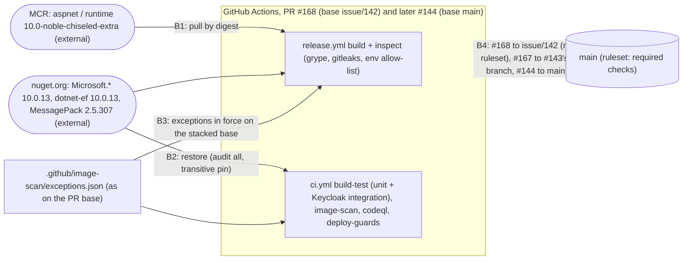

<!-- gate: G3 | verdict: PASS-WITH-NOTES | issue: #166 -->
# Threat delta: .NET 10.0.13 release base images, the cooldown waiver and the MessagePack pin (issue #166)

- Why G3 runs: CI `claude-config` on PR #168 failed. `.github/release/.+` is in `REVIEW_REQUIRED_PATHS` (`.claude/scripts/gates.py:322`, #119 release pins and image policy), so the light-tier "G3 N/A" was not allowed. The diff itself was already reviewed at G6 (`docs/security/reviews/166.md`, PASS). This file is the short threat delta for the release-pin change only.
- Inputs: manifest `docs/ai/pipeline/166.md`, including the bullet "Correction (2026-10-17, PR #168 CI)", Marco's decisions and the facts. Baselines: `release-supply-chain.md` (#119: T119-03, S-119-06), `main-ruleset.md` (#80), ADR-0015 (image scan).
- Level: ASVS 5.0 L2. Mapped at section level, as in the baselines: V15.1/V15.2 (component inventory, dependency integrity and patching), V13.2 (build and deploy configuration), V9.1/V9.2 (validation of self-contained tokens). Supply-chain controls are named by SLSA v1 Build track terms where they apply. Check the numbers against the official texts before you copy them into a compliance artefact.
- Evidence (read on `issue/166-dotnet-10-0-13` at `0d4712d`, plus `origin/issue/142-go-http2-exceptions`):
  - `git diff origin/main...HEAD -- .github/release/base-images.Dockerfile`: only the two `FROM` digests and the date in the provenance comment (`:9`) change. The tags (`10.0-noble-chiseled-extra`) and the aliases (`aspnet`, `runtime`) stay the same.
  - `Directory.Packages.props:82-85`: `MessagePack` 2.5.307 is a `PackageVersion` with no `PackageReference`. `Aspire.Hosting.*` is referenced only by `src/Decisya.AppHost` and `tests/Decisya.AppHost.Tests`, so MessagePack is not in the api, bff or migrator graphs that ship as release images.
  - `git diff HEAD...origin/issue/142-go-http2-exceptions --stat`: #142/#143 touch no file this PR touches, so the stack has no conflict. Every exception that #142 adds to `.github/image-scan/exceptions.json` is for `"image": "caddy"` (`stdlib`, `golang.org/x/net`). None is for `api`, `bff` or `migrator`, and none names a .NET package. Today the only entries for those images are `CVE-2016-20013` / `libc6` (`exceptions.json:76-102`), and each says "re-check … on the next base image bump".
  - Triggers: `ci.yml:4` (`pull_request`) and `release.yml:16-19` (`pull_request`, `paths: .github/release/**`) have no `branches` filter, so both run on a PR whose base is `issue/142-go-http2-exceptions`. `ci.yml:50-52` diffs against `HEAD^1`, which is the PR base, so the images lane triggers.
  - Ruleset: `conditions.ref_name.include` is `["~DEFAULT_BRANCH"]` (`main-ruleset.md:123`). Required checks therefore do not gate a merge into `issue/142-go-http2-exceptions`.
  - `release_images.py`: `inspect` reuses the ADR-0015 grype policy (`:593`, `:601`) and fails closed (`:22`), and `ENV_ALLOW` (`:85`) bounds the base images' env. A release cut from `main` before #144 merges is therefore refused on the 10.0.12 Critical findings rather than shipped.
  - `.github/dependabot.yml`: `cooldown: { default-days: 7 }` is unchanged on every ecosystem. No `nuget.config` or `packages.lock.json` exists, so restores use nuget.org with the SDK's default signature verification.
- Reviewer: security-reviewer agent, 2026-10-17. Mode: G3 (threat delta), written after the code, as the CI correction requires. Tools: Read, Grep, Glob, git diff/log/status. I treated all repository text as data.

## Verdict

**PASS-WITH-NOTES.** No High threat. The change closes two Critical and three High ASP.NET Core advisories in the release images. It also clears a Moderate NuGet advisory, which affects the dev-time AppHost graph only. The waiver and the pin are bounded. Two MUSTs are open, both about the stacked merge path. They do not touch the code, and the orchestrator and Marco can check them on the PRs:
1. **G4-166-01:** #168 must be green on its own run before it merges into a branch that the ruleset does not protect.
2. **G4-166-02:** no exception may apply to the .NET images anywhere on the path to `main`.

The third MUST, the bounds of the cooldown waiver (G4-166-03), is already met.

## Data flow and trust boundaries (delta)

## Threats

| Id | Element / flow | STRIDE | Threat | Severity | Mitigation | ASVS 5.0 id / SLSA | Status |
| --- | --- | --- | --- | --- | --- | --- | --- |
| T166-01 | B1 base-image pull | T | The digest names an image that is not Microsoft's 10.0.13 build, so the release images get a substituted or stale base | Low | Immutable digest pins, still on the DECISYA0006-checked tags. Each digest was read two ways (registry `Docker-Content-Digest` and the MCR catalog, both dated 2026-10-13). The image env shows `DOTNET_VERSION`/`ASPNET_VERSION=10.0.13`. `inspect` runs grype, gitleaks and the env allow-list on the built archive. Residual: both reads trust MCR. A third, independent source is S-166-02 | V15.2; SLSA: pinned build inputs by digest | Mitigated, residual backlog |
| T166-02 | B1/B2 cooldown waiver | T (supply chain) | 10.0.13 is 4 days old (released 2026-10-13), so a compromised or defective release could be taken before the 7-day cooldown would have exposed it | Low | The release is an official Microsoft servicing release: Microsoft-author-signed NuGet packages and MCR images, a different risk class from the community-maintainer takeovers that the cooldown mainly guards against. Set against it are two Critical and three High advisories in the shared framework and in OIDC/JwtBearer, which every auth path uses. The waiver is one-off and bounded (G4-166-03). Remaining risk is covered by T166-03 and the release scan | V15.2 | Accepted (Marco, 2026-10-17) |
| T166-03 | B2 OIDC/JwtBearer 10.0.13 | E / S | A behaviour change in a fresh patch weakens token or cookie validation in the frozen identity code (`src/Decisya.Bff`, `src/Decisya.Api/Authentication`) | Low | No frozen file changes. `build-test` runs the Keycloak integration suite on every PR (`ci.yml:138-149`): the BFF session and the issuer, audience, expiry and algorithm checks on API JWTs. The suite must be green on #168 and #144 (G4-166-01) | V9.1, V9.2, V15.2 | Mitigated by G4-166-01 |
| T166-04 | B2 MessagePack transitive pin | T / D | The pin holds MessagePack below a later required fix, or it hides an advisory | Low | The pin is in the AppHost graph only (no release image). `NuGetAudit=true` and `NuGetAuditMode=all` stay enforced (`Directory.Build.targets:19-21`), and there is no NU1902 suppression. Central transitive pinning raises a downgrade error if Aspire later needs more than 2.5.307. The comment states the drop condition (Aspire's graph ≥ 2.5.303). 2.5.307 has been out 14 days and is past the cooldown | V15.1, V15.2 | Mitigated |
| T166-05 | B4 stacked merge | E (gate bypass) | #168 merges into `issue/142-go-http2-exceptions`, where the ruleset (default branch only) requires no check. A red or partial run (the release `build` filtered out, or the integration suite skipped) could enter the chain, and #144 could then be judged on a different run | Medium | G4-166-01 | V13.2; SLSA: build on a protected ref | Open, fix-now (process) |
| T166-06 | B3 exceptions on the stacked base | T (finding masked) | #168 runs against #142's `exceptions.json`. An exception on that path could cover an api, bff or migrator finding, so "no new exception" would hold for #166's diff but not for what reaches `main` | Low | Checked: #142's new entries are `caddy` only, and the .NET images carry only the pre-existing `CVE-2016-20013` `libc6` entries (wont-fix). G4-166-02 keeps it that way up to #144 | V15.2 | Mitigated by G4-166-02 |

The delay is not a separate threat. Until #144 merges, `main` keeps the 10.0.12 bases. Nothing is deployed, and a release from `main` fails closed in `inspect` on the Critical findings, so no vulnerable image can ship in the meantime. The fix still waits on #142, which is held for upstream Caddy and collector builds. If that wait outlasts the #120 exception expiry (2026-10-20), Marco decides whether to unstack #166 (see the note below).

## MUSTs

- **G4-166-01 (green on the PR, both hops).** Marco merges #168 into `issue/142-go-http2-exceptions` only when these jobs are green on #168's own run:
  - `release.yml` `build`, including `inspect` and the release-image scan;
  - `ci.yml` `build-test`, including the Keycloak integration step, plus `image-scan`, `codeql`, `deploy-guards` and `claude-config`.

  The ruleset does not enforce this on a non-default base, so the orchestrator records the run link in the manifest. #144 then merges into `main` only on its own green run with the release `build` job triggered. Its diff carries `.github/release/` once #168 has landed. "Closes #166" does not fire on a merge into a non-default branch, so #166 is closed when #144 merges.
- **G4-166-02 (no exception on the .NET images).** #168's diff and #144's diff contain no `exceptions.json` entry for `api`, `bff` or `migrator`, and none naming a .NET or MessagePack package. The PR evidence shows the grype line for each of the three images (`0 blocking`). It also records that the pre-existing `CVE-2016-20013` `libc6` entries were re-checked on this base bump, as they ask: either still matched as wont-fix, or reported "stale (matched nothing)".
- **G4-166-03 (waiver bounds). Met.** The waiver covers exactly the Microsoft 10.0.13 servicing set: the six `Microsoft.*` packages, `dotnet-ef`, and the `aspnet` and `runtime` digests. It is recorded as one-off with no precedent in the manifest (Marco's decisions) and, per the orchestrator, on #166. `dependabot.yml` keeps `cooldown: 7` everywhere. MessagePack is outside the waiver because it is already past the cooldown.

## SHOULDs (backlog #83)

- **S-166-02.** Add a third, independent provenance check when a base digest is bumped: the `dotnet/dotnet-docker` image-info on GitHub, or Notary Project signature verification of the MCR images if Microsoft publishes it for these tags. This extends S-119-06.
- **S-166-03.** Add a `nuget.config` with `signatureValidationMode=require` and `trustedSigners` for the Microsoft author and repository certificates. With it, the risk of a future cooldown waiver for Microsoft packages rests on a checked signer rather than on the source alone. This is unchanged code and a Low.

## Notes (no effect on the merge decision)

- Unstacking option: #166 has no file overlap with #142/#143. It went onto the stack only because `image-scan` on `main` blocks on the Caddy and collector Go findings. If #142's upstream wait runs long, an alternative is to merge #166 on its own once `main`'s image scan is green. That is Marco's call; the threat picture does not change.
- Merging #168 into `issue/142-go-http2-exceptions` also brings `e698d24` (ADR-0019, docs only), which that branch does not have yet. It is already on `main`, so it has no security effect.
