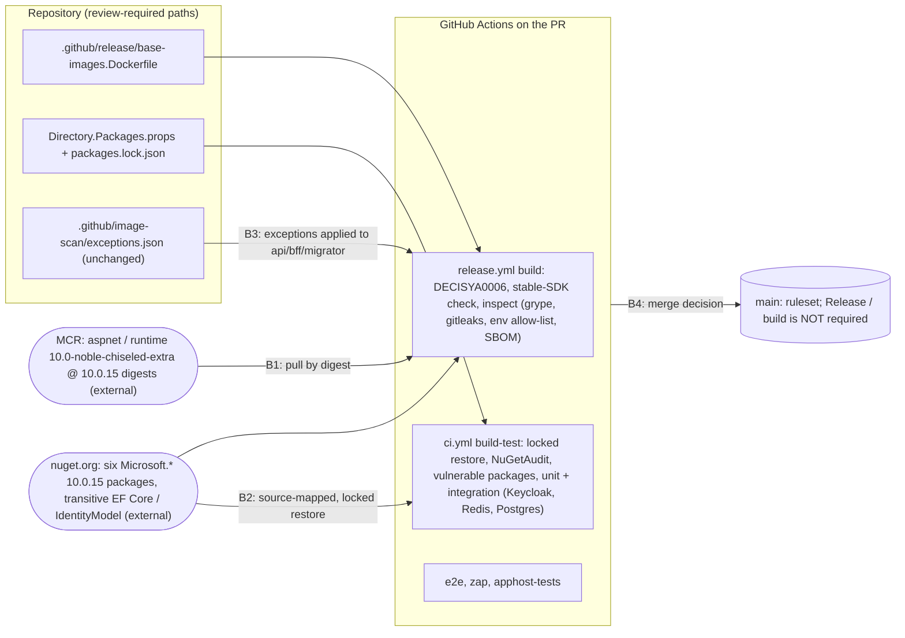

<!-- gate: G3 | verdict: PASS-WITH-NOTES | issue: #320 -->
# Threat delta: .NET 10.0.15 release base images and servicing pins (issue #320)

- Tier: full; class ci-tooling (Marco 2026-11-18). Host run. No new package id is planned.
- Scope: this is a threat delta for the planned change, not a full model. It covers `.github/release/base-images.Dockerfile` (two `FROM` digests and the provenance comment), the six `Directory.Packages.props` lines, and the regenerated lock files. Areas the change does not touch are not re-audited.
- Assurance: ASVS 5.0 Level 2 (addendum). V6, V7 and V10 code does not change, but the BFF's OIDC handler package and the Api's JwtBearer package move one servicing level, so the delta checks how that is proved unchanged.
- Inputs read on `issue/320-dotnet-10-0-15` (no committed diff against `origin/main`; only the manifest is untracked):
  - the manifest `docs/ai/pipeline/320.md` (facts, the 10.0.15 digests, Marco's approvals of 2026-11-18, the `dotnet-quality: preview` backlog discovery);
  - `.github/release/base-images.Dockerfile`, `.github/scripts/release_images.py` (`parse_pins`, `check_stable_sdk`, `cmd_build`, `check_config`/`ENV_ALLOW`, `cmd_inspect`, `_grype`), `Directory.Build.targets` (DECISYA0001-0009, DECISYA0006), `.github/workflows/release.yml` (triggers, permissions), `.github/workflows/ci.yml` (restore, vulnerable-package step, the integration loop), `.github/dependabot.yml`, `.github/image-scan/exceptions.json`, `.github/scripts/image_scan.py` (expiry handling);
  - `Directory.Packages.props`, `dotnet-tools.json`, `global.json`, the `src/Decisya.Api` and `src/Decisya.Bff` lock files (JwtBearer, OpenIdConnect, Ostium, `Microsoft.IdentityModel.*` entries), and the `.csproj` references to the six packages;
  - precedent: ADR-0017, `docs/ai/pipeline/166.md`, `docs/security/threat-models/dotnet-10-0-13-messagepack.md`, `docs/security/threat-models/aspire-13-6-5-318.md`.
- Not read: the advisory texts and the registries. I fetched nothing from the network. The advisory and digest facts come from the manifest.
- Reviewer: security-reviewer agent, 2026-11-18. Mode: G3 threat delta, before code. Repository text was treated as data.
- ASVS ids are named at the level used by the baselines (V15.1, V15.2.1, V15.2.4, V13.1, V9.1, V9.2, V10). Check them against the official 5.0 text before copying them into a compliance artefact.

## Verdict

**PASS-WITH-NOTES.** No High threat remains open. The base-image move closes three High ASP.NET Core shared-framework advisories (GHSA-67wp-ghc2-fw2g, GHSA-wr8v-9x5q-ggcm, GHSA-x33c-w48q-qrgc) in the api and bff images. The two digests are past the 7-day cooldown, so no waiver is needed. Five MUSTs bind G4 and the merge. Two decisions go to Marco (D-1, D-2).

Facts the delta rests on:
1. The advisories are in `Microsoft.AspNetCore.App.Runtime.*`, the shared framework. The release images run framework-dependent (`--self-contained false`, `release_images.py:516`), so the shared framework comes only from the `aspnet` base. The base-image bump alone closes the advisories in the shipped images. The six package bumps are alignment (Done-when 2), not the fix. A rollback of the package lines alone would not reopen the advisories.
2. `Microsoft.AspNetCore.Authentication.JwtBearer` reaches the Api only transitively: `Ostium.Authentication.Jwt` 0.2.0 declares 10.0.12, and central transitive pinning lifts it (`src/Decisya.Api/packages.lock.json:384-388`, `CentralTransitive`, requested `[10.0.13, )`). The BFF references OpenIdConnect directly (`src/Decisya.Bff/packages.lock.json:18-22`). The token validation code itself is `Microsoft.IdentityModel.*` 8.19.2, resolved as plain `Transitive` (not centrally pinned). It moves only if the 10.0.15 packages raise their floor.
3. `Microsoft.EntityFrameworkCore.Design` is referenced only by the Migrator (`PrivateAssets="all"`). In that graph it lifts EF Core itself, so the migrator image's EF Core assemblies move 10.0.13 → 10.0.15. The test projects that align EF Core through Design follow the same way.
4. `dotnet-tools.json` pins `dotnet-ef` at 10.0.13 with `rollForward: false`. The plan does not list it, but the issue's Done-when reads "every .NET pin that has a 10.0.15 version" (see S-1 and D-2). No workflow or test runs `dotnet-ef`.
5. `Release / build` runs on this PR because `.github/release/**` is in `release.yml`'s `pull_request.paths`. It is not a required check (manifest).
6. The `CVE-2016-20013` `libc6` exceptions for `api` and `bff` expire on **2026-11-23**; the migrator's on 2026-12-31. Each says "re-check at expiry or on the next base image bump". `image_scan.py:1090-1093` reports an expired entry as "not applied" and a non-matching one as "stale (matched nothing)".

## Data flow and trust boundaries (delta)

## Threats

| Id | Element / flow | STRIDE | Threat | Severity | Mitigation | ASVS 5.0 id / SLSA | Status |
| --- | --- | --- | --- | --- | --- | --- | --- |
| T320-01 | B1 digest provenance | T | A digest that is not Microsoft's 10.0.15 build becomes the release base | Low | Immutable digest on the DECISYA0006-checked tag; index digest equal for `10.0.15-noble-chiseled-extra` and the floating tag; image env `DOTNET_VERSION`/`ASPNET_VERSION=10.0.15`; `inspect` re-scans the built archive. Residual: both "ways" in the manifest are the same registry response (header and body hash), which proves transfer integrity, not an independent source (S-2) | V15.2.4; SLSA: pinned inputs | Mitigated; S-2 |
| T320-02 | B1/B2 cooldown | T (supply chain) | A fresh release is taken before defects or compromise surface | Low | 10.0.15 released 2026-11-10; image configs created 2026-11-10 16:01 UTC; NuGet packages published 2026-11-10; the 7-day cooldown (ADR-0014) ended 2026-11-17. No waiver. The config `created` time is a proxy for the push time; it is consistent with the release date | V15.2.1 | Met |
| T320-03 | Release guard code | E (gate weakened) | The edit touches `release_images.py` (`FROM_RE`, `REF_RE`, `ENV_ALLOW`, `check_stable_sdk`, the grype policy), DECISYA0006, `release.yml` or `tools.Dockerfile` in passing, for example to "make the build green" | Medium if it happened | M-1: the changed-file list and the Dockerfile diff are bounded | V13.1; SLSA: build integrity | Open → M-1 |
| T320-04 | B4 merge on a non-required check | E (gate bypass) | `Release / build` is not required, so the PR could merge while it is red, cancelled or not triggered, and the next release would fail closed or a scan regression would go unseen | Medium | M-2: Marco merges only on a green `Release / build` on the PR head, with the inspect evidence recorded | V15.2.1, V13.1 | Open → M-2 |
| T320-05 | B3 exception masking | T (finding hidden) | An exception added or widened for `api`, `bff`, `migrator` or a .NET package masks one of the three advisories or a new base finding | Medium | M-2: no `exceptions.json` change in this PR; grype lines per image recorded; libc6 entries re-checked as their text asks | V15.2.1 | Open → M-2 |
| T320-06 | B2 OIDC (BFF) and JwtBearer (Api via Ostium) 10.0.13 → 10.0.15 | S / E | A servicing change alters token validation (issuer, audience, expiry, algorithm), the OIDC callback (correlation/nonce cookies, PKCE) or cookie handling in frozen identity code | Low | No frozen file changes. Unit suites (`TokenValidationTests`, `JwtBearerOptionsPinnedTests`, `OidcChallengeShapeTests`, `SessionFixationTests`, `TicketProtectionTests`, antiforgery tests) and the integration loop (`Decisya.Identity.Tests`, `Decisya.Bff.Tests`, `Decisya.Api.Tests` incl. `ApiKeycloakAuthenticationTests`) plus e2e (real Keycloak sign-in) and zap prove behaviour. M-5 | V9.1, V9.2, V10, V7 | Mitigated by M-5 |
| T320-07 | B2 transitive moves | T | The bump pulls a new package id into the Api, BFF or Migrator graph, or silently moves `Microsoft.IdentityModel.*` (the actual token-validation library) | Low | M-4: per-lock-file list of moved, added and removed ids; IdentityModel moves named explicitly; any new id stops the run | V15.2.1, V15.2.4 | Open → M-4 |
| T320-08 | B2 restore integrity | T | Lock files regenerated through another source, or an NU error hidden by a suppression or a switched-off property | Low | `NuGet.config` `<clear/>` and source mapping; DECISYA0001-0009; NuGetAudit `all` with warnings as errors; locked restore in CI. M-3 keeps them untouched | V15.2.4, V13.1 | Open → M-3 |
| T320-09 | SDK selection in the release build | T | A preview SDK builds the release images | Low | `check_stable_sdk` (`release_images.py:495-501`) fails closed on a non-`x.y.z` SDK; the Release log shows 10.0.404. The `dotnet-quality: preview` download is already in the backlog (Marco 2026-11-18) | V15.2.1 | Mitigated (existing); backlog |
| T320-10 | Dependabot docker ecosystem for `/.github/release` | – | A later Dependabot PR moves the digests without this review, or duplicates this one | Info | `dependabot.yml:148-158` unchanged: weekly, cooldown 7, majors ignored, prefix `fix` (so release-please ships the fix). Its PRs run `Release / build` and the same review-required gates. A duplicate open PR for the same digests is closed by Marco once this merges | V15.2.1 | No change needed |

No High threat is left without a mitigation. The three High advisories are closed by the change itself.

## MUSTs (for G4 and the merge; G6 checks them)

- **M-1. Bounded release diff, guards unchanged.**
  - `git diff origin/main...HEAD -- .github/release/base-images.Dockerfile` shows only: the `aspnet` digest → `sha256:cae5b962bfb786606def03d250c6a645cc98839095c89e806e4bd8978a68115b`, the `runtime` digest → `sha256:b64d614c3c1c440abe6d57f510c5a4cfc0ccd56a9b96f96c1503efe4a7ac3e56`, and the provenance comment (lines 9-10). The repositories, the tag `10.0-noble-chiseled-extra`, the aliases and the `FROM <ref> AS <alias>` shape stay the same, so `parse_pins` and DECISYA0006 accept them unchanged.
  - The comment names #320, 2026-11-18, the index digests read for both the `10.0.15-` and the floating tag, the 10.0.15 env, and "cooldown ended 2026-11-17, no waiver".
  - `git diff --name-only origin/main...HEAD` contains none of: `.github/scripts/release_images.py`, `.github/scripts/image_scan.py`, `Directory.Build.targets`, `Directory.Build.props`, `NuGet.config`, `global.json`, `.github/workflows/release.yml`, `.github/release/tools.Dockerfile`, `.github/release/gitleaks-image.toml`, `.github/image-scan/exceptions.json`, `.github/dependabot.yml`.
- **M-2. `Release / build` green on the PR head, with evidence, before merge.** Because it is not a required check, the orchestrator records the run link and these lines from the protected `inspect` log in the manifest, and Marco merges only on that green run:
  - `build: .NET SDK 10.0.4xx` (stable);
  - for each of `api`, `bff`, `migrator`: `grype <name>: … 0 blocking`, with no `FAIL` line for GHSA-67wp-ghc2-fw2g, GHSA-wr8v-9x5q-ggcm or GHSA-x33c-w48q-qrgc;
  - the `base.digest label` lines: `api` and `bff` show the aspnet linux/amd64 manifest `sha256:d7b46e22…`, `migrator` the runtime linux/amd64 manifest `sha256:e7e90bfc…` (this binds the built images to the reviewed digests);
  - the libc6 `CVE-2016-20013` re-check the entries ask for on a base bump: `EXCEPTED` (and at what severity) or "stale (matched nothing)" for each image. No `exceptions.json` change in this PR (see D-1).
- **M-3. Exact package set, restore integrity, nothing hidden.**
  - `Directory.Packages.props`: exactly the six `Version` attributes move to `10.0.15`. Comment edits are allowed; no other `PackageVersion` changes.
  - Lock files are regenerated only through the repository's `NuGet.config`: no `--source`/`--add-source`, no `NoWarn`, `WarningsNotAsErrors` or `NuGetAuditSuppress` for any NU code. If restore raises NU1109, NU1605 or NU19xx, stop and report the exact code.
  - G4 evidence: locked restore with `LOCKED_RESTORE=true` (no NU errors), `dotnet build -warnaserror`, and `dotnet list package --vulnerable --include-transitive` with no High or Critical, outputs recorded.
- **M-4. Lock-file evidence.** For each changed `packages.lock.json`, list every id whose `resolved` moved and every id added or removed. Expected:
  - `src/Decisya.Bff`: `Microsoft.AspNetCore.Authentication.OpenIdConnect` `Direct`, `[10.0.15, )`, resolved `10.0.15`;
  - `src/Decisya.Api`: `Microsoft.AspNetCore.Authentication.JwtBearer` `CentralTransitive`, `[10.0.15, )`, resolved `10.0.15`; `Ostium.Authentication.Jwt` and `Ostium.Backchannel` still `0.2.0` with an unchanged `contentHash`;
  - `src/Decisya.Infrastructure.Migrator` and the EF-aligned test projects: `Microsoft.EntityFrameworkCore.*` moving to 10.0.15 is expected;
  - `Microsoft.Extensions.DependencyInjection(.Abstractions)` at 10.0.15 wherever they appear.
  - Any `Microsoft.IdentityModel.*` or `System.IdentityModel.Tokens.Jwt` move is named with from → to in the PR body.
  - A new package id in the Api, BFF or Migrator graph stops the run and goes to Marco. A new id elsewhere needs a one-line justification in the PR body.
- **M-5. Authentication behaviour proved unchanged.** No file under `src/Decisya.Bff` or `src/Decisya.Api/Authentication` (Ostium freeze) changes. On the PR head, CI is green for:
  - `build-test`, including unit + architecture tests and the full Testcontainers integration loop (`Decisya.Identity.Tests`, `Decisya.Bff.Tests`, `Decisya.Api.Tests` and the module, persistence and migrator suites);
  - `e2e` (AppHost, real Keycloak sign-in, Firefox and Chromium), `zap`, `apphost-tests`, `image-scan`, `codeql`, `deploy-guards` and `claude-config`.
  - Locally before the PR (CLAUDE.md, a change that touches the Keycloak path): the pre-push unit filters plus the `Decisya.Identity.Tests`, `Decisya.Bff.Tests` and `Decisya.Api.Tests` integration runs, with bounded run times and full logs. CI is the authority for the 10.0.15 shared framework (see S-4).

## SHOULDs

- **S-1 (fix-now, Low, one line; see D-2).** Move `dotnet-tools.json` `dotnet-ef` 10.0.13 → 10.0.15, as #166 did with its servicing set. The Done-when wording covers it. Confirm on nuget.org that `dotnet-ef` 10.0.15 exists and was published 2026-11-10 (past the cooldown).
- **S-2 (G4 evidence, fix-now in the manifest).** Add one source independent of the registry response for each index digest: the MCR catalog API (as #166 used) or the `dotnet/dotnet-docker` image-info. Record the result in the manifest. The longer-term third-source rule (S-166-02) stays in the backlog.
- **S-3 (fix-now, Low, changed file).** Update the `Directory.Packages.props` comment at line 26 ("10.0.14 since #318 …") so it states the 10.0.15 servicing level and #320. The stale "10.0.13" comments in the test projects (`Decisya.Api.Tests.csproj:54`, `Decisya.ArchitectureTests.csproj:78`, `KeyScope.cs:9`, `Decisya.Infrastructure.Migrator.Tests.csproj:34-41`, `Decisya.Modules.Entitlements.Tests.csproj:22`) are not security-relevant. Fix them if those files are touched; otherwise add one #243 line. The frozen `TenancyDatabaseFixture.cs` comment stays as it is.
- **S-4 (G4 evidence).** Record `dotnet --list-runtimes` on the host with the local test results. Local runs use the host's shared framework, which may still be 10.0.13 or 10.0.14, so they do not show the 10.0.15 framework. If the host runtime is below 10.0.15, the three advisories also apply to the host's local AppHost runs. Updating the host runtime is Marco's step.

## Decisions for Marco

- **D-1. The libc6 exceptions for `api` and `bff` expire on 2026-11-23, five days from now.** After that date `image_scan.py` stops applying them. If grype still matches `CVE-2016-20013` on the 10.0.15 `aspnet` base at a blocking severity, `Release / build` goes red again for api and bff on every PR and on release.
  - Recommendation (option A): merge #320 before 2026-11-23, keep `exceptions.json` out of #320, and act on the M-2 re-check result in a separate small issue. Renew the entry (with a fresh G3) if it still matches; remove it if it is stale.
    - Risks: one more issue. If #320 slips past 11-23 and the entry still matches, its Done-when 1 cannot be met until that issue lands.
  - Option B: fold the renewal or removal into #320.
    - Risks: it widens a security-fix PR into an exception decision. G6 would then also review an exception change on the same images whose advisories this PR closes, which is the masking risk T320-05 guards against.
  - First, the orchestrator should make clear what its "the 10.0.15 `aspnet` none" grype result means: no blocking finding with libc6 `EXCEPTED`, or no libc6 match at all.
- **D-2. Include `dotnet-ef` 10.0.15 (S-1)?** Marco's 2026-11-18 approval lists the six `Directory.Packages.props` packages and the two digests, not `dotnet-tools.json`.
  - Recommendation: include it. The issue's Done-when wording covers it, #166 set the precedent, and it is an existing tool pin moving one servicing level.
    - Risks: one more review-visible file. No CI job runs `dotnet-ef`, so a defect would show only in local migration work.
  - Option: leave it at 10.0.13 and record in the manifest that Done-when 2 excludes tool pins.
    - Risks: the servicing levels split across the repository, and Done-when 2 is not met as written.

## Checks the orchestrator makes

At G4:
1. M-1: `git diff --name-only origin/main...HEAD` and the `base-images.Dockerfile` diff.
2. M-3: the `Directory.Packages.props` diff (six versions only), a locked restore, `dotnet build -warnaserror` and `dotnet list package --vulnerable --include-transitive`, with outputs recorded.
3. M-4: the moved, added and removed ids per lock file, with a Grep for `"Microsoft.AspNetCore.Authentication.(JwtBearer|OpenIdConnect)": {`, `"Ostium.Authentication.Jwt": {` and `"Microsoft.IdentityModel.` with their `resolved` lines.
4. M-5 local: the unit filters and the three identity-path integration suites (bounded, full logs), plus S-4's `dotnet --list-runtimes`.
5. S-1 and S-2, if taken: the `dotnet-ef` publication date and the independent digest read, recorded in the manifest.

On the PR:
6. M-2: the `Release / build` run link and the inspect lines (SDK, grype per image, base.digest labels, libc6 re-check).
7. M-5: `build-test` (with the integration loop), `e2e`, `zap`, `apphost-tests`, `image-scan`, `codeql`, `deploy-guards` and `claude-config` all green on the PR head.
8. D-1: the merge date compared with the 2026-11-23 expiry.
