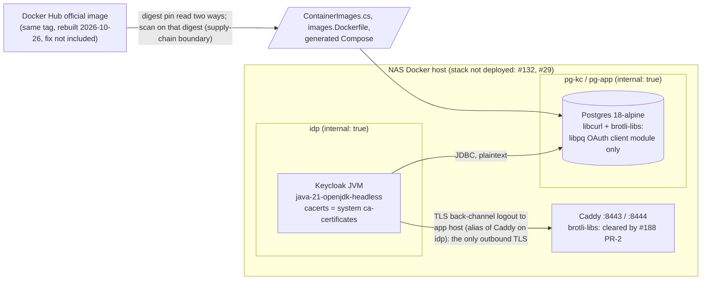

<!-- gate: G3 | verdict: PASS-WITH-NOTES | issue: #195 -->
# Threat delta: clear the 2026-10-26 image-scan drift (#195)

- **Scope.** This covers only the planned change:
  - new `keycloak` and (under route b) `postgres` entries in `.github/image-scan/exceptions.json`;
  - a conditional Postgres digest bump: `src/Decisya.AppHost/ContainerImages.cs`, `.devcontainer/engine/images.Dockerfile`, and the regenerated `deploy/compose/docker-compose.yaml`;
  - stacking this branch on #188's second PR, which clears Caddy.

  `image_scan.py`, ADR-0015, `ci.yml`, the ruleset, `test_stackctl.py` and every existing exception stay unchanged. Areas the change does not touch are not re-audited.
- **Sources read for this ruling:**
  - the manifest `docs/ai/pipeline/195.md` (origin FAIL lines, tags, Marco's decisions);
  - the #190 G3 `docs/security/threat-models/image-scan-keycloak-libc6-190.md`;
  - ADR-0015: the decision, items 2 and 3 of the 2026-10-06 amendment, and item 4 of the 2026-10-17 amendment;
  - the #183 G3 `docs/security/threat-models/image-zlib-curl.md` (§3, T-02, S-1, M-4);
  - `docs/security/threat-models/deployable-stack.md` (S-120-07, T120-12);
  - `exceptions.json` and its `$comment`;
  - `image_scan.py`: expiry is inclusive (`today <= expires_date`, line 623), and `added > today` is rejected (line 270);
  - `test_stackctl.py:691-706`;
  - `ContainerImages.cs`;
  - `images.Dockerfile`;
  - `docker-compose.yaml:3, 47, 58`;
  - `docker-compose.stack.yaml:91-135, 161-171, 292-320`;
  - `realm-decisya.json:181`, plus a search for `identityProviders`, `smtpServer`, `jwks`, `sector` and `request.uris` (none found).
- **Data from the main session (2026-10-26).** Used as data:
  - the Red Hat advisory text (CVSS preliminary);
  - the local scan of the `postgres:18-alpine` rebuild:
    - scanner: the pinned scanner `grype:v0.120.0@sha256:5c88961f…`, DB built 2026-10-26T06:38:44Z, `linux/amd64`;
    - image: index `sha256:10a5c69a83035ab5239f5620d708520e8b28f5aa1f2b20143e6024532edadfb5`, Alpine 3.24.3;
    - result: Critical 1 (`brotli-libs 1.2.0-r1` CVE-2026-111497, fix `1.2.1-r0`) and High 1 (`libcurl 8.22.0-r0` CVE-2026-92392, fix `8.23.0-r0`). **The rebuild does not carry the brotli fix.**

## Verdict

**PASS-WITH-NOTES.** G4 may start under M-1 to M-5.

- **Keycloak.** The CVE-2026-91403 exception is acceptable until 2026-11-02. #190's CVE-2026-114406 argument carries over unchanged, with one wording duty (M-1 b).
- **Postgres.** Scope point 2's condition fails, so no bump can clear the finding. Both routes are acceptable without an ADR-0015 amendment:
  - **(b), recommended:** bump to today's unfixed head under a cooldown waiver, then add time-boxed item-3 exceptions until 2026-11-02;
  - **(a):** wait.

  Route (b) needs Marco's waiver. If he does not give it, route (a) applies, and so does its no-waiver variant (b′) (ruling 2).
- **Caddy.** No exception is possible. #188's second PR is the only route.

I found no High or Medium flaw in unchanged code. The premises #190 relied on still hold on this branch (checked at the lines listed above).

## Data flow (unchanged from #190; the trust boundaries this delta relies on)

## Rulings

### 1. Keycloak CVE-2026-91403 (`java-21-openjdk-headless`): accepted to 2026-11-02

- **Same flaw, same store.** The advisory names the CA store of OpenJDK and the same eMudhra weak-key roots as CVE-2026-114406, under CWE-295 with the same CVSS vector. Red Hat states that the RHEL OpenJDK RPMs (non-portable builds, which is what the Keycloak UBI9 image carries) take their default store from `ca-certificates`. So 91403 is the JVM-side view of the same trust decision that #190 ruled on for 114406. The flaw is not a separate code path.
- **#190's argument carries over unchanged.**
  - Keycloak's only outbound TLS peer is the back-channel logout to the app host. The realm sets it at `realm-decisya.json:181`. The app host is an alias of Caddy's fixed address on `idp` (`docker-compose.stack.yaml:168-171`).
  - JDBC to Postgres is plaintext on `pg-kc` (`docker-compose.yaml:47`), so no CA store is used there.
  - The realm has no IdP, no SMTP server and no JWKS URL.
  - Keycloak sits only on the internal networks `idp` and `pg-kc` (`docker-compose.stack.yaml:101-103, 303-314`), so it has no egress.
  - A MITM needs a position on `idp`, where only Caddy and Keycloak sit and `NET_RAW` is dropped, or root on the host. Either is already a full compromise of the identity tier.
  - `KC_TRUSTSTORE_PATHS` (`docker-compose.yaml:58`) adds the Caddy root to the default store; it does not replace it.
  - Residual: **Low in context.**
- **The wording duty (the one difference from #190).** Red Hat's remedy is the fixed `ca-certificates`. The pinned `26.7.5` image (`37dbaf6f0722…`) still carries the unfixed `2025.2.80_v9.0.305-91.el9`. So the remedy is **not** in the image. The entry rests on reachability alone, and it must not read as "mitigated by the ca-certificates fix" (M-1 b).
- **Window.** `added` is the commit date (2026-10-26 or later) and `expires` is 2026-11-02, so the window is at most 7 days. That is within the `test_stackctl.py:700` cap and the 30-day check at `:703-706`. Expiry is inclusive. No new test pin is needed.
- **The #190 entries stay as they are.** CVE-2026-114406 now has a Red Hat fix. Its #190 entry is an `rpm` entry spanning 9 days, so item 3 keeps it while `26.7.5` still resolves to the pinned digest. It is neither edited nor renewed here. If the tag ever moves, item 3 ends it at once and fails closed. M-2 makes the green run show this.

### 2. Postgres: route (b) is accepted and recommended; route (a) remains acceptable

**Where the pin stands.**
- The pinned `83148c0bc09e…` and the new head `10a5c69a8303…` both carry `brotli-libs` 1.2.0 (Critical) and `libcurl` 8.22.0 (High, now matched with today's DB).
- The tag has moved, so item 3 fails closed for the pinned digest: neither finding can be excepted there. No digest available today fixes either finding.

**In-context exposure: Low, and the same under both routes.** It is the same packages at the same versions in both digests.
- In this image, `libcurl` is pulled in for the libpq OAuth client module.
- `brotli-libs` is reached only through libcurl's response decoding.
- The server does not use the client-side OAuth flow, and no connection in the repository uses OAuth parameters (#183 T-02, S-1).
- Postgres sits only on internal networks, and the stack is not deployed.

So the choice between routes is about the supply-chain risk of the waiver against what route (a) blocks. Exposure to these two CVEs does not differ.

**Route (a), wait: acceptable, not recommended.**
- **How long it lasts.** Postgres stays red until docker-library publishes an `18-alpine` rebuild that carries `brotli-libs` 1.2.1-r0 or later and `libcurl` 8.23.0-r0 or later. That rebuild must then clear its 7-day cooldown, or Marco waives it after a clean scan. That waiver would buy a fix, the same class as #183. The end date is open.
- **What it blocks.** Every images-lane PR, because `image-scan` scans every alias on each of them:
  - #195 itself;
  - **#188's second PR.** It clears the Caddy LAN-edge findings (the 16 #142 Go entries and the Caddy `brotli-libs`) and must land before the item-4 sunset on 2026-11-30. #142's entries lapse after 2026-10-31, so `main` stays red in the meantime;
  - **the Keycloak 26.8.1 bump due by 2026-11-02.** If it cannot merge by then, every Keycloak entry lapses from 2026-11-03 (`pcre2` x6, 91415, 114406, 91403). Renewing them needs a new issue, a fresh G3 and a change to the `test_stackctl.py:700` cap;
  - every Dependabot digest bump.
- **The security cost.** A Low-in-context Postgres finding holds back real fixes on the LAN edge (Caddy) and possibly on the identity tier (the `ca-certificates` fix in a newer Keycloak). It also creates pressure to weaken the gate (T195-04).

**Route (b), bump to the unfixed head under a waiver, then item-3 exceptions: accepted and recommended, under M-3.**
- **Is item 3 meant to cover this case? Yes.**
  - Item 3 reasons that an unchanged tag shows no fixed image exists yet. After the bump, the pin is the tag's current head. The scan shows that this head lacks the fix, so the premise is **true**, not manufactured. That is the case item 3 was written for: a distro fix exists, but no official rebuild carries it.
  - The earlier move from `83148c0b…` to `10a5c69a…` is ordinary tag churn (Alpine 3.24.3), not a fix.
  - Item 3's code conditions all hold: type `apk`, a span of at most 30 days, and the tag resolving to the pinned digest.
  - When a fixed rebuild appears, the tag moves, the entries end at once (fail-closed), and the response is a bump. That is the intended behaviour.
  - **What would be gaming:** pinning anything other than the tag's current head, or keeping an entry after the tag has moved. M-3 forbids both.
- **Is a waiver for an image that does not fix the finding acceptable? Yes, under ADR-0015 as written, if it is recorded honestly.**
  - Item 3's "No cooldown bypass" bullet allows a waiver that Marco records, and attaches no purpose test to it.
  - The earlier waivers (#120, #142, #185) each bought a fix. This one buys **pin currency**, so that item 3 can apply, and through that it unblocks the Caddy and Keycloak fixes. The waiver text must say exactly that (M-3), and must not imply that the rebuild fixes something.
  - The risk the waiver accepts is the same as in #183 §3: an unnoticed malicious or broken same-tag rebuild of an official image, running on Marco's host and in CI with synthetic data only. M-3's digest, provenance and scan record bound it.
- **Bound.**
  - The exceptions are capped at 2026-11-02 by `test_stackctl.py:699-700`.
  - From 2026-11-03, Postgres is red again in scheduled runs and on images-lane PRs, unless a fixed rebuild has been bumped in by then. Route (b) is a 7-day window to land #188 PR-2 and the Keycloak bump, not a fix.
  - Raising the Postgres cap is out of scope (note N-3).
- **Variant (b′) without a waiver.** The unfixed head clears its cooldown on 2026-11-02 at 04:09 UTC. Route (b) is possible then without a waiver, but only until the end of 2026-11-02 UTC. Everything (#195 plus #188 PR-2, and the Keycloak bump) must then merge within that window. It is acceptable, but fragile.

**No ADR amendment is needed for either route.** Item 3's code and its waiver clause already cover (b). The repeated waivers are a backlog item (S-1).

**Files touched by the route (b) bump:**
- `ContainerImages.cs`: `PostgresSha256`, and the #183 comment above it is replaced by the #195 comment;
- `images.Dockerfile:21`, and its comment on line 20;
- `deploy/compose/docker-compose.yaml:3`, regenerated by the publish (Marco, or the main session with his approval) and never edited by hand. CI's drift check (`deploy/tests/test_ci_workflow.py:65`) and the guard that ties Compose digests to scan targets enforce this.

`ContainerImageParityTests` and the deploy tests run unchanged and must pass. `docs/architecture/image-zlib-curl.md` keeps the old digest as history.

### 3. Caddy CVE-2026-111497: no exception; #188's second PR is the only route

- **No exception is possible.** The finding is a fixed `apk` finding and the `2.11.7-alpine` tag has moved (pinned `24ec7b05bc53…`, now `eb4d35b7452d…`), so item 3 fails closed. It is not `go-module`, so item 4 does not apply. D-2 decides. Caddy is also the LAN edge, so an exception there would need S-120-07 in any case.
- **The same reasoning ends the #183 Caddy `curl` entry.** Its finding now has a fix (`8.23.0-r0`) on a moved tag, so it is #188 PR-2's to clear by its new image. #195 adds no Caddy entry.
- **Stacking.** The stacking with #188's second PR must keep three things (M-5):
  - **No bypass of the required check.** The commit that reaches `main` has a green `image-scan` run on its exact SHA.
  - **One green run on the combined head** that shows all of the drift handled together.
  - **The premises.** The Keycloak premises (the Caddy alias on `idp`, Keycloak's networks) must still hold after #188 PR-2's changes.

## Threats

| Id | Element / flow | STRIDE | Threat | Severity | Mitigation | ASVS 5.0 id | Status |
| --- | --- | --- | --- | --- | --- | --- | --- |
| T195-01 | Keycloak → Caddy (Keycloak as TLS client) | S, T | A weak-key certificate chaining to an affected root in the JDK default store (= system store) lets someone MITM Keycloak's outbound TLS (CVE-2026-91403) | Low in context | Only peer is Caddy on internal `idp`; no egress; `NET_RAW` dropped; 7-day expiry; M-1, M-2 | V12.3, V15.2.1 | Accepted to 2026-11-02 |
| T195-02 | Justification text | R | The entry reads as mitigated by a fix the image does not carry, or a premise changes in the stacked #188 PR-2 while the entry is live (T120-12) | Low | M-1 (b, e), M-2, M-3 (justification) | V15.1.1, V13.2 | Mitigated if M-1 to M-3 hold |
| T195-03 | Postgres `libcurl`/`brotli-libs` (CVE-2026-92392, CVE-2026-111497) | T, I, D | A malicious HTTP response decoded by libcurl/brotli in the Postgres container | Low in context | Only the libpq OAuth client module links libcurl; no OAuth connection; internal networks; not deployed; item 3 ends the entries when the tag moves; cap 2026-11-02; M-3 | V15.2.1 | Accepted to 2026-11-02 (route b) |
| T195-04 | Official image → pin (supply chain), item 3 | T, E | A cooldown waiver for an image that fixes nothing becomes a routine way to re-arm item 3: a non-head digest is pinned, an entry outlives a moved tag, or the waiver is worded as a fix | Medium | M-3 (head digest re-checked at commit and in the run, honest waiver text, Marco's own record); item 3 fail-closed; S-1 | V15.2.1, V15.1.1 | Mitigated if M-3 holds |
| T195-05 | Required `image-scan` check under deadline (2026-10-31 / 2026-11-02) | T | The deadline pushes someone to weaken the gate (a policy, cap or ruleset change, or a merge past a red check) instead of landing the data changes | Medium if done | M-4, M-5 | V15.1.1 | Mitigated if M-4, M-5 hold |
| T195-06 | Approval and waiver record | R | An approval or waiver date is written before Marco gives it, or the PR body does not carry it (S-120-07) | Medium (process) | M-1 (f), M-3, M-5 | V15.1.1 | Open, fix-now |

## MUSTs for G4 (all fix-now)

- **M-1. The CVE-2026-91403 entry (both routes).**
  - **Fields:** `id` `CVE-2026-91403`, `image` `keycloak`, `package` `java-21-openjdk-headless`, `issue` `#195`, `added` = the UTC commit date (never before Marco's approval date, never after the CI run date), `expires` `2026-11-02`.
  - **Justification, in this order:**
    - (a) **The finding:** version `1:21.0.12.1.1-1.2.el9`; fix state not-fixed; the OpenJDK CA store trusts roots that signed eMudhra intermediates with weak private keys; CWE-295; Grype Critical; Red Hat CVSS 3.1 6.8 (preliminary) `AV:N/AC:H/PR:N/UI:R/S:U/C:H/I:H/A:N`.
    - (b) **The trust store:**
      - this package is the JVM that serves Keycloak, and it is loaded;
      - its default trust store is the system `ca-certificates` store (Red Hat's statement for the RHEL OpenJDK RPMs), which holds the same roots as CVE-2026-114406;
      - the pinned image still carries the unfixed `ca-certificates` `2025.2.80_v9.0.305-91.el9`, so Red Hat's remedy is not present and the entry rests on reachability;
      - Keycloak trusts the store as a TLS client: `KC_TRUSTSTORE_PATHS` adds the Caddy root and does not replace the store;
      - browsers do not use this store.
    - (c) **The deployed context:** as in #190 M-1 (c).
    - (d) **Reachability:** as in #190 M-2 (d). The only outbound TLS peer is the back-channel logout to the app host, which resolves to Caddy on internal `idp`. JDBC is plaintext on internal `pg-kc`. There is no IdP, SMTP or JWKS URL, and no egress network. A MITM needs a position on `idp` (where `NET_RAW` is dropped) or root on the host, and either is already a compromise.
    - (e) **The voiding premises:** any egress network for Keycloak, or any outbound peer outside `idp`/`pg-kc`.
    - (f) "issue #195", and exactly one `approved by Marco YYYY-MM-DD`, with a date no later than `added`.
    - (g) "Not renewed past this expiry without a new issue and a fresh G3".
  - **Banned wording:** "dev-only", "not loaded", and any claim that the ca-certificates fix mitigates the finding.
  - **No IP literal.** Write "Caddy's fixed address on idp".
- **M-2. Keycloak evidence and re-checks, recorded under the manifest's G4 evidence.**
  - **The Grype match for the 91403 row:** `artifact.type` `rpm`, name, version, fix state, `vulnerability.id`, and any related ids.
  - **The premises on the combined head (after stacking on #188 PR-2):**
    - `docker-compose.stack.yaml`: Keycloak's networks, the `internal` flags, and the Caddy alias for the app host on `idp`;
    - `realm-decisya.json`: `backchannel.logout.url`, and no `identityProviders`, `smtpServer` or JWKS URL;
    - `docker-compose.yaml`: `KC_DB_URL` and `KC_TRUSTSTORE_PATHS`.
    - Record the file and line of each. If any point fails, stop and report, and do not write the entry.
  - **The quay.io check at commit time:**
    - `26.7.5` still resolves to `sha256:37dbaf6f0722…`;
    - there is no `26.7.6`;
    - whether `26.8.1` has cleared cooldown (it ends 2026-10-30).
    - If a Keycloak image past cooldown clears the finding, stop and report to Marco.
  - **The #190 entries.** The green run shows #190's CVE-2026-114406 as `excepted` with `tag state unchanged`. If it shows anything else, stop and report. The #190 entries are not edited.
- **M-3. Postgres, route (b) (or (b′) without a waiver from 2026-11-02 04:09 UTC).** Every point must hold. Otherwise stop and report, and route (a) applies: no Postgres change in #195.
  - **The waiver comes first.** Before any Postgres edit:
    - Marco records the waiver himself in the manifest, or it is quoted from his own message with its date (an agent or orchestrator message is not a waiver).
    - It is repeated in the `ContainerImages.cs` comment and in the PR body.
    - The wording is: a one-off cooldown waiver for pin currency; the 2026-10-26 rebuild does **not** fix CVE-2026-111497 or CVE-2026-92392; it was taken so that ADR-0015 item 3 can cover them until 2026-11-02, which unblocks #188 PR-2 and the Keycloak bump; no precedent.
    - Under (b′) there is no waiver; record "bumped after the cooldown on `<date>`".
  - **The head digest.**
    - Read the index digest of `docker.io/library/postgres:18-alpine` two ways: the Docker Hub tags API `digest`, and the registry `Docker-Content-Digest` or `buildx imagetools inspect`. Both must equal `sha256:10a5c69a83035ab5239f5620d708520e8b28f5aa1f2b20143e6024532edadfb5`.
    - Record the push time (2026-10-26T04:09Z).
    - Re-check this at commit time. If the tag has moved (possibly to a fixed rebuild), stop and report. A fixed head is a new decision, and a better one.
  - **Provenance.**
    - The reference is the official-images namespace `docker.io/library/postgres`, and the index includes `linux/amd64`.
    - Record `org.opencontainers.image.source` and `org.opencontainers.image.revision`, or the attestation's source. If either names a source other than `docker-library/postgres`, stop. If both are absent, record that.
    - Record `PG_VERSION` for the old and the new digest. If it changed, state that in the waiver request.
  - **The scan.**
    - Record the main session's scan: scanner pin, DB build time, digest, and both rows with `artifact.type` `apk`, version and fix.
    - Before committing, re-run it on the same digest. It must show **exactly** those two High/Critical rows and nothing else High or Critical.
  - **Reachability evidence.** Run a `--network none` one-shot on the new digest, as in #183, and record:
    - `apk info -r libcurl` and `apk info -r brotli-libs`;
    - the files that link `libcurl.so` (`scanelf` or `ldd` over the PostgreSQL install).
    - The expected dependent is only the libpq OAuth client module. If the `postgres` server binary, or any library the server loads, links libcurl, stop and report.
    - Search the repository for OAuth connection parameters (`oauth_issuer`, `oauth_client_id`) and record that none are found.
  - **Two entries**, `image` `postgres`, `issue` `#195`, `added` = the UTC commit date (not before Marco's approval date), `expires` `2026-11-02`:
    - `brotli-libs` / `CVE-2026-111497`;
    - `libcurl` / `CVE-2026-92392` (the id Grype reports in `vulnerability.id`).
  - **What each justification states:**
    - the finding (version, severity, the Alpine fix version);
    - that the latest official `18-alpine` rebuild (`sha256:10a5c69a8303…`, 2026-10-26) does not carry the fix, so item 3 applies while the tag resolves to it;
    - the reachability evidence above, and that Postgres sits on internal networks only and the stack is not deployed;
    - "ends when the tag is rebuilt with the fix; bump the digest then; not renewed past 2026-11-02 without a new issue and a fresh G3";
    - exactly one `approved by Marco YYYY-MM-DD`.
    - Banned: "dev-only" and "not loaded".
  - **Files.** Exactly those in ruling 2, with `images.Dockerfile` equal to `ContainerImages.cs`. The Compose diff is exactly line 3 and comes from the publish.
- **M-4. Exceptions: exactly the planned set, no policy change.**
  - The only additions are the M-1 entry and, under route (b), the two M-3 entries.
  - There is no `caddy` entry, and no entry for the pinned `83148c0b…` digest.
  - No existing entry is renewed, edited or removed by #195. The Caddy item-4 entries and the #183 `curl` entry belong to #188 PR-2, and #187's renewals must not reach the combined head. The `$comment` stays byte-identical.
  - `image_scan.py` and its tests, the `image-scan` job in `ci.yml`, the ruleset and `test_stackctl.py` (the 2026-11-02 cap included) are untouched.
  - Run the full `deploy/tests`, `.claude` and .NET unit suites before pushing.
- **M-5. Stacking, the green run, and approvals.**
  - The required check is never bypassed. Whatever reaches `main` has a green `image-scan` run on its exact SHA. Marco decides the merge mechanics of the stack. A red #188 PR-2 is not merged on the promise of #195.
  - The orchestrator records the run id of one green run on the combined head, on or before 2026-11-02. Its log shows:
    - `postgres` at `10a5c69a8303…` with `tag state unchanged`, and both M-3 rows `excepted` under item 3;
    - no `caddy` row for CVE-2026-111497 and no `caddy` `curl`/`libcurl` FAIL. If either appears, stop: #195 has no route for it;
    - `keycloak` CVE-2026-91403 `excepted`, and CVE-2026-114406 `excepted` under item 3;
    - no `FAIL`.
  - The PR body records Marco's approval and date for each new entry (S-120-07), and his waiver and its date (or "no waiver; bumped after the cooldown on `<date>`").
  - After the merge, a scheduled run or a `workflow_dispatch` on `main` passes `image-scan` (the Done-when), and its run id is recorded.
  - Under route (a), #195 cannot meet its Done-when until a fixed rebuild lands. Report this to Marco rather than narrowing the Done-when.

## SHOULDs

- **S-1 (backlog #83).** This would be the fourth "one-off, no precedent" cooldown waiver (#120, #142, #185, #195), and the first that buys no fix. An ADR-0014/0015 amendment should turn these into rules:
  - waivers for a fixing rebuild: digest read two ways, provenance, a clean scan;
  - waivers for pin currency under item 3: the head digest only, the honest wording, and the cap.

  Defer this past the Phase 0 tooling freeze.

## Notes for Marco (these do not change the merge decision)

- **N-1. The Keycloak cliff on 2026-11-02.** Red Hat lists no RHEL 9 fix state for CVE-2026-91403, so Grype may still report it on `26.8.1` even when that image carries the fixed `ca-certificates` (`2026.2.92_v9.0.319-90.3.el9_8` or later). The Keycloak bump issue should scan both packages. If `ca-certificates` is fixed there, a fresh G3 can accept 91403 as **mitigated** (Red Hat: fixing the system store is enough), which is stronger than reachability. A Keycloak entry past 2026-11-02 needs its own issue, G3 and a change to the cap.
- **N-2. G6 diff base.** Once stacked, `origin/main...HEAD` includes #188 PR-2's commits. G6 for #195 reviews #195's own commits against PR-2's head, and PR-2 keeps its own review.
- **N-3. Postgres from 2026-11-03.** Under route (b), Postgres turns red again on 2026-11-03 unless a fixed `18-alpine` rebuild has been bumped in by then. That rebuild needs a scan plus either a fix-buying waiver (the #183 class) or the end of its cooldown. Item 3 would allow entries of up to 30 days, but the `test_stackctl.py:699-700` cap holds Postgres to 2026-11-02. Moving it is a new issue with its own G3.
