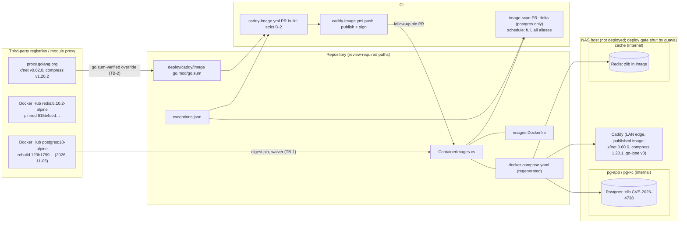

<!-- gate: G3 | verdict: PASS-WITH-NOTES | issue: #265 -->
# Threat delta: clear the 2026-11-02 / 2026-11-09 image-scan drift (#265)

- Written 2026-11-09 by security-reviewer (G3, full tier), before G4.
- **Scope.** Only the planned change:
  - the Postgres pin moves to the 2026-11-05 rebuild `sha256:123b17998ccaf47e53b502e8c6a1e79afd8f579c6f3eec83c563da026f957395`, under a one-off cooldown waiver;
  - two zlib CVE-2026-4738 exceptions (postgres, redis);
  - the go.mod overrides `golang.org/x/net` v0.62.0 and `github.com/klauspost/compress` v1.20.2 in `deploy/caddy/image/`;
  - the renewal of the go-jose v3 exception;
  - removal of the two expired #195 postgres entries;
  - the postgres, redis and caddy caps in `deploy/tests/test_stackctl.py`.

  `image_scan.py`, `caddy_image.py`, ADR-0015/0021/0022, `ci.yml`, `caddy-image.yml`, the Caddyfile, the Compose overlay, the busybox and distroless pins and every `keycloak`, `api`, `bff` and `migrator` entry are unchanged and are not re-audited.
- **Sources read for this ruling:**
  - the manifest `docs/ai/pipeline/265.md`, including the "Resumed 2026-11-09" block and scope decisions 1 to 6;
  - ADR-0014, item 4 and its 2026-10-31 pointer;
  - ADR-0015, with item 3 of the 2026-10-06 amendment, item 4 of the 2026-10-17 amendment and the 2026-10-31 retirement pointer;
  - ADR-0021, items 3, 5, 6 and 7, and the "Consequences";
  - ADR-0022, items 1 to 5;
  - `exceptions.json`;
  - `image_scan.py`: `ID_RE` :104, `APPROVAL_RE` :109, `exception_errors` :222-295, `_keeps_fixed_exception` :634, `evaluate` :647-699, `scan_targets` :764-773, `select_mode` :818-838, `compare_alias` :1014-1083, `run` :1113-1183, `resolve_tag_state` :405;
  - `caddy_image.py`: `OVERRIDE_RE` :102, `parse_gomod`, `compare_buildlists` :507-541, `cmd_inspect` :754-868;
  - `caddy-image.yml`, triggers :16-35;
  - `deploy/caddy/image/Dockerfile`, `deploy/caddy/image/go.mod`;
  - `deploy/caddy/Caddyfile`, searched for `acme`, `admin`, `tls`, `pki` and `encode`;
  - `stackguards.py`:1322-1324;
  - `deploy/tests/test_stackctl.py`:696-715;
  - `deploy/tests/test_caddy_image_inputs.py`:283-288 and :497-500, and `deploy/tests/test_caddy_image_script.py`:600-610;
  - `.claude/tests/test_image_scan.py`:490-493, and `.claude/tests/test_ci_gates_fail_closed.py`:160-163;
  - `ContainerImages.cs`, `.devcontainer/engine/images.Dockerfile`;
  - `deploy/compose/docker-compose.yaml`:1-39, and `docker-compose.stack.yaml`:40-90 and :290-320;
  - `deploy/redis/redis.conf`, and `deploy/postgres/init/10-keycloak-db.sh` and `20-decisya-db.sh`;
  - `deploy/` and `src/` searched for `pgcrypto`, `CREATE EXTENSION`, `pg_dump` and `pg_basebackup` (none found);
  - the earlier rulings `image-scan-drift-195.md`, `caddy-image-go-jose-212.md` and `keycloak-26-8-1-268.md`.
- **Scan and upstream facts** are the orchestrator's (manifest, 2026-11-09: run 42566830680 and Grype v0.120.0 amd64 on the new digests). I used them as data. I did not run a scanner or read a registry.

## Verdict

**PASS-WITH-NOTES.** G4 may start under M-1 to M-5. Three parts of the planned scope change from the manifest (rulings 3 and 6):

1. **The Postgres pin and waiver are acceptable.** This waiver, unlike #195, buys real fixes: libcurl, with 7 Critical and 17 High, and the brotli Critical. It does not fix zlib. M-1 governs the wording and the evidence.
2. **Both zlib exceptions are acceptable only conditionally.** The Alpine fix exists (`1.4-r0`), so each entry lives under ADR-0015 item 3. Item 3 holds only while the tag resolves to exactly the pinned index digest.
   - Postgres: acceptable on reachability once the M-2 evidence holds.
   - Redis: acceptable only if (a) `8.10.2-alpine` still resolves to the pinned **index** digest `615b4ced…`, and (b) the running `redis-server` maps no `libz`.
   - The manifest says the tag "points to `9f8d2d78…`". If that is the index digest and not the amd64 manifest under `615b4ced…`, the tag has moved. Item 3 then voids any redis entry at run time, and Marco's decision 2 ("redis keeps its pin") cannot clear redis (decision D-3).
3. **Caddy x/net and compress: no exception is possible.** The published image is an own build. `scan_targets` and `compare_alias` call `evaluate()` without a tag state (`image_scan.py:764-765, 1024-1026`), so strict D-2 applies, and ADR-0021 item 7 allows a `caddy` exception "only for a finding without a fix". Both findings have a fix.
   - An entry would either be rejected outright, because a `GO-` id fails `ID_RE` and with it the whole file, every scan and the Caddy build, or it would validate and be voided at run time: a record of an acceptance that does not exist.
   - `.claude/tests/test_image_scan.py:492` also requires the go-jose v3 entry to be the only `caddy` entry.
   - Scope decision 3's "short exceptions" part therefore falls away. The scheduled scan stays red on these two rows until the follow-up pin lands (decision D-2).
4. **The go-jose v3 renewal is acceptable for 30 days.** The #212 argument still holds on Caddy 2.11.7 with the new overrides.
5. **busybox 1.37.0:** nothing further is needed.
6. **The Done-when cannot be met by this PR alone.** Two findings remain with no exception route:
   - Keycloak guava, a fixed `java-archive` finding (D-008);
   - the two Caddy findings, until the pin PR lands.

   Marco amends the Done-when or splits the work (decisions D-1 and D-2). This is a scope decision, not a security blocker.

No High or Medium flaw was found in unchanged code.

## Data flow (delta)



Trust boundaries:
- **TB-1:** registry → pin (supply chain under a waiver).
- **TB-2:** module proxy → Caddy build list.
- **TB-3:** `exceptions.json` → the scan decision (CI, the Caddy build, `stackctl`).
- **TB-4:** the LAN → Caddy (unchanged runtime; the go-jose premises).

Postgres and Redis sit only on internal networks (`docker-compose.stack.yaml:51-53, 80-81, 309-317`) and publish no port.

## Rulings

### 1. Postgres pin `123b1799…` under a one-off cooldown waiver

- **What the waiver buys.** It clears every libcurl finding (Alpine `8.23.0-r0`) and brotli-libs CVE-2026-111497. Those findings have been unexcepted since 2026-11-02, and the libcurl rows are Critical. It leaves one High or Critical, zlib CVE-2026-4738. That makes it the #183/#185 class (a waiver that buys a fix), not #195's pin-currency class. The text must say both things: what it fixes and what it does not.
- **Why it is pinned inside the cooldown.** The cooldown ends about 2026-11-12 19:08 UTC, measured from the creation time. G4 records the push time, and that moves the end if the push was later. The PR must merge before the go-jose v3 entry lapses (expiry inclusive through 2026-11-12) and before the Caddy push build that needs it. Splitting Postgres into a later PR would also work, but Marco chose one PR.
- **Risk accepted.** The same as #183 §3 and #195 T195-04: an unnoticed malicious or broken same-tag rebuild of an official image, running on Marco's host and in CI with synthetic data only. The stack is not deployed. M-1's two-way digest read, provenance and scan bound it.
- **The #195 entries.** The `brotli-libs` CVE-2026-111497 and `libcurl` CVE-2026-92392 postgres entries expired on 2026-11-02 and no longer match on the new digest. G4 **removes** both in this PR. Their removal is justified only by the M-1 scan evidence: neither id appears on `123b1799…`, and the SBOM shows libcurl ≥ 8.23.0-r0 and brotli-libs ≥ 1.2.1-r0. Removing them closes the "expired" notes in the scheduled run. If either id still appears, stop and report.
- **Files.**
  - `ContainerImages.cs`: `PostgresSha256`, with the #195 comment replaced by the #265 comment. Keep one line of history: "Earlier pin (#195, waiver 2026-10-26): 10a5c69a…".
  - `images.Dockerfile:21` and its comment on line 20.
  - `deploy/compose/docker-compose.yaml:3`, regenerated by the publish and never edited by hand. The drift check and the Compose-to-scan-target guard enforce this.

### 2. zlib CVE-2026-4738 (Critical, Alpine fix `1.4-r0`) on postgres and redis

**Which rule applies.** Grype reports a fix, so D-2 ends the exception at once unless item 3 keeps it (`_keeps_fixed_exception`, `image_scan.py:634-644`). Item 3 needs all four of these:
- the alias in `ALIASES`;
- `artifact.type` `apk`;
- a span of at most 30 days;
- `tag_state == "unchanged"`, meaning the tag's **index** digest equals the pinned constant (`resolve_tag_state`, :405-420).

So each entry is valid only while no fixed official rebuild exists. When one appears, the entry ends by itself and the response is a bump. That is the intended behaviour.

**Postgres: reachable only with privileges the stack does not grant. Acceptable if M-2 holds.**
- In PostgreSQL 18, the server and its tools use zlib for these things only:
  - server-side `BASE_BACKUP … COMPRESSION 'gzip'`, which needs the `REPLICATION` attribute;
  - the client tools `pg_dump`, `pg_restore`, `pg_basebackup` and `pg_receivewal`;
  - pgcrypto's PGP compression and decompression, which needs the extension.
- WAL compression and TOAST use pglz, lz4 or zstd, never zlib. libxml2 links zlib, but the in-memory XML parsing Postgres does reads no compressed input.
- The stack's roles:
  - `decisya_migrator` is `NOSUPERUSER NOREPLICATION` (`20-decisya-db.sh:53`);
  - `keycloak` is `NOSUPERUSER`, and `REPLICATION` is off by default (`10-keycloak-db.sh:39`);
  - the bootstrap superuser is used only by the init scripts.
- The repository creates no extension. pgcrypto is a trusted extension, so a database owner could create it. That needs arbitrary SQL as the owner, which is already a full compromise of that database.
- No stack service runs a dump or base-backup tool. The future backup service (#30) is a voiding premise.
- Postgres sits on internal `pg-app`/`pg-kc` only, and the stack is not deployed.
- What I cannot rule on from the repository is **which zlib function the CVE affects**. G4 records it from the advisory (M-2). If it is reached by something other than the paths above (for example a function libcrypto or libpq calls on every connection), stop: no postgres entry, and the Done-when goes to Marco.

**Redis: not loaded, if M-2 proves it. Acceptable only with an unchanged tag.**
- Redis compresses RDB data with its own LZF code, not zlib.
- The stack disables persistence (`redis.conf:32-33`).
- The BFF's ACL grants only session commands: no `DUMP`, `RESTORE`, `MODULE` or `CONFIG`.
- The configuration has no `loadmodule`.
- zlib in an Alpine image is normally pulled in by `apk-tools`. That never runs in the read-only, capability-free container.
- The argument therefore rests on evidence that `redis-server` (and `redis-cli`, the healthcheck) neither links nor maps `libz`, and that no module is loaded. Redis 8 images ship modules, so that check matters.
- **The tag-state point is decisive.** The pin `615b4ced…` was pushed 2026-10-22T00:07Z. The manifest's `9f8d2d78…` was "created 2026-10-21". That fits the amd64 platform manifest (or config) of the same index, but the data does not say so.
  - If the index digest of `8.10.2-alpine` is not `615b4ced…`, the tag has moved, and `evaluate()` voids the redis entry ("tag moved: rescan and bump").
  - The entry would then pass the validator and still never apply. Writing it would be a false record.
  - The PR's own run cannot show this either, because redis is not scanned in delta mode (ruling 7). Hence the pre-write check in M-2.

### 3. Caddy: the go.mod overrides, and why there are no x/net or compress exceptions

**The overrides fit ADR-0021 item 3:**
- they raise a module to a version that fixes a published advisory;
- no Caddy release carries the fix (v2.11.9, 2026-11-05, still requires x/net v0.60.0 and compress v1.20.1);
- they follow the documented annotation.

What item 3 and the #212 ruling 4 ask in addition is in M-3. That covers the cooldown of the module versions: ADR-0021 T2 keeps module pins under the cooldown, and only Dependabot security updates skip it. It also covers the build-list closure.

**There is no exception on the published image (the D-2 question).** D-2 forbids it here, and the code enforces that.
- `caddy` resolves as an own build (`is_own_build`, :197-205). Both the full scan (:764-765) and the delta scan (:1024-1026) then call `evaluate()` with `tag_state=None`. `_keeps_fixed_exception` is false, and item 4 is retired (ADR-0021 E1).
- ADR-0021 item 7 limits a `caddy` exception to "a finding without a fix". The upstream fix exists, as module versions. That it is not yet in **our published** image is exactly the case strict D-2 was chosen for (ADR-0021 "Bad: Strict D-2 on our image: a fixed finding blocks … until the rebuilt image is pinned").
- On top of that:
  - the Grype id `GO-2026-6860`/`GO-2026-6865` fails `ID_RE` (:104), and `validate_exceptions` then rejects the **whole file**. Every scan exits 2: the PR gate, the schedule, `stackctl` and the Caddy build (`caddy_image.py:768`);
  - `.claude/tests/test_image_scan.py:492` pins the `caddy` entries to the single go-jose v3 entry.

**What follows:**
- **The PR's own `image-scan`** is unaffected: delta mode, and the caddy pin is unchanged (ruling 7).
- **The PR's `caddy-image.yml` build** scans the overridden binary under strict D-2. Both findings are gone there, and only the go-jose v3 row is excepted.
- **The scheduled full scan on `main`** stays red on the two `caddy` rows from now until the follow-up PR pins the image the push run publishes after this merge (ADR-0021 item 6: the digest exists only after the merge).
  - Under ADR-0022 item 2 this is drift. It is High on the LAN request path, so it has a 14-day deadline from first seen (at the latest about 2026-11-23 from the 2026-11-09 run, earlier if #285's first sighting counts).
  - It blocks no PR. The deploy gate refuses anyway, on these rows and on guava.
- **The Done-when** cannot be met for `caddy` by this PR. That is decision D-2.

### 4. go-jose v3 renewal (GHSA-mgcc-cww5-fp2q, not-fixed)

- **Still class (b), not reachable.**
  - The Caddyfile still has `admin off` (:52), `tls internal` (:69) and no `acme_server` ("No ACME", :47; no other match). The adapted-JSON guard still requires `admin.disabled` and the `local` CA (`stackguards.py:1322-1324`).
  - The module set is unchanged, because Caddy stays at v2.11.7 and `modules.txt` is checked in every build.
  - x/net and compress are transport and compression libraries. They are not on the `caddypki` → smallstep `authority` → `go.step.sm/crypto/jose` path.
  - No fixed v3 exists, and Caddy v2.11.9 still requires v3.0.5.
- **The rules.**
  - `evaluate()` excepts a not-fixed finding on the plain path, including for an own build.
  - ADR-0021 item 7 and S-120-07 allow at most 30 days. The `test_stackctl.py:712-715` loop enforces 30, and the validator requires exactly one `approved by Marco <date>` not after `added` (:281-288).
  - The entry is **replaced in place**, because a duplicate (image, package, id) rejects the file. `issue` becomes `#265`.
- **Residual unchanged:** premise 1 (`acme_server`) still rests on review, not a guard (#212 S-2, backlog). This is not a merge issue.

### 5. busybox

The pin stays `1.37.0-musl@sha256:5cec3fc1…` (0 High or Critical). The Dockerfile comment (:17) already records why 1.38.0 was dropped, and #285 is closed. Nothing else is needed for the merge. Dependabot will propose 1.38.0 again while it is the newest. Ignoring it, or closing each proposal, is housekeeping (N-2), not a security finding.

### 6. `test_stackctl.py` caps

`keycloak` stays as #268 left it. The `postgres`/`redis` block at :704-706 (`<= "2026-11-02"`) is replaced, and a `caddy` assertion is added in the same style. For approval date `D` (2026-11-09 assumed), the cap is `D + 30` = **2026-12-09**:
- every `postgres` and `redis` entry has `issue` `#265`, `expires <= "2026-12-09"`, a span of at most 30 days (the item 3 bound, asserted so a 31-day entry fails in the test rather than silently at run time) and no `dev-only`;
- every `caddy` entry has `issue` `#265` and `expires <= "2026-12-09"`. The existing :712-715 30-day loop stays as it is.

### 7. Delta-gate behaviour of this PR (ADR-0022)

- **The PR runs in delta mode.** It changes three lane paths: `ContainerImages.cs` (`PIN_FILE`), `images.Dockerfile` (`PARITY_FILE`) and `exceptions.json` (`EXCEPTIONS_PATH`). Its other paths (the Compose file, `deploy/caddy/image/*`, `deploy/tests/*`, docs) are outside `IMAGES_LANE_RE` and play no part in `select_mode` (:827).
- **Only `postgres` is scanned.** Only its reference changes (`changed_aliases`, :1141). Keycloak, redis and caddy are **not** scanned on the PR, so guava cannot block it. zlib is at the base (10a5c69a) and excepted at the head anyway.
- **What would flip it to a mode that scans Keycloak:**
  - any change to a `GATE_FILES` path (`image_scan.py`, `.github/image-scan/Dockerfile`, `ci.yml`) gives gate mode: every alias is scanned at base and head, and an unavailable base counts every head finding as new;
  - any other file under `.github/image-scan/` gives full mode;
  - a PR head that is not a two-parent merge commit gives full mode.

  In full mode, guava, the redis zlib (if its tag moved) and the two caddy rows all FAIL. M-5 therefore fixes the PR's file set.
- **`caddy-image.yml` also runs** on this PR (`deploy/caddy/image/**`). It validates the whole `exceptions.json` with today's date and scans strictly. The new entries must therefore be valid on the run date, with `added` not in the future.

## Threats

| Id | Element / flow | STRIDE | Threat | Severity | Mitigation | ASVS 5.0 id | Status |
| --- | --- | --- | --- | --- | --- | --- | --- |
| T265-01 | TB-1 Docker Hub → Postgres pin | T, S | A hijacked or broken same-tag rebuild is pinned inside its cooldown | Medium | M-1: index digest read two ways and re-checked at commit, provenance, PG_VERSION, a scan showing exactly one High or Critical, honest waiver text; synthetic data only; not deployed | V15.2.1, V15.1.1 | Mitigated if M-1 holds |
| T265-02 | Postgres zlib CVE-2026-4738 | T, D | Crafted data reaches a vulnerable zlib routine inside the server | Low in context | No stack role with REPLICATION or SUPERUSER; no extension; no dump tool in the stack; internal networks; item 3 ends the entry on a rebuild; M-2 | V15.2.1 | Accepted to D+30 if M-2 holds |
| T265-03 | Redis zlib CVE-2026-4738 | T, D | Same, in Redis | Low (not loaded) | M-2 linkage and maps evidence; no modules; LZF only; ACL; internal `cache` | V15.2.1 | Accepted only if M-2 (a) and (b) hold |
| T265-04 | TB-3 `exceptions.json` | T, R | A `GO-` id rejects the whole file (every scan exits 2, and so does the Caddy build), or a `caddy` entry for a fixed finding reads as an acceptance that `evaluate()` voids, or a redis entry is written on a moved tag | Medium | M-3 (no x/net or compress entry), M-2 (tag state before writing), `test_committed_file_is_valid`, `test_image_scan.py:492` | V15.1.1, V13.1 | Open, fix-now |
| T265-05 | TB-2 go.mod override | T | The override moves more than the two modules, uses versions inside the cooldown, or changes the module set without review | Medium | M-3: `buildlist`, `inspect`, `modules.txt`, `go mod verify`/`tidy -diff`, the cooldown check | V15.2.1 | Open, fix-now |
| T265-06 | Published Caddy (LAN edge): x/net GO-2026-6860, compress GO-2026-6865 | D, T | Fixed Highs remain in the image the stack would run until the pin PR | High (pre-auth edge), not exposed today | Not deployed; `stackctl` refuses on a non-excepted finding (ADR-0022 item 4); the build-input fix lands here; follow-up pin PR (D-2); ADR-0022 14-day deadline | V15.2.1, V15.1.1 | Mitigated (no exposure) with a linked follow-up |
| T265-07 | TB-4 LAN → Caddy, go-jose v3 | D | JWK parsing becomes reachable before authentication | Low (not reachable) | #212 premises re-checked (ruling 4); voiding premises in the text; 30 days | V15.2.1, V13.1 | Accepted to D+30 |
| T265-08 | PR image-scan mode | T | The PR touches a gate path and runs gate or full mode, and guava or caddy then block, which invites a bypass under the 2026-11-12 deadline | Medium (if done) | M-5: exact file set, delta-mode evidence, no policy, ruleset or required-check change | V15.1.1 | Open, fix-now |
| T265-09 | Approval record | R | An entry or waiver dated before Marco's own approval, or more than one approval phrase | Medium (process) | M-2, M-4, M-5; the validator for `caddy` | V15.1.1 | Open, fix-now |

## MUSTs for G4 (all fix-now)

- **M-1. Postgres pin, waiver and evidence (T265-01).**
  - **Before any edit**, record under "G4 evidence":
    - (a) the index digest of `docker.io/library/postgres:18-alpine`, read two ways: the Docker Hub tags API `digest`, and the registry `Docker-Content-Digest` with the index `Accept` header. Both must equal `sha256:123b1799…f957395`. Record the push time (`tag_last_pushed`) beside the amd64 creation time (2026-11-05 19:08 UTC), and the resulting cooldown end. If the tag has moved, stop and report: a newer head may carry the zlib fix, and that is a better decision.
    - (b) Provenance: `org.opencontainers.image.source` and `revision` (or the attestation) name `docker-library/postgres`. Record the Alpine release, and `PG_VERSION` old and new. If the PG minor changed, the waiver text says so, and the Postgres `Category=Integration` suites run.
    - (c) A scan with the pinned Grype v0.120.0 on this digest (DB build time): exactly one High or Critical, `zlib` CVE-2026-4738, type `apk`, with its installed version and `fix.state`/versions. No libcurl or brotli row. Record the libcurl and brotli-libs versions from the SBOM.
  - **Repeat (a) at commit time.**
  - **The waiver text** goes in the `ContainerImages.cs` comment, `images.Dockerfile:20`, the manifest and the PR body. Wording:
    > One-off cooldown waiver recorded by Marco on 2026-11-09 (#265, ADR-0014 item 4; ADR-0015 2026-10-06 amendment item 3, "No cooldown bypass"): `docker.io/library/postgres:18-alpine@sha256:123b17998ccaf47e53b502e8c6a1e79afd8f579c6f3eec83c563da026f957395`, pushed `<push time>`, is pinned before its 7-day cooldown ends (`<end>`), because #265 must merge before the go-jose v3 exception lapses on 2026-11-12. The rebuild fixes libcurl (8.23.0-r0: CVE-2026-92392 and the other libcurl findings) and brotli-libs (CVE-2026-111497). It does **not** fix zlib CVE-2026-4738, which ADR-0015 item 3 covers until `<expires>` while the tag resolves to this digest. Precedents #142, #185, #195. It sets no precedent: every later Postgres bump waits out the cooldown or needs its own recorded waiver.
  - **Remove** the two #195 postgres entries (ruling 1).
  - Regenerate the Compose file through the publish only, never by hand.
- **M-2. zlib entries: evidence first, then exactly these two entries (T265-02, T265-03, T265-04).** For each image, run with `--network none`. If any check fails, there is no entry for that image: stop and report.
  - **Both images:**
    - the Grype zlib row: `artifact.name` (`zlib`), `type` `apk`, version, `fix.state`, and the `vulnerability.id` (`CVE-2026-4738`) plus any related ids;
    - the affected zlib function or functions, from the advisory, recorded as data.
  - **Postgres (`123b1799…`):**
    - `apk info -r zlib`, and the files that link `libz.so` (`scanelf -n` or `ldd` over `/usr/local/bin`, `/usr/local/lib` and `/usr/lib`);
    - after the migrations, on a stack-shaped or Testcontainers database: `SELECT extname FROM pg_extension` shows only `plpgsql` in `decisya` and `keycloak`, and `SELECT rolname FROM pg_roles WHERE rolreplication OR rolsuper` shows only the bootstrap superuser;
    - no `CREATE EXTENSION`, `pg_dump` or `pg_basebackup` in `deploy/` or `src/`;
    - if the advisory's function is reached on a path outside ruling 2 (any per-connection or per-query path), stop.
  - **Redis (`615b4ced…`):**
    - (a) **Tag state.** The index digest of `docker.io/library/redis:8.10.2-alpine`, read two ways, equals `615b4ced…`. Say what `9f8d2d78…` is (platform manifest, config or index). If the index moved, stop: decision D-3.
    - (b) **Not loaded.**
      - `ldd`/`scanelf` of `/usr/local/bin/redis-server` and `redis-cli`: no `libz`;
      - `apk info -r zlib` names only image tooling (expected: `apk-tools`);
      - start `redis-server` with the stack's `redis.conf` (ACL file from a fixture, user `999:1000`, read-only root, `--cap-drop ALL`) and record that `/proc/<pid>/maps` has no `libz` and that `MODULE LIST` (through a fixture admin ACL user in the throwaway run only) is empty, or that the image ships no module directory.
  - **Entries.** `added` = Marco's approval date `D` (not before it, not after the commit), `expires` = `D + 30` at most, `issue` `#265`, exactly one `approved by Marco D`. Banned: "dev-only", "not loaded" without the M-2 evidence, and any IP literal. The texts are in "Exception entries" below, with the `<…>` filled from the evidence.
- **M-3. Caddy overrides, and no x/net or compress entry (T265-04, T265-05).**
  - **(a) `go.mod`.** Exactly two lines change:
    - `require golang.org/x/net v0.62.0 // indirect; override GO-2026-6603,…,GO-2026-6617,GO-2026-6860 #265` (the existing id list with GO-2026-6860 appended, issue `#265`);
    - `github.com/klauspost/compress v1.20.2 // indirect; override GO-2026-6865 #265`.

    Both must match `OVERRIDE_RE`. The `go` line stays, and no `toolchain` line is added. If the advisory carries a CVE alias, the id may be the CVE instead; GO ids are accepted by `OVERRIDE_RE`.
  - **(b) Neighbours.** If `buildlist` shows a row "raised by an override", it is allowed only for `golang.org/x/crypto`, `x/sys`, `x/text` or `x/term`, and only as x/net v0.62.0's own `go.mod` requirement. Each such row and its version is recorded. Any other changed row, `UNEXPLAINED`, `missing` or a `stale` problem: stop and report.
  - **(c) `go.sum`.** It changes only for the moved modules (`h1:` and `/go.mod h1:` lines). The Dockerfile's `go mod verify` and `go mod tidy -diff` pass.
  - **(d) The PR's `caddy-image.yml` build.** `inputs`, `buildlist` and `inspect` are green:
    - `caddy list-modules` is equal to `modules.txt` (unchanged in the diff);
    - the override check (`caddy_image.py:833-835`) passes for x/net, compress and go-jose v4;
    - the Grype step shows 0 blocking and exactly one excepted row, go-jose v3;
    - `go version -m` lists `golang.org/x/net v0.62.0` and `github.com/klauspost/compress v1.20.2`.

    Record the run id.
  - **(e) Cooldown.** Record the module proxy `.info` `Time` of x/net v0.62.0 and compress v1.20.2. If either is less than 7 days old at merge, stop and ask Marco (D-4). ADR-0021 T2 keeps module pins under the cooldown. Record whether Caddy's master has merged either version (preferred, not required).
  - **(f) Tests.** Update `deploy/tests/test_caddy_image_inputs.py:287-288` and `:500` from `#188` to `#265`. That is a few lines in files the PR changes.
  - **(g) No `caddy` entry** for x/net or compress, under any id.
- **M-4. go-jose v3 renewal and the caps (T265-07, T265-09).**
  - Replace the #212 entry in place with E-3 below (`issue` `#265`, `added` = `D`, `expires` = `D + 30`).
  - Make the `test_stackctl.py` change exactly as in ruling 6.
  - `deploy/tests/test_caddy_image_script.py:600-610` must still pass (one approval, 30 days or less, no "item 4 bound)").
  - The keycloak, api, bff and migrator entries and the `$comment` stay byte-identical.
- **M-5. PR shape, runs and approvals (T265-08, T265-09).**
  - **Changed paths:** exactly `ContainerImages.cs`, `images.Dockerfile`, `exceptions.json`, `deploy/compose/docker-compose.yaml` (publish), `deploy/caddy/image/go.mod` and `go.sum`, the `deploy/tests` files named above, and docs or the manifest.
  - **Never touched:**
    - `image_scan.py`, `.github/image-scan/Dockerfile` or any other `.github/image-scan/` file except `exceptions.json`;
    - `ci.yml`, `caddy-image.yml`, `caddy_image.py`, `release_images.py`, the ruleset;
    - `modules.txt`, the Dockerfile pins.
  - **The PR's `image-scan` log shows:**
    - `mode: delta`, with only `postgres` scanned;
    - `postgres: tag state unchanged`;
    - zlib `excepted (no rebuilt image: …)`, libcurl and brotli gone, `0 new blocking`.

    If the mode is not delta, stop.
  - **Suites** before push, under bounded run times: the full .NET unit suite and the Postgres-touching `Category=Integration` suite (`Decisya.Identity.Tests`), `deploy/tests` and `.claude/tests`.
  - **The PR body** records Marco's approval and date for each of the three entries (S-120-07), the waiver with its date, the two module advisories, and the publish dates of the overrides.
  - **Merge deadline:** before the end of 2026-11-12 UTC.
  - **After the merge:** record the `caddy-image.yml` push run (publish and verify green), and a scheduled or `workflow_dispatch` run on `main` in which:
    - postgres and redis zlib rows show `excepted` with `tag state unchanged`;
    - go-jose v3 shows `excepted`;
    - the only `FAIL` rows are guava and the two caddy rows that D-1 and D-2 cover.

    Anything else: stop and report.

## SHOULDs

- **S-1 (backlog #243).** This is the fifth "one-off, no precedent" cooldown waiver (#120, #142, #185, #195, #265), so #195 S-1 has come true. An ADR-0014/0015 amendment should turn this into a rule: a waiver for a fixing rebuild of an official image, with the two-way digest read, provenance and a scan showing it fixes more than it adds. One line in #243 at G7, if it is not already there.
- **S-2 (backlog #243, carried from #212 S-2).** Make `caddy_problems` refuse `acme_server` anywhere in the adapted JSON, so that go-jose premise 1 becomes a guard instead of review.

## Exception entries for Marco's approval

All three entries assume that Marco approves on 2026-11-09. For a later date `D`: `added` = `D`, the phrase reads `approved by Marco D`, `expires` ≤ `D` + 30, and the `test_stackctl.py` caps move with it. `<…>` marks values G4 fills from the M-2 evidence. If the evidence contradicts the text, the entry is not written.

**E-1, postgres zlib:**

```json
{
  "id": "CVE-2026-4738",
  "image": "postgres",
  "package": "zlib",
  "justification": "CVE-2026-4738, zlib <version> (Alpine apk) in the Postgres 18-alpine image (sha256:123b17998cca..., pushed <push time>): Grype rates it Critical; Alpine fix 1.4-r0; affected code: <advisory function>. The latest official 18-alpine rebuild, this digest, does not carry the fix, so ADR-0015 item 3 applies while the tag resolves to it; the pin moved here under a one-off cooldown waiver recorded by Marco on 2026-11-09 for the libcurl and brotli-libs fixes, and that rebuild does not fix this finding. Reachability (G4 evidence on this digest, docker run --network none, recorded in docs/ai/pipeline/265.md): the files linking libz.so are <list>; in PostgreSQL 18 the server reaches zlib only for server-side base-backup compression, which needs the REPLICATION attribute, and through pgcrypto's PGP functions, which need the extension; WAL and TOAST compression never use zlib. No stack role has REPLICATION or SUPERUSER except the bootstrap superuser used only by the init scripts; the decisya and keycloak databases hold no extension other than plpgsql, and the repository creates none; no stack service runs pg_dump, pg_restore or pg_basebackup. Postgres sits on the internal pg-app and pg-kc networks only and publishes no port; the stack is not deployed today, and the deploy gate refuses while Keycloak's bundled guava (GHSA-xxph-c9ww-hj94) has no fixed release (ADR-0022, D-008). Void if any stack role gains REPLICATION or SUPERUSER, if a migration or init script creates an extension that compresses or decompresses data (pgcrypto included), if a backup service runs pg_dump or pg_basebackup against the stack, or if the server reaches the affected zlib code on any other path. Ends when the tag is rebuilt with the fix; bump the digest then. Issue #265, approved by Marco 2026-11-09; added 2026-11-09, expires 2026-12-09, 30 days. Not renewed past this expiry without a new issue and a fresh G3.",
  "issue": "#265",
  "added": "2026-11-09",
  "expires": "2026-12-09"
}
```

**E-2, redis zlib** (written only if M-2 (a) and (b) hold):

```json
{
  "id": "CVE-2026-4738",
  "image": "redis",
  "package": "zlib",
  "justification": "CVE-2026-4738, zlib <version> (Alpine apk) in the Redis 8.10.2-alpine image (sha256:615b4cedaff0..., pushed 2026-10-22): Grype rates it Critical; Alpine fix 1.4-r0; affected code: <advisory function>. The tag 8.10.2-alpine still resolves to this index digest (checked two ways on <date>), so no fixed official rebuild exists and ADR-0015 item 3 applies while that holds. Reachability (G4 evidence on this digest, docker run --network none with the stack's redis.conf, recorded in docs/ai/pipeline/265.md): neither redis-server nor redis-cli links libz.so; the running redis-server maps no libz and loads no module; zlib is in the image only as a dependency of <apk info -r zlib result>, which the stack never runs (read-only root filesystem, every capability dropped). Redis compresses with its own LZF code, and the stack disables persistence (no RDB, no AOF). Redis sits on the internal cache network only, with the BFF as its only client and an ACL that grants the BFF session commands only (no DUMP, RESTORE, MODULE or CONFIG); it publishes no port, and the stack is not deployed today (deploy gate shut by Keycloak's guava, ADR-0022, D-008). Void if redis-server, redis-cli or any loaded module links or maps libz, if the configuration loads a module, or if any service runs a program inside the Redis container that uses zlib. Ends when the tag is rebuilt with the fix (Dependabot proposes the digest bump). Issue #265, approved by Marco 2026-11-09; added 2026-11-09, expires 2026-12-09, 30 days. Not renewed past this expiry without a new issue and a fresh G3.",
  "issue": "#265",
  "added": "2026-11-09",
  "expires": "2026-12-09"
}
```

**E-3, go-jose v3 renewal** (replaces the #212 entry in place):

```json
{
  "id": "GHSA-mgcc-cww5-fp2q",
  "image": "caddy",
  "package": "github.com/go-jose/go-jose/v3",
  "justification": "GHSA-mgcc-cww5-fp2q (CVE-2026-116587), github.com/go-jose/go-jose/v3 v3.0.5 in the Caddy v2.11.7 binary of the self-built image (the pinned ghcr.io/mpcs2013/decisya-caddy image and every build from deploy/caddy/image): denial of service when parsing JWKs that contain RSA keys (High, CVSS 3.1 AV:N/AC:L/PR:N/UI:N/S:U/C:N/I:N/A:H). No fixed v3 release exists (fix state: not-fixed, v3.0.5 is the latest), and no Caddy release drops v3 (v2.11.9 of 2026-11-05 still requires v3.0.5); v4 is raised to 4.1.6 under ADR-0021 item 3 (#212). Remove when a fixed v3 or a Caddy release without v3 exists. Component path: caddypki, then smallstep authority, then go.step.sm/crypto/jose, linked into the binary. Class (b), the vulnerable path is not reachable in the deployed configuration (G3 ruling 1 of #212, re-checked under #265): tls internal signs a certificate request made in-process, with no token and no JWK from a peer; Caddy's internal issuer builds the smallstep authority with no provisioners, and only the acme_server directive configures provisioners, which the Caddyfile does not use; the admin API is off; every site uses the internal issuer only; no other standard module verifies JOSE. The #265 overrides (golang.org/x/net v0.62.0, github.com/klauspost/compress v1.20.2) leave the module set (modules.txt) and this path unchanged. Void at once, whatever the expiry, if any of these changes: an acme_server directive or a pki CA other than the implicit local one; the admin API turned on in any form; a TLS issuer other than internal, or Caddy as an ACME client; a module added to the build that verifies JWS or JWT or fetches a JWKS; a Caddy bump that changes the component path above. Impact if a premise failed: availability only, on the LAN edge before authentication. Caddy is the LAN edge, so under G3 S-120-07 and ADR-0021 item 7 the approval is recorded here: first accepted 2026-10-29 under #212; renewed under issue #265, approved by Marco 2026-11-09; added 2026-11-09, expires 2026-12-09, 30 days. A further renewal needs a new issue, a fresh G3 and a fresh approval.",
  "issue": "#265",
  "added": "2026-11-09",
  "expires": "2026-12-09"
}
```

**Validator check of E-1 to E-3** (`exception_errors`):
- exactly the seven `ENTRY_KEYS`, all strings;
- `CVE-2026-4738` and `GHSA-mgcc-cww5-fp2q` match `ID_RE`;
- the images are in `EXCEPTION_IMAGES`;
- `zlib` and the module path match `PACKAGE_RE`;
- `#265` matches `ISSUE_RE`;
- 30 days ≤ 90;
- E-3 (an own-build image) has exactly one `approved by Marco 2026-11-09`, not after `added`. "first accepted" deliberately avoids a second phrase. E-1 and E-2 also carry exactly one.

No duplicate keys after the replacement and the removal of the #195 entries. The postgres and redis keys differ by image. Item 3: type `apk`, 30 days ≤ `MAX_FIXED_EXCEPTION_DAYS`. `test_stackctl.py` passes with the ruling 6 caps; `test_image_scan.py:492` passes (one `caddy` entry).

## Decisions for Marco

- **D-1. Guava and the Done-when.** The scheduled scan cannot pass while guava (GHSA-xxph-c9ww-hj94) is a fixed `java-archive` finding with no exception route.
  - Recommendation: amend #265's Done-when as #268's was: guava is excepted from it and stays tracked under D-008 and as drift.
  - Risk: none added. Without the amendment, #265 can never close.
- **D-2. Caddy x/net and compress.** No exception is possible (ruling 3), so the "short exceptions" part of scope decision 3 falls away.
  - **(a) Recommended:** a follow-up issue for the pin, `fix(deploy)` under ADR-0021 item 6, opened now and run as soon as the post-merge `caddy-image.yml` push run publishes. #265's Done-when names it.
    - Risk: two issues.
    - The scheduled scan stays red on two `caddy` rows for the days in between. Under ADR-0022 that is a High on the LAN request path with a 14-day deadline (by about 2026-11-23). Nothing is deployed, and the deploy gate refuses.
  - **(b)** A second PR under #265 (`Refs #265`, then `Closes #265`), as #188 PR-1/PR-2 did before #225.
    - Risk: it departs from one issue per PR and needs your explicit approval.
- **D-3 (only if M-2 (a) fails).** If `redis:8.10.2-alpine` has moved off `615b4ced…`, no redis entry can apply on the current pin.
  - Options:
    - bump redis in #265 to the head after a scan (no waiver if it is past cooldown);
    - leave redis red as drift (Critical, 7-day deadline) for Dependabot.
  - Recommendation: bump in #265.
  - Risk: a larger PR with one more image.
- **D-4 (only if M-3 (e) fails).** If x/net v0.62.0 or compress v1.20.2 is less than 7 days old at merge, you either waive the cooldown for that module (a security fix, the same class as Dependabot security updates) or the Caddy part waits. If it waits, go-jose still needs renewing by 2026-11-12, alone.
- **D-5. Approve E-1, E-2 and E-3** in your own words, with the date. The texts above assume 2026-11-09. Your approval of the scope on 2026-11-09 is not an approval of these entry texts.

## Notes

- **N-1.** The delta-mode PR run does not exercise the redis or caddy entries. Only the post-merge scheduled run proves them (M-5).
- **N-2.** Dependabot will propose busybox 1.38.0 again. A `dependabot.yml` ignore for `1.38.0` exactly, or closing the PR each time, is housekeeping for #243. It is not a security finding.
- **N-3.** Only amd64 is scanned (an existing ADR-0015 residual, not re-audited).

## Could not check

- Whether `9f8d2d78…` is the redis index digest or a platform or config digest (M-2 (a)).
- The affected zlib function of CVE-2026-4738, and which files in each image link libz (M-2).
- The publish dates of x/net v0.62.0 and compress v1.20.2, and what GO-2026-6860 and GO-2026-6865 affect (M-3 (e)). This does not change rulings 3 and 4, because no exception route exists either way.
- The push time of `123b1799…` (M-1 (a)).
