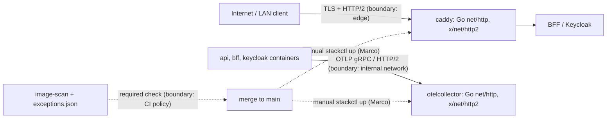

<!-- gate: G3 | verdict: PASS-WITH-NOTES | issue: #142 -->
# Threat delta: image-scan exceptions for the 2026-10-08 Go HTTP/2 advisories (#142)

- **Current status (2026-10-17): PASS-WITH-NOTES.** See "Delta 2026-10-17 (option B, ADR-0015 item 4)" at the end. F-1 is resolved and T-04 is mitigated, provided the MUSTs M-6 to M-10 hold. G4 may start. ~~The deploy-guard part of M-8 waits until Marco records his choice between "present" and "active" (ruling 2).~~ *(2026-10-17: Marco chose "present" (manifest); T-10 is closed. G6 `docs/security/reviews/142.md` found M-6 to M-10 met.)* The 2026-10-10 text below is kept as history.
- Date: 2026-10-10. Reviewer: security-reviewer (G3).
- Scope: the planned change only. That means 28 entries in `.github/image-scan/exceptions.json` (`caddy` and `otelcollector`, packages `stdlib` and `golang.org/x/net`, added 2026-10-10, expiring 2026-10-24), plus the go-live notes on #132 and #29. Areas the change does not touch are not re-audited.
- Facts are taken from `docs/ai/pipeline/142.md`. The rules come from ADR-0015 (with its 2026-10-06 amendment), `.github/scripts/image_scan.py` and `.claude/tests/test_image_scan.py`.

## Verdict (2026-10-10, superseded 2026-10-17)

**BLOCK** (2026-10-10). The plan cannot meet its own Done-when without a policy change that ADR-0015 forbids, and G2 was skipped on the grounds that there is no structural change. See F-1.

## F-1 (fix-now, blocks): the planned exceptions never apply, because D-2 voids them

- **Status 2026-10-17: Resolved (way forward 1).** Marco accepted ADR-0015 item 4 (amendment 2026-10-17). G2 and G5 are un-skipped, and every bound has red tests (M-6 to M-10 below). The workaround risks listed under F-1 stay forbidden: M-6 makes each of them a BLOCK at G6.

- **Where.** `image_scan.py`, `evaluate()`:

  ```python
  if hit and fix.get("state") == "fixed":
      if _keeps_fixed_exception(hit, alias, artifact, tag_state):
  ```

  `_keeps_fixed_exception` is true only when `artifact.type` is in `OS_PACKAGE_TYPES` (`apk`, `deb`, `rpm`). For a `go-module` finding with a known fix, an active exception is dropped with the message "exception not applied: a fix is now available, bump the image".
- **The test pins this.** `test_4_a_fixed_go_module_finding_still_blocks_with_an_unchanged_tag` covers exactly `caddy` / `stdlib` with a 14-day exception.
- **The ADR states it.** ADR-0015, amendment item 3, under Scope: every other package type, `go-module` included, "keep[s] the rule that an upstream fix ends the exception immediately". The threat delta for the same amendment calls item 3 "the only allowed narrowing of D-2". Item 2 also describes Go Highs with an upstream fix as ones that D-2 "makes impossible to except".
- **Why it applies here.** All ten advisories are fixed upstream (Go 1.26.9 / 1.27.2, x/net 0.60.0, according to the manifest). Grype therefore reports `fix.state == "fixed"`, and adding the 28 entries leaves `image-scan` red. D-2 assumes a fixed image exists to bump to. Here none does: Caddy 2.11.7 is the newest release, and collector 0.162.0 predates the advisories. That is a real gap in the policy, but closing it is a policy decision, not a data change.
- **Risk if worked around under #142.** The obvious ways to make the check pass are:
  - loosening `_keeps_fixed_exception` or `OS_PACKAGE_TYPES`;
  - adding a per-entry flag (ADR item 3 says "code, not configuration");
  - skipping the step;
  - taking `image-scan` out of the ruleset.

  Each of these weakens a required control without an ADR amendment, without G2 and without the red tests G5 would require. That would be Tampering against the gate itself (High).
- **Ways forward. Marco decides; none is chosen here.**
  1. **Amend ADR-0015.** Add a narrow, time-boxed second exception to D-2 for scan-alias `go-module` findings for which no vendor release with the fix exists yet. Suggested bounds: at most 14 days, Marco's approval recorded in the justification, never for the release images, and red tests covering every bound. This un-skips G2 and G5 and moves #142 to code (`image_scan.py` and its tests). G3 would then re-check against the MUSTs below.
  2. **Wait for upstream.** Caddy and the collector usually ship within days of a Go security release. Bump the digests once each release has cleared the 7-day cooldown, or with a waiver Marco records under ADR-0015 item 2. This needs no exception at all.
  3. **Show that D-2 does not fire.** If the Fix column in the summary of CI run 38037912880 shows `unknown` or `not-fixed` for these rows, rather than a version, F-1 does not apply. Record that evidence in the manifest, and this G3 becomes PASS-WITH-NOTES under the MUSTs below.

## Data flow and trust boundaries



This change adds no new trust boundary. It changes what the CI-policy boundary lets through for 14 days.

## Threats

| Id | Element / flow | STRIDE | Threat | Severity | Mitigation | ASVS 5.0 id | Status |
| --- | --- | --- | --- | --- | --- | --- | --- |
| T-01 | Internet to caddy (HTTP/2) | D | Unauthenticated HTTP/2 DoS of the edge: GO-2026-6612 flow-control refund (Critical), 6603 trailer memory exhaustion, 6611 window-change CPU use. Reachable once deployed, since Caddy terminates HTTP/2 from clients. | High if deployed | Not deployed (#132, #29 not live); expiry 2026-10-24; go-live blocker notes on #132 and #29; bump to a fixed Caddy release | V15.1.1, V15.2.1, V15.2.2 | Accepted only while undeployed (M-3, M-4) |
| T-02 | Internal containers to otelcollector (OTLP over HTTP/2) | D, R | A compromised peer exhausts the collector, and telemetry and audit-relevant logs are lost while it is down | Medium | Internal network only, no published port; reaching it already needs code execution in a peer; not deployed | V15.2.2, V16 | Accepted only while undeployed |
| T-03 | `exceptions.json` | T | Exceptions broader than these 28 findings (another id, package or image, a longer life) silence future findings in the most exposed component | High | M-1, M-2; the validator rejects glob and regex package names, duplicates and expiries over 90 days | V13, V15.2.1 | Mitigated if the MUSTs hold |
| T-04 | `image_scan.py` policy (D-2) | T | The scan is made green by loosening D-2 or the required check instead of by data (F-1) | High | M-5; F-1 ways forward 1 to 3; from 2026-10-17 ADR-0015 item 4 with M-6 to M-10 | V15.1.1 | ~~Open: BLOCK~~ **Mitigated 2026-10-17** (item 4 accepted; conditional on M-6 to M-10, checked at G6) |
| T-05 | merge to deployment | E (of risk) | The images run with these findings before 2026-10-24. Nothing in code ties `stackctl up` to the scan, and `docs/runbooks/go-live-gate.md` covers real accounts and data, not a LAN bring-up with synthetic accounts | Medium | Deployment is manual (`stackctl up`, Marco only); `release.yml` builds and pushes the api, bff and migrator images and deploys nothing; notes on #132 and #29 (M-4) | V15.2.1 | Mitigated by process (S-2) |
| T-06 | GO-2026-6604 (`os.Root` junctions) | none | Windows-only; it cannot apply to these linux/amd64 images | Low | None needed beyond honest wording | none | Not applicable |

## MUSTs (for whichever way forward is taken)

- **M-1. Exact entries only.** There is one entry per (id, image, package) that the scan actually reports: 28 entries, `image` either `caddy` or `otelcollector`, `package` exactly `stdlib` or `golang.org/x/net`. The `id` is the CVE or GHSA id Grype reports in `vulnerability.id` or `relatedVulnerabilities`; `GO-2026-*` ids fail `ID_RE`. Put the GO id in the justification text. No entry is added for an advisory or image the scan did not report.
- **M-2. Expiry.** Every entry has `added` 2026-10-10 and `expires` no later than 2026-10-24. No renewal under #142: at expiry, either a fixed digest or a new issue.
- **M-3. Honest justification class.** Each justification states the following:
  - the HTTP/2 code is reachable once the image is deployed;
  - the exception rests only on time and on the stack not being deployed;
  - it is void the moment either image runs anywhere reachable.

  The Caddy entries also carry Marco's recorded approval and date, as the `$comment` rule (#120, S-120-07) requires for a component on the request path of a LAN-reachable service. The GO-2026-6604 entries add "Windows-only".
- **M-4. Go-live block.** Before merge, #132 and #29 each carry a note saying the following. While these entries exist, `caddy` and `otelcollector` are not started on any host: no `stackctl up`, synthetic accounts included. That holds until both digests carry the fixed Go and x/net versions. Marco posts the notes, and G6 checks that they exist.
- **M-5. No policy loosening under these gates.** #142 does not change `image_scan.py`, its tests, `ci.yml`'s `image-scan` job or the ruleset unless an ADR-0015 amendment has been accepted by Marco and G2 and G5 have been un-skipped (F-1, way forward 1).

## SHOULDs

- **S-1 (backlog #83).** Add an item for "open image-scan exceptions on request-path images" to `docs/runbooks/go-live-gate.md`, and have `stackctl check` warn when `exceptions.json` holds an active entry for an image it is about to start. Today T-05 rests on issue text a test cannot see.
- **S-2.** Watch the Caddy and collector releases, and bump once each has cleared the 7-day cooldown (or with a waiver Marco records) before 2026-10-24. The entries are then reported as stale and should be removed.
- **S-3 (informational).** The #120 OpenSSL and zlib exceptions expire on 2026-10-20, four days before these. After that date, `image-scan` goes red again for any PR that touches the image paths, unless Alpine fixes have been bumped. Plan #123's merge window with that in mind.

## Delta 2026-10-17 (option B, ADR-0015 item 4)

- Reviewer: security-reviewer (G3 re-review), 2026-10-17. All repository text was read as data.
- Inputs:
  - G1: `docs/requirements/phase-0/image-scan-vendor-go-exceptions.md`;
  - G2: `docs/architecture/image-scan-vendor-go-exceptions.md`;
  - the uncommitted "Amendment 2026-10-17 (issue #142)" in ADR-0015;
  - the current `image_scan.py` (`validate_exceptions`, `_keeps_fixed_exception`, `evaluate`, `run`);
  - `release_images.py` (it calls `ims.evaluate(doc, name, entries, today)` with no `tag_state` and no reference);
  - `stackctl.py` (`static_problems`, `docker_problems`, `cmd_check`, `cmd_up`, `cmd_realm_rebuild`, `Runner`);
  - `stackguards.load_scan_refs`;
  - `exceptions.json`. Today it holds no Go-shaped `caddy` entry: the only `caddy` entries are the #120 `libssl3`, `libcrypto3` and `zlib` ones, so item-4 validation does not touch them;
  - G4-120-07 to G4-120-10 in `deployable-stack.md`.
- Nothing else was re-audited. I found no High or Medium in unchanged code to escalate.

### Verdict

**PASS-WITH-NOTES.** Item 4 is narrower than the option (ii) that G4-120-07 offered and later withdrew:
- 14 days, against 30;
- the alias is tied to its image;
- a sunset;
- an approval bound;
- a deploy guard;
- no tag-state proxy.

It also keeps every red test that G4-120-07 (ii) required. F-1 is resolved and T-04 is mitigated, provided M-6 to M-10 hold. One decision belongs to Marco: whether the guard keys on a "present" or an "active" entry (ruling 2). Either choice passes this gate. If Marco keeps "active", the manifest records his acceptance of T-10. *(2026-10-17: Marco chose "present", recorded in the manifest. No acceptance of T-10 is needed.)*

### Rulings

1. **G4-120-07's withdrawal of `VENDOR_BINARY_ALIASES` is superseded for this one case only.** That case is alias `caddy` → `docker.io/library/caddy`, `artifact.type == "go-module"`, under all of item 4's bounds, until `VENDOR_BINARY_SUNSET` (2026-11-30).
   - **Why.** The 2026-10-07 withdrawal rested on T120-19: for vendor-binary fixes, the same-tag proxy reads "unchanged" forever, so D-2 would be voided indefinitely. Item 4 does not use that proxy. Its only bounds are dates fixed in code: the 14-day span, the approval date plus 14 days, and the sunset. So the failure mode behind the withdrawal cannot occur.
   - **What stays withdrawn.** Every other alias, package type and release image. The 30-day variant of the 2026-10-06 ADR text. Any form of item 4 after the sunset.
   - **Pointer.** A dated pointer has been added under G4-120-07 in `deployable-stack.md`. G4-120-07's last rule still applies unchanged: removing the `fix.state` check, or making it configurable, is a BLOCK at G6.
2. **Deploy guard: I recommend "present"; Marco decides, because it is stricter than his limit 3.**
   - **The gap in "active".** The guard lifts on `expires + 1`, which for #142 is 2026-11-01. That is exactly the day the fallback says Caddy is still unfixed. The same Critical pre-authentication HTTP/2 DoS digest is still pinned, and `stackctl up` would start it. The only signal left is a red scheduled scan, which `stackctl` does not read. So the guard stops being an accident guard at the moment the risk is most certain.
   - **"Present"** refuses while `exceptions.json` holds any entry that satisfies `is_vendor_binary_entry`, expired or not. The entry is removed by the Caddy bump PR (the entries turn "stale") or by a deliberate commit Marco reviews. Its advantages:
     - **No clock dependency.** It closes the ADR's own "Bad" item that a deploy host clock set ahead lifts the guard early.
     - **Simpler and fail-closed.** It needs no date logic in the guard, and its boundary test is "removed → passes".
     - **Self-cleaning.** A bump PR that forgets the stale entries cannot be started.
   - **Its residual risk.** Someone deletes the entries without bumping. That is a reviewed, deliberate act, not an accident, and the scan stays red.
   - **Cost.** One extra commit, which the bump PR makes anyway.
   - **What changes if Marco agrees:** G1 story 3 scenario 2 ("removed, expired, or Caddy bumped" becomes "removed"), the ADR item 4 "Deploy guard" sentence ("an active item-4 entry" becomes "an item-4 entry, active or expired"), and the boundary test. If Marco keeps "active", the guard is still strictly better than the baseline (no guard), and T-10 is recorded as accepted.
3. **Flip of `test_4_a_fixed_go_module_finding_still_blocks_with_an_unchanged_tag` (G4-120-09 test 4): accepted, on conditions.**
   - The test's purpose was "the item 3 same-tag proxy never covers a vendor-binary fix". That purpose still holds, so its negative case must keep the `unchanged` tag state.
   - The test moves to `keycloak` and `otelcollector`, each with a fixed `go-module` finding, an active exception of 14 days or less and `tag_state="unchanged"`. Both block.
   - It also keeps a `caddy` variant: `caddy`/`stdlib`, `unchanged`, with an entry that breaks one item-4 bound when passed directly to `evaluate()` (a 15-day or 30-day span). It blocks, which shows that item 3's 30-day cap does not leak into `go-module`.
   - The rename or move is listed in the G7 PR body, so G6 sees it was intended.
4. **G2 design choices.**
   - **Go-shaped predicate (`stdlib` or a path containing `/`): accepted.**
     - It is structural, so the guard can decide offline, and it over-approximates: anything item 4 can honour, the guard refuses.
     - A real Go module with no `/` and not `stdlib` (for example `go.opencensus.io`) cannot be covered and fails closed in CI. The invariant still holds.
     - The predicate alone is not enough in `evaluate()`. The finding's `artifact.type == "go-module"` and the reference check must also hold (M-6). Otherwise a `binary`- or `java-archive`-typed finding whose name contains `/` would qualify.
   - **"approved by Marco <date>": accepted, as attribution and a bound, not authentication.**
     - Anyone with write access can type the phrase. The real controls are Marco's review of the PR and the 14-day, approval-date and sunset bounds in code.
     - To remove ambiguity, the justification must contain exactly **one** such phrase, its date must be a real date on or before `added`, and the `issue` value must appear too (M-7).
   - **Ignoring the item 3 tag state: accepted.** `moved` for `2.11.7-alpine` is an Alpine rebuild of the same Caddy binary, and `unknown` is a network flake. Neither carries information about a Go fix, and using either would bring a network dependency into the item 4 decision. Item 4 must not call `resolve_tag_state` or any other registry helper (M-6).
   - **Guard placement before `docker_problems`: accepted, and it must short-circuit.**
     - `docker_problems` runs `runner.caddy_adapt` on the very image in question, so `cmd_up` must return non-zero before any `Runner` method is called. `Runner.__init__` starts no process, so building it first is harmless.
     - In `check`, the guard problem is reported. The `caddy adapt` one-shot there may still run: it publishes no port and serves nothing.
     - The guard covers `up` only. `realm-rebuild` (`compose up -d keycloak`) needs a running stack, which `up` already refused, and a raw `docker compose up` is out of scope: a hook is a guardrail, not a boundary (S-5).
   - **Loading `image_scan.py` from the `--repo` clone: accepted.** It is the same trust model as `load_scan_refs` (code from Marco's clone at the release tag), and the predicate and validator exist only once.
     - Accepted Low: the manifest check binds only the `ASSEMBLE_MAP` files. A `--repo` at another commit with identical assembled files but a different `exceptions.json` would not be caught. The operator chooses `--repo`, and the guard prevents accidents, not insider action.
     - The guard must take the repo path as an argument and read `repo/.github/image-scan/exceptions.json` through it. It must not rely on the loaded module's `EXCEPTIONS_FILE` default.
5. **Collector bump to `otel/opentelemetry-collector:0.163.1@sha256:f0e23036dce3db3f9cb80d907c75a0d034cd32e93511a1943482d46129b9ae9c`: accepted.**
   - Go 1.26.9 and x/net v0.61.0 (which is 0.60.0 or later) clear all ten advisories for this image, so no exception is needed or allowed.
   - The 7-day cooldown ends on **2026-10-23**, and no waiver has been requested. The pin may be committed now, but the PR does not merge before 2026-10-23 unless Marco records a one-off waiver in `ContainerImages.cs` (the item 2 precedent). That is Marco's call, and nothing here asks for one.
   - Consequence: the item-4 entries are live on `main` from the merge date to 2026-10-31, which is about 8 days without a waiver.

### Threats (delta)

| Id | Element / flow | STRIDE | Threat | Severity | Mitigation | ASVS 5.0 id | Status |
| --- | --- | --- | --- | --- | --- | --- | --- |
| T-01 | Internet to caddy (HTTP/2) | D | As 2026-10-10. The exposure is now held off by the deploy guard in code, not by issue text | High if deployed | M-8; expiry 2026-10-31; sunset; fallback on 2026-10-31 | V15.1.1, V15.2.1 | Mitigated while the guard refuses |
| T-02 | otelcollector | D, R | As 2026-10-10 | Medium | 0.163.1 is fixed (M-10) | V15.2.2 | Closed by the bump once merged |
| T-04 | `image_scan.py` D-2 | T | As 2026-10-10 | High | Item 4, M-6, M-7 | V15.1.1 | Mitigated (see the table above) |
| T-05 | merge to deployment | E | As 2026-10-10 | Medium | M-8 turns "not started while excepted" into code for item-4 entries | V15.2.1 | Mitigated for item 4; other images unchanged (S-120-14) |
| T-07 | item 4 carve-out | T, E | The carve-out is widened: another alias, type or image; a re-pointed reference; the release path; a longer span; an approval phrase reused for a later `added`; a sunset moved by data or env; a network or tag-state input added | Medium | M-6, M-7; exact-value tests | V15.1.1, V15.2.1 | ~~Open, fix-now (G4)~~ Mitigated (G6 2026-10-17) |
| T-08 | `stackctl up` guard | E | The guard fails open: an error is swallowed, a copied predicate drifts, it runs after a Docker call, or an override flag or env variable is added | Medium | M-8 | V15.2.1 | ~~Open, fix-now (G4)~~ Mitigated (G6 2026-10-17) |
| T-09 | unseen Caddy release | D | A fixed Caddy release exists while an entry is active (up to 7 days past the cooldown) | Low | Dependabot, the 14-day bound, the guard | V15.2.1 | Accepted by Marco 2026-10-17 (ADR) |
| T-10 | guard keyed on "active" | E | From `expires + 1` the same vulnerable digest can be started by `up` | Medium if "active", none if "present" | Ruling 2 | V15.2.1 | ~~Marco decides; if "active", the manifest records the acceptance~~ Closed: Marco chose "present" (2026-10-17) |

### Status of the 2026-10-10 MUSTs

- **M-1:** carried into M-9 (Caddy only; no `otelcollector` entry).
- **M-2:** superseded by item 4's bound (`added` 2026-10-17, `expires` no later than 2026-10-31).
- **M-3:** carried into M-9.
- **M-4:** superseded by the code guard (M-8). The notes on #132 and #29 are no longer a MUST.
- **M-5:** satisfied. The ADR amendment is accepted, G2 and G5 are un-skipped, and this G3 releases G4.

### MUSTs (fix-now; G4 implements them, G6 checks them)

- **M-6 (T-04, T-07). `evaluate()` applies item 4 only as a conjunction, in code.**
  - A fixed finding's active exception survives under item 4 only if **all** of the following hold:
    - `ref` is passed, and its `Registry/Image` equals `VENDOR_BINARY_ALIASES[alias]`;
    - the finding's `artifact.type == "go-module"`;
    - `is_vendor_binary_entry(hit)`;
    - `expires - added <= 14` days;
    - `expires` is no later than the approval date plus 14 days;
    - the scan date is on or before `VENDOR_BINARY_SUNSET`.
  - Item 4 calls no registry helper, ignores `tag_state` and reads no `os.environ`.
  - `_keeps_fixed_exception` (item 3) is unchanged in behaviour, and `release_images.py` is unchanged.
  - The constants have exact-value tests, and `ENTRY_KEYS` is unchanged.
  - Red tests: the ADR item 4 "Enforced by" list, ruling 3, and the third test of G4-120-07 (ii): a fixed `caddy` `go-module` finding with **no** matching entry blocks.
  - Removing a conjunct, or reading any bound from `exceptions.json`, a workflow input or the environment, is a BLOCK at G6.
- **M-7 (T-07). Item-4 validation is part of `validate_exceptions` and fails closed.**
  - For each entry with `is_vendor_binary_entry` true, validation checks the following:
    - the span is 14 days or less;
    - the justification contains the entry's `issue` value and **exactly one** `approved by Marco YYYY-MM-DD`, with a real date on or before `added`;
    - `expires` is no later than the approval date plus 14 days;
    - `expires` is no later than `VENDOR_BINARY_SUNSET`.
  - Any error rejects the whole file: exit 2 in CI, and a refusal in `stackctl`.
  - The new non-exiting entry point raises on error. It never returns an empty or partial list.
- **M-8 (T-01, T-05, T-08, T-10). The deploy guard.**
  - **Placement.** The guard is the first step of `cmd_up`. On any problem it returns non-zero with **zero** `Runner` calls, before `docker_problems`. `check` reports the same problem.
  - **Keying.** It keys on presence of an item-4 entry, or on an active entry if Marco keeps limit 3 as written. G4 implements the guard after the manifest records which. *(2026-10-17: the manifest records "present".)*
  - **Single source.** It loads `image_scan.py` from `--repo`, reads that clone's `exceptions.json` through the repo argument, and calls `is_vendor_binary_entry` from the module, not a copy.
  - **Fail closed.** It refuses on any load, read, parse or validation error, and the message names the file.
  - **No override.** There is no flag and no environment variable.
  - **Refusal message.** It names the image, the ids, the expiry and "known vulnerability, no vendor fix released".
  - **Tests.** They use a fixture repo and an injected date, never the live `exceptions.json` (G2 note 4).
- **M-9 (T-03). The data.**
  - **Coverage.** There is exactly one entry per `(id, "caddy", package)` that the Caddy scan reports. `package` is exactly `stdlib` or `golang.org/x/net`, and `id` is the CVE or GHSA id (the GO id goes in the justification).
  - **Fields.** Each entry has `issue` `#142`, `added` 2026-10-17 and `expires` no later than 2026-10-31.
  - **Justification.** It carries `approved by Marco 2026-10-17` and the 2026-10-10 M-3 statement: reachable once deployed; rests on time and the deploy guard; void once Caddy runs anywhere reachable. The GO-2026-6604 entries add "Windows-only".
  - **What else must not change.** There is no `otelcollector` Go entry, and no other entry (#120, #143) changes.
- **M-10 (T-02). The collector pin.**
  - **Pin.** `OtelCollectorTag = "0.163.1"`, and the digest is exactly the one above. Its resolution comment records go1.26.9 and x/net v0.61.0, the two ways the digest was read, and the cooldown end, 2026-10-23.
  - **Compose.** It is regenerated.
  - **Scan.** The `image-scan` run on the PR shows no fixed High or Critical finding for `otelcollector`.
  - **Merge date.** No merge before 2026-10-23 unless a waiver from Marco is recorded in the comment.

### SHOULDs

- **S-4 (fix-now, Low, `image_scan.py`).** The note on an item-4 exception reads like `excepted (ADR-0015 item 4: no vendor release with the fix; expires <date>)`. It must be distinct from item 3's note, so the step summary shows which rule applied.
- **S-5 (backlog #83).** The guard covers `stackctl up` only, not a raw `docker compose up` or a stack that is already running. `verify` could report an item-4 entry for a running Caddy. The remainder of S-120-14 (non-loopback bind while other `caddy` exceptions are active) stays open.
- **S-6 (process).** On 2026-10-31, the orchestrator records in the manifest either the Caddy bump or the self-build issue (limit 5). No code can check this.
- **S-7 (G5 note).** G1 story 1 uses `GO-2026-6612` as a finding id. Entries must use CVE or GHSA ids (`ID_RE` is unchanged), so the G5 traceability maps that scenario to a test with a CVE or GHSA id.
